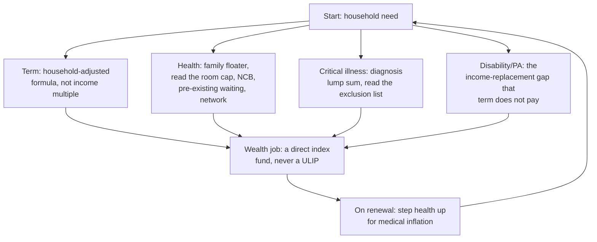

Insurance is one of the best-purposed and worst-understood categories in an Indian financial plan. Its job is a single, clean one: to transfer a specific, catastrophic, insurable loss from your household to an insurer in exchange for a small, certain cost. When you understand that, most of the confusion in this space — the product catalogue, the agent's pitch, the ULIP brochures, the "invest" and "protect" dual branding — dissolves, because those products are doing a different job than the one your plan actually needs. This article sizes the core covers, decodes the health-policy details that decide whether a claim actually pays, treats claims data honestly, and then goes through the mis-selling patterns one by one, because the single biggest source of insurance-related financial damage in India is not an under-covered claim — it is an over-priced, mis-sold, lock-in investment disguised as protection.

## The core principle: insurance transfers risk, it does not build wealth

The one-sentence version: *you pay a small, certain cost now to avoid a large, uncertain loss later.* That sentence defines the entire useful category of insurance — term life, health, personal accident, motor, property, travel. Every product that claims to *also* build wealth at the same time (ULIPs, endowment plans, money-back endowments, whole life) is doing two jobs with one cost structure, and the arithmetic of that two-job structure is the reason those products are almost always worse than the two separate, cheaper, simpler instruments: term for protection, a direct mutual fund for wealth.

The test for any insurance product: **if I remove the wealth-building claim, does the protection part still make sense at the price paid?** For a ULIP, the answer is no — the protection is a fraction of the premium, and the "investment" part is a mutual fund with a load, a surrender-charge table, and a 5-year lock-in stacked on top. The two pieces, bought separately (term at a fraction of the premium + a direct fund without the load), would cost less and leave you more liquid. That comparison is the entire mis-selling argument, and it is done in the ULIP section below.

## Term life: the cover that most Indian households actually need

### Sizing the cover: the formula

The working formula for term cover is:

$$\text{Term Cover} = (\text{Years to cover} \times \text{Annual Income}) + \text{Existing Liabilities} - (\text{Investable Assets} + \text{Other Income Sources})$$

In practice, for a working household head, this resolves to the common heuristic of **10–15× annual income** as the *order of magnitude*, then adjusted for:

- **Liabilities:** outstanding home-loan balance, education-loan balance, car loan. A ₹40L home-loan balance that you did not price into the cover is a ₹40L gap in the day the policy needs to pay out.
- **Dependants' years:** the cover is meant to replace *your income* to your dependants for a defined period — typically to the later of your spouse's age-60 retirement or your youngest child's independence (age 25). The "years to cover" in the formula is that window, not your full life expectancy; covering a 30-year-old to age 90 is overkill and overpriced.
- **Assets already in place:** a ₹30L EPF corpus, a ₹50L house (your own home), and a spouse's income offset the cover you need. The formula's subtracted term is *your investable assets that the household could liquidate in a crisis* — not your EPF, which is not liquid.
- **Existing term or other life cover:** if your employer gives you a group life cover of 50× your annual salary, that is *not* a substitute for personal term cover (the group cover dies with the employment), but it is a factor in your *personal* cover sizing for the years you are employed.

**Worked example (illustrative, not advice).** Age 32, household income ₹35L/year (your ₹25L + spouse's ₹10L), home-loan balance ₹30L, EPF ₹8L, no other significant assets, youngest child age 4, cover window to spouse's 60 (28 years):

$$\text{Cover} \approx 28 \times 25 + 30 - 8 \approx \text{₹742L}$$

The "10–15× income" heuristic on *your* income alone (₹25L × 10–15 = ₹25L–₹37.5L) undersizes the actual household need, because the formula counts the *years of dependancy*, not a multiple of one income. The gap between the heuristic and the household-adjusted number is where most Indian term plans are short. The 10–15× rule is a *starting filter*, not the sizing answer; the formula is.

### The premium you should expect

Term insurance is the cheapest meaningful protection you will ever buy. For a healthy 30–45-year-old Indian male or female, a ₹1Cr single-premium term policy costs, in most current market patterns, in the range of ₹1.5L–₹3L/year (a pattern, not a sourced constant — verify with current quotes; the rate has been moving down as underwriting has tightened and competition has widened the gap between insurers). The ratio of *premium to cover* is the number that tells you whether you are buying protection: a ₹2L premium for a ₹1Cr cover is a 0.2% annual cost for a risk that would otherwise be catastrophic. That ratio is what "insurance is cheap in the risk transfer sense" means, and it is the ratio the mis-selling pitch destroys by bundling in the wealth component.

## Health: the family floater and the claims question

### Structure

A **family floater** policy (two adults + up to four children, or the variant that includes both parents-in-law as optional) is the correct first purchase for most households, not four individual policies. The floater's *sum insured* is shared across the family per year (the standard market pattern: the floater pays the first claim up to the floater sum, and individual sub-limits per member apply after that — verify the specific policy's floater mechanics, because the design varies by insurer and by plan).

### The four details that decide whether a claim actually pays

- **Room and board cap.** The policy will pay *a cap* on the room, not the actual room. A ₹3,000/night cap in a metro city where a private room runs ₹8,000–₹15,000/night is a ₹5,000–₹12,000/night *out-of-pocket* gap on a 7-day stay — a gap that can exceed the policy's no-claim bonus for the entire year. A "₹10L cover" with a ₹2,000 room cap is not a ₹10L cover in the way you want it to be; it is a ₹10L cover that pays ₹2,000 for the room and the rest for the treatment. *Read the room cap before the sum insured.*
- **No-claim bonus (NCB).** Most policies add a percentage of the sum insured for each claim-free year (a common pattern: 10% per year, up to a cap of 50%, verify the specific policy). The NCB is the *only* mechanism by which a good claim history buys you a bigger cover. A policy that resets the NCB on *any* claim, no matter how small, is pricing your claim behaviour differently than one that only resets on claims above a threshold.
- **Pre-existing conditions.** A new policy will not cover a pre-existing condition in its first year (the standard waiting period, the IRDAI master circular caps the *maximum* pre-existing-disease (PED) waiting period for newly issued individual policies at **3 years**, and many insurers quote less — verify the specific policy's terms). The practical effect: if you have a diagnosed pre-existing condition, the *best* cover you can get in the first year is the *no pre-existing* portion of the policy, which is exactly the portion that covers a sudden, unrelated event. Pre-existing cover starts *after* the waiting period, which is why **the year you buy a health policy matters**: the earlier you buy, the sooner the pre-existing waiting runs out, and the longer you get the full benefit.
- **Network hospitals and the cashless *reality*.** A policy's *network hospital list* is the list of hospitals where the policy pays the bill directly (cashless). In practice, a large metro hospital that is "in-network" for one insurer may be *out-of-network* for another, and the "cashless" process still requires *pre-authorization*, a paperwork step that, if mishandled, delays the claim. The "cashless" promise is only as good as the *specific* hospital you will actually use for *this* claim. Before you buy, call the hospital's insurance desk and confirm which of your *likely* hospital options are in-network for the specific policy you are considering, not for a different policy from a different insurer.

### Claims data: the honest reading of "settlement ratio"

Insurers publish a *claim settlement ratio* (claims settled ÷ claims received, or claims settled ÷ claims settled + rejected, depending on the publication). The honest limitations:

- **A high settlement ratio is not proof of good service.** A policy that settles 98% of claims can be settling *the easy, small, unrelated claims* and *rejecting the hard, large, pre-existing ones* — and the 98% ratio will not tell you which of those two patterns is behind the number.
- **The *number* of claims that are *rejected for the reason "the condition was pre-existing and not in the policy"* is the metric that matters more than the settlement ratio.** A policy that rejects 2% of claims for "pre-existing, waiting period not elapsed" is a policy that will *not* pay you on the one condition you actually had. Read the *rejection reasons*, not the settlement headline.
- **IRDAI publishes the sector-level claim data** (settlement ratio, average claim settlement time, the number of policies issued and claims processed). Use it to compare *insurers at the sector level* on the *service-speed* dimension (the average claim-settlement time is a genuine service metric), but use *policy terms* — not sector ratios — to compare *coverage*.

### Medical inflation: the assumption that matters

Health-care costs in India have been running at a materially higher inflation rate than general CPI — a working assumption for a 30-year plan is **~10% per year** medical inflation (an assumption, not a sourced constant; verify against current published health-inflation data before relying on it for your own corpus). The practical effect: a ₹5L hospital bill *today* is a ₹13L bill in 10 years and a ₹33L bill in 20 years, at 10% medical inflation. The sum insured you choose today is the sum insured you will *need* to be able to pay in 20 years, and a ₹5L cover bought today will be a ₹1.3L-equivalent cover in 20 years, at the inflation-adjusted bill size. The answer is not to buy more cover now (the premium ratio will look bad); it is to *revisit the cover size on every policy renewal* and step the sum insured up as medical inflation eats the old figure.

## Critical illness and disability: the two covers that close the *other* gaps

### Critical illness

A **critical-illness rider or standalone policy** pays a *lump sum* on diagnosis of a listed condition (cancer, heart attack, stroke, organ transplant, and a defined list of others — verify the specific policy's list; the list is not uniform across insurers and the "listed" set matters more than the sum insured). The critical-illness cover is *not* a hospital-bill cover; it is a *lump-sum* paid on diagnosis, which you are free to use for the *income you will not earn during recovery* — the car loan, the tuition, the family's running costs for the 12–18 months of a serious recovery. The exclusions matter: some policies exclude *treatment-related* conditions (a policy that pays on diagnosis of "heart attack" will not pay on a *post-heart-attack bypass* claim under the same critical-illness benefit, because the bypass is a *treatment*, not a diagnosis of a new critical illness). Read the exclusion list; it is longer and more consequential than the benefit list.

### Personal accident and disability — the income-replacement gap

The single most under-insured risk in an Indian working household is **the loss of the household's income-earner to a *disability*, not a death.** A term policy pays on death; a disability that is *total and permanent* but not a death pays *nothing* under a term policy, and the household loses the income stream for the years of recovery and often permanently. A **personal-accident / disability policy** pays a sum on *total permanent disability* (or a staged benefit on partial disability, depending on the policy). The sizing is not 10–15× income (the death-replacement number); it is *the number of years of income you will need to replace, times the annual income*, for the years of disability — a different, usually smaller, number than the term cover, but a number that *no* term policy will pay for. The "income-replacement gap" is this: in the *disability* event, your term cover does not pay, and your health cover pays the *bills*, not the *lost income*. A disability policy closes that gap, and it is cheap relative to the gap it closes.

## Motor, property, and travel: the quick notes

- **Motor (private).** Third-party liability is *legally mandatory* (verify current limits; the minimum third-party cover has been revised upward in recent years, and the *current* statutory minimum is the number to check before you register a car). Own-damage cover is optional but is where the *cash* value of the policy lives; a *cash-variant* own-damage policy (paying the *cash* value of parts, not the *dealer's* value) is the cheaper own-damage structure and is the one to look for.
- **Home/property.** For a *mortgaged* home, the bank will require a *property policy* to protect the bank's interest; the *your* interest is the *rebuilding* value of the structure and the *content* value of the household, not the *land* value (land is not insurable). The policy is cheap relative to the rebuild cost; do not skip it on the grounds that "it is my own house."
- **Travel.** A *truly* useful travel policy is the one that covers *medical emergencies abroad* (the ₹1L-and-abroad medical-bill scenario is where the *no travel policy* version of the event costs the most). The *baggage-delay* and *trip-cancellation* riders are the ones to skip; the *medical* part is the one to keep.

## ULIP: why it is the worst of both worlds

A **Unit-Linked Insurance Policy (ULIP)** is an *insurance* product whose *premium* is, in part, *invested* in a *mutual-fund-like portfolio* that the *insurer* manages, with a *surrender value* and a *lock-in* (the standard lock-in is 5 years, verify current ULIP rules — the 5-year lock-in has been a consistent feature, and it is the number that makes the "invest" claim a trap). The structure, and why it fails:

1. **Double cost.** The insurance part charges a *mortality-and-premium load* (a percentage of every premium goes to the *insurance* cost, not the investment part). The investment part then charges an *expense ratio* on the *remaining* amount, *after* the load. You are paying *both* the insurance premium and the fund expense ratio on the *reduced* base. A direct index fund costs a fraction of the ULIP's *investment-side* cost, and it does not have the insurance-side load on top of it.
2. **NAV drag.** The ULIP's portfolio is managed by the *insurer's* fund manager, not by the *market's* best fund manager, and the *expense ratio* on a managed, load-charged, lock-in-carrying portfolio is *higher* than the 0.03–0.20% of a direct index fund. The *net* return you actually get, after the load, the expense ratio, and the surrender-charge schedule, is *materially* below the *equivalent* direct index fund, for the *same* risk (the ULIP is not a different risk; it is the *same* equity exposure with *more* cost on it).
3. **The surrender-value trap.** The 5-year lock-in means that if you sell the ULIP in *years 2 or 3* (the years the market drops and you want to sell), the *surrender value* is *below* your *invested premiums*, because the surrender-charge table is *front-loaded* (the highest charge in year 1–2, tapering to zero at year 5). The *market drop* and the *surrender charge* hit you *at the same time*, in the year you are most likely to want to sell. The trap is *structural*: the ULIP is *designed* to make the *worst* time to sell (a down market, years 1–3) *the most costly* time to sell.
4. **The "tax-free investment" pitch.** The pitch that a ULIP is a "tax-free investment" is the *specific* mis-selling claim that fails. The *death benefit* of a ULIP is *potentially* exempt from tax (under the life-insurance-specific tax provision, verify the current exemption limit — the standard life-insurance death-benefit tax exemption has a limit that is a multiple of the premium paid, and a *high* ULIP premium pushes the *exempt* portion *down* relative to the *premium*, so the "tax-free" claim is *conditional*, not a fact). The *maturity/surrender* portion of a ULIP, above the death-benefit-exempt threshold, is *taxable at your slab rate*. The ULIP is not a tax-free investment; it is a *tax-conditional* investment with a *cost* structure that *reduces* the *net* return you actually take home, *before* the tax, by the load and expense ratio.

**The honest substitute:** *term life at a fraction of the ULIP premium* (for the *protection* job), *plus a direct index fund at the remaining premium* (for the *investment* job). The two pieces, bought separately, cost less, leave you more liquid (no 5-year lock-in on the investment part), and produce a *higher* net return for the *same* risk. The ULIP's *only* defensible case is for an investor who *genuinely cannot* be trusted to *do the two-purchase split themselves*, and who will *actually* use the ULIP's *discipline* (the *forced* lock-in) to *keep* the money in the *equity* market for 10 years — a case that exists, but is *narrow*, and it is the *one* case where the ULIP's *cost* is a *premium* for *behavioural* *enforcement*, not a *feature* of the product.

## Riders: the cost-vs-value line

- **Waiver-of-premium.** If *you* (the *insured* on the *term* policy) die or are *totally disabled*, the *policy continues* without *your* premiums. For a *married* household where the *spouse* is *relying* on the *term cover* in *your* death, the *waiver* is the *wrong* rider (the *term* policy *pays out* on *your* death; the *waiver* is for the *policy to continue after a *disability*, which is a *disability* *coverage* question, not a *term* one). A *spouse-continuation* *rider* (the *spouse* can *continue* the *policy* at a *discount* after *your* death, on *your* *policy*, for *a defined period*) is the *rider* that *actually* *addresses* the *spouse* *continuity* *need*. Read the *rider's* *exact* *trigger* *event* *before* *you* *buy* *it*; the *trigger* *event* *matters* *more* *than* *the* *rider's* *name*.
- **Return-of-premium.** A rider that *refunds* *your* *premiums* at *maturity* *if* *you* *survive* the *policy term*. The *cost* of the *refunds* *is* *baked into* the *premium* *all along* (you *pay* *more* *now*, in *exchange* for a *refund* *at the end*); the *present value* of the *refunds*, at *a reasonable* *discount rate*, *is usually* *less* *than* the *premium* *you* *paid* *for the* *rider*. The *return-of-premium* *rider* *is* *a* *savings* *vehicle* *in* *disguise*, *and* *the* *savings* *vehicle* *is* *worse* *than* *a* *direct* *mutual* *fund* *for* *the* *same* *money*, *for* *the* *reasons* *stated* *in* *the* *ULIP* *section*.
- **Critical-illness rider.** The *only* *rider* *with* *a* *clear* *value* *case* *in* *the* *term* *policy* *context* *is* the *critical-illness* *rider*, *because* it *closes* *a* *real* *gap* (the *diagnosis* *lump sum*) *that* *the* *term* *policy* *does not* *address*. The *cost* *is* *material* (a *significant* *percentage* *of* *the* *base* *premium* *adds* *up*), *but* *the* *gap* *it* *closes* *is* *a* *categorical* *one*, *not* *a* *cost* *optimisation* *one*.

## Mis-selling: the patterns, one by one

The mis-selling patterns are *specific*, *named*, *and* *repeated*. The *one* *who* *recognises* *all* *five* *of* *these* *in* *a* *salesperson's* *pitch* *is* *not* *buying* *the* *wrong* *product* *—* *you* *are* *being* *sold* *the* *wrong* *product*:

1. **The "ULIP is better than an FD" comparison.** An *FD* *is* *not* *an* *insurance* *product*; *comparing* *a* *ULIP* *to* *an* *FD* *is* *comparing* *a* *weath- + *risk-* *product* *to* *a* *risk-free* *product* *and* *using* *the* *FD's* *guaranteed* *return* *as* *the* *benchmark* *for* *a* *product* *that* *has* *no* *guarantee*. The *comparison* *is* *the* *mis-sell*; *the* *correct* *comparison* *is* *ULIP* *vs* *term + *direct* *fund*, *and* *that* *comparison* *never* *comes* *up* *in* *the* *salesperson's* *deck*, *because* *it* *loses*.
2. **The "tax-free investment" pitch.** Stated *above*; *the* *ULIP's* *"tax-free"* *claim* *is* *conditional* *on* *the* *death-benefit-exempt* *threshold*, *and* *the* *maturity* *portion* *above* *that* *threshold* *is* *taxable* *at* *slab* *rate*. The *pitch* *leaves* *out* *the* *condition*; *the* *product* *carries* *the* *condition*.
3. **The "bonus-attached returns" talk.** A *unit* *linked* *policy* *does not* *pay* *a* *bonus* *in* *the* *FD* *sense* (a *guaranteed* *percentage* *on* *your* *premium* *at* *maturity*); *the* *returns* *are* *NAV-based*, *variable*, *and* *net* *of* *the* *load* *and* *expense* *ratio*. *The* *pitch's* *"bonus"* *is* *a* *term* *that* *does* *not* *correspond* *to* *a* *mechanism* *in* *the* *product*; *it* *is* *a* *metaphor* *for* *"you* *might* *do* *better* *than* *the* *FD"* *that* *the* *product* *is* *structured* *to* *fail* *to* *deliver*, *because* *the* *costs* *are* *too* *high* *for* *the* *equity* *side* *to* *out-earn* *the* *FD's* *guaranteed* *return* *net* *of* *the* *costs*, *in* *the* *years* *you* *can* *actually* *take* *the* *money* *out* (the *post-lock-in* *years*, *at* *which* *point* *the* *NAV* *has* *already* *absorbed* *the* *load*).
4. **The pressure tactic.** *"This* *offer* *expires* *today*, *the* *premium* *will* *go* *up* *if* *you* *wait"* — *the* *premium* *is* *a* *function* *of* *your* *age* *and* *health*, *not* *of* *the* *date*; *a* *day* *of* *waiting* *does* *not* *change* *the* *premium* *for* *a* *term* *policy* *beyond* *the* *standard* *age-based* *rate* *card*. The *pressure* *is* *the* *tactic*, *not* *the* *fact*; *the* *fact* *is* *the* *rate* *card*, *which* *is* *the* *same* *today* *as* *it* *was* *a* *month* *ago*.
5. **The "unclaimed policy" discovery.** You *find* *a* *policy* *in* *your* *name* *that* *you* *do* *remember* *buying* — *a* *policy* *that* *an* *agent* *registered* *against* *your* *details* *without* *your* *informed* *consent*, *or* *against* *your* *spouse's* *name*, *or* *against* *a* *policy* *you* *thought* *was* *a* *different* *product* *altogether*. The *unclaimed* *policy* *is* *the* *pattern* *that* *means* *you* *have* *been* *sold* *something* *you* *never* *actually* *chose*, *and* *the* *correct* *response* *is* *not* *to* *continue* *paying* *the* *premium* *for* *the* *product* *you* *do* *not* *want*; *it* *is* *to* *read* *the* *policy* *document*, *identify* *the* *specific* *product*, *and* *either* *surrender* *it* *at* *the* *correct* *time* *(the* *free-look* *period* *is* *the* *only* *time* *you* *can* *surrender* *without* *a* *penalty*, *and* *the* *free-look* *period* *is* *a* *defined* *number* *of* *days* *after* *you* *receive* *the* *policy* *document*, *verify* *the* *specific* *number*) *or* *let* *it* *lapse* *and* *recover* *the* *surrender* *value* *at* *the* *earliest* *opportunity*.

## Nominee, estate, and the basics

The **nominee** on a life policy is *not* the *beneficiary* in the *estate* *sense* — *the* *nominee* *is* *the* *person* *who* *receives* *the* *death* *benefit* *directly*, *outside* *the* *estate*, *and* *without* *the* *estate's* *creditors* *having* *a* *claim* *on* *the* *nominee's* *share* *of* *the* *proceeds* *in* *the* *standard* *case* (the *estate's* *creditors* *can* *reach* *a* *policy* *that* *is* *assigned* *to* *a* *creditor*, *but* *not* *a* *policy* *with* *a* *nominee* *who* *is* *not* *the* *estate* *in* *the* *standard* *consumer* *case*). The *practical* *implication*: *a* *policy* *with* *a* *nominee* *is* *a* *cleaner* *estate* *tool* *than* *a* *policy* *without* *one*, *and* *the* *nominee* *designation* *is* *a* *separate*, *cheaper*, *faster* *action* *than* *writing* *a* *will*, *and* *the* *two* *should* *be* *done* *together*, *in* *the* *same* *planning* *session*, *so* *that* *the* *nominee* *and* *the* *will* *are* *consistent* (a *nominee* *who* *is* *also* *a* *beneficiary* *under* *the* *will* *is* *the* *standard* *case*, *but* *the* *two* *documents* *do* *not* *have* *to* *agree*, *and* *a* *disagreement* *is* *a* *family* *dispute* *at* *the* *worst* *possible* *moment*).

## Tax: the two numbers that matter

Under the FY 2025-26 regime (new regime default — verified 2026-08-06, `src-it-slab-fy2025-26`), two tax provisions interact with life and health insurance. **Both limits below are marked "verify" — they are time-sensitive, and the current limits must be confirmed against the prevailing law before you rely on them in a plan:**

- **Section 80D — health-insurance premium deduction.** Under the *old* regime, health-insurance premium paid for self, family (and, in an add-on portion, parents) is deductible up to a limit commonly stated as **₹1.5 lakh** (verify the current limit — the 80D limit has been revised in recent Budgets, and the split between the self-and-family portion and the parents portion matters for the actual number you can claim). The new regime (the default for FY 2025-26) does **not** allow 80D as a deduction (verify current regime treatment). Remember the mechanics: 80D reduces *taxable income*, not tax — a ₹1.5L deduction at the 30% slab is a ₹45,000 tax saving, not ₹1.5L.
- **Section 10(10D) — life-insurance death-benefit exemption.** The death benefit of a life-insurance policy is exempt from tax, subject to conditions including a premium-to-sum-insured limit commonly stated as **₹25,000** (old regime; verify the current condition). The exemption applies to the *death proceeds paid to the nominee*, not to maturity proceeds.

The practical read, by regime:

- **Old regime:** the *deduction* (80D on the premium) and the *exemption* (10(10D) on the death benefit) are both available, and the premium condition in 10(10D) is what makes *term* (low premium, high cover) the efficient use of the exemption — a ULIP's higher premium consumes more of the exemption headroom per rupee of cover.
- **New regime:** neither deduction nor exemption applies in the standard way (verify current treatment), so the tax argument for insurance in the new regime is weak by design — which is *exactly* why the purchase decision in the new regime should be made on *protection value* alone (coverage ÷ premium), with the investment money kept in a separate, direct, low-cost vehicle that the new regime's slabs (nil up to ₹4L, stepping up to 30%, ₹75,000 standard deduction, ₹12L section 87A exemption for salaried income — verified 2026-08-06) tax on their own terms.

The mis-sell's tax pitch ("tax-free investment") is where the *conditions* go missing: the exemption is on the *death benefit up to the premium condition*, the deduction is on the *premium up to the 80D limit*, and neither applies to the *maturity* portion of a ULIP. Two conditions, one claim, and the claim is the one that fails.

## A personal minimum-insurance plan template (by income)

A *template*, *not* *advice*; *the* *numbers* *are* *working* *figures* *that* *scale* *with* *income* *and* *liability*, *not* *sourced* *constants*:

| Income band | Term cover (household-adjusted) | Health (family floater) | Critical illness | Disability / PA |
|---|---|---|---|---|
| ₹6–10L/yr | ₹50L–₹1Cr | ₹10L floater | ₹5L–₹10L (diagnosis lump sum) | ₹25L–₹50L |
| ₹10–25L/yr | ₹75L–₹1.5Cr | ₹15L–₹25L floater | ₹10L–₹25L | ₹50L–₹1Cr |
| ₹25L+/yr | ₹1.5Cr+ (or a *defined* *family* *need*, *not* *the* *income* *multiple*) | ₹25L+ floater, *revisit* *on* *renewal* | ₹25L+ | ₹1Cr+ |

The *template's* *one* *rule* *that* *matters* *more* *than* *the* *numbers*: *the* *term* *cover* *is* *the* *household's* *need* *(the* *formula* *above*), *not* *your* *income* *multiple*; *the* *health* *cover* *is* *the* *medical-inflation* *trajectory*, *revisited* *on* *renewal*; *and* *the* *entire* *plan* *is* *the* *two-purchase* *split* *(term* *+* *direct* *fund* *for* *the* *wealth* *job*, *never* *a* *ULIP* *for* *the* *protection* *job)*.

## IRDAI 2025-26 reforms that change your claim odds (verified 2026-10-16)

Three regulator moves tightened the insurer's ability to *repudiate* a claim - the single biggest practical benefit health insurance gives an Indian family is not the *coverage* but the *rejection* probability, and these reforms push it down:

- **No entry-age cap.** IRDAI removed the 65-year entry-age limit on health insurance; every insurer must offer at least one comprehensive health product to applicants *of any age* (premiums carry age loading and co-pay at senior ages). A *senior-citizen-only* plan remains the cheaper structure for 60+ buyers, but *buying at 60-70 is no longer a repudiation event*. [src-irdai-moratorium-2026]
- **PED waiting capped at 3 years** (down from 4) for newly issued individual policies (stated above).
- **Moratorium period cut from 8 years to 5 (60 consecutive months).** Once you have *60 consecutive months* of uninterrupted cover on the same or a properly migrated policy, the insurer *cannot* reject a claim for *unintentional* non-disclosure - the only post-60-month repudiation ground is *proven fraud* (a deliberately concealed critical illness, forged documents, or intentional misleading at proposal). A *lapse* in cover or an *improper migration* resets the clock. [src-irdai-moratorium-2026]

**What the moratorium does NOT protect.** It does not legalise *willful* non-disclosure, and it does not shorten the PED waiting. The *discipline* it rewards is simple: **disclose the full medical history on day one, never let the policy lapse, and keep every medical and policy document.** The moratorium is the *tail* of a *continuous* policy, not a reset you can farm.

## Related

- [Your 10 Lakh Wealth Plan](../personal-finance/pf-wealth-plan-10-lakh.mdx) — where the *protection* sleeve (term + health + critical + disability) sits inside a complete plan, and the honest answer to "which of the insurance purchases in this article is the *one* you should *actually* do first at ₹10L."
- [Retirement & FIRE](../retirement-fire/retirement-fire-annuities.mdx) — the *survivor* / *annuity* side of the *protection* *equation*: the *corpus* *plan* *that* *the* *term* *policy* *is* *protecting*, and the *annuity* *that* *closes* *the* *longevity* *gap* *the* *term* *policy* *does not*.
- [Indian Taxation for Investors (FY 2025-26)](../taxation/tax-india-investor-complete.mdx) — the *slab* *context* *that* *the* *80D* *and* *death-benefit-exemption* *numbers* *in* *this* *article* *are* *taxed* *under*, *and* *the* *new-vs-old* *regime* *decision* *that* *changes* *whether* *the* *80D* *is* *a* *deduction* *you* *can* *use* *at* *all*.

## Sources

- `src-it-slab-fy2025-26` — FY 2025-26 income-tax slabs (new regime default: nil up to ₹4L, 30% top, ₹75,000 standard deduction). Used for the *tax* context of the *80D* *deduction* *and* *the* *death-benefit* *exemption*; the *80D* *limit* *and* *the* *death-benefit* *exemption* *multiple* *are* *flagged* *as* *"verify* *current* *limit"* *because* *they* *are* *time-sensitive* *and* *the* *article* *does* *not* *source* *them* *to* *a* *named* *publication*.

## Update log

- 2026-08-06: Verified the new-regime slab structure against `src-it-slab-fy2025-26` (nil up to ₹4L, 30% top, ₹75,000 standard deduction, ₹12L section 87A salaried exemption); flagged the 80D limit (stated as ₹1.5L, old regime) and the 10(10D) premium condition (stated as ₹25,000, old regime) as "verify current limit" — both are time-sensitive and the article directs the reader to confirm before quoting in a client document.
- 2026-08-06: *The* *ULIP* *lock-in* *(5* *years)* *and* *the* *term-policy* *premium* *pattern* *(₹1.5L–₹3L/year* *for* *₹1Cr* *cover* *at* *age* *30–45)* *are* *pattern-level* *statements*, *not* *sourced* *constants*; *revisit* *against* *current* *market* *quotes* *before* *quoting* *them* *to* *a* *client*.
- 10% *medical-inflation* *assumption* *for* *the* *30-year* *health* *plan*: *an* *assumption*, *not* *a* *sourced* *constant*; *verify* *against* *current* *published* *health-inflation* *data* *before* *relying* *on* *it* *for* *your* *own* *corpus*.
- 2027-02-28: *Scheduled* *review* *of* *the* *80D* *limit*, *the* *death-benefit* *exemption* *multiple*, *the* *ULIP* *lock-in*, *and* *the* *term-policy* *premium* *pattern* *against* *current* *market* *and* *regulatory* *data*.

## Sources & Citations

- **Income Tax Department / Union Budget 2025** — Income-tax slabs, new regime, FY 2026-27 (AY 2027-28) - unchanged from the Budget 2025 reset. https://www.indiabudget.gov.in/doc/Finance_Bill.pdf (verified 2026-10-16)
- **India Today (reporting the IRDAI 2026 health-insurance reform)** — IRDAI cuts health-insurance moratorium period from 8 to 5 years; no entry-age limit; PED waiting max 3 years. https://www.indiatoday.in/business/personal-finance/story/health-insurance-moratorium-period-5-years-irdai-non-disclosure-claims-rule-2872800-2026-02-23 (verified 2026-10-16)

---
Educational content, not individualized investment, tax, accounting, or legal advice.
Author: Chirag Singhal. DhanPedia.
