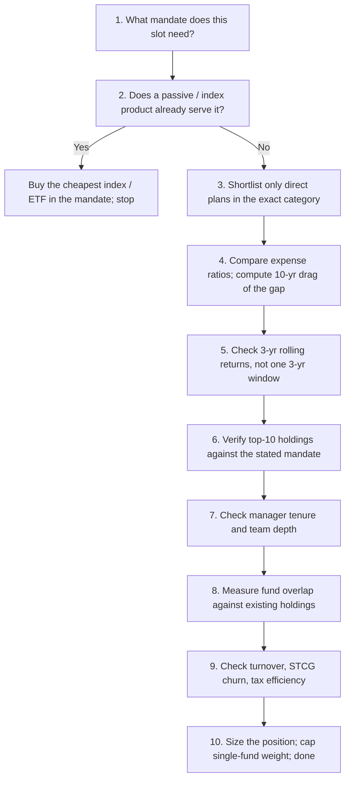

# How to Choose and Compare Mutual Funds (Without Chasing Performance)

The industry's most profitable behaviour pattern is not a bad fund — it is a *chaser* who pays full expense ratios to a manager, sells that manager in a bad year, and moves to the next star with a fresh expense ratio. This article gives you a process that is deliberately *slow*: ten steps, in order, before you buy any fund, and an anti-list of fund patterns you should not own under any circumstance. The through-line: **you are selecting a mandate and a cost structure, not predicting returns.**

## Why past returns are the most dangerous input (the base-rate argument)

The claim that "3-year top returns are misleading" is usually supported with a chart. No chart is needed. The logic is arithmetic:

1. The top returners in any 3-year window are, by definition, above the mean.
2. A large part of that outperformance is *noise* — a lucky sector call, a concentration that happened to rise, a benchmark that happened to fall while the fund concentrated elsewhere.
3. The **expected share of a top returner's excess that persists is low**. Even if a manager is genuinely skilled, a single 3-year sample has very little signal about skill: the statistical question "is this manager better than random?" requires *years* of overlapping decisions, not one 3-year stretch.
4. Therefore: buying the 3-year top returner is *ex ante* buying the most expensive fund in a crowded set, with an expected persistence near zero, and a fee structure priced for its current star status.

Step 3 is the base-rate argument: **the fraction of funds that earn a top-3-year return *and* repeat it in the next 3-year window is small**, whether the market is generous or not. The fee structure does not fall back when the star falls. This is not a claim about any specific fund's record; it is a claim about the *selection rule* "buy last year's winner," and the rule is dominated by: (a) buying the index, (b) buying the cheapest fund in the mandate, (c) not buying on a 3-year chart at all. The [index article](../mutual-funds/mf-index-etf-direct-regular.mdx) makes the same point from the cost side: most active funds *fail their hurdle* — and a 3-year top returner is not *ex ante* distinguishable from a lucky fund that will fall back.

## The 10-step selection checklist

The steps are ordered. Skipping to step 4 without step 1 is how portfolios end up full of "good funds, wrong mandate."

**Step 1 — Mandate first.** Write the slot down: "large-cap growth, 8 years, core." If you cannot write it, you are shopping for a feeling, not a fund.

**Step 2 — Passivity check.** Before any active fund gets reviewed, ask: is there an index fund or ETF that covers this mandate? If yes, the default is the passive product, and the active fund must earn its *entire* expense ratio before it gets your money. This is the single biggest cost reduction available to Indian investors, and it requires no fund research at all.

**Step 3 — Direct plans only, exact category.** Compare within the stated category (large-cap, mid-cap, flexi, ELSS). A fund that markets itself as "large-cap" and then runs a mid-cap book is a different animal (step 6 catches that). Use the direct version of every candidate; the [direct-vs-regular math](../mutual-funds/mf-index-etf-direct-regular.mdx) is your reference.

**Step 4 — Expense ratio, computed.** The gap between two funds in the same mandate is a *permanent* drag. The table below shows what 1 percentage point costs over 10 years; step 4 of every comparison should end with this number printed next to the fund names.

| Assumed gross return | 10 yrs @ 0.5% expense | 10 yrs @ 1.5% expense | Corpus lost to the 1-pp gap |
|---|---|---|---|
| 10% p.a. (net 9.5% vs 8.5%) | ₹2.48L on ₹1L | ₹2.26L on ₹1L | ≈ ₹21,500 (9.5% of the 1.5%-drag corpus) |
| 12% p.a. (net 11.5% vs 10.5%) | ₹2.97L on ₹1L | ₹2.71L on ₹1L | ≈ ₹25,600 (9.4%) |
| 15% p.a. (net 14.5% vs 13.5%) | ₹3.87L on ₹1L | ₹3.55L on ₹1L | ≈ ₹32,500 (9.2%) |

(₹1,00,000 lump sum, $P(1+r_{net})^{10}$ with $r_{net} = r - e$, annual compounding, 10 years. Note the pattern: a fixed 1-pp expense gap costs roughly **9–10% of the corpus at 10 years, regardless of the gross return** — the absolute ₹ loss is bigger at higher returns, but the *percentage* haircut is nearly flat, because the gap compounds inside the same corpus. This is why a 1-pp expense difference between two large-cap funds is a ~9% corpus difference at a decade horizon, and a bigger fraction again at 20 years — and why the index article's direct-vs-regular argument compounds so hard.)

**Step 5 — Rolling, not point-in-time.** Look at the distribution: in how many of the last 20+ rolling 3-year windows did the fund beat its benchmark? A fund that beat its benchmark in 6 of 20 windows has a win rate you should price into the manager fee. A fund that beat it in 17 of 20 is *still* not proof of skill (base-rate argument above), but it is proof of *at least one* of \{skill, luck, style fit\} that is worth a second look.

**Step 6 — Style drift detection.** Read the fund's **top-10 holdings** against its **stated mandate**, not against its marketing. Three tests:

- *Concentration:* a "diversified large-cap" fund with top-10 weightings above 70% is a concentrated-bets fund wearing a diversified label.
- *Sector drift:* a "large-cap" fund where 40% of the book is one sector is a sector fund with an expensive expense ratio.
- *Style drift over time:* compare the current top-10 to the top-10 from 3 years ago. A fund that was a value large-cap and is now a momentum mid-cap has changed its mandate *in practice* while the name stayed the same.

**Step 7 — Manager tenure & single-manager risk.** A fund led by one manager who could die, retire, or leave for a PMS has a *continuity risk* you have priced at zero. Questions: how long has the current manager run *this* fund (not just "been with the AMC")? Is there a co-manager? What was the fund's track record under the *previous* manager? A fund that outperformed under the previous manager and has a new manager with a short history is a coin flip on the current track record.

**Step 8 — Overlap.** Two "different" large-cap funds can hold **60% of their stocks in common** — the top-20 overlap of the major large-cap funds is routinely half of their books. Owning both is not diversification; it is the same book twice, with two expense ratios. Test: list the top-20 holdings of each fund, count the intersection. Over 50% overlap → the second fund is a fee, not a position.

**Step 9 — Tax efficiency.** A fund's *churn* (turnover) and its *short-term capital gains behaviour* matter even in a flat-rate equity-CG world: STCG is taxed at the flat short-term rate on every redemption, and funds with high turnover and aggressive trimming create STCG churn for you at the worst times. Check the fund's turnover ratio and, where disclosed, its short-term-gain percentage. A fund that trims winners every quarter is paying the market in STCG tax *on your behalf*. (The exact rates are time-sensitive — verify against the income-tax slabs reference, [src-it-slab-calculator](../mutual-funds/mf-choosing-comparing-funds.mdx), last verified 2026-08-06.)

**Step 10 — Size and cap.** No single fund should be a large fraction of your portfolio; no single category (ELSS, sector fund) should exceed the cap set by the goal plan. A 30%-plus single fund is a manager-dependency position, not a mandate position.

## Rating agencies: what they are, and what they are not

Fund rating agencies give *risk-adjusted-return* labels over a fixed window. Useful properties: they are *consistent* across funds, so they let you rank within a mandate. Unuseful properties: they are **point-in-time** (the label is a stamp, not a live monitor), they *incentivise exactly the chasing behaviour they are measured against* (the fund that gets upgraded is the fund everyone is now buying), and they say nothing about **cost, overlap, or manager continuity**, which are steps 4, 7, and 8 of this checklist. Treat a rating as one input among ten, never as the reason to buy.

## When to simply use an index

The honest answer is more often than you think:

- **The mandate is a broad market** (Nifty 50, Sensex, Nifty 500) → index, no contest. The active manager in a broad mandate is paying a fee to hold roughly the same book.
- **The horizon is > 10 years and the risk budget is modest** → index for the core. The active sleeve is optional, and only earns its keep if the 3-year-rolling win rate (step 5) and the cost drag (step 4) both survive the test.
- **You are not paying for advice** → index. The only legitimate reason to pay an active manager's expense ratio is a sustained, verifiable win rate; if you do not read the rolling windows, you cannot tell whether you are paying for skill, and the index is the honest default.

The [index article](../mutual-funds/mf-index-etf-direct-regular.mdx) has the direct-vs-regular cost math and the ETF plumbing; this article tells you when the active fund is worth the drag at all.

## The anti-list: fund patterns you should not own

Patterns, not names. Any fund matching two of these patterns is a fund you should not add, and any fund matching one is a fund you should question hard before adding.

1. **The tiny-NAV fund.** The fund's NAV is a small number (e.g. ₹8, ₹10) and it is marketed on "cheap NAV." NAV is not price; it is the *unit* price of the fund. A ₹10 NAV fund that grows to ₹20 is the same fund as a ₹100 NAV fund that grows to ₹200. The small NAV is a marketing artefact, not a value signal. (Some small-NAV funds are legitimate; the pattern to flag is *buying on the NAV number itself*.)
2. **The new-age chaser.** The fund launched 18 months ago, rode a hot theme (a specific sector, a specific style), and its expense ratio is priced for a large fund because the AMCs do not price small funds down. The launch-date-plus-one-bull-market combination is the single most common way investors buy a fund at the top of its theme.
3. **The sector fund above 10% of the portfolio.** A sector fund is a *bet*, not a mandate. The moment a sector fund is > 10% of a household's equity allocation, the household has turned its portfolio into a sector call with the sector fund's expense ratio on top. Cap it; treat it as satellite.
4. **The ELSS-with-a-lure.** An ELSS is a *tax instrument* (3-year lock-in, Section 80C claim, per [src-sebi-elss](../mutual-funds/mf-choosing-comparing-funds.mdx)); its 80C limit is capped (verify the current cap against the 80C source). An ELSS that is *marketed* on its 3-year return rather than on its tax structure is a fund being sold to chasers under the tax-instrument's own 80C lure. The 80C benefit is the reason to own ELSS; the 3-year return is not.
5. **The concentrated-bet masquerading as diversified.** Top-10 weightings above 70%, one sector, and the fund is marketed as "diversified." The label and the holdings disagree; trust the holdings.
6. **The high-fee manager fund.** Expense ratio at the top of the category, no sustained rolling win rate, a manager of short tenure. Every one of those three is a reason to not own the fund; all three together is a reason to never own it.
7. **The "guaranteed" anything.** No mutual fund in India is permitted to promise returns; the phrase "guaranteed return" in any fund marketing is a red flag that the seller does not understand the instrument, and the only reason to buy a fund whose seller does not understand the instrument is to be the exit liquidity.

## Reading a fact sheet: the numbers that matter

Before the checklist starts, here is what to pull off any fund's fact sheet and what to ignore:

**Pull:** the **expense ratio** (step 4), **3-year/5-year/10-year returns vs benchmark** (the *gap*, not the level), **Sharpe ratio** and **Sortino ratio** over 3 and 5 years, **maximum drawdown** over the same windows, **downside deviation**, **turnover ratio**, **top-10 holdings with weights**, and **AUM**. The two drawdown numbers — the fund's max drawdown and the benchmark's max drawdown over the *same* window — are the single most useful pair on the sheet: they tell you how the fund behaves when the market hurts, which is the only behaviour that matters for a sleep-loss budget.

**Ignore:** the **AUM growth rate** as a virtue (a fund growing to ₹5000 crore on a small-cap mandate may now be too large to work its mandate), the **5-star rating** (the label, not the substance — see the rating-agency section), and the **trailing 1-year return** (noise). A fact sheet is a report card from the manager's *past* year; the ten steps are where you test whether that report card is a signal.

## Risk metrics, defined

- **Sharpe ratio** = (fund return − risk-free rate) ÷ standard deviation of returns. It answers: *per unit of total volatility, how much excess did the fund earn?* Compare Sharpe ratios *within a mandate* only; a mid-cap fund's Sharpe is not comparable to a large-cap fund's.
- **Sortino ratio** = (fund return − risk-free rate) ÷ *downside* standard deviation. It penalises only the bad vol, which suits equity (where the upside vol is the point). A fund with a high Sortino and a mediocre Sharpe is a fund that rises in a straighter line and falls in spikier episodes — useful to know, because spiky falls are what sequence risk is made of.
- **Maximum drawdown** = the largest peak-to-trough loss over the window. It is the *experienced* worst case, and the number to put next to your own loss tolerance: if you would panic-sell at −30% and the fund's 5-year max drawdown was −45%, the fund is not your instrument, whatever its returns.
- **Beta and alpha** (vs the benchmark): a fund with beta > 1 and alpha ≈ 0 is simply a *levered* index — you are buying extra market exposure through an expensive wrapper. The beta, not the returns, is what it is.
- **Turnover ratio:** the share of the book that was replaced in a year. High turnover + high short-term-gain ratio = the tax-churn problem of step 9, and the operational cost that the expense ratio does not show.

## When to sell or switch a fund (rules, not signals)

The anti-chase discipline applies to *exiting* as hard as to entering. A sell should follow from a rule you wrote *before* the market moved:

1. **Mandate break.** The fund's practice no longer matches its stated mandate (style drift, caught at step 6). Sell; you are no longer paying for the instrument you thought you owned.
2. **Cost break.** A cheaper fund in the same mandate now delivers a better 3-year rolling win rate (step 5) *after* its lower expense ratio. Switch, not sell to cash — the slot keeps its mandate.
3. **Manager-change event.** The long-tenured manager (the one your step-7 decision was based on) leaves; the fund is now a coin flip on the new manager's record. This is a *review trigger*, not an automatic sell — but the review must happen on a set date, not "when I feel like it."
4. **Goal-met or deadline near.** The last-12-months rule: the fund is redeemed or STP'd into debt as the goal nears, regardless of how it is performing. The deadline is the exit, not the chart.
5. **The only signal that never justifies selling:** the fund's *own* short-term underperformance, in the absence of 1–4. A good mandate fund in a bad year is a *feature* (the risk you paid for), not a defect. Selling it locks in the bad-year behaviour and hands the rebound to whoever stayed.

The [index article](../mutual-funds/mf-index-etf-direct-regular.mdx) and this article together state the full discipline: *enter on the checklist, exit on the rules, and let the mandate — not the price — be the reason for both.*

## A compact worked selection (to make the checklist concrete)

You need a large-cap, 8-year, core slot.

1. *Mandate:* large-cap, 8 yrs, core.
2. *Passivity:* is there an index product for large-cap? Yes — a large-cap index fund / Nifty 50 ETF exists. **Default: the passive product.**
3. *Direct, exact category:* take the direct large-cap index.
4. *Expense ratio:* large-cap index expense ratios are at the low end of the market; the gap to the most expensive active large-cap fund is > 1 pp → the 10-yr table above shows the active fund must earn > 1 pp of alpha just to break even on cost.
5. *Rolling returns:* (skipped for the index, which has no manager to roll-test).
6. *Top-10 vs mandate:* the index holds exactly the large-cap mandate.
7. *Manager:* no single-manager risk in an index.
8. *Overlap:* the index *is* the mandate; no overlap question.
9. *Tax efficiency:* low turnover by construction; no STCG churn.
10. *Size:* cap the large-cap core at a sensible fraction of the total equity book.

The active large-cap fund, if you still want to run it, must beat the index *after* its own expense ratio, in the majority of rolling 3-year windows, with a manager of reasonable tenure. If it cannot, the index is not the fallback — it is the position.

## Related

- [Index Funds, ETFs, Direct vs Regular Plans & Tracking Error](../mutual-funds/mf-index-etf-direct-regular.mdx) — the cost and plumbing this checklist defers to.
- [SIP, STP & SWP: Structured Investing and Goal Planning](../mutual-funds/mf-sip-swp-stp-goals.mdx) — the funding-rhythm that decides *how much* goes into the fund you select.
- [Your 10 Lakh Wealth Plan](../personal-finance/pf-wealth-plan-10-lakh.mdx) — the allocation that decides *which slots* need funds at all.

## Sources

- `src-sebi-elss` — SEBI investor-education guide on ELSS (80C claim, 3-year lock-in).
- `src-it-slab-calculator` — secondary summary of the FY 2025-26 / FY 2026-27 income-tax slabs; referenced for the *time-sensitive* STCG-rate and 80C-cap claims, all marked "verify."

## Update log

- **2026-08-06** — last verified. The base-rate and expense-drag arguments are logical; no market statistic is asserted. The STCG/80C figures that would otherwise appear are deliberately left as "verify against the slabs reference" so the article survives the next tax revision without a re-write. The 10-year expense-drag table is arithmetic under the stated gross-return assumptions, not a forecast.

## Sources & Citations

- **SEBI Investor Education** — Securities Market Investment: A Guide to ELSS. https://investor.sebi.gov.in/elss.html (verified 2026-08-06)
- **Cleartax (secondary summary of official slabs)** — Income Tax Slabs FY 2025-26 & FY 2026-27 (New and Old Regime). https://cleartax.in/s/income-tax-slabs (verified 2026-08-06)

---
Educational content, not individualized investment, tax, accounting, or legal advice.
Author: Chirag Singhal. DhanPedia.
