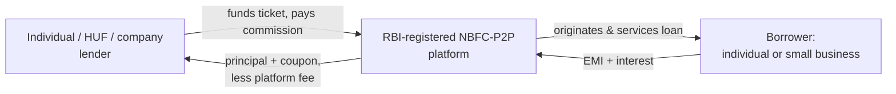

# P2P Lending in India: Framework, Expected Loss, Due Diligence, Recovery & Tax

Peer-to-peer (P2P) lending is the only retail investment in India that puts you, personally, on the other side of a private loan: you are the lender, the platform is the marketplace, and the borrower is an individual or a small business that no bank would underwrite cheaply. The reward is a yield above deposit and G-sec rates; the cost is **unsecured-or-weakly-secured credit risk that you bear personally, with no deposit-insurance backstop and no secondary market.** This article walks the full stack: the RBI framework (as consolidated in the 2025 Directions), how the return is actually generated, the expected-loss math with a three-scenario stress test, a platform due-diligence checklist, the recovery reality, the tax treatment, and the sizing rule that keeps P2P a sleeve instead of a strategy.

## How P2P lending works in India

- **You (lender) fund loan tickets** on the platform; each ticket is a loan to one borrower at a stated interest rate and tenure.
- **The platform charges on both sides** — a commission from the borrower and a fee from the lender — and from the platform's **total commission historically has been capped at 5% of the ticket size plus a service fee** (verify the exact fee structure in the 2025 consolidated text; this is the regime carried over from the earlier direction).
- **Every P2P platform is a Non-Banking Financial Company (NBFC) that must hold RBI registration** — the registration number is on rbi.org.in's registered-entity list and on the platform's own disclosure. **P2P is not a bank scheme: lender money is not insured by DICGC deposit insurance.** The ₹5L-per-depositor-per-bank protection does not reach you; your "insurer" is the platform's underwriting and your own diversification.

### The 2025 consolidated framework

The **RBI (Non-Banking Financial Companies – Peer to Peer Lending Platform) Directions, 2025** (RBI/DOR/2025-26/370, notified 28 November 2025) [src-rbi-p2p-directions-2025](../p2p-lending/p2p-lending-complete.mdx) consolidated the earlier P2P directions into a single current framework; the **full text** [src-rbi-p2p-master-pdf](../p2p-lending/p2p-lending-complete.mdx) is where the caps and prudential norms live. What the regime has carried since the original 2017 direction, in structure:

- **Credit-score-based lending is the core.** Roughly **75% of a platform's loan book must be sanctioned on bureau credit scores**, and **up to 25% may go through a self-assessment route** for borrowers without a clean bureau file. The self-assessment slice is structurally riskier — the risk is underwritten on income documents instead of a credit history — which is why the regime caps its share. *Verify the current 75/25 split and caps against the 2025 consolidated text before republishing.*
- **Borrower caps.** There is a **per-borrower ticket-size cap (₹25L), an exposure limit per lender, and a per-platform total-book limit** in the regime. *The ₹25L per-borrower cap is the known structure from the 2017 direction; verify it against the 2025 consolidated text before quoting it as current.*
- **Lenders must be registered with the platform's RBI entity;** the platform must hold lenders' money in a **trust/custodian account** and meet prudential and disclosure norms.

The consolidation matters practically: a platform that was operating on a 2019-era reading of the rules is now operating on the 2025 Directions. Read both source links above before you commit capital to any platform.

## How the return is generated: spread, not magic

The P2P yield is a **credit spread over bank prices**: the borrower pays more than a bank would (the bank's credit underwriting and deposit funding are absent), and you capture that spread net of the platform's two-sided fee and your idle-cash time. Against the fixed-income stack: a G-sec or bank FD earns the *risk-free-plus-bank-credit* price (the RBI repo was near 5.25% through late 2025 — verify the current rate; that level anchors the whole deposit/bond curve); a corporate bond earns sovereign + credit spread; a P2P loan earns sovereign + bank spread + **retail-credit spread**, the last term being the widest and most volatile.

The advertised P2P rate is usually in the **12–15% band**. Advertised ≠ realized. The bridge is the **expected-loss formula**:

$$EL = PD \times LGD, \qquad \text{Expected net} = \text{Gross coupon} - EL$$

where $PD$ is the annual probability a loan in the book defaults and $LGD$ (loss given default) is the share of the ticket you lose when it does (after partial recovery).

### Worked stress test: 300 loans, ₹25,000 average ticket

Portfolio: 300 loans, average ticket ₹25,000 (₹75L deployed), gross coupon 12%, **PD = 4%, LGD = 60%**.

$$EL = 0.04 \times 0.60 = 0.024 = 2.4\% \quad\Rightarrow\quad \text{Expected net} = 12\% - 2.4\% = \mathbf{9.6\%}$$

Note the arithmetic explicitly, because a common error is to compute "expected net" as $12\% - 4\% = 8\%$ (charging the full PD as a loss) or to quote the gross 12% as if defaults didn't happen. The expected loss is PD **times** LGD — a defaulted loan still recovers 40% on average, so each default-year costs 2.4% of the book, not 4%.

**Before** platform fee, idle-cash drag, and operational costs. After a ~1–2% all-in fee/idle-cash drag, the realistic *expected* net sits in the high-single-digit to low-double-digit zone, not the advertised band.

**Three-scenario table** (gross 12%; severe scenario widens both PD and LGD — in a bad year, *more* loans default **and** recoveries worsen, so LGD rises from 60% to 80%):

| Scenario | PD | LGD | EL = PD × LGD | Expected net (before fees/idle cash) |
|---|---|---|---|---|
| Mild (easy credit cycle) | 2% | 60% | 1.2% | 10.8% |
| Base (steady underwriting) | 4% | 60% | 2.4% | 9.6% |
| Severe (cycle stress, correlated defaults) | 10% | 80% | 8.0% | 4.0% |

Read the severe row cold: a 4 pp jump in the advertised-style band (12% → 4.0%) from one bad credit cycle. That is the number that should sit next to any P2P pitch deck in your head.

## Platform due-diligence checklist (run it on every platform, every year)

1. **RBI registration.** Confirm the NBFC-P2P registration number on the **rbi.org.in registered-NBFC list** — not on the platform's website, on the RBI's list. A platform that can't produce its registration number is not operating inside the 2025 Directions.
2. **"Guaranteed" wording is a red flag.** No regulated P2P product can guarantee returns; the 2025 framework contemplates loss to the lender. The word "guarantee" on a P2P page means the seller doesn't understand the instrument (the same anti-pattern the [fund anti-list](../mutual-funds/mf-choosing-comparing-funds.mdx) documents for funds).
3. **NPA / default disclosure.** The platform should publish its own book's NPA rate, bucket aging (30/60/90 days past due), and recovery rates. If the disclosure is absent, that absence is the due-diligence answer.
4. **Recovery mechanism.** How are secured tickets recovered? For secured loans: legal action and **possession/recovery of the security**, with the lender (you) as the secured party or the platform acting under the framework's norms. Read what the *next step* is after a 90-day NPA: demand letters, repossession, auction, litigation. Each step has a cost and a clock.
5. **Tenure distribution.** A book of 6-month consumer EMI loans behaves very differently from a book of 3-year business-term loans. Longer tenures carry more embedded default windows *and* more idle time between tickets.
6. **Borrower mix: individual vs business.** Individual-consumer EMIs have higher PD but better recovery data; business-term tickets have lower PD on bureau screens but LGD that depends on a small business's asset base. The split is a risk you are buying in one number's clothing.
7. **Fee math, both sides.** Compute your *actual* net: gross coupon − lender fee − any service fee − idle-cash drag. If the platform can't show the all-in figure, don't assume it.
8. **Trust/custodian account.** Confirm lender funds sit in the mandated trust account, not the platform's operating bank account.

## Liquidity & recovery: the pattern, not the promise

- **There is no secondary market.** You cannot sell a P2P ticket to another investor at a quoted price; your exit is either (a) waiting for the EMI to mature or (b) the loan defaulting and entering recovery. Liquidity, in the fixed-income sense, is **zero** ([the fixed-income article](../fixed-income/fixed-income-bonds-credit.mdx) contrasts this with G-sec/dealer-quoted markets).
- **Recovery for secured loans runs through legal/possession channels** — demand, repossession, auction or court process. **A 6–18 month recovery clock is the observed pattern, not a guarantee:** some secured tickets recover in months, some run to years, and the *amount* recovered (LGD in reverse) varies with asset type and jurisdiction. Treat 6–18 months as the median you should plan around, and plan cash flow to survive 24.
- **Idle cash is a return tax you can't see.** Between receiving one ticket's cash and deploying it in the next, capital sits at near-zero. In a thin-ticket platform, idle time can cost you a meaningful fraction of the expected net every year. Ask the platform for its **idle-time statistic**; if it's undisclosed, shave 1–2 pp off the expected net.

## Tax treatment

- **Interest is income, taxed at your slab rate** under the [FY 2025-26 slabs] [src-it-slab-fy2025-26](../p2p-lending/p2p-lending-complete.mdx) (new regime default; old regime optional). A ₹1L P2P coupon in a 30% slab is ~₹70,000 after tax — recompute every P2P "yield" at your slab before comparing it with a tax-free PPF or a post-tax G-sec coupon.
- **No Section 80C claim** on P2P lending. The ₹1.5L 80C cap does not stretch to P2P; do not let a platform imply otherwise.
- **TDS is not typically deducted** on P2P interest — *verify with a tax professional and against current TDS practice before you file*; the absence of a TDS line on your Form 26AS does not mean the income is unreportable.
- **Lender eligibility:** individuals, HUFs, and companies can lend; the HUF route is commonly used for tax-planning and is *only* valid for a genuine HUF (document it properly; a sham HUF is an income-tax risk).
- **Reporting:** P2P income is business/other income; your platform's statements are your books. The [tax article](../taxation/tax-india-investor-complete.mdx) has the regime-by-regime structure.

## Why advertised yields are not what you earn

Even in the mild scenario, five frictions separate the banner number from your realized number:

1. **Idle cash** — the time your money spends between tickets earning ~0%.
2. **Concentration** — a book tilted to one sector (e.g., unsecured business-term loans in one industry) means *correlated* defaults: the PDs stop being independent, and the $EL = PD \times LGD$ average understates the tail. One bad sector quarter can push that book's effective PD toward the severe scenario's 10% even when the platform advertises "4%."
3. **Correlated defaults** — economic downturns hit borrower cash flows at once; independent-PD math assumes they don't.
4. **Platform operational risk** — the party holding your recovery process. A platform that stumbles mid-recovery stalls your LGD realization; you are underwriting the operator, not just the borrowers.
5. **Fees** — the two-sided commission erodes the gross on every ticket.

None of these are disclosed on the landing page. They are the difference between "12–15%" and the 4.0% severe-scenario row above.

## Regulated vs unregulated: where P2P ends

The 2025 Directions cover **NBFC-registered P2P platforms**. What lives outside:

- **Unregistered "P2P" or crowd-lending sites** — no RBI registration, no prudential norms, no NPA disclosure. The borrower caps that protect registered platforms don't bind them. Verify the registration before the platform's name enters your portfolio.
- **Deposit-taking schemes** — any scheme that *pays you* a return on *your deposit* (rather than on loans you lend) is a deposit, and unregistered deposit-taking is illegal in India; a "P2P"-branded scheme that behaves like a bank account without a banking licence is outside the framework entirely.
- **"Gold loan" and unsecured-advance scams** — a scheme promising 12–15% for "parking gold" or an unsecured advance with weekly payouts is the unregulated-sound-of-P2P: the promised yield with no borrower risk you can see and no recovery you can enforce. The [fixed-income article](../fixed-income/fixed-income-bonds-credit.mdx) covers where genuine sovereign-curve yields actually sit; anything far above that is selling credit risk to you in disguise.

## The sizing rule

**P2P belongs at ≤ 10–15% of the total investment portfolio, and only with money you will not need for the loan tenures.**

- At 12.5% of portfolio, a *total* loss of the P2P sleeve (the severe extreme, not the expected loss) costs 12.5% of the household's capital — painful, survivable. At 50%, it's a life event.
- The sleeve's tenures set your *liquidity need horizon*: if your tickets are 1–3 years, that money is out of your liquidity pool for 1–3 years — so the sleeve must sit inside the portfolio's "money I won't touch for 3+ years" bucket, never in the emergency layer.
- **Stress-test before sizing:** run the three-scenario table above at your platform's *actual* gross coupon and its disclosed (or assumed) PD/LGD, and require that the severe-scenario net stays positive before the sleeve earns its size. The DhanPedia **P2P stress-test calculator** (companion tool on this site) takes gross coupon, PD, LGD, idle-time %, and fee % and prints the three-scenario net — the same arithmetic as the table, parameterised for your platform.

## What to do when a ticket defaults: an operational playbook

The default is not the failure — the *response* is. A pre-written playbook is the single highest-leverage thing a P2P lender can own, because it is what actually determines your realised LGD. The stages, in the order a secured ticket typically moves through:

1. **Missed EMI → 30-day NPA bucket.** The platform issues demand notices. Your job as the lender: confirm the platform *is* issuing them (a NPA-aged bucket with no demand trail is a platform-disclosure failure, and an early warning on the platform, not just the borrower).
2. **60–90-day NPA.** Legal notice; for secured tickets, the platform begins repossession/auction preparation. You should now know, *for your specific tickets*, what the security is (the asset type, the jurisdiction, the encumbrance status) — a secured loan to a business whose security is a *second* charge on a property already mortgaged to a bank is a recovery you are much less likely to realise, because the senior bank gets paid first from the asset's sale.
3. **90-day NPA / formal default.** The ticket is classified as a loss-in-wait. At this point the *realised* recovery is what the severe scenario's LGD = 80% is describing: the asset is in the process of being realised, but the sale price in a stressed market is typically far below the outstanding principal.
4. **Realisation (6–18 months, observed pattern).** The security is auctioned or the borrower settles for a discounted amount. The gap between the ticket's outstanding and the realised amount is your *real* LGD. This is where the three-scenario table's severe row (4.0% expected net) lives — the LGD *widens* in a bad year, which is exactly why the severe scenario couples a higher PD with a higher LGD rather than treating them independently.

**The lender's own levers inside the playbook:** (a) *ticket-level concentration* — holding the same borrower across multiple tickets does not diversify; it is one credit decision repeated, and the PD/LGD of that one borrower is all that matters; (b) *security type* — first-charge, moveable-asset secured tickets (e.g., a registered first charge on the specific asset pledged) recover more than second-charge or unsecured ones, and the platform should label which is which; (c) *jurisdiction* — repossession and auction timelines vary by state and court, so a ticket's recovery clock is partly a *geographic* property, not just a credit property.

None of these levers can make a bad borrower good; they can make your *share* of the loss smaller. That is the honest function of the playbook: you cannot prevent the default, you can only manage what you lose when it arrives.

## Diversifying across the book: ticket-level rules

The three-scenario table assumes a *single blended* PD and LGD for the whole book. A real book is not blended; it is a population of tickets with different PDs and LGDs, and the *correlation* between their defaults is the number that decides whether the blended math is even the right model. Practical diversification rules, in order of importance:

1. **Spread across borrowers, not across platforms.** The correlation risk is in the *borrower population* (one sector hit defaults a cohort at once). Holding 300 tickets on 300 different borrowers in one book is diversification; holding 30 tickets on 10 borrowers (3× each) is not, even if the platform shows you 30 "loans."
2. **Watch the sector and geography mix of the book.** A book where 60% of tickets are in one industry or one metro is one *credit decision* with a fee on it, not 60% diversification. The platform's own borrower-mix disclosure (checklist item 6) is where this lives.
3. **Match the tenures to your liquidity horizon.** The [sizing rule](#the-sizing-rule) caps the sleeve; the tenure distribution *inside* the sleeve sets the *liquidity* of the sleeve. A book of 6-month consumer EMIs is far more liquid (tickets mature and redeploy fast) than a book of 3-year business terms, and that liquidity has its own cost — the consumer book carries a higher blended PD.

The expected-loss formula generalises to a multi-ticket book:

$$\text{Portfolio } EL = \sum_{k} w_k \cdot PD_k \cdot LGD_k$$

with $w_k$ the weight of ticket $k$. The *expected* portfolio loss is the weighted sum, but the *actual* loss is governed by how many $k$'s default *together*, which the sum cannot see — that is the correlation gap, and it is why the severe scenario, not the base, is the number to stress against.

## Related

- [Fixed Income in India: Bonds, YTM, Duration, Credit & Sovereign Debt](../fixed-income/fixed-income-bonds-credit.mdx) — the opposite end of the credit spectrum: what a *priced* credit risk looks like when it is sovereign or corporate.
- [Your 10 Lakh Wealth Plan](../personal-finance/pf-wealth-plan-10-lakh.mdx) — where the P2P sleeve sits in the overall allocation and risk grading.
- [How to Choose and Compare Mutual Funds](../mutual-funds/mf-choosing-comparing-funds.mdx) — the same due-diligence discipline (cost, structure, anti-patterns) applied to the managed side of investing.

## Sources

- `src-rbi-p2p-directions-2025` — RBI (NBFC – P2P Lending Platform) Directions, 2025 (RBI/DOR/2025-26/370, notified 2025-11-28): consolidated P2P framework; registration, prudential and disclosure norms.
- `src-rbi-p2p-master-pdf` — full text of the 2025 Directions: ticket-size and borrower caps, 75/25 credit-score split (verify current values against this text).
- `src-it-slab-fy2025-26` — FY 2025-26 income-tax slab structure (new regime default; old regime optional), for the at-slab-rate taxation of P2P interest.

## Update log

- **2026-08-06** — last verified. (a) The 75% credit-score / 25% self-assessment split and the ₹25L per-borrower cap are the structure from the 2017 direction carried into the 2025 consolidation — **verify the current caps against the 2025 consolidated text** before republishing. (b) The "total commission cap historically 5% of ticket size + service fee" is the historical regime; verify the current fee structure in the 2025 Directions. (c) P2P's comparative "spread over bank rates" is anchored to the repo rate near 5.25% (late 2025, verify current value against the latest RBI MPC). (d) The 6–18 month recovery window is an observed pattern, not a promise — re-check against platform NPA disclosures annually. (e) TDS practice on P2P interest: verify with a tax professional each year.

## Sources & Citations

- **Reserve Bank of India** — RBI (Non-Banking Financial Companies – Peer to Peer Lending Platform) Directions, 2025. https://www.rbi.org.in/Scripts/BS_ViewMasDirections.aspx?id=12934 (verified 2026-08-06)
- **Reserve Bank of India (via PDICAI host)** — RBI P2P Lending Platform Directions, 2025 — full text (RBI/DOR/2025-26/370). https://www.pdicai.org/Docs/RBI-DOR-2025-26-370_24122025161753415.pdf (verified 2026-08-06)
- **Income Tax Department / Union Budget 2025** — Income-tax slabs, new regime, FY 2026-27 (AY 2027-28) - unchanged from the Budget 2025 reset. https://www.indiabudget.gov.in/doc/Finance_Bill.pdf (verified 2026-10-16)

---
Educational content, not individualized investment, tax, accounting, or legal advice.
Author: Chirag Singhal. DhanPedia.
