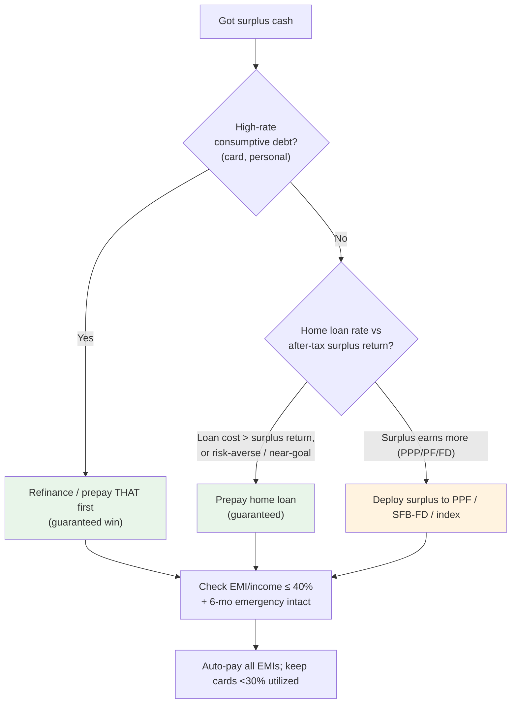

**Scope note.** Debt in India splits into two very different animals: **productive leverage** (a home loan that buys an asset whose value can rise and whose tax-deductible interest lowers your effective cost) and **consumptive debt** (credit cards, personal loans, top-ups that cost 14–32% on money that depreciates). This article gives the math to tell them apart. Figures marked **"(verified 2026-10-16)"** are checked against the cited sources.

## EMI mechanics — what the monthly number really hides

The **EMIs (Equated Monthly Installment)** formula amortizes principal + interest over a fixed term:

$$EMI = P \times \frac{r(1+r)^n}{(1+r)^n - 1}$$

where $P$ = loan amount, $r$ = monthly rate (annual rate ÷ 12 ÷ 100), $n$ = number of months.

**The counter-intuitive fact:** in a long-term loan, the *majority of the interest is paid in the first half of the tenure* because your outstanding principal is highest then. A ₹40L home loan at 8.5% for 20 years (240 EMIs) generates an EMI of ~₹34,300, and **total interest ≈ ₹42.3L** — more than the principal.

$$\text{Total interest} = (\text{EMI} \times n) - P$$

**Prepayment changes the game.** Any lump-sum prepayment that is *fully adjusted to principal* (not spread over remaining EMIs) shortens the tenure or lowers the EMI. A ₹3L prepayment early in a 20-year loan can shave **₹3–4L of total interest.**

### The three prepayment modes (choose deliberately)

| Mode | What happens | Best for |
|---|---|---|
| **Reduce tenure, keep EMI** | Tenure shrinks; EMI unchanged | Lowest total interest; you can afford the same EMI |
| **Reduce EMI, keep tenure** | EMI drops; tenure unchanged | Cash-flow relief, but *total interest rises* |
| **One-time, no change** | Principal reduced; next EMI auto-drops | Convenience; moderate interest saving |

## Home loan: the leverage that can make sense (or not)

A home loan is the *only* Indian retail debt where the loaned money buys an **appreciating asset** (land + construction, typically) and where the interest is **tax-deductible** under **Section 24(b)** (up to ₹2L p.a. for a self-occupied property, more for let-out). [src-it-slab-fy2026-27]

**Effective cost after the deduction:** a ₹40L loan at 8.5% with a ₹2L/yr 24(b) deduction, in the 30% bracket, gives a tax benefit of ₹60,000 p.a., effectively lowering the "after-tax" cost.

**But the honest comparison is to what the alternative earns.** The decision is not "is 8.5% high?" but "would the prepayment cash earn *more* than the after-tax loan cost, *net of risk and liquidity*?" [src-prepay-vs-invest-2026]

| Surplus use | Gross | After-tax (30% bracket) | Notes |
|---|---|---|---|
| Prepay home loan @ 8.5% | −8.5% (interest saved) | ~−7.1% (effective, with 24(b)) | Guaranteed, risk-free |
| Liquid/overnight fund | +5.8–6.2% | ~+4.4–4.9% (taxable) | 100% sure |
| PPF | +8.15% | +8.15% (EEE) | 15-yr lock; 80C cap |
| Diversified equity index | +11–12% (long-run) | +9.5–10.5% | Volatile; not guaranteed |
| SFB FD @ 8.25% | +8.25% | ~+7.3% | DICGC-protected ≤₹5L |

**The rule:** if your surplus can go into PPF, a long-horizon index fund, or a DICGC-safe SFB FD at 8%+ and you have a **high enough risk tolerance and a long enough horizon**, investing can beat prepaying. If you are *risk-averse, near a goal, or the loan is a high-rate old loan (double-digit)*, **prepaying wins** — it is a guaranteed "return." The single most common mistake is prepaying a *new, low-rate* home loan while leaving cash in a 2% savings account. [src-prepay-vs-invest-2026]

## Personal, auto & credit-card loans: the consumptive trap

These finance *depreciating* or *disposable* purchases at *high* rates:

| Loan type | Typical rate (2026) | Term | 80C / 24(b) benefit? |
|---|---|---|---|
| **Credit card (revolving)** | 36–42% (or min-36% annualized) | Revolving | No |
| **Personal loan** | 14–18% | 1–5 yrs | No |
| **Auto loan** | 9–11% | 3–7 yrs | No |
| **Home loan** | 8.0–8.9% (new, 2026) | 15–25 yrs | Yes (24(b)) |
| **LAP (loan-against-property)** | 10–13% | 5–15 yrs | Partially (if home loan) |
| **Education loan** | 9–10% (govt-backed up to limits) | 5+ yrs | Yes (80E) |

**The math is brutal on credit cards:** a ₹1L balance carried over at 36% costs ~₹36,000/yr in interest alone. A personal loan at 15% on a ₹3L refinance of that card is *almost always* the right move — **refinance high-rate consumptive debt first**, before any investing. [src-prepay-vs-invest-2026]

**Hard rule:** never use an *unsecured* loan (personal, card) to buy an *equity* or *long-term* asset. Unsecured consumptive debt costs more than anything a ₹10L portfolio can reliably earn.

## Credit scores after RBI's weekly reporting (2026)

RBI phased in **weekly credit-bureau reporting** from **July 2026** (framework from April 2026): lenders now push EMI/default data to CIBIL, Experian, Equifax and CRIF on the **9th, 16th, 23rd and last day** of each month. [src-rbi-credit-reporting-2026]

**What this changes:**

- **Defaults now show up in days, not 30–60 days.** A single missed EMI can dent your score within the next reporting window.
- **Recovery is faster too.** Paying off a loan or clearing a default now lifts the score within weeks.
- **Faster loan decisions** for banks, because their data is fresher.

**The scoring model (standard):** on-time EMIs (weight ~35–40%), credit utilization (keep cards under 30%), credit mix & age, number of recent enquiries, and outstanding balance. [src-rbi-credit-reporting-2026]

**Practical moves:**
- Set **auto-pay / EMI auto-debit** so an EMI can never "accidentally" miss.
- Keep **credit-card utilization under 30%** of your limit and *bill-pay in full* every cycle (revolving interest is the #1 score killer).
- Limit **hard enquiries** (each loan pre-approval query hits your report).
- A *paid-up* loan *does* stay on your report for up to 5 years as positive history; closing a *credit card* removes the "utilization headroom," so keep at least one card open.

## A cash-flow stress rule for a ₹10L investor

For a ₹10 lakh starter portfolio, the single most damaging decision is **over-levering cash flow.** Use these checks before taking *any* loan:

1. **EMI-to-income ≤ 40%.** If total monthly EMIs (home + auto + personal + card-minimums) exceed ~40% of take-home, you are over-extended.
2. **The 6-month emergency fund must survive a full job-loss month.** Cash that "belongs" to the investment corpus cannot be a buffer if the EMI will eat it.
3. **Productive debt only, and the cheapest productive debt first.** Home loan > (auto) >> personal > credit card in priority of *acceptable* leverage.
4. **Refinance on every rate reset.** When repo moves (it was held at 5.25%, neutral stance, per the Aug 2026 MPC [src-rbi-repo]), a home-loan prepayment window or a balance-transfer to a lower-rate lender can cut total interest materially.

### The decision tree

**Alt text:** Decision tree for surplus cash: first retire high-rate consumptive debt (guaranteed win), then compare home-loan cost to the after-tax surplus return to decide prepay-vs-invest, then verify EMI/income stays under 40% and the 6-month emergency fund is intact, then auto-pay everything.

## The "prepay or invest" one-line summary

Prepay when the debt is **high-rate and unsecured** (cards, personal loans) or you are **risk-averse / near a goal**. Invest the surplus when the debt is a **low-rate secured home loan** and you have a **long horizon and PPF/FD-grade safe options** earning more than the loan's *after-tax* cost. When in doubt, **split** the surplus between the two. [src-prepay-vs-invest-2026]

## Update log

| id | claim | lastVerified | reviewAfter | status |
|---|---|---|---|---|
| tl-rbi-weekly-credit-reporting | RBI weekly credit-bureau reporting (9/16/23/last of month) from July 1, 2026 (framework April 1, 2026) | 2026-10-16 | 2027-04-01 | ok |
| tl-home-loan-24b | Home-loan interest deduction under Section 24(b): up to ₹2L p.a. (self-occupied); new FY 2026-27 slabs unchanged from the Budget 2025 reset | 2026-10-16 | 2027-04-01 | ok |
| tl-repo-5-25 | RBI MPC 3–5 Aug 2026: repo held at 5.25%, neutral stance — the reference rate home loans reprice against | 2026-10-16 | 2027-03-31 | ok |

## Sources & citations

- [src-rbi-credit-reporting-2026] — RBI (Credit Information Reporting) Directions, 2025 (amended July 2026); weekly reporting
- [src-it-slab-fy2026-27] — Income-tax slabs FY 2026-27 (unchanged from Budget 2025 reset)
- [src-prepay-vs-invest-2026] — CreditSmart / Value Research / Money Control: prepay-vs-invest framework, 2026

## Related

- [Banking & Cash: Deposit Safety & FDs](/articles/banking-safety-deposits-fd)
- [Your ₹10 Lakh Plan](/articles/pf-wealth-plan-10-lakh)
- [Foundations: Compounding & Returns](/articles/foundations-compounding-returns)
- [Tax for the Indian Investor](/articles/tax-india-investor-complete)

## Sources & Citations

- **Reserve Bank of India (Master Direction) / CNBC TV18 & Mint reporting** — RBI (All India Financial Institutions – Credit Information Reporting) Directions, 2025 (updated 1 Jul 2026): phased weekly reporting — framework w.e.f. 1 Apr 2026, lenders to file borrower data 4×/month (9th, 16th, 23rd, last day) from 1 Jul 2026. https://www.cnbctv18.com/personal-finance/rbi-weekly-credit-reporting-kicks-april-1-what-changes-for-borrowers-lenders-ws-el-19878645.htm (verified 2026-10-16)
- **Income Tax Department / Union Budget 2025 (Finance Act 2025) — FY 2026-27 slabs** — Income-tax slabs, new regime, FY 2026-27 (AY 2027-28) — unchanged from the Budget 2025 reset: 0-4L nil, 5% to 8L, 10% to 12L, 15% to 16L, 20% to 20L, 25% to 24L, 30%+; Sec 87A rebate extends tax-free up to Rs 12L; standard deduction Rs 75,000. https://cleartax.in/s/income-tax-slabs (verified 2026-10-16)
- **CreditSmart / Value Research / Money Control / India Today (2026 prepay-vs-invest guides)** — Prepay home loan vs invest, 2026: at ~8.5% loan rate (effective ~7.1% after Sec 24(b)) vs 11–13% long-run equity / 8–8.5% safe debt — refinance high-rate unsecured debt first; prepay when risk-averse or loan cost > surplus after-tax return. https://creditsmart.in/home-loan-prepayment-strategy-india/ (verified 2026-10-16)
- **Reserve Bank of India** — RBI MPC decision, 3-5 Aug 2026: repo held at 5.25%, neutral stance, SDF 5.00%, MSF 5.50%. https://www.rbi.org.in/SCRIPTs/BS_ViewBulletin.aspx?Id=24369 (verified 2026-10-16)

---
Educational content, not individualized investment, tax, accounting, or legal advice.
Author: Chirag Singhal. DhanPedia.
