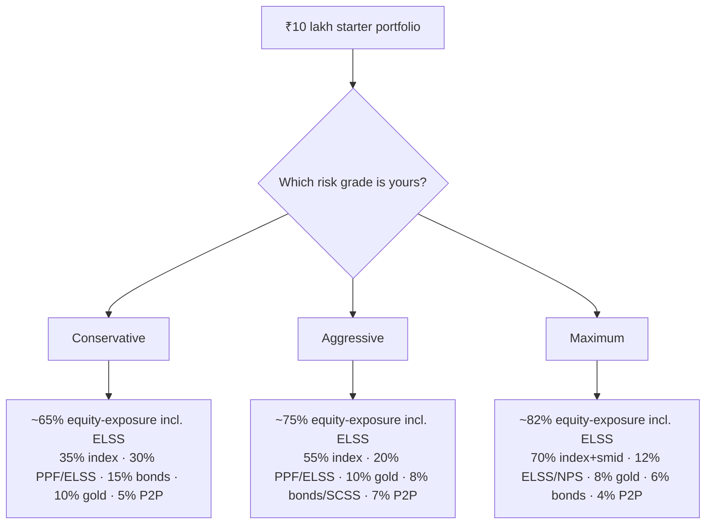
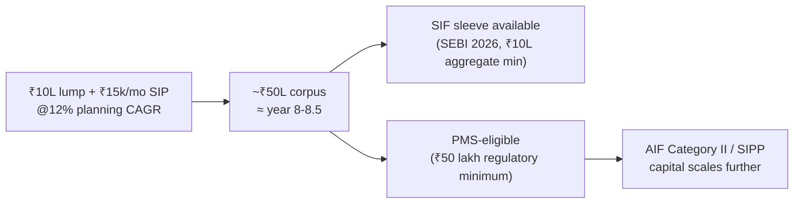

A ₹10 lakh portfolio is the stage where most Indian investors stop *planning* and start *doing*: the emergency fund is built, insurance is in place, and a first meaningful chunk of investable capital is ready. But "I have ₹10,00,000 — now what?" has no single answer. It depends on your risk grade, your horizon, your tax regime, and whether the plan has a growth path that does not strand you in a SIP-only mindset forever.

This article gives you a concrete, risk-graded plan for a ₹10,00,000 starter portfolio: exact allocation amounts for three risk grades, the SIP scaling math with the formula shown, a growth path that leads into PMS and AIFs when capital supports them, and honest about when those higher-capital avenues are the wrong tool. Everything below is educational and illustrative — not individualized advice. Numbers labelled "assumption" or "illustrative" are planning inputs you should stress-test with your own income and risk tolerance; numbers anchored to regulation or current policy are marked with their verification date.

## Assumptions block

Every plan is only as good as the assumptions written down before the money moves. This article assumes:

| Item | Assumption | Why it matters |
|---|---|---|
| Investable now | ₹10,00,000, **in addition to** a 6-month emergency fund held in liquid instruments | The starter capital must never be the safety net |
| Age / horizon | Reader in their 20s–40s; goal horizon 15+ years | Long horizons absorb equity drawdowns; short horizons cannot |
| Income | Stable salaried income, expected to grow 8–10% a year | Feasible step-ups on the SIP depend on this |
| Tax regime | New regime (the default since the FY 2024-25 transition; slabs and 87A per FY 2025-26) | Changes what "tax-efficient" means in every sleeve |
| Equity planning return | 10–12% nominal long-run — an **assumption for planning**, not a forecast | All compounding figures in this article scale with this |
| Debt-side anchor | PPF at ~7.1–7.2% p.a. and repo near 5.25% (last verified: 2026-08-06) | Debt sleeves are priced off these |
| Risk protection | Term + health insurance in place; no high-cost consumer debt | Otherwise the "growth" plan is a liability |

If your actual situation breaks one of these rows, the plan below still works as a template — change the assumption, keep the structure, and re-check the risk grade.

## Three risk grades: pick one, know why

You cannot allocate ₹10 lakh across five sleeves without first deciding how much pain you can actually sit through. We define three grades. The labels are about **your** behaviour in a −30% equity year, not about the markets.

Text version of the diagram: one entry node (your ₹10 lakh) branches into three grades; each grade expands into its sleeve split.

| Sleeve | Conservative | Aggressive | Maximum |
|---|---|---|---|
| Index equity (Nifty 50 + Nifty 500 ETFs/funds; maximum adds small & mid flexi) | 35% → ₹3.5 lakh | 55% → ₹5.5 lakh | 70% → ₹7.0 lakh |
| PPF + ELSS (longer-horizon tax-efficient sleeve) | 30% → ₹3.0 lakh | 20% → ₹2.0 lakh | 12% → ₹1.2 lakh |
| Gold (gold ETFs; SGBs are no longer the route — see update log) | 10% → ₹1.0 lakh | 10% → ₹1.0 lakh | 8% → ₹0.8 lakh |
| Bonds / SCSS when eligible | 15% → ₹1.5 lakh | 8% → ₹0.8 lakh | 6% → ₹0.6 lakh |
| P2P credit sleeve (RBI-regulated platforms only) | 5% → ₹0.5 lakh | 7% → ₹0.7 lakh | 4% → ₹0.4 lakh |
| **Total** | **100% → ₹10.0 lakh** | **100% → ₹10.0 lakh** | **100% → ₹10.0 lakh** |

**What each sleeve is doing.** The index sleeve is the compounder: low-cost, Nifty 50 plus Nifty 500 exposure, bought partly as a lump sum and partly as a monthly SIP so that market timing is mostly removed. The PPF + ELSS sleeve is the tax-advantaged, long-tenor middle: PPF runs 15 years at ~7.1–7.2% p.a. (last verified: 2026-08-06) with tax-exempt interest, and ELSS gives you a three-year equity lock-in (per the SEBI investor-education guide to ELSS, src-sebi-elss). The gold sleeve uses ETFs rather than Sovereign Gold Bonds, because SGBs stopped accepting new tranches from FY 2024-25 (last tranche February 2024; status re-check against the latest Budget note — src-sgb-discontinued). The bonds/SCSS sleeve earns the repo-linked fixed-income anchor — with policy repo near 5.25% through late 2025 (last verified: 2026-08-06, src-rbi-repo); SCSS at 8.2% p.a. for FY 2025-26 (last verified: 2026-08-06) applies only to seniors (60+), so for a 20s–40s reader that sleeve is short-duration bond funds and a PPF-heavy tilt instead, and the SCSS rate becomes relevant to you much later or to your parents' planning. The P2P sleeve is the satellite: a small, capped slice in RBI-regulated peer-to-peer lending for a yield pickup over bonds, sized so a bad vintage cannot hurt. We deliberately keep it at 4–7% of portfolio in every grade; the full due-diligence framework lives in `p2p-lending-complete`.

**Choosing your grade.** Conservative suits anyone with near-term goal overlap, a young family without dual income, or genuine inability to watch a 30% drawdown. Aggressive is the default for a stable-income reader in their 20s–30s with 15+ years to the goal. Maximum is for 30s–40s readers with high and growing income, no dependents at risk, and a written statement that they will add (not panic-sell) in a crash. Write the choice down. The grade decides the numbers in the table; the table decides the behaviour.

## SIP scaling: the math that moves the needle

A ₹10 lakh lump is a good start, but the plan's engine is the monthly SIP. The standard formula for the future value of a monthly SIP (ordinary annuity, monthly compounding of the annual CAGR) is:

$$FV \;=\; P \times \frac{(1+i)^{n}-1}{i}, \qquad i=\frac{CAGR}{12},\quad n=\text{number of months}$$

Worked example, stated precisely so you can reproduce it: **P = ₹15,000/month, assumed CAGR = 12%, horizon 15 years = 180 months**, so i = 1%.

1. Monthly growth factor: $(1+i) = 1.01$
2. $(1.01)^{180} = e^{180 \times \ln 1.01} = e^{180 \times 0.00995} = e^{1.7911} \approx 5.996$
3. Annuity factor: $\frac{5.996 - 1}{0.01} \approx 499.6$
4. $FV = 15{,}000 \times 499.6 \approx \text{₹}74{,}94{,}000$

So ₹15,000 a month at a 12% assumed CAGR for 15 years yields **≈ ₹74.9 lakh**, against **₹27.0 lakh actually invested** (15,000 × 180) — the gain is roughly ₹47.9 lakh, and nearly two-thirds of the final corpus is compounding, not contributions. (Be wary of figures like ₹44.7 lakh floating around for this exact setup: that number comes from a shorter horizon or a lower assumed CAGR. Show the formula; check the exponent.)

Two refinements, honestly labelled:

- **Annuity-due variant.** SIPs are paid at the start of the month, so each instalment earns one extra month: $FV_{due} = FV_{ordinary} \times (1+i) \approx 74.9 \times 1.01 \approx ₹75.7$ lakh. The difference is small; the habit of stating which convention you used is not optional.
- **Step-ups change everything.** If your income grows and you raise the SIP 10% every year (a growing annuity: year-1 SIP ₹1.8 lakh, year-2 ₹1.98 lakh, … at the same 12% planning CAGR), the 15-year *SIP* corpus alone rises to **≈ ₹1.23 crore** (illustrative, same assumptions; with the ₹10 lakh lump included, the total is ≈ ₹1.78 crore). Step-ups are the single largest behavioural lever in the whole plan — larger than any allocation tweak. The mechanism: a higher contribution in later years compounds for fewer years, but the sheer size of the contribution dominates; the two effects together turn a ₹74.9 lakh outcome into ₹1.23 crore from the SIP stream alone.

The CAGR you will quote anywhere else in this plan is defined as:

$$CAGR = \left(\frac{V_{end}}{V_{begin}}\right)^{1/t} - 1$$

where t is in years. Keep the pair: the formula for building (SIP FV) and the formula for checking (CAGR).

## Growth path: from ₹10 lakh to PMS/AIF territory

SIPs do not age gracefully. Below roughly ₹50 lakh, index funds are simply the right vehicle. Beyond that, the menu opens — but only if you *plan* the transition instead of stumbling into it.

The milestone math, at the same 12% planning CAGR: ₹10 lakh lump + ₹15,000 monthly SIP reaches **≈ ₹48.8 lakh by year 8** (lump: 10 × 1.12⁸ ≈ ₹24.8 lakh; SIP: 15,000 × ((1.01)⁹⁶ − 1)/0.01 ≈ ₹24.0 lakh) and crosses **₹50 lakh around year 8–8.5**. Illustrative, not a forecast.

Text version: the corpus path flows from the starter plan, through the ₹50 lakh PMS milestone, to AIF Category II territory as capital grows.

- **SIF: the new bridge rung at your current corpus.** SEBI’s 2026 Mutual Fund Regulations added the **Specialized Investment Fund** category (effective 1 April 2026) with a **₹10 lakh aggregate minimum** per PAN within a single AMC’s SIF offerings. That is *exactly* your starting corpus, so for the first time a ₹10L investor can own a "sophisticated" strategy tier (dynamic allocation, sector rotation, capped long-short) inside a regulated pooled vehicle taxed like a mutual fund — without jumping straight to the ₹50L PMS gate. Rule of thumb: keep the SIF sleeve to roughly 15–25% of total corpus and only on top of a solid index/debt core. Full treatment: [SIF: The ₹10 Lakh Tier](../alternatives/alternatives-sif-specialized-funds.mdx).

- **PMS entry at ₹50 lakh.** Portfolio Management Schemes have a ₹50 lakh minimum; above that the 1–2% management-fee structure becomes efficient *only if* the manager genuinely adds value against an index benchmark. The full anatomy — AIF Categories I/II/III, SEBI minimums, fee and lock-in comparisons, when PMS beats a fund house — is in `alternatives-pms-aif-private`. For this plan, treat ₹50 lakh as the *first* gate, not the last: a realistic 15-year outcome at these assumptions is a **≈ ₹1.3 crore** corpus (₹54.7 lakh from the lump: 10 × 1.12¹⁵ ≈ ₹54.7 lakh, plus the ₹74.9 lakh SIP corpus).
- **AIF Category II for private/smids.** Category II AIFs (typically long-only, no leverage beyond caps) are the natural home for private-market and small/mid-cap concentrated books once you have enough capital that a ₹50 lakh PMS no longer dwarfs your investable surplus. The rule of thumb: move a sleeve, never the whole plan, and only after the PMS stage.

### When NOT to use PMS/AIF

Higher capital access is not automatically better. Do **not** move into PMS/AIF when:

- **Your horizon for that money is under 5 years.** PMS lock-ins, AIF commitments and private-market illiquidity all assume you can wait through a full equity cycle.
- **You need liquidity.** A ₹50 lakh PMS position is not something you unwind in a week for a goal that moved up by two years.
- **Your total investable capital is near the minimum.** A 1.5% fee on a ₹50 lakh book that is benchmark-indexable is pure drag; index funds at ~0.1–0.5% expense ratios win on arithmetic alone.
- **You have not written an Investment Policy Statement.** PMS/AIF decisions without a written benchmark and sizing rule become concentration decisions in disguise.
- **The alternative is boring but correct.** If an index + gold + debt mix at your risk grade beats every available PMS on a risk-adjusted basis, stay in it.

## Tax drag: how slabs, 87A and lock-ins shape the plan

Under the new regime for FY 2025-26 (src-it-slab-fy2025-26), the individual slabs are:

| Slab (new regime, FY 2025-26) | Rate |
|---|---|
| Nil to ₹4,00,000 | Nil |
| ₹4,00,001 – ₹8,00,000 | 5% |
| ₹8,00,001 – ₹12,00,000 | 10% |
| ₹12,00,001 – ₹16,00,000 | 15% |
| ₹16,00,001 – ₹20,00,000 | 20% |
| ₹20,00,001 – ₹24,00,000 | 25% |
| Above ₹24,00,000 | 30% |

With the **₹75,000 standard deduction** and the **₹60,000 Section 87A rebate**, a salaried individual with taxable income up to **₹12,00,000** (i.e., gross salary up to ₹12.75 lakh) pays **zero income tax**. This is the quiet superpower of the new regime: most readers of a ₹10 lakh plan will live in the zero-tax zone for years, which means *tax drag while accumulating* is small. The drag concentrates at **exits**: long-term equity capital gains at 12.5% plus 4% cess (effective ~13%) on gains — last verified: 2026-08-06 — and short-term gains at 20%. Two worked intuitions:

- Realising ₹3 lakh of LCG costs you ₹37,500 tax plus ₹1,500 cess — ₹39,000, an effective 13% haircut on that slice.
- Dividends and bond interest are taxed at slab rates; for a reader inside 87A that tax is 0%, which is precisely why PPF's tax-exempt interest (~7.1–7.2%, last verified: 2026-08-06) is a *real* advantage in this plan and not just a marketing one.

**Regime nuance, stated plainly:** the ₹1.5 lakh 80C deduction (PPF, ELSS, etc.) and the extra ₹50,000 80CCD(1B) for NPS exist **only under the old regime** (80C limit: src-it-80c-150k). If you stay on the new regime, the PPF + ELSS sleeve in the tables above is valued for **capital protection, tenor and tax-free compounding**, not for the deduction. If your income puts you in a high slab where old-regime deductions pay more than 87A's rebate, the regime choice is a genuine arbitrage question — run it against the FY 2025-26 slabs above before you sign anything. (Full treatment in `tax-india-investor-complete`.)

### Pick the regime by arithmetic, not habit

The new regime is the **default** for FY 2026-27, and for most people at this income level it is the *lower-tax* choice even with zero deductions, because the slab structure was reset so that income up to **₹12 lakh is effectively tax-free** (₹12.75 lakh gross for a salaried person after the ₹75,000 standard deduction). The **old regime** only wins when your Chapter VI-A stack (80C, 80D, 24(b) home-loan interest, 80CCD-1B NPS, HRA) is large enough that its deductions outweigh the new regime’s flatter slabs — usually meaning a big home-loan or heavy insurance/NPS outlay, often somewhere above ₹20–25L of income. **Work the number for your own facts both ways** (the calculators page has the slab math) and commit to the lower-tax regime each year; it is a reversible, annual decision. Capital-gains and interest tax are *outside* this regime choice and are governed by the slab/CAPG rules in the taxation article.

## Two-year action checklist

**Months 0–3 — foundations**

- [ ] Confirm the 6-month emergency fund is in a liquid fund or sweep, separate from this portfolio
- [ ] Pick your risk grade in writing; fill the three-number table above with your grade
- [ ] Open demat; start the ₹15,000/month index SIP (Nifty 50 + Nifty 500 split per your grade)
- [ ] Open PPF (₹1.5L annual cap) and, if old-regime, ELSS within the 80C ₹1.5L limit
- [ ] Allocate the gold sleeve into a gold ETF, not jewellery
- [ ] If any P2P: RBI-regulated platform only, start at half your sleeve size, due-diligence per `p2p-lending-complete`
- [ ] Write a one-page Investment Policy Statement: grade, sleeves, trigger, no-trade rule (minimum 3 months between discretionary trades)

**Months 4–12 — first review**

- [ ] Step-up check: if income grew, raise the SIP 5–10%
- [ ] First annual rebalance to target weights (rules in `portfolio-construction-rebalancing`)
- [ ] File ITR; confirm regime choice (new vs old) in writing for next year
- [ ] Note any single position that crossed 10% of portfolio — flag for the review

**Months 13–24 — second cycle**

- [ ] Re-grade risk if life changed (new family, new city, new employer)
- [ ] Second step-up if budget allows; record the assumed CAGR you are *actually* planning against
- [ ] Corpus check: if you are on the 12% planning path, you should be near ₹14–16 lakh by month 24 (illustrative)
- [ ] PMS not yet — the plan says the gate is ₹50 lakh. Anyone selling you PMS entry at ₹10 lakh is selling you a minimum

## Three risk scenarios for the plan

Illustrative stress tests, not forecasts. "Aggressive" grade numbers: ~75% equity exposure (index + ELSS).

| Scenario | What the market does | What happens to the plan | Response encoded in the plan |
|---|---|---|---|
| **Bear** | Nifty −30 to −40% over 12–18 months | Aggressive portfolio drawdown ≈ −28%; P2P vintage stress may follow credit stress | SIPs continue (buying falls is the whole point); no chasing; P2P sleeve not added to; 3-month no-trade rule respected |
| **Bull** | Nifty +40% in 18 months | Drift to ~85% equity; the plan silently becomes "maximum" | Band rebalance back to targets (see `portfolio-construction-rebalancing`); step-up SIP; still no PMS until the ₹50L gate — measured on a smoothed, not peak, corpus |
| **Stagflation** | Inflation 8%+, repo near 5.25% (last verified: 2026-08-06) and cut slowly | Real equity returns compress; gold and short-duration debt hold value; bond yields chase inflation | Keep the 10% gold sleeve; tilt bonds short-duration; P2P stays at the minimum of the grade (5% or less) since defaults tick up |

The scenario table is the plan's insurance: because the responses are pre-decided, none of the three moments becomes a fresh decision under pressure.

## Key formulas

$$FV = P\,\frac{(1+i)^n - 1}{i} \qquad\text{(SIP future value; } i = \tfrac{CAGR}{12}\text{, } n \text{ in months)}$$

$$CAGR = \left(\frac{V_{end}}{V_{begin}}\right)^{1/t} - 1 \qquad\text{(t in years)}$$

Check figures in this article against these two formulas and the stated convention (ordinary vs annuity-due, nominal vs effective).

## How this article uses calculators

The SIP FV, CAGR and fee-drag figures in this article are reproducible on the DhanPedia calculators page at `/calculators`: enter P = ₹15,000, assumed CAGR 12%, 180 months, and you should land on ≈ ₹74.9 lakh (ordinary annuity). Use the XIRR tool on any real statement before you ever quote a personal CAGR — the worked example in `foundations-compounding-returns` shows why naive CAGR on a contribution stream is misleading. The calculators document their own assumptions (compounding convention, tax treatment) — read them once, then trust the arithmetic.

## Update log

Time-sensitive figures used in this article, each marked where it appears:

- **PPF rate ~7.1–7.2% p.a.** — revised quarterly (last verified: 2026-08-06)
- **RBI policy repo near 5.25% through late 2025** — re-verify at each MPC (last verified: 2026-08-06; src-rbi-repo)
- **SCSS 8.2% p.a. for FY 2025-26** — revised quarterly (last verified: 2026-08-06)
- **SGB scheme discontinued from FY 2024-25; last tranche February 2024** — re-check at each Union Budget before republishing (last verified: 2026-08-06)
- **FY 2025-26 new-regime slabs, ₹75,000 standard deduction, ₹60,000 87A rebate** — re-verify at each Budget (last verified: 2026-08-06; src-it-slab-fy2025-26)
- **ELSS 3-year lock-in; 80C ₹1.5 lakh limit (old regime)** — re-verify at each Budget (last verified: 2026-08-06; src-sebi-elss)

## Related

- `foundations-compounding-returns` — the CAGR/XIRR/real-return math behind every figure here
- `portfolio-construction-rebalancing` — band triggers and rebalancing rules for the sleeves
- `alternatives-pms-aif-private` — PMS/AIF anatomy, SEBI minimums, fees, lock-ins
- `tax-india-investor-complete` — regimes, slabs, 80C/80CCD, capital-gains reporting
- `mf-sip-swp-stp-goals` — SIP/STP/SWP mechanics and goal-based planning

## Sources & citations

- `src-rbi-repo` — Reserve Bank of India, "MPC decision: policy repo rate held near 5.25% through late 2025", https://www.business-standard.com/finance/news/rbi-to-keep-interest-rates-steady-at-5-25-through-2026-reuters-poll-126012900085_1.html
- `src-it-slab-fy2025-26` — Income Tax Department / Union Budget 2025, "Income tax slabs FY 2025-26 (new regime default; old regime optional)", https://www.incometax.gov.in/iec/foportal/help/individual/return-applicable-1
- `src-sebi-elss` — SEBI Investor Education, "Securities Market Investment: A Guide to ELSS", https://investor.sebi.gov.in/elss.html

Supporting context (not in this article's frontmatter, carried by the linked articles): PPF/SCSS rates and SGB status via `pf-` and `retirement-fire-annuities` articles; P2P framework via `p2p-lending-complete` (RBI P2P Directions 2025); 80C limit via `tax-india-investor-complete`.

## Editorial / review status

Published; last verified 2026-08-06; next review due 2027-02-28 (or earlier at the next MPC / Budget if a figure above changed). Educational content, not individualized advice.

## Sources & Citations

- **Reserve Bank of India** — RBI MPC decision, 3-5 Aug 2026: repo held at 5.25%, neutral stance, SDF 5.00%, MSF 5.50%. https://www.rbi.org.in/SCRIPTs/BS_ViewBulletin.aspx?Id=24369 (verified 2026-10-16)
- **Income Tax Department / Union Budget 2025** — Income-tax slabs, new regime, FY 2026-27 (AY 2027-28) - unchanged from the Budget 2025 reset. https://www.indiabudget.gov.in/doc/Finance_Bill.pdf (verified 2026-10-16)
- **SEBI Investor Education** — Securities Market Investment: A Guide to ELSS. https://investor.sebi.gov.in/elss.html (verified 2026-08-06)

---
Educational content, not individualized investment, tax, accounting, or legal advice.
Author: Chirag Singhal. DhanPedia.
