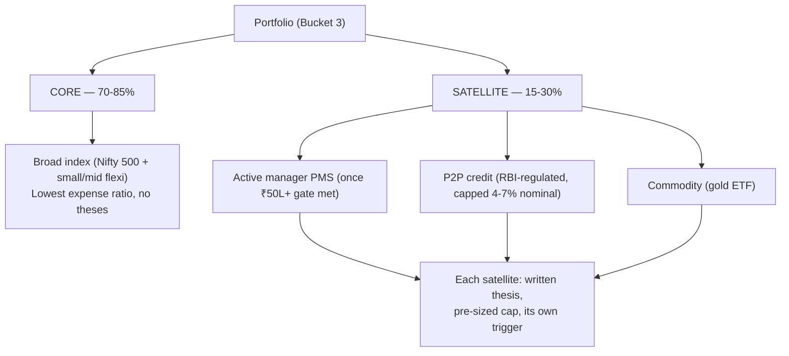
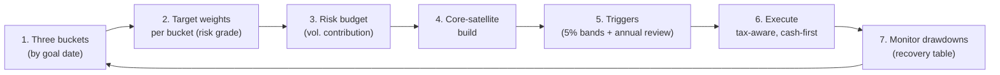

A portfolio is not a bag of investments; it is a **risk budget spent over time**. This article is the construction manual: how to build a target allocation from three goal-buckets, how to let it drift and bring it back with explicit triggers, how to do the rebalancing *tax-aware*, how to think in volatility contributions instead of nominal weights, and how to size and cap the drawdowns that actually matter. It is the advanced companion to `foundations-risk-allocation-behavior` (which asks *what to do*) and `pf-wealth-plan-10-lakh` (a concrete instance of this method at a ₹10 lakh starting point).

## Start from three buckets, not from a pie chart

Allocation work that begins with "how much equity should I hold?" is already one step behind, because it has not asked *what the money is for*. Structure the money by horizon first, then allocate within each bucket:

| Bucket | Money it holds | Horizon | Target character |
|---|---|---|---|
| **Bucket 1 — Emergency & short term** | 6-month expense buffer, any goal landing within ~3 years | 0–3 years | Capital first: liquid funds, sweep, short-duration debt, PPF-style fixed tenors. No meaningful equity exposure |
| **Bucket 2 — Goals** | Defined goals (home, child's higher education, etc.) | 5–10 years | 60/40-style blended mix that *de-gears into debt as the goal date approaches*; STP discipline |
| **Bucket 3 — Long horizon** | Retirement, wealth building, anything beyond 15 years | 15+ years | Equity-led (index core + satellites), full risk grade applied |

Three rules follow from the structure. **First**, money can only flow *out of* a bucket at its goal date, never borrowed between buckets — the emergency buffer is not a rate play. **Second**, each bucket gets its *own* allocation, its own trigger, its own no-trade rule; the moment you merge them, the emergency buffer starts earning equity risk. **Third**, the equity-risk question that everyone asks ("how much equity do I want?") gets answered *inside* Bucket 3 only, which is why most families' portfolios end up less volatile than their anxiety implies — or, worse, far more volatile than they believe, because "long-term money" was silently funding 5-year goals.

## Target allocation: band rebalancing vs calendar rebalancing

Pick a target weight for each sleeve within each bucket, then choose a *discipline* for restoring it. The two standard disciplines:

- **Calendar (time-based) rebalancing** — reset to targets at a fixed date (annual/semi-annual). Easy to audit; can be badly timed (you may sell equity at the start of a bull leg).
- **Band (threshold) rebalancing** — act only when a sleeve has drifted ≥ a fixed *absolute* percentage-point band from target. Cheaper (fewer trades), more tax-aware, and it turns rebalancing into an *event* you can pre-commit to — which is the whole point.

We use **5% absolute bands** as the default trigger for Bucket 3: a sleeve at 60% target is sold back when it reaches 65% or bought back when it falls to 55%. For Buckets 1–2, use *dates* (the goal date) rather than bands, because their rebalancing is de-gearing, not drift control.

| Discipline | Pros | Cons | Use when |
|---|---|---|---|
| Calendar (annual) | Simple, auditable, forces a review even in calm years | Can sell winners on schedule, at the top of a leg | You have not yet built the habit; you need the *forced review* more than the trade |
| Band (5% absolute) | Fewer trades, acts on genuine drift, naturally sells high / buys low | Requires monitoring (a quarterly look is enough) | You can commit to writing; the portfolio is large enough that trade costs matter |

For a ₹10–20 lakh portfolio, a common hybrid: **bands on the sleeves, and a hard annual review on the whole plan** — the review re-grades the risk and the assumptions (income growth, goal dates) even if no sleeve breached.

### Worked example: 60/40 drifts to 70/30, rebalance

Assume Bucket 3 holds **₹6,00,000 equity (60%) / ₹4,00,000 bond (40%)**, target 60/40, 5% absolute band. Over the year, equity rises **48%** and bonds fall **4%** (an aggressive equity year, a weak debt year — the exact combination that produces the drift):

| Position | Start | After 1 year | Weight after |
|---|---|---|---|
| Equity | ₹6,00,000 | 6,00,000 × 1.48 = **₹8,88,000** | 8,88,000 / 12,72,000 = **70.0%** |
| Bond | ₹4,00,000 | 4,00,000 × 0.96 = **₹3,84,000** | **30.0%** |
| **Total** | ₹10,00,000 | **₹12,72,000** | — |

Equity has drifted +10 percentage points past target — the 5% band is breached, so the trigger fires.

Rebalancing back to 60/40 on the new total of ₹12,72,000:

- Target equity = 0.60 × 12,72,000 = **₹7,63,200**
- Target bond = 0.40 × 12,72,000 = **₹5,08,800**
- **Trade: sell ₹1,24,800 of equity; buy ₹1,24,800 of bond.**

Notice what just happened: you sold the 48% winner and bought the 4% loser. That is *exactly* the behaviour the bias list in `foundations-risk-allocation-behavior` says you will avoid doing voluntarily — the band makes it mechanical. The trade is worth about ₹1.25 lakh (≈10% of the portfolio), which is why band width matters: a 5-point band on a large portfolio is not cost-free, and the trade should be executed in the *cheapest* sleeve form available (index ETFs, direct funds).

## Tax-aware rebalancing: the Indian investor's quiet edge

A rebalance is a taxable event (in India: LCG at 12.5% + 4% cess for equity held > 1 year; gains merge into slab rates for debt held > 3 years), so the *order* of your sales is worth real money. Three rules:

1. **Use losses first.** If any holding has an LCG-qualifying *loss* against your cost basis, sell it before selling winners; the loss offsets gains inside your ITR at the same character. A ₹50,000 loss in LCGs wipes out a tax bill you were otherwise about to pay.
2. **Sell LCG-heavy holdings to trim the overweight.** When you must sell equity to restore the band, prefer selling the position with the *largest* embedded long-term gain only *after* checking rule 1 — and prefer selling into strength (that is when the band fires, by construction). Selling at the band top means the tax cost is paid against the highest valuation, which is precisely the right time.
3. **Rebalance with cash, not sales, when possible.** Direct new SIP instalments and the year's fresh surplus *into the underweight sleeve*. For a ₹15,000 SIP, this is the cheapest rebalancing tool you own: ₹1.8 lakh a year of directed contributions quietly closes a 10-point band gap in under a year, with zero taxable events. Sell-only rebalancing is the fallback; cash-first is the default.

## Risk budgeting: volatility contribution, not nominal weights

Nominal weights are a *proxy* for risk, and a bad one. A "10% P2P sleeve" and a "10% equity sleeve" do not contribute 10% of the portfolio's risk each: equity at ~18–20% annual volatility dominates; a P2P vintage at ~8–10% contributes far less; and cash contributes almost none. The proper object of allocation is **volatility (or risk) contribution**: each sleeve's share of total portfolio risk.

$$\text{Vol. contribution of asset } i \;\approx\; w_i \times \sigma_i \bigg/ \sum_j w_j \times \sigma_j$$

(A single-asset approximation; the full expression uses covariance, but the product $w_i \sigma_i$ captures the intuition and is enough for a personal budget.)

Worked: 80% equity ($\sigma \approx 18\%$), 15% gold ($\sigma \approx 15\%$), 5% P2P ($\sigma \approx 10\%$):

| Sleeve | $w_i$ | $w_i \times \sigma_i$ | Share of risk |
|---|---|---|---|
| Equity | 0.80 | 0.80 × 0.18 = 0.144 | 0.144 / 0.1595 ≈ **90%** |
| Gold | 0.15 | 0.15 × 0.15 = 0.0225 | ≈ **14%** |
| P2P | 0.05 | 0.05 × 0.10 = 0.005 | ≈ **3%** |
| **Total** | 1.00 | 0.1595 | 100% (shares rounded) |

Read the table: the P2P sleeve is 5% of the money but only ~3% of the *risk*; gold is 15% of the money but ~14% of the risk. A risk budget says: *this is the share of my total risk I am willing to let each sleeve carry*, and then you choose nominal weights to achieve it — which is why a P2P sleeve at 7% nominal is a much larger *risk* commitment than the same percentage in short-duration bonds. The debt anchor here is the policy rate: with repo near 5.25% through late 2025 (last verified: 2026-08-06; src-rbi-repo), short-duration debt is genuinely *positive* yield, which is what makes it the correct ballast for a risk budget.

## Core-satellite: the structure that makes risk budgeting implementable

Text version: the core is the broad index sleeve holding 70–85% of the risk budget with zero thesis required; each satellite (active PMS, P2P credit, commodity) gets a written thesis, a pre-set nominal cap, and its own rebalancing trigger; satellites never get promoted to core.

The core is deliberately *uninteresting*: index funds at the lowest available expense ratio. The satellites are where views live — a PMS with a real edge, a P2P vintage you have diligenced, a gold position hedging currency/fear. Three structural rules:

- **Cap satellites so that a total satellite failure cannot endanger the bucket.** In `pf-wealth-plan-10-lakh`, P2P is 4–7% nominal across risk grades for exactly this reason.
- **Satellites de-gear or die.** A P2P vintage is a point-in-time credit decision: hold to scheduled maturity, do not "renew with more" unless you re-diligence from scratch.
- **Promotion is one-way.** When a satellite proves out (e.g., PMS beats its benchmark on a risk-adjusted basis for 3+ years) *and* your capital crosses the gate, you may raise its cap — never its status. Core stays core.

## Drawdowns: the recovery table that should end the argument

A drawdown is not a symmetric event. Losing X% requires gaining X/(1−X)% to recover — the denominator shrinks with the loss, and that is the nonlinearity that kills portfolios:

$$\text{Recovery required} = \frac{-d}{1-d} \times 100\% \qquad (d = \text{drawdown, e.g. } 0.50)$$

| Drawdown | Recovery required to break even |
|---|---|
| 10% | 11.1% |
| 20% | 25.0% |
| 30% | 42.9% |
| 40% | 66.7% |
| **50%** | **100%** |
| 60% | 150% |
| 70% | 233.3% |
| 90% | 900% |

The 50% row is the one to memorize: **a 50% loss needs a 100% gain.** Now plug in the numbers the market has actually produced. Indian broad equity has given investors multi-year 40–60% drawdowns (e.g., post-2008 and the 2020 crash-to-recovery). A full-equity portfolio that fell 50% at a realistic 12% *planning* CAGR (an assumption, not a forecast) needs **~6 years** to break even from the trough — meaning the first 6 years of any subsequent investment sequence start from a hole, not from zero. That is the quantitative argument for: (a) the risk grade in `pf-wealth-plan-10-lakh`, (b) the 5% bands here, and (c) the de-gearing of Buckets 1–2 before the goal dates. Drawdown management is not paranoia; it is the arithmetic of asymmetry.

## Fees, taxes, and the silent cost of doing it all wrong

Three cost lines, all compounding against you (the fee-drag method is fully worked in `foundations-compounding-returns`):

1. **Expense-ratio drag.** ~1% ER on a 12% gross equity return is worth roughly ₹1.58 lakh lost per ₹10 lakh start over 20 years (12% gross → ₹9.65L vs 11% net → ₹8.06L; assumptions labelled there). Across a core-satellite structure, *core at index-ETF cost* is where you stop paying for a view you do not have.
2. **Rebalancing trade cost.** With 5% absolute bands, a typical year produces 0–2 sleeve events; executing them in ETFs/direct funds keeps cost < 0.5% of the moved amount. Quarterly bands would nearly double the churn without meaningful risk improvement — do not over-trade the trigger.
3. **Tax churn.** The tax-aware rules above are worth more than most "alpha." Selling into a band top *with losses offset first* and *cash-first funding* is a systematic, repeatable edge that costs nothing to implement.

## Putting it together: a construction sequence

Text version: the seven steps form a loop — the monitoring step feeds back into bucket review, because goal dates and income change; the loop is the portfolio.

## How this article uses calculators

The DhanPedia calculators page at `/calculators` operationalizes this article's arithmetic:

- **Rebalance tool** — enter the 60/40 start (₹6L/₹4L) and the 48%/−4% year; it should output the exact trade pair: sell ₹1,24,800 equity / buy ₹1,24,800 bond.
- **Drawdown-recovery tool** — enter 50% and confirm 100% recovery; enter the −30% stress case from `pf-wealth-plan-10-lakh`'s scenario table and see the break-even horizon at your assumed CAGR.
- **XIRR/fee-drag tool** — verify the 1% expense-ratio drag on your actual contribution history (method and assumptions in `foundations-compounding-returns`).
- **Slab calculator context** — after a tax-aware rebalance, run the ITR-side numbers against the FY 2025-26 slabs (new regime: nil to ₹4L … 30% above ₹24L; 87A rebate ₹60,000) to confirm the LCG math.

Use the calculators as the *audit* step: the article builds the plan, the calculators verify the plan, and the update-log figures below verify the plan's inputs.

## Update log

- **RBI policy repo near 5.25% through late 2025** (debt-ballast anchor; re-verify at each MPC) — last verified: 2026-08-06; src-rbi-repo
- **Equity LCG at 12.5% + 4% cess; debt LCG (> 3 yrs) merges into slab income** — re-verify at each Budget — last verified: 2026-08-06
- **Planning CAGR assumption 12% and volatility figures (equity ~18–20%, gold ~15%, P2P ~10%)** — planning inputs, labelled as assumptions throughout, not forecasts; refresh the volatility inputs against a fresh 10-year rolling window before republishing
- **No PPF/SCSS/SGB rates are claimed in this article** (those live in `pf-wealth-plan-10-lakh` and `retirement-fire-annuities`, each with their own update logs)

## Related

- `foundations-risk-allocation-behavior` — the risk definitions and behavioural traps this method is designed to defeat
- `pf-wealth-plan-10-lakh` — a concrete ₹10 lakh instance of this construction method
- `alternatives-pms-aif-private` — satellite anatomy: PMS/AIF gates, minimums, fees
- `p2p-lending-complete` — the P2P satellite sleeve, in full: framework, expected loss, due diligence
- `foundations-compounding-returns` — fee-drag and post-tax math used in the cost section

## Sources & citations

- `src-rbi-repo` — Reserve Bank of India, "MPC decision: policy repo rate held near 5.25% through late 2025", https://www.business-standard.com/finance/news/rbi-to-keep-interest-rates-steady-at-5-25-through-2026-reuters-poll-126012900085_1.html — supports the debt-ballast / positive-yield anchor claim; re-verify quarterly per its limitation note.

The 5% band, risk-budget and recovery figures are the article's own arithmetic on labelled assumptions, not external statistics.

## Editorial / review status

Published; last verified 2026-08-06; next review due 2027-02-28. Educational content, not individualized advice.

## Sources & Citations

- **Reserve Bank of India** — RBI MPC decision, 3-5 Aug 2026: repo held at 5.25%, neutral stance, SDF 5.00%, MSF 5.50%. https://www.rbi.org.in/SCRIPTs/BS_ViewBulletin.aspx?Id=24369 (verified 2026-10-16)

---
Educational content, not individualized investment, tax, accounting, or legal advice.
Author: Chirag Singhal. DhanPedia.
