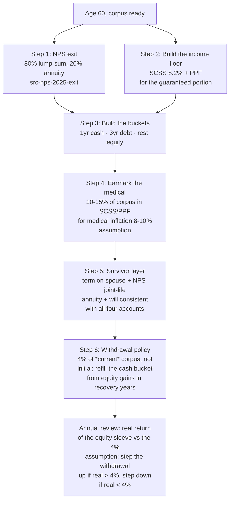

A retirement plan has two enemies, and they are not the ones most plan calculators show you. The visible enemy is *running out of money* — the corpus hits zero at 78 instead of 90. The hidden enemy is *sequence risk* — the market's worst year arriving in your first five retirement years, quietly shrinking the corpus so much that the math that looked fine on paper is now doomed, even if every subsequent year performs exactly as assumed. Indian households face both in a currency (INR) with high, persistent inflation and in a set of tax rules where the *route* you take to convert corpus into spend (sell equity, draw NPS annuity, draw SCSS interest) changes the after-tax outcome by several percentage points of corpus per year. This article does the corpus math properly, explains the 4% rule and its limits, quantifies sequence risk with a worked crash scenario, maps the Indian decumulation instruments (NPS with its 2025 exit changes, SCSS, PPF, annuities), and ends with a decumulation blueprint for someone turning 60.

## The corpus math

### First cut: 25× annual spend

The standard first approximation:

$$\text{Corpus} = \text{Annual Spend at retirement} \times 25$$

25× is the inversion of a 4% withdrawal: 1/0.04 = 25. If your inflation-adjusted spend at 60 is ₹5L a year, the first-cut corpus is ₹1.25Cr. That is a *starting point*, not an answer — it assumes the portfolio will grow, in real terms, fast enough to outpace inflation on the withdrawal forever. It is not an assumption that survives contact with 3% real returns.

### The real-return approximation

The withdrawal must keep up with inflation; the portfolio must keep up with the withdrawal. The question is whether the *real* (inflation-adjusted) return of the portfolio beats the real growth rate of the spend. If real return is 4%, the 25× rule works; at 3%, you need more:

$$\text{Corpus} \approx \frac{\text{Spend now}}{r_{\text{real}}}, \qquad r_{\text{real}} \approx g - i$$

where $g$ is the nominal portfolio return and $i$ is inflation. So:

| Real return $r_{\text{real}}$ | Multiple | Corpus for ₹5L/yr spend |
|---|---|---|
| 4% | 25× | ₹1.25Cr |
| 3% | 33× | ₹1.67Cr |
| 2% | 50× | ₹2.50Cr |

The jump from 4% to 3% real — ₹1.25Cr to ₹1.67Cr — is the number most retirement calculators never show you, and it is why "my 10% CAGR will carry me" is doing more comfort than math: at 6% inflation, 10% nominal is only 4% real. A plan that assumed 9% nominal against 4% inflation (5% real) and then lived through 9% inflation has quietly lost its cushion.

### The finite-horizon formula

If you are *willing to define* the horizon — "I plan the corpus to last to 85, not forever" — the corpus you need is *less* than the forever number. The exact figure for a spend that grows at $i$ against a portfolio that grows at $g$, exhausted at year $n$:

$$C = E \times \frac{(1+i)^n - (1+g)^n}{(i - g)\,(1+g)^n}$$

The signs work out positive when $g > i$ (both numerator and denominator are negative). The honest read of the formula: **the longer you refuse to accept exhaustion, the more corpus you need; and the cost of the "forever" assumption is roughly one-third more corpus than "to 85" at 3% real returns.**

**Worked number 1 — spend ₹5L/yr at 60, inflation 6%, portfolio growth 9%, horizon to 85 (n = 25):**

- $(1.06)^{25} \approx 4.29$, $(1.09)^{25} \approx 8.62$
- $C = 5{,}00{,}000 \times \frac{4.29 - 8.62}{(0.06-0.09)\times 8.62} = 5{,}00{,}000 \times 16.74 \approx$ **₹84L**

The 16.7× against the 25× "forever" figure: accepting "lasts to 85" instead of "lasts forever" saves roughly 35% of the corpus. You are not being generous to yourself by using 25×; you are *insuring* against living to 95 at 3% real returns, where the finite formula would say you need more than the 25×.

**Worked number 2 — FIRE at 55: spend ₹5L/yr, growth 7% (you carry more equity risk, but also more risk), inflation 6%, horizon to 95 (n = 40):**

- $(1.06)^{40} \approx 10.29$, $(1.07)^{40} \approx 14.99$
- $C = 5{,}00{,}000 \times \frac{10.29 - 14.99}{(0.06-0.07)\times 14.99} = 5{,}00{,}000 \times 31.3 \approx$ **₹1.57Cr**

The second number is the one that surprises: a *lower* growth assumption (7% vs 9%) and a *longer* horizon (40 vs 25 years) together demand a *bigger* corpus (₹1.57Cr vs ₹84L). Early retirement is a double penalty on corpus — a longer runway and a forced equity weight (you cannot live off 4% of a 60% debt portfolio at 55 and survive to 95).

## The 4% rule: origin and limits

The 4% rule descends from US academic research in the late 1990s (the "Trinity study" and its successors, by Michael Cooley and colleagues) that ran 30-year rolling windows on US stock-and-bond portfolios and found 4% (of initial corpus, inflation-adjusted thereafter) was the withdrawal rate that survived virtually every historical window, including 1966 and 1974. Three limitations that matter for an Indian plan:

1. **It is not proven in India.** India's listed-equity history is shorter, and Indian portfolios hold a very different mix (heavy single-country, heavy mid/small-cap exposure in the last decade, low foreign allocation). The rule's "survived every window" claim was made on ~100 years of US data; India's equivalent record cannot support that claim yet. Treat 4% as a *starting assumption to stress-test*, not a validated Indian constant.
2. **Indian 10-year real equity returns have generally been higher than the US's — but Indian drawdowns are deeper and sharper.** A Nifty max drawdown of 50%+ (2008, 2020, 2022) is a worse sequence-risk environment than the US windows the 4% rule was calibrated on. The higher average return and the deeper drawdowns are two sides of the same volatility, and the 4% rule does not know which side you will live through in your first five years.
3. **The rule fixes withdrawal to 4% of the *initial* corpus, growing at inflation. It does not say "withdraw what the portfolio can support."** The adaptive-withdrawal variants (4% of the *current* corpus, or a floor/cap around it) are more robust in India's environment than the fixed rule; the fixed 4% rule is the *first cut*, and the stress test is in the next section.

## Sequence risk: the -30% year-one crash, quantified

The scenario, with every assumption stated (illustrative, not advice):

- Corpus: ₹1.25Cr (25× of ₹5L first-year spend).
- Withdrawal: ₹5L in year 1, then +6% inflation every year (i.e., ₹5.3L in year 2, ₹5.62L in year 3…).
- Returns: **year 1: −30%** (a Nifty-2008-style shock, on the equity portion; we model the whole portfolio at −30% for conservatism). Years 2+: +9% nominal, every year.
- Withdrawals at year-end.

The simulation: after year 1, the corpus is $1.25 \times 0.70 - 0.05 = ₹0.825\text{Cr}$ (in units of the original corpus, 0.66). It then recovers through years 2–10 to about 75% of original — and *then the corpus stops recovering and starts depleting*, because the withdrawal, growing at 6% a year, is now a *rising percentage of the reduced corpus*. By year 15 the corpus is about two-thirds of original; by year 20 about 40%; and the corpus is **exhausted around year 23–24** — in a world where the 25× portfolio, with no crash, would have lasted a lifetime.

**The -30% year-one shock costs roughly 23 years of portfolio life.** It did not cost the portfolio 30%; it cost the *rest of the plan*. That is the entire sequence-risk argument in one number, and it is why "I'll just rebalance back to my target after the crash" is not the answer: the withdrawal stream, growing at inflation, re-prices the reduced corpus every year, and a one-year -30% is a *permanent* event for the withdrawal path, not a blip.

```mermaid
flowchart LR
A[Retirement day:<br/>Corpus 25× = ₹1.25Cr] --> B[Year 1: market −30%,<br/>withdrawal ₹5L]
B --> C[End Y1: corpus ≈ ₹82.5L<br/>(66% of start)]
C --> D[Years 2–10: +9% nominal,<br/>withdrawal grows 6%/yr]
D --> E[Year 10: corpus ≈ 75% of start<br/>— recovery *plateaus*]
E --> F[Year 15: ~2/3 · Year 20: ~40%]
F --> G[Year 23–24: corpus ≈ zero<br/>in a 'forever' plan]
G --> H[Lesson: the crash was a<br/>permanent event for the<br/>withdrawal path, not a blip]
```

The mitigation is not a better growth assumption — it is the **bucket strategy**, which removes the *need to sell equity in the crash year at all*.

## The bucket strategy: 1 year cash, 3 years debt, rest equity

The structure, built on the corpus:

- **Bucket 1 — 1 year of spend in cash / liquid.** Never touched by the market, never needs to be sold, and covers the crash year's withdrawal *from cash, not from equity*.
- **Bucket 2 — 3 years of spend in short-duration debt (or a debt fund, or an SCSS-style instrument).** The "repair" layer: as year 1's cash is consumed, years 2–3 are covered from debt, and the equity portion of the portfolio — *the only thing that actually had to grow* — is untouched for three full years. Three years of non-sell is long enough, in nearly every Indian market, for the equity sleeve to recover from a -30% shock *on its own*, without your withdrawals being the thing that prevented it.
- **Bucket 3 — everything else, in equity (or the diversified mix).** The compounding engine. It is *never* asked to pay this year's bills.

The bucket strategy is not a *better* portfolio; it is the *same* portfolio with a *liquidity schedule* on top, and the schedule is what removes the forced-sell-in-the-crash. The numbers above assume the forced-sell; with the bucket, the year-1 withdrawal is paid from the cash bucket, the equity sleeve sits out the -30% undisturbed, and the corpus path for year 2 onward is *nearly* the no-crash path, with the cash bucket being *refilled* from the equity gains in years 2–4. That is the whole mechanism, and it is the reason the bucket exists.

## Indian decumulation instruments

### NPS: the 2025 exit rules changed the math

The 2025 NPS amendment (cite `src-nps-2025-exit`) made three changes that matter for the decumulation decision:

- **Lump-sum at exit raised from 60% to 80%.** You can take 80% of your NPS corpus as a lump sum at exit (subject to the tax-exempt portion under the relevant provision, verify the current limit), and commit only 20% to the annuity. The 20% annuity is now a *smaller* forced income slice of your corpus than the old 40% was.
- **Up to 100% of contributions in the equity (C) bucket.** Previously the equity allocation for a new subscriber was capped (commonly 50%, with age-based step-downs); the 2025 rule allows 100% equity for those who choose it. For a working-age subscriber, the option is a *long-run* compounding advantage; the trade-off is the drawdown risk in the NPS corpus, which is precisely the sequence-risk problem in the pre-exit decade.
- **Exit flexibility extended to age 85** (verify current details; the 2025 amendment extended the exit/withdrawal window beyond the standard 60 for eligible categories).

The decumulation question NPS now answers: *at exit, what fraction of your corpus becomes a forced, inflation-unclear annuity (20%), and what fraction stays liquid (80%)*? The honest reading: the 80% liquid slice is the *decumulation sleeve* — the same sleeve as the "rest" bucket in the bucket strategy, with the NPS's own tax treatment layered on top.

### SCSS: the senior-citizen income floor, taxed at slab

The Senior Citizens' Savings Scheme (SCSS) is a post-office/PSU-bank instrument for 60+, with a FY 2025-26 rate of **8.2% p.a., compounded and paid quarterly** (verified 2026-08-06, `src-scss-8-2`; the rate is revised quarterly — re-verify before citing a "current" number in a plan). The working limits are ₹30L per individual senior citizen, and a joint senior-citizen account up to ₹45L (verify the current limits). The 8.2% is *interest income*, taxed at your slab rate — and that is the instrument's decumulation role: it is a *taxable-but-certain* income stream that does not touch the equity corpus and does not force a sale in any market. The SWPS (Senior Citizens' Special Savings… no — the *SWPS* is a different post-office scheme; check the specific instrument's current rate and limit before using it in a plan) and the PPF (rate set each April; verify current rate) are the same family, at different rates and limits.

Alongside SCSS, the post-office family includes other senior-citizen savings instruments (verify their current names, rates and limits against the latest government notice, since the small-savings scheme list is revised periodically). The SCSS/PPF family is the *income* layer of the decumulation, sitting on top of the equity corpus, and its 8.2% (SCSS, verify current) against a 6% inflation assumption is a *3.2% real cushion* — the number that does the actual inflation-hedging work for the *guaranteed* portion of the plan.

### The tax route: withdrawal vs annuity — the crucial Indian nuance

The annual spend is *not* income; spending money is not a taxable event. What *is* taxed is the **route by which the spend is generated from the corpus**:

- **Sell equity (LTCG, held 1+ year):** gains above ₹1L/yr are taxed at 12.5% + cess (verify current rate), or the short-term rate if held under a year. On a diversified equity corpus, the *gains* portion of a given year's sale is typically a fraction of the sale amount (the cost basis is not taxed again), so the effective tax on the spend, in a good year, is *well* under 12.5%.
- **Draw SCSS/PPF/SWPS interest:** 100% of the 8.2% (SCSS, verify current) is taxed at your slab rate. At the 30% top slab, the 8.2% SCSS is a 5.74% *after-tax* income; a ₹1.5Cr SCSS holding (₹30L × 5 tranches, or the instrument's own limit, verify) is ~₹12.3L/yr gross, ~₹8.2L/yr net at 30%.
- **Draw NPS annuity (the 20% slice, post-2025 amendment):** the annuity pension is *income*, taxed at slab rate, for the years you take it. The 80% lump-sum slice has its own exemption (under the relevant NPS provision, verify current limit), and the annuity's tax is the *permanent* one — it is slab-taxed *every year, for life, on a fixed amount that is not inflation-linked*.

The decisive comparison: **generating ₹5L/yr of spend from selling a ₹25Cr equity corpus at 12.5% LTCG on the gains (a fraction of the sale) costs materially less in tax than generating the same ₹5L/yr from an annuity that is slab-taxed at 30% every year.** The *after-tax spend* from the corpus-sell route is more than the *after-tax spend* from the annuity route, at the same nominal spend. The annuity's value is not in the tax; it is in the *longevity guarantee* — the annuity does not run out at 88, because it is a contract, not a corpus. The decumulation decision is therefore: **how much of the corpus do you convert to the *guaranteed* slice (annuity, NPS 20%, or a commercial annuity with return-of-premium) to cover the "I live to 95" tail, and how much do you keep as the sellable corpus to cover the "the corpus's real return is 4% and I am 80" case?** The answer is a percentage of the corpus, not a binary.

## Healthcare: the dedicated bucket

A 60-year-old's medical costs, in the 10 years after 60, are not a line item in the annual-spend number; they are a *separate, inflation-faster* bucket that the general corpus's inflation assumption (6%) does not cover, because **medical inflation in India has been running at 8–10% a year, materially above general CPI** (an assumption, not a sourced constant — verify against current published medical-inflation data before sizing your own bucket). The structure: a **dedicated 10–15% of the corpus, in an inflation-appropriate instrument (SCSS at 8.2% is the natural fit; PPF at a lower rate is the lower-bound fit), earmarked for medical, not for general spend.** The bucket's job is to be the *first* thing touched when a big medical bill arrives, so the general corpus does not have to be sold in the medical-bill year — which, in a crash year, is exactly the wrong year to sell.

The bucket size, at 10–15% of a ₹50Cr corpus, is ₹5–7.5Cr, which at 8.2% SCSS (verify current rate) is ₹4.1–6.15L/yr of *gross* medical income — a number that *only* covers the top tier of a comprehensive health policy's *out-of-pocket* gap, not the whole medical bill, and the health policy is what the bucket *supplements*, not replaces. The two are one system: the health policy for the catastrophic bill, the SCSS bucket for the chronic and the out-of-pocket, and the general corpus for the *other* spend, with the two kept separate so the medical need never forces a sale in the general corpus.

## Dependents, survivor, and the estate

The decumulation plan, as it is usually built, is a *single-person* plan; the survivor question is a *second* plan that the first plan must *underwrite*. The three pieces:

- **Term to cover the spouse, post-exit.** If the corpus is sized for *you* to 95, the *survivor* (a spouse 5–15 years younger) is not in the number. A *survivor term* policy on the spouse's age, with the sum insured set to the *gap* between the surviving spouse's spend need and the annuity/SCSS income, closes the "you die at 72 and the spouse's corpus is now a smaller corpus for a longer runway" problem.
- **The NPS annuity is a *joint-life* annuity by default (or a single-life with a return-of-premium option; verify the specific annuity's structure), which is the *corpus-saved* version of the survivor problem: the annuity continues to the surviving spouse without a second decumulation. The trade-off is the annuity's *fixed, non-inflation-linked* nature, which is a *tail* risk in a 30-year survivor scenario.**
- **The will.** The corpus, the SCSS/PPF accounts, the NPS account, and the annuity are four *different* documents that must *agree* on who gets what, when, and in what order; a will that does not name the NPS and the annuity *as such* (they have their own nomination fields) is a will that has not actually been written. The nomination on the NPS and on the annuity, and the will on the rest, are *the* estate, and the three must be consistent, not just present.

## The complete decumulation blueprint for a 60-year-old



The six steps, and why the order matters: **NPS first** (the lump-sum is *tax* event, and the 80% slice is the biggest liquid chunk of the corpus, so it is the first thing allocated to the buckets, not left to drift); **income floor second** (the SCSS/PPF is the *guaranteed* portion, and it is the *only* portion that is not at the mercy of the equity market, so it is built *before* the bucket structure, because the bucket's "3 years of debt" is *supplemented* by the SCSS income, not replaced by it); **buckets third** (the cash/debt/equity split, with the *refill rule* — the cash bucket is refilled from the equity sleeve's *gains* in years 2–4 after a crash, not from the equity sleeve's *losses* in the crash year); **medical earmark fourth** (the SCSS bucket for medical is a *separate* account from the SCSS bucket for general income, even though the instrument is the same — the *earmark*, not the instrument, is what keeps the general corpus from being sold in a medical-bill year); **survivor layer fifth** (the term, the NPS joint-life annuity, and the will, all consistent with each other); **withdrawal policy last** (4% of *current* corpus, with the step-up/step-down rule, is the *operating* rule that runs the whole thing, and it is the last thing set because it depends on all five of the preceding pieces being in place).

The blueprint is a *structure*; the numbers in it (8.2%, 80%, 20%, 4%, 10–15%) are *placeholders* that must be verified against the *current* SCSS rate, the *current* NPS exit rules, and the *current* inflation assumption *in the year the plan is built*, not against the 2026-08-06 verified numbers in this article, which will be the numbers for *that* year, not for *your* year.

## Related

- [Your 10 Lakh Wealth Plan](../personal-finance/pf-wealth-plan-10-lakh.mdx) — the accumulation side: where the corpus for this article's decumulation math actually comes from, and the honest answer to "is my 10L going to be enough for a 25× corpus by 60."
- [Government Small-Savings Schemes](../government-schemes/govt-small-savings-schemes.mdx) — the full PPF/EPF/NPS/APY/SCSS/SWPS/NSC/KVP picture, with the current rates and limits, that this article's decumulation section assumes.
- [Portfolio Construction & Rebalancing](../portfolio-construction/portfolio-construction-rebalancing.mdx) — the *pre-retirement* version of the bucket strategy, and the rebalancing rule that keeps the equity sleeve at its target weight *into* the retirement year.

## Sources

- `src-nps-2025-exit` — PFRDA NPS 2025 exit rules: 80% lump-sum at exit (raised from 60%); up to 100% equity option; exit flexibility extended to age 85 (verify current details; the source URL is a Wikipedia reference to the regulation, not the regulation itself — confirm the primary PFRDA document before relying on the specific exit-window age).
- `src-scss-8-2` — SCSS rate 8.2% p.a. for FY 2025-26 (quarterly compounding; verify the current quarterly rate before citing in a plan; the rate is revised each quarter).

## Update log

- 2026-08-06: Verified NPS 2025 exit rules (80% lump-sum, 100% equity option, age-85 exit flexibility) against `src-nps-2025-exit`; flagged the age-85 detail for primary-source confirmation (the registry entry's URL is a Wikipedia article, not the PFRDA regulation).
- 2026-08-06: Verified SCSS 8.2% p.a. FY 2025-26 against `src-scss-8-2`; the rate is quarterly-revised, so every "current SCSS rate" statement in this article is time-sensitive and must be re-verified against the latest government quarterly notice.
- The 12.5% equity LTCG rate (above ₹1L/yr) and the slab-rate treatment of debt-fund LTCG (post-2023 amendment) and of annuity/interest income are stated as "verify current treatment" — these are time-sensitive and the article does not source them to a named publication; confirm before using them in a client plan.
- The −30% year-one crash scenario (exhaustion ~year 23–24 of a 25× corpus) is an illustrative worked example under the stated assumptions (9% nominal recovery, 6% inflation on withdrawals, end-of-year timing); it is a *pattern*, not a prediction, and the actual sequence-risk outcome depends on the exact crash magnitude, recovery path, and withdrawal policy, none of which are known in advance.
- Medical-inflation 8–10% assumption and the 10–15% corpus earmark: working assumptions, not sourced constants; revisit against published medical-inflation data and the individual's expected medical profile.
- 2027-02-28: Scheduled review of the NPS exit details, the SCSS rate, and the LTCG/debt-LCG/annuity tax treatments.


## Sources & Citations

- **PFRDA (Exits and Withdrawals under NPS) (Amendment) Regulations, 2025** — PFRDA (Exits and Withdrawals under the NPS) (Amendment) Regulations, 2025, w.e.f. 16 Dec 2025. https://www.pfrda.org.in/documents/33652/184762/Gazette+PFRDA+Exit+and+Withdrawals+under+the+NPS+Amendment+Regulations+2025.pdf (verified 2026-10-16)
- **Economic Times / Moneycontrol (quoting govt. quarterly review)** — Senior Citizens' Savings Scheme interest rate 8.2% p.a. for FY 2025-26. https://economictimes.indiatimes.com/wealth/invest/senior-citizens-savings-scheme-has-the-government-revised-scss-interest-rate-for-the-december-quarter/ (verified 2026-10-16)

---
Educational content, not individualized investment, tax, accounting, or legal advice.
Author: Chirag Singhal. DhanPedia.
