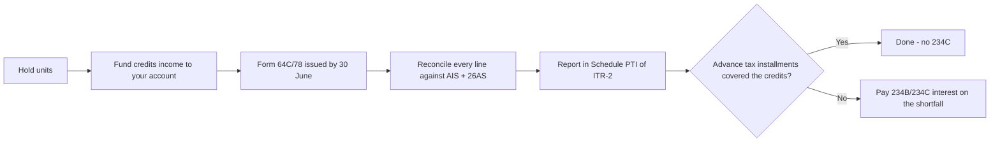

The [AIF category selection guide](../alternatives/alternatives-aif-category-selection-guide.mdx) decided
*which* category to put your crore in. This article answers the question that quietly costs investors the
most: **how does that AIF's income actually reach your ITR, at what rate, and on what deadline?** Get this
wrong and you are not just underpaid — the department cross-checks AIF credits against the AIS, and the
interest under the [advance-tax clocks](../taxation/tax-advance-itr-final-checklist.mdx) is the one avoidable
cost in the whole structure.

## The one distinction that drives everything

A PMS is *yours* — every trade is your capital gain. An AIF is a *pooled vehicle*, and the law decides
whether the fund's income **flows through to you** (keeping its original character) or **stops at the fund**
(and is taxed there). That fork is set by the category:

| | PMS | AIF Cat I & II | AIF Cat III |
|---|---|---|---|
| What you own | The securities | Units of the fund | Units of the fund |
| Who is taxed | You, on every trade | You, on fund income (**pass-through, §115UB**) | Usually the fund, not you |
| Governing provision | Normal capital-gains rules | §115UB pass-through | Fund-level trust taxation |
| Character of income | Retained | Retained | **Lost** — taxed at fund level |
| TDS you receive | On dividends & interest | **10% under §194LBB** | Fund pays tax at max marginal rate |
| Your source document | Capital-gains statement | **Form 64C** (→ Form 78) | The fund's own statement |

The headline: **in Category I and II you are taxed on what the fund reports; in Category III the fund pays
first and you receive the residue.** A Cat III headline return is therefore *not* comparable to a PMS or
Cat I/II return — the tax is already inside the fund's number.

## Category I & II: the pass-through, and its two breaks

Section 115UB accords Category I and II AIFs pass-through status. Income the fund earns is taxed in
**your** hands as though you earned it directly, retaining its character:

- Interest a private-credit fund earns → **your** interest income, slab-taxed.
- Capital gains on the fund's exit from a portfolio company → **your** capital gains, at CG rates.
- Dividends → **your** dividend income, slab-taxed.

**Two things break the neatness and are where money is lost:**

1. **Business income is NOT passed through.** Any income the fund earns under the head "profits and gains of
   business" is taxed *at the fund level* at the maximum marginal rate, and then reaches you **tax-free**. You
   never double-pay it — but you also cannot set it off against your own losses.
2. **Losses do not flow down.** A fund's *business* losses stay at the fund level and cannot be passed to
   you. Other losses are passed **only if you have held your units for at least 12 months**. Exit earlier and
   the loss is stranded in the fund — you cannot use it to offset your own gains.

The Budget FY26 clarity: income received by Cat I/II funds is **characterized as capital gains, not business
income**, which removes the earlier uncertainty that high-churn strategies might be pushed into the heavier
business-income head.

## Category III: the fund pays, usually at ~42.7%

Category III funds (long-short, listed-equity strategies, most hedge-fund-style AIFs) have **no
pass-through regime**. In practice a Cat III AIF set up as a trust is taxed at the fund level — frequently at
the **maximum marginal rate, ~42.7% including surcharge** — and you receive income *net* of that tax.

Specific Cat III vehicles can qualify for exemptions under §10(4D), §10(23FF) and §10(23FBC), and income from
non-specified securities is taxed under §115AD at concessional rates. But the two consequences you must know
*before* investing remain:

- **Character is lost.** A long-term equity gain that would have cost you 12.5% in your own hands can be
  taxed at the fund's rate.
- **You cannot set off your own losses** against income that was already taxed at the fund level.

One offset: the fund-level tax applies **at exit or redemption**, so your capital compounds *tax-deferred*
inside the fund during the holding period. That deferral is a real, if imperfect, benefit.

**Read the fund's tax note and its annual statement — do not assume your own slab applies to a Cat III.**

## The form migration: 64C/64D to 78/79 (from 1 April 2026)

This is the change most investors will trip over in AY 2027-28. India's tax framework moved from the
Income-tax Act 1961 to the **Income-tax Act 2025 (effective 1 April 2026)**, and the AIF forms were renamed:

| Purpose | Old framework (AY 2026-27, FY 2025-26) | New framework (AY 2027-28+) |
|---|---|---|
| Investor-level statement | **Form 64C** | **Form 78** |
| Fund-level consolidated statement | **Form 64D** | **Form 79** |
| Governing provision | §115UB, Rule 12CB | §224, Rule 145 |
| Fund statement deadline | 15 June | 15 June |
| Investor statement deadline | 30 June | 30 June |

**The Income-tax Department expressly maps 64C→78 and 64D→79.** The mechanics are unchanged: the fund files
the consolidated form (79/64D), the system generates each unit-holder's statement (78/64C), and the fund
delivers it to you. **Do not "upgrade" an old document to the new number** — income belonging to a year that
began before 1 April 2026 is still governed by the old Act and the old forms. Identify the tax year first,
then the form.

## TDS: 194LBB and why it rarely covers your real liability

For Category I & II pass-through income, TDS is deducted at **10% under §194LBB** on the income *credited*
to you — whether or not it is actually distributed. Claim it in your return like any TDS. But here is the trap
that connects straight to the [advance-tax clocks](../taxation/tax-advance-itr-final-checklist.mdx):

> A capital gain or a fund credit is **not** covered by salary TDS, and the 10% §194LBB deduction rarely
> covers your real liability. If you have not paid the balance by the quarterly dates, you owe **234C**
> interest. The one concession: gains are only required to be paid in the installment **falling after the
> gain arises**, not spread across earlier ones.

So the sequence for any year you hold a Cat I/II AIF:

## Schedule PTI and where it all lands

Pass-through income is reported in **Schedule PTI (Pass Through Income)** of ITR-2, fund by fund, head by
head: business/profession, long-term CG, short-term CG, dividends, other sources, eligible losses, and TDS.
Report it **by character and classification exactly as the fund's statement shows** — not by the amount that
reached your bank account. Under pass-through, income can be taxable on the basis of *deemed credit* even if
nothing was distributed to you.

## AIF vs PMS: the reporting shape

| | PMS | AIF Cat I/II | AIF Cat III |
|---|---|---|---|
| Reporting unit | Scrip-by-scrip capital-gains statement | Head-by-head pass-through (64C/78) | Fund-level tax note |
| ITR schedule | CG (sched CG) | **PTI** | Income as reported by fund |
| Surcharge cap on CG | 15% (for §111A/112/112A) | 15% on the CG lines | Fund already pays |
| Fee deductibility | **Not** deductible against CG (§48) | Fee inside the fund | — |

That last row is the quiet cost: **PMS/AIF management and performance fees are not deductible against capital
gains** — they are neither part of the acquisition cost nor an expense "wholly and exclusively" in connection
with the transfer, which are the only two things §48 allows. The return in your performance report is
*pre-tax, post-fee*; your tax is computed on a figure that ignores the fee entirely. Budget that gap — it is
the [fee-decay you must beat](../alternatives/alternatives-hnw-pms-aif-sif-selection.mdx).

## Related

- [AIF Category Selection: Which Rung of ₹1Cr Fits Your Capital](../alternatives/alternatives-aif-category-selection-guide.mdx)
- [Advance Tax, the 234B/234C Interest Clock & the Final ITR Checklist](../taxation/tax-advance-itr-final-checklist.mdx)
- [Beyond SIP: PMS, AIFs & Private Markets](../alternatives/alternatives-pms-aif-private.mdx)
- [Tax Loss Harvesting](../taxation/tax-loss-harvesting.mdx)

## Sources

- AIF pass-through & 194LBB TDS, Cat III fund-level tax, 64C/64D — <a href="https://49tax.ai/blog/pms-aif-taxation-india-guide">49Tax PMS/AIF Taxation Guide (AY 2026-27)</a>
- Form 64C/64D → 78/79 migration under the Income-tax Act 2025, §224/Rule 145, Schedule PTI — <a href="https://www.altportfunds.com/aif-tax-forms-itr-reporting">Altportfunds AIF Tax Forms</a>
- Advance-tax installments, 234B/234C clocks, capital-gains 31-Mar relief — <a href="https://taxclue.in/guide/advance-tax-calculator">TaxClue advance-tax guide</a>

## Update log

- 2026-10-18 — Wave 7: 115UB pass-through vs Cat III fund-level tax, the 194LBB 10% TDS trap, the
  business-income non-pass-through rule, the 12-month loss hold requirement, and the 64C/64D→78/79
  migration (Income-tax Act 2025, effective 1 Apr 2026). The Cat III ~42.7% fund-level rate is a
  secondary reading; confirm the exact rate and the specific-exemption sections (10(4D), 10(23FF),
  10(23FBC), 115AD) with a CA for the assessment year before acting. Form numbers and deadlines to be
  re-verified at each Finance Act and against the Income-tax Department's ITR-2 documentation.

## Sources & Citations

- **Income-tax Act, 2025 (FY 2026-27), Sec 207-211, 234B, 234C — via TaxClue advance-tax guide** — Advance tax FY 2026-27: duty when tax after TDS exceeds Rs.10,000; four cumulative installments 15 Jun (15%) / 15 Sep (45%) / 15 Dec (75%) / 15 Mar (100%); Sec 234C interest 1%/mo on each quarterly shortfall (3-month tails on the first three, 1-month on the last); Sec 234B 1%/mo from 1 Apr when advance paid is under 90% of assessed tax; capital-gains/lottery/dividend income arising after a date attracts no 234C if paid in the remaining installments (last quarter by 31 Mar); 44AD/44ADA presumptive taxpayers may pay 100% by 15 Mar in one installment. https://taxclue.in/guide/advance-tax-calculator (verified 2026-10-17)
- **Income Tax Department / Union Budget 2025 (Finance Act 2025) — FY 2026-27 slabs** — Income-tax slabs, new regime, FY 2026-27 (AY 2027-28) — unchanged from the Budget 2025 reset: 0-4L nil, 5% to 8L, 10% to 12L, 15% to 16L, 20% to 20L, 25% to 24L, 30%+; Sec 87A rebate extends tax-free up to Rs 12L; standard deduction Rs 75,000. https://cleartax.in/s/income-tax-slabs (verified 2026-10-16)
- **Income-tax Department of India (e-filing portal)** — Income-tax filing and advance-payment final dates for FY 2026-27: ITR-1/2/3/4 standard deadline 31 July 2027 (non-audited), 15 July 2027 (audited); verify the exact dates against the Income-tax Department each year-end. https://www.incometax.gov.in (verified 2026-10-17)
- **49Tax PMS/AIF Taxation Guide (AY 2026-27) / Altportfunds AIF Tax Forms / TaxHeal pass-through AY 2026-27** — AIF tax forms AY 2026-27 vs AY 2027-28: Section 115UB pass-through (Cat I/II) vs fund-level trust taxation (Cat III); 194LBB 10% TDS on credited income; business income NOT passed through; losses pass through only after 12-month hold; the 64C/64D -> 78/79 form migration under the Income-tax Act 2025 (effective 1 Apr 2026, Sec 224 / Rule 145); Schedule PTI reporting in ITR-2. https://www.altportfunds.com/aif-tax-forms-itr-reporting (verified 2026-10-18)

---
Educational content, not individualized investment, tax, accounting, or legal advice.
Author: Chirag Singhal. DhanPedia.
