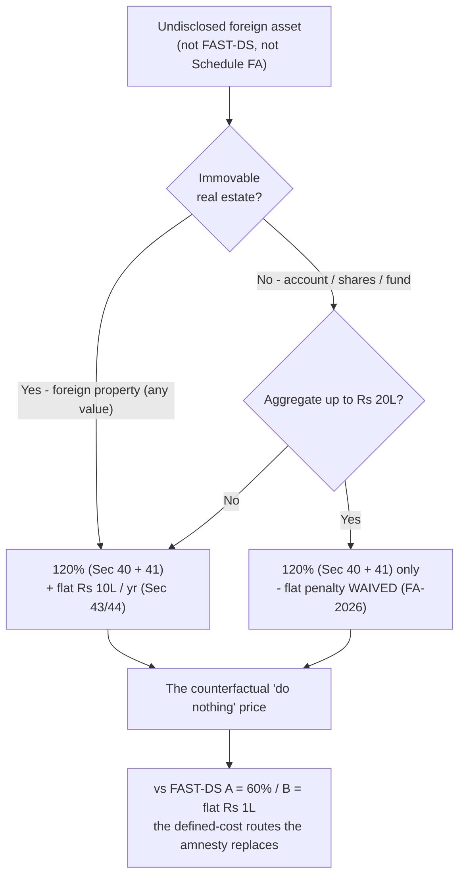

The [FAST-DS 2026 article](./tax-fastds-2026-declaration.mdx) is the *defined-cost* layer: pay 60% of the value (Category A) or a flat ₹1L (Category B) and get immunity. This page is the **counterfactual layer** the FAST-DS article deliberately left pointed at but did not compute: **what happens to an undisclosed foreign asset if you do *nothing* — no FAST-DS declaration, no Schedule FA disclosure, no successor scheme.** That "nothing" is not neutral; it is the **Black Money (Undisclosed Foreign Income and Assets) and Imposition of Tax Act, 2015** enforcement track, and its price is *structurally worse* than any amnesty cost. The whole reason FAST-DS exists is that this counterfactual is the number you are trying to avoid. Everything below is a planning model; the actual BMA assessment is a departmental order, not a calculator output.

## The counterfactual exposure (the "do nothing" price)

The Black Money Act 2015 is the *enforcement* framework; FAST-DS is a one-time way *out* of it. For an undisclosed foreign asset / income that you have not regularised and not disclosed, the counterfactual exposure is built from three sections:

| Section | What it charges | The math |
|---|---|---|
| **Section 40** | A tax on the undisclosed foreign income / asset | **30% of the value** |
| **Section 41** | A penalty on *concealment* of the income in relation to a foreign asset | **3 × the tax = 90% of the value** |
| **Section 43 / 44** | A flat penalty for failing to disclose the asset in **Schedule FA** (or furnishing inaccurate particulars) | **₹10,00,000 per defaulting assessment year** |

The first two are the headline number: **30% + 90% = 120% of the undisclosed value.** That is *deliberately* more than the value itself — the Act is designed so that the *cost of being caught* exceeds the asset, which is the whole deterrent. The Section 43/44 flat penalty is then **added on top, per year of non-disclosure**, so a multi-year omission compounds a ₹10L charge on the back of the 120%.

Worked: a ₹50L foreign bank account that was never in any Schedule FA and is not FAST-DS-regularised, with the omission spanning **3 assessment years**:

| Component | Amount |
|---|---|
| Section 40 tax (30% × ₹50L) | **₹15L** |
| Section 41 penalty (3 × tax = 90% × ₹50L) | **₹45L** |
| Tax + penalty (120% of value) | **₹60L** |
| Section 43/44 flat penalty (3 yr × ₹10L) | **₹30L** |
| **Total "do nothing" counterfactual** | **₹90L** |

Against that, the **FAST-DS Category A** defined cost for the *same* ₹50L is **₹30L** (60% of value). The **₹60L gap** is not an accident — it is the *exact price of the one-time amnesty*, and it is the number that answers "should I file FAST-DS before 31 December 2026?" for a category-A asset: *yes, by a factor of 2–3*, and the gap widens with every additional non-disclosure year (each adds another ₹10L to the counterfactual).

## The Finance Act 2026 threshold exception (the one soft edge)

There is exactly one place the counterfactual gets *softer*, and it was introduced by the **Finance Act 2026**: the flat **₹10L Section 43/44 penalty does not apply where the aggregate value of *non-immovable* foreign assets stays within **₹20 lakh**.** The logic is proportionality — a small, forgotten forex balance is not worth a ₹10L penalty stamp, so the *flat* penalty is waived for it.

Three precise consequences the exception does and does not change:

- **It only removes the *flat* ₹10L penalty, not the 120%.** Even a ₹15L non-immovable account that escapes the flat penalty still owes the **Section 40 30% + Section 41 90% = 120%** on the value if it is assessed as undisclosed. The soft edge is real but narrow.
- **It is value- and asset-class-specific.** The waiver is for **non-immovable** assets (a foreign bank account, foreign shares, a foreign fund) *at or under ₹20L in aggregate*. A **foreign immovable property** — no matter how small — *never* gets the waiver; the flat penalty applies to it in full.
- **It is a 2026-budget position and can move.** The ₹20L threshold is a Finance-Act 2026 figure; a later Budget can raise, lower or repeal it, so the "is my small account safe from the flat penalty?" answer should be re-checked each year (the update log carries this to the 2027-04-17 review).

**Alt text:** The Black Money Act counterfactual: a non-immovable foreign asset under ₹20L escapes only the flat ₹10L penalty (FA-2026) but still owes 120% (Section 40 + 41); anything over ₹20L or any foreign immovable property owes 120% *plus* the flat ₹10L/yr. Both are far above the FAST-DS 60% / flat-₹1L defined-cost routes.

## The three ways out (and why they are not the same thing)

There are three distinct routes, and conflating them is the core mistake:

1. **FAST-DS 2026 (the one-time defined cost, Category A = 60%, Category B = flat ₹1L, deadline 31 Dec 2026).** This is the *only* route that trades a **calculable, lower** cost for **immunity** from further tax, penalty and BMA prosecution. It is the route the counterfactual exists to make unnecessary. [→ the FAST-DS article](./tax-fastds-2026-declaration.mdx)
2. **Schedule FA going forward (the routine, ongoing obligation).** For every year *after* the asset is properly reported, the obligation is to keep disclosing it in Schedule FA each year — there is *no penalty* for correct disclosure, only for *omission or inaccuracy*. This is not an "out"; it is the *normal state* the counterfactual is a failure of.
3. **The open-ended BMA assessment (the "do nothing" counterfactual — 120% + flat ₹10L/yr).** This is what happens if *both* of the above are skipped: the department finds the undisclosed asset (often through the information exchange with the home-country tax authority), assesses Section 40 + 41, and stacks the Section 43/44 flat penalty for each defaulting year. **There is no cap, no deadline and no amnesty on this route** — it is the open-ended exposure the Act is built to impose.

The decision is therefore not "BMA vs FAST-DS" — it is: *did I use route 1 (FAST-DS) while the window was open, and am I now on route 2 (Schedule FA)?* If the answer to route 1 is "no" (the window closed, or the asset was above the FAST-DS ceiling), the only route left is 3, and the counterfactual in the first table *is your liability*.

## The penalty is per defaulting year (the compounding trap)

The Section 43/44 flat penalty is the part most people underestimate: it is **₹10L *per assessment year* the Schedule FA omission persisted**, not a one-time charge. An asset that was undisclosed across 2022-23, 2023-24 and 2024-25 carries **three** flat penalties (₹30L) on top of the 120%. This is why the "I'll just disclose it in this year's return" instinct is *partly* right and *partly* a trap: a late Schedule FA entry fixes the *current-year* omission but does not retroactively erase the flat penalties for the *prior* defaulting years — and a late self-disclosure, unlike a FAST-DS declaration, gives you **no immunity** from the Section 41 concealment penalty for the years you had already omitted. The FAST-DS route is the *only* one that bundles "I declare, I pay a defined amount, and I'm done" into a single instrument.

## A worked example: the ₹50L forgotten account, three routes

Same facts (a ₹50L non-immovable foreign account, never reported, 3 years of omission). The three routes price differently:

| Route | Cost | What you get |
|---|---|---|
| **FAST-DS Category A** (if it was *never* taxed elsewhere) | **₹30L** (60% of value) | **Immunity** from further tax, penalty & BMA prosecution — the clean exit |
| **FAST-DS Category B** (if it *was* taxed elsewhere but missed Schedule FA) | **₹1,00,000 flat** | Immunity for the omission — by far the cheapest if the asset was ever taxed |
| **Do nothing → BMA counterfactual** | **₹90L** (₹60L = 120% + ₹30L flat / 3 yr) | No immunity — you have simply paid the open-ended assessment, and the Section 41 "may" reading (a Mumbai ITAT Special Bench held the penalty word "may" to be *directory*, not *mandatory*, in *Mr. Vinil Venugopal & Mrs. Ranjeeta Vinil*) only gives the department *discretion*, not you a right |

The **₹90L vs ₹30L vs ₹1L** spread on the *identical asset* is the entire argument for reading the FAST-DS article's "was it ever taxed?" question *first*: the reclassification from Category A to Category B alone saves **₹29L**, and choosing *any* FAST-DS route over "do nothing" saves **₹60L+**.

## When the counterfactual is survivable (the honest layer)

- **The ₹20L non-immovable FA-2026 soft edge** is the one case where "do nothing" is *less* catastrophic than the 120%-plus-flat picture: a small forgotten forex account under ₹20L still owes 120% (not a tiny number, but bounded) and *skips* the flat-penalty stacking. It is the *only* scenario where the open-ended route is arguably survivable, and even there the 120% is 2× the FAST-DS Category A cost.
- **The per-year flat penalty makes time the enemy.** The longer the omission, the more ₹10L stacks; this is a *deadline* argument, not a strategy argument.
- **The "may" discretion is not a defence you can rely on.** The ITAT's directory reading of Section 43 means the *department* may or may not impose the flat penalty — that is a coin flip in the assessee's disfavour, not a planning input. You do not plan around the hope that an officer uses their discretion leniently.
- **Above the FAST-DS ceilings** (undisclosed > ₹1 cr, or missed-Schedule-FA > ₹5 cr), FAST-DS simply *cannot* be used, and the entire counterfactual is the only route — which is the honest limit of the amnesty and the reason a large undisclosed foreign asset needs professional handling, not a calculator.

## What to do (before the window closes and beyond it)

1. **Answer the Category question first** (*was this asset ever taxed or reported?*) — that decides FAST-DS Category B (the flat-₹1L cheap route) vs Category A (60%), and the "do nothing" counterfactual is the fallback for both if you miss the window.
2. **Check the value as of 31 March 2026** and the **₹20L non-immovable FA-2026 threshold** to know whether the flat-penalty soft edge applies to your specific asset.
3. **Count the defaulting years** — the flat penalty is *per year*, and this is the number that makes time the enemy.
4. **Run the [black-money-act-exposure calculator](/calculators/black-money-act-exposure)** for the "do nothing" total, and the [fast-ds-declaration calculator](/calculators/fast-ds-declaration) for the "defined cost" total; the **gap between the two is your amnesty's value**.
5. **If the window is still open (before 31 Dec 2026)** and the asset is within a FAST-DS ceiling, **file FAST-DS** — it is the *only* defined-cost, immunity-bearing route.
6. **If the window has closed or the asset is above the ceilings**, keep the asset on **Schedule FA every going-forward year** and get professional advice on the open-ended BMA exposure for the prior defaulting years.
7. **Reconcile with a CA** — the BMA "may" discretion, the FA-2026 threshold, and the per-year penalty stacking are all facts that a specific asset's record must be checked against, not assumed.

## The one-line verdict

**"Do nothing" on an undisclosed foreign asset is not a neutral position — it is the Black Money Act counterfactual: 120% of the value (Section 40 30% tax + Section 41 90% penalty) plus a flat ₹10L per defaulting year (Section 43/44), softened only for a non-immovable asset under the ₹20L Finance-Act-2026 threshold.** The defined-cost routes that *replace* it are FAST-DS Category A (60% of value) or Category B (a flat ₹1L), both carrying immunity, and both *only* while the one-time window (31 Dec 2026) is open. The gap between "do nothing" (₹90L on a ₹50L/3-yr asset) and the cheapest defined route (₹1L) is not an artefact — it is the entire economic reason the amnesty was passed. The **black-money-act-exposure calculator** runs that gap on your exact value, years and asset class.

## Update log

- **2026-10-18 (Wave 26):** created. Verified the Black Money Act 2015 counterfactual structure against the Act's text and 2026 coverage: **Section 40** (30% tax on the undisclosed foreign income/asset), **Section 41** (a penalty of 3× the tax = 90% of value, a 120% total), **Sections 43/44** (a flat ₹10,00,000 per defaulting assessment year for a Schedule FA omission or inaccurate particulars), and the **Finance Act 2026 exception** (the flat ₹10L penalty does not apply where aggregate *non-immovable* foreign assets stay within **₹20L**). Cross-checked the ITAT Special Bench (*Mr. Vinil Venugopal & Mrs. Ranjeeta Vinil*) directory-reading of the Section 43 "may" word.
- **Review by 2027-04-17:** re-verify the Finance Act 2026 **₹20L non-immovable threshold** (a later Budget can change it) and whether the Section 40/41 rates or the Section 43/44 flat-penalty structure have moved; this is the counterfactual, so any change re-prices the "do nothing" column.

## Sources

- `src-us-stock-tax-india-2026` — the Black Money Act 2015 enforcement structure (Section 40 30% tax, Section 41 3× penalty, the flat-₹10L-per-year Schedule FA non-disclosure penalty under Sections 43/44) and the FAST-DS 2026 scheme terms it is a way out of; the Section 43 "may"-word directory reading and the per-year penalty stacking.
- `src-it-slab-fy2026-27` — the FY 2026-27 context for why the 120% counterfactual and the flat-₹10L/yr Schedule FA penalty are priced the way they are relative to a normal assessment, and the Finance Act 2026 **₹20L non-immovable** flat-penalty exception.

## Related

- [FAST-DS 2026 Declaration (the defined-cost layer this page is the counterfactual of)](/articles/tax-fastds-2026-declaration)
- [Direct LRS US-Equity Filing Walkthrough (the routine Schedule FA layer, layer 4)](/articles/tax-direct-lrs-us-equity-filing-walkthrough)
- [International Investing & LRS](/articles/international-investing-lrs)
- [The Complete Indian Investor Tax Guide](/articles/tax-india-investor-complete)
- The **black-money-act-exposure** calculator — run your exact undisclosed value, years and asset class through the "do nothing" total and the FAST-DS saving.

## Sources & Citations

- **Vedanta / WINvesta / Vested / Filewise / Upstox 2026 investor guides + KPMG / CBDT / NDTV FAST-DS 2026 coverage + Income-tax Act 2025 renumbered text** — US stocks taxed in India 2026: the 25% individual dividend withholding (W-8BEN) vs the 30% backup (and the 15% corporate-with-voting-stock figure that is NOT the individual rate), the 24-month / 12.5% no-pool foreign-security CG treatment, the Form 67 FTC cap, Schedule FA no-threshold disclosure, and the FAST-DS 2026 small-taxpayer scheme (Finance Act 2026 Ch. IV, ~15 Aug to 31 Dec 2026). https://vested.blog/posts/how-us-stocks-are-taxed-in-india (verified 2026-10-18)
- **Income Tax Department / Union Budget 2025 (Finance Act 2025) — FY 2026-27 slabs** — Income-tax slabs, new regime, FY 2026-27 (AY 2027-28) — unchanged from the Budget 2025 reset: 0-4L nil, 5% to 8L, 10% to 12L, 15% to 16L, 20% to 20L, 25% to 24L, 30%+; Sec 87A rebate extends tax-free up to Rs 12L; standard deduction Rs 75,000. https://cleartax.in/s/income-tax-slabs (verified 2026-10-16)

---
Educational content, not individualized investment, tax, accounting, or legal advice.
Author: Chirag Singhal. DhanPedia.
