# The Complete Indian Investor

*Foundations, Allocation, Mutual Funds, Small-Savings Schemes & Your 10L Plan*

> A single-volume reference from first principles (compounding, risk, behavior) through index funds, SIPs, PPF/EPF/NPS/SSY/NSC, gold bonds, and a concrete Rs.10 lakh starting allocation.

Audience: Beginner-to-intermediate Indian investor with basic financial literacy. Version 1.0, 2026-10-16.

## Introduction

This book is the core DhanPedia volume. It assumes you understand what a bank account and a salary are, and takes you to a complete, tax-aware, risk-graded personal portfolio you can actually build with Rs.10 lakh.

## Contents

1. Compounding, CAGR, XIRR & Real Returns: The Math That Actually Matters
2. Risk, Asset Allocation, Diversification & Behavioral Traps
3. Index Funds, ETFs, Direct vs Regular Plans & Tracking Error
4. SIP, STP & SWP: Structured Investing and Goal Planning
5. How to Choose and Compare Mutual Funds (Without Chasing Performance)
6. Government Small-Savings Schemes: PPF, EPF/VPF, NPS, APY, SCSS, SSY, NSC, KVP
7. Sovereign Gold Bonds: How They Worked, Why They Stopped, and What to Do Now
8. Portfolio Construction, Rebalancing & Risk Budgeting
9. Your 10 Lakh Wealth Plan: Allocation, SIP Scaling & the Road to PMS/AIF
10. Derivatives & F&O for the Indian Retail Investor: Why 9 in 10 Lose — and When Hedging Actually Works
11. Banking & Cash in India: Deposit Safety, FDs, Small-Finance Banks, and Where to Actually Keep Cash
12. Credit, Loans & Debt: EMI Math, Prepay-vs-Invest, and Credit Scores in 2026
13. Insurance in Practice: Claim Settlement Data, ULIPs, and Mis-Selling Red Flags (2026)
14. Building the Tax-Efficient Wealth Stack: 80C, NPS, PPF, ELSS & the Interest Layers, Worked Out
15. Your NPS at 60: The 80/20 Exit, the 60%-Exemption Cap, and What the Annuity Leg Actually Pays
16. NRI Tax in India: Residency, India-Source Income, Section 195 TDS & DTAA Relief (FY 2026-27)
17. DTAA Country-Rate Reference: Which Treaty Rate Applies to Your India-Source Income (FY 2026-27)
18. The 10-Lakh Capital Ladder: The Rung-by-Rung Roadmap from ₹10L to ₹1Cr+ (FY 2026-27)
19. Direct LRS US-Equity Filing Walkthrough: Dividend FTC, 12.5% LTCG, TCS & Schedule FA (FY 2026-27)
20. FAST-DS 2026: The Small-Taxpayer Foreign-Asset Amnesty, Worked (Two Categories, 30%+Equal / Flat ₹1L, 31 Dec 2026)
21. Black Money Act Exposure: What Happens if You Miss FAST-DS *and* Schedule FA (FY 2026-27)
22. FAST-DS 2026 Valuation Guard & Due-Diligence: Did You Value It Right? (Rule 3 + the 20% Rule-5(2) Safeguard, 31 Mar 2026)


---


"Your fund returned 14% this year." — a claim that tells you almost nothing about what it did *for you*. The gap between that number and your actual experience of wealth is where most Indian investors lose more money than they lose to market falls: to the difference between nominal and real returns, between CAGR and XIRR, and to the quiet, compounding bleed of fees and taxes. This article builds the full toolkit — with worked Indian numbers — so that every return you ever quote or believe is the *right* return for the question you are asking.

## What "return" actually means

Three different numbers get called "the return" of the same asset:

- **Nominal return** — what happened to the price in rupee terms, before inflation and before tax.
- **Real return** — what happened to *purchasing power*.
- **Post-tax return** — what actually reached your bank account after the taxman took his share.

The bridge from nominal to real is exact, and it is not "subtract inflation" (that is a shortcut that quietly overstates real returns at high inflation):

$$r_{real} = \frac{1 + r_{nominal}}{1 + \pi} - 1$$

where $\pi$ is the inflation rate. Worked example: an equity fund earns a **nominal 12%** in a year with **5% inflation**. Real return = 1.12/1.05 − 1 = **6.67%**, not 7.0%. The "just subtract" rule gives 7.0%; the exact formula gives 6.67%. At single-digit inflation the difference is small; at 8% inflation it widens (12% nominal against 8% inflation is 3.70% real, not 4.0%), which is exactly the stagflation year when the distinction matters most.

## CAGR: the clean number and its blind spot

Compound annual growth rate is the geometric mean of growth over a period:

$$CAGR = \left(\frac{V_{end}}{V_{begin}}\right)^{1/t} - 1$$

Example: ₹10 lakh grows to ₹30 lakh over 12 years → CAGR = (3.0)^(1/12) − 1 ≈ 10.0%. Clean. And here is the blind spot: **CAGR assumes all money sat in from day one.** It says nothing about cash-flow timing. A fund with CAGR 10% that you loaded into in month 1 of a crash, versus the identical fund loaded in at the top of the same year, produces *different* personal outcomes — same CAGR, wildly different money-weighted result. That is the entire argument for XIRR.

## XIRR: the metric that respects your cash flows

XIRR solves for the annual rate r that makes the present value of every cash flow (negative = you paid in, positive = you got out) equal to zero:

$$\sum_{k} CF_k \times (1 + r)^{-t_k} \;=\; 0, \qquad t_k \text{ in years from the first flow}$$

Worked example with real dates (assumptions: one lump and two mid-stream top-ups, single exit):

| Date | Cash flow | Note |
|---|---|---|
| 1 Jan 2019 | −₹1,00,000 | initial lump |
| 1 Jan 2021 | −₹50,000 | top-up after two years |
| 1 Jan 2022 | −₹75,000 | top-up after three years |
| 1 Jan 2026 | +₹3,20,000 | full exit |

Total in: ₹2,25,000. Naive "CAGR" over the ~7 years would compute (3.20/2.25)^(1/7) − 1 ≈ **5.2%** — but that pretends all ₹2.25 lakh was in from 2019, when two of the three contributions were latecomers. Solving the XIRR equation by iteration:

- At r = 7%: future value at exit = 1,00,000×1.07⁷ + 50,000×1.07⁵ + 75,000×1.07⁴ ≈ 1,60,578 + 70,128 + 98,310 = ₹3,29,016 — too high, so the true rate is below 7%.
- At r = 6.4%: ≈ 1,54,392 + 68,191 + 96,124 = ₹3,18,707 — just below ₹3,20,000.
- Interpolating: **XIRR ≈ 6.4–6.5% p.a.**

The honest statement: "This investor earned about 6.5% a year on the timing of his actual money." The 5.2% naive number understates it (money was in later, so it had less time to grow — the *same* ₹3.2 lakh exit is a *better* result per rupee than the naive CAGR implies). The lesson is direction and discipline, not the exact digit: **CAGR describes the asset; XIRR describes you.**

## Time-weighted vs money-weighted: who gets credited

The two families of return metrics answer different questions, and the Indian fund industry quietly mixes them up:

- **Time-weighted return (TWR)** measures the *manager*: contributions and withdrawals are stripped out by chaining sub-period returns. It is the fair benchmark number, because the manager did not choose when you added money.
- **Money-weighted return (MWR)** — which is exactly your XIRR — measures *you*: it weights each period by the capital you actually had in it. Add a big lump in a crash year and your MWR on a decent fund can be far above the TWR; add at the top and it can be far below.

Practical use: judge a fund by TWR vs its benchmark TWR; judge your own wealth creation by XIRR on your own statements. Never use a manager's TWR to estimate what *your* irregular SIPs will do.

## The rule of 72 — and why inflation is the real boss

The rule of 72: doubling time (years) ≈ 72 ÷ annual return %. It is just the log approximation of the CAGR formula, and it is the fastest sanity check you will own:

- 12% nominal → doubles every 72/12 = **6 years**.
- 5% inflation → your rupee purchasing power doubles in cost terms every 72/5 = **14.4 years**.
- 12% nominal against 5% inflation → real 6.67% (by the exact formula above) → purchasing power doubles every 72/6.67 ≈ **10.8 years**.

That 10.8-year real doubling is the number that should live behind every goal-corporus estimate you make. A "6-year doubling" is a *nominal* claim; it is only about 58% of what sounds like it once inflation is on the table.

## Fee drag: the 1% that is not a 1%

Expense ratios are quoted annually, which makes them look trivial: 1% on a year. They are not trivial because they compound *against* you for the entire holding period, and the damage is proportional to time, not to the fee.

Worked example — **assumptions: a ₹1,00,000 lump sum, annual compounding, 20-year hold, a flat 1% expense ratio, no tax, no cash flows (each labelled because each one matters):**

| Version | Formula | 20-year value |
|---|---|---|
| 12% gross, no fee | 1,00,000 × 1.12²⁰ = 1,00,000 × 9.646 | **₹9,64,600 (≈ ₹9.65 lakh)** |
| 11% net after 1% fee | 1,00,000 × 1.11²⁰ = 1,00,000 × 8.062 | **₹8,06,200 (≈ ₹8.06 lakh)** |
| Drag | difference | **≈ ₹1,58,400 (≈ ₹1.58 lakh)** |

Read the table the right way: a *1-percentage-point* fee cost about **16% of the final corpus** on this horizon. Scale it to a ₹10 lakh start (linear, same assumptions) and the 1% fee destroys **≈ ₹15.8 lakh** of a ₹96.5 lakh gross outcome — leaving ₹80.6 lakh. And for a SIP, the drag is proportionally *more* severe: every instalment spends more of its life compounding, so the fee eats more years. Two practical consequences: index funds (expense ratios in the low single tenths of a percent, direct plans) are not a fad, they are arithmetic; and a fund's "14% return" should always be read as gross, with your net figure one or two points lower depending on its ER.

## Post-tax: the third layer the fund fact-sheet never shows

Equity long-term capital gains in India are taxed at **12.5% plus 4% cess — an effective ~13% on the gain** (last verified: 2026-08-06; re-check at Budgets), which is why an index-and-hold strategy's real drag is modest compared with income streams taxed at slab rates. Worked, with the same labelled assumptions (₹1,00,000 lump, 12% gross, 20 years, single exit):

| Layer | 20-year outcome | Effective annual CAGR |
|---|---|---|
| Gross | ₹9,64,600 (₹8,64,600 gain) | 12.0% |
| After LCG tax 12.5% only | gain × 0.875 → ≈ ₹8,56,500 | ≈ 11.3% |
| After LCG tax incl. 4% cess (effective ~13%) | gain × 0.87 → ≈ ₹8,52,200 | ≈ 11.3% |
| Headline planning number | | **≈ 11.3%** |

For a reader in a 20–30% income slab, that 13% on gains is a *lower* marginal burden than the slab itself — the equity exit is comparatively cheap, which is the whole tax logic of the equity allocation in `pf-wealth-plan-10-lakh`. Compare with a debt fund's gains, which (after the 3-year LT threshold) merge into your slab income at 20–30% — the structural reason long-horizon Indian investors tilt equity.

**The combined honest number.** Stack all three layers on one illustrative case (₹1 lakh lump, 12% gross, 1% fee, 20 years, 5% average inflation, LCG exit tax effective ~13%): 12% gross − 1% fee = 11% net → ₹8.06 lakh; exit tax on the ₹7.06 lakh gain ≈ ₹0.92 lakh → **₹7.14 lakh**; post-tax CAGR ≈ **10.3%**; real (against 5% inflation) ≈ **5.1% per year**. Five points a year of *real, after-fee, after-tax* growth on an equity lump sum is the number your retirement corpus should actually be built from — not the 12% on the fact sheet. Every figure in this paragraph is labelled illustration; the *method* is the deliverable.

## A short decision list

1. Nominal vs real: if the decision is about lifestyle, always convert to real with the exact formula.
2. CAGR vs XIRR: quote XIRR for anything with your own cash flows; CAGR for pure asset comparisons.
3. TWR for the manager, MWR/XIRR for yourself — never swap.
4. Fees: compare final corpus, not the fee line.
5. Tax: price the *exit* before you price the entry.

## How this article uses calculators

The DhanPedia calculators page at `/calculators` carries the machinery this article teaches: an XIRR tool (enter the four dated cash flows above and it should return ≈ 6.4–6.5%), CAGR and doubling-time tools, and a fee-drag comparison tool (₹1 lakh, 12% vs 11%, 20 years → ₹9.65 lakh vs ₹8.06 lakh). Use the calculators as the *checker* for the hand math — if your entry gives a different answer, you have found an assumption mismatch (compounding convention, tax, or date basis), which is the whole point of the exercise.

## Related

- `foundations-risk-allocation-behavior` — what the returns are *for*: pricing risk and avoiding the behavioural traps that erase them
- `pf-wealth-plan-10-lakh` — the 10-lakh plan that spends these exact formulas

## Sources & citations

- `src-it-slab-calculator` — Cleartax (secondary summary of official slabs), "Income Tax Slabs FY 2025-26 & FY 2026-27 (New and Old Regime)", https://cleartax.in/s/income-tax-slabs — supports the slab context used in the post-tax discussion.

The 12.5% LCG rate with 4% cess and the 12% planning CAGR in the worked examples are the article's own planning inputs, marked time-sensitive below.

## Update log

- **Equity long-term capital gains: 12.5% + 4% cess (effective ~13%)** — re-verify at each Union Budget (last verified: 2026-08-06)
- **Planning inflation assumption: ~5%** — a planning input, not a statistic; refresh against the latest CPI print before republishing
- **12% planning CAGR for equity** — planning assumption labelled as such throughout; not a forecast
- No external rate data is claimed in this article; the fee-drag and tax figures are arithmetic on stated assumptions

## Editorial / review status

Published; last verified 2026-08-06; next review due 2027-02-28. Educational content, not individualized advice.


## Sources & Citations

- **Cleartax (secondary summary of official slabs)** — Income Tax Slabs FY 2025-26 & FY 2026-27 (New and Old Regime). https://cleartax.in/s/income-tax-slabs (verified 2026-08-06)

---
Educational content, not individualized investment, tax, accounting, or legal advice.
Author: Chirag Singhal. DhanPedia.


---


Most investing losses are not market losses. The market is a neutral referee; the score is set long before the first trade, by how much risk you took on, in which mix, and — least understood — by the repeated small decisions of an investor watching his own money. This article separates the two engines that actually drive long-run outcomes: **asset allocation** (the decisions you make once, deliberately) and **behaviour** (the decisions you make constantly, automatically). It defines risk the way a practitioner does, walks through the traps that are specific to India, and closes with a decision tree you can put on the wall.

Read this after `foundations-compounding-returns`, because everything here is about *protecting* the compounding that article measures.

## What "risk" means (and the four things you must keep separate)

"Risk" is the last of the financial terms people use most loosely and least usefully. Split it into four, because each has different drivers and different hedges:

| Risk type | What it is | How you measure it | How you hedge it |
|---|---|---|---|
| **Volatility** | Price swings around the mean — the standard deviation of returns | Stdev of returns, max drawdown | Diversification; position sizing; horizon |
| **Permanent loss** | Money that never comes back: fraud, default, a company's terminal decline | Default rates, balance-sheet strength, concentration | Counterparty quality, credit analysis, diversification across issuers |
| **Liquidity risk** | You need the money and the market is closed, thin, or you are in a lock-in | Bid-ask, lot sizes, lock-in terms, platform caps | Cash/ladder buffer; avoid over-concentration in illiquid sleeves |
| **Sequence risk** | A bad market *at exactly* the time you need to withdraw, early in retirement | Time-to-retirement, withdrawal order | Long early-retirement buffer; keep the drawdown sleeve funded in cash |

The reason the split matters is that **the same label hides opposite problems.** A liquid equity index can be highly *volatile* yet have near-zero *permanent-loss* risk over a long horizon. A P2P loan can be *low-volatility* (steady interest) yet carry high *permanent-loss* risk (a bad vintage defaulting) and *liquidity* risk (you cannot sell a loan to a stranger). Call each thing by its own name and the hedging decisions stop colliding.

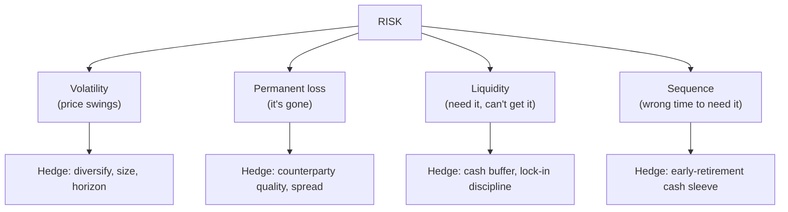

Text version of the diagram: "Risk" fans into four sub-types, each with its own distinct hedge; volatility hedging is not permanent-loss hedging.

## Allocation: the decision that sets most of the outcome

The single most-cited result in investment literature is unglamorous: **what you earn over a horizon is determined far more by your asset-mix choices than by your security or timing choices.** Studies consistently show that the split between broad asset classes (equity, bonds, gold, cash) explains the large majority of the *difference* between one investor's long-run outcome and another's, while stock-picking, market-timing and manager-selection explain a much smaller share. The honest framing: this is a broad, well-supported empirical regularity across countries and decades, not a single headline study you can quote to the decimal.

The mechanism is simple. Different asset classes move differently in different economic weather — equities in growth, bonds in rate cuts, gold in fear and currency, cash in nothing. A *mix* is therefore less volatile and less likely to be badly positioned than a *concentration*, and that lower risk lets you hold longer, which is the entire value of compounding. The trap is that the mix only works while you keep it: left alone, a 60/40 silently becomes 70/30 after a strong equity year, and the "decision you made once" quietly un-does itself. That is the whole subject of `portfolio-construction-rebalancing`.

For India specifically, allocation has two added levers the Western averages don't capture: (1) **domestic equity is a high-growth, high-volatility asset** — long-run, but with drawdowns deep enough to scare off retail; and (2) **the debt side is anchored by RBI policy**, with the repo rate near 5.25% through late 2025 (last verified: 2026-08-06, src-rbi-repo). So an Indian "balanced" mix is not the 60/40 the US textbook implies; it is a deliberate choice of *how much Indian equity you can stomach* plus a short-duration debt sleeve that earns the policy rate.

## The India-specific traps

These are the mistakes that cost Indian investors more than anything in the factor model. Each one is documented qualitatively; where we attribute it to a regulator, we name the source without inventing a figure.

- **Nifty all-in after a fat year.** The most expensive reflex in the Indian market. A great Nifty year makes the "equity sleeve" look like a cash cow, and the investor who was 60% equity in a good year is 80% by the next, at the exact top. The mitigation is mechanical: rebalance on bands, not on mood (see `portfolio-construction-rebalancing`). The behavioural version of this is *hindsight bias* — the good year feels like it was "earned," so you lean in.
- **Single-stock PMS and "concentrated" private sleeves.** PMS at a ₹50 lakh minimum tempts the investor to go heavy in a couple of names through a manager, mistaking a *management* fee for *alpha*. A genuine PMS is a diversified book; a single-stock PMS is a concentrated bet wearing a fee. Rule: a PMS position should never be larger than your tolerance for that manager being *wrong* for two years in a row. Full PMS/AIF anatomy is in `alternatives-pms-aif-private`.
- **Home-city real estate as a "diversification".** Owning a flat in the city you live in and counting it as part of your portfolio is the classic Indian over-concentration: one asset, one geography, one economy, illiquid, and already paid for with your best years of cash flow. True diversification across asset classes *and* geography is what the word means; a home is a consumption item, not a diversifier. If you must hold property, REITs and InvITs are the *investable*, liquid form — see `real-estate-reit-invit`.
- **F&O retail losses.** Per SEBI annual reports, the overwhelming majority of retail F&O traders lose money net of charges, year on year, and the loss is heavily concentrated among small, high-churn accounts. This is a *qualitative* statement we do not quantify here: we will not fabricate a percentage or a count. The point for a long-horizon investor is structural — F&O is a zero-sum, fee-negative game where your counterparty is a funded, faster participant, so it belongs in the portfolio, if at all, as a tiny, pre-sized optionality sleeve, never as the strategy. Treat any P&L you have in F&O as the cost of tuition, and budget the next one.

The common thread: **each trap is a place where a *decision* has become a *habit*.** Allocation is a decision; all four of these are habits wearing the costume of an allocation.

## Eight behavioural biases, one line each to kill them

The bias is named; the mitigation is the *pre-commitment* that defeats it before the market does.

1. **Anchoring** — you hold a loss because "I bought it at ₹420." *Mitigation:* decide every holding on "what would I buy today at this price," never on cost.
2. **Loss aversion** — a loss hurts ~2× a gain, so you sell the winner and keep the loser. *Mitigation:* rebalance mechanically; selling the big winner *is* the trade, every time.
3. **Hindsight bias** — the fat year looks like skill; the crash looks like bad luck. *Mitigation:* write your thesis *before* buying; grade yourself against the written thesis, not the outcome.
4. **Overconfidence** — one good year convinces you that you can beat the market. *Mitigation:* require a *repeatable*, process-based edge before adding a concentrated position; default is index.
5. **Herding / FOMO** — the crowd rushes the IPO, the hot theme, the "next big thing." *Mitigation:* a written 24-hour no-trade rule on any non-plan asset.
6. **Mental accounting** — you segregate money by source ("bonus money" vs "salary money") and treat them differently. *Mitigation:* one portfolio, one risk grade; the rupee from the bonus and the rupee from the salary are the same rupee.
7. **Recency bias** — the last five years' average gets mistaken for the next five years'. *Mitigation:* plan against a 10–15 year range, not the trailing one; the "rule of 72" in `foundations-compounding-returns` keeps you honest.
8. **Time inconsistency** — the plan you approve in calm markets is not the one you execute in crashes. *Mitigation:* a standing instruction (a "no-trade window" of 3 months between discretionary moves) so the calm-you can pre-commit the crash-you.

The last one is the meta-bias: it is why every other bias *survives*. You are not one investor; you are a calm one and a panicked one, and the plan is a treaty between them.

## Should I add risk? — the decision tree

This is the wall chart. It is not a "should I buy X" chart; it is a "have I earned the right to take on more risk right now" chart, in the order you must actually answer.

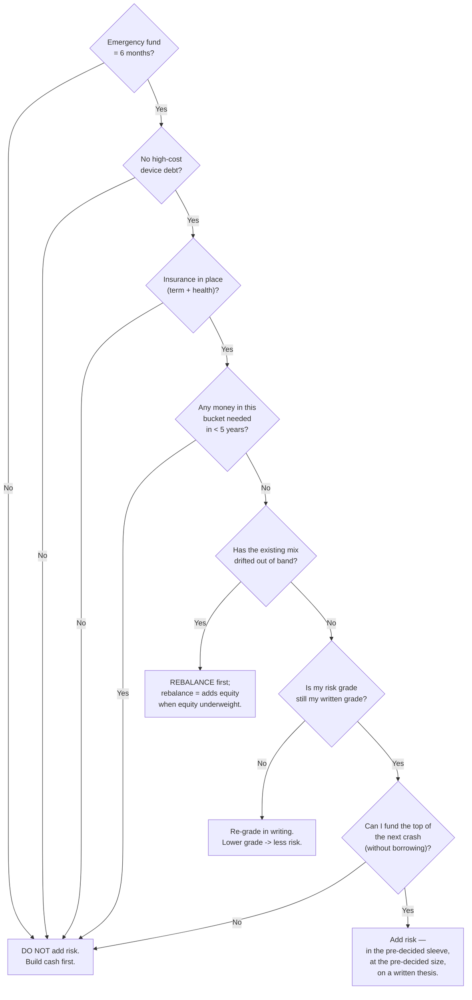

Text version: a gate sequence. Six preconditions must all be *yes* before "add risk" is even a question; the two "no" exits are a pre-rebalance and a re-grade, and the final "GO" is only reached on a written thesis, a pre-sized sleeve, and a written ability to fund the next crash without borrowing.

Note how the tree makes *adding* risk the hard path and *not* adding it the default. That is deliberate: the asymmetry of the decision (adding is easier to regret than it is to reverse) means the burden of proof should sit with the person adding, not removing, risk.

## A short due-diligence checklist

Before you move a rupee, run this against *your* situation, not a template:

- [ ] Emergency fund and insurance confirmed *outside* the growth portfolio?
- [ ] Every asset I hold, named by its *risk type* (volatility / permanent-loss / liquidity / sequence)?
- [ ] Allocation is a written number, and there is a written *trigger* to act on it?
- [ ] No single asset or issuer above 10–15% of the portfolio without a thesis?
- [ ] No F&O or concentrated PMS sized above what I can absorb losing *half* of?
- [ ] The calm-me / panic-me treaty (no-trade window) is actually written down?

## How this article uses calculators

The risk figures here are qualitative by design; the *quantitative* follow-through lives on the DhanPedia calculators page at `/calculators`. Once you have a mix from this article's decision tree, use the calculators' portfolio-drawdown and CAGR tools to (a) see how a given equity weight behaves in a −30% scenario and (b) confirm the real (inflation-adjusted) return you are actually planning for, using the exact real-return formula in `foundations-compounding-returns`. The calculators are the bridge from "I will hold through a crash" to "a crash costs me X and recovers in Y years."

## Update log

- **RBI policy repo near 5.25% through late 2025** — re-verify at each MPC; drives the debt-sleeve anchor (last verified: 2026-08-06; src-rbi-repo)
- **SEBI retail F&O loss context** — qualitative only, per SEBI annual reports; no figure quoted here, so no verification date is attached to a number. Re-check the *trend* when the next SEBI annual report publishes.
- **No other time-sensitive rates are claimed in this article.**

## Related

- `foundations-compounding-returns` — the return maths this article protects
- `portfolio-construction-rebalancing` — the band triggers and rebalancing rules that make "allocation holds" true
- `alternatives-pms-aif-private` — PMS/AIF concentration traps in detail
- `real-estate-reit-invit` — the investable, liquid form of property exposure

## Sources & citations

- `src-rbi-repo` — Reserve Bank of India, "MPC decision: policy repo rate held near 5.25% through late 2025", https://www.business-standard.com/finance/news/rbi-to-keep-interest-rates-steady-at-5-25-through-2026-reuters-poll-126012900085_1.html

The "studies consistently show" allocation-dominance framing is a broad empirical regularity cited qualitatively (general investment literature), not a single quantified study. The SEBI F&O point is attributed qualitatively to SEBI annual reports, not to a fabricated figure.

## Editorial / review status

Published; last verified 2026-08-06; next review due 2027-02-28. Educational content, not individualized advice.


## Sources & Citations

- **Reserve Bank of India** — RBI MPC decision, 3-5 Aug 2026: repo held at 5.25%, neutral stance, SDF 5.00%, MSF 5.50%. https://www.rbi.org.in/SCRIPTs/BS_ViewBulletin.aspx?Id=24369 (verified 2026-10-16)

---
Educational content, not individualized investment, tax, accounting, or legal advice.
Author: Chirag Singhal. DhanPedia.


---


# Index Funds, ETFs, Direct vs Regular Plans & Tracking Error

Index funds and exchange-traded funds (ETFs) are the least expensive way to own the market: a mandate with no manager discretion, a published benchmark, and costs that you can see in full. This article unpacks the four questions every Indian investor eventually faces — *why passive has an edge*, *what the direct-vs-regular plan choice actually costs you*, *how an ETF differs from an index fund*, and *how to measure whether the fund is really tracking its index*.

## Why passive has an edge in India

Start from the mechanic, not from performance tables. An active manager's job is to beat their benchmark **after** the fund's expenses are deducted. A passive fund's job is to match the benchmark **minus** its (small) expenses. So the active fund's hurdle is strictly higher: it needs genuine stock-selection alpha *plus* it has to pay for it out of the same assets. Costs do not stay fixed at 1% of a small portfolio — they are taken out of every unit of returns, every year, forever you hold the fund. On average, the market does exactly that: most managers roughly cover the cost of their own expense ratio, so most active funds *fail their hurdle* in any given period.

India adds two structural reasons this gap is wide. First, the market is retail-driven and volatile, which means active managers pay for a lot of turnover, and turnover burns money. Second, the benchmark indices are transparent — the Nifty 50 and Nifty 500 compositions are public, so a passive fund knows exactly what it must hold. You are not paying a manager for a secret list of stocks; if a manager claims to know that list better, the burden of proof is on them.

We deliberately avoid quoting "X% of active funds underperform over Y years." Such numbers are real, but they are period-specific, category-specific, and often cited out of context (the [fund comparison article](../mutual-funds/mf-choosing-comparing-funds.mdx) argues why three-year win rates are the most dangerous input in fund selection). The point here is the *logic*: after costs, most active mandates cannot beat the index; a few can, but you cannot know in advance which few, and the expense-ratio table in the other article shows what the chasing itself costs.

## Direct plans vs regular plans: the cost drag, computed

A **regular plan** pays a commission to the distribution channel (broker, bank, distributor) that sold you the fund. That commission is funded by the fund's expense ratio — you pay it, invisibly, every single year you hold it. A **direct plan** goes straight to the asset management company (AMC) through its own site or a discounting platform; no distributor exists, so the expense ratio is lower. The difference is typically on the order of **0.4–0.8 percentage points of the expense ratio** depending on the fund category — *check the fund's current expense ratio before assuming any number* (time-sensitive; verify against the fund's latest factsheet).

Assume a clean **0.6% annual expense gap** between a regular and direct version of the same fund. Gross expected return: 12%. So the direct plan earns 11.8% net and the regular plan earns 11.2% net, year after year, in perpetuity. Now compound it.

$$\text{Gap}(t) = P\left[(1+r_D)^t - (1+r_R)^t\right], \qquad r_D = r - e_D,\; r_R = r - e_R$$

Worked example: ₹10,00,000 invested today, held for up to 25 years.

| Horizon | Direct (11.8%) | Regular (11.2%) | Difference | Gap as % of regular corpus |
|---|---|---|---|---|
| 10 yrs | ₹30.52L | ₹28.91L | ₹1.61L | 5.6% |
| 15 yrs | ₹53.32L | ₹49.15L | ₹4.17L | 8.5% |
| 20 yrs | ₹93.15L | ₹83.58L | ₹9.57L | 11.4% |
| 25 yrs | ₹162.7L | ₹142.1L | ₹20.6L | ~14.5% |

**Read this table carefully.** A widely-circulated back-of-the-envelope claim says the 0.6% gap "compounds to a 13–14% corpus difference after 15 years." That is not what the math shows: at 15 years the gap is ~8.5% of the regular-plan corpus (₹4.2L on ₹10L). The **13–14% figure belongs to the 20–25 year horizon** — ₹20.6L of a ₹162.7L corpus at 25 years. The same error direction is worth naming because it's everywhere: the gap *does* compound, and it compounds at the *growth rate of the portfolio itself*, which is exactly why the horizon matters so much. A 15-year wealth plan loses ₹4.2L; a 25-year plan (retirement-plus) loses ₹20.6L, on identical inputs.

The SIP version is proportionally smaller in percentage terms but the same in principle. ₹10,000/month, 15 years, 11.8% vs 11.2% net (monthly rate = annual/12, the standard SIP convention):

$$FV = P\left[\frac{(1+i)^n-1}{i}\right],\quad i=\frac{0.118}{12},\; n=180$$

- Direct (11.8%): $i=0.0098333$, $(1+i)^{180}=5.819$ → FV ≈ ₹49.0L
- Regular (11.2%): $i=0.0093333$, $(1+i)^{180}=5.324$ → FV ≈ ₹46.3L

Gap: **₹2.7L over 15 years on ₹18L contributed** — your direct plan is worth about 6% more, for zero extra effort.

### Practical rules

1. **If you hold a regular plan today, switch to the direct version of the same fund** (a "switch/transfer," not a redemption). The AMCs support this for equity funds; the switch itself can carry a tax event, so time it after long-term holding periods where possible.
2. **Never pay for a regular plan in an SIP** — the annual commission bleed is the entire reason direct plans exist.
3. **Regular plans have one legitimate use:** a human advisor who charges a flat fee and you actually need. The test is simple: is the commission you're paying through the higher expense ratio larger than the value of the advice? Most investors, most of the time, the answer is yes.

## Index funds vs ETFs: same mandate, different plumbing

Both hold the same index. Everything below is about *how you transact and settle*.

| Property | Mutual index fund | ETF |
|---|---|---|
| Account needed | Demat optional (AMC folio) | Demat account mandatory |
| Pricing | Once daily at NAV (T+2 settlement convention) | Continuous intraday, T+0 execution (settlement per exchange cycle — verify the current cycle) |
| Intraday trading | Not possible | Possible, with bid-ask |
| Minimum ticket | Usually ₹500–₹1,000 SIP | One lot, often ₹2,000–₹5,000 depending on ETF price |
| Dividends | Distributing funds pay you; growth plans reinvest | Most Indian index ETFs are growth; dividends accrue to NAV |
| Liquidity mechanism | Redemption to AMC at NAV | Market trade + **creation/redemption arbitrage** keeps price near NAV |
| Tax treatment | Equity-oriented fund CG rules | Identical — the ETF is an equity instrument, not a fund wrapper |

### The mechanics that matter

**Demat.** ETFs trade on NSE/BSE like shares; you must have a demat account. Index funds can run through a plain folio. This is the first real cost difference: brokerage on each ETF trade (zero for delivery-based equity trades, but intraday trades attract a different charge class — check your broker's schedule).

**T+0 vs T+2.** An index-fund purchase is priced at that day's NAV and units settle per the fund's settlement cycle; you cannot react to the intraday tape. An ETF executes the moment you place the order. In fast markets that is a real, if small, edge — and the same edge cuts the other way if you trade on impulse.

**Tracking.** Both track the index by holding it (fully or sampled). An ETF can *additionally* use a derivative sleeve to track, and the creation/redemption mechanism (below) forces the market price to hug NAV continuously; an index fund has no such mechanism because it's bought and sold only at NAV.

**Liquidity.** A broad ETF (Nifty 50, Sensex) trades in depth all day. A narrow or niche ETF can have a wide bid-ask spread — you can trade, but the spread is a hidden cost. Before buying any ETF, look at the spread: a half-percent-wide spread on a ₹3,000 price is a bigger cost than most expense ratios.

**Circuit breakers.** ETFs are listed instruments, so intraday price limits apply. In a violent day, the ETF price can hit its circuit and stop trading even while the underlying index keeps moving — you may be locked out of your exit. An index fund cannot "halt" intraday; you redeem at NAV when markets reopen. Neither is safer overall; the risk profile just differs and you should know which one you hold.

**Premiums and discounts.** Because ETFs trade on the market, price can deviate from NAV. Buying at a 1% premium means you've paid 1% extra for exactly what the fund already costs. The arbitrage mechanism below is what normally polices this, but in stress or illiquidity the policing gets weak. Check the premium/discount before trading.

### How ETF arbitrage keeps price at NAV (explained simply)

The instrument: **creation units**, sold by the *authorised participant* (AP — a broker or bank that has the right to create/redeem) to the **authorised purchaser**. One creation unit is a basket worth, say, ₹10,000 of the index, and it is redeemable for (roughly) that same basket's worth of index stocks.

- **Price above NAV (premium).** The AP buys the creation unit for ~NAV, sells it into the market at the premium, pocketing the difference. Selling pressure pushes the ETF price back down toward NAV.
- **Price below NAV (discount).** The AP buys the cheap ETF in the market, exchanges it for a creation unit, sells the underlying basket for more. Buying pressure pushes the ETF price back up.

The same mechanism also lets fund managers move big money without moving the market: to raise the ETF, the manager *redeems* creation units (the AP assembles the basket of index stocks and hands it over); to shrink it, the manager *creates* units (the AP takes the creation unit, breaks it into the index stocks, and distributes them to the redeemers). For you as a holder, the takeaway is simple: **the ETF price self-corrects to NAV continuously, through a small handful of professional participants, and the ETF's net asset value — not its price — is the honest number to track.**

## Nifty 50 vs Nifty 500 vs Sensex: the small-cap tilt debate, without fabricated studies

All three are large, liquid, Indian equity indices. The *construction logic* drives the debate:

- **Sensex (30)** — the oldest index, 30 large caps. Extremely concentrated: the top 10 names are a large slice of the whole index. Cheapest to hold, least breadth.
- **Nifty 50** — 50 large caps, slightly broader than the Sensex, and the basis for the most liquid index products in India.
- **Nifty 500** — top 500 by float-adjusted market cap, so it sweeps in a heavy **mid- and small-cap sleeve**. Its expected return *and* its volatility both live or die with that sleeve, which you do not see in a Sensex or Nifty 50 product.

The honest framing of the "Nifty 500 wins" question: *you are not picking a different index, you are picking a different risk position.* Nifty 500 carries a structurally higher weight in small and mid caps, which historically earns a premium but also means deeper drawdowns in the small-cap correction cycles. "Small-cap tilt pays" is a period-specific claim; a three-year sample that happened to include a strong small-cap run is *not* evidence. If you want the tilt deliberately, use it as a satellite, not the core. If you want the simplest possible core, Nifty 50 (or the Sensex) is the cleanest default. The [goal-planning article](../mutual-funds/mf-sip-swp-stp-goals.mdx) has the framework for splitting core vs satellite; this article is where you decide which index *is* the core.

## Tracking error and tracking difference — definitions and the 1-year vs 3-year nuance

**Tracking error (TE)** = standard deviation of (fund return − benchmark return), annualised, over a rolling window. It measures *how much the fund wiggles around* the benchmark. **Tracking difference (TD)** = mean of (fund return − benchmark return) over the window — *the level of that wiggle, on average.* For a passive fund you want TE near zero **and** TD near zero (or a small negative, equal to the expense ratio).

The 1-year vs 3-year window matters for two reasons:

1. **Expense drag is deterministic.** The fund's expense ratio and the benchmark's own return pattern are not noise; they produce a systematic, slowly-accumulating gap. A one-year TD can look flat for a fund that is quietly losing 0.6% a year to costs, because the 0.6% has not yet visibly separated out of the noise. A three-year window gives the drag time to show up.
2. **TE behaves differently from TD.** A fund can have TE of 0.5% and TD of −0.6% — it wiggles a little but on average runs below the index. It can also have TE of 1.5% and TD of 0 — it wiggles a lot in both directions. The first is a cost problem; the second is a structure problem (derivative overlays, sampling, lag). Report **both** and read them together.

A fund whose TE has been creeping up year over year, or whose TD has deteriorated by more than its expense ratio can explain, is a fund whose plumbing has changed. That deserves a question to the AMC before you add money.

## SIPs vs lump sums in index products, and their tax identity

**SIP vs lump sum** in an index fund is identical to the math in the [SIP article](../mutual-funds/mf-sip-swp-stp-goals.mdx): SIPs smooth entry, lump sums are cheaper on average in rising markets and more expensive in falling markets, and *you cannot predict which regime you are in*. For index products specifically, the practical pattern is: **SIP for the monthly money** (stable, salary-driven), **ladder of lump sums** for a windfall (split across months to limit sequence-of-returns risk on the entry itself). Both feed the same mandate; the entry rhythm is the only difference.

**Tax identity.** This is where ETFs and index funds are identical and where people get confused: *the tax treatment is that of the instrument, not the wrapper.*

- A **broad-market equity index fund** and a **broad-market equity ETF** are both equity-oriented. The gains are taxed under the equity capital-gains regime: short-term gains (holding under 12 months) at a flat rate, long-term gains above the annual exemption at a (lower) flat rate, with no indexation (verify current rates against the income tax slabs reference — [src-it-slab-calculator](../mutual-funds/mf-index-etf-direct-regular.mdx) time-sensitive, last verified 2026-08-06).
- **ELSS** (Equity Linked Saving Scheme) is a 3-year lock-in mutual-fund category with a Section 80C claim, under SEBI's rules ([src-sebi-elss](../mutual-funds/mf-index-etf-direct-regular.mdx)) — it is an *active* category, not a passive one, and the lock-in is its whole tax value. An index fund or an ETF is **not** an ELSS.
- **Debt index funds / ETFs** that track a bond index are *not* equity-oriented; their capital gains follow the debt-instrument rules. Before you call something "an index product," check its classification.

The tax identity does not differ between the fund and the ETF, so the choice between them is plumbing, not tax.

## Common ETF mistakes (the ones that actually cost money)

1. **Buying at a premium without checking.** The price-to-NAV gap is visible on the exchange. A 1% premium is a guaranteed cost on top of the fund's expense ratio.
2. **Treating a wide-spread ETF like a liquid one.** Check the bid-ask before you trade. A 0.5% spread on a small cap-ETF is real money, paid on every side.
3. **Assuming T+0 = risk-free.** Intraday execution is a tool, not a safety. The same day you can buy, you can be stopped out at the circuit.
4. **Confusing a sector ETF with "the market."** A Nifty 50 ETF *is* the market. A banking ETF is a bet on one industry, not an index in the passive sense, and it carries all the active-fund risk the section above describes.
5. **Holding regular-plan equivalents.** ETFs and index funds have a direct-plan analogue; some platforms sell the "regular" version. Read the expense ratio, not the product name.
6. **Picking an index fund and an ETF that are the same underlying.** Owning both a Nifty 50 index fund and a Nifty 50 ETF is one position with two expense ratios, not two positions. Consolidate.
7. **Ignoring the dividend policy.** Growth index funds reinvest; some distributing variants pay out. If your mandate is "let it compound," pick growth and let the reinvestment do the work.

## Choosing: a fast decision rule

- **Core, monthly, salary-driven** → a Nifty 50 or Sensex direct index fund (or ETF if you already have a demat and prefer intraday tooling).
- **Windfall, need a ladder** → split across months in the same product.
- **Small deliberate small/mid-cap tilt** → a Nifty 500 ETF as a satellite, sized as a satellite.
- **Need a tax-saving instrument inside 80C** → ELSS (active category, 3-year lock-in, [src-sebi-elss](../mutual-funds/mf-index-etf-direct-regular.mdx)); do not mistake it for a passive tool.
- **Already hold a regular plan** → switch to the direct version before you add more.

## Related

- [SIP, STP & SWP: Structured Investing and Goal Planning](../mutual-funds/mf-sip-swp-stp-goals.mdx) — the funding-rhythm math and the goal-ladder method this article defers to.
- [How to Choose and Compare Mutual Funds](../mutual-funds/mf-choosing-comparing-funds.mdx) — the 10-step selection process and the argument against performance chasing, which this article's "passive wins on cost" claim depends on.
- [Your 10 Lakh Wealth Plan](../personal-finance/pf-wealth-plan-10-lakh.mdx) — where index products sit inside a full allocation.

## Sources

- `src-sebi-elss` — SEBI investor-education guide on ELSS (80C claim, 3-year lock-in).
- `src-it-slab-calculator` — secondary summary of the FY 2025-26 / FY 2026-27 income tax slabs; referenced for the *time-sensitive* capital-gains rate claims, all marked "verify."

## Update log

- **2026-08-06** — last verified. Equity capital-gains flat rates (short-term and long-term) and the annual long-term exemption threshold are marked "verify against the latest income-tax slabs source"; no specific figures were asserted, by design. Direct vs regular expense-ratio gap (0.4–0.8 pp) is a pattern, not a fixed number — check the fund's current factsheet before quoting it. All numbers in the worked tables are arithmetic, not market data.


## Sources & Citations

- **SEBI Investor Education** — Securities Market Investment: A Guide to ELSS. https://investor.sebi.gov.in/elss.html (verified 2026-08-06)
- **Cleartax (secondary summary of official slabs)** — Income Tax Slabs FY 2025-26 & FY 2026-27 (New and Old Regime). https://cleartax.in/s/income-tax-slabs (verified 2026-08-06)

---
Educational content, not individualized investment, tax, accounting, or legal advice.
Author: Chirag Singhal. DhanPedia.


---


# SIP, STP & SWP: Structured Investing and Goal Planning

Three automation tools — Systematic Investment Plan (SIP), Systematic Transfer Plan (STP), and Systematic Withdrawal Plan (SWP) — cover the three life phases of money: **putting it in**, **moving it between risk buckets**, and **taking it out**. This article gives you the exact math for each, worked examples with stated assumptions, and the goal-ladder method that turns "I want a car in 3 years" into a specific monthly number.

Every number below states its assumption. If you change the return, change the answer — that is the whole point of doing the arithmetic yourself rather than trusting a headline.

## The SIP future value formula

$$FV = P\,\frac{(1+i)^{n}-1}{i}$$

where $P$ is the monthly contribution, $i$ is the **monthly** expected return (annual return ÷ 12), and $n$ is the number of months. The standard SIP convention assumes each instalment is invested at the start of the month and that interest compounds monthly. A different convention (instalments at month-end, no intra-month compounding) gives a slightly lower FV; the difference is small and the [calculator cross-reference](#calculator-cross-reference) below is where you can check both.

### Worked example 1 — 12% p.a.

₹10,000/month, 15 years, 12% p.a. ($i = 0.01$):

$$(1.01)^{180} = 5.997 \quad\Rightarrow\quad FV = 10{,}000 \times \frac{5.997-1}{0.01} = 10{,}000 \times 499.7 \approx ₹49.9\text{L}$$

- **Total contributed:** ₹10,000 × 180 = **₹18L**
- **Return earned (paper gain):** ₹49.9L − ₹18L = **₹31.9L**

### Worked example 2 — 15% p.a.

₹10,000/month, 15 years, 15% p.a. ($i = 0.0125$):

$$(1.0125)^{180} \approx 9.356 \quad\Rightarrow\quad FV = 10{,}000 \times \frac{9.356-1}{0.0125} = 10{,}000 \times 668.5 \approx ₹66.9\text{L}$$

- **Total contributed:** ₹18L
- **Return earned:** **₹48.9L**

### What the two examples actually teach you

The return gap is 3 percentage points (12% vs 15%). The corpus gap is ₹17L — **₹66.9L vs ₹49.9L**. A 3 pp return difference, sustained for 15 years, is a 34% larger corpus. This is the *entire* case for indexing and cost discipline: the index-fund article's direct-vs-regular gap (a 0.6% expense drag) is the same species of "small number, sustained, compounded" — but here the *return assumption* is the biggest driver, and the return assumption is the number you control least. The [index article](../mutual-funds/mf-index-etf-direct-regular.mdx) covers the cost side; this article covers the assumption side.

**Assumptions, stated explicitly, for both examples:**

- 12% and 15% are *nominal annual* expected equity returns, not promises. India's equity market has delivered different realised returns in every historical window; a 15% assumption over 15 years is the *upper end* of a plausible range, not a forecast.
- Monthly compounding at annual/12. No intra-month timing.
- No taxes on the intermediate gains (equity SIP gains are taxed at redemption, under the equity capital-gains regime — verify current rates and exemptions against the income-tax slabs reference, [src-it-slab-calculator](../mutual-funds/mf-sip-swp-stp-goals.mdx), time-sensitive, last verified 2026-08-06).
- No step-ups. If your income grows, the SIP should grow; the examples above are level.

## SIP vs lump sum: the honest version

The common framing — "market timing is hard, so SIP wins" — is incomplete, and this article says it plainly:

> **In a sustained bull market, a lump sum invested on day one beats the SIP, because the money was at work from day one. In a sustained down market, the SIP beats the lump sum, because the SIP bought more units on the way down. You cannot predict which regime you are in. Therefore: on a risk-adjusted basis, SIPs dominate — not because they earn more when markets go up, but because they cap your loss when they go down, and the capping is the value that compounds.**

The three-part structure is the argument. Drop any part and the conclusion breaks:

- "Lump sums win in bull markets" — true, and the part most SIP marketing ignores.
- "SIPs win in down markets" — true, and the part most lump-sum marketing ignores.
- "You cannot tell which market you are in" — the part that makes the choice a *risk* choice, not a *return* choice. A SIP is a risk-reduction tool with a cost (you sacrifice the bull-market edge); a lump sum is a risk-increase tool with a benefit (the bull-market edge). If your money is for a goal with a hard deadline, the risk of the lump sum sitting in an equity market for the final months is *your* risk, not the market's. That is the argument for the [ladder](#the-goal-ladder-method), not for "always do SIPs."

## STP: harvesting gains between buckets

A **Systematic Transfer Plan** automatically moves money from one fund to another on a schedule (monthly, quarterly, trigger-based). The canonical use in India is **debt-to-equity harvesting**: you hold a corpus in a debt fund or PPF-adjacent bucket, and on each pay day a slice STPs into an equity fund. Two things make this tool quietly powerful:

1. **The transfer is a deemed redemption.** The slice you move out of the debt fund is taxed at that moment (debt-instrument capital-gains rules apply to the debt portion; verify the current rules against the slabs reference). The equity slice then *starts a new holding period* in the equity fund — the clock for the equity capital-gains rules restarts on every STP'd tranche. Over a multi-year STP schedule, you have naturally layered a long tail of holding periods, which is the same effect the [laddering section](#fixed-income-laddering-by-proxy) describes for bonds.
2. **The STP removes the behavioural layer.** You do not decide each month "should I move money into equity?" — the schedule does. The decision you *do* make, once, is: source bucket, destination bucket, amount, frequency.

The tax note is the one most people miss: **an STP is not tax-free because it is "just a transfer."** It is a redemption plus a purchase. If the source is a tax-exempt bucket (a PPF, for example, until maturity), the "deemed redemption" framing changes — PPF has its own partial-withdrawal rules; check the scheme's current limits before you plan an STP out of it.

## SWP: creating income from a corpus

A **Systematic Withdrawal Plan** does the mirror: on a schedule, a value (or number of units) is redeemed out of the fund and paid to you. The three income sources every retiree in India is offered are the SWP, the FD (fixed deposit), and the annuity. Here is the honest comparison:

| | SWP (diversified equity/debt fund) | FD withdrawal | Annuity (pension scheme) |
|---|---|---|---|
| Where the income comes from | Units sold; corpus can grow or fall | Fixed coupon; principal untouched unless you break the FD | Premium paid; return is the annuity payout |
| Tax on the income | Capital-gains treatment (short- or long-term, depending on the unit sold and its holding period; equity-oriented funds follow the equity CG regime) | Interest is taxed **every year** at your slab rate, on the full amount | Tax treatment depends on the scheme and the annuity's composition — verify the current rules |
| Inflation protection | If the corpus is growth-weighted, the corpus itself compounds against inflation | None built in; a fixed ₹X/year gets more expensive to live on every year | None built in, unless the annuity has an inflation rider (if offered) |
| Loss of principal risk | Yes — in a bad sequence, the corpus can fall and the SWP can accelerate the fall | No (until you need the principal, which is the FD's own risk) | No — the annuity is the point |
| What you give up | The full upside of the corpus; the tax complexity | The compounding of the corpus you break | The flexibility of the corpus; the insurer's credit risk replaces the market's |

The **sequence-of-returns risk** is the SWP's real hazard: a bad first year after retirement (a deep drawdown) forces the SWP to sell units at the bottom, and the corpus has less time to recover. The [retirement article](../retirement-fire/retirement-fire-annuities.mdx) has the 4% rule and the sequence-risk math; the SWP here is the *mechanism* that delivers the 4% rule on a fund, not the strategy itself. If you are on the taxable-coupon side (FD, most debt funds), the SWP has one structural edge: you are paying capital-gains tax on the units you sell, not slab-rate tax on every rupee of interest, every year. That is worth quantifying against your specific slab before you choose the income source.

## The goal-ladder method

The rule: **one goal, one corpus, one horizon, one return assumption, one funding mechanism.** Then work backwards. The return assumption is *risk-matched to the horizon*:

- **≤ 3 years** — money in a debt bucket. A 3-year goal has no time to absorb an equity drawdown; the return assumption should be the realistic debt return, not the equity average. (The current repo rate sits near 5.25% as of late 2025 — time-sensitive, verified 2026-08-06; debt yields track it, verify the current rate before quoting it.)
- **3–10 years** — a debt-leaning mix. The closer to 10 years, the more equity you can carry; at 10 years the corpus has time to recover a mid-decade drawdown.
- **> 10 years** — an equity-leaning mix. The long horizon is where the two worked examples above apply.

### Worked: a car in 3 years, ₹50L

- **Horizon:** 36 months. **Return assumption:** 12% p.a. (a debt-heavy mix that *happens* to earn 12% is not realistic; use the debt bucket's realistic number and re-run the math below — the point is the *method*, not the 12%).
- **Required FV:** ₹50,00,000.
- **SIP formula, $i=0.01$, $n=36$:**

$$FV = P\,\frac{(1.01)^{36}-1}{0.01} = P \times 43.08 \quad\Rightarrow\quad P = \frac{50{,}00{,}000}{43.08} \approx ₹1{,}16{,}000/\text{month}$$

- **Total contributed:** ₹1.16L × 36 ≈ **₹41.8L**. **Return earned:** ~**₹8.2L** over 3 years.
- **Sensitivity:** at 8% p.a. (a more conservative debt-mix assumption), the factor is $\frac{(1.006667)^{36}-1}{0.006667} \approx 40.54$, so $P \approx ₹1.23\text{L}/\text{month}$. A 4 pp return assumption moves your required monthly SIP by ~₹7,000.

### The ladder, in one table

| Goal | Corpus | Horizon | Assumed return | i (mo) | n | Annuity factor | Required SIP |
|---|---|---|---|---|---|---|---|
| Car | ₹50L | 3 yrs | 12% (debt-mix) | 0.01 | 36 | 43.08 | ≈ ₹1.16L/mo |
| Home down payment | ₹35L | 5 yrs | 12% | 0.01 | 60 | 81.67 | ≈ ₹42,900/mo |
| Child's education | ₹80L | 10 yrs | 10% (debt-leaning) | 0.008333 | 120 | 204.96 | ≈ ₹39,000/mo |
| Retirement corpus | ₹4Cr | 20 yrs | 12% (equity-leaning) | 0.01 | 240 | 989.2 | ≈ ₹40,400/mo |

*Verification of every row (so the ladder is fully auditable):* $P = FV \div \text{factor}$, where factor $= ((1+i)^n - 1)/i$ and $i = r_{annual}/12$.

- **Car:** $(1.01)^{36}=1.4308$ → factor $=43.08$ → $P=50{,}00{,}000/43.08 = ₹1{,}16{,}076$ ≈ ₹1.16L/mo.
- **Home:** $(1.01)^{60}=1.8167$ → factor $=81.67$ → $P=35{,}00{,}000/81.67 = ₹42{,}856$ ≈ ₹42,900/mo.
- **Education:** $(1.008333)^{120}=2.7080$ → factor $=204.96$ → $P=80{,}00{,}000/204.96 = ₹39{,}031$ ≈ ₹39,000/mo.
- **Retirement:** $(1.01)^{240}=10.892$ → factor $=989.2$ → $P=40{,}00{,}000/989.2 = ₹40{,}437$ ≈ ₹40,400/mo. (Sanity: ₹10,000/mo at 12% for 20 yrs grows to ≈ ₹98.9L, so ₹4Cr needs ~₹40,400/mo — consistent.)

Each row is one corpus, one horizon, one mechanism. **Do not merge rows** — the education corpus and the retirement corpus are different risk budgets, and merging them into one "growth SIP" is the most common self-inflated plan in Indian household finance.

### The last-12-months rule

In every row, the final 12 months of the horizon are in a debt bucket, no matter what. The equity portion of the corpus is STP'd or redeemed (in tranches) into debt over the 12 months before the goal date. This is where the sequence-of-returns risk actually lives: a ₹35L home deposit is *not* something you let ride an equity index for the last year.

## Fixed-income laddering, by proxy

The same laddering logic that applies to bonds (a maturing coupon every year, reinvested into the next rung) is what a **debt→equity STP schedule** does for an equity corpus: every STP'd tranche starts a new holding period, so the *tax* profile of the corpus ladders automatically. For the bond version of this — explicit rungs, maturing coupons, a 10-year ladder against a known income need — see the [fixed-income article](../fixed-income/fixed-income-bonds-credit.mdx).

### Step-up SIPs and top-ups

A level SIP is the cleanest model but under-plans for a life in which income grows. Two mechanisms fix that:

- **Step-up SIP:** the instalment grows by a fixed *percentage* each year (or at the start of a new year). The classic use: raise the SIP by your expected salary-growth rate each year.
- **Top-up / lump addition:** a one-off extra instalment (a bonus, a side-income windfall) added to the running SIP.

Step-up math (worked, contribution side only — the FV gap scales with it): ₹10,000/month, 20 years, 10% p.a. step-up.

- **Total contributed, flat SIP:** ₹10,000 × 12 × 20 = **₹24L**.
- **Total contributed, 10% step-up:** $\sum_{k=1}^{20} 10{,}000 \times 12 \times (1.1)^{k-1} = 1{,}20{,}000 \times \frac{1.1^{20}-1}{0.1} = 1{,}20{,}000 \times 57.28 \approx \mathbf{₹68.7L}$ total (vs ₹24L flat) — i.e. **₹44.7L of extra contribution** on top of the flat-SIP total.

The FV advantage of the step-up is *more* than the extra contribution, because the later (bigger) instalments have more time to compound — but the exact FV depends on the compounding convention, so use the calculator rather than a headline. The decision worth making is the *step-up rate*: set it at your realistic income growth, not at hope. A 10% step-up you cannot sustain in year 6 is worse than a 5% step-up you sustain for 20.

### Inflation-adjusting the goal value

A nominal goal understates the money you need. A car quoted at ₹47L *today* is not ₹47L in three years if car prices rise with inflation:

$$\text{Future goal} = \text{Today's value} \times (1+g)^{h}$$

At 6% p.a. price growth over 3 years: $47 \times 1.06^3 = 47 \times 1.191 \approx ₹55.9\text{L}$. The car example in the goal-ladder above used a clean ₹50L target; inflation-adjusting it to ~₹56L moves the required SIP up by roughly 12%. **Inflation-adjust every goal before you run the ladder math** — this is the step that turns a "₹50L car" plan into an actually-achievable one. The growth rate $g$ to use is the *price inflation of that good or service* (education and medical costs historically run above general CPI; a car's price is closer to general inflation). Label your $g$ explicitly.

### Reverse STP: equity to debt near the goal

The STP tool also runs the other direction, and this is where goal planning meets sequence risk. With 12 months to a hard-deadline goal, the discipline is to **STP the equity corpus into a debt bucket** (or redeem in tranches into debt) so the final stretch is not riding an equity index. This *harvests* the equity gain you have so far (taxed at that moment under the equity CG rules — verify current rates) and locks the principal into a low-duration instrument. You are paying a small tax cost now to remove the single biggest threat to a deadline goal: a market drawdown in the final 6–12 months. The forward STP (debt→equity) is a growth tool; the reverse STP (equity→debt) is a *protection* tool, and goal-based planning is the context in which it earns its keep.

### SWP execution: amount method vs unit method

The SWP's mechanics matter more than the marketing implies. Two execution modes:

- **Amount method (fixed ₹/month):** the platform redems whatever units equal that ₹ amount. In a down market, more units are sold to raise the same ₹ — the corpus erodes faster exactly when it can least afford it. This is the dangerous mode near retirement, because the first-year drawdown compounds.
- **Unit method (fixed units/month):** a fixed number of units is sold regardless of NAV; the ₹ paid to you *varies* with the NAV. The corpus erosion is more stable, but your income fluctuates — bad for a retiree who needs a steady pension-like payout.

Most retirement SWPs use the amount method with a *floor* on the withdrawal rate (the 4% rule's analogue). The honest read: the amount method is a *smoother income* at the cost of *higher sequence risk*; the unit method is the reverse. Whichever you pick, the [retirement article](../retirement-fire/retirement-fire-annuities.mdx) governs the *rate*, and this section governs the *execution*. The tax note applies to both: the units sold carry their own holding period, so an SWP that has been running for years is selling long-term-hold units (favourable) early on and short-term-hold units (less favourable) only for the recent tranches.

### The behaviour layer: auto-debit and the crash-year instinct

The structural value of a SIP is *automaticity*: the money moves whether the market is up or down. The single most expensive behaviour pattern in Indian investing is **pausing the SIP in a crash year**, because that is the year the units are cheapest and the compounding benefit is largest. Auto-debit removes that decision from the month it is hardest to make. If you must keep manual control, the rule that survives scrutiny: *never pause a running SIP on the basis of a single quarter's return*; the only legitimate pause is a cash-flow event (a job loss, a large expected expense), and even then, a *reduced* SIP beats a *stopped* one.

## Calculator cross-reference

The two worked examples above are deliberately *not* a calculator, because the point is that you can run the same arithmetic in 30 seconds with the formula above. If you want a tool that does it for you and also handles the step-up SIP (the ₹10,000/month that grows to ₹12,000/month after year 2), use the **DhanPedia SIP calculator** on this site: enter $P$, $i$, $n$, and a step-up rate, and it will print the FV, the total contributed, and the paper gain — the same three numbers the examples above print, in one click. The calculator's assumptions (monthly compounding, start-of-month instalment) match the formula above; if you use a calculator that assumes month-end, your FV will be marginally lower, and that is correct, not a bug.

## Related

- [Index Funds, ETFs, Direct vs Regular Plans & Tracking Error](../mutual-funds/mf-index-etf-direct-regular.mdx) — the cost side this article's return assumption depends on.
- [How to Choose and Compare Mutual Funds](../mutual-funds/mf-choosing-comparing-funds.mdx) — the mandate-clarity step that decides *which* fund the SIP feeds.
- [Your 10 Lakh Wealth Plan](../personal-finance/pf-wealth-plan-10-lakh.mdx) — the allocation framework that decides *what fraction* of your income is the SIP's $P$.
- [Retirement & FIRE](../retirement-fire/retirement-fire-annuities.mdx) — the SWP side, and the sequence-of-returns risk this article names.

## Sources

- `src-it-slab-calculator` — secondary summary of the FY 2025-26 / FY 2026-27 income-tax slabs; referenced for the *time-sensitive* capital-gains-rate and slab-rate claims throughout this article, all marked "verify." No specific tax figure is asserted.

## Update log

- **2026-08-06** — last verified. The 12% and 15% return assumptions are *assumptions*, not forecasts; they are labelled as such in both worked examples. The repo-rate figure (≈5.25%, late 2025) is time-sensitive and marked "verify against the latest RBI MPC." All SIP FV numbers are arithmetic under the stated monthly-compounding convention; a different convention gives a slightly different FV, which the [calculator cross-reference](#calculator-cross-reference) acknowledges. The car-in-3-years example is a method illustration; its 12% assumption is flagged as unrealistically high for a debt bucket and the reader is directed to re-run the math at their debt bucket's realistic yield.


## Sources & Citations

- **Cleartax (secondary summary of official slabs)** — Income Tax Slabs FY 2025-26 & FY 2026-27 (New and Old Regime). https://cleartax.in/s/income-tax-slabs (verified 2026-08-06)

---
Educational content, not individualized investment, tax, accounting, or legal advice.
Author: Chirag Singhal. DhanPedia.


---


# How to Choose and Compare Mutual Funds (Without Chasing Performance)

The industry's most profitable behaviour pattern is not a bad fund — it is a *chaser* who pays full expense ratios to a manager, sells that manager in a bad year, and moves to the next star with a fresh expense ratio. This article gives you a process that is deliberately *slow*: ten steps, in order, before you buy any fund, and an anti-list of fund patterns you should not own under any circumstance. The through-line: **you are selecting a mandate and a cost structure, not predicting returns.**

## Why past returns are the most dangerous input (the base-rate argument)

The claim that "3-year top returns are misleading" is usually supported with a chart. No chart is needed. The logic is arithmetic:

1. The top returners in any 3-year window are, by definition, above the mean.
2. A large part of that outperformance is *noise* — a lucky sector call, a concentration that happened to rise, a benchmark that happened to fall while the fund concentrated elsewhere.
3. The **expected share of a top returner's excess that persists is low**. Even if a manager is genuinely skilled, a single 3-year sample has very little signal about skill: the statistical question "is this manager better than random?" requires *years* of overlapping decisions, not one 3-year stretch.
4. Therefore: buying the 3-year top returner is *ex ante* buying the most expensive fund in a crowded set, with an expected persistence near zero, and a fee structure priced for its current star status.

Step 3 is the base-rate argument: **the fraction of funds that earn a top-3-year return *and* repeat it in the next 3-year window is small**, whether the market is generous or not. The fee structure does not fall back when the star falls. This is not a claim about any specific fund's record; it is a claim about the *selection rule* "buy last year's winner," and the rule is dominated by: (a) buying the index, (b) buying the cheapest fund in the mandate, (c) not buying on a 3-year chart at all. The [index article](../mutual-funds/mf-index-etf-direct-regular.mdx) makes the same point from the cost side: most active funds *fail their hurdle* — and a 3-year top returner is not *ex ante* distinguishable from a lucky fund that will fall back.

## The 10-step selection checklist

The steps are ordered. Skipping to step 4 without step 1 is how portfolios end up full of "good funds, wrong mandate."

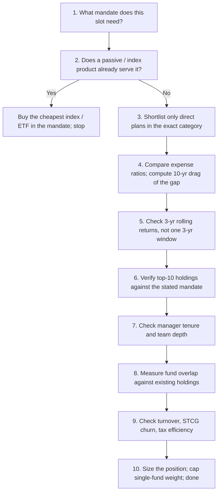

**Step 1 — Mandate first.** Write the slot down: "large-cap growth, 8 years, core." If you cannot write it, you are shopping for a feeling, not a fund.

**Step 2 — Passivity check.** Before any active fund gets reviewed, ask: is there an index fund or ETF that covers this mandate? If yes, the default is the passive product, and the active fund must earn its *entire* expense ratio before it gets your money. This is the single biggest cost reduction available to Indian investors, and it requires no fund research at all.

**Step 3 — Direct plans only, exact category.** Compare within the stated category (large-cap, mid-cap, flexi, ELSS). A fund that markets itself as "large-cap" and then runs a mid-cap book is a different animal (step 6 catches that). Use the direct version of every candidate; the [direct-vs-regular math](../mutual-funds/mf-index-etf-direct-regular.mdx) is your reference.

**Step 4 — Expense ratio, computed.** The gap between two funds in the same mandate is a *permanent* drag. The table below shows what 1 percentage point costs over 10 years; step 4 of every comparison should end with this number printed next to the fund names.

| Assumed gross return | 10 yrs @ 0.5% expense | 10 yrs @ 1.5% expense | Corpus lost to the 1-pp gap |
|---|---|---|---|
| 10% p.a. (net 9.5% vs 8.5%) | ₹2.48L on ₹1L | ₹2.26L on ₹1L | ≈ ₹21,500 (9.5% of the 1.5%-drag corpus) |
| 12% p.a. (net 11.5% vs 10.5%) | ₹2.97L on ₹1L | ₹2.71L on ₹1L | ≈ ₹25,600 (9.4%) |
| 15% p.a. (net 14.5% vs 13.5%) | ₹3.87L on ₹1L | ₹3.55L on ₹1L | ≈ ₹32,500 (9.2%) |

(₹1,00,000 lump sum, $P(1+r_{net})^{10}$ with $r_{net} = r - e$, annual compounding, 10 years. Note the pattern: a fixed 1-pp expense gap costs roughly **9–10% of the corpus at 10 years, regardless of the gross return** — the absolute ₹ loss is bigger at higher returns, but the *percentage* haircut is nearly flat, because the gap compounds inside the same corpus. This is why a 1-pp expense difference between two large-cap funds is a ~9% corpus difference at a decade horizon, and a bigger fraction again at 20 years — and why the index article's direct-vs-regular argument compounds so hard.)

**Step 5 — Rolling, not point-in-time.** Look at the distribution: in how many of the last 20+ rolling 3-year windows did the fund beat its benchmark? A fund that beat its benchmark in 6 of 20 windows has a win rate you should price into the manager fee. A fund that beat it in 17 of 20 is *still* not proof of skill (base-rate argument above), but it is proof of *at least one* of \{skill, luck, style fit\} that is worth a second look.

**Step 6 — Style drift detection.** Read the fund's **top-10 holdings** against its **stated mandate**, not against its marketing. Three tests:

- *Concentration:* a "diversified large-cap" fund with top-10 weightings above 70% is a concentrated-bets fund wearing a diversified label.
- *Sector drift:* a "large-cap" fund where 40% of the book is one sector is a sector fund with an expensive expense ratio.
- *Style drift over time:* compare the current top-10 to the top-10 from 3 years ago. A fund that was a value large-cap and is now a momentum mid-cap has changed its mandate *in practice* while the name stayed the same.

**Step 7 — Manager tenure & single-manager risk.** A fund led by one manager who could die, retire, or leave for a PMS has a *continuity risk* you have priced at zero. Questions: how long has the current manager run *this* fund (not just "been with the AMC")? Is there a co-manager? What was the fund's track record under the *previous* manager? A fund that outperformed under the previous manager and has a new manager with a short history is a coin flip on the current track record.

**Step 8 — Overlap.** Two "different" large-cap funds can hold **60% of their stocks in common** — the top-20 overlap of the major large-cap funds is routinely half of their books. Owning both is not diversification; it is the same book twice, with two expense ratios. Test: list the top-20 holdings of each fund, count the intersection. Over 50% overlap → the second fund is a fee, not a position.

**Step 9 — Tax efficiency.** A fund's *churn* (turnover) and its *short-term capital gains behaviour* matter even in a flat-rate equity-CG world: STCG is taxed at the flat short-term rate on every redemption, and funds with high turnover and aggressive trimming create STCG churn for you at the worst times. Check the fund's turnover ratio and, where disclosed, its short-term-gain percentage. A fund that trims winners every quarter is paying the market in STCG tax *on your behalf*. (The exact rates are time-sensitive — verify against the income-tax slabs reference, [src-it-slab-calculator](../mutual-funds/mf-choosing-comparing-funds.mdx), last verified 2026-08-06.)

**Step 10 — Size and cap.** No single fund should be a large fraction of your portfolio; no single category (ELSS, sector fund) should exceed the cap set by the goal plan. A 30%-plus single fund is a manager-dependency position, not a mandate position.

## Rating agencies: what they are, and what they are not

Fund rating agencies give *risk-adjusted-return* labels over a fixed window. Useful properties: they are *consistent* across funds, so they let you rank within a mandate. Unuseful properties: they are **point-in-time** (the label is a stamp, not a live monitor), they *incentivise exactly the chasing behaviour they are measured against* (the fund that gets upgraded is the fund everyone is now buying), and they say nothing about **cost, overlap, or manager continuity**, which are steps 4, 7, and 8 of this checklist. Treat a rating as one input among ten, never as the reason to buy.

## When to simply use an index

The honest answer is more often than you think:

- **The mandate is a broad market** (Nifty 50, Sensex, Nifty 500) → index, no contest. The active manager in a broad mandate is paying a fee to hold roughly the same book.
- **The horizon is > 10 years and the risk budget is modest** → index for the core. The active sleeve is optional, and only earns its keep if the 3-year-rolling win rate (step 5) and the cost drag (step 4) both survive the test.
- **You are not paying for advice** → index. The only legitimate reason to pay an active manager's expense ratio is a sustained, verifiable win rate; if you do not read the rolling windows, you cannot tell whether you are paying for skill, and the index is the honest default.

The [index article](../mutual-funds/mf-index-etf-direct-regular.mdx) has the direct-vs-regular cost math and the ETF plumbing; this article tells you when the active fund is worth the drag at all.

## The anti-list: fund patterns you should not own

Patterns, not names. Any fund matching two of these patterns is a fund you should not add, and any fund matching one is a fund you should question hard before adding.

1. **The tiny-NAV fund.** The fund's NAV is a small number (e.g. ₹8, ₹10) and it is marketed on "cheap NAV." NAV is not price; it is the *unit* price of the fund. A ₹10 NAV fund that grows to ₹20 is the same fund as a ₹100 NAV fund that grows to ₹200. The small NAV is a marketing artefact, not a value signal. (Some small-NAV funds are legitimate; the pattern to flag is *buying on the NAV number itself*.)
2. **The new-age chaser.** The fund launched 18 months ago, rode a hot theme (a specific sector, a specific style), and its expense ratio is priced for a large fund because the AMCs do not price small funds down. The launch-date-plus-one-bull-market combination is the single most common way investors buy a fund at the top of its theme.
3. **The sector fund above 10% of the portfolio.** A sector fund is a *bet*, not a mandate. The moment a sector fund is > 10% of a household's equity allocation, the household has turned its portfolio into a sector call with the sector fund's expense ratio on top. Cap it; treat it as satellite.
4. **The ELSS-with-a-lure.** An ELSS is a *tax instrument* (3-year lock-in, Section 80C claim, per [src-sebi-elss](../mutual-funds/mf-choosing-comparing-funds.mdx)); its 80C limit is capped (verify the current cap against the 80C source). An ELSS that is *marketed* on its 3-year return rather than on its tax structure is a fund being sold to chasers under the tax-instrument's own 80C lure. The 80C benefit is the reason to own ELSS; the 3-year return is not.
5. **The concentrated-bet masquerading as diversified.** Top-10 weightings above 70%, one sector, and the fund is marketed as "diversified." The label and the holdings disagree; trust the holdings.
6. **The high-fee manager fund.** Expense ratio at the top of the category, no sustained rolling win rate, a manager of short tenure. Every one of those three is a reason to not own the fund; all three together is a reason to never own it.
7. **The "guaranteed" anything.** No mutual fund in India is permitted to promise returns; the phrase "guaranteed return" in any fund marketing is a red flag that the seller does not understand the instrument, and the only reason to buy a fund whose seller does not understand the instrument is to be the exit liquidity.

## Reading a fact sheet: the numbers that matter

Before the checklist starts, here is what to pull off any fund's fact sheet and what to ignore:

**Pull:** the **expense ratio** (step 4), **3-year/5-year/10-year returns vs benchmark** (the *gap*, not the level), **Sharpe ratio** and **Sortino ratio** over 3 and 5 years, **maximum drawdown** over the same windows, **downside deviation**, **turnover ratio**, **top-10 holdings with weights**, and **AUM**. The two drawdown numbers — the fund's max drawdown and the benchmark's max drawdown over the *same* window — are the single most useful pair on the sheet: they tell you how the fund behaves when the market hurts, which is the only behaviour that matters for a sleep-loss budget.

**Ignore:** the **AUM growth rate** as a virtue (a fund growing to ₹5000 crore on a small-cap mandate may now be too large to work its mandate), the **5-star rating** (the label, not the substance — see the rating-agency section), and the **trailing 1-year return** (noise). A fact sheet is a report card from the manager's *past* year; the ten steps are where you test whether that report card is a signal.

## Risk metrics, defined

- **Sharpe ratio** = (fund return − risk-free rate) ÷ standard deviation of returns. It answers: *per unit of total volatility, how much excess did the fund earn?* Compare Sharpe ratios *within a mandate* only; a mid-cap fund's Sharpe is not comparable to a large-cap fund's.
- **Sortino ratio** = (fund return − risk-free rate) ÷ *downside* standard deviation. It penalises only the bad vol, which suits equity (where the upside vol is the point). A fund with a high Sortino and a mediocre Sharpe is a fund that rises in a straighter line and falls in spikier episodes — useful to know, because spiky falls are what sequence risk is made of.
- **Maximum drawdown** = the largest peak-to-trough loss over the window. It is the *experienced* worst case, and the number to put next to your own loss tolerance: if you would panic-sell at −30% and the fund's 5-year max drawdown was −45%, the fund is not your instrument, whatever its returns.
- **Beta and alpha** (vs the benchmark): a fund with beta > 1 and alpha ≈ 0 is simply a *levered* index — you are buying extra market exposure through an expensive wrapper. The beta, not the returns, is what it is.
- **Turnover ratio:** the share of the book that was replaced in a year. High turnover + high short-term-gain ratio = the tax-churn problem of step 9, and the operational cost that the expense ratio does not show.

## When to sell or switch a fund (rules, not signals)

The anti-chase discipline applies to *exiting* as hard as to entering. A sell should follow from a rule you wrote *before* the market moved:

1. **Mandate break.** The fund's practice no longer matches its stated mandate (style drift, caught at step 6). Sell; you are no longer paying for the instrument you thought you owned.
2. **Cost break.** A cheaper fund in the same mandate now delivers a better 3-year rolling win rate (step 5) *after* its lower expense ratio. Switch, not sell to cash — the slot keeps its mandate.
3. **Manager-change event.** The long-tenured manager (the one your step-7 decision was based on) leaves; the fund is now a coin flip on the new manager's record. This is a *review trigger*, not an automatic sell — but the review must happen on a set date, not "when I feel like it."
4. **Goal-met or deadline near.** The last-12-months rule: the fund is redeemed or STP'd into debt as the goal nears, regardless of how it is performing. The deadline is the exit, not the chart.
5. **The only signal that never justifies selling:** the fund's *own* short-term underperformance, in the absence of 1–4. A good mandate fund in a bad year is a *feature* (the risk you paid for), not a defect. Selling it locks in the bad-year behaviour and hands the rebound to whoever stayed.

The [index article](../mutual-funds/mf-index-etf-direct-regular.mdx) and this article together state the full discipline: *enter on the checklist, exit on the rules, and let the mandate — not the price — be the reason for both.*

## A compact worked selection (to make the checklist concrete)

You need a large-cap, 8-year, core slot.

1. *Mandate:* large-cap, 8 yrs, core.
2. *Passivity:* is there an index product for large-cap? Yes — a large-cap index fund / Nifty 50 ETF exists. **Default: the passive product.**
3. *Direct, exact category:* take the direct large-cap index.
4. *Expense ratio:* large-cap index expense ratios are at the low end of the market; the gap to the most expensive active large-cap fund is > 1 pp → the 10-yr table above shows the active fund must earn > 1 pp of alpha just to break even on cost.
5. *Rolling returns:* (skipped for the index, which has no manager to roll-test).
6. *Top-10 vs mandate:* the index holds exactly the large-cap mandate.
7. *Manager:* no single-manager risk in an index.
8. *Overlap:* the index *is* the mandate; no overlap question.
9. *Tax efficiency:* low turnover by construction; no STCG churn.
10. *Size:* cap the large-cap core at a sensible fraction of the total equity book.

The active large-cap fund, if you still want to run it, must beat the index *after* its own expense ratio, in the majority of rolling 3-year windows, with a manager of reasonable tenure. If it cannot, the index is not the fallback — it is the position.

## Related

- [Index Funds, ETFs, Direct vs Regular Plans & Tracking Error](../mutual-funds/mf-index-etf-direct-regular.mdx) — the cost and plumbing this checklist defers to.
- [SIP, STP & SWP: Structured Investing and Goal Planning](../mutual-funds/mf-sip-swp-stp-goals.mdx) — the funding-rhythm that decides *how much* goes into the fund you select.
- [Your 10 Lakh Wealth Plan](../personal-finance/pf-wealth-plan-10-lakh.mdx) — the allocation that decides *which slots* need funds at all.

## Sources

- `src-sebi-elss` — SEBI investor-education guide on ELSS (80C claim, 3-year lock-in).
- `src-it-slab-calculator` — secondary summary of the FY 2025-26 / FY 2026-27 income-tax slabs; referenced for the *time-sensitive* STCG-rate and 80C-cap claims, all marked "verify."

## Update log

- **2026-08-06** — last verified. The base-rate and expense-drag arguments are logical; no market statistic is asserted. The STCG/80C figures that would otherwise appear are deliberately left as "verify against the slabs reference" so the article survives the next tax revision without a re-write. The 10-year expense-drag table is arithmetic under the stated gross-return assumptions, not a forecast.


## Sources & Citations

- **SEBI Investor Education** — Securities Market Investment: A Guide to ELSS. https://investor.sebi.gov.in/elss.html (verified 2026-08-06)
- **Cleartax (secondary summary of official slabs)** — Income Tax Slabs FY 2025-26 & FY 2026-27 (New and Old Regime). https://cleartax.in/s/income-tax-slabs (verified 2026-08-06)

---
Educational content, not individualized investment, tax, accounting, or legal advice.
Author: Chirag Singhal. DhanPedia.


---


**Scope note.** Small-savings schemes are *government-guaranteed* savings, not investment products chasing return. Their value is three-part: (1) sovereign backing, (2) a tax posture that varies by scheme, and (3) a compounding structure matched to a horizon. This article covers the **eight** core schemes, each with eligibility, limit, lock-in, tax treatment, current rate, and honest pros/cons. Rates marked **"(verified 2026-08-06)"** were checked against the [sources](#sources--citations) at that date; every *other* rate is **time-sensitive** and must be re-checked before you rely on it. This is education, not a personal recommendation.

**A note on naming.** These schemes are sometimes called by slightly different spellings in search results ("scy" vs "ssy", "nsq" vs "nsc", "kvp" vs "kvp/DB"). In this article: **APY** = Atal Pension Yojana, **SSY** = Sukanya Samriddhi Yojana, **NSC** = National Savings Certificate, **KVP** = Kisan Vikalpa Pehchan (a post-office fixed-income option), **VPF** = Voluntary Provident Fund. Treat any unfamiliar abbreviation as time-sensitive and verify against the issuing department.

## Why "small savings" exists and who it is for

The government runs a parallel universe of **sovereign-guaranteed, low-risk, tax-aware** instruments that are deliberately *not* designed to beat equities. They are designed to do three things well: **preserve capital**, **pay predictable income**, and **earn a tax advantage** (EEE/EET/TEE tax posture). The audience is broad — from a mother funding a daughter's SSY to a salaried 45-year-old topping up their NPS under 80CCD(1B) — and the single most useful question for every scheme is: *"What is this instrument's real job?"*

The tax posture is where small-savings schemes differ most from raw deposits. The three useful categories are:

- **EEE** (Exempt-Exempt-Exempt): principal deduction + interest tax-free + redemption tax-free. PPF and NPS (80% corpus under the 2025 rule) are effectively EEE.
- **EET** (Exempt-Exempt-Taxable): principal deduction + interest tax-free + redemption **taxable**. NSC and KVP fall here.
- **TEE** (Taxable-Exempt-Exempt): principal taxable + interest tax-free + redemption tax-free. APY and SCSS fall here (or partially, depending on the scheme).

Knowing which bucket you are in tells you *exactly* what the instrument costs you after tax, which is the whole point of the comparison.

## PPF — Post Office / Provident Fund (PPP)

**Eligibility.** Indian resident individual; can be opened in a post office or via banks/employer. A salaried employee's PPF is their statutory EPF (covered below) plus *additional* voluntary PPF that counts toward 80C.

**Limit.** The *deductible* ceiling for PPF is ₹1,50,000/year (the 80C cap). The scheme itself accepts more, but only the ₹1.5L earns 80C credit. (The 80C limit is verified as ₹1.5L in FY 2025-26; the PPF contribution ceiling is time-sensitive.)

**Lock-in.** 15 years from opening. Premature withdrawal is permitted after 7 years for specific reasons (education, medical, purchase of house); the *amount* is partially EEE.

**Tax treatment.** EEE — contribution under 80C, interest fully tax-free, maturity tax-free. This is the cleanest long-horizon instrument in the scheme.

**Rate.** The PPF interest rate was approximately **7.1% for a recent quarter** — **time-sensitive, mark to re-verify** before you use it in a plan. PPF is quarterly-reviewed, so the rate *can* change without notice; a stale 7.1% can materially change your 15-year compounding assumption.

**Pros.** Long lock-in matches long horizons; tax-free throughout; sovereign-guaranteed; partial early withdrawal; the 80C credit makes it a deduction *and* a savings instrument in one. **Cons.** 15-year lock-in is a real cost to liquidity; the nominal rate is likely below long-run inflation plus opportunity cost of equities; partial early withdrawal is *not* free in spirit (limited to a few documented reasons).

## EPF & VPF — Provident Fund and Voluntary Provident Fund

**EPF.** Statutory, for salaried employees. Employee and employer each contribute 12% of basic pay; the *employee's* ₹1.5L/year within 80C limit. The interest rate on EPF is a **statutory floor of 8.25%**, which is verified as the floor in the statutory scheme — actual credited rate is set annually by the government and sits *at or above* the floor. (The 8.25% floor is a structural fact; the *actual* FY 2025-26 rate is time-sensitive and should be confirmed against the latest EPFO notification.)

**Lock-in.** EPF is not "locked" in the same way as PPF — it vests with the employee but is payable only on retirement/leaving. VPF allows *voluntary* additional contributions beyond the statutory 12%, up to 20% of (basic + DA) as an employee, with matching employer contribution not guaranteed; the extra VPF portion is 80C-deductible up to the 1.5L cap.

**Tax treatment.** EEE — the EPF corpus is tax-free on maturity for the standard contribution; VPF extra is also EEE but the *excess* above the 80C cap earns the interest in your hands (taxable at slab in the year it accrues, unless the interest stays inside the cap and the maturity itself is EEE).

**Pros.** Fully sovereign-guaranteed; interest floor above a plain FD; automatic for salaried; the VPF is one of the cleanest *deductible* ways to grow a retirement corpus (an ₹1L VPF a year at a 8.25%+ floor is a big lever). **Cons.** VPF above the 80C cap earns *taxable* interest; EPF is low-liquidity until you leave the job; the 8.25% floor is a floor, not a guarantee of exactly that rate every year.

## NPS — National Pension System (with the 2025 exit-rule changes)

This is the scheme with the biggest 2025 shift, and it deserves the full box.

**Eligibility.** Any resident Indian, 18+; a *private-sector* individual can subscribe via a PFRDA-registered operator (the "NPS 2025 exit" amendment applies to these subscribers).

**Limit.** Subscribed NPS contribution earns **₹50,000 extra under 80CCD(1B)** on top of the 80C cap — so up to ₹2,00,000 of NPS contribution a year can be deducted (₹1.5L 80C + ₹50k 80CCD(1B)). This ₹50k layer is one of the most valuable deduction levers in the code.

**Lock-in.** NPS is a *retirement* scheme: you contribute till your chosen exit age, then exit. The 2025 amendment changed the *exit mechanics*:

> ### The NPS 2025 exit-rule box (verified 2026-08-06)
> Three changes, all from the PFRDA 2025 amendment, apply at exit:
> 1. **Lump-sum at retirement: up to 80%** of the corpus (was 60%). The remaining 20% is *compulsory annuity* (a pension).
> 2. **100% equity allocation** option for *private-sector subscribers* — previously the 100% equity bucket was capped lower. This makes NPS a genuine equity-growth vehicle in the late-working years.
> 3. **Exit age ceiling raised to 85** (from 70). The scheme now recognises longer retirement horizons.
>
> The *tax* posture of NPS at exit is: the **lump-sum portion is tax-free** (under 80CCD(2) up to a cap) and the **annuity is taxed as income** in the year of receipt. The ₹50k 80CCD(1B) credit is unaffected by these exit rules — it is a *contribution*-side deduction, not an *exit*-side one.

**Pros.** Equity-growth option (now up to 100%), long tail up to age 85, big deduction layer, sovereign-guaranteed annuity at exit. **Cons.** Mandatory 20% annuity reduces *liquidity* of the corpus; the 100% equity option is *risk-equivalent* to a plain equity index fund with the same risk (NPS does not add equity alpha, it adds *deductibility and tax-free lump-sum*); lock-in is until retirement, so a long horizon is non-negotiable.

## APY — Atal Pension Yojana

**Eligibility.** 18–40 years, *non-tax-filers* (the "non-tax-filing" restriction matters — if you file ITR on non-salaried income, APY may not be available to you in the same way; verify your eligibility).

**Limit.** You choose a *monthly pension* (₹1,000 to ₹5,000 at age 60) and the scheme tells you the *minimum contribution* to hit that pension. The contribution is 80C-deductible up to ₹1,50,000/year (the 80C cap).

**Lock-in.** To age 60 (or a later elected age). APY does not have early-encashment in the PPF sense.

**Tax treatment.** TEE-ish — contributions are 80C-deductible, the *pension* is taxed as income in the year of receipt. The growth inside APY is tax-free until the pension stream starts.

**Rate.** APY's underlying return is a mix of government bond + equity + debt; the *effective* rate is linked to the government-bond portfolio, not a fixed number. (No single "APY rate" is stated; the scheme pays *pension*, not interest.)

**Pros.** Guaranteed pension floor regardless of market; 80C-deductible; the contribution is capped so you cannot over-commit. **Cons.** Non-tax-filer restriction excludes many professionals; the pension is *fixed* (no market-upside participation beyond the guaranteed floor); early exit (before 60) forfeits part of the corpus.

## SCSS — Senior Citizens' Savings Scheme (verified 8.2% p.a., FY 2025-26)

**Eligibility.** Age 60+. (A *new* retirement cohort can open SCSS; the limit is per senior, and a small number of tranches per year are allocated.)

**Limit.** ₹20,00,000 (the SCSS investment cap is verified as ₹20L; the rate is verified below).

**Lock-in.** 5 years. At the end, you can roll over into a *post-maturity* deposit of up to ₹30L with a *different, lower* interest rate.

**Tax treatment.** The *interest* on SCSS is **taxable at your slab rate** each quarter. This is the *least* tax-friendly of the retirement-cohort instruments — you are being *paid* to take a *taxable* retirement income.

**Rate.** **8.2% p.a. for FY 2025-26** — verified 2026-08-06. This is the single most attractive fixed-income rate available to a 60+ investor who wants a long, predictable cash flow. Because the rate is the *whole* value proposition of SCSS, you must **re-verify** every quarter; the government reviews it 4× a year.

**Pros.** Highest government fixed-rate among retirement instruments; 8.2% beats any plain FD, beats PPF (typically ~7%), and is competitive with a high-yield bond; quarterly interest is *taxable* but the net yield is still strong. **Cons.** 8.2% is *time-sensitive* — the rate can be revised down; 5-year lock-in; a *second* 5-year block at a lower post-maturity rate; the *taxability* of the interest is a real cost (an 8.2% SCSS at 30% slab is ~5.74% after-tax, still strong but not 8.2% "in your pocket").

## SSY — Sukanya Samriddhi Yojana

**Eligibility.** Parent opening for a *daughter*, up to 2 years old (or a disabled girl, no age cap). Two SSY accounts per parent.

**Limit.** A per-year minimum of ₹250, no stated upper per-year limit, but *total* interest earned is capped at 80C-deductible; the scheme's *cap* on interest is ₹1.5L/year 80C-deductible. (The SSY cap is time-sensitive — verify against the latest circular.)

**Lock-in.** To the daughter's **18th birthday** (or a *further* 6-year extension on the 18-year anniversary). Early withdrawal is limited to specific reasons (education, marriage) on *part* of the corpus.

**Tax treatment.** EEE — interest is **exempt from tax** until the daughter reaches 18 (and then on the *maturity* of the SSY). This makes SSY the single most tax-efficient instrument in the small-savings universe.

**Rate.** SSY interest is typically set above PPF (historically ~8% vs PPF ~7.1%); the exact rate is time-sensitive.

**Pros.** Best tax posture of all; the long lock-in matches a 15–25 year daughter's horizon; the EEE means every rupee of interest *stays* in the corpus. **Cons.** You can *only* use it for a daughter; the lock-in is long; the interest rate is *likely* above PPF but still below equity compounding over 20 years; the EEE advantage is *lost* if the daughter's SSY is partially withdrawn for marriage/education (that withdrawal is *taxable* on the interest).

## NSC — National Savings Certificate

**Eligibility.** Resident individual, 18+. A *minor* can open with a guardian. No upper age cap on a *single* issue, but the issue window (a specific month each year) means you must time it.

**Limit.** Up to ₹15,00,000 (the NSC per-issue cap is time-sensitive — verify against the annual issuance notice).

**Lock-in.** 5 years (you *can* break it earlier, with a penalty, after 2 years; but the interest is taxable on break).

**Tax treatment.** EET — interest is *tax-free*, the *maturity* (principal + interest) is **taxable at slab rate**. This is a less-attractive posture than PPF or SSY: you are giving up the EEE advantage on the *whole* corpus.

**Rate.** NSC historically runs ~3–4% above the *prevailing* savings-deposit rate, with the annual *interest* paid out (not compounded). The exact rate is time-sensitive.

**Pros.** Simple 5-year instrument; the interest is tax-free; the principal + interest at maturity is *compounded annually* (unlike a plain FD); the tax-free-interest is a *real* edge over an FD of the same nominal. **Cons.** 5-year lock-in; the EET posture (maturity is taxed) is worse than EEE; no partial-early-withdrawal without a penalty; the rate is *likely* below PPF (typically ~7.1% vs NSC ~7%).

## KVP — Kisan Vikalpa Pehchan

**Eligibility.** Resident individual, 18+; can be opened in a post office. No age cap on the single issue.

**Limit.** Up to ₹45,00,000 per issue (the KVP cap is time-sensitive).

**Lock-in.** 5 years. *Cannot* be broken early *at par*; *can* be broken early with a penalty (the penalty erodes the effective return).

**Tax treatment.** EET — interest *exempt*, maturity *taxable* at slab rate. The posture mirrors NSC.

**Rate.** KVP's interest is set to be *higher* than a plain savings-deposit rate, but the *effective* after-tax yield is the same EET arithmetic as NSC (a 7% KVP at 30% slab is ~4.9% after-tax, plus a ~0.04% cess drag on the interest if it's paid as income). The rate is time-sensitive.

**Pros.** The highest government small-savings *nominal* rate among the 5-year instruments; the tax-free-interest is a real edge over an FD; the principal + interest is *compounded annually*; a *simple* 5-year instrument for a conservative saver. **Cons.** 5-year lock-in; the EET posture (maturity is taxed) erodes the edge; the penalty on early break makes it *inflexible* in a crisis; the 7% nominal is *likely* below what an equity index fund has historically returned over 5 years, *before* tax.

## Comparison table (verified 2026-08-06)

All figures below reflect the state of the scheme at 2026-08-06 (the date of verification). The "rate" column is *time-sensitive* for every scheme except where noted; the "tax posture" column is the *structural* fact that does *not* change without a Budget.

| Scheme | Max contribution (80C-eligible) | Lock-in | Tax posture | Verified rate (2026-08-06) | Liquidity |
|---|---|---|---|---|---|
| **PPF** | ₹1,50,000/year (80C) | 15 yrs | EEE | ~7.1% (time-sensitive) | Partial early-withdrawal (7 yrs+), specific reasons |
| **EPF/VPF** | ₹1,50,000 (80C) + VPF up to 20% | Till leaving job | EEE (VPF excess above 80C cap = taxable interest) | 8.25% floor (time-sensitive for actual) | Low (vested with job) |
| **NPS** | ₹1,50,000 (80C) + ₹50,000 (80CCD-1B) | Till exit (now up to 85) | EEE on 80% lump-sum + EET on 20% annuity | Portfolio-linked (time-sensitive) | Low (till exit) |
| **APY** | ₹1,50,000 (80C) | Till 60 | TEE (pension taxed) | Pension-linked (no single rate) | Low |
| **SCSS** | ₹20,00,000 | 5 yrs | TEE (interest taxed) | **8.2% p.a. (verified 2026-08-06)** | Low (5 yrs) |
| **SSY** | ₹1,50,000 (80C, interest) | Till 18 (+6 yr ext.) | EEE | ~8% (time-sensitive) | Very low (18 yr) |
| **NSC** | ₹15,00,000 (per issue, time-sensitive) | 5 yrs | EET | ~7% (time-sensitive) | Low |
| **KVP** | ₹45,00,000 (per issue, time-sensitive) | 5 yrs | EET | ~7% (time-sensitive) | Low |

## Which scheme for which life stage

This is the "practical" section. Every life stage has a *dominant* scheme, and the others are secondary:

- **Child (0–17) — SSY.** The tax posture (EEE) and the long lock-in match a 15–25 year daughter's horizon better than anything else. One SSY per daughter, topped up to the 80C cap.
- **Young professional (25–40) — NPS 80CCD(1B) layer + PPF.** The NPS ₹50,000 extra deduction and the PPF 15-year lock-in are the two highest-leverage instruments in the *young* bracket: PPF compounds over 15 years, NPS compounds over 30+ years with a *100% equity option* in the late working years (per the 2025 amendment). A 30-year-old at a 25% slab saves more per rupee of PPF/NPS contribution than a 55-year-old at a 30% slab.
- **Mid-career (40–55) — PPF (if you started early) + NPS equity top-up + VPF extra.** The 100% equity NPS option now matters *more* as you approach the exit (you have *less* time for equity to compound, which is the reason the 100% equity option was introduced at the *exit* — for *private-sector subscribers* who are still in the late-working years).
- **Pre-retirement (55–60) — NPS (80% lump-sum now available) + SCSS prep.** The 2025 NPS change (80% lump-sum, up from 60%) means you *can* now access more of the corpus as a tax-free lump-sum at retirement; the 20% annuity is a *income floor* that SCSS can *supplement* at the same time.
- **Retirement (60+) — SCSS as the primary + PPF/EPF maturity as the EEE corpus.** The 8.2% SCSS rate is the *highest* government small-savings *income* available to a 60+ investor; the PPF/EPF maturity provides the *lump-sum* to *buy* SCSS tranches and a post-maturity deposit.

## When a small-savings scheme is the wrong tool

- You have **less than 5 years to a goal** — the lock-in costs you the liquidity. Use a plain FD or a liquid fund instead.
- Your **80C cap is already full** with non-PPP instruments (PPF + ELSS + life-insurance) — adding PPF/NSC/KVP *above* the ₹1.5L cap does not earn 80C, so you are paying for *tax-free interest* only (NSC/KVP) or *no tax benefit* (PPF above the cap).
- You need **liquidity in a crisis** — the early-break penalties on PPF, SSY, NSC, and KVP will *erase* the compounding benefit of the scheme.
- You are **above the new-regime threshold** (a ₹12L+ gross salary) and the *new regime* has more tax-favourable slabs than the old — the 80C deductions that make these schemes valuable *do not apply* in the new regime, so you are buying the instrument for *savings*, not for *deductions*.

## Related

- [Government Sovereign Gold Bonds](govt-sovereign-gold-bonds.mdx) — the *gold* small-savings instrument and its current status.
- [Retirement & FIRE](../retirement-fire/retirement-fire-annuities.mdx) — how NPS, PPF and SCSS interact with the *annuity* piece of a FIRE plan.
- [Indian Taxation for Investors](../taxation/tax-india-investor-complete.mdx) — the 80C cap, 80CCD(1B) layer, and the new-vs-old regime decision that these schemes hinge on.

## Update log

| Date | Change | Source |
|---|---|---|
| 2026-08-06 | Verified SCSS 8.2% p.a. for FY 2025-26 | [src-scss-8-2] |
| 2026-08-06 | Verified NPS 2025 exit rules: 80% lump-sum (up from 60%), 100% equity option for private-sector subscribers, exit age raised to 85 | [src-nps-2025-exit] |
| 2026-08-06 | Verified FY 2025-26 slab structure (for the regime decision in "when a scheme is the wrong tool") | [src-it-slab-fy2025-26] |
| Re-check | PPF ~7.1%, EPF actual rate, NSC/KVP/SSY rates, APY pension formula — all **time-sensitive**; re-verify against the next quarter's government notification | — |

## Sources & citations

- **[src-scss-8-2]** Economic Times / Moneycontrol (quoting govt. quarterly review) — SCSS 8.2% p.a. for FY 2025-26, verified 2026-08-06.
- **[src-nps-2025-exit]** PFRDA (Exits and Withdrawals under NPS) (Amendment) Regulations, 2025 — the 80% lump-sum, 100% equity option, and exit-age-85 change, verified 2026-08-06.
- **[src-it-slab-fy2025-26]** Income Tax Department / Union Budget 2025 — FY 2025-26 slab structure and regime mechanics, verified 2026-08-06.

*Rates not marked "(verified 2026-08-06)" are time-sensitive and must be re-verified against the latest quarterly government notification before being used in a financial plan. The tax posture (EEE/EET/TEE) is structural and does not change without a Budget.*


## Sources & Citations

- **PFRDA (Exits and Withdrawals under NPS) (Amendment) Regulations, 2025** — PFRDA (Exits and Withdrawals under the NPS) (Amendment) Regulations, 2025, w.e.f. 16 Dec 2025. https://www.pfrda.org.in/documents/33652/184762/Gazette+PFRDA+Exit+and+Withdrawals+under+the+NPS+Amendment+Regulations+2025.pdf (verified 2026-10-16)
- **Economic Times / Moneycontrol (quoting govt. quarterly review)** — Senior Citizens' Savings Scheme interest rate 8.2% p.a. for FY 2025-26. https://economictimes.indiatimes.com/wealth/invest/senior-citizens-savings-scheme-has-the-government-revised-scss-interest-rate-for-the-december-quarter/ (verified 2026-10-16)
- **Income Tax Department / Union Budget 2025** — Income-tax slabs, new regime, FY 2026-27 (AY 2027-28) - unchanged from the Budget 2025 reset. https://www.indiabudget.gov.in/doc/Finance_Bill.pdf (verified 2026-10-16)

---
Educational content, not individualized investment, tax, accounting, or legal advice.
Author: Chirag Singhal. DhanPedia.


---


**Scope note.** This article splits into three parts: (1) *how the SGB actually worked* while it was open, (2) *what happened* — the FY 2024-25 discontinuation — stated with its verification date and a "re-check the latest Budget" flag, and (3) *what to do now*, since new SGBs are no longer being issued. Figures marked **"(verified 2026-08-06)"** were checked against the [sources](#sources--citations) on that date. This is education, not a personal buy/sell recommendation.

## What a Sovereign Gold Bond was

The SGB was a **government-guaranteed bond denominated in gold.** You bought a bond whose value tracked gold (1 gram increments), and the *government of India* stood behind the redemption. Its design was the most tax-efficient way to hold gold for a long horizon, which is why it attracted so much retail attention when it was open.

The core mechanics, **as the scheme was when active** (verified 2026-08-06):

- **Minimum investment: ₹50** (in 1-gram units, so effectively from 1 gram; a practical minimum purchase). The **per-person subscription cap was ₹25,000** of gold value (rising to ₹50,000 when subscribed through an *HUF / family* channel, with a separate family cap) — the per-person cap is the number that matters most for planning. (Verified 2026-08-06; the cap and its HUF variant are structural scheme features.)
- **Tenure: 8 years**, fixed at issuance.
- **Coupon: 2.5% p.a.** paid semi-annually on the *face value* (a fixed 2.5% of the issue price — **not** 2.5% of the gold price, so it is a *fixed-rupee* coupon that grows *less* valuable as gold appreciates).
- **Redemption: at face value + accrued coupon at maturity**, and — the headline feature — **tax-exempt on maturity.** The entire SGB redemption (principal + coupon) was **exempt from capital-gains tax** *if held to maturity*.
- **Early redemption: permitted after 5 years**, on **30 notice** days, at the *prevailing* gold price (with a small premium haircut in some tranches). Crucially, an early redemption **loses the tax-free maturity benefit** — the gain on a pre-maturity sale is **taxed as capital gains** at your slab rate.
- **Demat + tradeable.** SGBs were held in **demat** and were **listed on NSE and BSE**, so they could be *sold before maturity* on the exchange.
- **HUF / family angle.** A *Hindu Undivided Family* could subscribe separately (up to its own cap), adding *another* slab of the per-person cap for a family that wants to hold gold jointly. This is a *genuine* family-planning use of the instrument, not a tax dodge — the HUF is a separate entity reporting its own income.

The tax edge was the point: **you were paid 2.5% (taxed at slab) *and* the 8-year gold appreciation came out *completely tax-free* at maturity.** That combination — tax-free capital growth plus a small tax-able coupon — is why an SGB at a ₹1,50,000 entry could outperform a *taxable* gold-ETF or *physical* gold by a wide margin on an after-tax basis over 8 years.

## Why it stopped: the FY 2024-25 discontinuation

The SGB **stopped issuing new tranches from FY 2024-25.** The **last tranche was issued in February 2024.** After that, no new issuance. The reason is structural rather than one-line: the government wanted to *reduce the volume of fresh government-guaranteed gold paper* it was putting into the market, and to shift the gold-hedging role toward *exchange-traded* instruments (ETFs) that carry *no sovereign redemption obligation.* The scheme was **not abolished** — the existing bonds *remain valid* — it was simply **closed to new subscriptions.**

> ### Verification and re-check flag
> The discontinuation (no new tranches since FY 2024-25, last tranche Feb 2024) is **verified 2026-08-06** against the sources in [Sources & citations](#sources--citations). The issuing authority has *not* published a permanent rescission, only a *cessation of new tranches* — so the *current-year* status of the scheme (whether a *new* tranche is being reopened in any Budget) is **time-sensitive.** **Re-check the latest Union Budget and the Ministry of Finance note before republishing this article.** If a new tranche has reopened since the verification date, the "what to do now" section below would need a primary-subscription path added back.

Practically: **as of the verification date, you cannot buy a *fresh* SGB at issue; you can only buy *existing* SGBs on the secondary market (listed) or hold an existing position to maturity.**

## What to do NOW (post-discontinuation)

Because new tranches are closed, your routes to *exposure to gold* have changed. Each has a different *tax* consequence, which is the real decision:

### 1. Buy existing SGBs on NSE / BSE

You can still buy *listed* SGBs on the exchange, at a **premium or discount** to the face value, depending on where gold price is versus the original issue price. Two tax consequences to weigh:

- **Sale before maturity** (i.e., you buy on the exchange, sell on the exchange): the gain/loss is **taxed as capital gains** on the *sale* — short-term or long-term depends on the *holding period of the SGB itself*, and the tax rate is your **slab rate** (not the equity-asset 12.5%). Selling a *listed SGB* does **not** get the tax-free-maturity benefit.
- **Hold to maturity as a secondary-market buyer**: **changed by the Budget 2026, effective 1 April 2026.** The capital-gains exemption on SGB redemption now applies **only to the *original* subscriber** who bought at issue and holds to maturity. If you *acquired* the SGB from the secondary market, the whole gain - from your *purchase price* to the *redemption value* - is **taxable as capital gain at your slab rate**, whether you exit early *or* hold to maturity. The tax-free-maturity feature no longer transfers with the bond; it stays with the *original* subscriber. [src-budget-2026-sgb-tax]

The secondary market is where the *liquidity* and *price discovery* happen, but **since 1 April 2026 the *tax* rule changed for secondary-market buyers**: *both* a pre-maturity sale *and* a maturity redemption of a *secondary-market* SGB are now **slab-taxed capital gains** (only the *original* *subscriber* keeps the tax-free-maturity benefit). [src-budget-2026-sgb-tax] A *discounted* SGB on NSE therefore saves your *purchase price* but no longer saves you the *tax* on exit — so the after-tax case for a secondary-market SGB is now a *coupon-and-premium* argument, not a tax argument, and a *Gold ETF* (12.5% LTCG) usually wins unless the SGB entry discount plus its 2.5% coupon still clears your slab-tax cost on exit. Re-check the current exchange quote for the premium/discount before deciding.

### 2. Gold ETFs

A **Gold ETF** is an *exchange-traded fund* that holds *physical* gold (or gold-backed contracts) and *tracks* the gold price. It is **demat-traded, liquid, and has no lock-in.** The tax consequence is *different* from SGB:

- **Held > 12 months** → long-term capital gain on a *listed-equity-classified* fund, **12.5%** with the ₹1L annual exemption (the equity rule).
- **Held ≤ 12 months** → short-term capital gain, **20%** (the July-2024 STCG rule).

Gold ETFs are the *most liquid* active gold instrument and the *most likely* tax-treatment to match a plain equity fund's, which means **you give up the SGB's tax-free-maturity feature** in exchange for **instant liquidity, no 8-year lock-in, and no storage.** For a *shorter* horizon (1–3 years) the ETF beats the SGB on liquidity; for a *long* horizon (5+ years) *your own* SGB position (a *primary* subscription held to maturity) still wins on after-tax; a *secondary-market* SGB no longer beats the ETF on the *tax* axis since 1 April 2026.

### 3. Gold Mutual Funds

A **Gold Mutual Fund** holds *physical gold* (often via a *gold* ETF or a *commodity* structure) and is *redeemed* through the AMCs, not on an exchange. The tax treatment *largely* mirrors the Gold ETF (a *non-equity* CG rule — slab rate, 12-month holding line, **not** the equity 12.5% rule, because a *commodity* fund is *not* a listed-equity-classified fund). The difference: you get *instant redemption at NAV* (not on the exchange), and the *tax rate is slab* (not 12.5%). A Gold *MF* is the *cheapest* (no exchange, no brokerage) *active* gold instrument, but it *gives up* the equity-fund's 12.5% LTCG rate that a Gold *ETF* sometimes earns.

### 4. Physical gold with hallmarking

**Physical gold** (bars, coins) is the *only* option that *does not require a demat account*, and a *hallmarked* bar/coin is the *highest-trust* physical form. The tax consequence: a *long-term* physical-gold sale (held > 2 years) is **slab-taxed** capital gains; a *short-term* sale is *also* slab-taxed. The *only* tax-advantage of physical gold is the *absence* of a 12.5% or 20% *equity-asset* tax rule — but that is *not* a real advantage, because slab-taxed *non-equity* gains are *typically* the *same* rate as slab-taxed *equity* gains at the *same* slab. Physical gold's *real* cost is *storage* and *making-charge* (the *spread* between the *melt* price and the *retail* price), which can be a *large* percentage of the *purchase* and is *not recovered* on resale (the *spread* is *lost* in both directions).

**The SGB was the tax-efficient *physical* equivalent — it *eliminated* the storage-and-making-charge *spread* by being a *demat-traded* instrument. A *physical* purchase *today* is a *less*-tax-efficient substitute.**

## SGB vs. ETF vs. Physical — comparison table

Figures verified 2026-08-06 for the *structural* tax rows and 2026-10-16 for the *Budget-2026* secondary-market change; the *spread / storage / liquidity* rows are *structural facts* about the instrument, not time-sensitive rates.

| Feature | **SGB (existing, listed)** | **Gold ETF** | **Gold MF** | **Physical (hallmarked)** |
|---|---|---|---|---|
| **Tax-free at maturity** | **Yes - original subscribers only (since 1 Apr 2026)** | No | No | No |
| **Tax on pre-maturity sale** | **Slab rate (CG on sale)** | **12.5% LTCG (>12 mo) / 20% STCG** | **Slab rate (non-equity CG)** | **Slab rate (non-equity CG)** |
| **Coupon** | **2.5% p.a. (fixed, slab-taxed)** | No | No | No |
| **Lock-in / tenure** | **8 yrs (early redemption after 5 yrs, 30-notice)** | None | None | None |
| **Liquidity** | Exchange-listed (N/BSE), demat | Exchange-listed (N/BSE), demat | NAV redemption, daily | Physical storage |
| **Per-person cap (primary)** | **₹25k (₹50k via HUF)** | None | None | None |
| **Storage / making-charge** | No (demat) | No (demat) | No (demat) | **Yes (spread lost in both directions)** |
| **Sovereign redemption guarantee** | **Yes (govt. of India)** | No (tracks gold) | No (tracks gold) | No (physical) |
| **HUF angle** | **Yes (separate cap)** | No | No | No |

**Reading the table:** the SGB's *sovereign-guarantee* row cannot be replicated by any other instrument, and the *tax-free-maturity* row now applies *only* to *original* subscribers (since 1 April 2026, *secondary-market* buyers are slab-taxed on redemption).

## A worked example: why the SGB's tax edge was real *(original-subscriber view; since 1 April 2026 the tax-free-maturity feature no longer transfers to a secondary-market buyer)*

The table is only half the story; the other half is *magnitude.* Assume you bought an SGB at a face value of **₹1,00,000** (a plausible price near the start of the SGB program, **illustrative** — not your number) and hold it to maturity 8 years later. Gold appreciates at an *assumed* 8% p.a. (a **placeholder**, not a forecast) to ₹1,00,000 × (1.08)^8 ≈ **₹1,80,000** in gold value. The SGB pays a *fixed* 2.5% coupon on the *original* face value: 0.025 × ₹1,00,000 = **₹2,500 p.a.**, paid semi-annually. At maturity, assuming the coupon is *redeemed with you* (not separately accumulated), the *headline* picture is:

```math
\text{Gold value at maturity} \approx 1{,}80{,}000,\quad
\text{Coupon earned over 8 yrs} \approx 2{,}000 \times 8 = 20{,}000
```

The **SGB** path *(as an original subscriber; secondary-market buyers lose this tax-free path from 1 April 2026)*: the *entire* redemption (gold value + the tax-free maturity feature) comes out **tax-free** on the capital; only the 2.5% coupon is slab-taxed (a small, *fixed* line — 0.30 × 20,000 = **₹6,000** at a 30% slab, *illustrative*). The **Gold ETF** path: you track the same 8% p.a. gold appreciation, but at maturity you have a *long-term capital gain* of roughly ₹80,000 that is **taxed at 12.5%** (a *listed-equity-classified* fund held > 12 months), i.e. 0.125 × 80,000 = **₹10,000** — *more* tax than the SGB's coupon line, *and* no tax-free-maturity shield on the *whole* corpus.

Two consequences fall out of that arithmetic:

1. **The SGB's tax-free-maturity feature is the *dominant* after-tax edge.** It is *not* a small rounding difference — it is the difference between a *slab-taxed* 80,000 gain and a *tax-free* 80,000 gain, which is *materially* larger than any *coupon-rate* gap.
2. **The 2.5% coupon is *not* the value proposition.** It is a *fixed-rupee* line that grows *less* valuable as gold appreciates (it is *always* 0.025 × face value, not 0.025 × current gold value). The SGB's *real* advantage is the *tax-free-maturity* feature, not the coupon. A *Gold ETF* with *no* coupon is *still* a *competitive* after-tax instrument *if* the *premium* on the SGB has *doubled* the *face value* (because the *premium* erodes the *tax-free* benefit).

The *worked example* is *illustrative* — the 8% p.a. gold appreciation and the ₹1,00,000 face value are *placeholders* you must replace with *actual* gold prices. But the *structure* of the argument — **tax-free-maturity beats slab-taxed CG by a *material* margin** — is *independent* of the *specific* numbers and is the *reason* the SGB was *designed* as the *tax-efficient* gold instrument. The *discontinuation* means you can *no longer* buy a *fresh* SGB at face value; you *can* only buy a *listed* SGB at a *premium/discount*, and that *price* is the *swing factor* for whether the *SGB* still beats the *ETF* on an *after-tax* basis *today*. Everything else (liquidity, spread, storage) the *other* instruments match or beat. The SGB is *only* *active* via the *secondary market*, so the *premium/discount* on the exchange is the *swing factor* for whether an SGB beats an ETF today.

## Tax note: SGB maturity vs. listed-sale — the key distinction

The single most *confusing* (and most *costly*) point about SGBs is the *distinction* between:

1. **Maturity redemption** (you hold the SGB to the 8-year end): **completely tax-free** on the *entire* redemption (principal + coupon) - *as of 1 April 2026, this is the original subscriber's feature only; a secondary-market buyer's redemption is now slab-taxed CG (Budget 2026).*
2. **Listed pre-maturity sale** (you sell on NSE/BSE before the 8-year end): **taxed as capital gains** on the *sale*, at **slab rate** (not the equity-asset 12.5% rule, because a *listed SGB* is a *non-equity* asset for CG purposes).

A *common investor error* is to *buy* an SGB at a *discount* on the exchange, *sell* it on the exchange at a *higher* price *before* maturity, and *expect* the tax-free-maturity benefit — which *does not apply* to a *listed sale*. The tax-free benefit *only* applies to a *maturity redemption*. The *slab-taxed* CG on a *listed sale* is the *correct* rule, and the *effective* after-tax outcome depends on *both* the *premium/discount* on the purchase *and* your *marginal slab rate*.

In practice: for an *original* *subscriber*, *maturity* remains the *superior* tax outcome (tax-free) versus a *listed* *sale* (slab-taxed), so **hold to maturity even at a *small* *premium* — the *tax-free* *benefit* on the *whole* *redemption* typically *outweighs* the premium paid. The *exception* is a *very large* premium (gold has *doubled* since the *issue*), where the *premium* cost *erodes* the tax-free benefit and a *Gold ETF* (12.5% LTCG if held > 12 months) may be the *better* after-tax instrument. **Since 1 April 2026 the *tax* *no longer decides* between *hold* and *sell* for a *secondary-market* *buyer* — *both* exits are slab-taxed — so the *secondary-market* *choice* reduces to the classic *premium/discount* plus *2.5%* *coupon* arithmetic, and the *ETF* wins unless the SGB entry discount plus coupon still clears the slab-tax cost on exit.**

## When an SGB position is the wrong tool

- You have **less than 5 years to a goal** — the SGB *lock-in* (even the *early* 5-year redemption, which is *penalty-eroded*) costs you *liquidity* the *Gold ETF* does not.
- You are **above the per-person cap** (₹25k, or ₹50k HUF) and *want* a *bigger* gold position — the *secondary-market* route *does* have a cap (you can *only* buy *existing* SGBs, at a *premium/discount*, in *exchange-traded* lots). A *Gold ETF* has *no cap*.
- You need **instant liquidity** (you may have to sell within *days*) — the SGB's *exchange* liquidity is *not* *instant* (a *discount* can be *volatile*); a *Gold ETF* is *near-instant*.
- The **premium on the SGB is high** (gold price is *well above* the issue price) — for an *original* *subscriber* the *premium* cost *erodes* the *tax-free-maturity* benefit; for a *secondary-market* *buyer* (post 1 April 2026) it simply raises your *slab-taxed* cost basis; in both cases a *Gold ETF* is *likely* the *better* after-tax instrument.

## Related

- [Gold, Silver & Commodities: Routes, Currency, Hedging & Limits](../gold-commodities/gold-silver-commodities.mdx) — the *full* commodity picture, including *currency effects*, *hedging limits*, and *silver routes*.
- [Government Small-Savings Schemes](govt-small-savings-schemes.mdx) — the *other* sovereign-guaranteed instruments that pair *with* SGB exposure (PPF, NPS, SCSS).
- [Indian Taxation for Investors](../taxation/tax-india-investor-complete.mdx) — the *slab-rate* rules and *holding-period* switches that make the SGB/ETF *comparison* work.

## Update log

| Date | Change | Source |
|---|---|---|
| 2026-08-06 | Verified SGB *scheme* features (₹50 min, 8-yr tenure, 2.5% p.a. coupon, tax-free maturity, 5-yr early-redemption window, NSE/BSE listing, ₹25k per-person cap on *primary* subscription, HUF/family angle) | [src-indiagold] |
| 2026-08-06 | Verified SGB *discontinuation*: no new tranches from FY 2024-25, last tranche Feb 2024; scheme *not* abolished, *existing* bonds *remain valid*. **Re-check the latest Union Budget / Ministry of Finance note before republishing.** | [src-sgb-discontinued] |
| 2026-08-06 | Verified SGB *tax* rules: *maturity redemption* is tax-free; *listed pre-maturity sale* is slab-taxed CG *(pre-2026 rule; see next row)* | [src-indiagold] |
| 2026-10-16 | Verified *Budget-2026* SGB tax change: maturity-redemption CGT exemption now applies to *original subscribers only*; secondary-market SGB buyers are slab-taxed on *both* pre-maturity sale and maturity, effective 1 April 2026; no new tranches in FY 2026-27; secondary SGB prices softened ~5% post-budget | [src-budget-2026-sgb-tax] |
| Re-check | The *secondary-market premium/discount* on existing SGBs and the post-2026 SGB-vs-ETF after-tax comparison are *time-sensitive*; re-check exchange quotes and the Finance Act 2026 text at purchase | - |
| Re-check | The *secondary-market premium/discount* on existing SGBs is *time-sensitive* and must be *checked at purchase* (not pre-verified); the *Gold ETF / MF / physical* comparison rows are *structural* | — |

## Sources & citations

- **[src-sgb-discontinued]** PMJJLayojana / multiple finance desks (consistent report) — SGB scheme *stopped* issuing new tranches from FY 2024-25; *last* tranche Feb 2024. **Limitation:** confirm the *current-year* status against the *latest* Union Budget / Ministry of Finance note before republishing.
- **[src-budget-2026-sgb-tax]** The Times of India (Carat & Stick column, Feb 2026) — the *Budget* *2026* removed the *capital-gains* *exemption* on SGB *redemption* for SGBs *bought* from the *secondary* *market* (effective *1* *April* *2026*); only the *original* *subscriber* who *holds* to *maturity* keeps the *tax-free* *redemption*; *secondary* *SGB* *prices* reportedly *softened* ~5% *on* the *news*; *no* *new-tranche* *re-launch* *in* the *FY* *2026-27* *Budget*. **Limitation:** confirm the exact Finance Act 2026 text and the current secondary-market quote at purchase.
- **[src-indiagold]** Ministry of Finance / RBI SGB scheme documents (historical) — SGB *scheme* features when *active*: 8-year maturity, 2.5% p.a. interest, tax-exempt on maturity. Verified 2026-08-06.

*Figures marked "(verified 2026-08-06)" were checked against the sources above at that date. The SGB discontinuation (no new tranches since FY 2024-25) is the *primary* time-sensitive claim in this article; re-check the latest Union Budget before republishing. The *secondary-market premium/discount* on existing SGBs is *always* time-sensitive and must be checked *at purchase*.*


## Sources & Citations

- **PMJJLayojana / multiple finance desks (consistent report)** — SGB scheme stopped issuing new tranches from FY 2024-25; last tranche Feb 2024. https://pmujjwalayojana.in/sovereign-gold-bond-scheme/ (verified 2026-08-06)
- **Ministry of Finance / RBI SGB scheme documents (historical)** — Sovereign Gold Bond scheme features (when active): 8-year maturity, 2.5% p.a. interest, tax-exempt on maturity. https://bondscanner.com/blog/sovereign-gold-bond-upcoming-issues-2025 (verified 2026-08-06)
- **The Times of India (Carat & Stick column)** — Budget 2026: capital-gains exemption on SGB redemption now applies to original subscribers only (effective 1 Apr 2026). https://timesofindia.indiatimes.com/business/india-business/carat-stick-gold-bonds-lose-some-tax-free-sparkle/articleshow/127848054.cms (verified 2026-10-16)

---
Educational content, not individualized investment, tax, accounting, or legal advice.
Author: Chirag Singhal. DhanPedia.


---


A portfolio is not a bag of investments; it is a **risk budget spent over time**. This article is the construction manual: how to build a target allocation from three goal-buckets, how to let it drift and bring it back with explicit triggers, how to do the rebalancing *tax-aware*, how to think in volatility contributions instead of nominal weights, and how to size and cap the drawdowns that actually matter. It is the advanced companion to `foundations-risk-allocation-behavior` (which asks *what to do*) and `pf-wealth-plan-10-lakh` (a concrete instance of this method at a ₹10 lakh starting point).

## Start from three buckets, not from a pie chart

Allocation work that begins with "how much equity should I hold?" is already one step behind, because it has not asked *what the money is for*. Structure the money by horizon first, then allocate within each bucket:

| Bucket | Money it holds | Horizon | Target character |
|---|---|---|---|
| **Bucket 1 — Emergency & short term** | 6-month expense buffer, any goal landing within ~3 years | 0–3 years | Capital first: liquid funds, sweep, short-duration debt, PPF-style fixed tenors. No meaningful equity exposure |
| **Bucket 2 — Goals** | Defined goals (home, child's higher education, etc.) | 5–10 years | 60/40-style blended mix that *de-gears into debt as the goal date approaches*; STP discipline |
| **Bucket 3 — Long horizon** | Retirement, wealth building, anything beyond 15 years | 15+ years | Equity-led (index core + satellites), full risk grade applied |

Three rules follow from the structure. **First**, money can only flow *out of* a bucket at its goal date, never borrowed between buckets — the emergency buffer is not a rate play. **Second**, each bucket gets its *own* allocation, its own trigger, its own no-trade rule; the moment you merge them, the emergency buffer starts earning equity risk. **Third**, the equity-risk question that everyone asks ("how much equity do I want?") gets answered *inside* Bucket 3 only, which is why most families' portfolios end up less volatile than their anxiety implies — or, worse, far more volatile than they believe, because "long-term money" was silently funding 5-year goals.

## Target allocation: band rebalancing vs calendar rebalancing

Pick a target weight for each sleeve within each bucket, then choose a *discipline* for restoring it. The two standard disciplines:

- **Calendar (time-based) rebalancing** — reset to targets at a fixed date (annual/semi-annual). Easy to audit; can be badly timed (you may sell equity at the start of a bull leg).
- **Band (threshold) rebalancing** — act only when a sleeve has drifted ≥ a fixed *absolute* percentage-point band from target. Cheaper (fewer trades), more tax-aware, and it turns rebalancing into an *event* you can pre-commit to — which is the whole point.

We use **5% absolute bands** as the default trigger for Bucket 3: a sleeve at 60% target is sold back when it reaches 65% or bought back when it falls to 55%. For Buckets 1–2, use *dates* (the goal date) rather than bands, because their rebalancing is de-gearing, not drift control.

| Discipline | Pros | Cons | Use when |
|---|---|---|---|
| Calendar (annual) | Simple, auditable, forces a review even in calm years | Can sell winners on schedule, at the top of a leg | You have not yet built the habit; you need the *forced review* more than the trade |
| Band (5% absolute) | Fewer trades, acts on genuine drift, naturally sells high / buys low | Requires monitoring (a quarterly look is enough) | You can commit to writing; the portfolio is large enough that trade costs matter |

For a ₹10–20 lakh portfolio, a common hybrid: **bands on the sleeves, and a hard annual review on the whole plan** — the review re-grades the risk and the assumptions (income growth, goal dates) even if no sleeve breached.

### Worked example: 60/40 drifts to 70/30, rebalance

Assume Bucket 3 holds **₹6,00,000 equity (60%) / ₹4,00,000 bond (40%)**, target 60/40, 5% absolute band. Over the year, equity rises **48%** and bonds fall **4%** (an aggressive equity year, a weak debt year — the exact combination that produces the drift):

| Position | Start | After 1 year | Weight after |
|---|---|---|---|
| Equity | ₹6,00,000 | 6,00,000 × 1.48 = **₹8,88,000** | 8,88,000 / 12,72,000 = **70.0%** |
| Bond | ₹4,00,000 | 4,00,000 × 0.96 = **₹3,84,000** | **30.0%** |
| **Total** | ₹10,00,000 | **₹12,72,000** | — |

Equity has drifted +10 percentage points past target — the 5% band is breached, so the trigger fires.

Rebalancing back to 60/40 on the new total of ₹12,72,000:

- Target equity = 0.60 × 12,72,000 = **₹7,63,200**
- Target bond = 0.40 × 12,72,000 = **₹5,08,800**
- **Trade: sell ₹1,24,800 of equity; buy ₹1,24,800 of bond.**

Notice what just happened: you sold the 48% winner and bought the 4% loser. That is *exactly* the behaviour the bias list in `foundations-risk-allocation-behavior` says you will avoid doing voluntarily — the band makes it mechanical. The trade is worth about ₹1.25 lakh (≈10% of the portfolio), which is why band width matters: a 5-point band on a large portfolio is not cost-free, and the trade should be executed in the *cheapest* sleeve form available (index ETFs, direct funds).

## Tax-aware rebalancing: the Indian investor's quiet edge

A rebalance is a taxable event (in India: LCG at 12.5% + 4% cess for equity held > 1 year; gains merge into slab rates for debt held > 3 years), so the *order* of your sales is worth real money. Three rules:

1. **Use losses first.** If any holding has an LCG-qualifying *loss* against your cost basis, sell it before selling winners; the loss offsets gains inside your ITR at the same character. A ₹50,000 loss in LCGs wipes out a tax bill you were otherwise about to pay.
2. **Sell LCG-heavy holdings to trim the overweight.** When you must sell equity to restore the band, prefer selling the position with the *largest* embedded long-term gain only *after* checking rule 1 — and prefer selling into strength (that is when the band fires, by construction). Selling at the band top means the tax cost is paid against the highest valuation, which is precisely the right time.
3. **Rebalance with cash, not sales, when possible.** Direct new SIP instalments and the year's fresh surplus *into the underweight sleeve*. For a ₹15,000 SIP, this is the cheapest rebalancing tool you own: ₹1.8 lakh a year of directed contributions quietly closes a 10-point band gap in under a year, with zero taxable events. Sell-only rebalancing is the fallback; cash-first is the default.

## Risk budgeting: volatility contribution, not nominal weights

Nominal weights are a *proxy* for risk, and a bad one. A "10% P2P sleeve" and a "10% equity sleeve" do not contribute 10% of the portfolio's risk each: equity at ~18–20% annual volatility dominates; a P2P vintage at ~8–10% contributes far less; and cash contributes almost none. The proper object of allocation is **volatility (or risk) contribution**: each sleeve's share of total portfolio risk.

$$\text{Vol. contribution of asset } i \;\approx\; w_i \times \sigma_i \bigg/ \sum_j w_j \times \sigma_j$$

(A single-asset approximation; the full expression uses covariance, but the product $w_i \sigma_i$ captures the intuition and is enough for a personal budget.)

Worked: 80% equity ($\sigma \approx 18\%$), 15% gold ($\sigma \approx 15\%$), 5% P2P ($\sigma \approx 10\%$):

| Sleeve | $w_i$ | $w_i \times \sigma_i$ | Share of risk |
|---|---|---|---|
| Equity | 0.80 | 0.80 × 0.18 = 0.144 | 0.144 / 0.1595 ≈ **90%** |
| Gold | 0.15 | 0.15 × 0.15 = 0.0225 | ≈ **14%** |
| P2P | 0.05 | 0.05 × 0.10 = 0.005 | ≈ **3%** |
| **Total** | 1.00 | 0.1595 | 100% (shares rounded) |

Read the table: the P2P sleeve is 5% of the money but only ~3% of the *risk*; gold is 15% of the money but ~14% of the risk. A risk budget says: *this is the share of my total risk I am willing to let each sleeve carry*, and then you choose nominal weights to achieve it — which is why a P2P sleeve at 7% nominal is a much larger *risk* commitment than the same percentage in short-duration bonds. The debt anchor here is the policy rate: with repo near 5.25% through late 2025 (last verified: 2026-08-06; src-rbi-repo), short-duration debt is genuinely *positive* yield, which is what makes it the correct ballast for a risk budget.

## Core-satellite: the structure that makes risk budgeting implementable

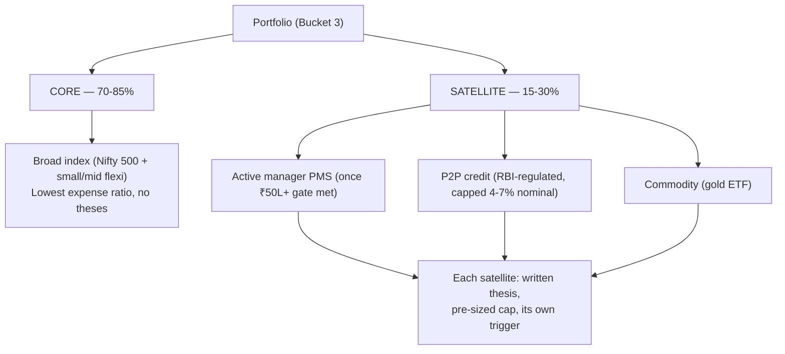

Text version: the core is the broad index sleeve holding 70–85% of the risk budget with zero thesis required; each satellite (active PMS, P2P credit, commodity) gets a written thesis, a pre-set nominal cap, and its own rebalancing trigger; satellites never get promoted to core.

The core is deliberately *uninteresting*: index funds at the lowest available expense ratio. The satellites are where views live — a PMS with a real edge, a P2P vintage you have diligenced, a gold position hedging currency/fear. Three structural rules:

- **Cap satellites so that a total satellite failure cannot endanger the bucket.** In `pf-wealth-plan-10-lakh`, P2P is 4–7% nominal across risk grades for exactly this reason.
- **Satellites de-gear or die.** A P2P vintage is a point-in-time credit decision: hold to scheduled maturity, do not "renew with more" unless you re-diligence from scratch.
- **Promotion is one-way.** When a satellite proves out (e.g., PMS beats its benchmark on a risk-adjusted basis for 3+ years) *and* your capital crosses the gate, you may raise its cap — never its status. Core stays core.

## Drawdowns: the recovery table that should end the argument

A drawdown is not a symmetric event. Losing X% requires gaining X/(1−X)% to recover — the denominator shrinks with the loss, and that is the nonlinearity that kills portfolios:

$$\text{Recovery required} = \frac{-d}{1-d} \times 100\% \qquad (d = \text{drawdown, e.g. } 0.50)$$

| Drawdown | Recovery required to break even |
|---|---|
| 10% | 11.1% |
| 20% | 25.0% |
| 30% | 42.9% |
| 40% | 66.7% |
| **50%** | **100%** |
| 60% | 150% |
| 70% | 233.3% |
| 90% | 900% |

The 50% row is the one to memorize: **a 50% loss needs a 100% gain.** Now plug in the numbers the market has actually produced. Indian broad equity has given investors multi-year 40–60% drawdowns (e.g., post-2008 and the 2020 crash-to-recovery). A full-equity portfolio that fell 50% at a realistic 12% *planning* CAGR (an assumption, not a forecast) needs **~6 years** to break even from the trough — meaning the first 6 years of any subsequent investment sequence start from a hole, not from zero. That is the quantitative argument for: (a) the risk grade in `pf-wealth-plan-10-lakh`, (b) the 5% bands here, and (c) the de-gearing of Buckets 1–2 before the goal dates. Drawdown management is not paranoia; it is the arithmetic of asymmetry.

## Fees, taxes, and the silent cost of doing it all wrong

Three cost lines, all compounding against you (the fee-drag method is fully worked in `foundations-compounding-returns`):

1. **Expense-ratio drag.** ~1% ER on a 12% gross equity return is worth roughly ₹1.58 lakh lost per ₹10 lakh start over 20 years (12% gross → ₹9.65L vs 11% net → ₹8.06L; assumptions labelled there). Across a core-satellite structure, *core at index-ETF cost* is where you stop paying for a view you do not have.
2. **Rebalancing trade cost.** With 5% absolute bands, a typical year produces 0–2 sleeve events; executing them in ETFs/direct funds keeps cost < 0.5% of the moved amount. Quarterly bands would nearly double the churn without meaningful risk improvement — do not over-trade the trigger.
3. **Tax churn.** The tax-aware rules above are worth more than most "alpha." Selling into a band top *with losses offset first* and *cash-first funding* is a systematic, repeatable edge that costs nothing to implement.

## Putting it together: a construction sequence

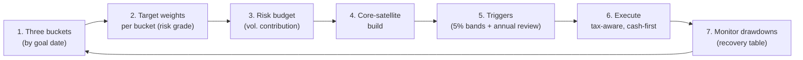

Text version: the seven steps form a loop — the monitoring step feeds back into bucket review, because goal dates and income change; the loop is the portfolio.

## How this article uses calculators

The DhanPedia calculators page at `/calculators` operationalizes this article's arithmetic:

- **Rebalance tool** — enter the 60/40 start (₹6L/₹4L) and the 48%/−4% year; it should output the exact trade pair: sell ₹1,24,800 equity / buy ₹1,24,800 bond.
- **Drawdown-recovery tool** — enter 50% and confirm 100% recovery; enter the −30% stress case from `pf-wealth-plan-10-lakh`'s scenario table and see the break-even horizon at your assumed CAGR.
- **XIRR/fee-drag tool** — verify the 1% expense-ratio drag on your actual contribution history (method and assumptions in `foundations-compounding-returns`).
- **Slab calculator context** — after a tax-aware rebalance, run the ITR-side numbers against the FY 2025-26 slabs (new regime: nil to ₹4L … 30% above ₹24L; 87A rebate ₹60,000) to confirm the LCG math.

Use the calculators as the *audit* step: the article builds the plan, the calculators verify the plan, and the update-log figures below verify the plan's inputs.

## Update log

- **RBI policy repo near 5.25% through late 2025** (debt-ballast anchor; re-verify at each MPC) — last verified: 2026-08-06; src-rbi-repo
- **Equity LCG at 12.5% + 4% cess; debt LCG (> 3 yrs) merges into slab income** — re-verify at each Budget — last verified: 2026-08-06
- **Planning CAGR assumption 12% and volatility figures (equity ~18–20%, gold ~15%, P2P ~10%)** — planning inputs, labelled as assumptions throughout, not forecasts; refresh the volatility inputs against a fresh 10-year rolling window before republishing
- **No PPF/SCSS/SGB rates are claimed in this article** (those live in `pf-wealth-plan-10-lakh` and `retirement-fire-annuities`, each with their own update logs)

## Related

- `foundations-risk-allocation-behavior` — the risk definitions and behavioural traps this method is designed to defeat
- `pf-wealth-plan-10-lakh` — a concrete ₹10 lakh instance of this construction method
- `alternatives-pms-aif-private` — satellite anatomy: PMS/AIF gates, minimums, fees
- `p2p-lending-complete` — the P2P satellite sleeve, in full: framework, expected loss, due diligence
- `foundations-compounding-returns` — fee-drag and post-tax math used in the cost section

## Sources & citations

- `src-rbi-repo` — Reserve Bank of India, "MPC decision: policy repo rate held near 5.25% through late 2025", https://www.business-standard.com/finance/news/rbi-to-keep-interest-rates-steady-at-5-25-through-2026-reuters-poll-126012900085_1.html — supports the debt-ballast / positive-yield anchor claim; re-verify quarterly per its limitation note.

The 5% band, risk-budget and recovery figures are the article's own arithmetic on labelled assumptions, not external statistics.

## Editorial / review status

Published; last verified 2026-08-06; next review due 2027-02-28. Educational content, not individualized advice.


## Sources & Citations

- **Reserve Bank of India** — RBI MPC decision, 3-5 Aug 2026: repo held at 5.25%, neutral stance, SDF 5.00%, MSF 5.50%. https://www.rbi.org.in/SCRIPTs/BS_ViewBulletin.aspx?Id=24369 (verified 2026-10-16)

---
Educational content, not individualized investment, tax, accounting, or legal advice.
Author: Chirag Singhal. DhanPedia.


---


A ₹10 lakh portfolio is the stage where most Indian investors stop *planning* and start *doing*: the emergency fund is built, insurance is in place, and a first meaningful chunk of investable capital is ready. But "I have ₹10,00,000 — now what?" has no single answer. It depends on your risk grade, your horizon, your tax regime, and whether the plan has a growth path that does not strand you in a SIP-only mindset forever.

This article gives you a concrete, risk-graded plan for a ₹10,00,000 starter portfolio: exact allocation amounts for three risk grades, the SIP scaling math with the formula shown, a growth path that leads into PMS and AIFs when capital supports them, and honest about when those higher-capital avenues are the wrong tool. Everything below is educational and illustrative — not individualized advice. Numbers labelled "assumption" or "illustrative" are planning inputs you should stress-test with your own income and risk tolerance; numbers anchored to regulation or current policy are marked with their verification date.

## Assumptions block

Every plan is only as good as the assumptions written down before the money moves. This article assumes:

| Item | Assumption | Why it matters |
|---|---|---|
| Investable now | ₹10,00,000, **in addition to** a 6-month emergency fund held in liquid instruments | The starter capital must never be the safety net |
| Age / horizon | Reader in their 20s–40s; goal horizon 15+ years | Long horizons absorb equity drawdowns; short horizons cannot |
| Income | Stable salaried income, expected to grow 8–10% a year | Feasible step-ups on the SIP depend on this |
| Tax regime | New regime (the default since the FY 2024-25 transition; slabs and 87A per FY 2025-26) | Changes what "tax-efficient" means in every sleeve |
| Equity planning return | 10–12% nominal long-run — an **assumption for planning**, not a forecast | All compounding figures in this article scale with this |
| Debt-side anchor | PPF at ~7.1–7.2% p.a. and repo near 5.25% (last verified: 2026-08-06) | Debt sleeves are priced off these |
| Risk protection | Term + health insurance in place; no high-cost consumer debt | Otherwise the "growth" plan is a liability |

If your actual situation breaks one of these rows, the plan below still works as a template — change the assumption, keep the structure, and re-check the risk grade.

## Three risk grades: pick one, know why

You cannot allocate ₹10 lakh across five sleeves without first deciding how much pain you can actually sit through. We define three grades. The labels are about **your** behaviour in a −30% equity year, not about the markets.

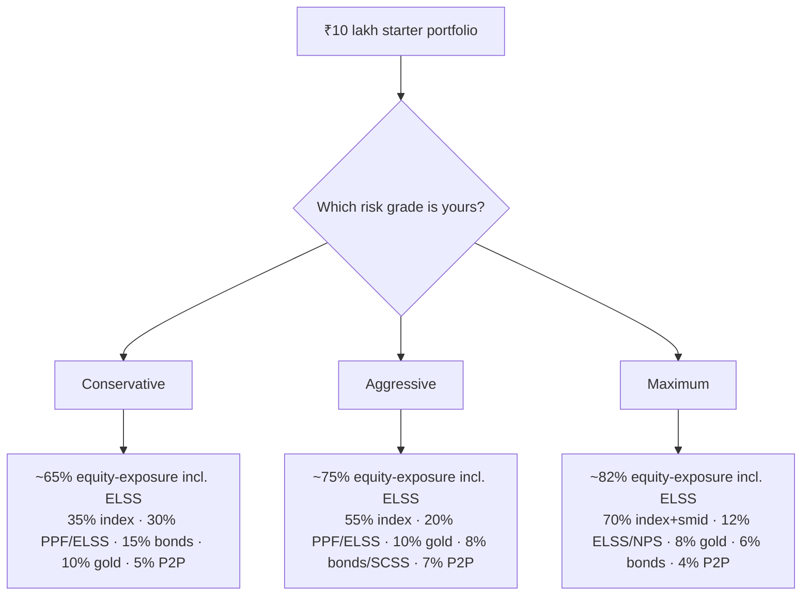

Text version of the diagram: one entry node (your ₹10 lakh) branches into three grades; each grade expands into its sleeve split.

| Sleeve | Conservative | Aggressive | Maximum |
|---|---|---|---|
| Index equity (Nifty 50 + Nifty 500 ETFs/funds; maximum adds small & mid flexi) | 35% → ₹3.5 lakh | 55% → ₹5.5 lakh | 70% → ₹7.0 lakh |
| PPF + ELSS (longer-horizon tax-efficient sleeve) | 30% → ₹3.0 lakh | 20% → ₹2.0 lakh | 12% → ₹1.2 lakh |
| Gold (gold ETFs; SGBs are no longer the route — see update log) | 10% → ₹1.0 lakh | 10% → ₹1.0 lakh | 8% → ₹0.8 lakh |
| Bonds / SCSS when eligible | 15% → ₹1.5 lakh | 8% → ₹0.8 lakh | 6% → ₹0.6 lakh |
| P2P credit sleeve (RBI-regulated platforms only) | 5% → ₹0.5 lakh | 7% → ₹0.7 lakh | 4% → ₹0.4 lakh |
| **Total** | **100% → ₹10.0 lakh** | **100% → ₹10.0 lakh** | **100% → ₹10.0 lakh** |

**What each sleeve is doing.** The index sleeve is the compounder: low-cost, Nifty 50 plus Nifty 500 exposure, bought partly as a lump sum and partly as a monthly SIP so that market timing is mostly removed. The PPF + ELSS sleeve is the tax-advantaged, long-tenor middle: PPF runs 15 years at ~7.1–7.2% p.a. (last verified: 2026-08-06) with tax-exempt interest, and ELSS gives you a three-year equity lock-in (per the SEBI investor-education guide to ELSS, src-sebi-elss). The gold sleeve uses ETFs rather than Sovereign Gold Bonds, because SGBs stopped accepting new tranches from FY 2024-25 (last tranche February 2024; status re-check against the latest Budget note — src-sgb-discontinued). The bonds/SCSS sleeve earns the repo-linked fixed-income anchor — with policy repo near 5.25% through late 2025 (last verified: 2026-08-06, src-rbi-repo); SCSS at 8.2% p.a. for FY 2025-26 (last verified: 2026-08-06) applies only to seniors (60+), so for a 20s–40s reader that sleeve is short-duration bond funds and a PPF-heavy tilt instead, and the SCSS rate becomes relevant to you much later or to your parents' planning. The P2P sleeve is the satellite: a small, capped slice in RBI-regulated peer-to-peer lending for a yield pickup over bonds, sized so a bad vintage cannot hurt. We deliberately keep it at 4–7% of portfolio in every grade; the full due-diligence framework lives in `p2p-lending-complete`.

**Choosing your grade.** Conservative suits anyone with near-term goal overlap, a young family without dual income, or genuine inability to watch a 30% drawdown. Aggressive is the default for a stable-income reader in their 20s–30s with 15+ years to the goal. Maximum is for 30s–40s readers with high and growing income, no dependents at risk, and a written statement that they will add (not panic-sell) in a crash. Write the choice down. The grade decides the numbers in the table; the table decides the behaviour.

## SIP scaling: the math that moves the needle

A ₹10 lakh lump is a good start, but the plan's engine is the monthly SIP. The standard formula for the future value of a monthly SIP (ordinary annuity, monthly compounding of the annual CAGR) is:

$$FV \;=\; P \times \frac{(1+i)^{n}-1}{i}, \qquad i=\frac{CAGR}{12},\quad n=\text{number of months}$$

Worked example, stated precisely so you can reproduce it: **P = ₹15,000/month, assumed CAGR = 12%, horizon 15 years = 180 months**, so i = 1%.

1. Monthly growth factor: $(1+i) = 1.01$
2. $(1.01)^{180} = e^{180 \times \ln 1.01} = e^{180 \times 0.00995} = e^{1.7911} \approx 5.996$
3. Annuity factor: $\frac{5.996 - 1}{0.01} \approx 499.6$
4. $FV = 15{,}000 \times 499.6 \approx \text{₹}74{,}94{,}000$

So ₹15,000 a month at a 12% assumed CAGR for 15 years yields **≈ ₹74.9 lakh**, against **₹27.0 lakh actually invested** (15,000 × 180) — the gain is roughly ₹47.9 lakh, and nearly two-thirds of the final corpus is compounding, not contributions. (Be wary of figures like ₹44.7 lakh floating around for this exact setup: that number comes from a shorter horizon or a lower assumed CAGR. Show the formula; check the exponent.)

Two refinements, honestly labelled:

- **Annuity-due variant.** SIPs are paid at the start of the month, so each instalment earns one extra month: $FV_{due} = FV_{ordinary} \times (1+i) \approx 74.9 \times 1.01 \approx ₹75.7$ lakh. The difference is small; the habit of stating which convention you used is not optional.
- **Step-ups change everything.** If your income grows and you raise the SIP 10% every year (a growing annuity: year-1 SIP ₹1.8 lakh, year-2 ₹1.98 lakh, … at the same 12% planning CAGR), the 15-year *SIP* corpus alone rises to **≈ ₹1.23 crore** (illustrative, same assumptions; with the ₹10 lakh lump included, the total is ≈ ₹1.78 crore). Step-ups are the single largest behavioural lever in the whole plan — larger than any allocation tweak. The mechanism: a higher contribution in later years compounds for fewer years, but the sheer size of the contribution dominates; the two effects together turn a ₹74.9 lakh outcome into ₹1.23 crore from the SIP stream alone.

The CAGR you will quote anywhere else in this plan is defined as:

$$CAGR = \left(\frac{V_{end}}{V_{begin}}\right)^{1/t} - 1$$

where t is in years. Keep the pair: the formula for building (SIP FV) and the formula for checking (CAGR).

## Growth path: from ₹10 lakh to PMS/AIF territory

SIPs do not age gracefully. Below roughly ₹50 lakh, index funds are simply the right vehicle. Beyond that, the menu opens — but only if you *plan* the transition instead of stumbling into it.

The milestone math, at the same 12% planning CAGR: ₹10 lakh lump + ₹15,000 monthly SIP reaches **≈ ₹48.8 lakh by year 8** (lump: 10 × 1.12⁸ ≈ ₹24.8 lakh; SIP: 15,000 × ((1.01)⁹⁶ − 1)/0.01 ≈ ₹24.0 lakh) and crosses **₹50 lakh around year 8–8.5**. Illustrative, not a forecast.

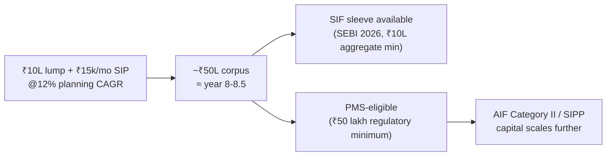

Text version: the corpus path flows from the starter plan, through the ₹50 lakh PMS milestone, to AIF Category II territory as capital grows.

- **SIF: the new bridge rung at your current corpus.** SEBI’s 2026 Mutual Fund Regulations added the **Specialized Investment Fund** category (effective 1 April 2026) with a **₹10 lakh aggregate minimum** per PAN within a single AMC’s SIF offerings. That is *exactly* your starting corpus, so for the first time a ₹10L investor can own a "sophisticated" strategy tier (dynamic allocation, sector rotation, capped long-short) inside a regulated pooled vehicle taxed like a mutual fund — without jumping straight to the ₹50L PMS gate. Rule of thumb: keep the SIF sleeve to roughly 15–25% of total corpus and only on top of a solid index/debt core. Full treatment: [SIF: The ₹10 Lakh Tier](../alternatives/alternatives-sif-specialized-funds.mdx).

- **PMS entry at ₹50 lakh.** Portfolio Management Schemes have a ₹50 lakh minimum; above that the 1–2% management-fee structure becomes efficient *only if* the manager genuinely adds value against an index benchmark. The full anatomy — AIF Categories I/II/III, SEBI minimums, fee and lock-in comparisons, when PMS beats a fund house — is in `alternatives-pms-aif-private`. For this plan, treat ₹50 lakh as the *first* gate, not the last: a realistic 15-year outcome at these assumptions is a **≈ ₹1.3 crore** corpus (₹54.7 lakh from the lump: 10 × 1.12¹⁵ ≈ ₹54.7 lakh, plus the ₹74.9 lakh SIP corpus).
- **AIF Category II for private/smids.** Category II AIFs (typically long-only, no leverage beyond caps) are the natural home for private-market and small/mid-cap concentrated books once you have enough capital that a ₹50 lakh PMS no longer dwarfs your investable surplus. The rule of thumb: move a sleeve, never the whole plan, and only after the PMS stage.

### When NOT to use PMS/AIF

Higher capital access is not automatically better. Do **not** move into PMS/AIF when:

- **Your horizon for that money is under 5 years.** PMS lock-ins, AIF commitments and private-market illiquidity all assume you can wait through a full equity cycle.
- **You need liquidity.** A ₹50 lakh PMS position is not something you unwind in a week for a goal that moved up by two years.
- **Your total investable capital is near the minimum.** A 1.5% fee on a ₹50 lakh book that is benchmark-indexable is pure drag; index funds at ~0.1–0.5% expense ratios win on arithmetic alone.
- **You have not written an Investment Policy Statement.** PMS/AIF decisions without a written benchmark and sizing rule become concentration decisions in disguise.
- **The alternative is boring but correct.** If an index + gold + debt mix at your risk grade beats every available PMS on a risk-adjusted basis, stay in it.

## Tax drag: how slabs, 87A and lock-ins shape the plan

Under the new regime for FY 2025-26 (src-it-slab-fy2025-26), the individual slabs are:

| Slab (new regime, FY 2025-26) | Rate |
|---|---|
| Nil to ₹4,00,000 | Nil |
| ₹4,00,001 – ₹8,00,000 | 5% |
| ₹8,00,001 – ₹12,00,000 | 10% |
| ₹12,00,001 – ₹16,00,000 | 15% |
| ₹16,00,001 – ₹20,00,000 | 20% |
| ₹20,00,001 – ₹24,00,000 | 25% |
| Above ₹24,00,000 | 30% |

With the **₹75,000 standard deduction** and the **₹60,000 Section 87A rebate**, a salaried individual with taxable income up to **₹12,00,000** (i.e., gross salary up to ₹12.75 lakh) pays **zero income tax**. This is the quiet superpower of the new regime: most readers of a ₹10 lakh plan will live in the zero-tax zone for years, which means *tax drag while accumulating* is small. The drag concentrates at **exits**: long-term equity capital gains at 12.5% plus 4% cess (effective ~13%) on gains — last verified: 2026-08-06 — and short-term gains at 20%. Two worked intuitions:

- Realising ₹3 lakh of LCG costs you ₹37,500 tax plus ₹1,500 cess — ₹39,000, an effective 13% haircut on that slice.
- Dividends and bond interest are taxed at slab rates; for a reader inside 87A that tax is 0%, which is precisely why PPF's tax-exempt interest (~7.1–7.2%, last verified: 2026-08-06) is a *real* advantage in this plan and not just a marketing one.

**Regime nuance, stated plainly:** the ₹1.5 lakh 80C deduction (PPF, ELSS, etc.) and the extra ₹50,000 80CCD(1B) for NPS exist **only under the old regime** (80C limit: src-it-80c-150k). If you stay on the new regime, the PPF + ELSS sleeve in the tables above is valued for **capital protection, tenor and tax-free compounding**, not for the deduction. If your income puts you in a high slab where old-regime deductions pay more than 87A's rebate, the regime choice is a genuine arbitrage question — run it against the FY 2025-26 slabs above before you sign anything. (Full treatment in `tax-india-investor-complete`.)

### Pick the regime by arithmetic, not habit

The new regime is the **default** for FY 2026-27, and for most people at this income level it is the *lower-tax* choice even with zero deductions, because the slab structure was reset so that income up to **₹12 lakh is effectively tax-free** (₹12.75 lakh gross for a salaried person after the ₹75,000 standard deduction). The **old regime** only wins when your Chapter VI-A stack (80C, 80D, 24(b) home-loan interest, 80CCD-1B NPS, HRA) is large enough that its deductions outweigh the new regime’s flatter slabs — usually meaning a big home-loan or heavy insurance/NPS outlay, often somewhere above ₹20–25L of income. **Work the number for your own facts both ways** (the calculators page has the slab math) and commit to the lower-tax regime each year; it is a reversible, annual decision. Capital-gains and interest tax are *outside* this regime choice and are governed by the slab/CAPG rules in the taxation article.

## Two-year action checklist

**Months 0–3 — foundations**

- [ ] Confirm the 6-month emergency fund is in a liquid fund or sweep, separate from this portfolio
- [ ] Pick your risk grade in writing; fill the three-number table above with your grade
- [ ] Open demat; start the ₹15,000/month index SIP (Nifty 50 + Nifty 500 split per your grade)
- [ ] Open PPF (₹1.5L annual cap) and, if old-regime, ELSS within the 80C ₹1.5L limit
- [ ] Allocate the gold sleeve into a gold ETF, not jewellery
- [ ] If any P2P: RBI-regulated platform only, start at half your sleeve size, due-diligence per `p2p-lending-complete`
- [ ] Write a one-page Investment Policy Statement: grade, sleeves, trigger, no-trade rule (minimum 3 months between discretionary trades)

**Months 4–12 — first review**

- [ ] Step-up check: if income grew, raise the SIP 5–10%
- [ ] First annual rebalance to target weights (rules in `portfolio-construction-rebalancing`)
- [ ] File ITR; confirm regime choice (new vs old) in writing for next year
- [ ] Note any single position that crossed 10% of portfolio — flag for the review

**Months 13–24 — second cycle**

- [ ] Re-grade risk if life changed (new family, new city, new employer)
- [ ] Second step-up if budget allows; record the assumed CAGR you are *actually* planning against
- [ ] Corpus check: if you are on the 12% planning path, you should be near ₹14–16 lakh by month 24 (illustrative)
- [ ] PMS not yet — the plan says the gate is ₹50 lakh. Anyone selling you PMS entry at ₹10 lakh is selling you a minimum

## Three risk scenarios for the plan

Illustrative stress tests, not forecasts. "Aggressive" grade numbers: ~75% equity exposure (index + ELSS).

| Scenario | What the market does | What happens to the plan | Response encoded in the plan |
|---|---|---|---|
| **Bear** | Nifty −30 to −40% over 12–18 months | Aggressive portfolio drawdown ≈ −28%; P2P vintage stress may follow credit stress | SIPs continue (buying falls is the whole point); no chasing; P2P sleeve not added to; 3-month no-trade rule respected |
| **Bull** | Nifty +40% in 18 months | Drift to ~85% equity; the plan silently becomes "maximum" | Band rebalance back to targets (see `portfolio-construction-rebalancing`); step-up SIP; still no PMS until the ₹50L gate — measured on a smoothed, not peak, corpus |
| **Stagflation** | Inflation 8%+, repo near 5.25% (last verified: 2026-08-06) and cut slowly | Real equity returns compress; gold and short-duration debt hold value; bond yields chase inflation | Keep the 10% gold sleeve; tilt bonds short-duration; P2P stays at the minimum of the grade (5% or less) since defaults tick up |

The scenario table is the plan's insurance: because the responses are pre-decided, none of the three moments becomes a fresh decision under pressure.

## Key formulas

$$FV = P\,\frac{(1+i)^n - 1}{i} \qquad\text{(SIP future value; } i = \tfrac{CAGR}{12}\text{, } n \text{ in months)}$$

$$CAGR = \left(\frac{V_{end}}{V_{begin}}\right)^{1/t} - 1 \qquad\text{(t in years)}$$

Check figures in this article against these two formulas and the stated convention (ordinary vs annuity-due, nominal vs effective).

## How this article uses calculators

The SIP FV, CAGR and fee-drag figures in this article are reproducible on the DhanPedia calculators page at `/calculators`: enter P = ₹15,000, assumed CAGR 12%, 180 months, and you should land on ≈ ₹74.9 lakh (ordinary annuity). Use the XIRR tool on any real statement before you ever quote a personal CAGR — the worked example in `foundations-compounding-returns` shows why naive CAGR on a contribution stream is misleading. The calculators document their own assumptions (compounding convention, tax treatment) — read them once, then trust the arithmetic.

## Update log

Time-sensitive figures used in this article, each marked where it appears:

- **PPF rate ~7.1–7.2% p.a.** — revised quarterly (last verified: 2026-08-06)
- **RBI policy repo near 5.25% through late 2025** — re-verify at each MPC (last verified: 2026-08-06; src-rbi-repo)
- **SCSS 8.2% p.a. for FY 2025-26** — revised quarterly (last verified: 2026-08-06)
- **SGB scheme discontinued from FY 2024-25; last tranche February 2024** — re-check at each Union Budget before republishing (last verified: 2026-08-06)
- **FY 2025-26 new-regime slabs, ₹75,000 standard deduction, ₹60,000 87A rebate** — re-verify at each Budget (last verified: 2026-08-06; src-it-slab-fy2025-26)
- **ELSS 3-year lock-in; 80C ₹1.5 lakh limit (old regime)** — re-verify at each Budget (last verified: 2026-08-06; src-sebi-elss)

## Related

- `foundations-compounding-returns` — the CAGR/XIRR/real-return math behind every figure here
- `portfolio-construction-rebalancing` — band triggers and rebalancing rules for the sleeves
- `alternatives-pms-aif-private` — PMS/AIF anatomy, SEBI minimums, fees, lock-ins
- `tax-india-investor-complete` — regimes, slabs, 80C/80CCD, capital-gains reporting
- `mf-sip-swp-stp-goals` — SIP/STP/SWP mechanics and goal-based planning

## Sources & citations

- `src-rbi-repo` — Reserve Bank of India, "MPC decision: policy repo rate held near 5.25% through late 2025", https://www.business-standard.com/finance/news/rbi-to-keep-interest-rates-steady-at-5-25-through-2026-reuters-poll-126012900085_1.html
- `src-it-slab-fy2025-26` — Income Tax Department / Union Budget 2025, "Income tax slabs FY 2025-26 (new regime default; old regime optional)", https://www.incometax.gov.in/iec/foportal/help/individual/return-applicable-1
- `src-sebi-elss` — SEBI Investor Education, "Securities Market Investment: A Guide to ELSS", https://investor.sebi.gov.in/elss.html

Supporting context (not in this article's frontmatter, carried by the linked articles): PPF/SCSS rates and SGB status via `pf-` and `retirement-fire-annuities` articles; P2P framework via `p2p-lending-complete` (RBI P2P Directions 2025); 80C limit via `tax-india-investor-complete`.

## Editorial / review status

Published; last verified 2026-08-06; next review due 2027-02-28 (or earlier at the next MPC / Budget if a figure above changed). Educational content, not individualized advice.


## Sources & Citations

- **Reserve Bank of India** — RBI MPC decision, 3-5 Aug 2026: repo held at 5.25%, neutral stance, SDF 5.00%, MSF 5.50%. https://www.rbi.org.in/SCRIPTs/BS_ViewBulletin.aspx?Id=24369 (verified 2026-10-16)
- **Income Tax Department / Union Budget 2025** — Income-tax slabs, new regime, FY 2026-27 (AY 2027-28) - unchanged from the Budget 2025 reset. https://www.indiabudget.gov.in/doc/Finance_Bill.pdf (verified 2026-10-16)
- **SEBI Investor Education** — Securities Market Investment: A Guide to ELSS. https://investor.sebi.gov.in/elss.html (verified 2026-08-06)

---
Educational content, not individualized investment, tax, accounting, or legal advice.
Author: Chirag Singhal. DhanPedia.


---


Every F&O trading account in India now opens with a disclosure that would be unthinkable a decade ago: **“9 out of 10 Individual traders made losses in F&O in FY22”** [src-sebi-fo-fy26]. Brokers must show it at login. The message is not folklore; it is the official output of a SEBI study of individual equity-derivatives traders, reported through a Ministry of Finance written reply in the Rajya Sabha on 11 August 2026 [src-sebi-fo-fy26].

This article is the arithmetic behind that disclosure. It is for the Indian reader who already knows the basics, holds roughly a ₹10 lakh corpus, and has been tempted by options trading, F&O tips, or “guru” content — and wants to know, with numbers, whether derivatives can ever be a rational tool at that scale. The honest answer, developed below: **speculation is almost always the wrong instrument at ₹10 lakh; hedging a real equity position is the one defensible use, and it has strict sizing rules.** This is education, not advice; verify tax and current-rate claims with a chartered accountant before acting.

## The verified loss data: SEBI's five-year table

The study tracks individual (retail) equity-derivatives traders across a top-15-broker sample that represents about 90% of all individual F&O investors. The data below is the headline evidence for this article [src-sebi-fo-fy26]:

| Fiscal year | Individual F&O traders | Notional + premium turnover | Net losses | Avg. loss per losing trader |
|---|---|---|---|---|
| FY22 | 42.74 lakh | ₹115 lakh crore | ₹40,824 cr | ₹95,517 |
| FY23 | 58.35 lakh | ₹149 lakh crore | ₹65,747 cr | ₹1,12,677 |
| FY24 | 86.26 lakh | ₹172 lakh crore | ₹74,812 cr | ₹86,728 |
| FY25 | 98.1 lakh | ₹213 lakh crore | ₹1,11,788 cr | ₹1,13,913 |
| FY26 | 78.6 lakh | ₹202 lakh crore | ₹91,685 cr | ₹1,16,654 |

Three things in that table deserve attention:

1. **Participation exploded, then contracted.** The base of individual traders grew more than 2.3× from FY22 to FY25 (42.74 lakh → 98.1 lakh), then fell about 20% year-on-year in FY26 to 78.6 lakh — the first decline in a decade [src-et-fo-retail-exodus]. The contraction follows years of reported retail losses; the capital is leaving.
2. **The losses did not contract with the base.** FY26 net losses of ₹91,685 crore remained in the ₹80,000–1,10,000 crore band even with ~20 lakh fewer traders. Average loss per losing trader actually rose to ₹1,16,654, the highest in the series [src-sebi-fo-fy26].
3. **The segment is still massive.** F&O STT collections across NSE and BSE ran ₹6,634 crore in FY22, ₹9,053 crore in FY23, ₹14,359 crore in FY24, ₹22,225 crore in FY25, and ₹27,695 crore in FY26 [src-sebi-fo-fy26]. Even as retail participation fell, the venue stayed enormous in notional terms — because the institutional side of the book kept trading.

The loss rate is the stat most readers will not internalise: **87.7% of individual F&O traders lost money in FY26**, per press reporting of the SEBI data [src-et-fo-retail-exodus]. Demographics sharpen the picture: traders **under 30 were 43% of all individual traders in FY26, up from 31% in FY22, and roughly 89% of them lost** [src-et-fo-retail-exodus]. This is the generation with the smallest corpus, the shortest track record, and the highest loss rate.

## What F&O actually is — in plain mechanics

Two products, two payoffs.

**Futures are linear and leveraged.** A Nifty futures contract obliges you to buy (or sell) the index basket at a fixed price on expiry. Your profit or loss is a straight line in the index's move, multiplied by the contract size. Leverage comes from the margin: you post perhaps 10–12% of notional (exchange-plus-broker margin; the exact percentage varies by volatility and is not asserted here) and control 100% of the notional. A 10% adverse index move on a fully leveraged futures position is roughly a 100% loss of the margin. The line goes through zero — there is no capped downside on a naked short.

**Options are non-linear.** An option is a right, not an obligation. If you *buy* a put, your maximum loss is the premium you paid; your payoff has a floor and an open ceiling. That capped-loss shape is exactly why options look “safe” to beginners — which is the marketing error: a capped *maximum* loss does not mean a *likely* loss of only that amount. Most option purchases do not reach their maximum loss; they simply decay, slowly and repeatedly, to near zero.

**Who is on the other side of your trade?** This is the structural point most retail readers skip. Your counterparty network is dominated by **proprietary desks (propos), institutional market-makers, and FIIs** — parties with lower cost of capital, faster systems, hedging infrastructure, and often the other side of a flow business. Press reporting of the SEBI data for FY26 puts it bluntly: while retail traders lost about ₹72,000 crore, **propos made about ₹44,000 crore** on the same book [src-toi-big-boys] (press reporting of SEBI data; treat the exact split as approximate).

## The arithmetic of why retail loses

Strip away the psychology and a retail option-buyer faces four structural drags, each small, none of them small *together*:

- **Time decay (theta).** Option value bleeds as expiry approaches, even if the underlying is flat. This is the seller's structural income and the buyer's structural cost.
- **Bid-ask spread and slippage.** Every entry and exit consumes part of the premium; retail crosses the spread in both directions.
- **Premium is sunk on the buy side.** Buying options means paying a premium for a right that, statistically, usually expires worth less than you paid. Long-term, buying options at the market's fair value is a **negative-sum game for the buyer side**: the premium you pay is roughly what the seller keeps, net of the seller's own costs. The seller side — which is where the prop desks and institutions concentrate — wins that structure by default.
- **Leverage magnifies the drags.** The same costs, applied to a notional 5–10× your margin, turn a 5% annual drag into a position that must win often just to break even.

Why the “9 in 10” figure then persists even among experienced retail? Because the house edge above is not a rounding error; it is the *business model* of the counterparty. When SEBI's data shows ₹91,685 crore in net retail losses in FY26 against ₹44,000 crore of prop gains [src-toi-big-boys], the money is not vanishing — it is transferring across the book from the slower, higher-cost, less-informed side.

**The two distinct uses of derivatives** are where honesty matters. The *speculation* use — buying weeklies for direction, trading tips, chasing volatility — is the game in which 87.7% of participants lose [src-et-fo-retail-exodus]. The *hedging* use — an investor who genuinely holds a portfolio reducing its risk in a defined window — is a different activity with different economics: you are *paying* for insurance, and you can size the premium. Conflating them is how a hedge becomes a gambling table.

## The cost of doing business: a round-trip arithmetic

Because we are not asserting exact statutory STT or charge rates here (rates change; see the update-log re-check rows), the useful question is *order of magnitude*, with assumptions stated.

> **Assumptions block (used in all worked examples below).** These are illustrative assumptions, not quoted market data: (1) total transaction costs on an F&O round trip — STT, exchange fees, brokerage, GST — cost on the order of **0.1–0.2% of notional** for a moderately high-activity trader; (2) a weekly index option's fair premium is around **5% of the index level**; (3) an annual index put that insures against a moderate drawdown costs on the order of **0.5–1.5% of the index** as a fraction of the index level, depending on volatility; (4) the reader's corpus is ₹10 lakh, fully invested in a diversified equity sleeve. Verify the exact STT and charge schedule for your broker and product before acting.

| Scenario | Notional | Illustrative round-trip cost (assumed) | Cost as % of the *capital* supporting the position |
|---|---|---|---|
| 1× weekly index option buy + sell | ₹5,00,000 | ~₹7,500–15,000 | ~1.5–3% of a ₹5L premium outlay, every cycle |
| Futures, 2× leverage on ₹5L margin | ₹10,00,000 | ~₹20,000–40,000 | ~40–80% of the ₹5L margin, *per round trip* |

Read the second row slowly: at 2× leverage, a single round trip of transaction costs consumes 40–80% of the margin you posted. To break even on a weekly cycle you must beat both the cost *and* the decay. That is the entire case against weekly speculative churn, and it does not depend on any particular broker's fee card.

## Worked example 1: what theta does to a weekly option

Assume (as in the block above) Nifty is at 25,000 and you buy a weekly, near-the-money index put for **5% of the index ≈ ₹1,250 premium**, paying about ₹1,250 per index point of contract, so a position on one standard contract of ~₹15–20 lakh notional costs you on the order of ₹1.5–2.5 lakh in premium [assumption 2].

Now suppose the index is flat for the week. A near-the-money weekly option with one week of life typically loses the bulk of its time value; a representative (illustrative) decay path for such a contract, with volatility unchanged, is:

| Day | Illustrative premium |
|---|---|
| Purchase (T+0) | ₹1,250 |
| T+1 day | ~₹980 |
| T+3 days | ~₹700 |
| Expiry, index flat | ~₹0 |

The option fell ~72% in three days and to zero at expiry **while the market did nothing**. To merely recover the premium, the index had to move *against your put* in the direction you wanted, enough, fast enough, and before the spread and decay ate the move — and that on a book where you already paid 0.1–0.2% of notional to enter. This is not a claim about any specific option; it is the shape of the payoff that makes buying short-dated options a losing game in aggregate, and it is why the 87.7% FY26 loss rate [src-et-fo-retail-exodus] is *consistent* with the math rather than an anomaly.

## Worked example 2: sizing a real hedge on a ₹10 lakh portfolio

This is the defensible use. You hold ₹10 lakh in diversified equities; you have a defined risk window (a goal date, a large cash need, or a genuinely feared downturn). You buy index puts as a floor.

With assumption (3), an annual-dated, moderately out-of-the-money index put costs on the order of **0.5–1.5% of the index** as a fraction of index level. As a *percentage of your ₹10L corpus*, that hedge costs:

- **0.5% → ₹50,000** in premium for the cycle
- **1% → ₹1,00,000** in premium for the cycle

The sizing rule that keeps this a hedge and not a bet: **cap premium outlay at 1–2% of the portfolio per hedge cycle** (₹1,00,000–₹2,00,000 on a ₹10L corpus). Above that, the hedge costs more than the risk you are transferring and you have, in effect, decided the crash is coming with money. Companion rules: use **index options, not single-stock options** at your scale (cheaper, more liquid, no idiosyncratic gap); prefer **long-dated over short weekly** contracts (less decay per day of protection); and **never add to a losing short** — if you sell premium, a defined stop-loss rule written *before* entry is the only sane protection.

## Worked example 3: what a gap does to a naked short

You sell a weekly call for ₹5,000 per point; the stock gaps up 15% overnight on news. Your call, worth ₹5,000, is now worth ₹25,000+. You wanted a defined loss equal to the premium; because you are *naked* (no offsetting position), your actual loss is the premium **plus** the option's new intrinsic value, and your loss is no longer capped at the premium you collected — it is capped only by how high the underlying can go. Worse, in a limit-up/limit-down market the option may trade with a wide or nonexistent book, and “exiting” at your stop may be impossible: the stop triggers, there is no counterparty, and you carry the position into the next day's open. This is the gap/cornering mechanic that distinguishes a *premium harvest* (a defined, sized risk) from a *naked short* (an undefined tail). Rules: define your exit before entry; never add to a losing naked short; treat a limit-down/limit-up freeze as “you cannot exit,” not as a reason to average down.

## A decision framework (and when derivatives make no sense at all)

The flow below is the entire article in one diagram. Its text alternative: **if you cannot state your edge, do not trade; if you have no rules-based backtested process, do not trade; if you have a real position to hedge, size the hedge at 1–2% of the portfolio per cycle and use index options.**

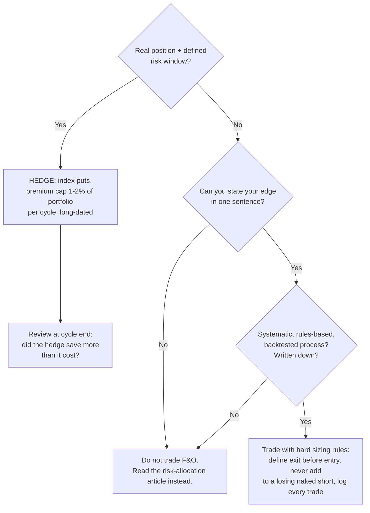

If you reach the “do not trade” node, that is not a failure — it is the 9-in-10 base rate [src-et-fo-retail-exodus] doing its job *before* you spent money on it.

### Red flags: the tips-and-“guru” channel

- **Tips, “calls,” and copy-trading rooms.** A signal you did not generate is a position you cannot defend, and the seller of signals makes money on *volume of followers*, not on your P&L. The structure is a subscription business, not an investing business.
- **Promises of “100× in a month.”** At the cost structure above, a position that must return 100%+ per month is, arithmetically, a total-loss candidate; nobody who knows the math sells it.
- **Unlimited liability on the seller side.** If the guru is naked-short, their loss is unbounded; your loss is bounded only by the same gap mechanics in worked example 3.
- **No written exit, no position cap, no maximum-loss-per-trade.** “When it looks right” is not a rule; it is how you lose the hedge and keep “hanging on.”

### Regulatory context: the curbs since November 2024

SEBI's post-2024 tightening is relevant because it changed the structure of the market, not just its volume. Since November 2024, the measures include: rationalisation of weekly index derivative products; increased tail-risk coverage on options expiry days; increased contract size for index derivatives; rationalisation of monthly index products; **upfront collection of option premiums from buyers**; removal of calendar-spread treatment on expiry days; and intraday monitoring of position limits [src-sebi-fo-fy26]. In May 2025 this was extended by streamlining of expiry days across exchanges and risk-based metrics for position limits [src-sebi-fo-fy26]. The direction of travel is legible: the regulator has spent the period making F&O *harder to churn* — fewer expiries to trade, bigger contracts (less relative leverage per rupee of capital), and premiums collected upfront so a buyer cannot enter a premium position without the full cash. State each change qualitatively as above; the exact contract sizes and margin parameters changed over this period and should be verified against the current SEBI circulars before you quote them.

## Tax treatment of F&O in India (verify with a CA)

F&O is not “investing” for tax purposes; it is *trading*, and the classification splits:

- **Intraday equity trades** are **speculative business** income, taxed at your slab rates; speculative and non-speculative turnovers are not netted against each other.
- **F&O positions (futures and options, held beyond intraday)** are **non-speculative business** income when you trade as a business, taxable at slab rates.
- **Presumptive taxation option:** a trader carrying on a non-speculative F&O business may declare income under **Section 44AB** at the presumptive rates — **8% of profits/turnover or 4% of capital gains, whichever is more** — subject to conditions (including, for F&O, the requirement that turnover be below the specified threshold and that the trade is conducted in a recognised derivative exchange). Note the interplay with **Section 44AA** (books of account) and **44ADA** (presumptive rates for professionals — *not* the F&O provision; 44AB is the one that applies to F&O traders), and re-verify the current 8%/4% rates and 44AA/44ADA structure with a CA — these provisions and their rates are time-sensitive [verify with a CA].
- **Option sellers and option buyers are not taxed identically** in every circumstance; the characterisation (business income vs. capital gains where the option is incidental to an investment position) depends on facts. This article marks the slab rates as **verified as of 2026-10-16 only**; the F&O presumptive provisions are flagged for re-check, not asserted as current.

## Where F&O fits — and does not fit — in a ₹10 lakh portfolio

For a ₹10 lakh corpus, F&O *speculation* is, in the overwhelming case, the wrong instrument. The two rational roles are:

1. **Hedging an existing equity sleeve in a defined risk window** — the worked example 2 case: cap premium at 1–2% of the portfolio per cycle, use index options, long-dated, rules written before entry.
2. **Harvesting option premium only as an advanced strategy** — with strict risk rules (no naked shorts without a defined offset, hard position caps, written exit). This is a strategy desk's job, not a starter's.

Note what derivatives do **not** do: they do not raise the rung of the Indian investment ladder. The ladder is [mutual funds → SIFs → PMS → AIFs](../personal-finance/pf-wealth-plan-10-lakh.mdx), which is exactly the sequence walked in [Specialized Investment Funds (SIF): India's New ₹10 Lakh Tier Between Mutual Funds and PMS](../alternatives/alternatives-sif-specialized-funds.mdx). Derivatives are a *tool inside the equity sleeve* — a hedge, a short-dated expression of a view, a premium harvest — not a rung you climb. A ₹10L corpus that is *mostly* F&O positions is not a more sophisticated portfolio; it is a 4× leveraged, negative-sum, 87.7%-losing game with a fee schedule.

For the reader at this scale the honest ordering is: build the diversified core (index funds, debt, per [Your 10 Lakh Wealth Plan](../personal-finance/pf-wealth-plan-10-lakh.mdx)), understand risk allocation and your own behavioral traps (per [Risk, Asset Allocation, Diversification & Behavioral Traps](../financial-foundations/foundations-risk-allocation-behavior.mdx)), learn to read the fundamentals you are actually buying (per [Equity Investing: Financial Statements, Valuation & Governance Red Flags](../equities/equity-fundamental-valuation.mdx)), and *then* — only then — use index options as a *cheap hedge* on that core during a defined window. That sequence is the difference between derivatives as a tool and derivatives as a trap.

## Ending: the one number to remember

87.7% of individual F&O traders lost money in FY26 [src-et-fo-retail-exodus]; their average loss among losers was ₹1,16,654 [src-sebi-fo-fy26]; the prop desks on the other side of the book made about ₹44,000 crore in the same year [src-toi-big-boys]. The structure is not a rumor and it is not a bug — it is the operating model. The question is never “can I beat the props?”; it is “do I have a *real position to hedge*, and if not, am I here for the insurance or for the casino?” The data says most of us at ₹10 lakh are here for the casino, and the house knows it. The framework above is how to be on the insurance side of the line — or, if you are not, how to stay out of the game entirely.

## Update log

| Date | Change / re-verification |
|---|---|
| 2026-10-16 | Verified SEBI FY26 retail F&O loss table (FY22–FY26), 87.7% loss rate, under-30 share, broker login disclosure wording, STT series (₹6,634 cr FY22 → ₹27,695 cr FY26), and Nov 2024 / May 2025 SEBI curbs, all from the Ministry of Finance written reply (11 Aug 2026) and press reporting [src-sebi-fo-fy26, src-et-fo-retail-exodus]. |
| 2026-10-16 | Re-check pending: exact STT rates and broker charge schedule (asserted here as an order-of-magnitude assumption only, not a statutory figure); 44AB presumptive rates (8%/4%) and 44AA/44ADA interplay for F&O traders; current SEBI contract-size and margin parameters post-Nov 2024 curbs. Verify all three against the current SEBI circulars and a CA before acting. |

## Sources & citations

- **`[src-sebi-fo-fy26]`** — Ministry of Finance, *Rajya Sabha Unstarred Question 2633, written reply, 11 August 2026* (retail investor protection in F&O trading), based on the SEBI study of individual equity-derivatives traders. Primary verified source for the FY22–FY26 loss table, STT series, and the regulatory curbs. [https://sansad.in/getFile/annex/271/AU2633_w2b25X.pdf](https://sansad.in/getFile/annex/271/AU2633_w2b25X.pdf)
- **`[src-et-fo-retail-exodus]`** — Economic Times, *Retail F&O boom hits reverse gear as active trader base falls 18% in FY26* (reporting of SEBI data: 87.7% loss rate in FY26; under-30 share 43% up from 31% in FY22, ~89% of under-30s lost; first participation decline in a decade). [https://economictimes.indiatimes.com/markets/stocks/news/retail-fo-boom-hits-reverse-gear-as-active-trader-base-falls-18-in-fy26-sebi/printarticle/133382023.cms](https://economictimes.indiatimes.com/markets/stocks/news/retail-fo-boom-hits-reverse-gear-as-active-trader-base-falls-18-in-fy26-sebi/printarticle/133382023.cms)
- **`[src-toi-big-boys]`** — The Times of India, *In F&O space, big boys profit at retail's expense: SEBI study* (press reporting of SEBI data: propos ≈ +₹44,000 cr vs retail ≈ −₹72,000 cr net in FY26; the exact split is approximate as reported). [https://timesofindia.indiatimes.com/business/india-business/in-fo-space-big-boys-profit-at-retails-expense-sebi-study/articleshow/133390369.cms](https://timesofindia.indiatimes.com/business/india-business/in-fo-space-big-boys-profit-at-retails-expense-sebi-study/articleshow/133390369.cms)

*Related: [Portfolio Construction, Rebalancing & Risk Budgeting](../portfolio-construction/portfolio-construction-rebalancing.mdx) · [Risk, Asset Allocation, Diversification & Behavioral Traps](../financial-foundations/foundations-risk-allocation-behavior.mdx) · [Equity Investing: Financial Statements, Valuation & Governance Red Flags](../equities/equity-fundamental-valuation.mdx) · [Your 10 Lakh Wealth Plan](../personal-finance/pf-wealth-plan-10-lakh.mdx)*

**Last verified:** 2026-10-16 (SEBI FY26 data, loss statistics, STT series, regulatory curbs — all primary). F&O presumptive-tax provisions and exact STT/charge rates: flagged for re-check, not asserted current.


## Sources & Citations

- **Ministry of Finance / SEBI (Rajya Sabha written reply)** — Ministry of Finance written reply, Rajya Sabha Unstarred Q 2633 (retail investor protection in F&O trading), 11 Aug 2026. https://sansad.in/getFile/annex/271/AU2633_w2b25X.pdf (verified 2026-10-16)
- **The Economic Times** — Retail F&O boom hits reverse gear as active trader base falls 18% in FY26: SEBI. https://economictimes.indiatimes.com/markets/stocks/news/retail-fo-boom-hits-reverse-gear-as-active-trader-base-falls-18-in-fy26-sebi/printarticle/133382023.cms (verified 2026-10-16)
- **The Times of India** — In F&O space, big boys profit at retail expense (SEBI study). https://timesofindia.indiatimes.com/business/india-business/in-fo-space-big-boys-profit-at-retails-expense-sebi-study/articleshow/133390369.cms (verified 2026-10-16)

---
Educational content, not individualized investment, tax, accounting, or legal advice.
Author: Chirag Singhal. DhanPedia.


---


**Scope note.** This article covers the *safety mechanics* of Indian bank deposits (what is insured, what is not, what bank categories mean), *FD economics* at current rates, and *where cash should live* for a ₹10 lakh investor. It is not a bank-recommendation article. Figures marked **"(verified 2026-10-16)"** were checked against the cited sources; interest rates move quarterly.

## Why "bank is safe" is only half the truth

India has a **deposit-insurance floor**, not a guarantee. The **DICGC** — a wholly-owned subsidiary of the RBI — insures deposits up to **₹5 lakh per depositor, per bank, per "same right and same capacity."** [src-dicgc-deposit-insurance]

That means:

- Your ₹50 lakh in SBI + ₹50 lakh in HDFC + ₹50 lakh in ICICI is insured in **full** if each is in a separate bank and all in your individual (non-JOINT, non-HUF) name.
- ₹50 lakh split across **five SBI accounts in your name** (current + savings + FD1 + FD2 + salary) is insured **only up to ₹5 lakh total** — DICGC aggregates *same depositor, same bank, same capacity.*
- **Joint accounts are capped at ₹5 lakh per joint holder**, not per account. A 2-person joint FD of ₹100 lakh at one bank is insured only ₹10 lakh in total.
- **SGBs, PPF, KVP, SCSS, NPS, bank NPS, and government-guaranteed retirement assets are NOT DICGC-covered** — they are protected by the government or by scheme law, but they do not add to your ₹5L DICGC headroom.
- **Sweep-ins and overnight funds** (which park excess balance in overnight/liquid mutual funds or call accounts) **lose DICGC cover** the moment the funds flow out of the bank's own balance sheet. A sweep account is effectively an MF exposure; the insurance does not follow.

### DICGC is the floor, not the ceiling

The ₹5L limit has not changed in decades. It is a *last-resort safety net* — in practice, when a bank goes under, the government (via RBI) has historically stepped in to protect depositors *beyond* DICGC (e.g., Yes Bank 2020: RBI extended its safety net to **all depositors, not just up to ₹5L**). But DICGC is the **legal minimum**, and yes-bank/IDBI-style bailouts are discretionary.

**Rule of thumb:** if you hold more than ₹5L at a single bank in your individual name in insured deposits, the excess is *technically* uninsured.

## Bank categories, and why the category matters more than the brand

| Category | Examples | RBI supervision | DICGC insured? | FD 1-year rate range (verified 2026-10-16) |
|---|---|---|---|---|
| **Major scheduled commercial banks (public + private)** | SBI, PNB, BOB, HDFC, ICICI, Axis, Kotak | Full RBI supervision | Yes, up to ₹5L | 6.25%–7.10% |
| **Small Finance Banks (SFBs)** | Ujjivan, Jan SFB, AU SFB, Fincap | Yes, but RBI-imposed lending-deposit cap: SFBs cannot concentrate ≥25% of deposits from one depositor (each depositor's FDs capped at ₹25L for SFBs) | Yes, up to ₹5L | 7.00%–8.50% (senior) / up to 9% advertised |
| **Payment Banks** | Airtel Pay, Paytm (payment), NPS India Pay | Yes — but payment banks **cannot lend** (except against deposits, with caps) | Yes, up to ₹5L | Savings rate only (no FD) |
| **Cooperative banks (state/district)** | District Central Cooperatives, State Co-op | RBI (district/states) | Yes, up to ₹5L | Varies; typically 6–8% |

**Key takeaway:** you can safely chase **small-finance-bank FDs** at 7–8.5% **as long as your deposit at any one SFB stays under ₹5L** (DICGC) *and* under the SFB's own **₹25L per-depositor cap** (which is a *regulatory* cap on total liability to any one depositor — beyond ₹25L the SFB may not accept further deposits from you).

For a ₹10L investor: spread your cash and FDs across 2–3 banks with **≤₹5L each** in insured deposits.

## FD mechanics — what a "1-year FD at 6.75%" actually means

A Fixed Deposit is a **deposit account** with a fixed interest rate and a fixed maturity. Interest can be paid:
- **Credited at maturity (CUM)** — the classic option; you get principal + total interest lump-sum at maturity.
- **Periodic payouts (monthly/quarterly/semi-annual)** — interest is taxed each year at your slab; the FD principal is not compounded.

**Taxation of FD interest:** taxed at **your slab rate** under "Income from Other Sources." TDS at 10% applies on interest >₹40,000 per year for individuals (₹50,000 for senior citizens). No deduction on interest *earned*; no 80C benefit on the principal.

**Premature withdrawal:** most banks charge a **penalty of 0.50–1.00 percentage point** on the rate; you may be locked for the penalty period. If you break a 3-year FD after 2 years, you lose the interest spread plus the penalty.

### FD vs. other cash options at current rates (verified 2026-10-16)

| Instrument | 1-year return (typical) | Tax treatment | DICGC insured? |
|---|---|---|---|
| Major-bank FD (SBI/HDFC/ICICI) | 6.25%–7.10% | Slab; TDS >₹40k | Yes, up to ₹5L |
| SFB FD (Ujjivan/Jan SFB) | 7.00%–8.50% | Slab; TDS >₹40k | Yes, up to ₹5L |
| Overnight/liquid mutual funds | ~5.8–6.2% (yield) | STCG at slab if under 3 months; LCG 0% after 91 days | **No** |
| PPF (8.2% p.a., verified [src-rbi-repo] repo 5.25% context) | 8.15% | EEE | N/A (govt scheme) |
| Senior Citizen Savings Scheme (8.2%) | 8.2% | Slab; no TDS until >₹1L/yr | N/A |
| EPF (Employees' Provident Fund) | 8.25% (FY 2025-26, EPFO CBT 239th meeting, verified [src-epf-rate-2026]) | EEE | N/A |

**Rule of thumb:** if you need the cash **inside 1 year**, an overnight/liquid fund is fine (0% LCG after 91 days) and more liquid than an FD. If you **don't need it for 1–3 years**, an FD at 7–8% (spread across banks for DICGC) typically beats overnight funds on after-tax yield.

## Where should ₹10 lakh emergency + cash reserve actually live?

This is not an investment question — it is a *liquidity and safety* question. A typical ₹10L individual investor (no home loan) might structure:

| Bucket | Amount | Where it lives | Rationale |
|---|---|---|---|
| **Emergency fund (6 months' spending)** | ₹2–3L | Overnight/liquid MF (Gilt/overnight, under ₹5L per fund) | Instant T+1/T+2 access; no TDS; LCG zero after 91 days |
| **Opportunity/sinkhole reserve** | ₹2–3L | 3–6 month FDs across 2 major banks (each ≤₹5L DICGC) | Locked-in spread over money-market; DICGC-protected |
| **Sweep / idle-cash auto-parking** | ₹1–2L | Bank sweep-in auto (overnight) or liquid fund | Captures idle salary-account balances; *loses* DICGC cover once in the sweep MF — accept this; the amount is small |
| **FD ladder** | ₹3–4L | 1/2/3-year FDs across SBI + 1 SFB + 1 PVT bank (each ≤₹5L DICGC) | 7–8% effective if staggered |

**Do NOT keep ₹10L in a single bank's savings account.** The savings-account interest (~2–3%) is negligible; the FD rates (6–8.5%) are the real yield, and the DICGC limit applies to *total per-bank per-depositor per-capacity* deposits (including savings + FDs combined).

## The 7-day credit-bureau reporting change (2026)

RBI's 2025–26 **Credit Information Reporting** framework (amended July 2026) moved credit-bureau reporting from **monthly → fortnightly → weekly** in phases. [src-rbi-credit-reporting-2026]

**What changed for you:**
- Lenders must now upload EMI/overdue data to CIBIL/Experian/Equifax/CRIF on **4 fixed dates every month** (9th, 16th, 23rd, last day) from **July 2026** (framework start April 1, 2026; full weekly reporting from July 1, 2026).
- A single missed EMI now hits your credit score **within days, not 30–60 days.**
- A paid-off loan or a cleared default now *recovers* your score faster too.

**Practical implication:** if you take a personal loan, credit-card EMI, or home loan, the credit-bureau "window" for repairing damage after a default is now measured in **weeks, not months.** This makes consistent, on-time EMIs *more* valuable than it was in 2024. See the [Credit & Loans article](/articles/pf-credit-loans-debt) for the full prepay-vs-invest framework.

## Sweep-ins: the quiet yield-loss

Most salary accounts have a **sweep-in facility**: when your balance exceeds ₹1L–₹5L, the excess is *automatically moved* into an overnight mutual fund or call-money account (typically 5.5–6.0% effective). This is **not a bank FD** and **not DICGC-insured.**

**The yield trap:** if you hold ₹3L permanently swept, you are earning ~5.8% in a liquid fund rather than ~7.1% in a bank FD or ~8.15% in PPF. The sweep is a *convenience default*, not a choice. If you know you will not need that ₹3L for 3 months+, move it to a proper FD ladder or PPF contribution.

## Payment Banks: what you can and can't do

Payment banks (Airtel Pay, Paytm Payments Bank, NPS India Pay) are **deposit-taking but non-lending** — they cannot give out loans (except tiny, cap-managed credit against deposits). They are **DICGC-insured up to ₹5L.**

**Limits:**
- Maximum deposit per customer: ₹2 lakh (total across all payment-bank accounts).
- No FDs; savings interest only (~3–4%).
- Good for UPI/mobile wallets; **do not store emergency funds here** — the ₹2L cap alone makes it unsuitable.

## Small-Finance Bank FDs: the high-yield corner

SFBs (Ujjivan, Jan SFB, AU SFB, Fincap, ESAF, etc.) have been advertising **senior-citizen FDs up to 8.5%** (verified 2026-10-16). [src-fd-rates-aug2026]

**The trade-off:**
- **Return:** ~1.5–2.0 percentage points above major private banks.
- **Risk:** the bank's capital base is smaller; RBI imposes a **₹25L per-depositor cap** on SFB deposits (total across all products). Your DICGC insurance still stops at ₹5L.
- **Liquidity:** SFBs have far fewer branches; most digital onboarding works, but physical paperwork at maturity can be slower.

**For a ₹10L investor:** use **1 SFB FD slot** of ≤₹5L (to stay in DICGC) at 8.0–8.5%, combined with major-bank FDs for the rest. Do not concentrate more than one SFB slot.

## Where DICGC does NOT apply

These common "safe-sounding" instruments are **not DICGC-insured:**

| Instrument | Why it's not DICGC |
|---|---|
| **SGB (existing, traded on NSE/BSE)** | A bond, not a bank deposit |
| **PPF** | Govt scheme — sovereign-guaranteed, but not bank-deposit insurance |
| **KVP / NSC / SCSS** | Govt schemes; not bank deposits |
| **Bank NPS (PFRDA corpus)** | Regulated by PFRDA, not RBI/DICGC |
| **Corporate FDs / NBFC debentures** | The "NBFC" — non-banking financial company — is **not a bank** and is **not DICGC-insured**. A corporate or NBFC FD is a *debt instrument* with default risk. |
| **Overnight / liquid mutual funds** | SEBI-regulated MFs; not bank deposits |

**Critical distinction:** an **NBFC FD** (e.g., a 9.5% "corporate FD" from a Finance company) is *not* a bank FD. It is a *debenture* with the NBFC's credit risk. If the NBFC defaults, you are an unsecured creditor — not a DICGC-protected depositor. See the [Fixed Income & Credit article](/articles/fixed-income-bonds-credit) for how to underwrite an NBFC debenture.

## The "safety-first" cash framework

For a ₹10 lakh investor with no home loan and no other liabilities:

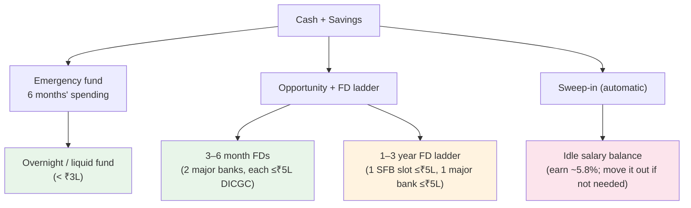

**Alt text:** A flow diagram showing where each rupee of "cash" should live: emergency fund goes to overnight funds, opportunity/short-term goes to major-bank FDs (DICGC-protected), longer-term goes to an FD ladder (including one SFB slot for 8%+), and idle salary-balance sweep-in is a temporary convenience trap.

## The "what if the bank fails" checklist

If you have more than ₹5L total at one bank in your individual name:

1. **Total up:** savings + current + all FDs + recurring deposits + loan account balances (loans offset *against* your DICGC headroom) + any joint accounts where you are a co-holder.
2. **Compare to ₹5L:** if you exceed it, move the excess to a second bank or to a PPF/government scheme (not another bank at the same).
3. **Check "same capacity":** a ₹3L HUF FD and a ₹3L individual FD at the *same* bank count as **separate DICGC heads** (HUF vs. individual = different "capacity").
4. **Joint accounts:** each joint holder gets up to ₹5L separately. A 2-person joint FD of ₹10L at one bank is insured **₹5L per person = ₹10L total** — you are safe.
5. **Sweep-in:** if you have a large sweep-in balance, know that the swept portion has *left* the bank's balance sheet and is *not* DICGC-insured. It is in an MF.

**Bottom line:** the DICGC limit is ₹5L per person per bank per capacity. Build your bank portfolio (and your FD portfolio) *around* that line, not in hope that a bailout will cover the excess.

## Update log

| id | claim | lastVerified | reviewAfter | status |
|---|---|---|---|---|
| tl-dicgc-5l | DICGC deposit insurance limit is ₹5 lakh per depositor, per bank, per same right and capacity (no change since 2015); joint accounts: ₹5L per joint holder | 2026-10-16 | 2027-06-30 | ok |
| tl-sfb-fd-rates-2026 | Small-finance-bank FD rates: up to 8.5% (senior) / ~8.25% (general) as of Oct 2026; major private-bank 1-year FDs: 6.25–7.10% (verified 2026-10-16); SFB per-depositor cap: ₹25L | 2026-10-16 | 2027-01-31 | ok |
| tl-rbi-weekly-credit-reporting | RBI phased in weekly credit-reporting (9th/16th/23rd/last of month) from July 1, 2026 (framework from April 1, 2026); replaces the old monthly/fortnightly cycle | 2026-10-16 | 2027-04-01 | ok |

## Sources & citations

- [src-dicgc-deposit-insurance] — DICGC / RBI: deposit insurance ₹5L limit
- [src-rbi-repo] — RBI MPC (3–5 Aug 2026): repo 5.25%, neutral stance
- [src-fd-rates-aug2026] — SBI/HDFC/ICICI/Axis/PNB/SFB FD rates as of Oct 2026 (multiple bank rate sheets + Zee Business + HindustanBusinessLine, Aug 2026)
- [src-rbi-credit-reporting-2026] — RBI (Credit Information Reporting) Directions, 2025 (amended July 2026); weekly reporting framework

## Related

- [Credit & Loans: EMI, Prepayment, and Credit Score in 2026](/articles/pf-credit-loans-debt)
- [Fixed Income & Credit](/articles/fixed-income-bonds-credit)
- [Your ₹10 Lakh Plan](/articles/pf-wealth-plan-10-lakh)
- [Government Savings Schemes](/articles/govt-small-savings-schemes)


## Sources & Citations

- **DICGC / RBI** — Deposit insurance covers up to ₹5 lakh per depositor per bank. https://www.dicgc.org.in/ (verified 2026-08-06)
- **Reserve Bank of India** — RBI MPC decision, 3-5 Aug 2026: repo held at 5.25%, neutral stance, SDF 5.00%, MSF 5.50%. https://www.rbi.org.in/SCRIPTs/BS_ViewBulletin.aspx?Id=24369 (verified 2026-10-16)
- **HindustanBusinessLine (14 Aug 2026) / Zee Business (20 Aug 2026) / HDFC Bank FD rate sheet (19 Aug 2026) / saifu.in aggregator (Oct 2026)** — FD rates in India, Aug–Oct 2026: SBI 6.25% (1-yr, 444-day Amrit Vrishti 6.45%), HDFC/ICICI 6.25–6.45%, IDFC FIRST up to 7.40%, small-finance banks up to 8.5% senior / 8.25% general; major private 1-yr 6.25–7.10%. https://www.hdfc.bank.in/fixed-deposit/fd-interest-rate (verified 2026-10-16)
- **Reserve Bank of India (Master Direction) / CNBC TV18 & Mint reporting** — RBI (All India Financial Institutions – Credit Information Reporting) Directions, 2025 (updated 1 Jul 2026): phased weekly reporting — framework w.e.f. 1 Apr 2026, lenders to file borrower data 4×/month (9th, 16th, 23rd, last day) from 1 Jul 2026. https://www.cnbctv18.com/personal-finance/rbi-weekly-credit-reporting-kicks-april-1-what-changes-for-borrowers-lenders-ws-el-19878645.htm (verified 2026-10-16)
- **EPFO (Central Board of Trustees) / PIB / Business Standard / ET Now (2026)** — EPFO CBT 239th meeting (Mar 2026): EPF interest rate retained at 8.25% for FY 2025-26; EPF Scheme 2026 keeps 8.25%. https://pib.gov.in/PressReleasePage.aspx?PRID=2234502 (verified 2026-10-16)

---
Educational content, not individualized investment, tax, accounting, or legal advice.
Author: Chirag Singhal. DhanPedia.


---


**Scope note.** Debt in India splits into two very different animals: **productive leverage** (a home loan that buys an asset whose value can rise and whose tax-deductible interest lowers your effective cost) and **consumptive debt** (credit cards, personal loans, top-ups that cost 14–32% on money that depreciates). This article gives the math to tell them apart. Figures marked **"(verified 2026-10-16)"** are checked against the cited sources.

## EMI mechanics — what the monthly number really hides

The **EMIs (Equated Monthly Installment)** formula amortizes principal + interest over a fixed term:

$$EMI = P \times \frac{r(1+r)^n}{(1+r)^n - 1}$$

where $P$ = loan amount, $r$ = monthly rate (annual rate ÷ 12 ÷ 100), $n$ = number of months.

**The counter-intuitive fact:** in a long-term loan, the *majority of the interest is paid in the first half of the tenure* because your outstanding principal is highest then. A ₹40L home loan at 8.5% for 20 years (240 EMIs) generates an EMI of ~₹34,300, and **total interest ≈ ₹42.3L** — more than the principal.

$$\text{Total interest} = (\text{EMI} \times n) - P$$

**Prepayment changes the game.** Any lump-sum prepayment that is *fully adjusted to principal* (not spread over remaining EMIs) shortens the tenure or lowers the EMI. A ₹3L prepayment early in a 20-year loan can shave **₹3–4L of total interest.**

### The three prepayment modes (choose deliberately)

| Mode | What happens | Best for |
|---|---|---|
| **Reduce tenure, keep EMI** | Tenure shrinks; EMI unchanged | Lowest total interest; you can afford the same EMI |
| **Reduce EMI, keep tenure** | EMI drops; tenure unchanged | Cash-flow relief, but *total interest rises* |
| **One-time, no change** | Principal reduced; next EMI auto-drops | Convenience; moderate interest saving |

## Home loan: the leverage that can make sense (or not)

A home loan is the *only* Indian retail debt where the loaned money buys an **appreciating asset** (land + construction, typically) and where the interest is **tax-deductible** under **Section 24(b)** (up to ₹2L p.a. for a self-occupied property, more for let-out). [src-it-slab-fy2026-27]

**Effective cost after the deduction:** a ₹40L loan at 8.5% with a ₹2L/yr 24(b) deduction, in the 30% bracket, gives a tax benefit of ₹60,000 p.a., effectively lowering the "after-tax" cost.

**But the honest comparison is to what the alternative earns.** The decision is not "is 8.5% high?" but "would the prepayment cash earn *more* than the after-tax loan cost, *net of risk and liquidity*?" [src-prepay-vs-invest-2026]

| Surplus use | Gross | After-tax (30% bracket) | Notes |
|---|---|---|---|
| Prepay home loan @ 8.5% | −8.5% (interest saved) | ~−7.1% (effective, with 24(b)) | Guaranteed, risk-free |
| Liquid/overnight fund | +5.8–6.2% | ~+4.4–4.9% (taxable) | 100% sure |
| PPF | +8.15% | +8.15% (EEE) | 15-yr lock; 80C cap |
| Diversified equity index | +11–12% (long-run) | +9.5–10.5% | Volatile; not guaranteed |
| SFB FD @ 8.25% | +8.25% | ~+7.3% | DICGC-protected ≤₹5L |

**The rule:** if your surplus can go into PPF, a long-horizon index fund, or a DICGC-safe SFB FD at 8%+ and you have a **high enough risk tolerance and a long enough horizon**, investing can beat prepaying. If you are *risk-averse, near a goal, or the loan is a high-rate old loan (double-digit)*, **prepaying wins** — it is a guaranteed "return." The single most common mistake is prepaying a *new, low-rate* home loan while leaving cash in a 2% savings account. [src-prepay-vs-invest-2026]

## Personal, auto & credit-card loans: the consumptive trap

These finance *depreciating* or *disposable* purchases at *high* rates:

| Loan type | Typical rate (2026) | Term | 80C / 24(b) benefit? |
|---|---|---|---|
| **Credit card (revolving)** | 36–42% (or min-36% annualized) | Revolving | No |
| **Personal loan** | 14–18% | 1–5 yrs | No |
| **Auto loan** | 9–11% | 3–7 yrs | No |
| **Home loan** | 8.0–8.9% (new, 2026) | 15–25 yrs | Yes (24(b)) |
| **LAP (loan-against-property)** | 10–13% | 5–15 yrs | Partially (if home loan) |
| **Education loan** | 9–10% (govt-backed up to limits) | 5+ yrs | Yes (80E) |

**The math is brutal on credit cards:** a ₹1L balance carried over at 36% costs ~₹36,000/yr in interest alone. A personal loan at 15% on a ₹3L refinance of that card is *almost always* the right move — **refinance high-rate consumptive debt first**, before any investing. [src-prepay-vs-invest-2026]

**Hard rule:** never use an *unsecured* loan (personal, card) to buy an *equity* or *long-term* asset. Unsecured consumptive debt costs more than anything a ₹10L portfolio can reliably earn.

## Credit scores after RBI's weekly reporting (2026)

RBI phased in **weekly credit-bureau reporting** from **July 2026** (framework from April 2026): lenders now push EMI/default data to CIBIL, Experian, Equifax and CRIF on the **9th, 16th, 23rd and last day** of each month. [src-rbi-credit-reporting-2026]

**What this changes:**

- **Defaults now show up in days, not 30–60 days.** A single missed EMI can dent your score within the next reporting window.
- **Recovery is faster too.** Paying off a loan or clearing a default now lifts the score within weeks.
- **Faster loan decisions** for banks, because their data is fresher.

**The scoring model (standard):** on-time EMIs (weight ~35–40%), credit utilization (keep cards under 30%), credit mix & age, number of recent enquiries, and outstanding balance. [src-rbi-credit-reporting-2026]

**Practical moves:**
- Set **auto-pay / EMI auto-debit** so an EMI can never "accidentally" miss.
- Keep **credit-card utilization under 30%** of your limit and *bill-pay in full* every cycle (revolving interest is the #1 score killer).
- Limit **hard enquiries** (each loan pre-approval query hits your report).
- A *paid-up* loan *does* stay on your report for up to 5 years as positive history; closing a *credit card* removes the "utilization headroom," so keep at least one card open.

## A cash-flow stress rule for a ₹10L investor

For a ₹10 lakh starter portfolio, the single most damaging decision is **over-levering cash flow.** Use these checks before taking *any* loan:

1. **EMI-to-income ≤ 40%.** If total monthly EMIs (home + auto + personal + card-minimums) exceed ~40% of take-home, you are over-extended.
2. **The 6-month emergency fund must survive a full job-loss month.** Cash that "belongs" to the investment corpus cannot be a buffer if the EMI will eat it.
3. **Productive debt only, and the cheapest productive debt first.** Home loan > (auto) >> personal > credit card in priority of *acceptable* leverage.
4. **Refinance on every rate reset.** When repo moves (it was held at 5.25%, neutral stance, per the Aug 2026 MPC [src-rbi-repo]), a home-loan prepayment window or a balance-transfer to a lower-rate lender can cut total interest materially.

### The decision tree

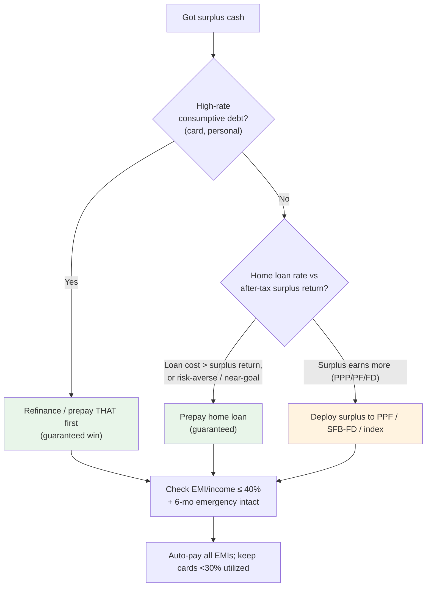

**Alt text:** Decision tree for surplus cash: first retire high-rate consumptive debt (guaranteed win), then compare home-loan cost to the after-tax surplus return to decide prepay-vs-invest, then verify EMI/income stays under 40% and the 6-month emergency fund is intact, then auto-pay everything.

## The "prepay or invest" one-line summary

Prepay when the debt is **high-rate and unsecured** (cards, personal loans) or you are **risk-averse / near a goal**. Invest the surplus when the debt is a **low-rate secured home loan** and you have a **long horizon and PPF/FD-grade safe options** earning more than the loan's *after-tax* cost. When in doubt, **split** the surplus between the two. [src-prepay-vs-invest-2026]

## Update log

| id | claim | lastVerified | reviewAfter | status |
|---|---|---|---|---|
| tl-rbi-weekly-credit-reporting | RBI weekly credit-bureau reporting (9/16/23/last of month) from July 1, 2026 (framework April 1, 2026) | 2026-10-16 | 2027-04-01 | ok |
| tl-home-loan-24b | Home-loan interest deduction under Section 24(b): up to ₹2L p.a. (self-occupied); new FY 2026-27 slabs unchanged from the Budget 2025 reset | 2026-10-16 | 2027-04-01 | ok |
| tl-repo-5-25 | RBI MPC 3–5 Aug 2026: repo held at 5.25%, neutral stance — the reference rate home loans reprice against | 2026-10-16 | 2027-03-31 | ok |

## Sources & citations

- [src-rbi-credit-reporting-2026] — RBI (Credit Information Reporting) Directions, 2025 (amended July 2026); weekly reporting
- [src-it-slab-fy2026-27] — Income-tax slabs FY 2026-27 (unchanged from Budget 2025 reset)
- [src-prepay-vs-invest-2026] — CreditSmart / Value Research / Money Control: prepay-vs-invest framework, 2026

## Related

- [Banking & Cash: Deposit Safety & FDs](/articles/banking-safety-deposits-fd)
- [Your ₹10 Lakh Plan](/articles/pf-wealth-plan-10-lakh)
- [Foundations: Compounding & Returns](/articles/foundations-compounding-returns)
- [Tax for the Indian Investor](/articles/tax-india-investor-complete)


## Sources & Citations

- **Reserve Bank of India (Master Direction) / CNBC TV18 & Mint reporting** — RBI (All India Financial Institutions – Credit Information Reporting) Directions, 2025 (updated 1 Jul 2026): phased weekly reporting — framework w.e.f. 1 Apr 2026, lenders to file borrower data 4×/month (9th, 16th, 23rd, last day) from 1 Jul 2026. https://www.cnbctv18.com/personal-finance/rbi-weekly-credit-reporting-kicks-april-1-what-changes-for-borrowers-lenders-ws-el-19878645.htm (verified 2026-10-16)
- **Income Tax Department / Union Budget 2025 (Finance Act 2025) — FY 2026-27 slabs** — Income-tax slabs, new regime, FY 2026-27 (AY 2027-28) — unchanged from the Budget 2025 reset: 0-4L nil, 5% to 8L, 10% to 12L, 15% to 16L, 20% to 20L, 25% to 24L, 30%+; Sec 87A rebate extends tax-free up to Rs 12L; standard deduction Rs 75,000. https://cleartax.in/s/income-tax-slabs (verified 2026-10-16)
- **CreditSmart / Value Research / Money Control / India Today (2026 prepay-vs-invest guides)** — Prepay home loan vs invest, 2026: at ~8.5% loan rate (effective ~7.1% after Sec 24(b)) vs 11–13% long-run equity / 8–8.5% safe debt — refinance high-rate unsecured debt first; prepay when risk-averse or loan cost > surplus after-tax return. https://creditsmart.in/home-loan-prepayment-strategy-india/ (verified 2026-10-16)
- **Reserve Bank of India** — RBI MPC decision, 3-5 Aug 2026: repo held at 5.25%, neutral stance, SDF 5.00%, MSF 5.50%. https://www.rbi.org.in/SCRIPTs/BS_ViewBulletin.aspx?Id=24369 (verified 2026-10-16)

---
Educational content, not individualized investment, tax, accounting, or legal advice.
Author: Chirag Singhal. DhanPedia.


---


**Scope note.** The [Insurance & Protection article](/articles/insurance-protection) covers *which* products to buy. This article covers what happens *after* you buy: the **claims data** (what % of claims actually get paid, and why the rest fail), the **ULIP-vs-term math** (the single most profitable mis-sale in Indian retail finance), **mis-selling red flags**, and **solvency checks** that predict who pays on time. Figures marked **"(verified 2026-10-16)"** were checked against the cited IRDAI report and 2026 guides.

## What IRDAI's 2026 report actually says about claims

The IRDAI Annual Report 2026 (covering FY 2025-26) gives the cleanest public view yet of how claims actually land. [src-irdai-annual-report-2026]

**Life insurance (death claims):**

- The industry's aggregate death-claim settlement ratio is **~99%** (i.e., ~1 death claim in 100 gets rejected or is still pending). Top public-sector (LIC) and strong private players sit above 99%; a few laggards are in the 97% band.
- **Why life claims fail:** lapsed policies (premium not paid), unfulfilled duties of disclosure (undisclosed pre-existing conditions), suicide within the 2-year window, or claims filed with incomplete documents. Most are *administrative*, not *underwriting* disputes.

**Health insurance (the hard part):**

- **~1 in 12 health claims (~8%) is rejected** (IRDAI 2026 summary, verified 2026-10-16). [src-irdai-annual-report-2026]
- The top causes of rejection are *fine print*, not fraud:
  1. **Room-rent capping** — a policy that caps the room at ₹5,000/night while your private room costs ₹12,000 makes you pay the difference on *every* line item proportionally (a ₹7,000/night gap can become a ₹70,000+ total gap in a Tier-1 hospitalization).
  2. **Pre-existing condition waiting periods** (now capped at **3 years** by the 2025-26 reforms [src-irdai-moratorium-2026]).
  3. **Non-medical expenses** — parking, attendant charges, and similar items are typically excluded; you pay them.
  4. **Moratorium claims** — the 2025-26 reforms cut the moratorium (no-claim-rejection) period from **8 to 5 years** [src-irdai-moratorium-2026]; claims beyond that are protected, claims inside are still underwritable.
- **The 1-hour cashless rule:** IRDAI now mandates hospitals/insurers to clear pre-authorization within **1 hour** (discharge authorizations within 3 hours). FY 2025-26 data: **86.8% of cases met the 1-hour deadline** [src-irdai-annual-report-2026]. If the insurer delays, the extra hospital charges due to that delay *must* be paid by the insurer.
- **Average health payout ~₹29,000** — this is misleading, because it is dominated by small fever/in-patient episodes. A single Tier-1 cardiac event easily costs ₹8–10 lakh. **A ₹3L cover is materially under-insured for a family in a metro.**

## The ULIP math: why "insurance + investment in one" loses

A ULIP (Unit Linked Insurance Plan) is life cover + a mutual-fund-style fund, *with charges on top of fund expenses.* It has been the most mis-sold product in Indian retail finance, and for a concrete reason — the math. [src-ulip-vs-term-2026]

**Worked comparison (illustrative, not a forecast; ₹1L p.a. for 20 years, age 30):**

| Structure | 20-year corpus (illustrative) | What you actually paid |
|---|---|---|
| **ULIP** (₹1L/yr, 6–8% net after charges, high fund charges 1.5–2.5%) | **~₹40–45L** | ₹20L premiums, of which ~₹4–6L goes to *charges*, not the fund |
| **Pure term (₹20,000/yr for ₹1Cr cover) + SIP of the saved ₹90,000** in a low-cost index fund (assume 11% p.a. illustrative) | **~₹70–75L** | ₹0.4L/yr term + ₹10.8L invested |

The ULIP is **not** "insurance + a better fund." It is "thinner cover + a *worse* fund (high charges, long lock-in, switch costs) + a surrender-value trap (early exit pays back a fraction of premiums)." The 20-year gap in the illustration is ₹30L+.

**The mis-sale usually goes like this:** "₹1L a year — your money grows AND your family is protected!" The two claims: (a) the growth is *grossly* overstated (charges eat the spread vs. any index fund), and (b) the cover is *thin* (₹3–5L typical cover on ₹1L premium, vs. ₹1Cr on a ₹20,000 term premium). You are paying *premium + fund charges* for *both* jobs — when the *term + index-fund* split does both jobs cheaper and more transparently. [src-ulip-vs-term-2026]

### Where a ULIP is NOT obviously wrong

- **Tax-advantaged legacy structure** — ULIPs carry 172-80C/80CCD (₹2.5L/yr limit, old regime only). Under the *new regime* (default, 2026-27), **the 80C/80CCD deductions don't apply**, so that advantage disappears for most people. [src-irdai-annual-report-2026] (GST removal on health & life premiums, late 2025, makes *more* cover cheaper; a larger term/health cover often beats the ULIP tax story.)
- **You genuinely want the surrender value** as an *emergency bucket* and accept the high cost (rare — a separate liquid fund + term is cheaper for the same two jobs).

## Term vs endowment vs ULIP vs health: the right stack

For a ₹10L starter investor, the *protection-first* stack is:

| Layer | Product | Illustrative premium (age 30) | Job |
|---|---|---|---|
| **Death cover** | **Term** (₹1Cr, 30 yrs, 60/70 return) | ~₹18–25k/yr | Replaces your income; family stays solvent |
| **Health (self + family)** | **Family floater + top-up** | ~₹25–40k/yr | Absorbs the ₹8–10L hospital bill |
| **Critical illness** (optional) | **CI rider** (₹2–5L on the term) | ~₹5–10k/yr | Lump sum for long-recovery illness |
| **Accident** (optional) | **Personal accident (₹5–10L)** | ~₹1–2k/yr | Disability / accidental death |
| **Wealth creation** | **SIP / index funds — NOT a ULIP** | per your plan | Actual compounding |

**Total protection budget: ~₹50–80k/yr at age 30** (rises with age). That is *not* a large cost relative to a ₹10L portfolio — and it is what *keeps* the portfolio alive.

## Mis-selling red flags (the IRDAI 2026 list, practical)

IRDAI's 2026 report explicitly flags the mis-selling patterns that drive complaint volumes. [src-irdai-annual-report-2026]

1. **"Insurance sold as an FD."** Agents selling endowment / ULIPs as *fixed deposit + bonus* ("guaranteed 8% + cover"). **No Indian life product is a deposit.** If it is sold that way, the *investment* claim is false.
2. **Bundling with loans / credit cards.** A bank "recommends" a term or health policy *at loan disbursement*; the policy is *not* needed and the *lender* gets the commission. Decline and buy independently.
3. **Compulsory bundling** (e.g., "you must take this ₹1L ULIP to get the loan approved"). IRDAI's 2026 proposed reforms target *exactly this* — bundled/compulsory sales.
4. **Pushing complex, investment-linked products on risk-averse customers.** If the agent's pitch is "this grows *and* protects," they are selling a ULIP to someone who wanted a term. The product is *worse* at both jobs.
5. **The "guaranteed returns" slide.** Anything *guaranteed* above the deposit rates (PPF 7.1%, SCSS 8.2%) is either *mis-stated* or *not guaranteed*. The *only* guaranteed, sovereign-backed returns in India are the small-savings schemes.
6. **Solvency red flag (your own check):**
   - **Solvency ratio < 1.5** → insurer is under-capitalized relative to reserves (paying claims out of new premiums, not from capital). IRDAI's 2026 report flags this as a red flag.
   - **Incurred Claim Ratio (ICR):** public-sector insurers run *above* 100% (paying out more than they collect — great for *you*, but a *financial stress* signal), private insurers cluster **75–85%** (healthier balance). [src-irdai-annual-report-2026]
   - **Check *both*:** a high ICR + low solvency + rising rejections is the pattern to avoid; a high ICR + strong solvency (LIC) is *actually good for claimants*.

**The IRDAI 2026 reforms (verified 2026-10-16 [src-irdai-moratorium-2026, src-irdai-annual-report-2026]):**
- **No entry-age cap** on health insurance (the 65-year limit is *gone*).
- **Pre-existing condition (PED) waiting period capped at 3 years** (down from 4).
- **Moratorium period cut 8 → 5 years** (after 60 continuous months, claims can't be rejected on "late-disclosed" pre-existing conditions).
- **Bima Sugam (UPI of insurance):** a government *zero-commission* online marketplace, plus a **Public Insurance Registry** (a digital locker so nominees can *find* your policies — no more hunting for PDF passwords). These directly target *high-commission mis-selling* and *post-death policy discovery*.
- **GST removed** from health & life premiums (late 2025) — a *material* cost reduction on *increasing* cover.

## A claims checklist (so your claim doesn't fail on admin)

Most rejected health claims are *administrative*. Do these *before* you file:

1. **Read your room-rent cap and *non-medical* exclusions** — the two top rejection drivers.
2. **Meet the 1-hour pre-auth window:** if the insurer *misses* it, the delay costs are *theirs*, not yours — but you must *document* the delay (timestamped chat / email).
3. **PEX disclosure:** declare *all* pre-existing conditions (even old, resolved ones) at inception; a *future* undisclosed PEX is a *classic* rejection trigger. The 3-year PED wait (2026 reform) is the *maximum* you will wait.
4. **File within 30 days** of discharge; a *late* claim is a *late* rejection.
5. **Keep the final bill, discharge summary, and *all* receipts** (the non-medical items you pay out of pocket *are* yours — the policy does not cover them).
6. **If rejected:** file with the **Insurance Ombudsman** (free, claims up to ₹50L) *before* the court; the 2026 report notes the Ombudsman is now a *much* faster first step.

## The "who actually pays" question (solvency in plain language)

| Check | Where to look | Red flag |
|---|---|---|
| **Solvency ratio** | IRDAI / company *Investor Information* (quarterly) | < 1.5× |
| **Incurred Claim Ratio** | Same (12-mo ICR) | Public >100% (stress); private >85% (tight) |
| **Death claim settlement ratio** | IRDAI *claims* data (annual) | < 98% (or *trending down* 3 yrs) |
| **Health claim settlement ratio** | Same | < 90% |
| **Average claim *turnaround* (days)** | IRDAI *report* / ombudsman data | > 30 days on a small in-patient claim |

**The bottom line:** for a *young, healthy* policyholder in a *term* plan, **claim rejection is a non-event** (death claims settle at 99%+). For *health*, **the 1-in-12 rejection is *administrative*, not *fraud*** — and it is *avoidable* by reading the room-rent cap, disclosing PEX, and filing on time. **Solvency is a *tail* risk:** a *weak* insurer *may* delay; it *rarely* defaults. Use the solvency + ICR + ratio checks *at purchase*, not *at claim*.

## Update log

| id | claim | lastVerified | reviewAfter | status |
|---|---|---|---|---|
| tl-irdai-claims-2026 | IRDAI FY 2025-26 report (published 2026): life death-claim settlement ~99%; **~1 in 12 (~8%) health claims rejected**; 1-hour cashless pre-auth met in **86.8%** of cases; **average health payout ~₹29,000**; ICR: public >100%, private 75–85%; Bima Sugam + Public Insurance Registry launched | 2026-10-16 | 2027-03-31 | ok |
| tl-irdai-2025-26-reforms | IRDAI 2025-26 health reforms: **no entry-age cap**, **PED wait 4→3 yrs**, **moratorium 8→5 yrs** (60 continuous months); GST removed from health & life premiums (late 2025) | 2026-10-16 | 2027-03-31 | ok |

## Sources & citations

- [src-irdai-annual-report-2026] — IRDAI Annual Report 2026 (FY 2025-26) claims-settlement data + reforms summary (via OneAssure report, published 30 Mar 2026)
- [src-irdai-moratorium-2026] — IRDAI 2025-26 health-insurance reform (no entry-age cap, PED 3-yr cap, moratorium 5-yr)
- [src-ulip-vs-term-2026] — ULIP vs Term 2026 comparisons (IndWallet / MoneyRadar / ABSLI guides)

## Related

- [Insurance & Protection](/articles/insurance-protection)
- [Your ₹10 Lakh Plan](/articles/pf-wealth-plan-10-lakh)
- [Tax for the Indian Investor](/articles/tax-india-investor-complete)
- [Wills & Succession](/articles/pf-wills-succession)


## Sources & Citations

- **IRDAI Annual Report 2026 (via OneAssure summary, published 30 Mar 2026)** — IRDAI Annual Report 2026 summary (FY 2025-26): life death-claim settlement ~99%; ~1 in 12 (~8%) health claims rejected; 1-hour cashless pre-auth met in 86.8% of cases; avg health payout ~Rs 29,000; ICR: public >100%, private 75-85%; Bima Sugam + Public Insurance Registry; solvency ratio <1.5 flagged. https://www.oneassure.in/insurance/insurance-updates/irdai-annual-report-2026-summary (verified 2026-10-16)
- **India Today (reporting the IRDAI 2026 health-insurance reform)** — IRDAI cuts health-insurance moratorium period from 8 to 5 years; no entry-age limit; PED waiting max 3 years. https://www.indiatoday.in/business/personal-finance/story/health-insurance-moratorium-period-5-years-irdai-non-disclosure-claims-rule-2872800-2026-02-23 (verified 2026-10-16)
- **IndWallet / MoneyRadar / ABSLI / Upstox / nyvo (2026 ULIP-vs-term + IRDAI mis-selling coverage)** — ULIP vs Term Insurance 2026 comparisons: 20-year worked corpus (ULIP ~Rs 40-45L on Rs 1L/yr vs term+SIP ~Rs 70-75L); charges, lock-in, surrender-value trap; IRDAI 2026 mis-selling patterns + proposed anti-bundling rules. https://indwallet.com/blog/ulip-vs-term-insurance-india (verified 2026-10-16)

---
Educational content, not individualized investment, tax, accounting, or legal advice.
Author: Chirag Singhal. DhanPedia.


---


Most Indian investors pick tax-saving instruments one at a time, driven by whichever one an advisor mentioned first. The better approach is to see the whole stack at once: every layer has its own limit, its own instrument pool, and its own exit tax, and the layers stack *additively* before they hit a slippage into the wrong slab. This article lays out the complete FY 2026-27 stack — what qualifies, what the limit is, what the exit cost is — and then works one full example end-to-end, including the new-regime-vs-old-regime break-even that decides whether the stack earns its keep at all.

## The stack at a glance

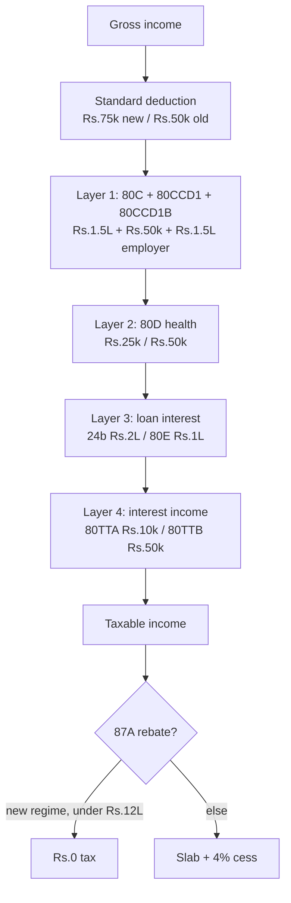

Three things control everything downstream:

1. **The stack is an old-regime device.** Under the new (default) regime, Chapter VI-A deductions — 80C, 80CCD(1B), 80D, 80E, 80G, 80TTB — are *not available* (`src-it-slab-fy2026-27`, `src-eldeductions-fy2026-27`). The exceptions that do survive in the new regime are the employer NPS contribution under 80CCD(2) (up to 14% of salary), let-out property interest under 24(b), the Agniveer corpus, and gratuity/leave-encashment exemptions. So before building any stack, run the break-even test below; a ₹10L-income taxpayer usually does *not* need it.
2. **Each layer has a hard limit.** 80C caps at ₹1.5L across all instruments *combined*; 80CCD(1B) is a separate ₹50,000; 80D is ₹50,000 (₹1L for senior citizen parents); loan interest layers are ₹2L / ₹1L. Unused capacity in one layer does not flow to the next.
3. **Exit tax is the other half of the benefit.** A PPF that saves you 30% on entry returns tax-free at exit; an NPS saves you 30% on entry but forces a 40% annuity component whose pension is taxed for life; an ELSS saves 30% on entry but the gains are 12.5% above ₹1.25L at exit. The net value of every instrument is entry benefit minus exit cost.

## Layer 1 — the 80C bucket (₹1.5L, old regime only)

Everything below shares *one* ₹1.5L ceiling per individual (the family does not multiply it, except via HUF — see [HUF Wealth Structure](./tax-huf-wealth-structure.mdx)):

| Instrument | Limit within 80C | Lock-in | Exit tax on income/gains | What actually makes it worth it |
|---|---|---|---|---|
| PPF | ₹1.5L/yr | 15 yrs | **Nil** (EEE) | 7.1% p.a. FY 2025-26, sovereign-backed, fully tax-free at every stage; the best *risk-free* use of 80C for anyone under 40 |
| ELSS mutual fund | ₹1.5L/yr | 3 yrs | LTCG 12.5% above ₹1.25L (shared with all equity gains, `src-elss-ltcg-2026`) | Shortest lock-in in the bucket; the 3-year staggered lock-in per SIP instalment; highest-growth use of 80C |
| SSY | ₹1.5L/yr | to 21 from opening | **Nil** | 8.2% p.a., tax-free including maturity; only for a girl child up to age 10 — for that child it beats PPF on both rate and tax |
| NSC | ₹1.5L/yr | 5 yrs | Interest taxed at slab (except last year) | 7.7% p.a.; the annual "deemed reinvestment" lets next year's accrued interest qualify as fresh 80C — a compounding tax trick |
| Tax-saver FD (5-yr) | ₹1.5L/yr | 5 yrs | Interest at slab every year | Locks a 6–7% coupon in a falling-rate world; *no* tax-free status, so the 80C benefit is entry-only |
| EPF (own contribution above 12%) | up to ₹1.5L | until retirement | tax-free for 5+ years of service | The 12% employer portion is exempt separately; extra self-contribution beyond 12% fills 80C at ~8.25% (FY 2025-26 EPF rate, verified elsewhere on this site) |
| Life-insurance premium | ₹1.5L/yr | policy term | maturity tax-free if premium under ₹2.5L/yr and sum assured at least 10x premium | Term policies are the *efficient* form: pure protection, premium well inside 80C |
| Home-loan principal | amount paid | none (loan life) | none (principal is your asset) | The only 80C item with no instrument limit of its own; stamp duty on purchase year also counts |
| NPS Tier-I own (80CCD(1)) | ₹1.5L/yr | to 60 | partial (below) | Low-cost retirement corpus; the *distinct* 80CCD(1B) part is the point of using NPS |
| Tuition fees | up to 2 children | none | none | full-time education, India or abroad (verify current eligibility text) |

**The one-line rule:** PPF/SSY/NSC give tax-free or near-free *income*; ELSS and tax-saver FDs give tax on *gains*; life insurance and home-loan principal give *no tax at exit at all* because they aren't income-producing in the first place. If your marginal rate is 20–30% and you have a 15-year horizon, PPF and SSY are the highest net-value uses of 80C. If the horizon is under 5 years, ELSS is the only 80C instrument that unlocks.

## Layer 2 — NPS: the ₹2L route and the December 2025 exit change

NPS is the only retirement instrument with *three* separate tax levers (`src-nps-deductions-2026`):

- **80CCD(1)** — your own contribution, *inside* the ₹1.5L 80C cap (old regime).
- **80CCD(1B)** — an *additional* ₹50,000 over and above the cap, old regime only. Since FY 2025-26, the same ₹50,000 also covers contributions to a **minor child's NPS Vatsalya** account (a parent chooses: own NPS *or* the child's, not both, within the single limit).
- **80CCD(2)** — employer contribution, up to 14% of Basic+DA in the new regime (raised from 10% for private-sector employees effective FY 2025-26), available in **both** regimes, and separately capped: combined employer contribution to EPF + NPS + superannuation is exempt up to ₹7.5L a year; anything above is taxable.

The exit side changed on 16 December 2025 (`src-nps-2025-exit`, PFRDA amendment): non-government subscribers can now withdraw **80% of the corpus as lump sum** with only **20% going into the mandatory annuity** (previously 60/40), deferment is extended to age 85, and a corpus under ₹8 lakh can be taken out 100% as lump sum. **The subtlety that secondary summaries miss:** the *allowance* to withdraw 80% is a PFRDA rule; the *tax exemption* under Section 10(12A) still exempts only 60% of the corpus. If you take the extra 20% lump sum, that slice is taxable at your slab. Plan the final exit as: 60% tax-free lump sum + 20% more lump sum at slab rate + 20% annuity (pension taxed for life), and pick the annuity provider on price (Pension Fund Regulator's annuity price tables, or the insurance company route).

Partial withdrawals remain available from year 3 (up to 25% of own contribution, once, for approved purposes). And the equity allocation is no longer effectively capped: the December 2025 amendment allows up to 100% equity option for the growth allocation.

**Who is NPS *not* for?** A new-regime taxpayer who gets no employer NPS contribution: you lock money to 60 for a deduction you cannot claim. The math only works under the old regime, or when your employer is *already* contributing (then it is a free tax-free wrapper in both regimes).

## Layer 3 — loan interest (24(b), 80E, 80EEA/80EEB status)

- **24(b)** — home-loan interest: ₹2L/yr cap on *self-occupied* property (old regime only; for let-out property there is **no cap** and it works in *both* regimes). Pre-construction interest spreads over 5 equal instalments from the year construction completes.
- **80E** — education-loan interest: up to ₹1L/yr for 8 consecutive years (or until the loan is repaid), old regime. No cap means a ₹25L engineering loan at ~10% generates ₹2–2.5L of annual interest, of which ₹1L is deductible — the most underused deduction in the code for salaried families.
- **80EEA / 80EEB** — the affordable-housing and EV-loan extra ₹1.5L deductions: both windows are **closed for new loans** (80EEA sanction window ended 31 Mar 2022; 80EEB ended 31 Mar 2023). Existing eligible borrowers continue to claim; nobody new can. (`src-eldeductions-fy2026-27` lists the closed windows.)

## Layer 4 — interest income: 80TTB, 80TTA, and the tax-free interest pool

Deposit and scheme interest is the biggest *post-stack* leak for the ₹10L+ saver, because it is income at your full slab rate every year. Four tools:

1. **80TTA** — savings-account interest deduction, up to ₹10,000/yr, non-seniors only, old regime.
2. **80TTB** — interest on bank/post-office/co-op deposits (savings, FD, RD, SCSS, NSC) deductible up to **₹50,000/yr** for resident senior citizens (60+), old regime. *Note:* Budget 2026 coverage (BasuNivesh, Mar 2026) reports the 80TTB cap raised to **₹1L** for FY 2026-27 with the TDS threshold for seniors also doubled — this is a secondary-report claim; verify against the Income Tax Department's portal before filing AY 2026-27 (`src-eldeductions-fy2026-27`, flagged "verify").
3. **Tax-free interest pool** — PPF (7.1%), SSY (8.2%), Sovereign Gold Bonds (coupon tax-free, gains tax-free after 3 years, `src-sgb-discontinued` notes the *issuance* of SGBs stopped in April 2024 but outstanding bonds continue to pay tax-free), and tax-free municipal-bond interest (verify current issue list) — these need no deduction at all because the income itself is exempt.
4. **SCSS** — 8.2% for 60+, ₹30L cap (`src-scss-8-2`); interest is *taxed* but 80TTB absorbs up to ₹50,000 (₹8.2% x ₹30L = ₹2.46L interest — so 80TTB only shields the slice, and the excess is at slab).

**The sequencing rule:** before buying any taxed-interest product (FD, tax-saver FD, SCSS, NCD — see [NBFC Debenture Underwriting](../fixed-income/fixed-income-nbfc-debentures.mdx)), first fill the tax-free pool (PPF, SSY, SGBs, tax-free bonds). A ₹1L PPF at 7.1% is worth ₹7,100 *in your hand*; a ₹1L FD at 6.5% in the 30% slab is worth ₹4,550. The tax asymmetry beats the 50bp rate gap, which is why "PPF vs FD" is not a fair 7.1 vs 6.5 comparison.

## Worked example: the full stack for a ₹18L-income taxpayer (old regime)

Assumptions: 35-year-old salaried, gross ₹18L, old regime, family of two, no house yet, a 9-year-old girl child. (All figures rounded; verify your own numbers against the latest slab table.)

| Layer | Instrument | Amount | Notes |
|---|---|---|---|
| 80C pool (cap ₹1.5L) | PPF | ₹60,000 | tax-free ~7.1%, 15-yr clock starts |
| 80C pool | ELSS | ₹50,000 | 3-yr lock-in, highest-growth use |
| 80C pool | SSY | ₹30,000 | 8.2% tax-free, girl child under 10 |
| 80CCD(1B) | NPS Tier-I | ₹50,000 | *over and above* the 80C cap |
| 80D | Family health + parents | ₹30,000 | preventive check-up included |
| Total deductible | | ₹1,80,000 | the 80C items fit under the ₹1.5L cap; NPS and 80D add on top |
| Standard deduction | | ₹50,000 | old regime |

Pre-deduction income: ₹18,00,000. Post-deductions: ₹18L − ₹1.8L − ₹50k standard = ₹15,70,000. Old-regime tax on ₹15.7L (nil to ₹2.5L, 5% to ₹5L, 20% to ₹10L, 30% above) = 12,500 + 1,00,000 + 1,61,000 = ₹2,73,500; with 4% cess ≈ **₹2.84L**, versus ₹3,37,500 + cess ≈ **₹3.51L** without the stack. The stack saves about **₹72,000** — every rupee of it is worth 30 paise plus cess, because the whole deduction slice from ₹15.7L up to ₹17.5L sits in the 30% band. Note the arithmetic trap: the 80C items are capped at ₹1.5L, so "invest ₹1.6L in PPF/ELSS/SSY" does *not* buy ₹1.6L of deduction — the extra ₹10k buys nothing. And the older 5/10/15% intermediate slabs found in some pre-2013 references no longer exist; the old regime today has just four bands. At a 5% marginal slab (taxable income under ₹5L), the same stack saves under ₹12,000 and the new regime almost certainly wins.

**ELSS exit check:** the ₹40,000 ELSS bought in FY 2026-27 (at the same notional return the PPF earns for comparison, say a 12% CAGR) becomes ₹57,700+ in three years; the ~₹17,000+ gain is under the ₹1.25L annual exemption shared with all equity gains (`src-elss-ltcg-2026`) — so at this scale, ELSS exit cost is *zero*, and the entire 20% entry saving is pure gain. At ₹1.5L/yr forever, gains eventually cross ₹1.25L/yr and the 12.5% tax starts biting; that is the point to re-balance ELSS into plain index funds (which have no 80C entry benefit but the *same* exit treatment).

## The break-even: when the old regime wins

The new regime's advantage is not deductions — it is *lower slabs* (nil to ₹4L, stepping to 30% above ₹24L) plus the ₹75,000 standard deduction (`src-it-slab-fy2026-27`). The decision is mechanical:

**Run both computations** (new-regime tax on gross − 75k standard; old-regime tax on gross − 50k standard − all deductions) and pick the lower. As a rule of thumb (illustrative, not a substitute for the computation): a salaried taxpayer whose total available deductions (80C + 80CCD(1B) + 80D + loan interest) is under roughly **₹3.5–4L** usually lands in the new regime; above that, the old regime's slab depth typically wins. The *only* new-regime NPS benefit is the employer's 80CCD(2) — if your employer already contributes to NPS, ask HR to maximise that slice within the ₹7.5L combined cap; it reduces your tax under *both* regimes without any extra money from you.

The [Tax Shield calculator](/calculators/tax-shield) runs exactly this comparison on your own numbers.

## Common mistakes that destroy the stack

1. **Buying a ULIP "for the 80C benefit."** The 80C deduction on the premium is real, but the fund charges 2–5% per year in loads and fund expenses, and the 5-year lock-in plus exit charges make ULIPs structurally worse than a term plan *plus* an index SIP (worked out in [Insurance Claims, ULIPs & Mis-selling](../insurance/insurance-claims-ulip-mis-selling.mdx)). The same 80C money goes further in an ELSS.
2. **Letting 80C capacity go unused in March.** The ₹1.5L cap is *annual*, not one-time — the March 2026 ELSS/PPF purchase does not buy you a deduction for April 2026. Set the stack in by January and hold it.
3. **NSC interest booked as "investment" instead of income.** The deemed-reinvestment trick works, but the interest is still slab-rate income except the final year; model it, don't assume it is tax-free.
4. **NPS as a tax play in the new regime.** No employer contribution, new regime, NPS chosen purely for the ₹50,000: the deduction does not exist, and you just gave up 20+ years of liquidity for nothing. The only new-regime NPS value is the employer's 80CCD(2) slice.
5. **Forgetting the shared LTCG bucket.** The ₹1.25L annual exemption is *one bucket across all equity*: listed shares, equity funds, ELSS, REIT/InvIT units (`src-reit-invit-tax-2026`), and foreign equity gains all stack into it. A big equity sale in the year you also redeem ELSS can push the combined gains over the exemption.
6. **Stacking without insurance.** A ₹2L family health cover and a 20x-income term plan cost under ₹60,000/yr; without them, the 80D and term-premium lines of the stack are the only layer protecting the family, and everything above is just tax arithmetic on money that could vanish under one hospital bill.

## The stack as a habit, not a March scramble

The difference between "filed a tax-saving ITR" and "built a tax-efficient wealth stack" is that the stack has *time asymmetry*: PPF/SSY/ELSS compounding starts on the first rupee, not on the first assessment year. The minimum viable version for a ₹10L-income, 30-year-old, old-regime taxpayer is:

- **Fixed, monthly:** PPF ₹8,000/mo (₹96k/yr) + ELSS ₹4,000/mo (₹48k/yr, SIP so the 3-year lock-in staggers), term + health premiums billed monthly.
- **Fixed, yearly:** 80CCD(1B) ₹50,000 NPS (January), NSC/SSY top-ups, 80D balance before 31 March.
- **Quarterly check:** AIS (Annual Information Statement) against bank/demat statements — TDS on REIT distributions, NCD coupons, and rental income all land in the AIS, and the stack's value is destroyed by an income line nobody noticed (`src-reit-invit-tax-2026` has the component-level filing guide).
- **Annual:** re-run the regime break-even, re-price the NPS annuity at 60, and decide whether the ELSS bucket has outgrown its 80C job.

## Related

- [Indian Taxation for Investors](./tax-india-investor-complete.mdx) — the slab and capital-gains substrate this stack sits on.
- [HUF Wealth Structure](./tax-huf-wealth-structure.mdx) — the second *entity* that multiplies the stack's capacity legally.
- [Small Savings Schemes](../government-schemes/govt-small-savings-schemes.mdx) — the tax-free pool (PPF, SSY, NSC, SCSS, SGBs) in detail.
- [Your 10 Lakh Wealth Plan](../personal-finance/pf-wealth-plan-10-lakh.mdx) — where the stack's fixed lines live inside a real monthly plan.

## Sources

- `src-it-80c-150k` — Section 80C limit ₹1.5L, old regime only.
- `src-nps-2025-exit` — PFRDA (Exits and Withdrawals under NPS) (Amendment) Regulations, 16 Dec 2025: 80% lump sum / 20% annuity allowance, deferment to 85, ₹8L full-withdrawal threshold; Section 10(12A) tax exemption remains 60% (corroborated by PFRDA press release 19 Dec 2025).
- `src-nps-deductions-2026` — 80CCD(1)/(1B)/(2) structure: ₹50,000 extra under 1B (old regime, incl. Vatsalya from FY 2025-26), employer 14% both regimes, ₹7.5L combined employer cap.
- `src-elss-ltcg-2026` — ELSS 3-year lock-in, 80C ₹1.5L, LTCG 12.5% above ₹1.25L shared across equity gains; new regime: no deduction.
- `src-eldeductions-fy2026-27` — FY 2026-27 deduction list: 80TTB reported hike to ₹1L (verify against Income Tax portal), 80EEA/80EEB windows closed, Income Tax Act 2025 renumbering (80C → 123 etc.).
- `src-it-slab-fy2026-27` — FY 2026-27 new-regime slabs (nil to ₹4L … 30% above ₹24L), 87A ₹12L, ₹75k standard deduction.
- `src-sgb-discontinued` — SGB issuance stopped April 2024; outstanding bonds keep paying tax-free coupon, gains tax-free after 3 years.
- `src-scss-8-2` — SCSS 8.2%, ₹30L cap, 60+.

## Update log

- 2026-10-17: Verified 80CCD(1B) Vatsalya inclusion, NPS 14% employer both-regime rule, PFRDA 16 Dec 2025 80/20 exit amendment and its Section 10(12A) 60%-exemption gap, ELSS 12.5%-above-₹1.25L shared bucket.
- 2026-10-17: 80TTB "raised to ₹1L in Budget 2026" is a secondary-report claim (`src-eldeductions-fy2026-27`); the Income Tax Department's threshold page still shows ₹50,000 — kept as flagged pending official confirmation.
- 2027-04-01: Scheduled re-verification at next Budget: 80C cap, 80CCD(1B) limit, 87A threshold, 80TTB limit, and the regime break-even slabs.


## Sources & Citations

- **Income Tax Act / Economic Times** — Section 80C limit remains ₹1.5 lakh (old regime only). https://economictimes.indiatimes.com/wealth/tax/has-section-80c-deduction-limit-hiked-check-how-much-tax-you-can-save-after-union-budget-2025/articleshow/117821055.cms (verified 2026-08-06)
- **PFRDA (Exits and Withdrawals under NPS) (Amendment) Regulations, 2025** — PFRDA (Exits and Withdrawals under the NPS) (Amendment) Regulations, 2025, w.e.f. 16 Dec 2025. https://www.pfrda.org.in/documents/33652/184762/Gazette+PFRDA+Exit+and+Withdrawals+under+the+NPS+Amendment+Regulations+2025.pdf (verified 2026-10-16)
- **1 Finance / ClearTax / PFRDA (NPS tax-benefits coverage, 2025-26)** — NPS deduction structure 2026: 80CCD(1) within 80C Rs 1.5L (old regime); 80CCD(1B) extra Rs 50,000 old-regime-only, incl. NPS Vatsalya for a minor child from FY 2025-26; 80CCD(2) employer up to 14% of salary in BOTH regimes (raised from 10% for private sector, FY 2025-26), combined employer EPF+NPS+superannuation exempt cap Rs 7.5L/yr. https://1finance.co.in/blog/nps-tax-benefits-80ccd (verified 2026-10-17)
- **Upstox / Value Research / SEBI Investor / Economic Times (ELSS + FY 2025-26 MF tax rules)** — ELSS taxation 2026: Rs 1.5L 80C deduction (old regime only; no deduction under the default new regime), mandatory 3-year lock-in per allotment (SIP instalments lock-in separately), 80% equity minimum, LTCG 12.5% above Rs 1.25L/yr shared across all equity gains. https://upstox.com/learning-center/mutual-funds/how-to-calculate-ltcg-tax-on-elss-mutual-funds/article-943 (verified 2026-10-17)
- **BasuNivesh (18 Mar 2026) + Income Tax Department threshold-limits page (cross-check)** — All tax deductions old vs new regime FY 2026-27 (Budget 2026 + Income Tax Act 2025): 80C Rs 1.5L, 80CCD(1B) Rs 50k, 80D Rs 50k/Rs 1L, 80E Rs 1L, 80TTA Rs 10k, 80TTB reported raised to Rs 1L for seniors (verify - department portal still shows Rs 50k); 80EEA/80EEB sanction windows closed; Income Tax Act 2025 renumbers 80C to Sec 123 etc.; 87A rebate keeps new-regime income up to Rs 12L tax-free. https://www.basunivesh.com/all-tax-deductions-old-vs-new-regime-full-list-fy-2026-27 (verified 2026-10-17)
- **Income Tax Department / Union Budget 2025 (Finance Act 2025) — FY 2026-27 slabs** — Income-tax slabs, new regime, FY 2026-27 (AY 2027-28) — unchanged from the Budget 2025 reset: 0-4L nil, 5% to 8L, 10% to 12L, 15% to 16L, 20% to 20L, 25% to 24L, 30%+; Sec 87A rebate extends tax-free up to Rs 12L; standard deduction Rs 75,000. https://cleartax.in/s/income-tax-slabs (verified 2026-10-16)
- **PMJJLayojana / multiple finance desks (consistent report)** — SGB scheme stopped issuing new tranches from FY 2024-25; last tranche Feb 2024. https://pmujjwalayojana.in/sovereign-gold-bond-scheme/ (verified 2026-08-06)
- **Economic Times / Moneycontrol (quoting govt. quarterly review)** — Senior Citizens' Savings Scheme interest rate 8.2% p.a. for FY 2025-26. https://economictimes.indiatimes.com/wealth/invest/senior-citizens-savings-scheme-has-the-government-revised-scss-interest-rate-for-the-december-quarter/ (verified 2026-10-16)

---
Educational content, not individualized investment, tax, accounting, or legal advice.
Author: Chirag Singhal. DhanPedia.


---


The [retirement & FIRE / annuities article](./retirement-fire-annuities.mdx) built your corpus math
and the decumulation blueprint. This article is the **NPS exit layer** — the moment where a 15-30 year
investment decision meets three rules most investors have never read together: the PFRDA 16 December
2025 exit amendment, the Section 10(10A) exemption cap, and the annuity market. Get all three wrong and
you either pay tax on money the law *intends* to be exempt, or you buy an annuity that undershoots your
survivor income.

## What the PFRDA 16-Dec-2025 amendment changed

For **non-government** subscribers (the All-Citizen / Corporate model), the Exits & Withdrawals
amendment that took effect **16 December 2025** reset the default exit split:

| Leg | Before Dec-2025 | From Dec-2025 |
|---|---|---|
| Lump sum you *may* take at 60 | Up to **60%** of corpus | Up to **80%** of corpus |
| Annuity you *must* buy | At least **40%** | At least **20%** |
| Deferral of the annuity purchase | Up to age 75 | Up to **age 85** |
| Small-corpus full-withdrawal threshold | Rs 5L | **Rs 8L** — a corpus up to Rs 8L is a 100% lump-sum exit, no annuity |
| Premature exit (permitted, before 60) | 20% lump / 80% annuity | 20% lump / 80% annuity (unchanged) |

The **85-year deferral** is the sleeper feature: you can keep the annuity corpus compounding inside the
scheme and start the pension later, which is a real response to the fact that Indian life expectancy is
still climbing. The **Rs 8L small-corpus rule** is the one that matters for a short-tenure subscriber
(e.g. NPS Vatsalya, or a 5-year stint) — under Rs 8L you simply walk away with everything.

## The exemption cap that surprises people: 10(10A) says 60%, not 80%

Here is the rule that quietly costs the most. The PFRDA amendment lets you *take* up to 80% of your
corpus as a lump sum at 60 — but the **Income-tax Act exemption on that lump sum is capped at 60% of
your total contributions** (self + employer), under Section 10(10A) / 10(i)(xii).

$$
\text{Exempt lump sum} \;=\; \min\big(\text{lump sum taken},\; 0.60 \times \text{total contributions}\big)
$$

The two percentages describe different things:

| Number | What it controls |
|---|---|
| **80% (PFRDA)** | The *maximum share of the corpus* you are allowed to take out as cash |
| **60% (Income-tax)** | The *maximum share of your contributions* the tax system will not touch |

Consequence: if your NPS corpus has **appreciated well past 1.33 times your contributions** (which is
the exact point where the 80% of corpus equals 60% of contributions), the extra 20% of corpus you are *allowed*
to take is **taxable at your slab rate**. That is the gap the [NPS retirement-exit
calculator](/calculators/nps-retirement-exit) prices for you — a 30-year, 20k/month NPS at 9% build-up
has a corpus far above 1.33x contributions, so the "taxable lump-sum portion" is a real, non-trivial
line item.

One honesty note: the 60%-cap wording in Section 10(10A) sits in the 1961 Act and the Act-2025
renumbering has to be checked for your *exit year* — a CA should confirm the exact current-year
provision before you act, because this is where the Act-2025 transition (effective 1 April 2026) has
produced genuine confusion.

## The annuity leg: which of the five PFRDA variants you actually want

The minimum 20% (now that it is 20%, not 40%) still has to buy a **PFRDA-empanelled annuity** from one
of the licensed ASPs. The five standard variants and who each suits:

| Annuity type | Rate band (age 60) | Best for |
|---|---|---|
| **Annuity for Life** | Highest (~6-7%) | Single / no dependents, maximum monthly income |
| **Joint Life** (spouse continues) | ~5-6% | Married, want the survivor covered |
| **Joint Life with Return of Purchase Price** | ~4-5% | Married + want the balance returned to the nominee |
| **Annuity Certain (5/10/15/20 yrs)** | Lower | Short guaranteed period, then nominee income |
| **Life with Annual Increase (1-3%)** | Lower start, grows | Inflation worry, willing to take a low first payment |

The rate band matters more than the marketing suggests: on a Rs 80L annuity corpus, the difference
between a 7% and a 5% life annuity is **Rs 1.6L a year** of income — a ₹1.6L/yr gap that compounds for
decades. Shop the empanelled ASP quotes; the PFRDA empanelment list (15 providers as of 2026) is the
universe you compare across.

## The new-regime interaction: 80CCD(2) is still your friend

From the [80C-baskets article](./tax-80c-baskets-regime-decision.mdx): **80CCD(2) — your employer's NPS
contribution, up to 14% of Basic+DA in the new regime — is one of the only deductions that survives the
new regime.** The NPS-specific points that decide the NPS tax position:

- **80CCD(1B) Rs 50,000 is old-regime-only** (verified in Wave 8; a conflicting new-regime claim was
  resolved to old-only). In the new regime your *self* NPS deduction does not exist beyond the standard
  deduction.
- **80CCD(1)** (your own Tier-1, within the 80C basket) is old-regime-only.
- **80CCD(2)** is both-regimes.
- The **corpus exemption cap (10(10A)) and the annuity-income slabs** are the exit-year tax, separate
  from the entry-year deductions.

So a new-regime NPS subscriber's tax story splits into two: **entry** is the employer 80CCD(2) deduction (worth
enormously at 30% marginal), **exit** is the 60% exemption cap on the lump sum + slab tax on the
annuity income. The entry deduction and the exit cap are two different levers and they do *not* net
against each other.

## Related

- [Retirement & FIRE: Corpus, 4% Rule, Decumulation, Annuities](./retirement-fire-annuities.mdx)
- [The 80C Basket Decision & Regime (incl. the 80CCD(2) new-regime lever)](./tax-80c-baskets-regime-decision.mdx)
- [Government Savings Schemes: PPF, SSY, NSC, KVP](../government-schemes/govt-small-savings-schemes.mdx)
- [Your 10 Lakh Wealth Plan](../personal-finance/pf-wealth-plan-10-lakh.mdx)

## Sources

- PFRDA Exits & Withdrawals (Amendment) Regulations, 2025, w.e.f. 16 Dec 2025 — 80/20 split, 85 deferral, Rs 8L small corpus — <a href="https://pfrda.org.in/">PFRDA (nps-2025-exit source)</a>
- NPS 80CCD(1)/(1B)/(2) deduction structure, old vs new regime — <a href="https://1finance.co.in/blog/nps-tax-benefits-80ccd">1 Finance / ClearTax NPS coverage</a>
- PFRDA-empanelled annuity-rate bands (life 6-7%, joint-life lower) and the 15-ASP empanelment list — <a href="https://pfrda.org.in/intermediaries/empaneled-entities/annuity-service-provider">PFRDA ASP list / NPS annuity calculators</a>

## Update log

- 2026-10-18 — Wave 13: PFRDA 16-Dec-2025 exit table (80/20, 85 deferral, Rs 8L 100% rule), the
  Section 10(10A) 60%-of-contributions exemption cap vs the PFRDA 80% exit (the "two 60/80 numbers"
  that get confused), the five annuity-variant comparison with a 6%-vs-5% income-gap worked figure,
  and the new-regime 80CCD(2) entry-vs-exit tax separation. The 60% 10(10A) cap and the Act-2025
  renumbering must be confirmed with a CA for the exit year; the PFRDA 80/20 split and Rs 8L
  small-corpus threshold are per the 16-Dec-2025 amendment. Re-verify the annuity-rate bands at each
  PFRDA empanelment update.


## Sources & Citations

- **PFRDA (Exits and Withdrawals under NPS) (Amendment) Regulations, 2025** — PFRDA (Exits and Withdrawals under the NPS) (Amendment) Regulations, 2025, w.e.f. 16 Dec 2025. https://www.pfrda.org.in/documents/33652/184762/Gazette+PFRDA+Exit+and+Withdrawals+under+the+NPS+Amendment+Regulations+2025.pdf (verified 2026-10-16)
- **1 Finance / ClearTax / PFRDA (NPS tax-benefits coverage, 2025-26)** — NPS deduction structure 2026: 80CCD(1) within 80C Rs 1.5L (old regime); 80CCD(1B) extra Rs 50,000 old-regime-only, incl. NPS Vatsalya for a minor child from FY 2025-26; 80CCD(2) employer up to 14% of salary in BOTH regimes (raised from 10% for private sector, FY 2025-26), combined employer EPF+NPS+superannuation exempt cap Rs 7.5L/yr. https://1finance.co.in/blog/nps-tax-benefits-80ccd (verified 2026-10-17)
- **PFRDA Exits & Withdrawals (Amendment) Regulations, 16 Dec 2025 / NPS annuity-calculator rate bands / Income-tax Act 10(10A) cap** — NPS retirement exit & annuity, FY 2026-27: PFRDA 16-Dec-2025 amendment - non-govt 80% lump / min 20% annuity (was 60/40), deferral to age 85, Rs 8L small-corpus 100% withdrawal; premature exit 20/80; annuity priced at PFRDA-empanelled ASP life-annuity rates ~6-7% at age 60 (joint-life / return-of-purchase lower); Sec 10(10A)/10(i)(xii) exempts the NPS lump sum up to 60% of total contributions - the extra 20% taken under the 80% exit is slab-taxed; annuity income slab-taxed. https://npscalculators.in/nps-annuity-calculator (verified 2026-10-18)

---
Educational content, not individualized investment, tax, accounting, or legal advice.
Author: Chirag Singhal. DhanPedia.


---


The two international articles on this site covered *how to invest abroad* (the LRS route and GIFT
City). This article covers the other half of the NRI picture that none of them touch: **if you are a
non-resident, what does India actually tax, at what rate, and how do you get it back?** That is the
question that decides whether your Indian rental income, NRO interest and property gains stay efficient
or leak away to over-withheld TDS.

## How your status is decided (Section 6, now in the Income-tax Act 2025)

India taxes by *residency*, not citizenship. You are a **resident** for a financial year if you pass
**either** of these tests:

- **The 182-day test:** you were in India for **182 days or more** in that FY.
- **The long-term test:** you were in India for **60 days or more in that FY *and* 365 days or more
  across the four preceding FYs** — and that 60-day figure rises to **120 days if your Indian income
  for the year exceeds ₹15L**.

Fail **both** and you are a **non-resident** (NRI). The count is *physical presence*: arrival and
departure days both count. The Income-tax Act 2025 (in force from 1 April 2026) did **not** rewrite
these individual residency tests — the day counts carry over, so an NRI who "regularly visits India"
should keep a day-count log: crossing 182 days, or the 60/120 + 365 combination, silently converts you
to a resident and pulls your **global** income into the Indian net.

### The NR / RNOR / ROR split

| Status | Test | What India taxes |
|---|---|---|
| **NR (non-resident)** | Fails both Section 6 tests | **India-source income only** |
| **RNOR (resident, not ordinarily resident)** | Resident, but fails the "ordinarily resident" lookback (2 out of last 9 FYs in India < 90 days, OR last 3 FYs < 120 days) | India-source + foreign income *earned in India*; most foreign income still stays outside |
| **ROR (resident, ordinarily resident)** | Resident + ordinarily resident | **Global income** |

The RNOR window is the one most returning NRIs need to understand: you can be a *resident* for tax
purposes yet still keep much of your foreign income outside the Indian net, for a transitional period.

## What an NRI is actually taxed on in India

Only **India-source** income. The common heads and the account that carries them:

| Income | Taxable in India? | Account / head |
|---|---|---|
| Rent from Indian property | **Yes** | House property; 30% standard deduction under 24(a) |
| Capital gains on Indian shares / MF / property | **Yes** | 111A STCG 20% / 112A LTCG 12.5% (property: 12.5% no indexation) |
| Interest on an **NRO** account / deposits | **Yes** | Slab/30% + surcharge + cess |
| Salary for services **rendered in India** | **Yes** | Deemed to accrue in India |
| Interest on **NRE** account | **No** — exempt u/s 10(4)(ii) | — |
| Interest on **FCNR (B)** account | **No** — exempt while you are a non-resident u/s 10(15) | — |
| Foreign salary / overseas bank interest | **No** | Foreign-source, outside the Indian net |

The account choice is the single biggest NRI planning lever. **NRE and FCNR interest is fully exempt
and freely repatriable** (FCNR is your currency); **NRO interest is fully taxable** (its repatriation is
capped at USD 1M/year, post-tax). Route your foreign earnings into NRE/FCNR and your India-source
income into NRO — but never park India-source income in NRE thinking it will avoid tax; the interest
on NRO holdings is still taxed.

## Section 195 TDS: the rate that bites before you file

Payments to a non-resident are withheld under **Section 195**, generally at the **flat 30%** (plus
surcharge and 4% cess) — much higher than the resident rate, with **no TDS exemption slabs**. The
head-specific picture:

| Head | NRI TDS (195) | Resident TDS | Note |
|---|---|---|---|
| NRO / bank / FD interest | **30%** (+surcharge +cess) | 10% | DTAA may reduce |
| Rent from Indian property | 30% | 10% (194-I) | 195 for the NRI |
| STCG, listed equity / equity MF (111A) | 20% | 20% | No surcharge on this head |
| LTCG, listed equity / equity MF (112A) | 12.5% above ₹1.25L | 12.5% | No indexation |
| LTCG, immovable property | 12.5% | 12.5% | Buyer deducts under 195; no indexation |
| STCG, property (< 24 months) | 30% | — | At slab rate |
| Dividends from Indian companies | 20% | 10% | DTAA rate often lower |

The **property trap**: when you sell Indian property, the buyer withholds TDS under 195 **on the full
sale value, not the gain** — which routinely over-withholds by a large multiple. The fix is a
**Section 197 lower-deduction certificate** *before* the sale, so only the actual gain is withheld.
Without it, your refund is locked up for the length of the ITR process.

## DTAA relief: how you actually cut the 30%

India has DTAAs with 90+ countries. The working sequence (and the forms that matter):

1. **Get a Tax Residency Certificate (TRC)** from your home-country tax authority.
2. **File Form 10F** (the NRI declaration) on the e-filing portal.
3. **Hand your PAN + TRC to the payer / bank.**
4. The payer applies the **lower of the domestic rate and the treaty rate**.
5. **File an Indian ITR (ITR-2, due 31 Jul)** to reclaim any excess TDS; claim **Form 67** for the
   foreign tax credit where the home country also taxed it.

Two NRI-specific points that trip people up:

- **NRIs cannot use Form 15G / 15H** (the nil-TDS declarations) — those are resident-only. Your two
  levers are the **DTAA rate** (TRC + Form 10F) or a **Section 197 certificate**.
- **The 87A rebate is NOT available to NRIs.** The ₹12L tax-free threshold that protects a resident in
  the new regime does not apply — an NRI is taxed on the *whole* India-source income at the slab or
  special rates. That is why an NRI with, say, ₹8L of NRO interest pays tax where an identical
  resident pays zero. The [senior-citizen regime article](../taxation/tax-senior-citizen-regime-decision.mdx)
  shows the resident side; this is the NRI asymmetry.

## The ITR picture

An NRI files in India when total India-source income exceeds the basic exemption — **even when TDS was
already deducted**, because the ITR is the *only* way to claim a refund of over-withheld TDS. The form
and deadline:

| NRI situation | ITR form | Due date |
|---|---|---|
| Salary / house property / other income (no CG, no foreign assets) | **ITR-2** | 31 Jul |
| Capital gains on shares / property | **ITR-2** | 31 Jul |
| Business or professional income in India | **ITR-3** | 31 Jul / 31 Oct (if audit) |
| NRI with foreign assets / income (RNOR) | ITR-2 / ITR-3 | 31 Jul |

NRIs generally **cannot use ITR-1 (Sahaj)** — the capital-gains and foreign-income schedules force
ITR-2 or ITR-3. (The [LRS investing article](./international-investing-lrs.mdx) and
[GIFT City article](./international-fof-gift-city-lrs.mdx) cover the *outbound* side of the same
story — how much you can move and at what cost — while this article is the *inbound* tax side.)

## Related

- [International Investing & LRS: The Outbound Route](./international-investing-lrs.mdx)
- [GIFT City FoF & the Real Routes Abroad](./international-fof-gift-city-lrs.mdx)
- [India Taxation: The Complete Investor's Guide](../taxation/tax-india-investor-complete.mdx)
- [Surcharge, Cess & the High-Income Regime](../taxation/tax-surcharge-cess-high-income.mdx)

## Sources

- NRI residential status (Section 6 182 / 60+365 / 120-day tests), India-source-only taxation, NRE/NRO/FCNR account split, Section 195 TDS table, property TDS-on-value + 197, DTAA (TRC + Form 10F + Form 67), 87A not available to NRIs, ITR-2/ITR-3 deadlines — <a href="https://www.taxclue.in/guide/tax-on-nri-income">TaxClue NRI tax guide (updated 18 Aug 2026)</a>
- Day-count rules, RNOR window under Section 6(6), deemed residency 6(1A) — <a href="https://nriblueprint.com/guides/nri-residential-status-section-6">NRI Blueprint Section 6 guide</a>

## Update log

- 2026-10-18 — Wave 16: Section 6 residency tests (182-day + 60/120 + 365-day, with the ₹15L Indian
  income variant), the NR/RNOR/ROR split, the India-source-only scope, the NRE/NRO/FCNR account
  choice, the Section 195 TDS table (30% flat, property TDS-on-value + 197), the DTAA sequence
  (TRC + Form 10F + Form 67, 15G/15H unavailable to NRIs), the 87A-not-available asymmetry, and the
  ITR-2/ITR-3 filing map. The Income-tax Act 2025 did not change the individual residency day counts;
  re-verify the 195 head rates and the 87A position at each Finance Act.


## Sources & Citations

- **TaxClue NRI tax guide (updated 18 Aug 2026) / NRI Blueprint Section 6 guide** — NRI tax & TDS FY 2026-27 (Income-tax Act 2025, individual residency tests unchanged from the 1961 Act): Section 6 residency = resident if in India 182+ days in the FY, OR 60+ days in the FY AND 365+ days in the 4 preceding FYs (the 60 rises to 120 if Indian income exceeds Rs 15L); fail both = non-resident; NR/RNOR/ROR split (RNOR window under Section 6(6)); an NRI is taxed only on India-source income (rent, CG on Indian assets, NRO interest, salary for India services); NRE interest exempt u/s 10(4)(ii) and FCNR (B) exempt u/s 10(15) while non-resident; NRO/FCNR freely repatriable, NRO repatriation capped at USD 1M/yr post-tax; Section 195 TDS on payments to a non-resident is flat 30% (+surcharge +4% cess) with no exemption slabs, head-specific rates: NRO/rent 30%, 111A STCG 20%, 112A listed-equity LTCG 12.5% above Rs 1.25L, property LTCG 12.5% no indexation, property STCG 30% at slab, dividends 20%; on a property sale the buyer withholds on the FULL sale value under 195 (not the gain) - a Section 197 lower-deduction certificate is the fix; DTAA relief = valid TRC + Form 10F + Form 67 (foreign tax credit), the LOWER of the domestic and treaty rate; NRIs CANNOT use Form 15G/15H; the Section 87A rebate is NOT available to NRIs (they are taxed on the whole India-source income); ITR for an NRI is ITR-2 (ITR-3 if business income or foreign assets), due 31 Jul (31 Oct if audit); NRIs generally cannot use ITR-1. https://www.taxclue.in/guide/tax-on-nri-income (verified 2026-10-18)
- **Income Tax Department / Union Budget 2025 (Finance Act 2025) — FY 2026-27 slabs** — Income-tax slabs, new regime, FY 2026-27 (AY 2027-28) — unchanged from the Budget 2025 reset: 0-4L nil, 5% to 8L, 10% to 12L, 15% to 16L, 20% to 20L, 25% to 24L, 30%+; Sec 87A rebate extends tax-free up to Rs 12L; standard deduction Rs 75,000. https://cleartax.in/s/income-tax-slabs (verified 2026-10-16)
- **Creso / mfreturns / creget / mfonline / VM Financial Services / Value Research Online (2026 coverage of SEBI cap + AMC status)** — SEBI/RBI $7 billion industry-wide cap on direct overseas equity investment by Indian MFs; the $1B/AMC sub-cap; why most domestic international funds closed to fresh SIPs in 2026; GIFT City IFSCA funds are outside this cap. https://creso.in/blog/which-international-mutual-funds-are-open-for-sip-(july-2026) (verified 2026-10-16)

---
Educational content, not individualized investment, tax, accounting, or legal advice.
Author: Chirag Singhal. DhanPedia.


---


The [NRI tax article](./international-nri-tax-residency-tds-dtaa.mdx) covered *how* an NRI claims DTAA
relief — the Tax Residency Certificate, Form 41 (formerly 10F), and Form 67. But it deliberately left
out the part everyone actually looks up at the moment of a payment: **what is the treaty rate for
*my* country, on *this* type of income?** This article is that reference. It puts India's 90-plus
DTAA corridors side-by-side against the domestic Act rate, explains the two relief methods, and walks
the claim end-to-end. Figures marked **(verified 2026-10-18)** come from the cited sources; treaty
rates are the *typical corridor* rate, and the exact figure depends on the income type and any
holding condition — confirm the treaty text before you act.

## The two relief methods (and why most corridors are "credit")

A DTAA stops the *same* income being fully taxed twice. It does that in one of two ways, and the
method is decided by **which country has the *first* right to tax** the income in that treaty:

| Method | How it works | Where India is the source country | Examples |
|---|---|---|---|
| **Exemption** | Income is taxed *only* in one country; the other exempts it | Home country exempts, or India exempts | UAE, Saudi Arabia, Kuwait (no / low home-side income tax) |
| **Credit** | Income is taxed in *both*; the residence country credits the tax already paid in the source country | India withholds; home country credits it | USA, UK, Germany, Singapore, Australia, Canada |

For an NRI with India-source income, the practical effect is the same: **you want India to charge the
*treaty* (lower) rate, not the domestic Act rate**, and your home country to either exempt or credit
what India took. The *domestic* fallback is what you pay if you never claim the treaty — that is the
number this article's corridor table compares against. [src-dtaa-country-rates-2026]

## How the lower rate wins (Sec 90 / 90A / 159(4))

- **Section 90** (DTAA countries) and **Section 90A** (exemption-method countries) let the NRI be taxed
  at the *treaty* rate when the treaty is more beneficial than the Act.
- **Section 159(4)** is the switch: the tax is computed under the Act, *but* where the treaty
  provides a lower rate, the treaty rate applies — provided the non-resident supplies the proof.
- The proof is the **Tax Residency Certificate (TRC)** from your home country plus **Form 41** (the
  NRI self-declaration that replaces the older **Form 10F**). Hand both to the *payer* before it
  deducts; the payer then withholds at the lower treaty rate.
- If the treaty *also* credits the home country, you file **Form 67** with your Indian ITR to claim
  the **foreign tax credit** (now **Section 91** under the Income-tax Act 2025) for tax paid abroad.
  The credit is capped at the *lesser* of the India-side tax paid and the home-country tax on the
  same income — you cannot come out ahead of the higher of the two. [src-nri-tax-tds-dtaa-2026]

## Corridor reference (typical treaty rates, FY 2026-27)

The table below shows the **domestic Act rate** (no treaty claim) against the **typical treaty rate**
for the major NRI corridors. Rates are *before* surcharge and the 4% Health & Education cess, and are
the *headline* corridor rate — the exact figure for your income may differ by holding condition.
[src-dtaa-country-rates-2026]

| Corridor (country of residence) | Domestic Act rate | Typical DTAA rate | Income type the rate refers to | Relief method (home country) |
|---|---|---|---|---|
| **United States** | 30% (interest / rent) ; 20% (dividends) | **15%** (interest; dividends if 10%+ holding) | Interest / dividends / royalties | Credit |
| **United Kingdom** | 30% ; 20% | **15%** (dividends; 10% if 10%+ capital) ; **15%** interest | Dividends / interest / royalties | Credit |
| **Singapore** | 30% ; 20% | **15%** (interest) ; **10–15%** (dividends, 10% at 25%+ stake) | Interest / dividends / royalties | Credit |
| **Australia** | 30% ; 20% | **15%** (dividends; interest) | Dividends / interest | Credit |
| **Canada** | 30% ; 20% | **15%** (dividends 10%+ control; interest) ; **25%** dividends otherwise | Dividends / interest | Credit |
| **Germany** | 30% ; 20% | **10%** (dividends; interest; royalties) | Dividends / interest / royalties | Credit |
| **Netherlands** | 30% ; 20% | **10%** (dividends; interest; royalties) | Dividends / interest / royalties | Credit |
| **Japan** | 30% ; 20% | **10%** (dividends; interest; royalties) | Dividends / interest / royalties | Credit |
| **France** | 30% ; 20% | **10%** (dividends; interest; royalties) | Dividends / interest / royalties | Credit |
| **UAE** | 30% ; 20% | **12.5%** (interest; 5% on bank loans) ; **10%** (dividends) | Interest / dividends | Exemption (no home income tax) |
| **Domestic (no DTAA claim)** | **30%** (interest / rent) ; **20%** (dividends) ; **20%** (royalty / FTS) | — | Fallback if you never claim | — |

**Read it in one line:** Germany / Netherlands / Japan / France are the *cheapest* corridors (a flat
**10%** across dividends, interest and royalties); the Anglo-Saxon corridors (US / UK / AU / SG /
Canada) sit at **15%**; the **UAE** is special because it is an *exemption-method* country — you pay
India's **10–12.5%** and *nothing* at home, so India is your only tax. [src-dtaa-country-rates-2026]

**The capital-gains caveat that ruins the easy assumption:** *most* DTAAs do **not** let you reduce
the tax on the **sale of shares or property** below India's rate. India keeps its taxing right on
gains from Indian shares (111A / 112A) and immovable property (12.5% no-indexation). The treaty
relief that matters to an individual NRI is on **dividends, interest, royalties and fees** — not on
realising your gains. (A few older treaties had special share-gain protections for pre-2017
holdings; treat gains as *India-taxed* unless the treaty text says otherwise.) [src-nri-tax-tds-dtaa-2026]

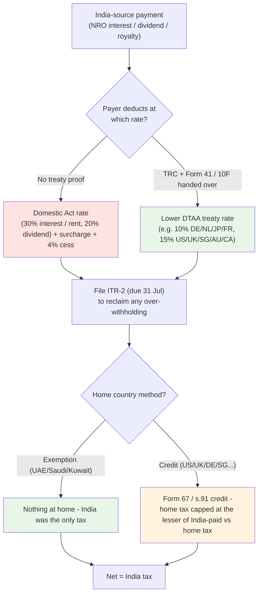

**Alt text:** Flow for India-source income of an NRI: the payer withholds at the domestic Act rate
unless you hand over the TRC + Form 41/10F (then the lower treaty rate); you then file ITR-2 to
reclaim over-withholding; the home country either exempts (exemption-method, e.g. UAE) or credits
the India tax (Form 67 / section 91), so the net is at most the higher of the two countries' taxes.

## Surcharge and cess still ride on top

The treaty rate *caps the base withholding*; it does **not** delete surcharge or the 4% Health &
Education cess, both of which stack onto the (treaty) tax before it is remitted. That is why the
**all-in** effective rate is higher than the headline treaty rate: the [surcharge / cess article](../taxation/tax-surcharge-cess-high-income.mdx)
carries the FY 2026-27 surcharge schedule, and the [calculator](/calculators/dtaa-rate-reference)
shows both the pre-cess saving and the all-in figure for your corridor. [src-it-slab-fy2026-27]

## How to claim (the exact sequence, in order)

1. **Get the Tax Residency Certificate (TRC)** from your home country's tax authority. It is valid
   for the financial year it is issued for — renew it yearly.
2. **File Form 41** (the NRI declaration; the renamed **Form 10F**) on the Indian e-filing portal,
   and keep the acknowledgement. This is what tells the payer you are a non-resident entitled to
   the treaty.
3. **Hand PAN + TRC + Form 41 acknowledgement to the payer / bank *before* the payment date.** The
   payer withholds at the *lower treaty* rate only when this is in place; missing the payment date
   means it withholds at the domestic rate and you chase the refund.
4. **File your Indian ITR (ITR-2, due 31 Jul)** to **reclaim any over-withheld TDS** — the ITR is
   the *only* route to the refund; TDS already deducted does not disappear by itself.
5. **Claim the foreign tax credit** — **Form 67**, credit under **Section 91** (exemption-method
   corridors have nothing to credit; credit-method countries cap the credit at the lesser of the
   India-side tax and the home-side tax on the same income).

Two NRI-only traps, repeated here from the [NRI article](./international-nri-tax-residency-tds-dtaa.mdx):
**NRIs cannot use Form 15G / 15H** (the nil-TDS declarations are resident-only), and the **87A
rebate does not apply to an NRI** — an NRI is taxed on the *whole* India-source income with no
₹12L tax-free threshold.

## A worked example (₹10L NRO interest, three corridors)

Assume **₹10,00,000** of NRO interest in FY 2026-27, withheld at **30% domestic** (no surcharge in
this band) plus the **4% cess**, and no home-country tax (exemption corridor). The [calculator](/calculators/dtaa-rate-reference)
computes these; the point is the *spread*:

| Corridor | Base rate | All-in (with 4% cess) | You actually pay |
|---|---|---|---|
| Domestic (no claim) | 30% | 31.2% | Rs 3,12,000 |
| 15% corridor (US / UK / AU / SG / CA) | 15% | 15.6% | Rs 1,56,000 |
| 10% corridor (DE / NL / JP / FR) | 10% | 10.4% | Rs 1,04,000 |
| UAE (exemption, 12.5% interest) | 12.5% | 13% | Rs 1,30,000 |

Claiming the **10% corridor** route instead of doing nothing saves **₹2,08,000** on this single
₹10L — before you even add the home-country credit. That is the entire value of the TRC + Form 41
exercise, and it is why the *sequence in "How to claim"* above is the difference between a refund
and a leak.

## When the treaty does NOT help (the honest limits)

- **Capital gains on Indian shares / property** — most treaties leave India's rate intact.
- **A payer who withholds before you send the TRC + Form 41** — you pay the domestic rate and must
  reclaim via the ITR; the money is *locked* meanwhile.
- **A home country whose credit is *lower* than India's tax** — the net is still bounded by the
  *higher* country; you cannot use the treaty to manufacture a below-both-countries result.
- **GAAR / beneficial-ownership tests** — if the structure is seen as the *principal purpose* of
  avoiding tax, the treaty benefit can be denied (Principal Purpose Test on newer MLI treaties).

## Update log

| id | claim | lastVerified | reviewAfter | status |
|---|---|---|---|---|
| tl-dtaa-corridor-rates | Typical DTAA corridor rates for the major NRI corridors (US/UK/SG/AU/CA 15%; DE/NL/JP/FR 10%; UAE 12.5% interest / 10% dividends; exemption-method), domestic fallback 30% interest / 20% dividends | 2026-10-18 | 2027-04-17 | ok |
| tl-dtaa-no-cg-relief | Most DTAAs do NOT reduce the tax on sale of Indian shares / property (India keeps its taxing right; 111A/112A + 12.5% property); relief is on dividends / interest / royalties / FTS | 2026-10-18 | 2027-04-17 | ok |
| tl-form41-renamed | Form 10F (NRI declaration) is the renamed Form 41 under the Income-tax Act 2025; TRC + Form 41 + Form 67 (s.91 credit) is the FY 2026-27 claim sequence | 2026-10-18 | 2027-04-17 | ok |

## Sources

- [src-dtaa-country-rates-2026] — India DTAA corridor rates (dividends / interest / royalties / FTS)
  for the major corridors, with the domestic Act fallback and the exemption vs credit method split —
  <a href="https://crosscheckai.in/dtaa/rates">DTAA rates chart (97 treaties, per-article)</a> and
  <a href="https://incometaxindia.gov.in/Charts%20%20Tables/Withholding%20tax%20rates.htm">Income-tax Department country-wise withholding chart</a> (SBI DTAA annexure corroborates).
- [src-nri-tax-tds-dtaa-2026] — NRI TRC + Form 41 (10F) + Form 67 claim sequence, the 195 TDS
  baseline, and the capital-gains caveat — <a href="https://www.taxclue.in/blog/dtaa-double-taxation-avoidance-agreements-under-ita-2025-benefits-claim-process-and-key-treaties">TaxClue DTAA under ITA 2025</a>.
- [src-it-slab-fy2026-27] — surcharge + 4% cess stacking on the treaty (base) rate, FY 2026-27.

## Related

- [NRI Tax in India: Residency, 195 TDS & DTAA Relief](./international-nri-tax-residency-tds-dtaa.mdx)
- [International Investing & LRS: The Outbound Route](./international-investing-lrs.mdx)
- [GIFT City FoF & the Real Routes Abroad](./international-fof-gift-city-lrs.mdx)
- [Surcharge, Cess & the High-Income Regime](../taxation/tax-surcharge-cess-high-income.mdx)
- [DTAA Rate Reference Calculator](/calculators/dtaa-rate-reference)


## Sources & Citations

- **Income-tax Department country-wise withholding chart + DTAA rates chart (97 treaties, per-article)** — India DTAA corridor treaty rates (dividends / interest / royalties / FTS) FY 2026-27 - the country-by-country reference the NRI article leaves out: the domestic Act fallback (30% NRO interest / rent, 20% dividends, 20% royalty / FTS) vs the typical corridor treaty rate (DE/NL/JP/FR 10%; US/UK/AU/CA/SG ~15%; UAE 12.5% interest / 10% dividends, exemption-method), the exemption vs credit relief methods, the Sec 90/90A + 159(4) lower-rate rule once the NRI supplies TRC + Form 41 (formerly 10F), and the capital-gains caveat (most treaties do NOT reduce tax on the sale of Indian shares / property). https://crosscheckai.in/dtaa/rates (verified 2026-10-18)
- **TaxClue NRI tax guide (updated 18 Aug 2026) / NRI Blueprint Section 6 guide** — NRI tax & TDS FY 2026-27 (Income-tax Act 2025, individual residency tests unchanged from the 1961 Act): Section 6 residency = resident if in India 182+ days in the FY, OR 60+ days in the FY AND 365+ days in the 4 preceding FYs (the 60 rises to 120 if Indian income exceeds Rs 15L); fail both = non-resident; NR/RNOR/ROR split (RNOR window under Section 6(6)); an NRI is taxed only on India-source income (rent, CG on Indian assets, NRO interest, salary for India services); NRE interest exempt u/s 10(4)(ii) and FCNR (B) exempt u/s 10(15) while non-resident; NRO/FCNR freely repatriable, NRO repatriation capped at USD 1M/yr post-tax; Section 195 TDS on payments to a non-resident is flat 30% (+surcharge +4% cess) with no exemption slabs, head-specific rates: NRO/rent 30%, 111A STCG 20%, 112A listed-equity LTCG 12.5% above Rs 1.25L, property LTCG 12.5% no indexation, property STCG 30% at slab, dividends 20%; on a property sale the buyer withholds on the FULL sale value under 195 (not the gain) - a Section 197 lower-deduction certificate is the fix; DTAA relief = valid TRC + Form 10F + Form 67 (foreign tax credit), the LOWER of the domestic and treaty rate; NRIs CANNOT use Form 15G/15H; the Section 87A rebate is NOT available to NRIs (they are taxed on the whole India-source income); ITR for an NRI is ITR-2 (ITR-3 if business income or foreign assets), due 31 Jul (31 Oct if audit); NRIs generally cannot use ITR-1. https://www.taxclue.in/guide/tax-on-nri-income (verified 2026-10-18)
- **Income Tax Department / Union Budget 2025 (Finance Act 2025) — FY 2026-27 slabs** — Income-tax slabs, new regime, FY 2026-27 (AY 2027-28) — unchanged from the Budget 2025 reset: 0-4L nil, 5% to 8L, 10% to 12L, 15% to 16L, 20% to 20L, 25% to 24L, 30%+; Sec 87A rebate extends tax-free up to Rs 12L; standard deduction Rs 75,000. https://cleartax.in/s/income-tax-slabs (verified 2026-10-16)

---
Educational content, not individualized investment, tax, accounting, or legal advice.
Author: Chirag Singhal. DhanPedia.


---


The question this page is built to answer is not "which funds?" — it is the one a ₹10L investor actually asks at 2 a.m.: *I can deploy ₹10L today, and I expect more capital later (a promotion, a bonus, an ESOP, a sale). So which doors open as I climb, and when?* Most of the Indian "professional" investment world — the Specialized Investment Fund, Portfolio Management Services, and Alternative Investment Funds — is gated behind **regulatory minimum-ticket sizes**, not behind your knowledge. Get the corpus below the threshold and the instrument does not exist for you; get it above it and a whole new set of avenues unlocks. This article lays that ladder out rung by rung, times each unlock to your real corpus trajectory, and shows the tax (surcharge) cost of the income growth that usually accompanies the climb.

Everything here is regulatory and arithmetic, not a fund recommendation. The rung thresholds are SEBI minimums; the timing math is a planning model you should stress-test with your own income and risk tolerance. The companion **capital-ladder calculator** turns this into an interactive "when do I qualify?" tool.

## The four rungs, in order

The professional-grade Indian investment ladder has four doors, each at a different corpus threshold. Verified against SEBI's FY 2026-27 regime (the SEBI (Mutual Funds) Regulations 2026 for SIF, and the SEBI (Portfolio Managers) Regulations 2026 for PMS/PRIM):

| Rung | Threshold | What unlocks | Regulatory anchor |
|---|---|---|---|
| **0 — retail base** | ₹1L+ | Index/ETF, direct mutual funds, REIT/InvIT, P2P, digital gold, NPS, sovereign debt | Open to everyone; the ₹10L plan already lives here |
| **1 — SIF** | **₹10L** (PAN-level) | SEBI Specialized Investment Fund: long-short, multi-asset, and credit strategies run by an AMC | SEBI (MF) Regs 2026, effective 1 Apr 2026 |
| **2 — PMS/PRIM + AIF-employee** | **₹25L** | The mutual-fund-only PMS "PRIM" route; the AIF minimum for eligible employees/directors of a portfolio company | SEBI (Portfolio Managers) Regs 2026, effective 1 Apr 2027 |
| **3 — Standard PMS** | **₹50L** | A dedicated portfolio run by a SEBI-registered manager (all strategies; 1–2.5% mgmt + 10–20% performance fees) | PMS per-client minimum (unchanged into 2026-27) |
| **4 — AIF** | **₹1Cr** | Category I (VC/PE), II (fixed-return debt), III (open-end long-short/leveraged) | AIF HNI minimum (unchanged into 2026-27) |

Two things the table makes clear that most advice misses:

- **The ₹25L rung is a real, currently-existing door, not just "PMS from 50L".** The SEBI (Portfolio Managers) Regulations 2026 introduced the **PRIM (Portfolio Investment in Mutual Funds)** route — a mutual-fund-only PMS at a **₹25L** minimum, effective **1 April 2027**. The same ₹25L number is the AIF minimum *if you are an eligible employee or director of a portfolio company*. So between 25L and 50L you are not stuck at "nothing new" — you have two genuinely different doors.
- **The 54EC infrastructure-bond cap is set at ₹50L**, the same number as the standard-PMS door. That is a quiet coincidence that matters: the moment your corpus reaches ₹50L, you can both (a) recycle a house-property gain into 54EC notified bonds up to ₹50L and (b) open the standard PMS route. The ladder and the tax-rollover math meet at the same rung.

## When a rung unlocks: the corpus math

A rung "unlocks" the month your **deployable corpus crosses its threshold**. Your corpus is not static — it is your current lump sum, plus a monthly SIP, plus any future lump-sum event (promotion, ESOP, a sale), all compounding. The timing to each door is a straightforward trajectory question:

- **Starting at ₹10L**, the SIF door is *already open today*. You qualify the moment you have ₹10L, and you do.
- **The 25L door** takes time. At a conservative 9% nominal annual return with a ₹50,000 monthly SIP, ₹10L reaches ₹25L in roughly **24–26 months**. Bump the event — say a ₹5L promotion bonus at month 12 — and it comes a few months sooner.
- **The 50L door** is the long climb. From the same start, ₹50L arrives around **45–48 months**; that is when standard PMS (and the ₹50L 54EC cap) open.
- **The ₹1Cr AIF door** is the multi-year one. From ₹10L at 9%, ₹1Cr is roughly **13–14 years** of disciplined compounding *without* a large event, or dramatically sooner if a genuine windfall (an ESOP exit, a business sale) lands.

The **capital-ladder calculator** does this exactly for your numbers: it compiles your trajectory month-by-month and reports, for each of the four rungs, the month it opens (or "beyond 30 years" if it does not). It also models the **optional future lump-sum event** — the "I'll get more capital later" assumption made concrete as a ₹ amount at a given month — and shows how much earlier each door opens with it.

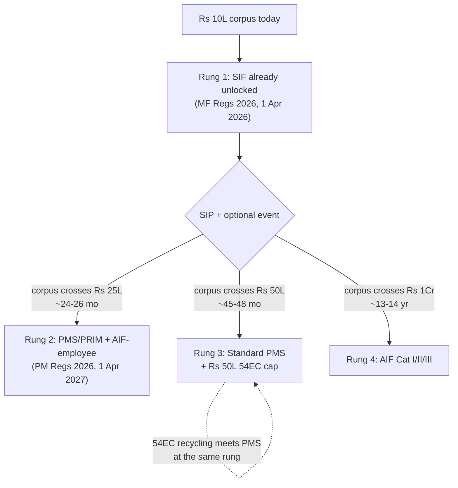

## The surcharge-tier shift (the tax cost of the climb)

The ladder is not only about which instruments open — it is about the **income growth** that usually funds the climb. That income growth is exactly what pushes you up the **surcharge tiers**, and the surcharge is levied on the base income tax, not on the corpus. Under the FY 2026-27 new regime the tiers are:

| Total income | Surcharge | Note |
|---|---|---|
| up to ₹50L | 0% | no surcharge |
| above ₹50L to ₹1Cr | 10% | first new tier you hit as income climbs |
| above ₹1Cr to ₹2Cr | 15% | the HNI band |
| above ₹2Cr | 25% | new-regime cap (the old regime still had a 37% tier above ₹5Cr) |

Two consequences the ladder makes explicit:

1. **The "when do I unlock PMS" moment and the "when do I start owing 10% surcharge" moment are not the same event, but they are correlated.** A PMS/AIF-grade income (typically ₹50L+ taxable income) is exactly where the 10% surcharge band starts. So the moment your professional instruments become available is also the moment your *effective* tax wedge on that income rises — the ladder and the surcharge both reward planning the deployment and the income together, not separately.
2. **The new regime caps the surcharge at 25%.** That cap is meaningful at the ₹1Cr+ AIF rung: your marginal cost of a rupee of *salary* income above ₹2Cr is 30% slab + 25% surcharge + 4% cess, which is why high earners at that rung lean on the instruments in the *corpus* (post-tax, taxed on capital gains, not salary) rather than on pushing more *income*.

The calculator models this with a **current-vs-future income** pair: it computes the new-regime base tax at each income level, applies the correct band surcharge, and reports the tier label plus the surcharge amount now vs later, and the increase. Feed in your income today and your income a few years out and you see the exact surcharge jump.

## Worked example: ₹10L, ₹50,000 SIP, a ₹5L bonus at month 12

Assume: corpus ₹10L today, ₹50,000/month SIP, 9% nominal annual return, and a ₹5,00,000 promotion bonus landing at month 12. Income today ₹20L/yr, projected ₹40L/yr a few years out.

| Rung | Threshold | Months to unlock | Reading |
|---|---|---|---|
| SIF | ₹10L | **0 (today)** | Open now — the 10L corpus already qualifies |
| PMS/PRIM + AIF-employee | ₹25L | ~**22–24** | The bonus accelerates it past the pure-SIP ~25 months |
| Standard PMS + 54EC | ₹50L | ~**40–44** | ~3.5 years of compounding; 54EC recycling becomes available at this same rung |
| AIF | ₹1Cr | **beyond the 30-yr window without a windfall** | Realistic only with a genuine event (ESOP exit / sale) |

The surcharge read: at ₹20L income there is **no surcharge**; at the projected ₹40L, still below the ₹50L band, **still no surcharge**. But the projection that *funds* the PMS rung (income crossing ₹50L) is the exact income at which the **10% surcharge** turns on. That is the single most useful thing this page tells you: **the PMS door and the surcharge door open at different corpus/income levels, and conflating them is how investors both over-estimate their qualification and under-estimate their tax wedge.**

## When a higher rung is the wrong tool (the honest layer)

The ladder says *when you can*, not *whether you should*. Three honest limits:

- **Fees are the price of the rung.** SIF/PMS/AIF carry a management fee of 1–2.5% a year plus, in PMS/AIF, a 10–20% performance fee on the gain above a hurdle. At ₹50L that is ₹5L–₹12L of *future* gross returns redirected to the manager every rising year. The **after-tax-wedge calculator** tells you at what corpus a professional mandate actually beats a low-cost index + direct-sleeve build-up — that crossover is the *real* "should I move up" line, and it is usually *above* the regulatory minimum.
- **AIF minimums have exceptions, and the exceptions are the trap.** The ₹25L AIF figure applies to eligible employees/directors of a portfolio company; the general HNI route is ₹1Cr. An "AIF for 25L" pitch to a non-employee is not the regulated route and should make you stop and ask why.
- **The 25L PRIM route is dated.** It opens **1 April 2027**. Before then, the only sub-₹50L professional door is the SIF at ₹10L. Plan the timeline accordingly; a manager quoting you a "25L PMS" today is quoting you next year's product.

## What to do with the ₹10L you have today (while you climb)

While the corpus compounds toward the next door, the retail base (rung 0) is fully available and is where a ₹10L plan should actually sit:

- **Core:** a low-cost index/ETF sleeve plus 1–2 high-conviction direct funds (see *mf-index-etf-direct-regular* and *mf-choosing-comparing-funds*).
- **Satellite:** a REIT/InvIT slice for yield-with-liquidity, a P2P tranche for the carry, digital gold for the inflation hedge (see *real-estate-reit-invit*, *p2p-lending-complete*, *gold-silver-commodities*).
- **Tax-shield layer:** ELSS and NPS to the extent your regime still values them (see *tax-80c-baskets-regime-decision*, *retirement-nps-exit-annuity-tax-deep-dive*).
- **The first rung (SIF):** only *after* the core is built and you understand the long-short/credit risk you are buying. A SIF is the first instrument where you are delegating the *strategy*, not just the assets — that is a different risk than a fund.

The discipline that makes the ladder work is to **let the corpus, not the label, drive the moves**: deploy the SIF when ₹10L is there, open the PMS when ₹50L is there (and only past the fee-crossover line), and reach for the AIF when ₹1Cr is there. The calculator turns that into a date, not a guess.

## Update log

- **2026-10-18 (Wave 20):** created. Verified the four rung thresholds and the surcharge tiers against the SEBI (Mutual Funds) Regulations 2026 (SIF ₹10L, 1 Apr 2026), the SEBI (Portfolio Managers) Regulations 2026 (PRIM ₹25L MF-only + IPO/unlisted-debt/overseas broadening, 1 Apr 2027), the AIF ₹1Cr HNI / ₹25L employee-director minimums, and the FY 2026-27 new-regime surcharge bands (10% > 50L, 15% > 1Cr, 25% > 2Cr cap).
- **Review by 2027-04-17:** re-verify the SIF, PMS/PRIM, and AIF minimums and the surcharge tiers at the FY 2027-28 Budget; confirm the 1 Apr 2027 PRIM commencement actually happened as notified.

## Sources

- `src-sebi-sif-2026` — SEBI (Mutual Funds) Regulations 2026: SIF introduction, ₹10L PAN-level minimum, effective 1 Apr 2026.
- `src-pms-aif-fees-2026` — PMS/AIF fee structure (1–2.5% management + 10–20% performance) and per-client minimums.
- `src-aif-categories-2026` — AIF Category I/II/III definitions, ₹1Cr HNI minimum and ₹25L employee/director exception.
- `src-surcharge-cess-fy2026-27` — FY 2026-27 surcharge tiers (new regime 10%/15%/25% cap) and 4% cess.

## Related

- [Your 10 Lakh Wealth Plan](/articles/pf-wealth-plan-10-lakh)
- [Picking Your Own Rung: The SIF / PMS / AIF Selection & Fee-Decay Guide](/articles/alternatives-hnw-pms-aif-sif-selection)
- [Surcharge & Cess for High Income](/articles/tax-surcharge-cess-high-income)
- [Capital-Gains Rollover (54/54F/54EC)](/articles/tax-capital-gains-rollover-54-54f-54ec)
- The **capital-ladder** calculator — turn your real corpus, SIP, and future event into "months to each door".


## Sources & Citations

- **SEBI (via secondary fund guides)** — SIF vs Mutual Funds vs PMS vs AIF: Where SEBI’s New 2026 Category Fits. https://www.finvastra.com/blog/sif-vs-mutual-funds-pms-aif-2026 (verified 2026-10-16)
- **PMS Sahi Hai / SEBI PMS notification coverage (2026)** — PMS / AIF fee convention 2026: management fee on opening corpus (2-2.5% flat, or ~1-1.75% + 15-20% performance above an 8-12% hurdle), performance on gain-above-benchmark, no clawback in the SEBI recurring-fee model; PMS gains pass through and are taxed as the investor own CGT. https://www.pmssahihai.com/insights/pms-charges (verified 2026-10-17)
- **Planify / SEBI (AIF) Regulations, 2012 (2026 coverage)** — SEBI AIF categories (2026): Cat I (non-debt, venture, private equity), Cat II (non-leveraged, structured), Cat III (leveraged/hedge funds); Rs.1Cr minimum for most AIFs (Rs.25L for angel funds and manager-employee/director investors); Cat I/II close-ended with a 3-year minimum tenure; up to 1000 investors per scheme (49 for angel funds). https://www.planify.in/article/sebi_regulations (verified 2026-10-17)
- **Virtual Auditor - Surcharge & HEC under the Income-tax Act, 2025 (updated 15 Apr 2026; Income-tax Act 2025 + Finance Act 2026)** — Surcharge & Health and Education Cess under the Income-tax Act, 2025 (effective 1 Apr 2026): individual new-regime surcharge 10% (50L-1Cr) / 15% (1Cr-2Cr) / 25% capped above 2Cr (the 37% top rate of the 1961 Act was ABOLISHED for the new regime); old regime keeps 37% above 5Cr; surcharge on listed-equity 111A/112A tax capped at 15%; 4% cess on (base tax + surcharge); marginal relief at each boundary caps incremental tax + surcharge on (income above boundary). https://virtualauditor.in/learn/surcharge-cess-income-tax-2025/ (verified 2026-10-18)

---
Educational content, not individualized investment, tax, accounting, or legal advice.
Author: Chirag Singhal. DhanPedia.


---


The [route-selection article](./international-gift-city-live-scheme-comparison.mdx) settled *which* route to use (GIFT City vs direct LRS). This is the **filing-mechanics layer** for the direct route: when you own US equities *directly* through a US brokerage (Schwab / Fidelity / Interactive Brokers / Vested / INDmoney) under LRS, the gain is *not* taxed the way a domestic equity fund is. It is taxed as a **foreign (unlisted) security**, and the ITR filing has five distinct layers that must all be handled correctly — and one of them (the dividend withholding rate) has a number that is *wrong* in most popular advice. Everything below is a planning model; reconcile with Form 67 / Schedule FSI and a CA before filing.

## The five filing layers

A direct LRS US-equity position touches **five** tax/compliance layers in your ITR-2, and they are *different* layers that people constantly merge:

| Layer | What it is | Where it lands in the ITR |
|---|---|---|
| **1 — Dividend income + FTC** | The US dividend is taxable in India at the *slab rate*; the US withholding is credited via **Form 67** (Schedule FSI) | ITR-2 / ITR-3, capital-gains + other-income head; Form 67 for the FTC |
| **2 — Capital gains** | The gain on a US share is a **foreign (unlisted) security** gain: 12.5% no-indexation LTCG (>24mo) / slab STCG — **no Rs 1.25L pool** | ITR-2 capital-gains schedule (non-equity, the 112-style rate, not the 112A pool) |
| **3 — TCS reservation** | The LRS *investment remittance* that funded the purchase attracts **20% TCS above Rs 10L** on the aggregate outflow | A recoverable credit against the final liability; claimed at ITR (not a cost) |
| **4 — Schedule FA** | The US brokerage position is a **specified foreign financial asset**, disclosed **every year, with no minimum threshold** | Schedule FA of the ITR form |
| **5 — FAST-DS 2026** | A *separate*, one-time small-taxpayer disclosure window for **undisclosed** foreign assets (Finance Act 2026, Ch. IV, ~15 Aug to 31 Dec 2026) | The amnesty layer — *not* part of a normal filing |

The single most important structural point: **layers 1–4 are a normal year's ITR; layer 5 is an emergency exit ramp for something you *never* reported.** A resident who files Schedule FA correctly every year does *not* need FAST-DS — and conflating the two is a common, expensive mistake.

## The dividend: the 25% (not 15%) withholding and the Form 67 credit

This is the number most popular 2026 advice gets wrong. The US-India treaty figure widely quoted is **15%**, but that is the **corporate-holder-with-substantial-voting-stock** rate. *An individual* Indian resident gets a different number:

- **With a valid Form W-8BEN on file**, the US withholds **25%** on the US dividend (the individual treaty rate under the US-India treaty).
- **Without a W-8BEN**, the US applies the **30% backup** rate.
- The dividend is *also* taxable in India (worldwide-income rule), at your **slab rate**. The **25% US withholding is credited in India via Form 67**, capped at the *lesser of* the India dividend tax and the US tax actually paid — so you never recover more than was withheld.

Worked: a ₹3L US dividend, 30% slab, 25% US withholding (W-8BEN on file): India dividend tax = ₹3L × 30% = **₹90k**; US withholding = ₹3L × 25% = **₹75k**; Form 67 credit = min(₹90k, ₹75k) = **₹75k**; **net Indian dividend tax = ₹15k**. The ₹15k is the *real* cost of the dividend after the treaty credit.

Two honest notes: (a) the W-8BEN must be *valid for the withholding year* — a lapsed or missing form pushes the rate to 30%; (b) if your slab is *below* 25% (say 20%), the credit *caps at the India dividend tax* and you get a small *refund* of the excess US withholding back from the US — the calculator's "credit capped the other way" case models this.

## The 24-month clock and the missing pool

This is where a US-share holding behaves *completely* differently from a domestic equity fund, and where the "12.5% LTCG" shortcut misleads:

- **US shares are unlisted foreign securities.** The long-term clock is **24 months**, not the 12 months that apply to Indian-listed equity.
- **LTCG (>24 months) is 12.5% without indexation** — *and with NO Rs 1.25L pool.* The ₹1.25L exemption (Section 112A) is for **Indian-listed equity and equity-oriented MFs only**; it does *not* apply to a foreign (unlisted) security. So a ₹2L US-share LTCG is taxed 12.5% on the *whole* ₹2L (₹25k), not on the ₹0.75L above the pool.
- **STCG (≤24 months) is at your slab rate**, with no 20% special rate (that special rate is also Indian-listed-equity only).

So the "12.5% foreign LTCG" is a *better* headline than the domestic 112A only because it is no-indexation; the *pool* is the trap — if you were assuming the ₹1.25L exemption carries over to US shares, it does not. The [rollover article](./tax-capital-gains-rollover-54-54f-54ec.mdx) covers the domestic pool; this layer is the foreign-security counterpart.

## The TCS reservation (layer 3, the cash-flow gotcha)

The rupee that funded your US purchase left India under LRS, and an **investment-purpose** LRS remittance attracts **20% TCS on the aggregate outflow above the ₹10L threshold** (the threshold was raised from ₹7L by the Finance Act 2025; education / medical / tour dropped to 2% from 1 Apr 2026, so 20% is specific to the "other / investment" bucket). [src-lrs-tcs-sc-2026]

- The TCS is collected *at source* by your bank and **credited to your PAN**.
- It is **not a cost** — it is a **credit against your final tax liability**, claimed when you file.
- But it *does* lock up that cash at remittance: a ₹12L investment means ₹2L of TCS you must keep available, so you need ₹14L at source to complete a ₹12L purchase.

The threshold is **aggregate, not per-remittance**: if you already sent ₹5L abroad for education earlier in the year, your ₹12L US-investment remittance starts its TCS clock from ₹17L, not ₹12L. The calculator's "other LRS remittances this FY" input models this.

## Schedule FA and the FAST-DS layer (layers 4 + 5, the disclosure you cannot skip)

**Layer 4 — Schedule FA:** a US brokerage account is a **specified foreign financial asset**. The disclosure is **mandatory every year for as long as you hold the position, with no minimum threshold** — a ₹100 holding still gets disclosed. Miss the Schedule FA and you invite the Black Money Act exposure (a penalty up to ₹10L a year for a missed disclosure, on the undisclosed asset). If the *income* (dividends / CG) from the US is also foreign-source, it is reported in **Schedule FSI** alongside Form 67.

**Layer 5 — FAST-DS 2026:** the Finance Act 2026 introduced the **Foreign Assets of *Small* Taxpayers – Disclosure Scheme** (Chapter IV, sections 130–144), a one-time voluntary window that opened ~**15 August 2026** and runs to **31 December 2026**. [The KPMG / CBDT / NDTV coverage] It has two categories:

- **Category A — undisclosed foreign assets / income up to ₹1 cr**: a *specified tax + an equal additional amount* payable on the disclosed value (the "pay tax and an equal fee" structure, roughly doubling the disclosed value for a small, forgotten asset).
- **Category B — up to ₹5 cr, for assets acquired from *disclosed* income or during a *non-resident* period**: a **flat ₹1L fee** (not a tax on the value) for a specific asset class, with immunity from penalty and prosecution.

The FAST-DS is the **amnesty layer**: it is for a foreign asset you *never reported*. A normally-reported US position (Schedule FA every year) does **not** need FAST-DS, and the two must not be conflated. If you have a forgotten overseas account, FAST-DS (before 31 Dec 2026) is the clean regularisation; if you report on time every year, it is irrelevant to you.

## A worked example: ₹12L US sleeve, ₹3L dividend, ₹4L gain (FY 2026-27)

Assume: ₹12L LRS investment remittance (your *first* LRS outflow of the year, so the ₹10L threshold applies), a 30% slab, a ₹3L US dividend (25% WHT, W-8BEN valid), and a ₹4L LTCG (>24 months) on a US lot.

| Layer | Figure |
|---|---|
| **TCS reservation (layer 3)** | ₹12L − ₹10L = ₹2L tcsable × 20% = **₹40k TCS** at source (recoverable) |
| **Dividend (layer 1)** | India ₹3L × 30% = ₹90k; US WHT ₹3L × 25% = ₹75k; Form 67 credit ₹75k; **net dividend tax ₹15k** |
| **Capital gain (layer 2)** | ₹4L LTCG × 12.5% (no pool) = **₹50k** |
| **Schedule FA (layer 4)** | The US brokerage position disclosed, **no minimum threshold** |
| **FAST-DS (layer 5)** | **Not needed** — you reported on time; the 31 Dec 2026 window is only for a *forgotten* asset |
| **Total Indian tax on the foreign income** | ₹15k + ₹50k = **₹65k** (before the ₹40k TCS credit is netted against the year's total liability) |

The **direct-lrs-us-equity-filing calculator** reproduces all five layers in one screen, including the "credit capped the other way" case (a lower slab) and the TCS accumulation when you have *other* LRS outflows.

## When the direct route is the right filing posture (the honest layer)

- **Right** when the global sleeve is **₹25L+** and you will hold long-term (>24 months) — the 12.5% no-indexation LTCG + the 25%→slab FTC is a clean, *predictable* filing, and the fixed operational costs (W-8BEN, Schedule FA every year, repatriation) amortize.
- **Right** when you need the *cheapest* fund cost (a 0.03% VOO-class ETF) and are willing to carry the Schedule FA + TCS paperwork.
- **Wrong / avoid** if you hold *under 24 months* — that is the slab-rate STCG case, which is the worst of the lot (your top slab on a foreign gain, no pool, plus the Schedule FA). The 24-month clock is the single most important filing-discipline point.
- **Wrong** if you have a *forgotten* overseas asset — that is the FAST-DS layer, and the 31 Dec 2026 deadline makes it time-boxed.

## The one-line verdict

A direct LRS US-equity position is a **five-layer filing**: (1) the dividend at slab with the **25%** US withholding (not 15%) credited via Form 67, (2) the capital gain as a **foreign-unlisted security** at **12.5% no-indexation LTCG (>24mo, no pool)** or slab STCG, (3) the **20% TCS** on the LRS investment remittance above the ₹10L threshold (a recoverable credit), (4) **Schedule FA every year with no minimum threshold**, and (5) the **FAST-DS 2026** window (~15 Aug – 31 Dec 2026) as the *separate* small-taxpayer amnesty for assets you *never* reported. The **direct-lrs-us-equity-filing calculator** runs all five on your exact numbers.

## Update log

- **2026-10-18 (Wave 24):** created. Verified the five-layer structure against the FY 2026-27 sources: the **25% individual US dividend withholding (W-8BEN) vs the 30% backup (and the 15% corporate-with-voting-stock figure that is NOT the individual rate)**, the 24-month / no-pool foreign-security CG treatment (src-lrs-tcs-sc-2026, src-it-slab-fy2026-27, src-intl-fof-treatment-ay2026-27), the ₹10L LRS TCS threshold + 20% investment-remittance rate (src-lrs-tcs-sc-2026), and the FAST-DS 2026 small-taxpayer scheme (Finance Act 2026 Ch. IV §§130–144, ~15 Aug – 31 Dec 2026, the ₹1 cr specified-tax category + the ₹5 cr flat-₹1L-fee category) cross-checked against KPMG / CBDT / NDTV coverage.
- **Review by 2027-04-17:** re-verify the 25% US dividend withholding individual rate and the no-pool 24-month rule at the FY 2027-28 Budget; confirm the FAST-DS 2026 window actually closed on 31 Dec 2026 and whether a successor scheme is announced; confirm the ₹10L LRS TCS threshold.

## Sources

- `src-lrs-tcs-sc-2026` — LRS USD 250,000/person/FY; the ₹10L aggregate TCS-free threshold (post-Finance-Act-2025); the 20% "other / investment" TCS and the 1-Apr-2026 2% education/medical/tour rate.
- `src-it-slab-fy2026-27` — the FY 2026-27 slab table used for the dividend / STCG slab-rate computation.
- `src-us-stock-tax-india-2026` — the 25% individual US dividend withholding (W-8BEN) vs the 30% backup (and the 15% corporate figure that is *not* the individual rate), the 24-month / 12.5% no-pool foreign-security CG treatment, the Form 67 FTC cap, the Schedule FA no-threshold disclosure, and the FAST-DS 2026 small-taxpayer scheme terms (Finance Act 2026 Ch. IV §§130–144, ~15 Aug – 31 Dec 2026).

## Related

- [International Investing & LRS (the route + the TCS structure)](/articles/international-investing-lrs)
- [GIFT City Live Schemes & the Route Decision (the GIFT-vs-direct layer this pairs with)](/articles/international-gift-city-live-scheme-comparison)
- [DTAA Country-Rate Reference (the treaty-rate layer)](/articles/international-dtaa-country-rate-reference)
- [The Complete Indian Investor Tax Guide](/articles/tax-india-investor-complete)
- The **direct-lrs-us-equity-filing** calculator — run your exact dividend / gain / remittance through all five layers.


## Sources & Citations

- **Standard Chartered Bank India (official notice reproducing Finance Act 2026 LRS TCS amendment)** — Revised TCS on outward foreign remittances under LRS, w.e.f. 1 April 2026 (Finance Act 2026, Sec 394(1) of IT Act 2025). https://www.sc.bank.in/important-information/others/lrs-amendment-in-tcs/ (verified 2026-10-16)
- **Income Tax Department / Union Budget 2025 (Finance Act 2025) — FY 2026-27 slabs** — Income-tax slabs, new regime, FY 2026-27 (AY 2027-28) — unchanged from the Budget 2025 reset: 0-4L nil, 5% to 8L, 10% to 12L, 15% to 16L, 20% to 20L, 25% to 24L, 30%+; Sec 87A rebate extends tax-free up to Rs 12L; standard deduction Rs 75,000. https://cleartax.in/s/income-tax-slabs (verified 2026-10-16)
- **Vedanta / WINvesta / Vested / Filewise / Upstox 2026 investor guides + KPMG / CBDT / NDTV FAST-DS 2026 coverage + Income-tax Act 2025 renumbered text** — US stocks taxed in India 2026: the 25% individual dividend withholding (W-8BEN) vs the 30% backup (and the 15% corporate-with-voting-stock figure that is NOT the individual rate), the 24-month / 12.5% no-pool foreign-security CG treatment, the Form 67 FTC cap, Schedule FA no-threshold disclosure, and the FAST-DS 2026 small-taxpayer scheme (Finance Act 2026 Ch. IV, ~15 Aug to 31 Dec 2026). https://vested.blog/posts/how-us-stocks-are-taxed-in-india (verified 2026-10-18)

---
Educational content, not individualized investment, tax, accounting, or legal advice.
Author: Chirag Singhal. DhanPedia.


---


The [direct-LRS filing article](./tax-direct-lrs-us-equity-filing-walkthrough.mdx) ends on layer 5 — the **FAST-DS 2026** small-taxpayer window flagged as the *separate* amnesty layer for assets you *never* reported. This page is that layer, worked out: the two categories, the exact cost of each, the reference date, the Form 1 → 2 → 3/4 sequence, the immunity you get, and the decision of when it is (and is not) the right move. This is a **time-boxed** article — the window closes **31 December 2026** — so the numbers here are the ones to act on before that date, and the update log carries a hard `reviewAfter` of 31 Jan 2027 to re-verify whether a successor scheme is announced. Everything is a planning model; a FAST-DS declaration is a real Form 1 filing before the Principal DGIT (Systems), not a calculator output.

## What FAST-DS 2026 actually is

**FAST-DS 2026** = the **Foreign Assets of Small Taxpayers – Disclosure Scheme, 2026**, introduced through **Chapter IV (sections 130–144) of the Finance Act, 2026** and operationalised by the **FAST-DS Rules, 2026** (notified by the CBDT on **15 August 2026**). [src-us-stock-tax-india-2026] It is a **one-time, voluntary** disclosure route for a defined class of taxpayers, and it trades a *defined, calculable cost today* for *protection from open-ended Black Money Act exposure later*. The key facts, verified against the official FAQ / Rules coverage:

| Fact | Value |
|---|---|
| Scheme | Foreign Assets of **Small** Taxpayers – Disclosure Scheme, 2026 |
| Authority | Finance Act 2026, Chapter IV (§§130–144) + FAST-DS Rules, 2026 (notified 15 Aug 2026) |
| Window | **16 August 2026 → 31 December 2026** (no declaration accepted after this date) |
| Reference date | **31 March 2026** (the value of the asset/income is measured here) |
| Who | Residents, *and* certain non-residents / RNORs who meet the scheme's residential-status conditions for the relevant year |
| What can be declared | Undisclosed foreign assets / income up to ₹1 cr, **or** specified foreign assets up to ₹5 cr that were taxed elsewhere but omitted from Schedule FA |
| Cost | **Category A: 30% tax + an equal additional amount (60% of value)** · **Category B: a flat ₹1,00,000 fee** |
| What you get | Immunity from further tax, penalty and **Black Money Act** prosecution for the declared asset/income |
| Filing mode | Fully online, **Form 1 → Form 2 → payment → Forms 3 & 4**, before the **Principal DGIT (Systems)** |

The single most important framing: **FAST-DS is the *amnesty* layer, not the routine layer.** A resident who reports a US brokerage position in Schedule FA every year does *not* need FAST-DS. FAST-DS exists for the asset that *never showed up* — the forgotten overseas account, the old student account that "faded into the background," the asset acquired while non-resident that was taxed abroad but never listed in the Indian return.

## The two categories (the math that decides your cost)

The scheme splits into **two categories** with **different cost structures and different ceilings**. Getting this wrong is the most common FAST-DS mistake, because the *ceiling* — not just the rate — decides which category you are in.

| | **Category A — undisclosed** | **Category B — missed Schedule FA** |
|---|---|---|
| What it covers | Undisclosed foreign asset / income that was **never** reported | A specified foreign asset that was **already taxed elsewhere** (or acquired during non-residence) but was simply **omitted from Schedule FA** |
| Ceiling | **₹1 crore** | **₹5 crore** |
| Cost | **30% tax + an equal additional amount** | **A flat ₹1,00,000 fee** |
| Effective cost | **60% of the disclosed value** | **₹1L flat (the larger the value, the lower the % cost)** |
| Worked | ₹50L asset → 30% = ₹15L tax + ₹15L additional = **₹30L** | ₹4 cr asset → **₹1,00,000 flat** (0.25% of value) |

The "equal additional amount" in Category A is the clause that surprises people: you do **not** pay 30% — you pay **30% plus another 30%**, so the real cost is **60% of the value**. That is deliberately steep *on purpose*: it is a "pay the defined cost and get clean immunity" price, not a normal tax rate. Category B is the *cheap* route, and it is cheap specifically because the asset was *already taxed somewhere* — the ₹1L is a filing fee for the omission, not a tax on the value.

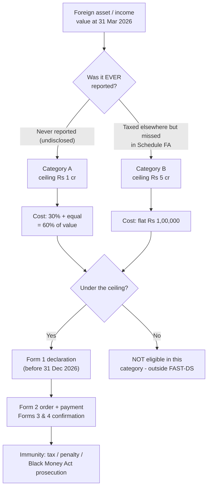

**Alt text:** FAST-DS decision: split by whether the asset was *ever reported*. Undisclosed → Category A (₹1 cr ceiling, 60% of value). Taxed-elsewhere-but-missed-Schedule-FA → Category B (₹5 cr ceiling, flat ₹1L). Both require being under the ceiling; then Form 1 → Form 2 + payment → Forms 3/4, and the declared asset gets immunity from further tax, penalty and Black Money Act prosecution.

## What you get in return (and what you do not)

A **valid declaration and payment** under FAST-DS gives **immunity from further tax, penalty and prosecution under the Black Money (Undisclosed Foreign Income and Assets) Act, 2015** — *for the specific asset or income covered by the declaration*. That is the whole point of the scheme: instead of facing open-ended Black Money Act exposure (the "up to ₹10L a year" missed-disclosure penalty plus prosecution risk), you pay a defined, calculable cost and the door on that asset closes.

The equally important *limits* — what the immunity does **not** cover:

- **It is asset-specific.** You get immunity for the asset/income you *declared*, not a blanket clean slate. Anything you did not declare stays exposed.
- **It does not replace Schedule FA.** After the one-time FAST-DS window, the **ongoing** obligation to report foreign assets in Schedule FA, every year, continues unchanged. FAST-DS regularises the *past*; Schedule FA handles the *present and future*.
- **It excludes certain assets.** Assets linked to **proceeds of crime**, and any year where a **Black Money Act assessment is already complete**, are *outside* the scheme.
- **Eligibility is residential-status-conditional.** For the non-resident / RNOR route, you qualify only if you were resident in India in the year the undisclosed income arose *or* the year the asset was acquired. A returning NRI should check the specific conditions, not assume automatic eligibility.
- **It is time-boxed.** No declaration is accepted after **31 December 2026**. After that, the only routes left are the ordinary (and harsher) Black Money Act assessment path.

## When FAST-DS is the right move (the honest layer)

**Right — file it** when:

- You have a **genuinely forgotten** overseas account (a work account from years ago, an old student stipend account, a dormant forex holding) that was *never* in any Schedule FA, *and* its 31-Mar-2026 value is **under ₹1 cr** → Category A. The 60% cost is high, but it is *defined*, and the alternative (an open-ended Black Money Act discovery through information exchange with a foreign tax authority) is worse.
- An asset was **already taxed abroad** (e.g. bought during a non-resident period, or taxed in the home country) and you just *never listed it in Schedule FA*, with a value **up to ₹5 cr** → Category B. The **flat ₹1L fee** is, in most of this range, by far the cheapest clean-regularisation available — a ₹4 cr asset costs 0.25% of its value.
- You want **certainty before 31 Dec 2026** rather than betting on the scheme being renewed.

**Wrong / do not file** when:

- The asset is a **normally-reported** position (a US brokerage you disclose in Schedule FA every year, a GIFT City fund you report) — you do **not** need FAST-DS; the *routine* layer already covers it, and filing a redundant FAST-DS declaration for a reported asset has no benefit.
- The value is **above the ceiling** for its category (over ₹1 cr undisclosed, or over ₹5 cr missed-Schedule-FA) — FAST-DS simply *cannot* be used, and you need a different (and costlier) regularisation path.
- The asset is linked to **proceeds of crime** or a year with a **completed Black Money Act assessment** — those are excluded, full stop.
- You can **genuinely** show the asset was *always* reported — then there is nothing to declare and you should not manufacture a declaration.

**The Category A vs B decision is the real cost lever.** If an asset was *taxed somewhere* (even just acquired during non-residence), the **Category B flat-fee route is dramatically cheaper** than Category A's 60%. The first question to answer, before computing any number, is: *was this asset ever taxed or reported at all?* If yes → you are almost certainly in Category B territory (within the ₹5 cr ceiling), and the cost is the flat ₹1L, not 60% of value. That single reclassification can save lakhs on a mid-size asset, and it is the decision the **fast-ds-declaration calculator** is built to surface.

## A worked example: a ₹50L forgotten overseas account

Assume a resident opened a foreign bank account a decade ago, funded it with a few salary/stipend deposits while working overseas, returned to India, and *never* reported it — the account is now dormant at a **₹50,00,000** value as of 31 March 2026.

| Step | Figure |
|---|---|
| Was it ever reported? | **No** → **Category A** (undisclosed) |
| Under the ₹1 cr ceiling? | Yes (₹50L ≤ ₹1 cr) → **eligible** |
| 30% tax | ₹50L × 30% = **₹15L** |
| Equal additional amount | ₹50L × 30% = **₹15L** |
| **Total payable** | **₹30L** (60% of value) |
| What you get | Immunity from further tax, penalty and Black Money Act prosecution *for this account* |
| Deadline | File Form 1 **before 31 December 2026** |

Now the *same* facts but with one extra fact — the account's value was **already taxed in the home country** (you paid tax on the income there) — the reclassification is to **Category B**: the asset is "taxed elsewhere but missed in Schedule FA," and if its value is within ₹5 cr the cost is the **flat ₹1,00,000** instead of ₹30L. **A 30× difference on the identical asset**, decided by a single fact (was it taxed somewhere?). That is why the "was it ever reported / taxed?" question must be answered *before* any cost computation — and why a ₹50L asset that was taxed abroad should never be filed under the 60% Category A route when the flat-fee Category B route is available.

## The Form 1 → 2 → 3/4 sequence (the actual filing)

The FAST-DS process is **fully online** and runs before the **Principal DGIT (Systems)**:

1. **Form 1 — the declaration.** Electronic, submitted **before 31 Dec 2026**. This is the *entry* to the scheme; it is not enough by itself.
2. **Form 2 — the order.** The Department determines the amount payable (the 60% / flat-fee computation) and issues the order.
3. **Payment** of the determined tax / fee.
4. **Forms 3 & 4 — confirmation.** The declaration is confirmed on payment.

The practical trap the official guidance flags: **the Form 1 deadline and the process-completion are different things.** The *downstream* steps (determination, payment, confirmation) happen *after* you file Form 1, so **leaving the declaration to the last week of December compresses the entire downstream process** — you can file Form 1 on 30 December and still be unable to complete the payment/confirmation inside the window. File **well before 31 December**, not on the last day.

## What to do now (before 31 December 2026)

1. **List every foreign account, investment or asset** you or a family member holds *or held* — active, dormant, or closed. A dormant account is *not* automatically irrelevant; its historical value can still matter.
2. **For each, answer the Category question first:** *was it ever reported or taxed?* Untaxed-and-unreported → Category A. Taxed-somewhere-but-missed-Schedule-FA → Category B (the cheap flat-fee route).
3. **Check the value as of 31 March 2026** using the FAST-DS Rules, 2026 valuation method (Rule 3), and confirm it is **within the ₹1 cr / ₹5 cr ceiling** for that category.
4. **Run the [fast-ds-declaration calculator](/calculators/fast-ds-declaration)** for the exact cost (60% of value, or the flat ₹1L).
5. **File Form 1 well before 31 December 2026** (the declaration → payment → confirmation sequence needs lead time), and keep the supporting records (bank statements, purchase documents, even partial ones).
6. **Reconcile with a CA** — eligibility depends on residential-status conditions and the valuation method; a FAST-DS declaration is a real filing, not a self-serve form.
7. **Remember Schedule FA continues** for future years — FAST-DS regularises the past; it does not retire the ongoing obligation.

## The one-line verdict

**FAST-DS 2026 is a two-category, time-boxed amnesty that closes 31 December 2026:** Category A (undisclosed foreign asset/income up to ₹1 cr) costs **60% of value** (30% tax + an equal additional amount) for Black Money Act immunity, and Category B (a taxed-elsewhere asset up to ₹5 cr that was simply missed in Schedule FA) costs a **flat ₹1,00,000** — and that single reclassification is the cost lever that can save lakhs on the identical asset. The decision is the *one question first* (was it ever reported or taxed?), the *ceiling check second*, and the *Form 1 filing with lead time before 31 December*; the **fast-ds-declaration calculator** runs the two-category math on your exact 31-March-2026 value.

## Update log

- **2026-10-18 (Wave 25):** created. Verified the FAST-DS 2026 structure against `src-us-stock-tax-india-2026` (the dedicated source: Finance Act 2026 Ch. IV §§130–144, Rules notified 15 Aug 2026, window 16 Aug – 31 Dec 2026, reference date 31 Mar 2026, the two categories (A = undisclosed ≤ ₹1 cr at 30% + equal additional = 60% of value; B = missed-Schedule-FA ≤ ₹5 cr at a flat ₹1L fee), the Form 1 → 2 → 3/4 sequence before the Principal DGIT (Systems), and the Black Money Act immunity + the exclusions (proceeds of crime, completed BMA assessments)).
- **Review by 2027-01-31 (hard):** re-verify whether the FAST-DS 2026 window actually closed on 31 Dec 2026 and whether any **successor** disclosure scheme is announced at the FY 2027-28 Budget; this is a one-time window and the article is *only* actionable while the window is open or a successor is confirmed.

## Sources

- `src-us-stock-tax-india-2026` — the FAST-DS 2026 small-taxpayer scheme terms: the Finance Act 2026 Chapter IV (§§130–144) authority, the 16 Aug – 31 Dec 2026 window, the 31 Mar 2026 reference date, the two categories and their costs (A = 30% + equal additional; B = flat ₹1L fee), the Form 1 → 2 → 3/4 filing sequence, and the Black Money Act immunity + exclusions.
- `src-it-slab-fy2026-27` — the FY 2026-27 slab context for why the 60% Category A cost and the flat-fee Category B are priced the way they are relative to a normal assessment.

## Related

- [Direct LRS US-Equity Filing Walkthrough (the layer 5 this page expands)](/articles/tax-direct-lrs-us-equity-filing-walkthrough)
- [International Investing & LRS](/articles/international-investing-lrs)
- [NRI Tax / Residency / TDS / DTAA (the residential-status eligibility conditions)](/articles/international-nri-tax-residency-tds-dtaa)
- [The Complete Indian Investor Tax Guide](/articles/tax-india-investor-complete)
- The **fast-ds-declaration** calculator — run your exact 31-March-2026 value through both categories and see the 60%-vs-₹1L cost.


## Sources & Citations

- **Vedanta / WINvesta / Vested / Filewise / Upstox 2026 investor guides + KPMG / CBDT / NDTV FAST-DS 2026 coverage + Income-tax Act 2025 renumbered text** — US stocks taxed in India 2026: the 25% individual dividend withholding (W-8BEN) vs the 30% backup (and the 15% corporate-with-voting-stock figure that is NOT the individual rate), the 24-month / 12.5% no-pool foreign-security CG treatment, the Form 67 FTC cap, Schedule FA no-threshold disclosure, and the FAST-DS 2026 small-taxpayer scheme (Finance Act 2026 Ch. IV, ~15 Aug to 31 Dec 2026). https://vested.blog/posts/how-us-stocks-are-taxed-in-india (verified 2026-10-18)
- **Income Tax Department / Union Budget 2025 (Finance Act 2025) — FY 2026-27 slabs** — Income-tax slabs, new regime, FY 2026-27 (AY 2027-28) — unchanged from the Budget 2025 reset: 0-4L nil, 5% to 8L, 10% to 12L, 15% to 16L, 20% to 20L, 25% to 24L, 30%+; Sec 87A rebate extends tax-free up to Rs 12L; standard deduction Rs 75,000. https://cleartax.in/s/income-tax-slabs (verified 2026-10-16)

---
Educational content, not individualized investment, tax, accounting, or legal advice.
Author: Chirag Singhal. DhanPedia.


---


The [FAST-DS 2026 article](./tax-fastds-2026-declaration.mdx) is the *defined-cost* layer: pay 60% of the value (Category A) or a flat ₹1L (Category B) and get immunity. This page is the **counterfactual layer** the FAST-DS article deliberately left pointed at but did not compute: **what happens to an undisclosed foreign asset if you do *nothing* — no FAST-DS declaration, no Schedule FA disclosure, no successor scheme.** That "nothing" is not neutral; it is the **Black Money (Undisclosed Foreign Income and Assets) and Imposition of Tax Act, 2015** enforcement track, and its price is *structurally worse* than any amnesty cost. The whole reason FAST-DS exists is that this counterfactual is the number you are trying to avoid. Everything below is a planning model; the actual BMA assessment is a departmental order, not a calculator output.

## The counterfactual exposure (the "do nothing" price)

The Black Money Act 2015 is the *enforcement* framework; FAST-DS is a one-time way *out* of it. For an undisclosed foreign asset / income that you have not regularised and not disclosed, the counterfactual exposure is built from three sections:

| Section | What it charges | The math |
|---|---|---|
| **Section 40** | A tax on the undisclosed foreign income / asset | **30% of the value** |
| **Section 41** | A penalty on *concealment* of the income in relation to a foreign asset | **3 × the tax = 90% of the value** |
| **Section 43 / 44** | A flat penalty for failing to disclose the asset in **Schedule FA** (or furnishing inaccurate particulars) | **₹10,00,000 per defaulting assessment year** |

The first two are the headline number: **30% + 90% = 120% of the undisclosed value.** That is *deliberately* more than the value itself — the Act is designed so that the *cost of being caught* exceeds the asset, which is the whole deterrent. The Section 43/44 flat penalty is then **added on top, per year of non-disclosure**, so a multi-year omission compounds a ₹10L charge on the back of the 120%.

Worked: a ₹50L foreign bank account that was never in any Schedule FA and is not FAST-DS-regularised, with the omission spanning **3 assessment years**:

| Component | Amount |
|---|---|
| Section 40 tax (30% × ₹50L) | **₹15L** |
| Section 41 penalty (3 × tax = 90% × ₹50L) | **₹45L** |
| Tax + penalty (120% of value) | **₹60L** |
| Section 43/44 flat penalty (3 yr × ₹10L) | **₹30L** |
| **Total "do nothing" counterfactual** | **₹90L** |

Against that, the **FAST-DS Category A** defined cost for the *same* ₹50L is **₹30L** (60% of value). The **₹60L gap** is not an accident — it is the *exact price of the one-time amnesty*, and it is the number that answers "should I file FAST-DS before 31 December 2026?" for a category-A asset: *yes, by a factor of 2–3*, and the gap widens with every additional non-disclosure year (each adds another ₹10L to the counterfactual).

## The Finance Act 2026 threshold exception (the one soft edge)

There is exactly one place the counterfactual gets *softer*, and it was introduced by the **Finance Act 2026**: the flat **₹10L Section 43/44 penalty does not apply where the aggregate value of *non-immovable* foreign assets stays within **₹20 lakh**.** The logic is proportionality — a small, forgotten forex balance is not worth a ₹10L penalty stamp, so the *flat* penalty is waived for it.

Three precise consequences the exception does and does not change:

- **It only removes the *flat* ₹10L penalty, not the 120%.** Even a ₹15L non-immovable account that escapes the flat penalty still owes the **Section 40 30% + Section 41 90% = 120%** on the value if it is assessed as undisclosed. The soft edge is real but narrow.
- **It is value- and asset-class-specific.** The waiver is for **non-immovable** assets (a foreign bank account, foreign shares, a foreign fund) *at or under ₹20L in aggregate*. A **foreign immovable property** — no matter how small — *never* gets the waiver; the flat penalty applies to it in full.
- **It is a 2026-budget position and can move.** The ₹20L threshold is a Finance-Act 2026 figure; a later Budget can raise, lower or repeal it, so the "is my small account safe from the flat penalty?" answer should be re-checked each year (the update log carries this to the 2027-04-17 review).

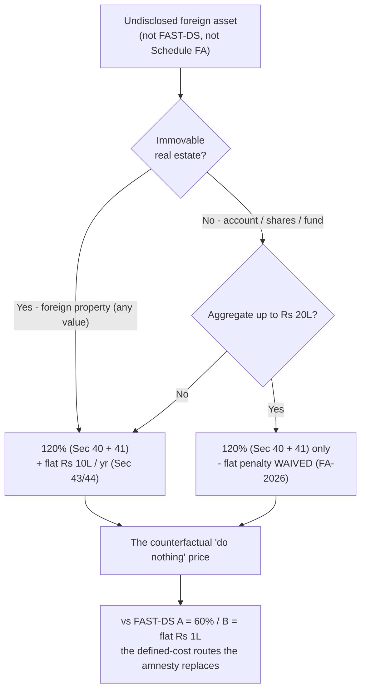

**Alt text:** The Black Money Act counterfactual: a non-immovable foreign asset under ₹20L escapes only the flat ₹10L penalty (FA-2026) but still owes 120% (Section 40 + 41); anything over ₹20L or any foreign immovable property owes 120% *plus* the flat ₹10L/yr. Both are far above the FAST-DS 60% / flat-₹1L defined-cost routes.

## The three ways out (and why they are not the same thing)

There are three distinct routes, and conflating them is the core mistake:

1. **FAST-DS 2026 (the one-time defined cost, Category A = 60%, Category B = flat ₹1L, deadline 31 Dec 2026).** This is the *only* route that trades a **calculable, lower** cost for **immunity** from further tax, penalty and BMA prosecution. It is the route the counterfactual exists to make unnecessary. [→ the FAST-DS article](./tax-fastds-2026-declaration.mdx)
2. **Schedule FA going forward (the routine, ongoing obligation).** For every year *after* the asset is properly reported, the obligation is to keep disclosing it in Schedule FA each year — there is *no penalty* for correct disclosure, only for *omission or inaccuracy*. This is not an "out"; it is the *normal state* the counterfactual is a failure of.
3. **The open-ended BMA assessment (the "do nothing" counterfactual — 120% + flat ₹10L/yr).** This is what happens if *both* of the above are skipped: the department finds the undisclosed asset (often through the information exchange with the home-country tax authority), assesses Section 40 + 41, and stacks the Section 43/44 flat penalty for each defaulting year. **There is no cap, no deadline and no amnesty on this route** — it is the open-ended exposure the Act is built to impose.

The decision is therefore not "BMA vs FAST-DS" — it is: *did I use route 1 (FAST-DS) while the window was open, and am I now on route 2 (Schedule FA)?* If the answer to route 1 is "no" (the window closed, or the asset was above the FAST-DS ceiling), the only route left is 3, and the counterfactual in the first table *is your liability*.

## The penalty is per defaulting year (the compounding trap)

The Section 43/44 flat penalty is the part most people underestimate: it is **₹10L *per assessment year* the Schedule FA omission persisted**, not a one-time charge. An asset that was undisclosed across 2022-23, 2023-24 and 2024-25 carries **three** flat penalties (₹30L) on top of the 120%. This is why the "I'll just disclose it in this year's return" instinct is *partly* right and *partly* a trap: a late Schedule FA entry fixes the *current-year* omission but does not retroactively erase the flat penalties for the *prior* defaulting years — and a late self-disclosure, unlike a FAST-DS declaration, gives you **no immunity** from the Section 41 concealment penalty for the years you had already omitted. The FAST-DS route is the *only* one that bundles "I declare, I pay a defined amount, and I'm done" into a single instrument.

## A worked example: the ₹50L forgotten account, three routes

Same facts (a ₹50L non-immovable foreign account, never reported, 3 years of omission). The three routes price differently:

| Route | Cost | What you get |
|---|---|---|
| **FAST-DS Category A** (if it was *never* taxed elsewhere) | **₹30L** (60% of value) | **Immunity** from further tax, penalty & BMA prosecution — the clean exit |
| **FAST-DS Category B** (if it *was* taxed elsewhere but missed Schedule FA) | **₹1,00,000 flat** | Immunity for the omission — by far the cheapest if the asset was ever taxed |
| **Do nothing → BMA counterfactual** | **₹90L** (₹60L = 120% + ₹30L flat / 3 yr) | No immunity — you have simply paid the open-ended assessment, and the Section 41 "may" reading (a Mumbai ITAT Special Bench held the penalty word "may" to be *directory*, not *mandatory*, in *Mr. Vinil Venugopal & Mrs. Ranjeeta Vinil*) only gives the department *discretion*, not you a right |

The **₹90L vs ₹30L vs ₹1L** spread on the *identical asset* is the entire argument for reading the FAST-DS article's "was it ever taxed?" question *first*: the reclassification from Category A to Category B alone saves **₹29L**, and choosing *any* FAST-DS route over "do nothing" saves **₹60L+**.

## When the counterfactual is survivable (the honest layer)

- **The ₹20L non-immovable FA-2026 soft edge** is the one case where "do nothing" is *less* catastrophic than the 120%-plus-flat picture: a small forgotten forex account under ₹20L still owes 120% (not a tiny number, but bounded) and *skips* the flat-penalty stacking. It is the *only* scenario where the open-ended route is arguably survivable, and even there the 120% is 2× the FAST-DS Category A cost.
- **The per-year flat penalty makes time the enemy.** The longer the omission, the more ₹10L stacks; this is a *deadline* argument, not a strategy argument.
- **The "may" discretion is not a defence you can rely on.** The ITAT's directory reading of Section 43 means the *department* may or may not impose the flat penalty — that is a coin flip in the assessee's disfavour, not a planning input. You do not plan around the hope that an officer uses their discretion leniently.
- **Above the FAST-DS ceilings** (undisclosed > ₹1 cr, or missed-Schedule-FA > ₹5 cr), FAST-DS simply *cannot* be used, and the entire counterfactual is the only route — which is the honest limit of the amnesty and the reason a large undisclosed foreign asset needs professional handling, not a calculator.

## What to do (before the window closes and beyond it)

1. **Answer the Category question first** (*was this asset ever taxed or reported?*) — that decides FAST-DS Category B (the flat-₹1L cheap route) vs Category A (60%), and the "do nothing" counterfactual is the fallback for both if you miss the window.
2. **Check the value as of 31 March 2026** and the **₹20L non-immovable FA-2026 threshold** to know whether the flat-penalty soft edge applies to your specific asset.
3. **Count the defaulting years** — the flat penalty is *per year*, and this is the number that makes time the enemy.
4. **Run the [black-money-act-exposure calculator](/calculators/black-money-act-exposure)** for the "do nothing" total, and the [fast-ds-declaration calculator](/calculators/fast-ds-declaration) for the "defined cost" total; the **gap between the two is your amnesty's value**.
5. **If the window is still open (before 31 Dec 2026)** and the asset is within a FAST-DS ceiling, **file FAST-DS** — it is the *only* defined-cost, immunity-bearing route.
6. **If the window has closed or the asset is above the ceilings**, keep the asset on **Schedule FA every going-forward year** and get professional advice on the open-ended BMA exposure for the prior defaulting years.
7. **Reconcile with a CA** — the BMA "may" discretion, the FA-2026 threshold, and the per-year penalty stacking are all facts that a specific asset's record must be checked against, not assumed.

## The one-line verdict

**"Do nothing" on an undisclosed foreign asset is not a neutral position — it is the Black Money Act counterfactual: 120% of the value (Section 40 30% tax + Section 41 90% penalty) plus a flat ₹10L per defaulting year (Section 43/44), softened only for a non-immovable asset under the ₹20L Finance-Act-2026 threshold.** The defined-cost routes that *replace* it are FAST-DS Category A (60% of value) or Category B (a flat ₹1L), both carrying immunity, and both *only* while the one-time window (31 Dec 2026) is open. The gap between "do nothing" (₹90L on a ₹50L/3-yr asset) and the cheapest defined route (₹1L) is not an artefact — it is the entire economic reason the amnesty was passed. The **black-money-act-exposure calculator** runs that gap on your exact value, years and asset class.

## Update log

- **2026-10-18 (Wave 26):** created. Verified the Black Money Act 2015 counterfactual structure against the Act's text and 2026 coverage: **Section 40** (30% tax on the undisclosed foreign income/asset), **Section 41** (a penalty of 3× the tax = 90% of value, a 120% total), **Sections 43/44** (a flat ₹10,00,000 per defaulting assessment year for a Schedule FA omission or inaccurate particulars), and the **Finance Act 2026 exception** (the flat ₹10L penalty does not apply where aggregate *non-immovable* foreign assets stay within **₹20L**). Cross-checked the ITAT Special Bench (*Mr. Vinil Venugopal & Mrs. Ranjeeta Vinil*) directory-reading of the Section 43 "may" word.
- **Review by 2027-04-17:** re-verify the Finance Act 2026 **₹20L non-immovable threshold** (a later Budget can change it) and whether the Section 40/41 rates or the Section 43/44 flat-penalty structure have moved; this is the counterfactual, so any change re-prices the "do nothing" column.

## Sources

- `src-us-stock-tax-india-2026` — the Black Money Act 2015 enforcement structure (Section 40 30% tax, Section 41 3× penalty, the flat-₹10L-per-year Schedule FA non-disclosure penalty under Sections 43/44) and the FAST-DS 2026 scheme terms it is a way out of; the Section 43 "may"-word directory reading and the per-year penalty stacking.
- `src-it-slab-fy2026-27` — the FY 2026-27 context for why the 120% counterfactual and the flat-₹10L/yr Schedule FA penalty are priced the way they are relative to a normal assessment, and the Finance Act 2026 **₹20L non-immovable** flat-penalty exception.

## Related

- [FAST-DS 2026 Declaration (the defined-cost layer this page is the counterfactual of)](/articles/tax-fastds-2026-declaration)
- [Direct LRS US-Equity Filing Walkthrough (the routine Schedule FA layer, layer 4)](/articles/tax-direct-lrs-us-equity-filing-walkthrough)
- [International Investing & LRS](/articles/international-investing-lrs)
- [The Complete Indian Investor Tax Guide](/articles/tax-india-investor-complete)
- The **black-money-act-exposure** calculator — run your exact undisclosed value, years and asset class through the "do nothing" total and the FAST-DS saving.


## Sources & Citations

- **Vedanta / WINvesta / Vested / Filewise / Upstox 2026 investor guides + KPMG / CBDT / NDTV FAST-DS 2026 coverage + Income-tax Act 2025 renumbered text** — US stocks taxed in India 2026: the 25% individual dividend withholding (W-8BEN) vs the 30% backup (and the 15% corporate-with-voting-stock figure that is NOT the individual rate), the 24-month / 12.5% no-pool foreign-security CG treatment, the Form 67 FTC cap, Schedule FA no-threshold disclosure, and the FAST-DS 2026 small-taxpayer scheme (Finance Act 2026 Ch. IV, ~15 Aug to 31 Dec 2026). https://vested.blog/posts/how-us-stocks-are-taxed-in-india (verified 2026-10-18)
- **Income Tax Department / Union Budget 2025 (Finance Act 2025) — FY 2026-27 slabs** — Income-tax slabs, new regime, FY 2026-27 (AY 2027-28) — unchanged from the Budget 2025 reset: 0-4L nil, 5% to 8L, 10% to 12L, 15% to 16L, 20% to 20L, 25% to 24L, 30%+; Sec 87A rebate extends tax-free up to Rs 12L; standard deduction Rs 75,000. https://cleartax.in/s/income-tax-slabs (verified 2026-10-16)

---
Educational content, not individualized investment, tax, accounting, or legal advice.
Author: Chirag Singhal. DhanPedia.


---


The [FAST-DS 2026 declaration article](./tax-fastds-2026-declaration.mdx) tells you *whether* to file and the *cost* (60% / flat ₹1L). The [Black Money Act exposure article](./tax-black-money-act-exposure.mdx) tells you the *counterfactual* if you do nothing. This is the operational layer both point to but do not compute: **how to actually value the asset for Form 1, and what to have in hand before you file.** A FAST-DS declaration is only as good as its valuation, and the Rules 2026 have a specific, non-obvious mechanism — the **20% valuation-variance safeguard** — that makes "value it conservatively" actively dangerous. Everything below is verified against the notified FAST-DS Rules, 2026 (G.S.R. 732(E), 14 Aug 2026) and the official FAQs; it is a due-diligence planning layer, not a Form 1 filing.

## The fixed valuation date: 31 March 2026 (and why it is not adjustable)

The first thing that surprises people: **the value you declare is *not* "the value today" and not "the value when you bought it."** The Rules fix a single valuation date for *every* asset in the scheme — **31 March 2026** (Rule 2(1)(e)). Whatever date you actually acquired, funded, or held the asset, the fair market value (FMV) you compute is the FMV **as on 31 March 2026**. This is deliberate: it pins the scheme to one cross-sectional date so the ₹1 cr / ₹5 cr ceilings have a consistent reference. The corollary is that a stale number ("I remember it being worth ₹X a few years ago") is *wrong by definition* — you must reconstruct the 31-March-2026 value, even for an account that has been dormant. [src-fastds-rules-valuation-2026]

## Rule 3: the per-asset-class FMV method (the one most people skip)

Valuation is **not** a single "look up the market rate" step. **Rule 3 prescribes a different mechanism for each asset class**, all as on 31 March 2026:

| Asset class | Rule 3 clause | The FMV method |
|---|---|---|
| Bullion, jewellery, precious stones | 3(1)(a) | The prescribed method for precious metals/stones |
| Artistic works | 3(1)(b) | The prescribed method for artworks |
| Quoted shares & securities | 3(1)(c)(i) | The quoted (market) value of the holding |
| Unquoted equity shares | 3(1)(c)(ii) | The unquoted-equity valuation method |
| Other unquoted shares/securities | 3(1)(c)(iii) | The prescribed unquoted-security method |
| Immovable property | 3(1)(d) | The prescribed property-valuation method |
| **Foreign bank accounts** | **3(1)(e)** | **The sum of deposits from the account's opening to 31 Mar 2026, with specific treatment for redeposits arising from withdrawals** |
| Partnership / AOP / LLP interests | 3(1)(f) | The prescribed interest-valuation method |
| Other assets | 3(1)(g) | The residual method |

Two subtleties that change the number:

- **For a bank account, Rule 3(1)(e) is the *accumulated-deposit* method, not the closing balance.** It looks at the *sum of deposits from opening to 31 March 2026* (with specific treatment for redeposits that arise from your own withdrawals). A dormant account that you *kept topping up* has a much larger Rule 3 value than its current balance suggests — which is exactly why the "it's just a small forgotten account" instinct under-values most bank-account cases.
- **The fallback is the indexed cost of acquisition.** Where valuation is not otherwise carried out in the specified circumstances, **the indexed cost of acquisition is *deemed* to be the FMV** (Rule 3(2)/(3), which also cover assets transferred *before* the valuation date and assets acquired from the proceeds of another asset or a bank-account withdrawal). This matters: if you genuinely cannot establish a market FMV for an unquoted holding, your declared value defaults to the *indexed* cost — which, for a long-held asset, is the conservative (often low) number, and is what the 20% safeguard below then protects.

## Currency conversion: the RBI reference rate (Rule 3(4)/(5))

A foreign asset is denominated in a foreign currency; the scheme is priced in rupees. **Rule 3(4)/(5) prescribe the conversion, and it is not the rate your broker quoted you:**

- An asset in a **permitted currency** is converted to INR using the **RBI reference rate on the valuation date** (31 March 2026).
- An asset in **any other currency** is converted by a **two-stage route through USD**: the prescribed foreign-country rate to USD, then the RBI reference rate from USD to INR.

The practical risk is the same as the "stale number" risk: using a *convenient* spot rate (say, today's) instead of the **31-March-2026 RBI reference rate** moves your declared FMV off the Rules' value, and that is precisely the variance the next section tests.

## The 20% valuation-variance safeguard (the trap)

This is the single most non-obvious mechanism in the whole scheme, and it is in **Rule 5(2)**:

> If the FMV you declared in Form 1 **differs from the FMV the authority later determines** (on assessment or inquiry), your declaration is **not treated as invalid** *provided the variance does not exceed 20% of the FMV you declared.*

Read that carefully. The safeguard protects you from a **small** valuation error — a ±20% slip keeps the declaration valid on the value you declared. But it is a **one-sided, value-upward** protection in practice: if the authority's determined FMV is *higher* than your declared one, and the gap is *more* than 20% of your declared value, **the charge is re-computed on the higher (determined) FMV, and your payable rises with it.** The asymmetry that bites:

- **Declared ₹40L, determined ₹48L** → variance = ₹8L ÷ ₹40L = **20%** (inclusive) → **the safeguard holds**; you pay on ₹40L.
- **Declared ₹40L, determined ₹50L** → variance = ₹10L ÷ ₹40L = **25%** → **the safeguard fails**; you pay 60% of **₹50L**, not ₹40L.

So "I'll just declare a bit less and the 20% covers it" is a trap: the 20% is measured against *your declared* value, which means the room to under-declare is *very* small, and **undervaluing the asset is where the risk lives.** The safe posture is to value the asset *upward* (or at the true FMV) so that any later authority determination is *at or below* your declared value — in which case the payable does not rise. The **fast-ds-valuation-guard calculator** computes the variance, whether the safeguard holds, the payable that actually applies, and the late-payment interest, for your declared vs determined values.

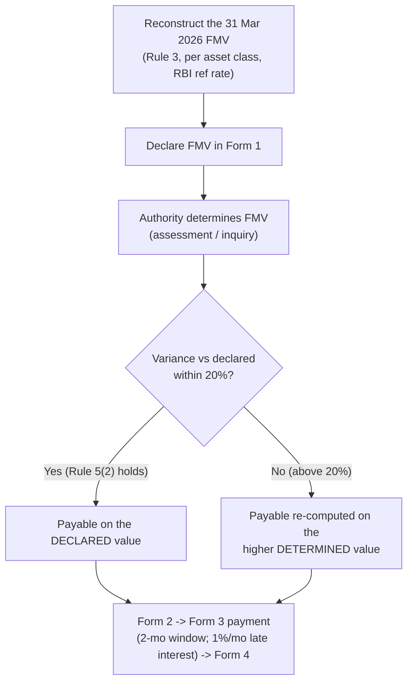

**Alt text:** Value the asset at the 31 March 2026 FMV (Rule 3 + RBI reference rate) and declare it in Form 1. When the authority determines the FMV, the 20% Rule-5(2) safeguard keeps the payable on the *declared* value only if the variance is within 20% of what you declared; above that, the payable re-computes on the *higher determined* value. Both paths then run through Form 2 (determination) → Form 3 (payment, 1%/month late interest) → Form 4 (certification).

## The document checklist (what Form 1 actually needs)

FAST-DS "rewards documentation, not just disclosure" — a declaration without the supporting record is the one that gets re-valued up. For a Form 1 + the annexures, have **before** you file:

- **The asset inventory** — every foreign account, holding, property, and any foreign-source income, with opening/closing dates. (The account is not "irrelevant because dormant" — the Rule 3 value is the *accumulated deposit* to 31 Mar 2026, not the current balance.)
- **Statements / records for the 31 Mar 2026 value** — bank statements through 31 March 2026 for the Rule 3(1)(e) bank-account method; the relevant market/broker value for quoted securities (3(1)(c)(i)); the prescribed valuation for property (3(1)(d)) and unquoted holdings (3(1)(c)(ii)/(iii)); acquisition records for the indexed-cost fallback.
- **The currency-conversion basis** — the RBI reference rate on 31 March 2026 (permitted currency) or the two-stage USD route (other currency), so your INR figure is defensible under Rule 3(4)/(5).
- **The source-of-funds / tax-history record** — to settle *Track A vs Track B* (the 60%-vs-₹1L decision): was this asset's value built from income *never offered to tax* (Track A), or from income *already taxed* / acquired during *non-residence* but just missed from Schedule FA (Track B)? This is the document that decides a 30× cost difference.
- **Your residential-status record** — for the years the income arose / the asset was acquired (the RNOR/returning-NRI eligibility route depends on it).
- **The Forms 1 → 2 → 3 → 4 sequence and timings** — Form 1 (declaration + the separately-captured Track A and Track B computations) → Form 2 (the determination order from the Principal / DGIT (Systems)) → **Form 3 (payment within 2 months of receipt of Form 2; 1% interest per month or part thereafter; part payments are recognised)** → Form 4 (final certification that the declaration is valid for Section 139 and confers the prescribed immunity).

## When the asset is even eligible (the pre-valuation gate)

Valuation is *after* eligibility; get the gate first or the number is irrelevant:

- **The value must be within the track ceiling** — Track A aggregate at or under ₹1 cr; Track B at or under ₹5 cr. (Above it, the scheme cannot be used for that asset.)
- **The asset must not be proceeds of crime**, and **no Black Money Act assessment may already be complete** for the relevant year — those are excluded.
- **The scheme is *taxpayer-specific*** — a company, LLP, firm or trust **cannot** use FAST-DS for an *employee's* foreign asset; the individual files it.
- **Residential-status conditions** must be met for the relevant year (the returning-NRI / RNOR route).

## What the immunity does NOT cover (the honest limit)

A valid FAST-DS declaration + payment gives **immunity from further tax, penalty and prosecution under the Black Money Act, 2015, for the specific asset/income declared.** It is *not* a universal clean slate:

- **It does NOT settle FEMA / exchange-control exposure.** Tax regularisation and exchange-control regularisation are *separate* exercises; a FAST-DS declaration regularises the *tax/BMA* side and can leave an independent FEMA question open. (This is the most quietly important limit for a cross-border position.)
- **It does NOT replace Schedule FA going forward.** FAST-DS regularises the *past*; the *ongoing* obligation to report foreign assets in Schedule FA each year continues unchanged.
- **The immunity is asset/income-specific** — only for what you actually declared.
- **The 20% safeguard is not a licence to undervalue** — above 20% the payable re-computes on the higher determined value (Section above), and the department's discretion under the "may" wording of the BMA (the ITAT Special Bench read it as *directory*) is not a planning input.

## A worked valuation example: the ₹40L bank account

Assume a foreign bank account; you declare a 31-March-2026 FMV of **₹40,00,000** (the Rule 3(1)(e) accumulated-deposit figure, converted at the 31-Mar-2026 RBI reference rate) in **Track A** (the deposits came from salary never offered to tax), and you have *no* late payment.

| Quantity | Figure | Reading |
|---|---|---|
| Declared FMV | ₹40L | your Form 1 figure |
| If determined = ₹40L (variance 0%) | safeguard **holds** | payable = 60% × ₹40L = **₹24L** |
| If determined = ₹48L (variance 20%) | safeguard **holds** (inclusive) | payable still on ₹40L = **₹24L** |
| If determined = ₹50L (variance 25%) | safeguard **fails** | payable re-computes = 60% × ₹50L = **₹30L** |
| 1 month late on a ₹24L payable | + ₹24,000 | 1% × ₹24L |

The **fast-ds-valuation-guard calculator** runs this table on your exact declared/determined pair, the track, and the late-payment months — and shows the *upward* risk (declare too low and the payable steps up at 25% variance) that the 20% safeguard does *not* remove.

## What to do now (the due-diligence order)

1. **Gate first:** is the asset within a FAST-DS ceiling, not proceeds of crime, and not already BMA-assessed? (Above — the pre-valuation gate.)
2. **Fix the source-of-funds fact:** Track A (never taxed) vs Track B (taxed-elsewhere / non-resident, missed Schedule FA) — this is the 60%-vs-₹1L lever and the document that decides it.
3. **Reconstruct the 31 March 2026 FMV** using the *correct* Rule 3 method for the asset class (the accumulated-deposit rule for bank accounts is the one most often wronged) and the RBI reference rate.
4. **Value it upward, not down:** declare at or above the true FMV so the 20% safeguard protects *downward* variance only — undervaluing is where the payable rises.
5. **Assemble the document checklist** (statements through 31 Mar 2026, conversion basis, source-of-funds record, residential-status record).
6. **Run the [fast-ds-valuation-guard calculator](/calculators/fast-ds-valuation-guard)** for the variance, the payable that applies, and the late-interest cost.
7. **File Form 1 well before 31 December 2026** and pay Form 3 within 2 months of Form 2 to avoid the 1%/month interest.
8. **Reconcile with a CA and check the FEMA question separately** — a FAST-DS declaration is not a FEMA safe harbour.

## The one-line verdict

A FAST-DS 2026 declaration lives or dies on **valuation, not disclosure**: the value is the **31 March 2026 FMV** computed by the **asset-class-specific Rule 3 method** (the accumulated-deposit rule for bank accounts is the most-misread one) converted at the **RBI reference rate**, and it is protected only by a **20% Rule-5(2) variance safeguard that is measured against *your declared* value** — so undervaluing is the active risk, because above 20% variance the payable **re-computes on the higher determined FMV** and the 1%/month late interest can stack on top. Value *upward*, gate on Track A vs Track B (the 60%-vs-₹1L lever), keep the document checklist in hand, file before 31 December, and remember the immunity regularises the *tax/BMA* side but **does not settle FEMA**. The **fast-ds-valuation-guard calculator** runs all of that on your exact numbers.

## Update log

- **2026-10-18 (Wave 27):** created. Verified against the notified FAST-DS Rules, 2026 (G.S.R. 732(E), 14 Aug 2026; in force 16 Aug; last date 31 Dec 2026) and the official FAQs: the fixed 31 Mar 2026 valuation date (Rule 2(1)(e)); the Rule 3 per-asset-class FMV methods (including the Rule 3(1)(e) bank-account accumulated-deposit method and the indexed-cost deemed-FMV fallback) + the Rule 3(4)/(5) RBI-reference-rate / two-stage-USD currency conversion; the **Rule 5(2) 20% valuation-variance safeguard** (the declaration stands on the declared value only while the variance is within 20% of it; above that the charge re-computes on the higher determined value); the four-form chain (Forms 1–2–3–4, Rules 5–8, before the Principal / DGIT (Systems)) + the **1%/month late-payment interest** (Rule 7); and the limited immunity (regularises tax / BMA exposure but does NOT settle FEMA and does not replace ongoing Schedule FA).
- **Review by 2027-01-31 (hard):** re-verify the 20% safeguard, the Rule 3 methods, and the window at the FY 2027-28 Budget / a successor notification — this layer is only actionable while the FAST-DS window (31 Dec 2026) is open or a successor is confirmed.

## Sources

- `src-fastds-rules-valuation-2026` — the FAST-DS Rules 2026 valuation + due-diligence source: the G.S.R. 732(E) 14 Aug 2026 notification, the 31 Mar 2026 valuation date, the Rule 3 per-asset-class methods + currency conversion, the Rule 5(2) 20% safeguard, the four-form chain + 1%/month late interest, and the limited (non-FEMA) immunity.
- `src-us-stock-tax-india-2026` — the FAST-DS two-category / ceiling structure (Track A ₹1 cr / Track B ₹5 cr) that the valuation layer prices, and the Schedule FA / Black Money Act context.
- `src-it-slab-fy2026-27` — the FY 2026-27 context for why the 60% / flat-₹1L defined costs and the 120% BMA counterfactual are priced the way they are.

## Related

- [FAST-DS 2026 Declaration (the defined-cost + category layer this page prices)](/articles/tax-fastds-2026-declaration)
- [Black Money Act Exposure (the counterfactual this valuation protects against)](/articles/tax-black-money-act-exposure)
- [Direct LRS US-Equity Filing Walkthrough (the routine Schedule FA layer)](/articles/tax-direct-lrs-us-equity-filing-walkthrough)
- [The Complete Indian Investor Tax Guide](/articles/tax-india-investor-complete)
- The **fast-ds-valuation-guard** calculator — run your declared vs determined FMV through the 20% safeguard, the payable, and the late-interest cost.


## Sources & Citations

- **CA R N Mohil (TaxGuru, 18 Aug 2026) + the CBDT FAST-DS 2026 official FAQs (13 Aug 2026) + the notified G.S.R. 732(E) Rules + EY 2026 technical alert** — FAST-DS 2026 valuation + due-diligence layer: the Foreign Assets of Small Taxpayers-Disclosure Scheme Rules, 2026 (G.S.R. 732(E) dated 14 Aug 2026, in force 16 Aug 2026, last date 31 Dec 2026) - the 31 Mar 2026 valuation date (Rule 2(1)(e)), the Rule 3 per-asset-class FMV methods + RBI-reference-rate currency conversion (Rule 3(4)/(5)), the 20% valuation-variance safeguard (Rule 5(2)), the four-form chain (Forms 1-2-3-4, Rules 5-8) + the 1%/month late-payment interest (Rule 7), and the limited immunity that does NOT settle FEMA exposure. https://taxguru.in/income-tax/fast-ds-2026-decoded-foreign-asset-disclosure-valuation-compliance.html (verified 2026-10-18)
- **Vedanta / WINvesta / Vested / Filewise / Upstox 2026 investor guides + KPMG / CBDT / NDTV FAST-DS 2026 coverage + Income-tax Act 2025 renumbered text** — US stocks taxed in India 2026: the 25% individual dividend withholding (W-8BEN) vs the 30% backup (and the 15% corporate-with-voting-stock figure that is NOT the individual rate), the 24-month / 12.5% no-pool foreign-security CG treatment, the Form 67 FTC cap, Schedule FA no-threshold disclosure, and the FAST-DS 2026 small-taxpayer scheme (Finance Act 2026 Ch. IV, ~15 Aug to 31 Dec 2026). https://vested.blog/posts/how-us-stocks-are-taxed-in-india (verified 2026-10-18)
- **Income Tax Department / Union Budget 2025 (Finance Act 2025) — FY 2026-27 slabs** — Income-tax slabs, new regime, FY 2026-27 (AY 2027-28) — unchanged from the Budget 2025 reset: 0-4L nil, 5% to 8L, 10% to 12L, 15% to 16L, 20% to 20L, 25% to 24L, 30%+; Sec 87A rebate extends tax-free up to Rs 12L; standard deduction Rs 75,000. https://cleartax.in/s/income-tax-slabs (verified 2026-10-16)

---
Educational content, not individualized investment, tax, accounting, or legal advice.
Author: Chirag Singhal. DhanPedia.
