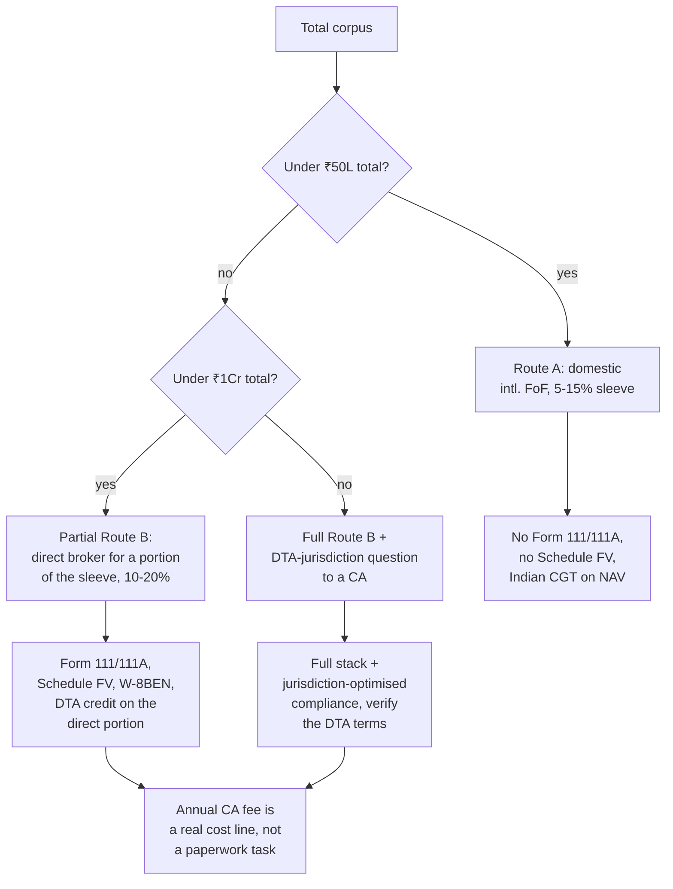
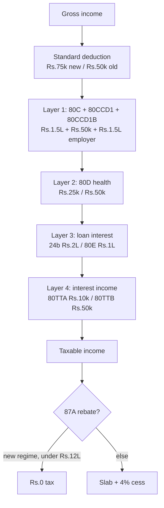
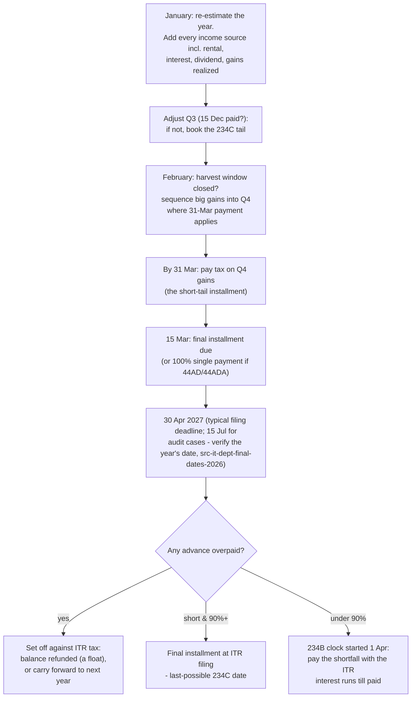
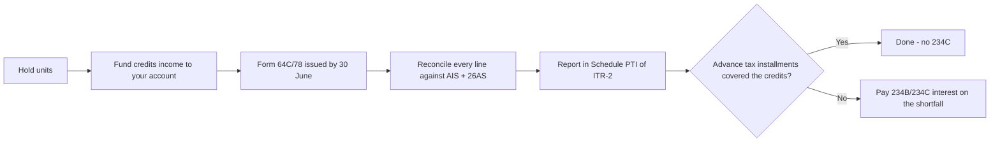

# Indian Taxation for Investors

*Regimes, Capital Gains, Deductions, Reporting & International Rules*

> A single reference for the tax treatment of every major Indian investment avenue: new vs old regime, slab math, equity STCG/LCG, debt and commodity gains, ELSS/80C, NPS 80CCD, TDS, ITR forms, HUF and DTA reporting.

Audience: Any Indian investor; advanced for the reporting chapters. Version 1.0, 2026-10-16.

## Introduction

Tax rules are the single most time-sensitive part of this book. Every figure is marked with its verification date and re-verified each Budget cycle.

## Contents

1. Indian Taxation for Investors (FY 2026-27): Regimes, Capital Gains, Deductions & Reporting
2. Government Small-Savings Schemes: PPF, EPF/VPF, NPS, APY, SCSS, SSY, NSC, KVP
3. International Investing & LRS for Indian Residents
4. ESOPs & RSUs for Indian Employees: The Two-Stage Tax That Everyone Gets Wrong
5. Tax Loss Harvesting & Set-Off in India: The 8-Year Loss Asset Most Investors Let Expire
6. Building the Tax-Efficient Wealth Stack: 80C, NPS, PPF, ELSS & the Interest Layers, Worked Out
7. HUF Wealth Structure: The Second Tax Entity Your Family Can Legally Create
8. Advance Tax, the 234B/234C Interest Clock, and the Final ITR Checklist for FY 2026-27
9. AIF Taxation Decoded: Section 115UB Pass-Through, the Cat III Fund-Level Tax & the 64C-to-78 Form Migration
10. The 80C Basket Decision: What ₹1.5 L of Deductions Is Actually Worth in Your Regime (and the NPS Side-Door)
11. Surcharge, Cess & the High-Income Regime: What ₹50L+ Actually Costs in FY 2026-27 (and the 25% Cap That Changes Everything Above ₹2Cr)
12. The HUF at High Income: Second-Slab Savings, the Gifting Rules, and the Two Advance-Tax Clocks
13. The Senior-Citizen Regime Decision: When the Old Regime Wins for a Retiree (and the 87A Trap It Hides)
14. Capital Gains Rollover: Section 54, 54F & 54EC — Reinvest the Gain, Not the Sale Value (and What Breaks It)
15. ESOP / RSU Vesting Tax Walkthrough: The Full Two-Stage Lifecycle (FY 2026-27)
16. The 54EC Tranche Tracker: The 6-Month Window, 5-Year Lock-In & the Early-Redemption Reversal (FY 2026-27)


---


**Scope note.** This is a *general-education* reference, not a personal tax opinion. Tax law changes each Budget, individual facts (residency, holding periods, source of funds, co-owners) matter enormously, and the marginal-rate math below assumes a resident individual in the highest applicable slab unless stated. Run your specific numbers through a CA or a tax tool before filing. The figures marked **"(verified 2026-10-16)"** were checked against the sources in [Sources & citations](#sources--citations) at that date; treat any other rate as time-sensitive and re-verify.

## Why tax is the quiet return-killer

Before the math, the mindset: taxes do two distinct things to an investment. First they tax the *income stream* (coupon, dividend, interest) each year, which shrinks the amount that can compound. Second they tax the *capital gain* when you sell or redeem. The two are treated differently across asset classes, and that difference is where most of the planning happens. An investor who understands *when* money is taxed and *at what rate* can often choose between two "the same" instruments purely on the after-tax outcome. This article is organised around that idea: regimes first, then asset-class by asset-class, then deductions and reporting.

## The two regimes and how to choose between them

Since the new regime became the default in FY 2023-24, every individual must answer one structural question each year: **new regime or old regime.** The difference is not small.

Under the **new regime** the slabs are steeper-then-flatter, and almost all deductions under Chapter VI-A are switched off (the standard deduction and an employer's NPS contribution are the exceptions that survive). Under the **old regime** the slabs are older and gentler at the top, but you can claim 80C, 80D, home-loan interest under section 24(b), NPS under 80CCD(1B), and HRA. The whole game of Indian tax planning is the tension between those two columns.

### New-regime slabs, FY 2026-27 (verified 2026-10-16)

The slab structure below was reset by the Budget 2025 and **carried over unchanged for FY 2026-27** (the Budget 2026 made no slab change; it only changed ITR timelines and compliance framing).

| Taxable income slab | Rate |
|---|---|
| Up to ₹4,00,000 | 0% |
| ₹4,00,001 – ₹8,00,000 | 5% |
| ₹8,00,001 – ₹12,00,000 | 10% |
| ₹12,00,001 – ₹16,00,000 | 15% |
| ₹16,00,001 – ₹20,00,000 | 20% |
| ₹20,00,001 – ₹24,00,000 | 25% |
| Above ₹24,00,000 | 30% |

Two levers sit on top of the slabs:

- **Standard deduction ₹75,000** (new regime, salaried). It reduces the *gross salary* that is taxable; it is applied before the slabs. (verified 2026-10-16)
- **Rebate under section 87A of ₹60,000.** When total taxable income is up to ₹12,00,000, the tax payable is wiped out by the rebate, so income up to ₹12 lakh is effectively tax-free. Because a salaried person also gets the ₹75,000 standard deduction, **a gross salary of up to ₹12,75,000 can be tax-free** under the new regime. (verified 2026-10-16)

This is the key number to remember: the new regime is deliberately engineered to make mid-range salaried incomes largely tax-free, which is why so many people switch even when they have deductions.

### Old-regime slabs (still available as an option in FY 2026-27)

The old regime keeps its classic structure — **nil up to ₹2.5L, 5% to ₹5L, 20% to ₹10L, 30% above** (Budget 2025 widened the *new* regime slabs only; the old regime kept this shape and it carries unchanged into FY 2026-27; senior citizens get a ₹3L nil band, super-seniors ₹5L) — **and** it unlocks Chapter VI-A deductions: 80C (₹1,50,000), 80D (₹25,000, more for senior parents), home-loan interest under 24(b) (₹2,00,000 of interest, 20% of that = ₹40,000 in deduction), HRA, and 80CCD(1B) NPS (₹50,000 extra, on top of 80C). Because the top slab is 30% and the deduction stack is rich, the old regime can win for high-income people with big housing or insurance outlays — but only if the deductions actually exceed the slab savings. That is the decision, and it is a *calculation*, not a vibe.

### Worked example: ₹15 lakh salary, HRA shown as illustrative

**Illustrative assumptions — clearly labelled, not your numbers.** Assume an individual salaried taxpayer with gross salary ₹15,00,000, part of which is HRA. Under the new regime HRA is *not* deductible; under the old regime it is. For this illustration we assume an HRA exemption of ₹1,20,000 under the 50% rule (the actual figure depends on rent, city, and salary split). No home-loan interest is assumed; a ₹50,000 NPS contribution and ₹25,000 health premium are assumed available to the old regime. **Treat every deduction figure as a placeholder to substitute your own.**

**New regime:**

```math
T_{\text{taxable}} = 15{,}00{,}000 - 75{,}000_{\text{std. deduction}} = 14{,}25{,}000
```

| Slab | Amount in slab | Tax |
|---|---|---|
| Up to ₹4L | ₹4,00,000 | ₹0 |
| ₹4L–₹8L | ₹4,00,000 | ₹20,000 (5%) |
| ₹8L–₹12L | ₹4,00,000 | ₹40,000 (10%) |
| ₹12L–₹16L | ₹2,25,000 | ₹33,750 (15%) |
| **Tax before cess** | | **₹93,750** |

Income is above ₹12L, so no 87A rebate. Below ₹50L, so no surcharge. Add **4% Health & Education cess**: 0.04 × 93,750 = ₹3,750. **Total new-regime tax ≈ ₹97,500.**

**Old regime:**

```math
T_{\text{taxable}} = 15{,}00{,}000 - 1{,}20{,}000_{\text{HRA}} - 1{,}50{,}000_{\text{80C}}
- 50{,}000_{\text{80CCD(1B)}} - 25{,}000_{\text{80D}} - 50{,}000_{\text{std. deduction}} = 11{,}05{,}000
```

| Slab | Amount in slab | Tax |
|---|---|---|
| Up to ₹2.5L | ₹2,50,000 | ₹0 |
| ₹2.5L–₹5L | ₹2,50,000 | ₹12,500 (5%) |
| ₹5L–₹10L | ₹5,00,000 | ₹1,00,000 (20%) |
| Above ₹10L | ₹1,05,000 | ₹31,500 (30%) |
| **Tax before cess** | | **₹1,44,000** |

No 87A rebate (income > ₹5L, and 87A applies only when total income is below the ₹5L old-regime ceiling). Add 4% cess: 0.04 × 1,44,000 = ₹5,760. **Total old-regime tax ≈ ₹1,50,000.**

**Reading the result.** The new regime wins by about ₹52,000 (₹97,500 vs ₹1,50,000). Why? The ~₹3.3L of old-regime deductions is real, but it only lowers taxable income — it does not change the steeper old-regime slabs (20% from ₹5L, 30% above ₹10L). At ₹15L the new regime's flatter 15% band on the ₹12–16L slice means the *lower* taxable income under the old regime still lands in a heavier slab load, so the new regime's cleaner rate structure beats the deductions. This is the typical picture for a salaried person in this bracket: **new regime.** The old regime becomes competitive only when your *deduction stack is very large* (a big home-loan interest, heavy 80C, 80CCD(1B), and medical) that pushes old-regime taxable income down deep enough to escape the 20%/30% bands — often only somewhere above ₹20–25L of income, where each ₹1 of a 30%-slab deduction saves ₹0.30 while a new-regime rupee of income is often taxed at just 15–20%.

The cleanest way to express "what does one more rupee of income cost me here" is the **marginal tax rate**, the rate on the next incremental rupee:

```math
m = \frac{\partial(\text{tax})}{\partial(\text{income})} = w_{\text{slab}} + 0.04 + s_{\text{surcharge}}
```

where $w_{\text{slab}}$ is the slab rate on that rupee, 0.04 is the cess, and $s_{\text{surcharge}}$ is the applicable surcharge (0 below ₹50L). Knowing your marginal rate tells you exactly how much you save per ₹1 of a deduction — so a ₹1.5L 80C claim is worth $0.30 \times 1{,}50{,}000$ at a 30% marginal rate but only $0.15 \times 1{,}50{,}000$ at a 15% marginal rate. Deductions are not equally valuable at every income level.

## Equity capital gains: the 10%→12.5% and 15%→20% shift

Equity capital-gains taxation was changed in the **July 2024** budget, effective for transfers on or after **23 July 2024**. The changes are established facts, not projections:

- **Long-term capital gain (LTCG)** on listed equity and equity funds (held **> 12 months**): **12.5%**, up from 10%. The first ₹1,00,000 of LTCG per year is exempt. (Verified fact about the 10%→12.5% change.)
- **Short-term capital gain (STCG)** (held **≤ 12 months**): **20%**, up from 15%, effective from the July 2024 change. No indexation, no ₹1L exemption.

Two consequences for an active Indian investor:

1. **The holding-period line is the most valuable switch you own.** Pushing a position across the 12-month mark drops its tax from a flat 20% to 12.5% (with a ₹1L annual exemption) on the long-term portion. This is why disciplined, patient investors are structurally tax-advantaged versus traders.
2. **The ₹1L exemption is on *aggregate* LTCG**, not per holding. It is a real planning tool: if you harvested gains in one year, deliberately deferring some selling to the *next* financial year can reset the ₹1L exemption bucket. (This is a timing strategy, not a guarantee — markets move, and it changes your portfolio.)

Unlisted equity, REIT/InvIT units, and debt have their own holding-period definitions (typically **24 months**), which we handle in the debt and gold sections.

## Debt funds, taxable bonds and "interest" income

The important regime shift for fixed income happened earlier: from **FY 2024-25**, gains on debt mutual funds (and other non-equity assets) are **taxed at your slab rate**, not at the old preferential 20%-plus-indexation rate, whether short- or long-term. So a debt fund held for three years is taxed the same as one held for two weeks — at your marginal slab.

That makes **income taxation** the dominant force for debt:

- **Taxable bonds / debentures / bank FDs:** the coupon and the accretion (the increase in value between purchase and redemption) are **income taxed at your slab rate** every year, and TDS is deducted at source on interest. An **8%+ bond taxed at 30% plus 4% cess** delivers far less after-tax than its nominal yield suggests.
- **Tax-free instruments** (e.g., certain infrastructure-bond interest under section 80EE, and some state-bond instruments historically) break the chain — but 80EE had been discontinued for fresh investment in FY 2024-25, so verify current status before assuming tax-free debt income.
- **Gold / commodity funds, real-estate funds:** treated as non-equity; gains follow the asset. Gold is addressed next.

The recurring investor takeaway: *before* you chase a higher nominal bond yield, compute the **after-tax yield at your marginal rate**. The gap between a 7.5% taxable bond and a tax-free or lower-taxed instrument is frequently *larger* than the gap between two nominal yields.

## Gold and SGB tax treatment

Gold is where the instrument choice is almost entirely a **tax** decision:

- **Physical gold:** if the gold is held for more than 2 years *and* is a "listed" or identifiable asset, the gain is a long-term capital gain **taxed at your slab rate**. Short-term gain is also at slab rate. The point is that physical gold has **no special preferential rate** — it behaves like any other non-equity asset for CG purposes.
- **Sovereign Gold Bonds (SGBs):** the headline feature — as of **1 April 2026 (Budget 2026)**, the *maturity-redemption* *capital-gains* *exemption* now applies **only to the *original* *subscriber*** who *holds* *to* *maturity* (*the* 2.5% *annual* *interest* *remains* *taxable* *at* *your* *slab*). An SGB **acquired from the secondary market** is now **taxable as capital gain at slab rate on *both* the pre-maturity sale and the maturity redemption** — the Budget 2026 change deliberately narrowed the exemption to the original-subscriber case. SGBs **stopped issuing new tranches from FY 2024-25** (last tranche February 2024), and the FY 2026-27 Budget confirmed no re-launch. [src-budget-2026-sgb-tax] See the dedicated SGB article for the full comparison.
- **Gold ETFs and Gold Mutual Funds:** taxed like their underlying (commodity/equity-style CG treatment; held > 12 months = long-term at 12.5% for listed-equity-classified funds, slab otherwise). This is why a *taxable gold ETF* is often the practical post-SGB substitute: you give up the tax-free-maturity feature in exchange for liquidity and no storage.

The deep point: **gold is not a tax shelter in most forms; the SGB was.** Now that the SGB is closed, plan the rest of your gold exposure assuming it is taxed like any other asset.

## P2P lending interest: taxed at slab rate

Under the RBI's P2P framework, the **interest you earn as a lender is "income from other sources" and taxed at your slab rate.** The platform deducts **TDS at source** on that interest. Two investor-relevant consequences:

- There is **no preferential rate** on P2P returns — the same 20–30% marginal rate that hits your salary also hits your P2P income, so the *real* edge of P2P versus an FD is its nominal spread minus expected credit loss, not a tax shield.
- P2P income is **taxable in the year it accrues/receives**, even if you are in a loss-making year. You cannot "time" it the way you can time a capital gain.

The regulatory details (caps, platform prudential norms, recovery mechanics) live in the RBI P2P Directions and are covered in the dedicated P2P article; here the tax line is simply: **slab rate, TDS-able, income-taxed, no hold-period preference.**

## The deductions chapter (old-regime levers)

All of these only pay off if you are *choosing the old regime* (or a genuinely higher-income case where they beat the new regime):

| Section | Instrument | Annual limit | Nature |
|---|---|---|---|
| 80C | PPF, ELSS, NSC, EPF, life-insurance premium, SIP | ₹1,50,000 (aggregate cap) (verified 2026-10-16) | Principal |
| ELSS (inside 80C) | Equity fund | up to ₹1,50,000, **3-year lock-in** | Principal, highest-risk of the 80C set |
| PPF (inside 80C) | 15-year government scheme | up to the 80C cap; ~7.1% (time-sensitive) | EEE (principal+interest+redemption tax-free) |
| NSC | 5-year | within 80C cap | EET (interest + maturity taxed) |
| 24(b) | Home-loan *interest* | ₹2,00,000 interest → 20% = ₹40,000 deduction | Interest |
| 80D | Health insurance | ₹25,000 (₹50,000 with senior parents) | Premium |
| 80CCD(1B) | NPS own contribution | **extra ₹50,000 on top of 80C** | Principal |

**ELSS mechanics (verified: 3-year lock-in + 80C eligibility).** An ELSS investment counts toward the ₹1,50,000 80C cap and is locked for three years; after lock-in, redemption gains are taxed by the *equity* rules (held > 12 months → 12.5% LTCG with the ₹1L exemption). It is the highest-risk 80C instrument (pure equity) but often the best long-term after-tax compounder among the 80C set — the three-year lock-in, not the fund's returns, is the only "feature" the tax code gives you.

**NPS and the 80CCD(1B) layer (NPS 2025 changes, verified 2026-10-16).** Your own NPS contribution gets ₹50,000 of *extra* deduction under 80CCD(1B) beyond the 80C cap. Separately, the 2025 NPS exit amendment made three changes that matter for the retirement side of the ledger: **up to 80% of the corpus can be withdrawn as tax-free lump sum at retirement (up from 60%)**, **private-sector (subscribed) participants may allocate 100% of the corpus to equities**, and the **exit age ceiling was raised to 85**. The extra 20% lump-sum and the 100% equity option make NPS meaningfully more attractive for pre-retirement growth, while the ₹50,000 80CCD(1B) stays one of the cleanest deduction levers in the code.

## TDS basics for investors

TDS (Tax Deducted at Source) is money withheld by the *payer* and remitted to the government; you credit it against your tax liability at ITR time. The investor-relevant TDS points:

- **Bank interest** above a threshold (e.g., savings/FD interest above ₹10,000 in the year) attracts TDS, usually at 10% (20% without a PAN, higher for senior citizens).
- **P2P lending interest** — TDS at source by the platform (see above).
- **Rent, home-loan repayment, professional fees** above limits — TDS applies (e.g., rent above ₹50,000/month attracts 10% TDS on landlord).
- **Sale of property, some capital gains** — TDS applies on certain transfers.
- If TDS is *over-withheld* relative to your final liability, you get a **refund** at ITR; if under, you pay the balance plus possible interest.

The practical rule: **TDS is a prepayment, not the final tax.** Your final liability is set by your ITR. A salaried investor with investment income should reconcile TDS (Form 26AS / 26AS statements and the AIS pre-filled data) with their own records every year — mismatches are the top cause of filing rejections.

## ITR forms: which one do you file?

The three forms most individuals use, and when each fits:

| Form | When to use | Typical investor signal |
|---|---|---|
| **ITR-1 (Saubhagya)** | Salaried; income from up to **one** house property; capital gains; other sources (deposits, P2P, gold) | Most individual retail investors |
| **ITR-2 (Pryag)** | No business income, but **more than one house property** or capital gains from more complex sources | Property + multiple assets, or HUF-linked property |
| **ITR-3 (Samsthiti)** | **Business/professional income** | Freelancers, traders, professionals |

Guidance: a salaried retail investor with a few houses of property and index/ELSS/capital-gain income usually files **ITR-1**. The moment a business or professional source appears, or a *second* house property does, you move to **ITR-2 / ITR-3**. Choosing a lower form than your actual income profile allows triggers rejection. File within due dates to avoid interest and late-filing fee; non-residents and HUFs have separate treatment.

## HUF: a planning technique, not tax evasion

A **Hindu Undivided Family (HUF)** is a *separate taxable entity* in its own right, distinct from its individual members. A family can pool certain income/assets under the HUF, and the HUF gets its own **basic exemption** (the same slab structure) and its own **deductions** (e.g., it can hold an NPS, invest in 80C instruments, get health premium). Because the HUF has an independent exemption and independent slab space, income that would push an *individual* into a higher slab can sometimes sit in the HUF at a lower effective rate.

**This is a legitimate structure, not evasion.** The line is clean: the HUF must be a real, separate entity with genuine contributions/family income to report, it files its **own ITR**, and every asset must be legally the HUF's (not an individual's held in the family's name). Transferring an individual's income to the HUF to dodge tax is not permitted; the HUF reports *its* income. Use it for what it is — a genuine family planning vehicle that adds one more slab of exemption and deduction room — and keep the paper trail real. For a married family with two high earners, the HUF is one of the few "add a tax exemption" levers that does not cost a premium.

## DTA, FATCA & CRS: the cross-border layer

If any of your investing crosses a border, three layers apply:

- **DTA/DTAA (Double Tax Avoidance Agreements):** India has treaty relief with many countries, so the same income is not taxed twice — but *relief requires reporting* and often a Form-16A/foreign-asset disclosure. The benefit is real only if you claim it correctly.
- **FATCA:** the US regime requiring US persons to report foreign assets; India is a FATCA-Implementing jurisdiction and banks/firms exchange account information to the US. For a US-person NRI or investor, this is the strictest reporting regime.
- **CRS (Common Reporting Standard):** the multilateral mirror — India exchanges account information with treaty partners, so a *foreign* account held by an Indian resident is reported back and taxed in India.

The investor takeaway: **foreign income and foreign assets are taxable in India for residents**, and the disclosure stack (Schedule FV under ITR, plus FATCA/CRS) is mandatory. Under-reporting a foreign portfolio is one of the few "paper trail is obvious" risks — the counterparty bank is literally sending your data to the IT department. Keep foreign income on the books.

## Cess and surcharge: the top-up lines

Two add-ons ride on the slab tax:

- **Health & Education Cess: 4%** of the tax liability. It multiplies everything above it — so a "30% top rate" is really 30% + cess + surcharge in practice.
- **Surcharge (verified as the current FY 2026-27 structure, 2026-10-16): a top-up on tax for high incomes — 10% (₹50L–₹1Cr), 15% (₹1Cr–₹2Cr), 25% (₹2Cr–₹5Cr), 37% (above ₹5Cr). Surcharge makes the *effective* marginal rate above ₹2Cr very high, which is precisely where 80C/80CCD(1B) deductions become worth the most (₹0.30+ per ₹1 saved) and where the new vs old regime decision is most contested.

Surcharge also **caps** certain deductions in the upper slabs (some deductions are reduced when surcharge is payable), so the "deduction math" is not linear at the top. This is advanced-territory; have the top-bracket numbers done by a CA.

## Which regime for me? — decision tree

```mermaid
flowchart TD
    A["Start: resident individual"] --> B{"Do you have Chapter-VI-A deductions<br/>(80C, 80D, 24b home loan, 80CCD-1B, HRA)?"}
    B -->|No / very small| C["New regime<br/>(deductions switched off, slabs flatter)"]
    B -->|Yes, sizeable| D{"Income below ~₹20L?"}
    D -->|Yes| E{"New regime effectively tax-free<br/>up to ₹12L gross after std. deduction?"}
    E -->|Yes| C
    E -->|No| F["Compare: run both regimes<br/>on your exact deductions"]
    D -->|No (high income, 30% slab)| G{"Deduction value<br/>(0.30 per ₹1) > new-regime slab saving?"}
    G -->|Yes| H["Old regime<br/>rich housing/insurance/NPS"]
    G -->|No| C
    C --> I["File ITR with new regime<br/>select"]
    H --> I
    I --> J["Recompute TDS credit, cess, surcharge"]
```

The tree deliberately ends on *compute, then select* — because the honest answer for a large share of mid-to-high earners is "run both numbers on my exact deductions this year, pick the lower one, and record the choice at filing." The new regime's engineered tax-free corridor up to ₹12L makes it the default for the middle, while the old regime's deduction stack defends the top.

## When an investor gets the tax wrong

The recurring, expensive mistakes: (1) **holding-period error** — selling an equity fund at 11 months and paying 20% STCG that would have been 12.5% LTCG a few weeks later; (2) **ignoring the ₹1L LTCG exemption** and not resetting it annually; (3) **choosing the wrong regime on habit**, not by running the deduction stack; (4) **taxing debt at nominal yield** instead of after-tax slab yield; (5) **forgetting P2P interest is income**, not capital; (6) **TDS reconciliation failures** causing rejections; (7) **leaving HUF, DTA/CRS opportunities** on the table. Each is a calculation, and each is fixable if you run the numbers once per year.

## Related

- [Government Small-Savings Schemes: PPF, EPF/VPF, NPS, APY, SCSS, SSY, NSC, KVP](../government-schemes/govt-small-savings-schemes.mdx) — the instruments this article's 80C/NPS sections reference.
- [Index Funds, ETFs & Direct vs Regular Plans](../mutual-funds/mf-index-etf-direct-regular.mdx) — where the 12.5% LTCG and holding-period switch live in practice.
- [Your 10 Lakh Wealth Plan](../personal-finance/pf-wealth-plan-10-lakh.mdx) — allocation that should be built *before* you layer tax planning on top.
- [Sovereign Gold Bonds](../government-schemes/govt-sovereign-gold-bonds.mdx) — the tax-free-maturity gold instrument and its current status.

## Update log

| Date | Change | Source |
|---|---|---|
| 2026-10-16 | Confirmed FY 2026-27 carries the unchanged slab structure (Budget 2026 made no slab change) | see FY 2026-27 sources |
| 2026-08-06 | Verified FY 2025-26 new-regime slabs, ₹75,000 standard deduction, ₹60,000 87A rebate (≈₹12L tax-free for salaried), ₹1.5L 80C, NPS 80CCD(1B) ₹50,000, NPS 2025 exit (80% lump-sum, 100% equity, age 85) | [src-it-slab-fy2025-26], [src-it-slab-calculator], [src-it-80c-150k], [src-sebi-elss], [src-nps-2025-exit] |
| 2026-08-06 | Confirmed July-2024 equity CG change (LTCG 10%→12.5%, STCG 15%→20%) as established fact | [src-it-slab-fy2025-26] |
| Re-check | PPF ~7.1%, surcharge tiers, 80EE status, debt-fund slab taxation — all **time-sensitive**; re-verify against the next Budget | — |

## Sources & citations

- **[src-it-slab-fy2025-26]** Income Tax Department / Union Budget 2025 — new-regime 7-slab structure (reset in Budget 2025, carried unchanged to FY 2026-27) and regime mechanics.
- **[src-it-slab-calculator]** Cleartax secondary summary of official slabs (cross-check on ₹12L tax-free corridor and standard deduction).
- **[src-it-80c-150k]** 80C limit remains ₹1.5 lakh, old regime only.
- **[src-sebi-elss]** SEBI Investor Education — ELSS 80C eligibility and lock-in.
- **[src-nps-2025-exit]** PFRDA 2025 exit amendment — 80% lump-sum, 100% equity option (private-sector), exit age to 85.

*Figures marked "(verified 2026-10-16)" were checked against the sources above as of that date. Unmarked rates (PPF ~7.1%, surcharge tiers, 80EE) are time-sensitive — re-verify against the latest Budget and RBI announcements before relying on them.*


## Sources & Citations

- **Income Tax Department / Union Budget 2025** — Income-tax slabs, new regime, FY 2026-27 (AY 2027-28) - unchanged from the Budget 2025 reset. https://www.indiabudget.gov.in/doc/Finance_Bill.pdf (verified 2026-10-16)
- **Cleartax (secondary summary of official slabs)** — Income Tax Slabs FY 2025-26 & FY 2026-27 (New and Old Regime). https://cleartax.in/s/income-tax-slabs (verified 2026-08-06)
- **Income Tax Act / Economic Times** — Section 80C limit remains ₹1.5 lakh (old regime only). https://economictimes.indiatimes.com/wealth/tax/has-section-80c-deduction-limit-hiked-check-how-much-tax-you-can-save-after-union-budget-2025/articleshow/117821055.cms (verified 2026-08-06)
- **SEBI Investor Education** — Securities Market Investment: A Guide to ELSS. https://investor.sebi.gov.in/elss.html (verified 2026-08-06)
- **PFRDA (Exits and Withdrawals under NPS) (Amendment) Regulations, 2025** — PFRDA (Exits and Withdrawals under the NPS) (Amendment) Regulations, 2025, w.e.f. 16 Dec 2025. https://www.pfrda.org.in/documents/33652/184762/Gazette+PFRDA+Exit+and+Withdrawals+under+the+NPS+Amendment+Regulations+2025.pdf (verified 2026-10-16)
- **The Times of India (Carat & Stick column)** — Budget 2026: capital-gains exemption on SGB redemption now applies to original subscribers only (effective 1 Apr 2026). https://timesofindia.indiatimes.com/business/india-business/carat-stick-gold-bonds-lose-some-tax-free-sparkle/articleshow/127848054.cms (verified 2026-10-16)

---
Educational content, not individualized investment, tax, accounting, or legal advice.
Author: Chirag Singhal. DhanPedia.


---


**Scope note.** Small-savings schemes are *government-guaranteed* savings, not investment products chasing return. Their value is three-part: (1) sovereign backing, (2) a tax posture that varies by scheme, and (3) a compounding structure matched to a horizon. This article covers the **eight** core schemes, each with eligibility, limit, lock-in, tax treatment, current rate, and honest pros/cons. Rates marked **"(verified 2026-08-06)"** were checked against the [sources](#sources--citations) at that date; every *other* rate is **time-sensitive** and must be re-checked before you rely on it. This is education, not a personal recommendation.

**A note on naming.** These schemes are sometimes called by slightly different spellings in search results ("scy" vs "ssy", "nsq" vs "nsc", "kvp" vs "kvp/DB"). In this article: **APY** = Atal Pension Yojana, **SSY** = Sukanya Samriddhi Yojana, **NSC** = National Savings Certificate, **KVP** = Kisan Vikalpa Pehchan (a post-office fixed-income option), **VPF** = Voluntary Provident Fund. Treat any unfamiliar abbreviation as time-sensitive and verify against the issuing department.

## Why "small savings" exists and who it is for

The government runs a parallel universe of **sovereign-guaranteed, low-risk, tax-aware** instruments that are deliberately *not* designed to beat equities. They are designed to do three things well: **preserve capital**, **pay predictable income**, and **earn a tax advantage** (EEE/EET/TEE tax posture). The audience is broad — from a mother funding a daughter's SSY to a salaried 45-year-old topping up their NPS under 80CCD(1B) — and the single most useful question for every scheme is: *"What is this instrument's real job?"*

The tax posture is where small-savings schemes differ most from raw deposits. The three useful categories are:

- **EEE** (Exempt-Exempt-Exempt): principal deduction + interest tax-free + redemption tax-free. PPF and NPS (80% corpus under the 2025 rule) are effectively EEE.
- **EET** (Exempt-Exempt-Taxable): principal deduction + interest tax-free + redemption **taxable**. NSC and KVP fall here.
- **TEE** (Taxable-Exempt-Exempt): principal taxable + interest tax-free + redemption tax-free. APY and SCSS fall here (or partially, depending on the scheme).

Knowing which bucket you are in tells you *exactly* what the instrument costs you after tax, which is the whole point of the comparison.

## PPF — Post Office / Provident Fund (PPP)

**Eligibility.** Indian resident individual; can be opened in a post office or via banks/employer. A salaried employee's PPF is their statutory EPF (covered below) plus *additional* voluntary PPF that counts toward 80C.

**Limit.** The *deductible* ceiling for PPF is ₹1,50,000/year (the 80C cap). The scheme itself accepts more, but only the ₹1.5L earns 80C credit. (The 80C limit is verified as ₹1.5L in FY 2025-26; the PPF contribution ceiling is time-sensitive.)

**Lock-in.** 15 years from opening. Premature withdrawal is permitted after 7 years for specific reasons (education, medical, purchase of house); the *amount* is partially EEE.

**Tax treatment.** EEE — contribution under 80C, interest fully tax-free, maturity tax-free. This is the cleanest long-horizon instrument in the scheme.

**Rate.** The PPF interest rate was approximately **7.1% for a recent quarter** — **time-sensitive, mark to re-verify** before you use it in a plan. PPF is quarterly-reviewed, so the rate *can* change without notice; a stale 7.1% can materially change your 15-year compounding assumption.

**Pros.** Long lock-in matches long horizons; tax-free throughout; sovereign-guaranteed; partial early withdrawal; the 80C credit makes it a deduction *and* a savings instrument in one. **Cons.** 15-year lock-in is a real cost to liquidity; the nominal rate is likely below long-run inflation plus opportunity cost of equities; partial early withdrawal is *not* free in spirit (limited to a few documented reasons).

## EPF & VPF — Provident Fund and Voluntary Provident Fund

**EPF.** Statutory, for salaried employees. Employee and employer each contribute 12% of basic pay; the *employee's* ₹1.5L/year within 80C limit. The interest rate on EPF is a **statutory floor of 8.25%**, which is verified as the floor in the statutory scheme — actual credited rate is set annually by the government and sits *at or above* the floor. (The 8.25% floor is a structural fact; the *actual* FY 2025-26 rate is time-sensitive and should be confirmed against the latest EPFO notification.)

**Lock-in.** EPF is not "locked" in the same way as PPF — it vests with the employee but is payable only on retirement/leaving. VPF allows *voluntary* additional contributions beyond the statutory 12%, up to 20% of (basic + DA) as an employee, with matching employer contribution not guaranteed; the extra VPF portion is 80C-deductible up to the 1.5L cap.

**Tax treatment.** EEE — the EPF corpus is tax-free on maturity for the standard contribution; VPF extra is also EEE but the *excess* above the 80C cap earns the interest in your hands (taxable at slab in the year it accrues, unless the interest stays inside the cap and the maturity itself is EEE).

**Pros.** Fully sovereign-guaranteed; interest floor above a plain FD; automatic for salaried; the VPF is one of the cleanest *deductible* ways to grow a retirement corpus (an ₹1L VPF a year at a 8.25%+ floor is a big lever). **Cons.** VPF above the 80C cap earns *taxable* interest; EPF is low-liquidity until you leave the job; the 8.25% floor is a floor, not a guarantee of exactly that rate every year.

## NPS — National Pension System (with the 2025 exit-rule changes)

This is the scheme with the biggest 2025 shift, and it deserves the full box.

**Eligibility.** Any resident Indian, 18+; a *private-sector* individual can subscribe via a PFRDA-registered operator (the "NPS 2025 exit" amendment applies to these subscribers).

**Limit.** Subscribed NPS contribution earns **₹50,000 extra under 80CCD(1B)** on top of the 80C cap — so up to ₹2,00,000 of NPS contribution a year can be deducted (₹1.5L 80C + ₹50k 80CCD(1B)). This ₹50k layer is one of the most valuable deduction levers in the code.

**Lock-in.** NPS is a *retirement* scheme: you contribute till your chosen exit age, then exit. The 2025 amendment changed the *exit mechanics*:

> ### The NPS 2025 exit-rule box (verified 2026-08-06)
> Three changes, all from the PFRDA 2025 amendment, apply at exit:
> 1. **Lump-sum at retirement: up to 80%** of the corpus (was 60%). The remaining 20% is *compulsory annuity* (a pension).
> 2. **100% equity allocation** option for *private-sector subscribers* — previously the 100% equity bucket was capped lower. This makes NPS a genuine equity-growth vehicle in the late-working years.
> 3. **Exit age ceiling raised to 85** (from 70). The scheme now recognises longer retirement horizons.
>
> The *tax* posture of NPS at exit is: the **lump-sum portion is tax-free** (under 80CCD(2) up to a cap) and the **annuity is taxed as income** in the year of receipt. The ₹50k 80CCD(1B) credit is unaffected by these exit rules — it is a *contribution*-side deduction, not an *exit*-side one.

**Pros.** Equity-growth option (now up to 100%), long tail up to age 85, big deduction layer, sovereign-guaranteed annuity at exit. **Cons.** Mandatory 20% annuity reduces *liquidity* of the corpus; the 100% equity option is *risk-equivalent* to a plain equity index fund with the same risk (NPS does not add equity alpha, it adds *deductibility and tax-free lump-sum*); lock-in is until retirement, so a long horizon is non-negotiable.

## APY — Atal Pension Yojana

**Eligibility.** 18–40 years, *non-tax-filers* (the "non-tax-filing" restriction matters — if you file ITR on non-salaried income, APY may not be available to you in the same way; verify your eligibility).

**Limit.** You choose a *monthly pension* (₹1,000 to ₹5,000 at age 60) and the scheme tells you the *minimum contribution* to hit that pension. The contribution is 80C-deductible up to ₹1,50,000/year (the 80C cap).

**Lock-in.** To age 60 (or a later elected age). APY does not have early-encashment in the PPF sense.

**Tax treatment.** TEE-ish — contributions are 80C-deductible, the *pension* is taxed as income in the year of receipt. The growth inside APY is tax-free until the pension stream starts.

**Rate.** APY's underlying return is a mix of government bond + equity + debt; the *effective* rate is linked to the government-bond portfolio, not a fixed number. (No single "APY rate" is stated; the scheme pays *pension*, not interest.)

**Pros.** Guaranteed pension floor regardless of market; 80C-deductible; the contribution is capped so you cannot over-commit. **Cons.** Non-tax-filer restriction excludes many professionals; the pension is *fixed* (no market-upside participation beyond the guaranteed floor); early exit (before 60) forfeits part of the corpus.

## SCSS — Senior Citizens' Savings Scheme (verified 8.2% p.a., FY 2025-26)

**Eligibility.** Age 60+. (A *new* retirement cohort can open SCSS; the limit is per senior, and a small number of tranches per year are allocated.)

**Limit.** ₹20,00,000 (the SCSS investment cap is verified as ₹20L; the rate is verified below).

**Lock-in.** 5 years. At the end, you can roll over into a *post-maturity* deposit of up to ₹30L with a *different, lower* interest rate.

**Tax treatment.** The *interest* on SCSS is **taxable at your slab rate** each quarter. This is the *least* tax-friendly of the retirement-cohort instruments — you are being *paid* to take a *taxable* retirement income.

**Rate.** **8.2% p.a. for FY 2025-26** — verified 2026-08-06. This is the single most attractive fixed-income rate available to a 60+ investor who wants a long, predictable cash flow. Because the rate is the *whole* value proposition of SCSS, you must **re-verify** every quarter; the government reviews it 4× a year.

**Pros.** Highest government fixed-rate among retirement instruments; 8.2% beats any plain FD, beats PPF (typically ~7%), and is competitive with a high-yield bond; quarterly interest is *taxable* but the net yield is still strong. **Cons.** 8.2% is *time-sensitive* — the rate can be revised down; 5-year lock-in; a *second* 5-year block at a lower post-maturity rate; the *taxability* of the interest is a real cost (an 8.2% SCSS at 30% slab is ~5.74% after-tax, still strong but not 8.2% "in your pocket").

## SSY — Sukanya Samriddhi Yojana

**Eligibility.** Parent opening for a *daughter*, up to 2 years old (or a disabled girl, no age cap). Two SSY accounts per parent.

**Limit.** A per-year minimum of ₹250, no stated upper per-year limit, but *total* interest earned is capped at 80C-deductible; the scheme's *cap* on interest is ₹1.5L/year 80C-deductible. (The SSY cap is time-sensitive — verify against the latest circular.)

**Lock-in.** To the daughter's **18th birthday** (or a *further* 6-year extension on the 18-year anniversary). Early withdrawal is limited to specific reasons (education, marriage) on *part* of the corpus.

**Tax treatment.** EEE — interest is **exempt from tax** until the daughter reaches 18 (and then on the *maturity* of the SSY). This makes SSY the single most tax-efficient instrument in the small-savings universe.

**Rate.** SSY interest is typically set above PPF (historically ~8% vs PPF ~7.1%); the exact rate is time-sensitive.

**Pros.** Best tax posture of all; the long lock-in matches a 15–25 year daughter's horizon; the EEE means every rupee of interest *stays* in the corpus. **Cons.** You can *only* use it for a daughter; the lock-in is long; the interest rate is *likely* above PPF but still below equity compounding over 20 years; the EEE advantage is *lost* if the daughter's SSY is partially withdrawn for marriage/education (that withdrawal is *taxable* on the interest).

## NSC — National Savings Certificate

**Eligibility.** Resident individual, 18+. A *minor* can open with a guardian. No upper age cap on a *single* issue, but the issue window (a specific month each year) means you must time it.

**Limit.** Up to ₹15,00,000 (the NSC per-issue cap is time-sensitive — verify against the annual issuance notice).

**Lock-in.** 5 years (you *can* break it earlier, with a penalty, after 2 years; but the interest is taxable on break).

**Tax treatment.** EET — interest is *tax-free*, the *maturity* (principal + interest) is **taxable at slab rate**. This is a less-attractive posture than PPF or SSY: you are giving up the EEE advantage on the *whole* corpus.

**Rate.** NSC historically runs ~3–4% above the *prevailing* savings-deposit rate, with the annual *interest* paid out (not compounded). The exact rate is time-sensitive.

**Pros.** Simple 5-year instrument; the interest is tax-free; the principal + interest at maturity is *compounded annually* (unlike a plain FD); the tax-free-interest is a *real* edge over an FD of the same nominal. **Cons.** 5-year lock-in; the EET posture (maturity is taxed) is worse than EEE; no partial-early-withdrawal without a penalty; the rate is *likely* below PPF (typically ~7.1% vs NSC ~7%).

## KVP — Kisan Vikalpa Pehchan

**Eligibility.** Resident individual, 18+; can be opened in a post office. No age cap on the single issue.

**Limit.** Up to ₹45,00,000 per issue (the KVP cap is time-sensitive).

**Lock-in.** 5 years. *Cannot* be broken early *at par*; *can* be broken early with a penalty (the penalty erodes the effective return).

**Tax treatment.** EET — interest *exempt*, maturity *taxable* at slab rate. The posture mirrors NSC.

**Rate.** KVP's interest is set to be *higher* than a plain savings-deposit rate, but the *effective* after-tax yield is the same EET arithmetic as NSC (a 7% KVP at 30% slab is ~4.9% after-tax, plus a ~0.04% cess drag on the interest if it's paid as income). The rate is time-sensitive.

**Pros.** The highest government small-savings *nominal* rate among the 5-year instruments; the tax-free-interest is a real edge over an FD; the principal + interest is *compounded annually*; a *simple* 5-year instrument for a conservative saver. **Cons.** 5-year lock-in; the EET posture (maturity is taxed) erodes the edge; the penalty on early break makes it *inflexible* in a crisis; the 7% nominal is *likely* below what an equity index fund has historically returned over 5 years, *before* tax.

## Comparison table (verified 2026-08-06)

All figures below reflect the state of the scheme at 2026-08-06 (the date of verification). The "rate" column is *time-sensitive* for every scheme except where noted; the "tax posture" column is the *structural* fact that does *not* change without a Budget.

| Scheme | Max contribution (80C-eligible) | Lock-in | Tax posture | Verified rate (2026-08-06) | Liquidity |
|---|---|---|---|---|---|
| **PPF** | ₹1,50,000/year (80C) | 15 yrs | EEE | ~7.1% (time-sensitive) | Partial early-withdrawal (7 yrs+), specific reasons |
| **EPF/VPF** | ₹1,50,000 (80C) + VPF up to 20% | Till leaving job | EEE (VPF excess above 80C cap = taxable interest) | 8.25% floor (time-sensitive for actual) | Low (vested with job) |
| **NPS** | ₹1,50,000 (80C) + ₹50,000 (80CCD-1B) | Till exit (now up to 85) | EEE on 80% lump-sum + EET on 20% annuity | Portfolio-linked (time-sensitive) | Low (till exit) |
| **APY** | ₹1,50,000 (80C) | Till 60 | TEE (pension taxed) | Pension-linked (no single rate) | Low |
| **SCSS** | ₹20,00,000 | 5 yrs | TEE (interest taxed) | **8.2% p.a. (verified 2026-08-06)** | Low (5 yrs) |
| **SSY** | ₹1,50,000 (80C, interest) | Till 18 (+6 yr ext.) | EEE | ~8% (time-sensitive) | Very low (18 yr) |
| **NSC** | ₹15,00,000 (per issue, time-sensitive) | 5 yrs | EET | ~7% (time-sensitive) | Low |
| **KVP** | ₹45,00,000 (per issue, time-sensitive) | 5 yrs | EET | ~7% (time-sensitive) | Low |

## Which scheme for which life stage

This is the "practical" section. Every life stage has a *dominant* scheme, and the others are secondary:

- **Child (0–17) — SSY.** The tax posture (EEE) and the long lock-in match a 15–25 year daughter's horizon better than anything else. One SSY per daughter, topped up to the 80C cap.
- **Young professional (25–40) — NPS 80CCD(1B) layer + PPF.** The NPS ₹50,000 extra deduction and the PPF 15-year lock-in are the two highest-leverage instruments in the *young* bracket: PPF compounds over 15 years, NPS compounds over 30+ years with a *100% equity option* in the late working years (per the 2025 amendment). A 30-year-old at a 25% slab saves more per rupee of PPF/NPS contribution than a 55-year-old at a 30% slab.
- **Mid-career (40–55) — PPF (if you started early) + NPS equity top-up + VPF extra.** The 100% equity NPS option now matters *more* as you approach the exit (you have *less* time for equity to compound, which is the reason the 100% equity option was introduced at the *exit* — for *private-sector subscribers* who are still in the late-working years).
- **Pre-retirement (55–60) — NPS (80% lump-sum now available) + SCSS prep.** The 2025 NPS change (80% lump-sum, up from 60%) means you *can* now access more of the corpus as a tax-free lump-sum at retirement; the 20% annuity is a *income floor* that SCSS can *supplement* at the same time.
- **Retirement (60+) — SCSS as the primary + PPF/EPF maturity as the EEE corpus.** The 8.2% SCSS rate is the *highest* government small-savings *income* available to a 60+ investor; the PPF/EPF maturity provides the *lump-sum* to *buy* SCSS tranches and a post-maturity deposit.

## When a small-savings scheme is the wrong tool

- You have **less than 5 years to a goal** — the lock-in costs you the liquidity. Use a plain FD or a liquid fund instead.
- Your **80C cap is already full** with non-PPP instruments (PPF + ELSS + life-insurance) — adding PPF/NSC/KVP *above* the ₹1.5L cap does not earn 80C, so you are paying for *tax-free interest* only (NSC/KVP) or *no tax benefit* (PPF above the cap).
- You need **liquidity in a crisis** — the early-break penalties on PPF, SSY, NSC, and KVP will *erase* the compounding benefit of the scheme.
- You are **above the new-regime threshold** (a ₹12L+ gross salary) and the *new regime* has more tax-favourable slabs than the old — the 80C deductions that make these schemes valuable *do not apply* in the new regime, so you are buying the instrument for *savings*, not for *deductions*.

## Related

- [Government Sovereign Gold Bonds](govt-sovereign-gold-bonds.mdx) — the *gold* small-savings instrument and its current status.
- [Retirement & FIRE](../retirement-fire/retirement-fire-annuities.mdx) — how NPS, PPF and SCSS interact with the *annuity* piece of a FIRE plan.
- [Indian Taxation for Investors](../taxation/tax-india-investor-complete.mdx) — the 80C cap, 80CCD(1B) layer, and the new-vs-old regime decision that these schemes hinge on.

## Update log

| Date | Change | Source |
|---|---|---|
| 2026-08-06 | Verified SCSS 8.2% p.a. for FY 2025-26 | [src-scss-8-2] |
| 2026-08-06 | Verified NPS 2025 exit rules: 80% lump-sum (up from 60%), 100% equity option for private-sector subscribers, exit age raised to 85 | [src-nps-2025-exit] |
| 2026-08-06 | Verified FY 2025-26 slab structure (for the regime decision in "when a scheme is the wrong tool") | [src-it-slab-fy2025-26] |
| Re-check | PPF ~7.1%, EPF actual rate, NSC/KVP/SSY rates, APY pension formula — all **time-sensitive**; re-verify against the next quarter's government notification | — |

## Sources & citations

- **[src-scss-8-2]** Economic Times / Moneycontrol (quoting govt. quarterly review) — SCSS 8.2% p.a. for FY 2025-26, verified 2026-08-06.
- **[src-nps-2025-exit]** PFRDA (Exits and Withdrawals under NPS) (Amendment) Regulations, 2025 — the 80% lump-sum, 100% equity option, and exit-age-85 change, verified 2026-08-06.
- **[src-it-slab-fy2025-26]** Income Tax Department / Union Budget 2025 — FY 2025-26 slab structure and regime mechanics, verified 2026-08-06.

*Rates not marked "(verified 2026-08-06)" are time-sensitive and must be re-verified against the latest quarterly government notification before being used in a financial plan. The tax posture (EEE/EET/TEE) is structural and does not change without a Budget.*


## Sources & Citations

- **PFRDA (Exits and Withdrawals under NPS) (Amendment) Regulations, 2025** — PFRDA (Exits and Withdrawals under the NPS) (Amendment) Regulations, 2025, w.e.f. 16 Dec 2025. https://www.pfrda.org.in/documents/33652/184762/Gazette+PFRDA+Exit+and+Withdrawals+under+the+NPS+Amendment+Regulations+2025.pdf (verified 2026-10-16)
- **Economic Times / Moneycontrol (quoting govt. quarterly review)** — Senior Citizens' Savings Scheme interest rate 8.2% p.a. for FY 2025-26. https://economictimes.indiatimes.com/wealth/invest/senior-citizens-savings-scheme-has-the-government-revised-scss-interest-rate-for-the-december-quarter/ (verified 2026-10-16)
- **Income Tax Department / Union Budget 2025** — Income-tax slabs, new regime, FY 2026-27 (AY 2027-28) - unchanged from the Budget 2025 reset. https://www.indiabudget.gov.in/doc/Finance_Bill.pdf (verified 2026-10-16)

---
Educational content, not individualized investment, tax, accounting, or legal advice.
Author: Chirag Singhal. DhanPedia.


---


An Indian portfolio that is 100% INR-denominated and 100% India-based is not a diversified portfolio; it is a *country position* with a currency and an equity story stacked on top of it. That is not an indictment — India is where your tax residency, your income, your home, and your obligations live — but it means the "equity vs debt" diversification most Indian investors are asked about is the *second* axis of risk, and the *first* axis is the country axis, which domestic allocation cannot touch. This article explains why that axis matters, the two implementation routes an Indian resident actually has (domestic international funds vs the LRS route through a foreign broker), the foreign-exchange and tax mechanics of each, the reporting stack (LRS paperwork, Form 111, Schedule FV, FATCA/CRS), and a practical capital ladder for going from no international exposure to a direct, tax-optimised overseas sleeve.

## Why international diversification helps — and where it stops

**What it does:**

- **Reduces single-country risk.** Indian equities are a *cyclical, inflation-sensitive, single-regime* market: a global risk-off event that hits US equities also hits Indian equities, and the correlation spikes exactly when you most need diversification. US/global broad markets have lower single-country *concentration* risk (the US is ~60–70% of global equity market value, which is itself a concentration risk, just a less-acute one for an India-based investor) and a longer, deeper *liquidity* track record.
- **Currency diversification.** The USd (and the global basket it sits inside) is a *different* currency, with a *different* inflation regime, a *different* central bank, and a *different* fiscal story. For an INR investor, a global asset is a *two-way* bet: you are long *the asset* and *long the currency* (in the INR-asset, INR-short, INR-neutral sense: a global equity position is *net-long USD* against INR). The currency dimension is *not* noise — it is *one of the two independent returns* in the position, and it is the return that most Indian investors do not *think about* when they say "I want to buy some Apple."
- **Access to a *different* growth story.** US large-caps and *the rest of the world* (Japan, Europe, the developed ex-US, the developed Asia) are not *proxy* assets for Indian equities; they are *different* businesses, in *different* economic cycles, with *different* customer bases. A *total* global portfolio *with* India is *more* diversified *in the true sense* than a global portfolio *without* India, and more diversified than an India-only portfolio with *no* global exposure.

**Where it stops:**

- **The India premium is real.** India's long-run *nominal* growth story (mid-single-digit GDP growth, a compounding *equity* market in a *high-growth* country) is *not* something a global portfolio *replaces*; it is something a global portfolio *adds to*. The global allocation is not a *substitute* for India; it is a *cushion* on top of India. *Removing* the India exposure *to* fund the global sleeve is a *different* question, and the honest answer is: *do not* do it, unless the *India* sleeve has *gotten* *bigger* *than* *you* *intended* *through* *drift*.
- **The tax friction is *permanent*.** Every rupee that goes *out* under LRS and comes *back* (or every *overseas gain* that is *taxed* at *home*) costs *spread* + *conversion* + *foreign tax* (partially *credited* under the DTA) + *reporting* *burden*. The *net* *return* *difference* *between* *a* *domestic* *international* *fund* *and* *a* *direct* *overseas* *position* *is* *the* *tax-and-friction* *gap*, *and* *that* *gap* *is* *not* *zero* — *it* *is* *the* *cost* *of* *the* *currency* *hedge* *and* *the* *direct* *access*, *and* *for* *a* *small* *sleeve* *it* *is* *usually* *more* *than* *the* *return* *it* *adds*.

## The two implementation routes

### Route A: Domestic MFs/FoFs with overseas exposure (usually the right answer below ₹50L)

The *simplest* route: *buy* *an* *Indian* *mutual* *fund* *or* *fund-of-funds* *that* *holds* *foreign* *indices*, *foreign* *ETFs*, *or* *foreign* *equities* *through* *the* *fund's* *own* *LRS/overseas* *vehicle*. The *mechanics* are *entirely* *domestic* — *the* *fund* *does* *the* *LRS* *as* *a* *fund*, *not* *you*, *as* *an* *investor*; *you* *pay* *the* *Indian* *capital-gains* *tax* *on* *the* *fund's* *NAV* *movement* *(equity* *fund* *treatment* *if* *the* *fund* *is* *an* *equity* *fund*, *debt* *treatment* *if* *it* *is* *a* *debt* *fund*, *verify* *the* *current* *classification* *of* *your* *specific* *fund* *before* *quoting* *a* *tax* *outcome)*; *you* *do* *not* *file* *Form* *111*, *you* *do* *not* *deal* *with* *FATCA*, *you* *do* *not* *have* *a* *foreign* *broker* *account* *at* *all*, *and* *the* *INR* *you* *put* *in* *is* *the* *INR* *you* *get* *out*, *with* *the* *currency* *movement* *already* *in* *the* *NAV*.

The *cost* stack of Route A: *the* *fund's* *expense* *ratio* *(a* *global-equity* *FoF* *typically* *runs* *higher* *than* *a* *domestic* *index* *fund*, *with* *a* *foreign* *expense* *ratio* *on* *top* *of* *the* *domestic* *one*, *verify* *the* *specific* *fund's* *expense* *ratio* *and* *the* *foreign* *sub-fund's* *expense* *ratio* *before* *quoting* *a* *net* *cost)*, *plus* *the* *INR/USD* *conversion* *the* *fund* *does* *on* *your* *behalf* *(the* *fund's* *own* *spread*, *usually* *better* *than* *your* *retail* *spread*, *because* *the* *fund* *converts* *in* *large* *lots)*, *plus* *the* *tax* *on* *the* *gains* *at* *Indian* *slab* *or* *equity-LCG* *rates*, *depending* *on* *the* *fund's* *classification*.

The *honest* *answer* *for* *the* *majority* *of* *Indian* *investors* *(and* *the* *reason* *this* *route* *is* *stated* *first*): *below* *roughly* *₹50L* *of* *intended* *overseas* *sleeve*, *Route* *A* *is* *almost* *always* *the* *correct* *route*. *The* *tax* *and* *reporting* *complexity* *of* *Route* *B* *is* *not* *a* *small* *cost* *—* *it* *is* *a* *separate* *workstream* *with* *its* *own* *CA* *fee*, *its* *own* *filing* *deadlines*, *and* *its* *own* *penalty* *for* *getting* *a* *line* *wrong*, *and* *the* *amount* *you* *are* *sparing* *by* *doing* *Route* *B* *directly* *is* *the* *fund's* *expense* *ratio* *minus* *the* *foreign* *expense* *ratio* *minus* *the* *tax* *difference* *between* *Indian* *LTCG* *and* *foreign* *LTCG* *plus* *the* *DTA* *credit* *—* *and* *that* *difference* *is* *frequently* *smaller* *than* *the* *CA* *fee* *for* *the* *filing* *itself*, *for* *a* *₹50L* *sleeve*.

### Route B: Direct foreign broker under LRS (the route that is worth its complexity above ~₹50L, and is the *only* route for *some* asset classes)

The *direct* *route*: *open* *a* *foreign* *broker* *account* *(usually* *a* *US* *broker* *for* *a* *US* *equity* *sleeve*), *remittance* *under* *LRS* *through* *your* *Indian* *bank*, *buy* *directly* *(equities, *ETFs*, *bonds*, *or* *the* *broker's* *own* *funds)*, *and* *hold* *the* *assets* *overseas*.

**The LRS mechanics, stated precisely:**

- **The LRS limit.** The *Liberalised* *Remittance* *Scheme* *allows* *an* *Indian* *resident* *to* *remittance* *abroad* *up* *to* ***USd* *250,000* *per* *financial* *year*, *in* *aggregate*, *for* *permitted* *current* *and* *capital* *account* *transactions* *(which* *include* *the* *purchase* *of* *foreign* *securities*, *subject* *to* *the* *permitted* *list)* *—* *a* *limit* *that* *has* *held* *at* *USd* *250,000* *since* *2019*, *with* *periodic* *proposals* *to* *revise* *it* *(verify* *the* *current* *limit* *against* *the* *latest* *RBI* *notification* *before* *quoting* *it* *in* *a* *plan*; *the* *limit* *is* *per* *person*, *per* *FY*, *and* *the* *HUF* *version* *of* *the* *LRS* *is* *a* *separate* *limit* *for* *the* *HUF* *as* *an* *entity*, *verify* *the* *current* *HUF* *limit* *as* *well*, *which* *has* *historically* *been* *separate* *from* *the* *individual's*).
- **The paperwork.** Every LRS remittance requires *Form* *111* *(the* *outward* *remittance* *form*, *signed* *by* *you* *and* *by* *the* *bank*, *the* *bank* *retains* *its* *copy* *and* *sends* *the* *RBI* *its* *copy*, *and* *you* *get* *the* *reference* *number* *that* *is* *the* *paper* *trail* *for* *the* *entire* *remittance* *and*, *eventually*, *for* *the* *foreign* *tax* *return* *filing*), *and*, *for* *repatriation* *(when* *the* *money* *comes* *back*), *Form* *111A*, *which* *ties* *the* *inward* *remittance* *to* *the* *outward* *one*, *by* *reference* *number*. *The* *reference* *number* *is* *the* *key* *that* *the* *CA* *uses* *to* *match* *your* *overseas* *asset* *to* *your* *LRS* *filing*; *a* *missing* *or* *unmatched* *reference* *number* *is* *a* *penalty* *event*, *not* *a* *paperwork* *event*.
- **The *permitted* *purpose* *list*.** The LRS is *not* *an* *unrestricted* *remittance*; *it* *is* *a* *list* *of* *permitted* *purposes* *(education*, *medical* *treatment*, *purchase* *of* *foreign* *securities* *is* *on* *the* *list*, *but* *the* *list* *is* *not* *open-ended*, *and* *a* *purpose* *that* *is* *not* *on* *the* *list* *is* *not* *a* *permitted* *LRS* *transaction*, *verify* *the* *current* *permitted* *list* *before* *structuring* *a* *remittance* *for* *a* *specific* *asset*, *because* *the* *list* *is* *revised*).

### TCS on outward remittances - the FY 2026-27 structure (verified 2026-10-16)

Every LRS remittance passes through your bank, and the bank collects **Tax Collected at Source (TCS)** at the moment of remittance. **The Budget 2026 reshaped the rates and the threshold, effective 1 April 2026:** the threshold rose from *Rs 7 lakh* to ***Rs 10 lakh*** per remitter per FY (tracked *cumulatively* across *all* of your LRS remittances for the year), and the *education/medical* rate fell to *2%* above the threshold (from 5%).

| Purpose | FY 2026-27 TCS |
|---|---|
| Education funded by an Indian bank / NBFC loan | **0%** (no threshold) |
| Self-funded education, medical treatment | **2%** above *Rs 10 lakh* |
| Overseas tour packages (travel + stay) | **2% flat** (no threshold - applies from the first rupee) |
| Investment, gifts, maintenance, other LRS purposes | **20%** above *Rs 10 lakh* |

Three practical points. (1) **Loan-funded overseas education is now effectively TCS-free** - a real cash-flow improvement for families financing a degree through an Indian lender rather than personal savings. (2) **TCS is not an extra tax** - it is a *prepayment* that shows up as credit in your Form 26AS/AIS; if your actual liability is lower, the excess is refunded after filing, and for a large one-time remittance you can apply to the Assessing Officer *in advance* for a lower/nil TCS certificate to avoid the cash-flow lock-up. (3) If your **PAN is not linked to Aadhaar, a higher TCS rate applies** - link it before remitting. The LRS limit itself (USD 2,50,000 per person per FY; HUF limit separate) was *unchanged* by the 2026 changes. [src-lrs-tcs-sc-2026]

**The tax side of Route B, stated as the honest picture (verify the current DTA terms — the DTA is a *treaty*, and the *specific* *credit* *mechanism*, *the* *limit*, *and* *the* *form* *of* *the* *credit* *are* *treaty-specific*, *not* *a* *universal* *number):**

- **An Indian resident is taxed on *worldwide* income.** This is the *first* *principle* *of* *the* *Indian* *overseas* *tax* *position*, *and* *it* *is* *the* *reason* *the* *LRS* *route* *has* *a* *tax* *consequence* *at* *all*: *a* *gain* *realised* *on* *a* *US* *stock* *you* *hold* *through* *a* *US* *broker*, *in* *a* *year* *you* *are* *a* *resident* *in* *India*, *is* *taxable* *in* *India*, *not* *only* *in* *the* *US*. *The* *foreign* *tax* *paid* *in* *the* *US* *is* *not* *a* *substitute* *for* *the* *Indian* *tax*; *it* *is* *a* *credit* *against* *it*, *under* *the* *DTA*, *up* *to* *the* *DTA's* *limit*.
- **The credit mechanism.** The US imposes a *withholding* *tax* *on* *dividends* *for* *non-US* *residents* *(a* *30%* *statutory* *rate*, *reduced* *by* *the* *India-US* *DTA* *to* *a* *lower* *rate* *on* *portfolio* *dividends*, *verify* *the* *current* *DTA* *rate* *and* *the* *form* *the* *credit* *is* *claimed* *in*), *and* *the* *India-US* *DTA* *gives* *the* *credit* *for* *the* *US* *tax* *paid* *against* *the* *Indian* *tax* *on* *the* *same* *income*, *up* *to* *the* *lower* *of* *the* *two* *(the* *limitation* *that* *is* *the* *whole* *point* *of* *the* *DTA*: *you* *never* *pay* *more* *than* *the* *higher* *of* *the* *two* *countries'* *rate* *on* *the* *same* *income*). *For* *capital* *gains*, *the* *DTA's* *specific* *rules* *(which* *country* *taxes* *them*, *and* *whether* *the* *credit* *applies* *to* *the* *gain*, *not* *just* *the* *dividend)* *are* *the* *critical* *detail*, *and* *they* *are* *not* *a* *universal* *number* — *verify* *the* *current* *India-US* *DTA's* *capital-gains* *article* *before* *structuring* *the* *overseas* *equity* *sleeve*.
- **The W-8BEN.** The *W-8BEN* *is* *the* *form* *you* *fill* *in* *at* *the* *US* *broker* *to* *certify* *your* *foreign* *status* *and* *to* *claim* *the* *DTA* *rate* *on* *dividends* *instead* *of* *the* *30%* *statutory* *rate*; *the* *form* *is* *a* *three-year* *valid* *form*, *and* *it* *must* *be* *renewed* *on* *schedule*, *and* *the* *failure* *to* *renew* *it* *is* *a* *30%* *withholding* *on* *the* *next* *dividend*, *not* *a* *DTA* *rate* *on* *the* *next* *dividend*. *The* *form* *is* *the* *mechanism* *by* *which* *the* *DTA* *actually* *works*, *for* *the* *dividend* *side*.
- **The Schedule FV and Form CACT (verify current form names and thresholds).** The *ITR* *filing* *for* *an* *overseas* *asset-holder* *requires* *the* *foreign* *asset* *schedule* *(historically* *Schedule* *FV*, *now* *a* *revised* *schedule* *that* *captures* *the* *asset*, *the* *value*, *and* *the* *gain/loss* *in* *the* *year*, *verify* *the* *current* *schedule* *name* *and* *the* *current* *filing* *threshold*), *and*, *if* *the* *asset* *was* *acquired* *in* *the* *year*, *the* *CACT*-type* *information* *(a* *certificate* *or* *statement* *from* *the* *broker*, *verifying* *the* *cost*, *the* *currency*, *and* *the* *date*, *for* *the* *Indian* *tax* *filing*, *verify* *the* *current* *form* *and* *the* *CACT* *requirement* *against* *the* *latest* *IT* *notified* *procedure*). *A* *missing* *line* *on* *either* *form* *is* *a* *notice* *event*, *not* *a* *filing* *event*, *and* *the* *notice* *is* *where* *the* *penalty* *lives*.

**The cost stack of Route B, and why it is not a free lunch:**

| Cost | Route A (domestic FoF) | Route B (direct) |
|---|---|---|
| FX spread | Fund's own conversion spread | Your retail bank spread |
| Platform/expense | Fund's expense ratio + foreign sub-fund's expense ratio | Broker commission + underlying ETF/asset's expense ratio |
| Tax | Indian CGT on NAV | Indian CGT on worldwide gain + DTA credit (limit applies) |
| Reporting | No Form 111/111A, no Schedule FV | Form 111/111A, Schedule FV, CACT, W-8BEN renewal, DTA credit claim |
| Net after-tax edge | Smaller, but simpler | Larger *in the same tax year*, *only if* the DTA credit is *actually* worth it; *smaller* in the *multi-year* picture, if the *penalty-and-notice* *risk* *is* *non-zero* |

The honest read: *the* *Route* *B* *advantage* *is* *a* *tax* *advantage*, *and* *the* *tax* *advantage* *is* *real* *but* *modest*, *and* *the* *cost* *is* *the* *compliance*, *and* *the* *compliance* *cost* *is* *a* *perpetual*, *per-year*, *per-asset* *cost*, *not* *a* *one-time* *cost*. *The* *route* *is* *worth* *the* *compliance* *at* *the* *₹50L–₹1Cr* *and* *above* *band*, *and* *it* *is* *not* *worth* *the* *compliance* *below* *that* *band*, *for* *the* *same* *reason* *a* *PMS* *is* *not* *worth* *the* *compliance* *below* *its* *minimum*.

## The practical ladder

The three bands, and the honest recommendation at each (the *band* *boundaries* *are* *working* *numbers*, *not* *sourced* *constants*; *the* *principle* *is* *that* *the* *complexity* *of* *Route* *B* *must* *be* *justified* *by* *the* *amount* *in* *the* *sleeve*, *and* *the* *amount* *in* *the* *sleeve* *is* *a* *function* *of* *the* *total* *corpus*, *not* *of* *the* *sleeve* *itself*):

| Total investable corpus | International sleeve target | Route | Reason |
|---|---|---|---|
| **₹0–50L** | 5–15% of corpus | Route A (domestic intl. FoF) | The *compliance* *cost* *of* *Route* *B* *exceeds* *the* *tax* *advantage*, *at* *this* *band* |
| **₹50L–1Cr** | 10–20% of corpus | Partial Route B (a *portion* of the *sleeve* in *a* *direct* *broker*, *the* *rest* in *Route* *A*) | The *tax* *advantage* *starts* *to* *compete* *with* *the* *compliance* *cost*, *and* *a* *partial* *Route* *B* *is* *the* *honest* *compromise* |
| **> ₹1Cr** | 15–25% of corpus | Full Route B, *and* *the* *DTA*-optimised *jurisdiction* *question* *arises* *(verify* *the* *current* *DTA* *against* *each* *jurisdiction* *you* *consider*, *and* *the* *jurisdiction* *choice* *is* *a* *CA* *question*, *not* *this* *article's* *answer*) | The *compliance* *cost* *is* *a* *small* *percentage* *of* *the* *sleeve*, *and* *the* *tax* *advantage* *is* *a* *large* *percentage* *of* *the* *sleeve*, *and* *the* *jurisdiction* *question* *is* *now* *a* *real* *question*, *with* *a* *real* *answer* *that* *requires* *a* *CA* *and* *a* *tax* *planner*, *not* *an* *encyclopaedia* *article* |

*The* *one* *rule* *that* *the* *three* *bands* *share*: *the* *sleeve* *is* *a* *cushion* *on* *India*, *not* *a* *replacement* *for* *India*. *A* *₹50L* *sleeve* *on* *a* *₹50L* *India* *corpus* *is* *a* *1:1* *split*, *which* *is* *a* *valid* *allocation* *decision*, *but* *it* *is* *not* *the* *allocation* *the* *ladder* *is* *describing*; *the* *ladder* *is* *describing* *the* *sleeve* *as* *a* *percentage* *of* *the* *total*, *and* *the* *percentage* *is* *the* *answer*, *not* *the* *absolute* *amount*.



## FX risk: both directions, and what it actually is

The INR/USD rate is a *two-way* risk for the *Indian* *investor* *in* *a* *global* *sleeve*:

- **A rising INR (a *falling* USD/INR) *hurts* the *INR* *value* of the *global* sleeve.** A global sleeve that is *flat* in USD terms is *down* in INR terms, by the *INR* *appreciation* *percentage*, *in* *the* *same* *period*. *The* *INR* *does* *not* *have* *to* *appreciate* *against* *every* *currency* *the* *sleeve* *holds*; *the* *INR* *appreciates* *against* *the* *USD* *specifically*, *and* *the* *USD* *is* *the* *sleeve's* *currency*, *and* *that* *is* *the* *risk*, *regardless* *of* *what* *the* *INR* *does* *against* *the* *Euro* *or* *the* *Yen*.
- **A falling INR (a *rising* USD/INR) *helps* the *INR* *value* of the *global* sleeve, *but* it is *not* *a* *return* *you* *can* *rely* *on*, *because* *the* *INR's* *path* *is* *a* *macro* *variable*, *not* *an* *asset* *return*, *and* *its* *long-run* *drift* *(if* *any)* *is* *not* *something* *you* *can* *plan* *around*, *for* *the* *same* *reason* *the* *gold* *article* *in* *this* *encyclopaedia* *says* *the* *currency* *effect* *is* *a* *hedging* *dimension*, *not* *a* *return* *dimension.*

The *net* *effect*, *on* *a* *multi-year* *hold*, *is* *that* *the* *INR/USD* *rate* *is* *a* *material*, *independent* *return* *component*, *and* *the* *two* *returns* *(the* *global* *asset* *return*, *and* *the* *INR/USD* *return)* *are* *the* *only* *two* *returns* *in* *the* *position*, *and* *the* *only* *way* *to* *reduce* *the* *FX* *risk* *is* *to* *reduce* *the* *INR/USD* *exposure*, *which* *is* *to* *hold* *a* *smaller* *global* *sleeve*, *or* *to* *hold* *a* *multi-currency* *sleeve* *(not* *just* *USD*), *which* *diversifies* *the* *currency* *risk* *across* *currencies*, *but* *does* *not* *remove* *it*.

## Related

- [Your 10 Lakh Wealth Plan](../personal-finance/pf-wealth-plan-10-lakh.mdx) — where a *small* *international* *sleeve* *fits* *inside* *a* *₹10L* *plan* *(usually* *a* *single* *domestic* *international* *fund*, *and* *the* *sleeve* *is* *a* *few* *per* *cent* *of* *the* *total*, *not* *a* *Route* *B* *question* *at* *all*).
- [PMS, AIFs & Private Markets](../alternatives/alternatives-pms-aif-private.mdx) — the *companion* *article* *for* *the* *₹50L* *and* *above* *band*, *where* *the* *Route* *B* *compliance* *cost* *starts* *to* *be* *justified* *by* *the* *sleeve's* *size*, *and* *the* *AIF* *layer* *is* *the* *parallel* *argument* *for* *the* *private* *markets*.
- [Portfolio Construction & Rebalancing](../portfolio-construction/portfolio-construction-rebalancing.mdx) — the *rebalancing* *rule* *that* *keeps* *the* *international* *sleeve* *at* *its* *target* *weight*, *and* *the* *drift* *question* *that* *decides* *when* *the* *sleeve* *is* *too* *big* *or* *too* *small*.

## Sources

- `src-it-slab-fy2025-26` — FY 2025-26 income-tax slabs (new regime default: nil up to ₹4L, 30% top, ₹75,000 standard deduction). Used for the *context* of the *overseas gain taxation* (the gain is *taxed* at *the* *slab* *rate* *if* *it* *is* *a* *short-term* *or* *debt* *gain*, *or* *at* *the* *equity-LTCG* *rate* *if* *it* *is* *a* *long-term* *equity* *gain* *on* *a* *domestic* *equity* *asset*; *a* *foreign* *equity* *gain* *is* *a* *separate* *tax* *question*, *verify* *the* *current* *treatment* *of* *foreign* *equity* *LTCG* *under* *the* *FY* *2025-26* *rules* *before* *quoting* *a* *rate*).

## Update log

- 2026-08-06: *The* *LRS* *limit* *of* *USd* *250,000* *per* *person* *per* *FY* *is* *stated* *as* *"verify* *the* *current* *limit"* *—* *the* *limit* *has* *been* *USd* *250,000* *since* *2019*, *with* *periodic* *proposals* *to* *change* *it*, *and* *the* *current* *limit* *must* *be* *confirmed* *against* *the* *latest* *RBI* *LRS* *circular* *before* *quoting* *it* *in* *a* *plan*. *The* *HUF* *limit* *is* *separate* *and* *also* *marked* *"verify* *the* *current* *HUF* *limit"*.
- 2026-08-06: *The* *30%* *US* *withholding* *rate* *on* *non-US-resident* *dividends* *and* *the* *DTA-reduced* *rate* *are* *stated* *as* *structural* *facts*, *but* *the* *DTA-reduced* *rate* *itself* *is* *marked* *"verify* *the* *current* *DTA* *rate*", *because* *the* *DTA* *rate* *is* *a* *treaty* *number*, *not* *a* *universal* *number*, *and* *the* *specific* *credit* *mechanism* *and* *limit* *are* *DTA-specific*. *The* *W-8BEN* *three-year* *validity* *is* *stated* *as* *a* *pattern*, *verify* *the* *current* *validity* *period*.
- 2026-08-06: *The* *Schedule* *FV* *and* *CACT* *form* *names* *and* *thresholds* *are* *marked* *"verify* *current* *form* *name* *and* *threshold*", *because* *the* *foreign-asset* *reporting* *forms* *have* *been* *renamed* *and* *revised* *in* *recent* *IT* *amendments*, *and* *the* *current* *form* *is* *the* *one* *to* *file*, *not* *the* *historical* *one*.
- *The* *₹50L* *and* *₹1Cr* *band* *boundaries* *in* *the* *ladder* *are* *working* *numbers*, *not* *sourced* *constants*; *the* *principle* *behind* *them* *(the* *compliance* *cost* *of* *Route* *B* *must* *be* *justified* *by* *the* *sleeve's* *size*, *and* *the* *size* *is* *a* *percentage* *of* *the* *corpus*) *is* *the* *actual* *rule*, *and* *the* *₹50L* *and* *₹1Cr* *figures* *are* *the* *illustrative* *band* *edges* *at* *which* *the* *rule* *tips* *from* *"Route* *A"* *to* *"partial* *Route* *B"* *to* *"full* *Route* *B* *+"*.
- 2026-08-06: *The* *₹4L* *to* *30%* *slab* *structure* *is* *verified* *against* `src-it-slab-fy2025-26`; *the* *specific* *treatment* *of* *foreign* *equity* *LTCG* *in* *the* *Indian* *filing* *(the* *rate*, *and* *the* *holding-period* *that* *applies*) *is* *a* *separate*, *time-sensitive* *question*, *marked* *"verify* *current* *treatment*", *and* *the* *DTA* *credit* *on* *the* *foreign* *gain* *is* *the* *second*, *separate*, *time-sensitive* *question*, *also* *marked* *"verify* *the* *current* *DTA* *terms"*.
- 2027-02-28: *Scheduled* *review* *of* *the* *LRS* *limit*, *the* *HUF* *LRS* *limit*, *the* *DTA* *credit* *mechanism*, *the* *Schedule* *FV/CACT* *form* *names*, *and* *the* *W-8BEN* *validity* *period*, *all* *against* *the* *current* *RBI* *and* *IT* *notified* *text*.


## Sources & Citations

- **Income Tax Department / Union Budget 2025** — Income-tax slabs, new regime, FY 2026-27 (AY 2027-28) - unchanged from the Budget 2025 reset. https://www.indiabudget.gov.in/doc/Finance_Bill.pdf (verified 2026-10-16)
- **Standard Chartered Bank India (official notice reproducing Finance Act 2026 LRS TCS amendment)** — Revised TCS on outward foreign remittances under LRS, w.e.f. 1 April 2026 (Finance Act 2026, Sec 394(1) of IT Act 2025). https://www.sc.bank.in/important-information/others/lrs-amendment-in-tcs/ (verified 2026-10-16)

---
Educational content, not individualized investment, tax, accounting, or legal advice.
Author: Chirag Singhal. DhanPedia.


---


**Scope note.** Most Indian employees have *equity compensation* (ESOPs or RSUs) but are taxed on it **twice** — once when it *vests/exercises* as salary, and again when it *sells* as capital gain. The first taxation often catches people off guard because **you owe tax on the equity even if you never sell a single share.** This article maps both stages across the four common variants. Figures marked **"(verified 2026-10-16)"** are checked against the cited sources; always verify with a CA for your specific grant.

## The two-stage framework (the core)

Employee equity in India is taxed at **two distinct events**, in this order: [src-esop-tax-it-dept]

1. **Stage 1 — Exercise / Vesting (a perquisite):** the difference between the **Fair Market Value (FMV) on the exercise/vesting date** and the **exercise price** (or ₹0 for RSUs) is taxable as a **salary perquisite under Section 17(2)(vi)**, at your slab rate, in the year of exercise.
2. **Stage 2 — Sale (a capital gain):** when you later *sell* the shares, the gain over the FMV at exercise is a **capital gain** — short- or long-term depending on your *actual holding period of the shares* (for listed equity, 12 months for LCG).

**The critical trap:** Stage 1 taxes you **in the year you exercise**, even if the shares are *unlisted* (pre-IPO startup) or you *cannot sell yet* (lock-in). You pay tax on money you have not received. This is the most common ESOP mistake.

$$\text{Perquisite (Stage 1)} = (\text{FMV}_{exercise} - \text{exercise price}) \times \text{shares exercised}$$
$$\text{Capital gain (Stage 2)} = \text{sale price} - \text{FMV}_{exercise}$$

The exercise-date FMV is your **cost of acquisition** for the Stage-2 capital-gains computation. That is why the *exercise-day price* matters enormously.

## Variant A: Listed-company ESOP / RSU (most common)

For a **listed** employer, the FMV on the exercise/vesting day is the **market price** that day. This is the *best* case for you:

- **Stage 1:** perquisite = (market price − exercise price) × shares, taxed at slab.
- **Stage 2:** a *listed* equity sale gives you the standard equity CG rules — **LCG over 12 months @ 12.5% (no indexation), STCG under 12 months @ 20%** (FY 2026-27; verified [src-it-slab-fy2026-27]).

**The planning lever:** *when you exercise/vest* determines your cost base. Exercising on a **high-price day** raises your Stage-2 cost, shrinking the later capital gain. A disciplined exerciser watches the market and exercises at strong points (within the vesting window the company allows).

**TDS at source:** your employer *should* deduct TDS on the perquisite at exercise. If it does not, you pay **advance tax** yourself. Track the Form 16 / TDS certificate every year you exercise.

## Variant B: Pre-IPO / unlisted startup ESOP (the painful one)

For an **unlisted** company, the FMV at exercise is *harder to establish* (no market price). The rules:

- **Stage 1:** the perquisite uses the *unlisted-company valuation* (often the recent external-valuation date under §22 of the Companies Act, or the ESOP valuation on the relevant date, per the Income-tax rules). The gap (unlisted FMV − exercise price) is *still* a salary perquisite, taxed at slab.
- **You pay tax on paper value you cannot monetize** — the shares are illiquid until an exit (IPO / acquisition). **This is the classic "taxed before you sell" trap.** Many early employees pay slab-rate tax on a perquisite that later *falls below* what they paid.
- **Stage 2:** when the shares are *finally* listed and sold, you take the *actual* market price against the *unlisted FMV at exercise.* If the IPO price is *higher*, you owe additional CG (equity rules: 12.5% LCG if held 12 months post-listing). If it's *lower*, you have a *capital loss* that offsets other gains.

**Because of this, unlisted ESOPs are a *liquidity and taxation* planning problem, not just a "when it lists" problem.** Talk to a CA *before* you exercise a pre-IPO grant, model the Stage-1 cash outflow, and check whether the company allows a *staggered* exercise.

## Variant C: Foreign-listed (US FAANG / MNC) ESOPs & RSUs

For a **foreign-listed** employer, the same two-stage framework applies, but with extra layers:

- **Stage 1:** the perquisite (FMV at vesting − exercise price) is still salary income **residually in India** (you are an Indian resident). It is taxed at your Indian slab, *in INR at the vesting-day exchange rate.*
- **Stage 2:** a *foreign* listed equity sale — the CG is computed on the *INR value at sale* vs the *INR FMV at exercise.* Holding period is the **actual** period you hold the foreign shares (12 months for foreign LCG @ 12.5%, STCG @ 20%).
- **DTA credit:** any tax paid in the *foreign* country on the CG may be creditable under the India–US DTA. Track the foreign tax payment; it is *rarely* a big number for an Indian employee but must be reported.
- **The Schedule FA trap:** the *perquisite* computation of foreign-equity FMV has specific valuation dates and a schedule-disclosure requirement in your ITR (ITR-2). A wrong valuation date inflates your tax bill. [src-esop-tax-it-dept]

**Also:** if you *convert* the foreign equity to INR and repatriate, you may cross **LRS / TCS** lines (see the [International & LRS article](/articles/international-investing-lrs)).

## The "you owe tax even if you cannot sell" numbers

A worked illustration (assumed figures, **not** a forecast):

You exercise 10,000 RSUs of a listed company. Exercise-day market price = ₹1,500, grant price = ₹500.

- **Stage 1 perquisite** = (1500 − 500) × 10,000 = **₹10,000,000** of *salary income* in that year.
- At the top 30% slab, that alone adds **₹3,000,000** of tax *before* you sell a single share.
- **Stage 2:** you sell a year later at ₹2,000. LCG = (2000 − 1500) × 10,000 = ₹5,000,000 → 12.5% = **₹625,000** CG tax.

**Total two-stage tax on that grant ≈ ₹36,25,000.** A first-year exercise at a *low* price (say ₹700) would have cut the Stage-1 perquisite to ₹20L and the Stage-2 base to ₹13L — *massively* lower total tax. **The exercise/vesting timing choice is a real, large, often-ignored decision.**

## Tax treatment at a glance

| Variant | Stage 1 (perquisite) | Stage 2 (capital gain) |
|---|---|---|
| **Listed** ESOP/RSU | Slab on (mkt px − ex px)×shares | LCG 12.5% / STCG 20% (12-mo hold) |
| **Unlisted** startup | Slab on (unlisted FMV − ex px)×shares | Equity CG after listing; loss if px < FMV |
| **Foreign-listed** | Slab on INR FMV at vest; DTA credit | Foreign-equity CG; Schedule FA |
| **RSU (grant ₹0)** | Slab on full FMV×shares | Same CG rules as above |

**Note on the new regime:** the slab rates above are under the **new regime (default)**. Under the *old* regime the perquisite still adds to salary and can trigger the higher old-regime slabs — so the **regime choice must be re-run each year you exercise a large grant.** [src-it-slab-fy2026-27]

## Practical checklist

1. **Know your variant** (listed / unlisted / foreign) before you exercise — the rules differ materially.
2. **Track the exercise/vesting-day FMV in INR** — it is your permanent cost base for Stage 2.
3. **Get the TDS certificate** every year you exercise; reconcile it with your Form 16.
4. **Model the Stage-1 cash outflow** before exercising a large grant — you may need funds *now*, not at sale.
5. **File ITR-2** if you have any ESOP/RSU/foreign-equity income (ITR-1 is insufficient for Schedule FA / foreign assets).
6. **For pre-IPO:** a CA review of the unlisted FMV method is *mandatory*; a valuation that is too high is a permanent tax overpayment.
7. **Never lump-sum exercise on a spike** into a low-risk position without a plan — the tax is *certain* on the spike day, the value is *not.*

## When this gets expensive to get wrong

- Exercising a large unlisted grant on a *high* unlisted-FMV date and then having the IPO come *below* that FMV → you paid slab tax on a gain that evaporated.
- Forgetting that *foreign* equity FMV uses a *specific* valuation date (not the last trade you remember) → inflated perquisite.
- Choosing the **old regime** in an exercise year without re-running the new-vs-old computation → overpaid.
- Omitting the perquisite from the ITR (assuming "I didn't sell, so no tax") → notice, demand, and interest under §245A.

## Update log

| id | claim | lastVerified | reviewAfter | status |
|---|---|---|---|---|
| tl-esop-two-stage | ESOP/RSU two-stage taxation (perquisite under §17(2)(vi) at exercise; capital gain at sale) is substantially unchanged in the IT Act 2025; listed equity CG rates FY 2026-27: LCG 12.5% (12-mo), STCG 20% | 2026-10-16 | 2027-04-01 | ok |

## Sources & citations

- [src-esop-tax-it-dept] — Income-tax Department: "Taxation of Employee Stock Option Plan (ESOP)," perquisite (Stage 1) + capital-gain (Stage 2) framework
- [src-it-slab-fy2026-27] — FY 2026-27 slab & equity-CG rates (unchanged from Budget 2025 reset)

## Related

- [Tax for the Indian Investor](/articles/tax-india-investor-complete)
- [Equity: Fundamental & Valuation](/articles/equity-fundamental-valuation)
- [Your ₹10 Lakh Plan](/articles/pf-wealth-plan-10-lakh)
- [International & LRS](/articles/international-investing-lrs)


## Sources & Citations

- **Income Tax Department, India (IT Act 2025 consolidated guide)** — Taxation of Employee Stock Option Plan (ESOP): two-stage — perquisite at exercise under Sec 17(2)(vi) (FMV minus exercise price) + capital gains at sale; unlisted-company FMV valuation and Schedule FA disclosure. https://www.incometaxindia.gov.in/w/taxation-of-employee-stock-option-plan-esop- (verified 2026-10-16)
- **Income Tax Department / Union Budget 2025 (Finance Act 2025) — FY 2026-27 slabs** — Income-tax slabs, new regime, FY 2026-27 (AY 2027-28) — unchanged from the Budget 2025 reset: 0-4L nil, 5% to 8L, 10% to 12L, 15% to 16L, 20% to 20L, 25% to 24L, 30%+; Sec 87A rebate extends tax-free up to Rs 12L; standard deduction Rs 75,000. https://cleartax.in/s/income-tax-slabs (verified 2026-10-16)

---
Educational content, not individualized investment, tax, accounting, or legal advice.
Author: Chirag Singhal. DhanPedia.


---


**Scope note.** A capital loss in India is not "lost money" — it is a **tax asset** that can wipe out current-year gains and, if unused, **carry forward for eight assessment years** under **§70(3).** Most retail investors never use it: the ITR is filed late, the loss is not claimed, and the asset silently expires. This article is the *mechanics* of the set-off and carry-forward waterfall, the specific *constraints* (LTCG-only set-off, 87A rebate trap, F&O speculation rules), and a **practical harvesting workflow** for a ₹10 lakh portfolio. Figures marked **"(verified 2026-10-16)"** are checked against the cited sources.

## The set-off and carry-forward waterfall (Sections 70–74)

The Income-tax Act prescribes a **fixed order** for loss adjustment. [src-loss-carry-forward-2026]

### Step 1 — Intra-head set-off (§70)

First, **losses within the same head** offset gains within that head:

- **STCL** (short-term capital loss) can be set off against **both STCG *and* LTCG** in the same year.
- **LTCL** (long-term capital loss) can **only** be set off against **LTCG** in the same year.

> **Key asymmetry:** STCL is *flexible*; LTCL is *rigid*. A long-term capital loss is useless against a short-term gain in that year.

### Step 2 — Inter-head set-off (§71)

After intra-head, unabsorbed **business losses** (not speculation) can be set off against *other* heads, but:

- **Capital losses cannot be set off against salary, interest, or business income.**
- **House-property loss** is capped at **₹2,00,000** for inter-head set-off.
- **Speculation losses** (including F&O under most interpretations) can only be set off against **speculation gains** in the same year; the *unabsorbed* amount does **not** carry forward under the same rules as ordinary capital losses.

### Step 3 — Carry-forward (§70(3))

Any **unabsorbed STCG/STCL/LTCL** that survives Steps 1 and 2 is **carried forward for eight assessment years (AY)**, set off against the *corresponding* gain type in those future years:

| Loss type | Can be set off against in future years | Carry-forward window |
|---|---|---|
| **Unabsorbed STCL** | STCG *and* LTCG | 8 AYs |
| **Unabsorbed LTCL** | LTCG only | 8 AYs |

**The §139(1) deadline is the gate.** To *claim* carry-forward, you **must file the ITR for the year in which the loss was incurred *by the §139(1) due date*** (typically 31 July for individuals; 31 October with audit). If you miss the due date, **the loss does not carry forward** — it is gone, even if you later file a belated return. [src-loss-carry-forward-2026]

## The §87A rebate trap (the "₹12L threshold" that bites)

The **§87A rebate** reduces tax to *zero* for total taxable income up to **₹12L** (FY 2026-27, new regime, verified [src-it-slab-fy2026-27]). This creates a **counter-intuitive interaction** with capital-gains harvesting:

- If your *total* taxable income (salary + interest + STCG + LTCG + other heads, *after* all deductions) is **under ₹12L**, **no tax is payable** — and **capital-gains *losses* you set off have zero value in that year** (you would have paid zero anyway).
- **Harvesting losses in a year where your income is under ₹12L is wasted** for that year's tax — the losses carry forward, but you had nothing to shield.
- Conversely, **a large LTCG event in a year where your other income is modest can push you *above* ₹12L**, and *then* a prior-year loss carry-forward *does* save real tax.

**Practical implication:** track your *total* income each year. If you are *below* the §87A threshold, **do not rush to harvest** (the loss is wasted that year, though it *does* carry forward). If a *large* LTCG is coming (e.g., an ESOP exit, a property sale), **harvest a matching loss *in the same or a prior year*** so the carry-forward *absorbs* the gain and *keeps* you *below* the threshold.

## F&O losses: the "speculation" constraint

F&O trading in India is generally treated as **speculation** (or **business** if you trade *frequently* and *systematically*). The loss-treatment depends on the *characterization*:

| Characterization | Loss treatment | Carry-forward |
|---|---|---|
| **Capital gain/loss** (infrequent, investment-intent) | STCL → flexible; LTCL → rigid (LTCG only) | 8 AYs (§70(3)) |
| **Speculation business** (frequent, not a business) | Set off against *speculation gains only*; unabsorbed does *not* carry forward the same way | *No 8-yr carry-forward under §70(3)* |
| **Non-speculation business** (frequent, *registered* business, *proper books*) | Set off against *other business income*; unabsorbed carries forward 8 AYs under §72 | 8 AYs (§72) |

**The SEBI FY26 data (87.7% of retail F&O traders lost, avg loss ₹1,16,654) [src-sebi-fo-fy26] is *not* a tax-loss asset** for most retail traders, because the losses are *speculation* losses that *cannot* be set off against *salary* or *equity LTCG*. They only reduce *other F&O gains* in the same year. If you have a *large* F&O loss and *no* F&O gains that year, **the loss is largely stranded** — it does not carry forward the same way a §70(3) capital loss does.

**This is a major, often-missed tax cost of F&O trading** on top of the direct loss. [src-loss-carry-forward-2026]

## Debt funds and the "12-month" rule

A **debt fund** (or a *taxable bond* held in a demat) is *not* equity. The *STCG/LTCG* split is:

- **Held < 36 months → STCG** (taxed at slab).
- **Held ≥ 36 months → LTCG** (indexed; 20% or 11.25% after indexation, whichever is lower — the *§50AA/50AB* rules).

**The harvesting implication:** if you hold a *debt fund position at a loss* and sell it *before* 36 months, the loss is a **STCL** (flexible, §70(3) carry-forward). If you wait *past* 36 months, the loss (if it persists) becomes an **LTCL** (rigid, LTCG-only). **For a ₹10L investor, a STCL from a debt-fund redemption is the most useful *flexible* loss asset you can create.**

## A practical harvesting workflow for a ₹10L portfolio

This is a *decision framework*, not a recommendation. Execute in order:

### 1. Year-end review (January–February, *before* ITR due date)

- **List all open positions** in demat, MF, PPF, NPS, F&O, REITs, InvITs, SGBs, gold ETFs.
- **Flag every position at a *loss*** (mark-to-market, not just "sold at a loss").
- **Separate equity positions from debt-fund positions** (the STCL vs LTCL flexibility differs).

### 2. Compute your "loss asset" inventory

| Position | P&L | Type | STCL/LTCL? | Set-off use in *this* year | Carry-forward value |
|---|---|---|---|---|---|
| Nifty fund, bought 2022, −12% | −₹60k | Equity | STCL (held under 12 months *if* recent; LTCG if held over 12 months) | Can offset any STCG/LTCG this year | If not used, 8-yr carry-forward (§70(3)) |
| Debt fund, bought 2023, −4% | −₹8k | Debt | STCL (held under 36 months) | Flexible set-off | 8-yr carry-forward |
| 1 F&O trader, net loss −₹50k | −₹50k | F&O | Speculation loss | Set off against *F&O gains only* | **No §70(3) carry-forward** (spec) |

### 3. Decide: sell at a loss?

Sell a losing position *only if*:

- [ ] The *fundamental reason* you bought it is *gone* (or the position is *poorly* performing *relative to its replacement*).
- [ ] You have a **matching gain** in the *same year* that the loss will offset (otherwise you are *paying* the spread + *losing* the carry-forward value for a year where you paid zero tax anyway — the §87A trap).
- [ ] You **do not need to replace the position in the same day** (a *wash-sale* rule does *not* apply in India as it does in the US, but a *same-instrument re-purchase* on the *same day* can raise *transfer-pricing / sham-transaction* questions with the tax department; **spread purchases by ≥ 30 days** to be safe).
- [ ] You will **file the ITR by the §139(1) due date** to *claim* the carry-forward.

### 4. Execute the sale, book the loss in your records

- The *broker/AMC* reports the P&L to the *income-tax department* via **Form 24C / 12BB** (equity) or **MF statements** (debt). **Do not rely on the broker's report alone — keep your own cost-base records** (including *bonus issues, splits, buybacks, and ESOP exercise-day FMV*).
- The loss is *final* at the time of sale (you *cannot* "undo" it).

### 5. File the ITR by the due date (§139(1))

- **ITR-2** is required for any *capital-gains* income (ITR-1 cannot report *LTCG/STCG* from *listed equity* — it *can* report *debt-fund* CG but not *equity* CG).
- **Claim the loss in the "Schedule CG"** section of the ITR (even if the loss *exceeds* the gains — the excess *carries forward* if the return is filed *on time*).
- **If you missed the §139(1) deadline**, file a *belated* return within the *same AY* (before 31 Dec) — the *current-year* loss is *claimed* in that belated return, but **the carry-forward from a *prior* year is *lost* if that prior-year ITR was not filed on time**.

### 6. Track carry-forward losses (a simple ledger)

Maintain a **rolling ledger**:

```
AY 2025-26 (FY 2024-25): Unabsorbed STCL = ₹42,000  [carries to AY 2027-28]
AY 2025-26 (FY 2024-25): Unabsorbed LTCL = ₹18,000  [carries to AY 2027-28]
AY 2026-27 (FY 2025-26): Unabsorbed STCL = ₹15,000  [carries to AY 2028-29]
```

Each entry *expires* 8 years later. **If you have *no* gains in a given year, the loss *just sits* in the carry-forward — it does not *reduce* your other income (salary, interest) unless it is a *business* loss.**

## When NOT to harvest

| Situation | Why not to sell at a loss |
|---|---|
| **Your total income is *under* the ₹12L §87A threshold** | The loss has *zero* tax value this year; the carry-forward is *locked* to a future gain type (LTCL → LTCG only). Better to *hold* (no cost) and let the position recover. |
| **You *need* the money in the *same day*** | The sale is a *forced* liquidity event, not a *tax* decision. Harvest when you *choose* to, not when you *have* to. |
| **You are in F&O speculation and have *no* F&O gains that year** | The loss is a *speculation* loss with *no §70(3) carry-forward* — selling more *just increases* the stranded loss. |
| **The position is a *winner*** | **Never** sell a *winner* to "harvest a loss." The loss from a *loser* offsets the *gain* from the *winner* — you want to *realize* the *winner*, not the *loser*. |

## The "one-loss-per-year" rule of thumb for a ₹10L portfolio

A practical *minimum* harvesting routine:

1. **Once a year (Jan–Feb),** review *all* positions. Flag *losses > 10%*.
2. **If you have a *planned* LTCG event** (ESOP exit, property sale, large MF redemption) *in the same year*, **harvest a *matching* STCL/LTCL *before* the gain event** so the *set-off* happens in-year.
3. **If you have *no* planned gain event**, *do not* manufacture a loss. The carry-forward is *useless* if you have no gains to offset. **Hold the losing position.**
4. **File ITR-2 on time.** This is the *single most important* step — an *on-time* ITR is what *enables* the 8-year carry-forward. A *late* ITR *destroys* it.
5. **Keep a *loss ledger* (AY by AY)** so you *never* lose track of a carry-forward that *expires*.

**The one number to remember: a §70(3) capital-loss carry-forward *expires* 8 years after the AY in which the loss was *incurred.* A *late* ITR in that AY *forfeits* the carry-forward. The *cost* of a late ITR is not a penalty — it is the *permanent loss* of a *tax asset* that could have offset a future gain of ₹1–5L+ over the 8-year window.**

## Update log

| id | claim | lastVerified | reviewAfter | status |
|---|---|---|---|---|
| tl-sec70-3-carryforward | §70(3): unabsorbed STCL/LTCL carries forward 8 AYs; STCL is flexible (STCG+LTCG), LTCL is rigid (LTCG only); §139(1) on-time filing is mandatory to claim carry-forward | 2026-10-16 | 2027-04-01 | ok |
| tl-87a-rebate-trap | §87A: total taxable income ≤ ₹12L → zero tax (FY 2026-27 new regime, unchanged from Budget 2025 reset); harvesting a loss in a *below-threshold* year has zero in-year value | 2026-10-16 | 2027-04-01 | ok |
| tl-fo-spec-loss | F&O retail losses (speculation character) *cannot* be set off against salary or equity gains; unabsorbed spec loss has *no* §70(3) carry-forward; SEBI FY26: 87.7% of retail F&O traders lost, avg ₹1,16,654 | 2026-10-16 | 2027-04-01 | ok |

## Sources & citations

- [src-loss-carry-forward-2026] — NumberIQ / CalcWise / Patron Accounting: §70(3) set-off and carry-forward rules, AY 2026-27
- [src-it-slab-fy2026-27] — Income-tax slabs FY 2026-27 (new regime, §87A threshold ₹12L, LCG 12.5%, STCG 20%)
- [src-sebi-fo-fy26] — SEBI F&O FY26 data (Rajya Sabha written reply 11 Aug 2026): 87.7% loss rate, avg loss ₹1,16,654

## Related

- [Tax for the Indian Investor](/articles/tax-india-investor-complete)
- [ESOPs & RSUs](/articles/tax-esop-stock-grants)
- [F&O for Retail Investors](/articles/derivatives-fno-retail-realities)
- [Equity: Fundamental & Valuation](/articles/equity-fundamental-valuation)


## Sources & Citations

- **NumberIQ / CalcWise / Patron Accounting (AY 2026-27 set-off & carry-forward guides)** — Set-off and carry-forward of losses, AY 2026-27: Sec 70 intra-head first, Sec 71 inter-head (₹2L house-property cap; capital losses cannot offset salary/interest), unabsorbed capital losses carry 8 AYs under Sec 70(3) only if the return is filed by the Sec 139(1) due date; speculation losses have no 70(3) carry-forward. https://numberiq.in/insights/set-off-carry-forward-losses-income-tax (verified 2026-10-16)
- **Income Tax Department / Union Budget 2025 (Finance Act 2025) — FY 2026-27 slabs** — Income-tax slabs, new regime, FY 2026-27 (AY 2027-28) — unchanged from the Budget 2025 reset: 0-4L nil, 5% to 8L, 10% to 12L, 15% to 16L, 20% to 20L, 25% to 24L, 30%+; Sec 87A rebate extends tax-free up to Rs 12L; standard deduction Rs 75,000. https://cleartax.in/s/income-tax-slabs (verified 2026-10-16)
- **Ministry of Finance / SEBI (Rajya Sabha written reply)** — Ministry of Finance written reply, Rajya Sabha Unstarred Q 2633 (retail investor protection in F&O trading), 11 Aug 2026. https://sansad.in/getFile/annex/271/AU2633_w2b25X.pdf (verified 2026-10-16)

---
Educational content, not individualized investment, tax, accounting, or legal advice.
Author: Chirag Singhal. DhanPedia.


---


Most Indian investors pick tax-saving instruments one at a time, driven by whichever one an advisor mentioned first. The better approach is to see the whole stack at once: every layer has its own limit, its own instrument pool, and its own exit tax, and the layers stack *additively* before they hit a slippage into the wrong slab. This article lays out the complete FY 2026-27 stack — what qualifies, what the limit is, what the exit cost is — and then works one full example end-to-end, including the new-regime-vs-old-regime break-even that decides whether the stack earns its keep at all.

## The stack at a glance



Three things control everything downstream:

1. **The stack is an old-regime device.** Under the new (default) regime, Chapter VI-A deductions — 80C, 80CCD(1B), 80D, 80E, 80G, 80TTB — are *not available* (`src-it-slab-fy2026-27`, `src-eldeductions-fy2026-27`). The exceptions that do survive in the new regime are the employer NPS contribution under 80CCD(2) (up to 14% of salary), let-out property interest under 24(b), the Agniveer corpus, and gratuity/leave-encashment exemptions. So before building any stack, run the break-even test below; a ₹10L-income taxpayer usually does *not* need it.
2. **Each layer has a hard limit.** 80C caps at ₹1.5L across all instruments *combined*; 80CCD(1B) is a separate ₹50,000; 80D is ₹50,000 (₹1L for senior citizen parents); loan interest layers are ₹2L / ₹1L. Unused capacity in one layer does not flow to the next.
3. **Exit tax is the other half of the benefit.** A PPF that saves you 30% on entry returns tax-free at exit; an NPS saves you 30% on entry but forces a 40% annuity component whose pension is taxed for life; an ELSS saves 30% on entry but the gains are 12.5% above ₹1.25L at exit. The net value of every instrument is entry benefit minus exit cost.

## Layer 1 — the 80C bucket (₹1.5L, old regime only)

Everything below shares *one* ₹1.5L ceiling per individual (the family does not multiply it, except via HUF — see [HUF Wealth Structure](./tax-huf-wealth-structure.mdx)):

| Instrument | Limit within 80C | Lock-in | Exit tax on income/gains | What actually makes it worth it |
|---|---|---|---|---|
| PPF | ₹1.5L/yr | 15 yrs | **Nil** (EEE) | 7.1% p.a. FY 2025-26, sovereign-backed, fully tax-free at every stage; the best *risk-free* use of 80C for anyone under 40 |
| ELSS mutual fund | ₹1.5L/yr | 3 yrs | LTCG 12.5% above ₹1.25L (shared with all equity gains, `src-elss-ltcg-2026`) | Shortest lock-in in the bucket; the 3-year staggered lock-in per SIP instalment; highest-growth use of 80C |
| SSY | ₹1.5L/yr | to 21 from opening | **Nil** | 8.2% p.a., tax-free including maturity; only for a girl child up to age 10 — for that child it beats PPF on both rate and tax |
| NSC | ₹1.5L/yr | 5 yrs | Interest taxed at slab (except last year) | 7.7% p.a.; the annual "deemed reinvestment" lets next year's accrued interest qualify as fresh 80C — a compounding tax trick |
| Tax-saver FD (5-yr) | ₹1.5L/yr | 5 yrs | Interest at slab every year | Locks a 6–7% coupon in a falling-rate world; *no* tax-free status, so the 80C benefit is entry-only |
| EPF (own contribution above 12%) | up to ₹1.5L | until retirement | tax-free for 5+ years of service | The 12% employer portion is exempt separately; extra self-contribution beyond 12% fills 80C at ~8.25% (FY 2025-26 EPF rate, verified elsewhere on this site) |
| Life-insurance premium | ₹1.5L/yr | policy term | maturity tax-free if premium under ₹2.5L/yr and sum assured at least 10x premium | Term policies are the *efficient* form: pure protection, premium well inside 80C |
| Home-loan principal | amount paid | none (loan life) | none (principal is your asset) | The only 80C item with no instrument limit of its own; stamp duty on purchase year also counts |
| NPS Tier-I own (80CCD(1)) | ₹1.5L/yr | to 60 | partial (below) | Low-cost retirement corpus; the *distinct* 80CCD(1B) part is the point of using NPS |
| Tuition fees | up to 2 children | none | none | full-time education, India or abroad (verify current eligibility text) |

**The one-line rule:** PPF/SSY/NSC give tax-free or near-free *income*; ELSS and tax-saver FDs give tax on *gains*; life insurance and home-loan principal give *no tax at exit at all* because they aren't income-producing in the first place. If your marginal rate is 20–30% and you have a 15-year horizon, PPF and SSY are the highest net-value uses of 80C. If the horizon is under 5 years, ELSS is the only 80C instrument that unlocks.

## Layer 2 — NPS: the ₹2L route and the December 2025 exit change

NPS is the only retirement instrument with *three* separate tax levers (`src-nps-deductions-2026`):

- **80CCD(1)** — your own contribution, *inside* the ₹1.5L 80C cap (old regime).
- **80CCD(1B)** — an *additional* ₹50,000 over and above the cap, old regime only. Since FY 2025-26, the same ₹50,000 also covers contributions to a **minor child's NPS Vatsalya** account (a parent chooses: own NPS *or* the child's, not both, within the single limit).
- **80CCD(2)** — employer contribution, up to 14% of Basic+DA in the new regime (raised from 10% for private-sector employees effective FY 2025-26), available in **both** regimes, and separately capped: combined employer contribution to EPF + NPS + superannuation is exempt up to ₹7.5L a year; anything above is taxable.

The exit side changed on 16 December 2025 (`src-nps-2025-exit`, PFRDA amendment): non-government subscribers can now withdraw **80% of the corpus as lump sum** with only **20% going into the mandatory annuity** (previously 60/40), deferment is extended to age 85, and a corpus under ₹8 lakh can be taken out 100% as lump sum. **The subtlety that secondary summaries miss:** the *allowance* to withdraw 80% is a PFRDA rule; the *tax exemption* under Section 10(12A) still exempts only 60% of the corpus. If you take the extra 20% lump sum, that slice is taxable at your slab. Plan the final exit as: 60% tax-free lump sum + 20% more lump sum at slab rate + 20% annuity (pension taxed for life), and pick the annuity provider on price (Pension Fund Regulator's annuity price tables, or the insurance company route).

Partial withdrawals remain available from year 3 (up to 25% of own contribution, once, for approved purposes). And the equity allocation is no longer effectively capped: the December 2025 amendment allows up to 100% equity option for the growth allocation.

**Who is NPS *not* for?** A new-regime taxpayer who gets no employer NPS contribution: you lock money to 60 for a deduction you cannot claim. The math only works under the old regime, or when your employer is *already* contributing (then it is a free tax-free wrapper in both regimes).

## Layer 3 — loan interest (24(b), 80E, 80EEA/80EEB status)

- **24(b)** — home-loan interest: ₹2L/yr cap on *self-occupied* property (old regime only; for let-out property there is **no cap** and it works in *both* regimes). Pre-construction interest spreads over 5 equal instalments from the year construction completes.
- **80E** — education-loan interest: up to ₹1L/yr for 8 consecutive years (or until the loan is repaid), old regime. No cap means a ₹25L engineering loan at ~10% generates ₹2–2.5L of annual interest, of which ₹1L is deductible — the most underused deduction in the code for salaried families.
- **80EEA / 80EEB** — the affordable-housing and EV-loan extra ₹1.5L deductions: both windows are **closed for new loans** (80EEA sanction window ended 31 Mar 2022; 80EEB ended 31 Mar 2023). Existing eligible borrowers continue to claim; nobody new can. (`src-eldeductions-fy2026-27` lists the closed windows.)

## Layer 4 — interest income: 80TTB, 80TTA, and the tax-free interest pool

Deposit and scheme interest is the biggest *post-stack* leak for the ₹10L+ saver, because it is income at your full slab rate every year. Four tools:

1. **80TTA** — savings-account interest deduction, up to ₹10,000/yr, non-seniors only, old regime.
2. **80TTB** — interest on bank/post-office/co-op deposits (savings, FD, RD, SCSS, NSC) deductible up to **₹50,000/yr** for resident senior citizens (60+), old regime. *Note:* Budget 2026 coverage (BasuNivesh, Mar 2026) reports the 80TTB cap raised to **₹1L** for FY 2026-27 with the TDS threshold for seniors also doubled — this is a secondary-report claim; verify against the Income Tax Department's portal before filing AY 2026-27 (`src-eldeductions-fy2026-27`, flagged "verify").
3. **Tax-free interest pool** — PPF (7.1%), SSY (8.2%), Sovereign Gold Bonds (coupon tax-free, gains tax-free after 3 years, `src-sgb-discontinued` notes the *issuance* of SGBs stopped in April 2024 but outstanding bonds continue to pay tax-free), and tax-free municipal-bond interest (verify current issue list) — these need no deduction at all because the income itself is exempt.
4. **SCSS** — 8.2% for 60+, ₹30L cap (`src-scss-8-2`); interest is *taxed* but 80TTB absorbs up to ₹50,000 (₹8.2% x ₹30L = ₹2.46L interest — so 80TTB only shields the slice, and the excess is at slab).

**The sequencing rule:** before buying any taxed-interest product (FD, tax-saver FD, SCSS, NCD — see [NBFC Debenture Underwriting](../fixed-income/fixed-income-nbfc-debentures.mdx)), first fill the tax-free pool (PPF, SSY, SGBs, tax-free bonds). A ₹1L PPF at 7.1% is worth ₹7,100 *in your hand*; a ₹1L FD at 6.5% in the 30% slab is worth ₹4,550. The tax asymmetry beats the 50bp rate gap, which is why "PPF vs FD" is not a fair 7.1 vs 6.5 comparison.

## Worked example: the full stack for a ₹18L-income taxpayer (old regime)

Assumptions: 35-year-old salaried, gross ₹18L, old regime, family of two, no house yet, a 9-year-old girl child. (All figures rounded; verify your own numbers against the latest slab table.)

| Layer | Instrument | Amount | Notes |
|---|---|---|---|
| 80C pool (cap ₹1.5L) | PPF | ₹60,000 | tax-free ~7.1%, 15-yr clock starts |
| 80C pool | ELSS | ₹50,000 | 3-yr lock-in, highest-growth use |
| 80C pool | SSY | ₹30,000 | 8.2% tax-free, girl child under 10 |
| 80CCD(1B) | NPS Tier-I | ₹50,000 | *over and above* the 80C cap |
| 80D | Family health + parents | ₹30,000 | preventive check-up included |
| Total deductible | | ₹1,80,000 | the 80C items fit under the ₹1.5L cap; NPS and 80D add on top |
| Standard deduction | | ₹50,000 | old regime |

Pre-deduction income: ₹18,00,000. Post-deductions: ₹18L − ₹1.8L − ₹50k standard = ₹15,70,000. Old-regime tax on ₹15.7L (nil to ₹2.5L, 5% to ₹5L, 20% to ₹10L, 30% above) = 12,500 + 1,00,000 + 1,61,000 = ₹2,73,500; with 4% cess ≈ **₹2.84L**, versus ₹3,37,500 + cess ≈ **₹3.51L** without the stack. The stack saves about **₹72,000** — every rupee of it is worth 30 paise plus cess, because the whole deduction slice from ₹15.7L up to ₹17.5L sits in the 30% band. Note the arithmetic trap: the 80C items are capped at ₹1.5L, so "invest ₹1.6L in PPF/ELSS/SSY" does *not* buy ₹1.6L of deduction — the extra ₹10k buys nothing. And the older 5/10/15% intermediate slabs found in some pre-2013 references no longer exist; the old regime today has just four bands. At a 5% marginal slab (taxable income under ₹5L), the same stack saves under ₹12,000 and the new regime almost certainly wins.

**ELSS exit check:** the ₹40,000 ELSS bought in FY 2026-27 (at the same notional return the PPF earns for comparison, say a 12% CAGR) becomes ₹57,700+ in three years; the ~₹17,000+ gain is under the ₹1.25L annual exemption shared with all equity gains (`src-elss-ltcg-2026`) — so at this scale, ELSS exit cost is *zero*, and the entire 20% entry saving is pure gain. At ₹1.5L/yr forever, gains eventually cross ₹1.25L/yr and the 12.5% tax starts biting; that is the point to re-balance ELSS into plain index funds (which have no 80C entry benefit but the *same* exit treatment).

## The break-even: when the old regime wins

The new regime's advantage is not deductions — it is *lower slabs* (nil to ₹4L, stepping to 30% above ₹24L) plus the ₹75,000 standard deduction (`src-it-slab-fy2026-27`). The decision is mechanical:

**Run both computations** (new-regime tax on gross − 75k standard; old-regime tax on gross − 50k standard − all deductions) and pick the lower. As a rule of thumb (illustrative, not a substitute for the computation): a salaried taxpayer whose total available deductions (80C + 80CCD(1B) + 80D + loan interest) is under roughly **₹3.5–4L** usually lands in the new regime; above that, the old regime's slab depth typically wins. The *only* new-regime NPS benefit is the employer's 80CCD(2) — if your employer already contributes to NPS, ask HR to maximise that slice within the ₹7.5L combined cap; it reduces your tax under *both* regimes without any extra money from you.

The [Tax Shield calculator](/calculators/tax-shield) runs exactly this comparison on your own numbers.

## Common mistakes that destroy the stack

1. **Buying a ULIP "for the 80C benefit."** The 80C deduction on the premium is real, but the fund charges 2–5% per year in loads and fund expenses, and the 5-year lock-in plus exit charges make ULIPs structurally worse than a term plan *plus* an index SIP (worked out in [Insurance Claims, ULIPs & Mis-selling](../insurance/insurance-claims-ulip-mis-selling.mdx)). The same 80C money goes further in an ELSS.
2. **Letting 80C capacity go unused in March.** The ₹1.5L cap is *annual*, not one-time — the March 2026 ELSS/PPF purchase does not buy you a deduction for April 2026. Set the stack in by January and hold it.
3. **NSC interest booked as "investment" instead of income.** The deemed-reinvestment trick works, but the interest is still slab-rate income except the final year; model it, don't assume it is tax-free.
4. **NPS as a tax play in the new regime.** No employer contribution, new regime, NPS chosen purely for the ₹50,000: the deduction does not exist, and you just gave up 20+ years of liquidity for nothing. The only new-regime NPS value is the employer's 80CCD(2) slice.
5. **Forgetting the shared LTCG bucket.** The ₹1.25L annual exemption is *one bucket across all equity*: listed shares, equity funds, ELSS, REIT/InvIT units (`src-reit-invit-tax-2026`), and foreign equity gains all stack into it. A big equity sale in the year you also redeem ELSS can push the combined gains over the exemption.
6. **Stacking without insurance.** A ₹2L family health cover and a 20x-income term plan cost under ₹60,000/yr; without them, the 80D and term-premium lines of the stack are the only layer protecting the family, and everything above is just tax arithmetic on money that could vanish under one hospital bill.

## The stack as a habit, not a March scramble

The difference between "filed a tax-saving ITR" and "built a tax-efficient wealth stack" is that the stack has *time asymmetry*: PPF/SSY/ELSS compounding starts on the first rupee, not on the first assessment year. The minimum viable version for a ₹10L-income, 30-year-old, old-regime taxpayer is:

- **Fixed, monthly:** PPF ₹8,000/mo (₹96k/yr) + ELSS ₹4,000/mo (₹48k/yr, SIP so the 3-year lock-in staggers), term + health premiums billed monthly.
- **Fixed, yearly:** 80CCD(1B) ₹50,000 NPS (January), NSC/SSY top-ups, 80D balance before 31 March.
- **Quarterly check:** AIS (Annual Information Statement) against bank/demat statements — TDS on REIT distributions, NCD coupons, and rental income all land in the AIS, and the stack's value is destroyed by an income line nobody noticed (`src-reit-invit-tax-2026` has the component-level filing guide).
- **Annual:** re-run the regime break-even, re-price the NPS annuity at 60, and decide whether the ELSS bucket has outgrown its 80C job.

## Related

- [Indian Taxation for Investors](./tax-india-investor-complete.mdx) — the slab and capital-gains substrate this stack sits on.
- [HUF Wealth Structure](./tax-huf-wealth-structure.mdx) — the second *entity* that multiplies the stack's capacity legally.
- [Small Savings Schemes](../government-schemes/govt-small-savings-schemes.mdx) — the tax-free pool (PPF, SSY, NSC, SCSS, SGBs) in detail.
- [Your 10 Lakh Wealth Plan](../personal-finance/pf-wealth-plan-10-lakh.mdx) — where the stack's fixed lines live inside a real monthly plan.

## Sources

- `src-it-80c-150k` — Section 80C limit ₹1.5L, old regime only.
- `src-nps-2025-exit` — PFRDA (Exits and Withdrawals under NPS) (Amendment) Regulations, 16 Dec 2025: 80% lump sum / 20% annuity allowance, deferment to 85, ₹8L full-withdrawal threshold; Section 10(12A) tax exemption remains 60% (corroborated by PFRDA press release 19 Dec 2025).
- `src-nps-deductions-2026` — 80CCD(1)/(1B)/(2) structure: ₹50,000 extra under 1B (old regime, incl. Vatsalya from FY 2025-26), employer 14% both regimes, ₹7.5L combined employer cap.
- `src-elss-ltcg-2026` — ELSS 3-year lock-in, 80C ₹1.5L, LTCG 12.5% above ₹1.25L shared across equity gains; new regime: no deduction.
- `src-eldeductions-fy2026-27` — FY 2026-27 deduction list: 80TTB reported hike to ₹1L (verify against Income Tax portal), 80EEA/80EEB windows closed, Income Tax Act 2025 renumbering (80C → 123 etc.).
- `src-it-slab-fy2026-27` — FY 2026-27 new-regime slabs (nil to ₹4L … 30% above ₹24L), 87A ₹12L, ₹75k standard deduction.
- `src-sgb-discontinued` — SGB issuance stopped April 2024; outstanding bonds keep paying tax-free coupon, gains tax-free after 3 years.
- `src-scss-8-2` — SCSS 8.2%, ₹30L cap, 60+.

## Update log

- 2026-10-17: Verified 80CCD(1B) Vatsalya inclusion, NPS 14% employer both-regime rule, PFRDA 16 Dec 2025 80/20 exit amendment and its Section 10(12A) 60%-exemption gap, ELSS 12.5%-above-₹1.25L shared bucket.
- 2026-10-17: 80TTB "raised to ₹1L in Budget 2026" is a secondary-report claim (`src-eldeductions-fy2026-27`); the Income Tax Department's threshold page still shows ₹50,000 — kept as flagged pending official confirmation.
- 2027-04-01: Scheduled re-verification at next Budget: 80C cap, 80CCD(1B) limit, 87A threshold, 80TTB limit, and the regime break-even slabs.


## Sources & Citations

- **Income Tax Act / Economic Times** — Section 80C limit remains ₹1.5 lakh (old regime only). https://economictimes.indiatimes.com/wealth/tax/has-section-80c-deduction-limit-hiked-check-how-much-tax-you-can-save-after-union-budget-2025/articleshow/117821055.cms (verified 2026-08-06)
- **PFRDA (Exits and Withdrawals under NPS) (Amendment) Regulations, 2025** — PFRDA (Exits and Withdrawals under the NPS) (Amendment) Regulations, 2025, w.e.f. 16 Dec 2025. https://www.pfrda.org.in/documents/33652/184762/Gazette+PFRDA+Exit+and+Withdrawals+under+the+NPS+Amendment+Regulations+2025.pdf (verified 2026-10-16)
- **1 Finance / ClearTax / PFRDA (NPS tax-benefits coverage, 2025-26)** — NPS deduction structure 2026: 80CCD(1) within 80C Rs 1.5L (old regime); 80CCD(1B) extra Rs 50,000 old-regime-only, incl. NPS Vatsalya for a minor child from FY 2025-26; 80CCD(2) employer up to 14% of salary in BOTH regimes (raised from 10% for private sector, FY 2025-26), combined employer EPF+NPS+superannuation exempt cap Rs 7.5L/yr. https://1finance.co.in/blog/nps-tax-benefits-80ccd (verified 2026-10-17)
- **Upstox / Value Research / SEBI Investor / Economic Times (ELSS + FY 2025-26 MF tax rules)** — ELSS taxation 2026: Rs 1.5L 80C deduction (old regime only; no deduction under the default new regime), mandatory 3-year lock-in per allotment (SIP instalments lock-in separately), 80% equity minimum, LTCG 12.5% above Rs 1.25L/yr shared across all equity gains. https://upstox.com/learning-center/mutual-funds/how-to-calculate-ltcg-tax-on-elss-mutual-funds/article-943 (verified 2026-10-17)
- **BasuNivesh (18 Mar 2026) + Income Tax Department threshold-limits page (cross-check)** — All tax deductions old vs new regime FY 2026-27 (Budget 2026 + Income Tax Act 2025): 80C Rs 1.5L, 80CCD(1B) Rs 50k, 80D Rs 50k/Rs 1L, 80E Rs 1L, 80TTA Rs 10k, 80TTB reported raised to Rs 1L for seniors (verify - department portal still shows Rs 50k); 80EEA/80EEB sanction windows closed; Income Tax Act 2025 renumbers 80C to Sec 123 etc.; 87A rebate keeps new-regime income up to Rs 12L tax-free. https://www.basunivesh.com/all-tax-deductions-old-vs-new-regime-full-list-fy-2026-27 (verified 2026-10-17)
- **Income Tax Department / Union Budget 2025 (Finance Act 2025) — FY 2026-27 slabs** — Income-tax slabs, new regime, FY 2026-27 (AY 2027-28) — unchanged from the Budget 2025 reset: 0-4L nil, 5% to 8L, 10% to 12L, 15% to 16L, 20% to 20L, 25% to 24L, 30%+; Sec 87A rebate extends tax-free up to Rs 12L; standard deduction Rs 75,000. https://cleartax.in/s/income-tax-slabs (verified 2026-10-16)
- **PMJJLayojana / multiple finance desks (consistent report)** — SGB scheme stopped issuing new tranches from FY 2024-25; last tranche Feb 2024. https://pmujjwalayojana.in/sovereign-gold-bond-scheme/ (verified 2026-08-06)
- **Economic Times / Moneycontrol (quoting govt. quarterly review)** — Senior Citizens' Savings Scheme interest rate 8.2% p.a. for FY 2025-26. https://economictimes.indiatimes.com/wealth/invest/senior-citizens-savings-scheme-has-the-government-revised-scss-interest-rate-for-the-december-quarter/ (verified 2026-10-16)

---
Educational content, not individualized investment, tax, accounting, or legal advice.
Author: Chirag Singhal. DhanPedia.


---


An HUF (Hindu Undivided Family) is one of the most misunderstood structures in Indian personal finance — and one of the most useful, because it is not a *company* and not a *partnership*: it is a **person in the eyes of the income-tax law**, arising by operation of family law, with its own PAN, its own bank account, and its own slab of taxable income. Used properly, a family that has one working adult earner plus the assets they generate gets a *second* slab to spread income across. Used improperly, it is an artificial arrangement that the clubbing rules will claw back — with interest. This article covers the full mechanics as they stand in FY 2026-27, under both the 1961 Act and the renumbered Income Tax Act 2025 (which took effect 1 April 2026 and moved the old Section 64(2) clubbing to Sections 99(3)–(4) (`src-huf-tax-2026`)).

## What an HUF actually is (and what it is not)

An HUF is recognised only for persons who follow **Hindu, Buddhist, Jain, or Sikh** personal law (`src-huf-tax-2026`). Three properties define it:

- **It exists by operation of law, not by registration.** A family of two or more persons lineally descended from a common ancestor (coparceners) can be an HUF the moment it is formed — a father with one minor son is already one; there is no "creation filing." What you create on paper is the *documentation*: a HUF deed, then the PAN, then the account. (A husband-and-wife pair with no parent or child is *not* an HUF; that is the single most common "creation" error — no deed, no PAN, and the arrangement quietly fails.)
- **It is a separate legal person (Section 2(31) of the 1961 Act; corresponding provision in the 2025 Act).** It can own property, borrow, enter contracts, and — the point of this article — it is assessed to tax *as a distinct person* at the same slab rates as an individual, with its own 87A basic-exemption layer.
- **It persists through partition.** A *partition* splits the property among the coparceners; the HUF can survive with the surviving members (a family can be re-formed as an HUF after partition), and partition itself has a specific tax position (below).

The **Karta** — the senior-most competent male member, or a woman who acts as head — conducts the HUF's affairs, signs the PAN application, operates the bank account, and files the ITR. The Karta role and the legal-heir question are related but separate: the Karta is a *managerial* office, not an ownership interest ([Wills & Succession](../personal-finance/pf-wills-succession.mdx) covers the heir side; a Karta who dies does not cause the HUF to "die" or the property to lapse to the heirs automatically).

## The three-step setup (what actually gets created)

1. **The HUF deed.** A notarised declaration naming all members, identifying the Karta, stating the formation date and the corpus (ancestral property, gifts, or the family's agreed initial contributions). Stamp + notary cost in the low thousands of rupees; the deed itself is not a statutory requirement but is the *evidence* that keeps the structure defensible.
2. **The PAN** — applied for via NSDL/UTIITSL on Form 49A with the deed, at nominal cost. The HUF's PAN gets its own AIS (Annual Information Statement), its own 26AS, and eventually its own ITR.
3. **The HUF bank account** — opened with the PAN and the deed. This is where the family *deliberately* routes HUF-owned income (gifts received by the family, income from family property).

**What a HUF cannot do:** it cannot claim HRA, or any personal deduction that presupposes an individual life (80D is available to the HUF as an *entity* insuring its members, but the everyday salary-driven deductions of 80C-HRA type belong to the individuals). And a HUF's 80C ₹1.5L, like everything in the stack, is **old-regime only** (`src-it-slab-fy2026-27`).

## Which income may sit in the HUF — and which gets clubbed

This is where "HUF is a tax hack" advice usually collapses, because the line between *lawful family income* and *income artificially shifted into the family* is policed by the clubbing provisions (Section 64(2) of the 1961 Act; Sections 99(3)–(4) of the Income Tax Act 2025, `src-huf-tax-2026`).

**Income that genuinely belongs to the HUF** (taxed in the HUF's hands, in the HUF's slab):

- **Ancestral / coparcenary property income** — rent or sale proceeds from property the family already owns undivided. This is the cleanest HUF income: it is family property by birthright, not a transfer.
- **Gifts to the HUF from persons who are not members** — for example, a gift of cash or property from a *sibling's* spouse or a distant relative who is not a coparcener. The gift itself: gifts to a HUF from non-relatives are taxable in the HUF's hands *to the same extent as in an individual's* — over ₹50,000 from a non-relative is a taxable gift (Section 56; see [Gift-tax mechanics](../personal-finance/pf-wills-succession.mdx) and `src-gift-tax-it-dept`) — but the *income generated by the gifted asset* is HUF income, which is the useful part.
- **Gifts to a minor member at marriage** — wedding gifts received *as a family occasion* are customarily treated as HUF gifts; the income from them is HUF income.
- **The HUF's own earning** — a HUF that runs a business (rare at the retail scale) or holds and lends out family assets, with the Karta operating it properly.

**Income that gets clubbed into a member's hands** (the traps):

- **Property gifted *by a member* (or by the member's spouse) to the HUF** → the income from that property is taxed in the *transferor's* hands, not the HUF's. The family's own savings moved "into the HUF" to earn interest is the most common version of this error: the Karta's own ₹10L deposited into the HUF account to earn interest is still the Karta's income for tax.
- **Income from property gifted by a parent to a minor child** → clubbed into the parent's income.
- **A transfer that is purely an income-shifting device** — the department looks at whether the HUF structure was created *for* the income; a HUF that exists on paper but has no real family function ("two members who never meet") is the profile that gets reassessed.

The honest design, then: an HUF is worth creating when the family *already has* coparcenary assets or receives family gifts; it is a poor tool for moving one member's own savings into a second slab.

## Partition: the Vineeta Sharma position

The landmark **Vineeta Sharma** judgment (SC, 2020, cited in `src-huf-tax-2026`'s treatment of the 2025 Act) fixed two things: every *daughter* has coparcener status by birth (no longer dependent on the father being alive), and — for tax planning — a **partition of HUF property is not a taxable event in the hands of the family**: you do not pay gift tax or capital gains merely because a joint family asset was divided among coparceners.

That makes partition a legitimate and often under-used move: a HUF's coparcenary property can be *divided*, after which each coparcener owns their share outright, the HUF (now smaller or dissolved) stops reporting that property's income, and the individual holds it in their own name with their own cost basis. The discipline is that it must be a *genuine partition* — the same evidence-of-function test as everywhere in this article: deed, separate management, separate accounts, the family actually living that way.

## The worked example: why the second slab matters

A family with one full-time earner (the other partner is a homemaker):

| Entity | Annual income | Tax regime math (old regime, FY 2026-27 slabs: nil to ₹2.5L, 5% to ₹5L, 20% to ₹10L, 30% above) |
|---|---|---|
| Individual (Karta) | ₹22L gross − 80C ₹1.5L − standard ₹50k = ₹19.6L taxable | ≈ ₹4.17L tax incl. cess (30% band on the ₹10L–₹19.6L slice) |
| HUF | ₹8L: coparcenary property rent ₹5L + non-relative family gift income ₹3L (post-₹50k tax treatment applied) | ≈ ₹0.75L tax incl. cess (5% to ₹5L, 20% above; **HUFs cannot claim the 87A rebate** under either regime) |
| **Combined** | | **≈ ₹4.92L**, versus a *single-person* version of the same ₹30L (₹30L − 80C ₹1.5L − standard ₹50k = ₹28L taxable → ≈ **₹6.79L**) |

The gap is not a fixed number — it is the depth of the *second* slab: while the individual sits in 20–30% territory, the HUF's income is still running at 5–20%, and the combined position saves the spread. Two honesty notes that matter when you reuse this arithmetic: (1) **HUFs cannot claim the Section 87A rebate** — the 87A tax-free tiers (₹5L old / ₹12L new) belong to resident individuals only, so the HUF is taxed from its first rupee on the slab rates. (2) **Income that is genuinely the Karta's own is clubbed back** under Section 64(2), so the HUF's slab room only works on *family* income — coparcenary property rent, gifts from non-member relatives, HUF-owned investments — never on a parked version of the Karta's salary.

**What the example deliberately does *not* do:** it does not move the Karta's own salary or own-savings interest into the HUF — that is the 64(2)/99(3) clubbing trap above, and a HUF whose income is "just the Karta's money in a family-name account" is exactly the arrangement that gets reassessed.

## Filing: the HUF's own ITR

- **Form:** ITR-2 if the HUF has only investment/property income; ITR-3 if the HUF carries business income (`src-huf-tax-2026`).
- **Deadlines for AY 2026-27 (FY 2025-26):** 31 July 2026 for non-audit returns; 31 October 2026 where a statutory audit applies (as of mid-2026, the July date is the operative one — the October audit-track deadline is the carry-over convention; check the Income Tax Department's current-year notice for any extension).
- **What the Karta must keep:** the deed, the PAN-49A certificate, the HUF's 26AS/AIS reconciled against the family's demat and bank statements (REIT/InvIT distributions held in the HUF demat, NCD coupons, rental receipts — each lands in the HUF's AIS under the HUF PAN, not the Karta's), and the partition deed if the family partitioned during the year.
- **A HUF with no income files a nil return?** — *not required* for a HUF (unlike an individual in a few circumstances), but a HUF with a PAN and with *any* investment income is a filer; the "HUF has ₹0 this year, no filing" habit is the one that quietly builds a reassessment file.

## When an HUF is the wrong tool

- **The family is husband-and-wife only, or a single adult** — no HUF can exist; the deed is false on its face and any "HUF" claim fails.
- **The only "HUF asset" is one member's own savings** — clubbing will put it back in that member's hands; you are paying a CA's fee to get your own income taxed twice over on paper.
- **The family uses it to shelter speculative/investment behaviour** (a HUF trading F&O, a HUF running a P2P book) — the income form, not the owner's name, sets the tax treatment, and a HUF trading account is exactly the pattern that triggers the "real function?" test.
- **Partition is imminent** — the structure is being used to hold assets *just long enough* to convert coparcenary status into separate ownership with one partition deed; that is the legitimate use (Vineeta Sharma), but the family needs a deed that evidences the *genuine division*, not a one-page "partition of accounts" signed the month before an asset event.

## Checklist before you create one

1. [ ] Does the family already include *coparceners by blood or a marriage-adjacent* structure (two or more persons lineally related through a common ancestor, at least one of whom is a Karta-eligible senior member)? If the answer is "no, it's just the two of us," stop.
2. [ ] Which assets are genuinely *family* assets (ancestral, jointly held, family-occasion gifts) versus member-only assets? Only the first set goes in the HUF's name.
3. [ ] Deed executed, naming all members, Karta identified, corpus listed with document references.
4. [ ] PAN applied (Form 49A) and in hand; HUF bank account opened *after* the PAN.
5. [ ] HUF's own demat opened (HUF PAN on it) so that family-held instruments (REITs, NCDs, SGBs, gold ETFs) are issued in the HUF's name — the moment they are in the *individual's* demat, the income is the individual's.
6. [ ] Karta's personal ITR and HUF ITR filed *separately, every year*, with the HUF's 26AS/AIS reconciled; a HUF with a PAN and a nil income year still keeps the records even if no filing is due that year.
7. [ ] A partition deed if the family partitions — executed with a lawyer, witnessed, and referenced in the next year's HUF filing.
8. [ ] Insurance: a HUF cannot own a *term* policy on its own, but family-structured protection (a Karta as proposer for the family's cover) is a separate planning line; don't let the HUF paperwork crowd it out.

## Related

- [Indian Taxation for Investors](./tax-india-investor-complete.mdx) — slabs, 87A, and the ITR-form map this structure sits inside.
- [Building the Tax-Efficient Wealth Stack](./tax-tax-free-wealth-stack.mdx) — the individual's stack; the HUF is the family's parallel track.
- [Wills, Succession & the Nominee Trap](../personal-finance/pf-wills-succession.mdx) — the heir-law side of the same family assets; a partition deed and a will do not replace each other.
- [NBFC Debenture Underwriting](../fixed-income/fixed-income-nbfc-debentures.mdx) — if the HUF holds NCDs in its demat, the coupons land in the HUF's ITR; the underwriting discipline is the same either way.

## Sources

- `src-huf-tax-2026` — Income Tax Department (incometaxindia.gov.in HUF guidance) + FY 2025-26 HUF filing guides: HUF as a separate taxable person under Section 2(31), own PAN, ITR-2/ITR-3, clubbing under 64(2)→99(3)–(4) in the Income Tax Act 2025, Vineeta Sharma partition position, AY 2026-27 filing dates.
- `src-it-slab-fy2026-27` — the slab and 87A structure the HUF's second slab is measured against.
- `src-gift-tax-it-dept` — Section 56 gift-tax mechanics for gifts received by a HUF from non-members (over ₹50,000 from a non-relative).
- `src-wills-succession-2026` — Karta / legal-heir distinction and family property succession context.

## Update log

- 2026-10-17: Verified HUF-creation/PAN/ITR-2 mechanics and the Income Tax Act 2025 renumbering (64(2) → 99(3)–(4)) from `src-huf-tax-2026`; flagged the 31 October 2026 audit-track HUF deadline as a carry-over convention pending the current-year notice.
- 2027-04-01: Scheduled re-verification at next Budget: HUF slab parity with individual slabs, 87A applicability to HUFs, and any change to the Vineeta Sharma partition position.


## Sources & Citations

- **Income Tax Department HUF guidance + Tradeviser / SetIndiaBiz / TaxClue HUF guides (Oct 2026)** — HUF taxation FY 2025-26 / AY 2026-27: HUF is a separate taxable person (Sec 2(31) of the 1961 Act), own PAN, files ITR-2 (investment income) or ITR-3 (business income); dues 31 Jul 2026 non-audit / 31 Oct 2026 audit; clubbing under Sec 64(2) (old Act) = Sec 99(3)-(4) of the Income Tax Act 2025; Vineeta Sharma partition position; HUF gets its own slab + 87A layer. https://www.incometaxindia.gov.in/huf (verified 2026-10-17)
- **Income Tax Department / Union Budget 2025 (Finance Act 2025) — FY 2026-27 slabs** — Income-tax slabs, new regime, FY 2026-27 (AY 2027-28) — unchanged from the Budget 2025 reset: 0-4L nil, 5% to 8L, 10% to 12L, 15% to 16L, 20% to 20L, 25% to 24L, 30%+; Sec 87A rebate extends tax-free up to Rs 12L; standard deduction Rs 75,000. https://cleartax.in/s/income-tax-slabs (verified 2026-10-16)
- **Income Tax Department, India** — Tax treatment of gifts received by an individual or HUF: gifts from specified 'relatives' (and on marriage occasion) are exempt; gifts > ₹50,000 from non-relatives are taxable to the recipient under Sec 57(xii). https://www.incometaxindia.gov.in/w/tax-treatment-of-gifts-received-by-an-individual-or-huf-1 (verified 2026-10-16)
- **GHAR.tv Intelligence / Harunraaj / iWills estate-planning guides (2026)** — Property inheritance & succession law in India 2026: will vs nominee vs succession certificate vs probate — a nominee is a trustee, not an owner; probate requirements vary by state for immovable property. https://www.ghar.tv/intelligence/property-inheritance-succession-law-india-2026-wills-nominee-legal-heir/artgi133 (verified 2026-10-16)

---
Educational content, not individualized investment, tax, accounting, or legal advice.
Author: Chirag Singhal. DhanPedia.


---


Most of the site's tax articles tell you *what you owe*. This one tells you *when it becomes expensive to be late*, and the small machine of end-of-year steps that separates a clean filing from a 234B interest bill. Advance tax is where the investor's two biggest non-salary incomes — rental income and realized gains — meet the tax authority *during the year*, not in July. The numbers below are for FY 2026-27 (the first year of the Income-tax Act, 2025; nothing in Budget 2026 moved the personal slab rates, `src-it-slab-fy2026-27`).

## Who owes advance tax at all

The duty is simple: if your **total tax liability for the year, after all TDS/TCS credited, exceeds ₹10,000**, you owe advance tax (`src-advance-tax-fy2026-27`). That single sentence has four consequences most salaried readers never feel, because their TDS already covers them, and every investor with a side income or realized gains *does* feel:

- **Rental income has no TDS.** You receive it in full; the advance duty is *yours* to discharge. The 234C clock starts ticking from 15 June even on income you have not yet received.
- **Capital gains are timing problems.** A large long-term gain realized in February is taxed *in the quarter it arises* — the installment *ahead* of it cannot cover it, but the final 15 March installment can. The Act gives you a specific relief here (below).
- **Interest income from NCDs, deposits, and P2P platforms is partial-TDS territory.** The TDS on those (where any is deducted) is credited; the residue beyond the ₹10,000 threshold is advance tax.
- **Freelancers and professionals** get 44AD/44ADA presumptive income, which means they may pay 100% of the advance tax in *a single 15 March installment* instead of the four-part schedule (`src-advance-tax-fy2026-27`).

## The four dates, and why they are cumulative

The schedule for FY 2026-27 (unchanged for years; dates only, `src-advance-tax-fy2026-27`):

| Installment | Due | Cumulative share | What you actually pay on that date |
| --- | --- | --- | --- |
| 1st | **15 Jun 2026** | 15% of the year's estimated tax | 15% |
| 2nd | **15 Sep 2026** | 45% | a further 30% |
| 3rd | **15 Dec 2026** | 75% | a further 30% |
| 4th | **15 Mar 2027** | 100% | the final 25% |

The word *cumulative* is the whole game. The 15 June payment is not "15% of what you know by June"; it is 15% of your *estimate for the whole year* made at the time. An underestimate at 15 June is a 234C interest cost on the shortfall, and it is not fixed by paying more in September — the *first* quarter's shortfall still carries interest. This is the most common advance-tax error: treating the schedule as four independent payments instead of a cumulative ramp.

$$\text{Advance tax} = \max\big(0,\;\text{estimated total tax} - \text{TDS/TCS}\big) \;\;\text{payable as cumulative } 15/45/75/100\%$$

The [advance-tax calculator](/calculators/advance-tax) on this site gives you the four numbers for any income/TDS pair under FY 2026-27 new-regime slabs (surcharge and 4% cess included when the income crosses the 50L / 1Cr / 2Cr thresholds — 10% / 15% / 25% surcharge, new-regime cap at 25% over ₹2Cr, `src-it-slab-fy2026-27`).

## The two interest clocks: 234C is your problem, 234B is the backstop

**Section 234C — the installment clock (the one you will actually hit).** 1% per month (or part thereof) on *each* installment shortfall. The statutory pattern, which is what most calculators understate:

- Short at **15 June** → 1% × 3 months of 234C interest on the shortfall (Jun, Jul, Aug).
- Short at **15 Sep** → 1% × 3 months (Sep, Oct, Nov).
- Short at **15 Dec** → 1% × 3 months (Dec, Jan, Feb).
- Short at **15 Mar** → 1% × 1 month (Mar) — the final installment has no 3-month tail.
- Paid after **15 March** but within the year → 1% × 1 month on the 100% shortfall.

Worked example, so the clock is not abstract: you estimated ₹1,50,000 of advance tax and paid *nothing* until 15 March.

$$\text{234C} = 1\%\times3\times0.15\times1.5\text{L} + 1\%\times3\times0.45\times1.5\text{L} + 1\%\times3\times0.75\times1.5\text{L} + 1\%\times1\times1.0\times1.5\text{L}$$
$$= 675 + 2025 + 3375 + 1500 = ₹7{,}575$$

That is the cost of "I'll just pay it all in March" on a modest liability: **₹7,575 of interest on ₹1.5L of tax**, a 5% effective rate on the tax itself. The [advance-tax calculator](/calculators/advance-tax) reports an *approximation* of this clock (1% × 3 months on each of the first three quarterly shortfalls — identical to the formula above when only one payment is made at the end; when several payments are made on time the approximation overstates slightly, which is why the calculator says *approx* and the ITR utility is the authority).

**Section 234B — the 90% backstop (rare but real).** If your total advance paid for the year is less than **90% of the tax finally assessed** (not the estimated figure), 234B charges 1% per month from 1 April on the shortfall, until paid. This is the catch that converts "I estimated well" into "I estimated 8% too low": estimating 85% of the final tax saves you nothing and costs you a 234B clock that runs from the start of the year. The practical rule: **estimate with a margin.** If you expect ₹1.5L, budget for a slightly higher number in Q1/Q2 — an overpayment of a few percent is refunded against the final ITR (a free, interest-bearing float), while a 90% miss is not refunded, it is *interest-billed*.

$$\text{If } \text{advance paid} < 0.9\times \text{assessed tax} \;\Rightarrow\; \text{234B: }1\%\text{/month on the shortfall from 1 Apr}$$

## The capital-gains relief that is worth knowing

The Act's standard relief, and the one that saves a specific, expensive scenario: **income that arises after an installment date — capital gains, lottery, dividend — attracts no 234C interest on that installment**, provided its tax is paid in the installments that remain, and tax on gains arising in the last quarter is payable by **31 March** of the year-end (`src-advance-tax-fy2026-27`). The consequence is a real planning lever:

- A ₹80L long-term equity gain realized on **28 February** owes *no* 234C on the missed December installment, provided the tax on it is paid by **31 March 2027** (a one-month 234C on the final installment at most).
- The same gain realized on **10 January** (third quarter) must be paid *in the 15 December installment* — one quarter early — or you carry 234C.

The planning move this enables: if you are planning to harvest a large gain [as the loss-harvesting article describes](../taxation/tax-loss-harvesting.mdx), **the month you harvest changes the quarter its tax is due**. A gain harvested before the quarter's date is a 234C item; a gain harvested in the last quarter is a 31 March item with a shorter interest tail. For a large harvest, that sequencing decision is worth more than the harvest itself in some years. (The harvest's *eligibility* and its interaction with loss carry-forward are the loss-harvesting article's subject; this one only prices the *taxing* of what you harvested.)

## The surcharge layer the ₹10L reader will meet later

FY 2026-27 surcharge is income-thresholded on *total income*, not tax: **10% above ₹50L, 15% above ₹1Cr, 25% above ₹2Cr, with marginal relief at each threshold, capped at 25% under the new regime** (the old regime's cap reaches 37%+, and super-seniors above ₹5Cr face their own bands — out of scope here, verify with a CA) (`src-it-slab-fy2026-27`). Two things the 10L→50L→1Cr roadmap reader should internalize *now*, before the corpus arrives:

1. **Surcharge bites on the *estimate*, which is why the estimate margin matters more at the threshold.** An estimate that straddles ₹50L or ₹1Cr in one quarter and lands under it in the final ITR can *create or remove* a whole surcharge band — the advance duty on the wrong side of the line is a real, non-trivial difference.
2. **Marginal relief is per-threshold, and it is generous.** Income just above a threshold pays at most (income − threshold) × the marginal rate; the cliff is a *relief*, not a trap. This is also why the new regime's 25% surcharge cap is structurally better at the 50L–1Cr band than the old regime's 37% top — a reason it surfaces in the [tax-shield calculator](/calculators/tax-shield) comparisons at the very top of the range.

## The final-year checklist: from estimate to settled

The fiscal year's last 90 days is where the advance tax plan and the ITR filing meet. Run this in order, and the "estimate" becomes "settled":



The checklist items, in the order they fail in practice:

1. **Re-estimate in January, not March.** The January re-estimate catches the rental income and Q1–Q2 realized gains you forgot, while the December installment (if unpaid) is still adjustable. By March there is only one move left.
2. **Sequence the last big gain.** As above: a Q4 harvest buys the 31 March, one-month 234C treatment; a Q1–Q3 harvest must be paid early or you carry 234C.
3. **Pick the right form.** The FY 2026-27 forms under the new Act: **ITR-1** (salary + one house property + other sources, up to the capital-gains threshold), **ITR-2** (any capital gains, HUF investment income, or a non-resident — note: a HUF files ITR-2 for investment income and ITR-3 for business income, as [the HUF structure article](../taxation/tax-huf-wealth-structure.mdx) lays out), **ITR-3** (business/profession income). An investor with a large equity gain jumps to ITR-2; a single HUF and its karta may file *two* returns this year. Filing the wrong form and catching it is a refile and a late fee; filing the right one is a form of *compliance insurance*.
4. **Set off the overpayment, and let the float work.** Advance tax that exceeds the assessed tax is not a loss: it is set off at filing, and a residue *can* be carried forward to the next year. A deliberate small overestimate in year N is thus a zero-interest loan to the government in year N — never a strategy to abuse, but never a penalty to fear.
5. **The 90% test, last.** Before you file, check: *advance paid this year* ≥ 90% of *assessed tax*? If not, the 234B clock is running from 1 April and the *only* stop is paying the shortfall with the ITR — which the final installment is, so you stop it then, and every month before then costs 1% on the shortfall.
6. **Verify the dates for the year.** The standard deadline is **31 July 2027** (15 July for audited entities; the Act keeps the July dates) — but the Income-tax Department publishes the final dates at year-end, and `src-it-dept-final-dates-2026` is the check line. Do not plan the last mile off a remembered date.

## The three advance-tax errors that cost real money

Ranked by frequency in the patterns the 234B/234C structure actually produces:

1. **"Cumulative" read as "independent."** Paying nothing until March on a ₹1.5L liability: the worked ₹7,575 234C cost above, a 5% effective rate on *the tax itself* — a rate no fixed-income instrument beats.
2. **Estimating 90%+ of the *estimate* instead of a cushion on the *year's* estimate.** A Q1 rental income that arrives at Q3, and the gain the December installment should have covered, are the two misses that turn a clean year into a 234B year. The margin rule: estimate the *whole year* in January.
3. **Filing ITR-1 with a capital gain in it.** The form will not carry it; the gain becomes *disclosed-but-not-taxed* in a form that cannot tax it, which is the specific kind of exposure that gets the ITR reassessed. ITR-2 for any equity capital gain, full stop; [the loss-harvesting article](../taxation/tax-loss-harvesting.mdx) covers the *losses* that travel with those gains.

## What this article does not model (read before you rely on it)

- **234A/234E** (the small business-interest and the TDS-shortfall interest) are out of scope — they apply to specific categories and the 234C mechanism above is the investor's one.
- **Presumptive 44AD/44ADA** is mentioned for its *single 15 March payment*; its 50%/55% income assumption and the turnover thresholds are the [loss-harvesting](./tax-loss-harvesting.mdx) article's subject, not this one's — the point here is only that it is a *single* payment, not a four-part ramp.
- **The 87A rebate does not reduce the advance duty.** The duty is on the *tax after rebate* — a ₹10L income owes *no* advance tax at all (₹0 after the 87A rebate), which is the cleanest line in the whole section: **if you fall under the ₹12L new-regime tax-free corridor, the advance tax machine does not touch you** (`src-it-slab-fy2026-27`).
- **This is the site's general-information layer; the ITR utility's own 234B/234C calculation, and your CA's filing, are the authority** on the specific numbers for *your* year. The calculator and this article are the pre-filing map; the filing is the territory.

## Related

- [India's Income-Tax System for Investors](./tax-india-investor-complete.mdx) — the slab structure this article's estimates sit on; read it if the new-regime slabs are new to you.
- [Building the Tax-Efficient Wealth Stack](./tax-tax-free-wealth-stack.mdx) — the tax-free corridor this article's "you may owe no advance tax at all" line points to.
- [Loss Harvesting and Carry-Forward](./tax-loss-harvesting.mdx) — the losses that travel with the gains this article's 31 March timing lever prices.
- [The ₹10 Lakh Wealth Plan](../personal-finance/pf-wealth-plan-10-lakh.mdx) — the corpus under which the advance tax estimate is first run, and why the estimate margin matters at 10L.

## Sources

- `src-advance-tax-fy2026-27` — Income-tax Act, 2025 (FY 2026-27), Sections 207–211 (advance duty), 234B, 234C (interest clocks), the 15/45/75/100% cumulative schedule and its 15 Jun / 15 Sep / 15 Dec / 15 Mar 2026–27 dates, the ₹10,000 threshold, the capital-gains 31 March relief, the 44AD/44ADA single-payment option, and the 90% backstop.
- `src-it-slab-fy2026-27` — the FY 2026-27 new-regime slab structure (nil to ₹4L … 30% above ₹24L; 87A rebate to ₹12L; surcharge 10/15/25% at 50L/1Cr/2Cr, new-regime cap 25%), which this article's "estimate" is computed on; confirmed unchanged by Budget 2026.
- `src-it-dept-final-dates-2026` — the Income-tax Department's FY 2026-27 filing and advance-payment final dates (the 31 July 2027 ITR deadline for non-audited, 15 July for audited), the check line for the "last mile" of the checklist.

## Update log

- 2026-10-17: New article. The FY 2026-27 advance-tax schedule (15/45/75/100% on 15 Jun / 15 Sep / 15 Dec / 15 Mar), the 234B/234C interest clocks (3-month and 1-month tails), the capital-gains 31 March relief, the surcharge thresholds (10/15/25% at 50L/1Cr/2Cr, new-regime cap 25%), and the ITR-1/2/3 selection logic verified against `src-advance-tax-fy2026-27`, `src-it-slab-fy2026-27`, `src-it-dept-final-dates-2026`.
- 2027-04-17: Scheduled re-verification: the FY 2027-28 advance schedule dates and thresholds (re-check at each Finance Act), the surcharge cap (the new-regime 25% cap is the current number; any change at the 2027 Budget), the 31 July filing deadline (published by the Income-tax Department each year), and the MF-only PMS route's April-2027 go-live (cross-checks with the HNW selection article's re-verify line).


## Sources & Citations

- **Income-tax Act, 2025 (FY 2026-27), Sec 207-211, 234B, 234C — via TaxClue advance-tax guide** — Advance tax FY 2026-27: duty when tax after TDS exceeds Rs.10,000; four cumulative installments 15 Jun (15%) / 15 Sep (45%) / 15 Dec (75%) / 15 Mar (100%); Sec 234C interest 1%/mo on each quarterly shortfall (3-month tails on the first three, 1-month on the last); Sec 234B 1%/mo from 1 Apr when advance paid is under 90% of assessed tax; capital-gains/lottery/dividend income arising after a date attracts no 234C if paid in the remaining installments (last quarter by 31 Mar); 44AD/44ADA presumptive taxpayers may pay 100% by 15 Mar in one installment. https://taxclue.in/guide/advance-tax-calculator (verified 2026-10-17)
- **Income Tax Department / Union Budget 2025 (Finance Act 2025) — FY 2026-27 slabs** — Income-tax slabs, new regime, FY 2026-27 (AY 2027-28) — unchanged from the Budget 2025 reset: 0-4L nil, 5% to 8L, 10% to 12L, 15% to 16L, 20% to 20L, 25% to 24L, 30%+; Sec 87A rebate extends tax-free up to Rs 12L; standard deduction Rs 75,000. https://cleartax.in/s/income-tax-slabs (verified 2026-10-16)
- **Income-tax Department of India (e-filing portal)** — Income-tax filing and advance-payment final dates for FY 2026-27: ITR-1/2/3/4 standard deadline 31 July 2027 (non-audited), 15 July 2027 (audited); verify the exact dates against the Income-tax Department each year-end. https://www.incometax.gov.in (verified 2026-10-17)

---
Educational content, not individualized investment, tax, accounting, or legal advice.
Author: Chirag Singhal. DhanPedia.


---


The [AIF category selection guide](../alternatives/alternatives-aif-category-selection-guide.mdx) decided
*which* category to put your crore in. This article answers the question that quietly costs investors the
most: **how does that AIF's income actually reach your ITR, at what rate, and on what deadline?** Get this
wrong and you are not just underpaid — the department cross-checks AIF credits against the AIS, and the
interest under the [advance-tax clocks](../taxation/tax-advance-itr-final-checklist.mdx) is the one avoidable
cost in the whole structure.

## The one distinction that drives everything

A PMS is *yours* — every trade is your capital gain. An AIF is a *pooled vehicle*, and the law decides
whether the fund's income **flows through to you** (keeping its original character) or **stops at the fund**
(and is taxed there). That fork is set by the category:

| | PMS | AIF Cat I & II | AIF Cat III |
|---|---|---|---|
| What you own | The securities | Units of the fund | Units of the fund |
| Who is taxed | You, on every trade | You, on fund income (**pass-through, §115UB**) | Usually the fund, not you |
| Governing provision | Normal capital-gains rules | §115UB pass-through | Fund-level trust taxation |
| Character of income | Retained | Retained | **Lost** — taxed at fund level |
| TDS you receive | On dividends & interest | **10% under §194LBB** | Fund pays tax at max marginal rate |
| Your source document | Capital-gains statement | **Form 64C** (→ Form 78) | The fund's own statement |

The headline: **in Category I and II you are taxed on what the fund reports; in Category III the fund pays
first and you receive the residue.** A Cat III headline return is therefore *not* comparable to a PMS or
Cat I/II return — the tax is already inside the fund's number.

## Category I & II: the pass-through, and its two breaks

Section 115UB accords Category I and II AIFs pass-through status. Income the fund earns is taxed in
**your** hands as though you earned it directly, retaining its character:

- Interest a private-credit fund earns → **your** interest income, slab-taxed.
- Capital gains on the fund's exit from a portfolio company → **your** capital gains, at CG rates.
- Dividends → **your** dividend income, slab-taxed.

**Two things break the neatness and are where money is lost:**

1. **Business income is NOT passed through.** Any income the fund earns under the head "profits and gains of
   business" is taxed *at the fund level* at the maximum marginal rate, and then reaches you **tax-free**. You
   never double-pay it — but you also cannot set it off against your own losses.
2. **Losses do not flow down.** A fund's *business* losses stay at the fund level and cannot be passed to
   you. Other losses are passed **only if you have held your units for at least 12 months**. Exit earlier and
   the loss is stranded in the fund — you cannot use it to offset your own gains.

The Budget FY26 clarity: income received by Cat I/II funds is **characterized as capital gains, not business
income**, which removes the earlier uncertainty that high-churn strategies might be pushed into the heavier
business-income head.

## Category III: the fund pays, usually at ~42.7%

Category III funds (long-short, listed-equity strategies, most hedge-fund-style AIFs) have **no
pass-through regime**. In practice a Cat III AIF set up as a trust is taxed at the fund level — frequently at
the **maximum marginal rate, ~42.7% including surcharge** — and you receive income *net* of that tax.

Specific Cat III vehicles can qualify for exemptions under §10(4D), §10(23FF) and §10(23FBC), and income from
non-specified securities is taxed under §115AD at concessional rates. But the two consequences you must know
*before* investing remain:

- **Character is lost.** A long-term equity gain that would have cost you 12.5% in your own hands can be
  taxed at the fund's rate.
- **You cannot set off your own losses** against income that was already taxed at the fund level.

One offset: the fund-level tax applies **at exit or redemption**, so your capital compounds *tax-deferred*
inside the fund during the holding period. That deferral is a real, if imperfect, benefit.

**Read the fund's tax note and its annual statement — do not assume your own slab applies to a Cat III.**

## The form migration: 64C/64D to 78/79 (from 1 April 2026)

This is the change most investors will trip over in AY 2027-28. India's tax framework moved from the
Income-tax Act 1961 to the **Income-tax Act 2025 (effective 1 April 2026)**, and the AIF forms were renamed:

| Purpose | Old framework (AY 2026-27, FY 2025-26) | New framework (AY 2027-28+) |
|---|---|---|
| Investor-level statement | **Form 64C** | **Form 78** |
| Fund-level consolidated statement | **Form 64D** | **Form 79** |
| Governing provision | §115UB, Rule 12CB | §224, Rule 145 |
| Fund statement deadline | 15 June | 15 June |
| Investor statement deadline | 30 June | 30 June |

**The Income-tax Department expressly maps 64C→78 and 64D→79.** The mechanics are unchanged: the fund files
the consolidated form (79/64D), the system generates each unit-holder's statement (78/64C), and the fund
delivers it to you. **Do not "upgrade" an old document to the new number** — income belonging to a year that
began before 1 April 2026 is still governed by the old Act and the old forms. Identify the tax year first,
then the form.

## TDS: 194LBB and why it rarely covers your real liability

For Category I & II pass-through income, TDS is deducted at **10% under §194LBB** on the income *credited*
to you — whether or not it is actually distributed. Claim it in your return like any TDS. But here is the trap
that connects straight to the [advance-tax clocks](../taxation/tax-advance-itr-final-checklist.mdx):

> A capital gain or a fund credit is **not** covered by salary TDS, and the 10% §194LBB deduction rarely
> covers your real liability. If you have not paid the balance by the quarterly dates, you owe **234C**
> interest. The one concession: gains are only required to be paid in the installment **falling after the
> gain arises**, not spread across earlier ones.

So the sequence for any year you hold a Cat I/II AIF:



## Schedule PTI and where it all lands

Pass-through income is reported in **Schedule PTI (Pass Through Income)** of ITR-2, fund by fund, head by
head: business/profession, long-term CG, short-term CG, dividends, other sources, eligible losses, and TDS.
Report it **by character and classification exactly as the fund's statement shows** — not by the amount that
reached your bank account. Under pass-through, income can be taxable on the basis of *deemed credit* even if
nothing was distributed to you.

## AIF vs PMS: the reporting shape

| | PMS | AIF Cat I/II | AIF Cat III |
|---|---|---|---|
| Reporting unit | Scrip-by-scrip capital-gains statement | Head-by-head pass-through (64C/78) | Fund-level tax note |
| ITR schedule | CG (sched CG) | **PTI** | Income as reported by fund |
| Surcharge cap on CG | 15% (for §111A/112/112A) | 15% on the CG lines | Fund already pays |
| Fee deductibility | **Not** deductible against CG (§48) | Fee inside the fund | — |

That last row is the quiet cost: **PMS/AIF management and performance fees are not deductible against capital
gains** — they are neither part of the acquisition cost nor an expense "wholly and exclusively" in connection
with the transfer, which are the only two things §48 allows. The return in your performance report is
*pre-tax, post-fee*; your tax is computed on a figure that ignores the fee entirely. Budget that gap — it is
the [fee-decay you must beat](../alternatives/alternatives-hnw-pms-aif-sif-selection.mdx).

## Related

- [AIF Category Selection: Which Rung of ₹1Cr Fits Your Capital](../alternatives/alternatives-aif-category-selection-guide.mdx)
- [Advance Tax, the 234B/234C Interest Clock & the Final ITR Checklist](../taxation/tax-advance-itr-final-checklist.mdx)
- [Beyond SIP: PMS, AIFs & Private Markets](../alternatives/alternatives-pms-aif-private.mdx)
- [Tax Loss Harvesting](../taxation/tax-loss-harvesting.mdx)

## Sources

- AIF pass-through & 194LBB TDS, Cat III fund-level tax, 64C/64D — <a href="https://49tax.ai/blog/pms-aif-taxation-india-guide">49Tax PMS/AIF Taxation Guide (AY 2026-27)</a>
- Form 64C/64D → 78/79 migration under the Income-tax Act 2025, §224/Rule 145, Schedule PTI — <a href="https://www.altportfunds.com/aif-tax-forms-itr-reporting">Altportfunds AIF Tax Forms</a>
- Advance-tax installments, 234B/234C clocks, capital-gains 31-Mar relief — <a href="https://taxclue.in/guide/advance-tax-calculator">TaxClue advance-tax guide</a>

## Update log

- 2026-10-18 — Wave 7: 115UB pass-through vs Cat III fund-level tax, the 194LBB 10% TDS trap, the
  business-income non-pass-through rule, the 12-month loss hold requirement, and the 64C/64D→78/79
  migration (Income-tax Act 2025, effective 1 Apr 2026). The Cat III ~42.7% fund-level rate is a
  secondary reading; confirm the exact rate and the specific-exemption sections (10(4D), 10(23FF),
  10(23FBC), 115AD) with a CA for the assessment year before acting. Form numbers and deadlines to be
  re-verified at each Finance Act and against the Income-tax Department's ITR-2 documentation.


## Sources & Citations

- **Income-tax Act, 2025 (FY 2026-27), Sec 207-211, 234B, 234C — via TaxClue advance-tax guide** — Advance tax FY 2026-27: duty when tax after TDS exceeds Rs.10,000; four cumulative installments 15 Jun (15%) / 15 Sep (45%) / 15 Dec (75%) / 15 Mar (100%); Sec 234C interest 1%/mo on each quarterly shortfall (3-month tails on the first three, 1-month on the last); Sec 234B 1%/mo from 1 Apr when advance paid is under 90% of assessed tax; capital-gains/lottery/dividend income arising after a date attracts no 234C if paid in the remaining installments (last quarter by 31 Mar); 44AD/44ADA presumptive taxpayers may pay 100% by 15 Mar in one installment. https://taxclue.in/guide/advance-tax-calculator (verified 2026-10-17)
- **Income Tax Department / Union Budget 2025 (Finance Act 2025) — FY 2026-27 slabs** — Income-tax slabs, new regime, FY 2026-27 (AY 2027-28) — unchanged from the Budget 2025 reset: 0-4L nil, 5% to 8L, 10% to 12L, 15% to 16L, 20% to 20L, 25% to 24L, 30%+; Sec 87A rebate extends tax-free up to Rs 12L; standard deduction Rs 75,000. https://cleartax.in/s/income-tax-slabs (verified 2026-10-16)
- **Income-tax Department of India (e-filing portal)** — Income-tax filing and advance-payment final dates for FY 2026-27: ITR-1/2/3/4 standard deadline 31 July 2027 (non-audited), 15 July 2027 (audited); verify the exact dates against the Income-tax Department each year-end. https://www.incometax.gov.in (verified 2026-10-17)
- **49Tax PMS/AIF Taxation Guide (AY 2026-27) / Altportfunds AIF Tax Forms / TaxHeal pass-through AY 2026-27** — AIF tax forms AY 2026-27 vs AY 2027-28: Section 115UB pass-through (Cat I/II) vs fund-level trust taxation (Cat III); 194LBB 10% TDS on credited income; business income NOT passed through; losses pass through only after 12-month hold; the 64C/64D -> 78/79 form migration under the Income-tax Act 2025 (effective 1 Apr 2026, Sec 224 / Rule 145); Schedule PTI reporting in ITR-2. https://www.altportfunds.com/aif-tax-forms-itr-reporting (verified 2026-10-18)

---
Educational content, not individualized investment, tax, accounting, or legal advice.
Author: Chirag Singhal. DhanPedia.


---


If you are on the **new regime** (the default since 2023), this article is still worth reading, because
the regime decision is *computable*, and the new regime is not automatically the winner for someone with a
₹1.5L 80C basket plus employer NPS. If you are on the **old regime**, this is the piece that tells you
*what to do with the deduction you are already paying for*.

The [India tax complete guide](./tax-india-investor-complete.mdx) gave you the slabs and the two regimes.
This article is the decision layer: **how much is the 80C basket actually worth to you, instrument by
instrument, and which regime should you file under in FY 2026-27?**

## What the 80C basket is — and is not

Section 80C gives **one shared bucket of ₹1,50,000 per year** (old regime only) that you can fill from any
mix of:

| Instrument | Typical return | Lock-in | Risk | Tax treatment |
|---|---|---|---|---|
| **ELSS** (equity mutual funds) | ~12-15% CAGR (historical, market risk) | **3 years** | Market | Deduction + 112A LTCG 12.5% on gains |
| **PPF** | **7.1% guaranteed** (FY 2026-27, 8th straight unchanged quarter) | **15 years** | None (govt) | EEE — completely tax-free |
| **EPF** | 8.25% (FY 2025-26 rate, carried forward) | Till retirement | None | EEE, but contribution capped at 10% of salary inside 80C |
| **NSC** | ~7.7% | 5 years | None | EEE |
| **Home-loan principal** | Your loan's rate | Until the loan ends | Property | Deduction on principal only |
| **LIC premium** | 4-6% (traditional) | 15-20 years | Low, but expensive | Deduction on premium |
| **Tuition fees** | — | — | — | Up to 2 children |
| **NPS self (80CCD(1))** | Market (E/G/C/A modes) | Till 60 | Market | Within the ₹1.5L, not on top |

Two traps that cost real money:

1. **The LIC-first habit.** Putting the whole ₹1.5L into a traditional LIC plan buys 4-6% with a 15-20
   year lock, when the same ₹1.5L in PPF buys 7.1% guaranteed with zero lock-in flexibility. The only
   reason to hold LIC at all is *insurance* — and for that, a **term policy (₹15-20k/year for ₹1Cr cover)**
   plus ELSS or PPF for the 80C is nearly always better.
2. **The "80C is automatic" myth.** EPF contributes automatically, but it only counts up to **10% of
   salary**, and anything beyond the ₹1.5L total gives you *zero* extra. If EPF alone fills 80C, a PPF or
   ELSS top-up does nothing for your tax this year.

## The NPS side-door: ₹50K over the basket — old regime only

Beyond the ₹1.5L 80C basket, **Section 80CCD(1B)** gives an *extra* ₹50,000 deduction for NPS Tier-1
self-contributions (salaried, self-employed, or even on your child's account under NPS Vatsalya).
The rules that matter for FY 2026-27:

- **Old regime: yes.** 80C (₹1.5L) + 80CCD(1B) (₹50K) stack, for ₹2.0L of NPS-related deductions.
- **New regime: no.** This was the subject of a conflicting blog claim during our Wave 8 research;
  the CA-reviewed source (15 Oct 2026) and 1 Finance/ClearTax coverage both confirm
  **80CCD(1B) is disallowed under the new regime (Section 115BAC)**. It is recorded in our update log
  (`ul-80ccd1b-regime-clarification-2026`).
- **The one NPS lever that survives the new regime: 80CCD(2)** — your *employer's* NPS contribution,
  up to **14% of Basic+DA for all employers** (raised from 10% private-sector by Budget 2024). You cannot
  claim it directly; you *get it* by asking HR to route part of your "special allowance" into employer NPS.
  For a ₹20L CTC earner in the 20% slab, converting ₹1.4L of cash salary into employer NPS saves
  **~₹29,120/year** — that is a 20.8% instant "return" on the money, before the NPS account even compounds.
  It counts toward the ₹7.5L combined employer EPF+NPS+superannuation exempt cap; above that it is taxed as
  a perquisite.

$$
\text{Total NPS-related deductions (old regime)} \;=\; \underbrace{80C \;(\le 1.5L)}_{\text{incl. 80CCD(1)}} \;+\; \underbrace{80CCD(1B) \;(\le 0.5L)}_{\text{old only}} \;+\; \underbrace{80CCD(2)}_{\text{both regimes}}
$$

## When the new regime actually wins (and a surprising FY 2026-27 result)

Here is the finding most people get wrong: **after the Budget 2025 widening of the new regime
(nil up to ₹4L, then 5/10/15/20/25/30% with the 87A rebate keeping income up to ₹12L tax-free, and a
₹75,000 standard deduction for salaried people), the new regime wins for a typical salaried taxpayer
even when they have a full old-regime deduction stack** — up to roughly ₹45 lakh of income, before
surcharge even enters.

We verified this by running the `deductionShieldFY27()` model across incomes with a *complete* ~₹5L
old-regime stack (₹1.5L 80C + ₹50k NPS 80CCD(1B) + ₹2L home-loan interest 24(b) + ₹1L health 80D).
The new regime came out cheaper at every income tested up to ₹45L. The reason is arithmetic, not
intuition: the new regime's lower *base* slabs (0/5/10/15/20/25% where the old regime was 0/5/20/30%)
mean the old regime has less base tax for the deductions to offset, and at the top both regimes hit
30% — so the deductions no longer have a steeper slope to leverage.

**So when does the old regime actually win?** Only when your *deductions are large relative to
income*, which for FY 2026-27 happens in a few specific cases:

| Your profile | Why old can win |
|---|---|
| Income ₹50L+ with a big 24(b) home-loan + 80E startup loss offset | Surcharge (not modelled here) plus the deduction stack flips the balance; verify with a CA including surcharge |
| Heavy 80D (₹1L health) + 80E (startup investment, up to ₹1L) on top of 80C | The old regime's extra deduction buckets stack into ₹3-4L that the new regime gives up |
| A mid-career earner where employer NPS (80CCD(2)) is *not* available | The one deduction the new regime *does* keep is gone, so the new regime's advantage shrinks |

The practical takeaway: **do not assume the new regime wins.** Run the numbers. For a ₹15L–₹40L
salaried person with a normal 80C basket, the new regime almost certainly wins. For a home-loan holder
at the top of that band, or anyone with 80E, the gap narrows and you must compute it.

**The one lever that is pure value in the new regime: 80CCD(2) employer NPS.** Because it is the only
deduction that survives in *both* regimes, routing salary into employer NPS is the single most
efficient tax move a new-regime filer has — it drops income at your full marginal rate with no
deduction-bucket limit, up to the ₹7.5L employer EPF+NPS+superannuation cap.

## Filling the basket: the three archetypes

| You are | Fill the basket with | Why |
|---|---|---|
| **In your 20s-30s, no home loan** | EPF auto (up to its cap) + the rest into **ELSS SIP** | 3-year lock is cheap at your age; ~12%+ historical CAGR beats 7.1% PPF in expectation |
| **Mid-career with a home loan** | **Home-loan principal** (you are paying it anyway) + EPF + a **PPF top-up** | No incremental cash outflow; PPF's 7.1% guaranteed with EEE is the safe core |
| **40s+, near retirement** | **PPF first** (15-yr tenure matches your retirement date), SCSS at 60+ | Guaranteed, tax-free, duration-matched; ELSS's equity risk is wrong for you this close |

One more timing rule worth ₹1,000 a year: **PPF contributions before the 5th of the month** earn a month's
interest for that month; contributing on the 6th or later costs you the month's accrual. On a ₹1.5L PPF
balance that is roughly ₹1,300/year of guaranteed interest.

## The regime decision, computed (not guessed)

Use the **80C + NPS Shield calculator** (`/calculators/regime-80c-shield`): enter your gross income, the
₹ you will actually invest in the 80C basket, your 80CCD(1B) self NPS, and your employer NPS — and it
returns the tax under *each* regime, which one wins, and the **rupee value of each bucket at your own
marginal rate** (a bucket is only worth its marginal-slab value: at the 5% slab, ₹1.5L of 80C saves ₹75K,
not ₹46.8K).

$$
\text{80C bucket value} \;=\; \text{old-regime tax (without it)} \;-\; \text{old-regime tax (with it)}
$$

That subtraction — not the 30%-slab headline number you see in every marketing piece — is the honest value
of the deduction for *you*.

## Related

- [India Taxation: The Complete Investor's Guide](./tax-india-investor-complete.mdx)
- [The Tax-Free Wealth Stack (EEE + EET instruments)](./tax-tax-free-wealth-stack.mdx)
- [Government Savings Schemes: PPF, SSY, NSC, KVP](../government-schemes/govt-small-savings-schemes.mdx)
- [Your 10 Lakh Wealth Plan](../personal-finance/pf-wealth-plan-10-lakh.mdx)

## Sources

- 80C limit ₹1.5L, old-regime-only — <a href="https://taxclue.in/blog/section-80c-tax-saving-investments-fy-2025-26">TaxClue 80C guide</a>
- Old vs new regime deduction map FY 2026-27 (80C, 80CCD(1B), 80D, 80E, 80TTA/80TTB) — <a href="https://cleartax.in/">ClearTax / 1 Finance coverage (FY 2026-27)</a>
- PPF 7.1% for FY 2026-27 Q1 (unchanged, 8th straight quarter) — <a href="https://economictimes.indiatimes.com/wealth/invest/ppf-interest-rate-2026-has-public-provident-fund-interest-rate-increased-for-april-june-2026-quarter/articleshow/130060237.cms">Economic Times (07 Apr 2026)</a>
- NPS 80CCD(1)/(1B)/(2) structure; 80CCD(1B) old-regime-only; 80CCD(2) 14% all-employers — <a href="https://smarttaxcalc.in/blog/nps-tax-benefits">SmartTaxCalc (CA-reviewed 15 Oct 2026)</a>

## Update log

- 2026-10-18 — Wave 9: 80C instrument-by-instrument value table, the NPS side-door regime resolution
  (80CCD(1B) old-regime-only, per the Wave 8 `ul-80ccd1b-regime-clarification-2026` record; 80CCD(2)
  14% for all employers works in both regimes), the regime-decision archetype table, the PPF timing
  rule (contribute before the 5th), and the `regime-80c-shield` calculator wiring. PPF 7.1% verified
  for FY 2026-27 Q1 (ET, 07 Apr 2026); re-verify the PPF rate at each quarterly notification (July,
  October, January).


## Sources & Citations

- **Income Tax Act / Economic Times** — Section 80C limit remains ₹1.5 lakh (old regime only). https://economictimes.indiatimes.com/wealth/tax/has-section-80c-deduction-limit-hiked-check-how-much-tax-you-can-save-after-union-budget-2025/articleshow/117821055.cms (verified 2026-08-06)
- **BasuNivesh (18 Mar 2026) + Income Tax Department threshold-limits page (cross-check)** — All tax deductions old vs new regime FY 2026-27 (Budget 2026 + Income Tax Act 2025): 80C Rs 1.5L, 80CCD(1B) Rs 50k, 80D Rs 50k/Rs 1L, 80E Rs 1L, 80TTA Rs 10k, 80TTB reported raised to Rs 1L for seniors (verify - department portal still shows Rs 50k); 80EEA/80EEB sanction windows closed; Income Tax Act 2025 renumbers 80C to Sec 123 etc.; 87A rebate keeps new-regime income up to Rs 12L tax-free. https://www.basunivesh.com/all-tax-deductions-old-vs-new-regime-full-list-fy-2026-27 (verified 2026-10-17)
- **Economic Times / Finance Ministry small-savings notification (30 Mar 2026)** — PPF interest rate FY 2026-27: 7.1% p.a. unchanged for Q1 (Apr-Jun 2026), the 8th straight unchanged quarter (Finance Ministry notification 30 Mar 2026); PPF is EEE - 80C deduction on contribution (old regime), tax-free interest credited annually, tax-free withdrawal; 15-year tenure; partial withdrawal after 5 yrs up to 50% of the lower of year-4 / previous-year balance; deposit before the 5th of the month earns that month interest. https://economictimes.indiatimes.com/wealth/invest/ppf-interest-rate-2026-has-public-provident-fund-interest-rate-increased-for-april-june-2026-quarter/articleshow/130060237.cms (verified 2026-10-18)
- **1 Finance / ClearTax / PFRDA (NPS tax-benefits coverage, 2025-26)** — NPS deduction structure 2026: 80CCD(1) within 80C Rs 1.5L (old regime); 80CCD(1B) extra Rs 50,000 old-regime-only, incl. NPS Vatsalya for a minor child from FY 2025-26; 80CCD(2) employer up to 14% of salary in BOTH regimes (raised from 10% for private sector, FY 2025-26), combined employer EPF+NPS+superannuation exempt cap Rs 7.5L/yr. https://1finance.co.in/blog/nps-tax-benefits-80ccd (verified 2026-10-17)

---
Educational content, not individualized investment, tax, accounting, or legal advice.
Author: Chirag Singhal. DhanPedia.


---


Below ₹50L the tax model is just slabs plus a 4% cess line — the
[80C basket decision article](./tax-80c-baskets-regime-decision.mdx) covers that world, and its
calculator *deliberately excluded surcharge*. Above ₹50L, two more layers switch on, and in FY 2026-27
one of them changed in a way most tax articles still get wrong: **the Income-tax Act, 2025 (effective
1 April 2026) abolished the 37% top surcharge in the new regime and capped it at 25%**. The old regime
keeps 37% above ₹5Cr. That single asymmetry is what decides regime fights at the top of your capital
ladder.

## The three tiers: base tax → surcharge → cess

Every bill above ₹50L is computed in exactly this order:

1. **Base tax** — your slab tax (new or old regime) plus the separate-head tax on equity gains
   (112A LTCG at 12.5% above the shared ₹1.25L pool; 111A STCG at 20%).
2. **Surcharge** — a percentage *of the base tax* (not of income), in bands by total income.
3. **Marginal relief** — at each surcharge boundary, the extra (tax + surcharge) on income above the
   boundary cannot exceed the incremental income itself. This removes the "cliff effect": crossing
   ₹50L by ₹1,000 costs about ₹1,040 *with* relief, not roughly ₹1.1L *without* it.
4. **Health & education cess** — a flat **4% on (base tax + surcharge after relief)**, in both
   regimes, with no threshold.

$$
\text{Total liability} \;=\; \underbrace{T}_{\text{base tax}} \;+\; \underbrace{(S - MR)}_{\text{surcharge after marginal relief}} \;+\; 0.04\,(T + S - MR)
$$

## The FY 2026-27 surcharge table — and the change that matters

| Total income | New regime | Old regime |
|---|---|---|
| Up to ₹50L | Nil | Nil |
| ₹50L – ₹1Cr | 10% | 10% |
| ₹1Cr – ₹2Cr | 15% | 15% |
| ₹2Cr – ₹5Cr | 25% | 25% |
| Above ₹5Cr | **25% (capped)** | **37%** |

The two regimes are identical up to ₹5Cr. **Above ₹5Cr the new regime stops at 25% while the old
regime reaches 37%** — a 12-percentage-point wedge on the surcharge layer alone, before you even
compare the lower new-regime slabs. The 37% top rate of the 1961 Act was deliberately not carried into
the new regime; the cap is a policy choice to keep very high earners in the default regime.

## The 15% equity-surcharge cap: the rule long-term equity investors need

Surcharge on tax arising from **listed-equity gains** — 111A short-term (20%) and 112A long-term
(12.5%) — is **capped at 15%**, no matter how high your total income is. The slab portion of your base
tax still attracts the full band rate. Consequence at, say, a ₹3Cr+ income:

| Base-tax component | Surcharge applied |
|---|---|
| Equity LTCG/STCG tax | 15% (capped) |
| Everything else (salary, rent, interest, unlisted gains, business) | Full band (25% / 37% by regime) |

This is why a ₹10Cr earner whose income is mostly 112A LTCG pays far less *effective* surcharge than a
₹10Cr earner whose income is salary — and why the [loss-harvesting and tax-free-stack
articles](./tax-loss-harvesting.mdx) keep pushing equity activity into the 112A bucket: the 12.5% rate
*and* the 15% surcharge cap stack into the most tax-efficient long-term channel in the system.

## Worked numbers (from the high-income calculator)

All figures below come from the `highIncomeTaxFY27()` model — the
[high-income calculator](/calculators/high-income-regime) reproduces them with your own inputs.

| Case | New regime (total) | Old regime (total) | Winner |
|---|---|---|---|
| ₹55L slab income, salaried | ₹13,81,380 (eff. 25.1%) | ₹16,55,940 (eff. 30.1%) | **New** |
| ₹2.5Cr slab income | ₹91,74,750 (eff. 36.7%) | ₹94,86,750 (eff. 38.0%) | **New** (narrower) |
| ₹8Cr slab income | ₹3,06,24,750 (eff. 38.3%) | ₹3,39,06,678 (eff. 42.4%) | **New, by ₹32.8L** |
| ₹3Cr slab + ₹5Cr equity LTCG | ₹1,85,81,063 (eff. 23.2%) | ₹1,99,90,991 (eff. 25.0%) | **New** (15% cap helps both, new slab wins) |

The pattern to internalize: **at every income tested, the new regime wins on total bill — but the
margin is not constant.** Between ₹50L and roughly ₹1–2Cr a heavy old-regime deduction stack (home-loan
interest, 80D, 80E) can still flip the decision, as the [regime-decision article](./tax-80c-baskets-regime-decision.mdx)
shows. Above ~₹2Cr, where both regimes sit in the 25% band and the new regime's slabs are structurally
lower, the new regime pulls away — and above ₹5Cr the 25%-vs-37% wedge makes the new regime the
unambiguous choice for a high-earner *without* a very large deduction stack.

## Marginal relief, shown at the ₹50L boundary

Crossing ₹50L (self-employed, no standard deduction): the surcharge band turns from 0% to 10%. Without
relief, the extra ₹1,000 of income would pull a 10% surcharge across the *entire* base tax (about
₹1.08L), so the marginal cost of that ₹1,000 would be ₹10,800+. **With marginal relief the extra
liability is capped at the incremental income** — the verified figure is ₹1,040 (₹1,000 plus a sliver
of slab-rate tax), not the cliff. The same cap operates at ₹1Cr, ₹2Cr and ₹5Cr. In practice this
means: *income that lands just above a boundary is nearly as cheap as income at the boundary* — and
it removes most of the temptation to "save for next year" an income component that is already going to
happen (you usually cannot choose the timing of salary).

## What this means for your ladder

| Your income position | What changes at FY 2026-27 |
|---|---|
| ₹50L – ₹1Cr | Surcharge starts: +10% on the whole base tax (plus cess on it). The new regime still wins for most people here; re-run the regime decision with surcharge included. |
| ₹1Cr – ₹2Cr | 15% band. The surcharge on a ₹1Cr base tax is ~₹1.5L before cess — plan the advance-tax installments on the *post-surcharge* number, or the [234C clock](./tax-advance-itr-final-checklist.mdx) starts working against you. |
| ₹2Cr+ | Both regimes at 25%. New regime's lower slabs + capped surcharge make it the default winner; old wins only with an unusually large deduction stack. |
| ₹5Cr+ | **Old regime's 37% is now the out-of-sight cost.** A ₹10Cr income saves roughly ₹3L/year just from the surcharge differential, before slabs. |

Two honesty notes: (1) these are the model's numbers, and the ITR utility is the authority for the
exact figure at each boundary — the marginal-relief computation here prices the boundary at its own
band, which is the standard approximation; (2) the 15% equity cap and the 25% new-regime ceiling are
the Income-tax Act, 2025 positions as effective 1 April 2026 — re-verify at each Finance Act.

## Related

- [India Taxation: The Complete Investor's Guide](./tax-india-investor-complete.mdx)
- [The 80C Basket Decision & Regime](./tax-80c-baskets-regime-decision.mdx)
- [Advance Tax, the 234B/234C Interest Clock & the Final ITR Checklist](./tax-advance-itr-final-checklist.mdx)
- [Tax Loss Harvesting](./tax-loss-harvesting.mdx)

## Sources

- Surcharge & cess under the Income-tax Act, 2025 (new-regime 25% cap, old-regime 37% above 5Cr, 15% equity cap, 4% cess, marginal relief; worked examples) — <a href="https://virtualauditor.in/learn/surcharge-cess-income-tax-2025/">Virtual Auditor (updated 15 Apr 2026)</a>
- FY 2026-27 slab structure & 87A — <a href="https://taxatlas.app/in/tax-brackets/">Tax Atlas India / Income-tax Dept (incometaxindia.gov.in)</a>
- Advance-tax interplay (installments run on the post-surcharge figure) — <a href="https://taxclue.in/guide/advance-tax-calculator">TaxClue advance-tax guide</a>

## Update log

- 2026-10-18 — Wave 11: three-tier computation (base → surcharge with marginal relief → 4% cess), the
  FY 2026-27 surcharge table with the new-regime 25% cap vs old-regime 37% above ₹5Cr (Income-tax Act,
  2025, effective 1 Apr 2026), the 15% equity-surcharge cap, worked regime comparisons at 55L / 2.5Cr
  / 8Cr / 3Cr+5Cr-LTCG, and the marginal-relief cliff math at ₹50L (₹1,040 not ₹1,08,000+ on an extra
  ₹1,000). Model verified against the Act 2025 secondary source; exact boundary figures should be
  confirmed with the ITR utility. Re-verify the surcharge bands at each Finance Act.


## Sources & Citations

- **Virtual Auditor - Surcharge & HEC under the Income-tax Act, 2025 (updated 15 Apr 2026; Income-tax Act 2025 + Finance Act 2026)** — Surcharge & Health and Education Cess under the Income-tax Act, 2025 (effective 1 Apr 2026): individual new-regime surcharge 10% (50L-1Cr) / 15% (1Cr-2Cr) / 25% capped above 2Cr (the 37% top rate of the 1961 Act was ABOLISHED for the new regime); old regime keeps 37% above 5Cr; surcharge on listed-equity 111A/112A tax capped at 15%; 4% cess on (base tax + surcharge); marginal relief at each boundary caps incremental tax + surcharge on (income above boundary). https://virtualauditor.in/learn/surcharge-cess-income-tax-2025/ (verified 2026-10-18)
- **Income Tax Department / Union Budget 2025 (Finance Act 2025) — FY 2026-27 slabs** — Income-tax slabs, new regime, FY 2026-27 (AY 2027-28) — unchanged from the Budget 2025 reset: 0-4L nil, 5% to 8L, 10% to 12L, 15% to 16L, 20% to 20L, 25% to 24L, 30%+; Sec 87A rebate extends tax-free up to Rs 12L; standard deduction Rs 75,000. https://cleartax.in/s/income-tax-slabs (verified 2026-10-16)
- **Income-tax Act, 2025 (FY 2026-27), Sec 207-211, 234B, 234C — via TaxClue advance-tax guide** — Advance tax FY 2026-27: duty when tax after TDS exceeds Rs.10,000; four cumulative installments 15 Jun (15%) / 15 Sep (45%) / 15 Dec (75%) / 15 Mar (100%); Sec 234C interest 1%/mo on each quarterly shortfall (3-month tails on the first three, 1-month on the last); Sec 234B 1%/mo from 1 Apr when advance paid is under 90% of assessed tax; capital-gains/lottery/dividend income arising after a date attracts no 234C if paid in the remaining installments (last quarter by 31 Mar); 44AD/44ADA presumptive taxpayers may pay 100% by 15 Mar in one installment. https://taxclue.in/guide/advance-tax-calculator (verified 2026-10-17)

---
Educational content, not individualized investment, tax, accounting, or legal advice.
Author: Chirag Singhal. DhanPedia.


---


The [HUF wealth-structure article](./tax-huf-wealth-structure.mdx) covered *what* a HUF is and how to
set one up. This article is the **high-income layer**: what the HUF actually saves you once you are
past ₹50L–₹1Cr of income, *which income legally gets to sit in it* (and which is clawed straight back
into your hands), and why a HUF that earns a meaningful amount carries **its own** advance-tax clocks.

## The second-slab value

A HUF is a **separate assessable person** with its own PAN, its own slabs, its own ₹1.25L equity-LTCG
pool (via 112A), its own surcharge structure, and — under the new regime — its own tax-free
₹12L/87A threshold. That last point is the whole game at the margin: **a HUF earning ₹5L a year in the
new regime owes ₹0**, while the same ₹5L stacked on a ₹35L individual is taxed at the 30% top slab.

Run it (new regime, no deductions, via the [HUF income-split calculator](/calculators/huf-income-split)):

| Leg | Solo bill | Split bill | Saving |
|---|---|---|---|
| Individual ₹30L + HUF ₹5L | ₹6,31,800 (eff. 18.1%) | ₹4,75,800 (eff. 13.6%) | **₹1,56,000/yr** |

The HUF's own 87A threshold does all the work: its ₹5L leg is tax-free, so the family's combined bill
drops from an 18% effective rate to 13.6%. In the **old regime** the HUF also gets its *own* 80C/80D
buckets as an entity, which makes the split even more powerful — but the 87A-only new regime is the
cleaner, deduction-free version and is usually the better default.

## Which income may legally sit in the HUF (and which does not)

This is where most HUF planning goes wrong. The HUF is a *family* entity, and the clubbing rules
draw the line between *family* income and *your* income:

| Income | May it sit in the HUF? | Why |
|---|---|---|
| **Coparcenary property** (born-into / inherited HUF assets) income | **Yes** | Genuinely family property; taxed at the HUF's slabs |
| **Gift from a non-member relative** to the HUF | **Yes** (56(2) exemption, see below) | The HUF receives it as an entity |
| **Inheritance into the HUF** (from a lineal ancestor) | **Yes** | Not a conversion of self-acquired property |
| **Your self-acquired property** you "gift" to the HUF | **No — clubbed back** | **Sec 64(2)** (1961 Act) = **Sec 99(3)–(4) of the Act 2025**: converting self-acquired property to a HUF you belong to taxes the income in *your* hands |
| **Income on assets gifted to your spouse** | **No — clubbed** | **Sec 64(1)(iv)**: income from an asset transferred to a spouse without adequate consideration is your income |
| **A minor child's investment income** | **No — clubbed** | **Sec 64(1A)**: minor's income goes to the higher-income parent |
| **Your salary / business income** | **No** | Not HUF-sourced; the HUF has no salary income at all |

The single most expensive mistake: earning your way to a commercial property, then "gifting" it to the
family HUF to split the rent. Section 64(2) / 99(3)-(4) claws the *entire* rental income back to you,
year after year, for as long as you hold the asset. The HUF only gets *income it was born with or
inherited*, not income you converted into it.

## The gifting rules that feed a HUF (Section 56(2))

To lawfully move *new* wealth into the HUF (or to anyone), you use the gift provisions — and the line
between "exempt" and "fully taxable" is a **₹50,000 cliff on non-relatives**:

- **Gifts from specified relatives** (spouse, siblings, lineal ascendants/descendants, their spouses)
  are **exempt with no limit** — the gift itself is not taxed.
- **From non-relatives, if the aggregate value in a year exceeds ₹50,000, the *entire* amount is
  taxable** at your slab rate — not just the excess. ₹60,000 of friends' gifts → all ₹60,000 taxed.
- **Always exempt regardless of amount:** wedding gifts, inheritance under a will, gifts from a
  12A/10(23C) registered trust, and a genuine employer gift up to ₹5,000.

The two traps:

1. **Exempt gift ≠ exempt income.** A gift from a relative is tax-free *in your hands*, but if you then
   give it to your *spouse* and it earns returns, **Sec 64(1)(iv) clubs that income back to you**. The
   gift is safe; the *income it generates* is not.
2. **A "gift" that is really a loan or unexplained cash** can be taxed under Sec 68 / 56 with penalty.
   For any significant transfer: a registered gift deed (mandatory for immovable property), banking
   channels, proof of the donor's relationship, and the donor's PAN.

## The two advance-tax clocks

This is the piece most HUF structuring articles skip, and it is the one that will actually cost you
money if you ignore it. A HUF is a *separate* assessable person, so:

- **Each PAN runs its own 234B/234C clock.** If the HUF's leg of income crosses ₹10,000 of tax (after
  its own TDS, which is usually nil for rental/interest), the **HUF itself owes advance tax** in the
  four cumulative instalments (15/45/75/100% on 15 Jun / 15 Sep / 15 Dec / 15 Mar). The family must
  track *two* streams of advance tax — the individual's and the HUF's — or the [234C interest
  clocks](./tax-advance-itr-final-checklist.mdx) start ticking on the HUF PAN independently.
- **The HUF files its own ITR** (ITR-2 for investment income, ITR-3 if it has business income) by the
  same 31-Jul non-audit deadline as you, and owes *its own* 234B 90% backstop.
- **Partition is not a taxable event** (Vineeta Sharma, SC 2020: every daughter is a coparcener by
  birth, so a genuine partition of HUF property is not a taxable event in the family), but a *fake*
  partition of your self-acquired assets is — see the 64(2) row above.

$$
\underbrace{\text{Family total bill}}_{\text{one PAN}} \;\geq\; \underbrace{T_{\text{individual}} + T_{\text{HUF}}}_{\text{two PANs, two 87A thresholds, two 112A pools, two advance-tax clocks}}
$$

The inequality is what you are *buying*: two tax-free thresholds, two ₹1.25L equity pools, and a
lower combined effective rate — paid for in the compliance of a second ITR and a second set of
advance-tax instalments.

## Related

- [The HUF Wealth Structure (setup, Karta, deed, ITR-2)](./tax-huf-wealth-structure.mdx)
- [Advance Tax, the 234B/234C Interest Clock & the Final ITR Checklist](./tax-advance-itr-final-checklist.mdx)
- [Surcharge, Cess & the High-Income Regime (above ₹50L)](./tax-surcharge-cess-high-income.mdx)
- [India Taxation: The Complete Investor's Guide](./tax-india-investor-complete.mdx)

## Sources

- HUF as a separate assessable person; 64(2) → 99(3)-(4) Act 2025 renumbering; Vineeta Sharma partition; HUF 80C/80D entity buckets — <a href="https://www.legalsuvidha.com/blog/clubbing-of-income/">Legal Suvidha HUF / clubbing coverage</a>
- 56(2) gifts: relative exemption, ₹50k non-relative cliff, wedding/inheritance exemptions — <a href="https://taxclue.in/guide/tax-on-gifts">TaxClue tax-on-gifts guide</a>
- Advance tax per assessable person; 234B/234C per PAN; 15/45/75/100% schedule — <a href="https://www.oquilia.com/news/advance-tax-calendar-fy2627">Oquilia advance-tax calendar FY 2026-27</a>

## Update log

- 2026-10-18 — Wave 12: HUF second-slab worked example (30L+5L split saves ₹1.56L/yr in the new regime),
  the income-eligibility table (coparcenary vs self-acquired 64(2) conversion), the 56(2) gifting cliff
  and the "exempt gift, taxed income" trap, and the **two-advance-tax-clock** consequence of a HUF being
  a separate PAN. The 64(2)→99(3)-(4) renumbering and the HUF ITR-2/3 deadlines are per `src-huf-tax-2026`;
  re-verify the HUF filing dates at each Income-tax Department notification.


## Sources & Citations

- **Income Tax Department HUF guidance + Tradeviser / SetIndiaBiz / TaxClue HUF guides (Oct 2026)** — HUF taxation FY 2025-26 / AY 2026-27: HUF is a separate taxable person (Sec 2(31) of the 1961 Act), own PAN, files ITR-2 (investment income) or ITR-3 (business income); dues 31 Jul 2026 non-audit / 31 Oct 2026 audit; clubbing under Sec 64(2) (old Act) = Sec 99(3)-(4) of the Income Tax Act 2025; Vineeta Sharma partition position; HUF gets its own slab + 87A layer. https://www.incometaxindia.gov.in/huf (verified 2026-10-17)
- **TaxClue tax-on-gifts guide / Legal Suvidha clubbing-of-income guide (FY 2026-27)** — Gifts (Sec 56(2)) and clubbing of income (Sec 60-65; 64(2) = 99(3)-(4) of the Act 2025) FY 2026-27: gifts from specified relatives exempt with no limit; non-relative gifts aggregate over Rs 50,000 in a year makes the ENTIRE amount taxable at slab (a cliff, not an excess); wedding/inheritance/12A-trust gifts always exempt; 64(1)(iv) clubs income on assets gifted to a spouse; 64(1A) clubs a minor's income to the higher-income parent; 64(2) clubs income from self-acquired property converted into a HUF the transferor belongs in; 65 makes the transferee jointly liable. https://legalsuvidha.com/blog/clubbing-of-income/ (verified 2026-10-18)
- **Income-tax Act, 2025 (FY 2026-27), Sec 207-211, 234B, 234C — via TaxClue advance-tax guide** — Advance tax FY 2026-27: duty when tax after TDS exceeds Rs.10,000; four cumulative installments 15 Jun (15%) / 15 Sep (45%) / 15 Dec (75%) / 15 Mar (100%); Sec 234C interest 1%/mo on each quarterly shortfall (3-month tails on the first three, 1-month on the last); Sec 234B 1%/mo from 1 Apr when advance paid is under 90% of assessed tax; capital-gains/lottery/dividend income arising after a date attracts no 234C if paid in the remaining installments (last quarter by 31 Mar); 44AD/44ADA presumptive taxpayers may pay 100% by 15 Mar in one installment. https://taxclue.in/guide/advance-tax-calculator (verified 2026-10-17)

---
Educational content, not individualized investment, tax, accounting, or legal advice.
Author: Chirag Singhal. DhanPedia.


---


The [80C basket regime decision](./tax-80c-baskets-regime-decision.mdx) answered *"which regime for a
working earner."* This article is the same question for the **terminal rung of your ladder** — the
retiree living on pension, interest and a SCSS, with no salary. The answer is not the one most people
assume: because the new regime's 87A rebate keeps income up to **₹12L tax-free** while the old regime's
87A only reaches **₹5L**, the new regime can *still* be cheaper for an interest-heavy retiree even after
you give up 80TTB and the higher age exemption.

## The age brackets — and which regime they matter in

The Income-tax Act splits older taxpayers into two groups, and the distinction **only carries weight
under the old regime**:

| Group | Age | Old-regime basic exemption | New regime |
|---|---|---|---|
| Regular taxpayer | Below 60 | ₹2.5L | No age benefit |
| **Senior citizen** | 60-79 | **₹3L** | No age benefit |
| **Super senior citizen** | 80+ | **₹5L** | No age benefit |

Under the **new regime (the default)**, age does not matter: everyone gets the same slabs and the same
₹4L nil band plus the 87A rebate to ₹12L. So a super-senior who moves to the new regime **silently gives
up ₹1L of extra exemption** (₹5L old vs ₹4L new) — that is the cost of the 87A sweetener.

## The two benefits the old regime gives a retiree (and both are old-only)

1. **Section 80TTB — the interest deduction.** A senior citizen can deduct up to **₹50,000** (AY
   2026-27; a Budget-2026 raise to ₹1L has been reported but is unverified — treat it as ₹50,000 until a
   CA confirms) of interest income from savings accounts, FDs, RDS, post-office deposits and SCSS. It is
   far more generous than 80TTA (₹10,000, savings-only, for non-seniors). It exists **only in the old
   regime** — opt into the new one and it vanishes.
2. **The higher age exemption** above (₹3L/₹5L), which the new regime does not give.

The retirement instrument most retirees hold — **SCSS at 8.2% on up to ₹30L** — is exactly where the
tax surprises them: the interest is **fully taxable as Income from Other Sources** at slab. The only two
reliefs are both old-regime: the **deposit** counts for 80C (up to ₹1.5L in the year you invest) and up
to ₹50,000 of the **interest** is sheltered by 80TTB.

$$
\text{SCSS after-tax income} \;\approx\; \text{interest} \times (1 - \text{slab rate}) \;-\; \text{the 80TTB shelter you actually get}
$$

## The counterintuitive result: the new regime often wins anyway

This is the finding most "save with 80TTB" articles get wrong. Run a 66-year-old with ₹8.46L of income
(₹2.46L SCSS interest + ₹6L pension):

| Regime | What applies | Tax |
|---|---|---|
| **New** | 87A rebate to ₹12L → **zero** | **₹0** |
| Old | 80TTB (₹50k) + 80D + 3L exemption, but 87A only to ₹5L | **₹59,200** |

Below ₹12L of income, the new regime's 87A rebate swallows the *entire* tax bill, so giving up 80TTB
costs you nothing — the old regime's deductions have **no base tax left to reduce**. The old regime only
starts to win **above ₹12L**, where its 80TTB + 80D + higher exemption can beat the new regime's steeper
top bands. That boundary is why you must *compute* the decision rather than assume "80TTB means old."

The [senior-regime-tax calculator](/calculators/senior-regime-tax) runs both regimes on your actual
numbers and shows the 80TTB value at your own marginal position.

## The retirement TDS and filing reliefs that save you effort

| Relief | What it does |
|---|---|
| **₹1,00,000 TDS threshold on senior interest** (raised from ₹50,000) | Banks deduct TDS on a senior's interest only above ₹1L/yr. Below that, no TDS. |
| **Form 15H** (the senior version of 15G) | If your total income is below the taxable limit even after crossing ₹1L, submit 15H to the bank to stop TDS at source — avoid the wait for a refund. |
| **Advance-tax exemption for retirees** | A senior with *no business income* is exempt from advance tax; pay the whole bill as self-assessment tax by the filing due date without 234B/234C interest ([the advance-tax article](./tax-advance-itr-final-checklist.mdx) covers the clock). |
| **Section 194P convenience** | A senior aged 75+ whose only income is pension + interest *from the same bank* can have that bank compute and deduct the correct tax — and **not file an ITR at all**. |

The 194P route is the one most retirees never discover: a 78-year-old on ₹4L of pension + interest from
one bank may have literally zero filing to do.

## Related

- [The 80C Basket Decision & Regime (working-earner version)](./tax-80c-baskets-regime-decision.mdx)
- [Surcharge, Cess & the High-Income Regime (above ₹50L)](./tax-surcharge-cess-high-income.mdx)
- [Government Savings Schemes: PPF, SSY, NSC, KVP & SCSS](../government-schemes/govt-small-savings-schemes.mdx)
- [Retirement & FIRE: Corpus, 4% Rule, Decumulation, Annuities](../retirement-fire/retirement-fire-annuities.mdx)

## Sources

- Senior/super-senior old-regime exemptions (₹3L/₹5L), 80TTB (₹50,000, old-only), 80D enhanced cap, the ₹1L senior TDS threshold, Form 15H, the advance-tax exemption, Section 194P, and SCSS 8.2% taxation — <a href="https://calcguru.in/senior-citizen-tax-benefits-80ttb-scss">CalcGuru senior-citizen benefits (Aug 2026)</a>
- FY 2026-27 slab structure & 87A (new regime to ₹12L, old to ₹5L) — <a href="https://economictimes.indiatimes.com/wealth/tax/income-tax-slabs-after-budget-2026-have-tax-slabs-for-fy-26-27-changed-check-latest-rates/articleshow/127910133.cms">Economic Times (Budget 2026 continuity)</a>
- SCSS 8.2% rate (FY 2025-26, carried forward) — <a href="https://economictimes.indiatimes.com/wealth/invest/scss-interest-rate">small-savings rate notifications</a>

## Update log

- 2026-10-18 — Wave 15: the age-bracket table, the two old-regime-only senior benefits (80TTB ₹50k,
  higher age exemption), the counterintuitive new-regime-87A-wins-below-12L result (worked 66-year-old
  ₹8.46L case: new ₹0 vs old ₹59,200), the SCSS taxation mechanics, the ₹1L senior TDS threshold +
  Form 15H, the retiree advance-tax exemption, and the Section 194P no-ITR convenience. The 80TTB
  limit is modelled as ₹50,000 (AY 2026-27 confirmed); the reported Budget-2026 raise to ₹1,00,000 is
  flagged as unverified and user-settable in the calculator — confirm with a CA before relying on it.


## Sources & Citations

- **CalcGuru senior-citizen tax benefits (Aug 2026) / TaxClue senior slabs / Moneykit senior calculator** — Senior-citizen tax FY 2026-27 (Income-tax Act 2025): old-regime basic exemption Rs 3,00,000 (senior 60-79) / Rs 5,00,000 (super-senior 80+) vs Rs 2,50,000 below 60; the new regime has NO age benefit (same slabs + 87A to 12L + Rs 75,000 standard deduction for everyone); 80TTB up to Rs 50,000 on interest income (savings/FD/RD/post-office/SCSS), OLD regime only - a Budget-2026 raise to Rs 1,00,000 has been reported but is unverified; 80D enhanced senior cap; senior TDS threshold on interest raised to Rs 1,00,000 (from 50,000); Form 15H stops TDS below the taxable limit; seniors with no business income are exempt from advance tax (pay as self-assessment tax); Section 194P lets a 75+ senior whose only income is pension + interest from the same bank skip ITR filing; SCSS 8.2% interest is fully taxable as Other Sources with only 80C on the deposit and 80TTB on up to Rs 50,000 of interest (both old regime). https://calcguru.in/senior-citizen-tax-benefits-80ttb-scss (verified 2026-10-18)
- **Income Tax Department / Union Budget 2025 (Finance Act 2025) — FY 2026-27 slabs** — Income-tax slabs, new regime, FY 2026-27 (AY 2027-28) — unchanged from the Budget 2025 reset: 0-4L nil, 5% to 8L, 10% to 12L, 15% to 16L, 20% to 20L, 25% to 24L, 30%+; Sec 87A rebate extends tax-free up to Rs 12L; standard deduction Rs 75,000. https://cleartax.in/s/income-tax-slabs (verified 2026-10-16)
- **Economic Times / Moneycontrol (quoting govt. quarterly review)** — Senior Citizens' Savings Scheme interest rate 8.2% p.a. for FY 2025-26. https://economictimes.indiatimes.com/wealth/invest/senior-citizens-savings-scheme-has-the-government-revised-scss-interest-rate-for-the-december-quarter/ (verified 2026-10-16)
- **Income-tax Act, 2025 (FY 2026-27), Sec 207-211, 234B, 234C — via TaxClue advance-tax guide** — Advance tax FY 2026-27: duty when tax after TDS exceeds Rs.10,000; four cumulative installments 15 Jun (15%) / 15 Sep (45%) / 15 Dec (75%) / 15 Mar (100%); Sec 234C interest 1%/mo on each quarterly shortfall (3-month tails on the first three, 1-month on the last); Sec 234B 1%/mo from 1 Apr when advance paid is under 90% of assessed tax; capital-gains/lottery/dividend income arising after a date attracts no 234C if paid in the remaining installments (last quarter by 31 Mar); 44AD/44ADA presumptive taxpayers may pay 100% by 15 Mar in one installment. https://taxclue.in/guide/advance-tax-calculator (verified 2026-10-17)

---
Educational content, not individualized investment, tax, accounting, or legal advice.
Author: Chirag Singhal. DhanPedia.


---


The [loss-harvesting article](./tax-loss-harvesting.mdx) covers offsetting gains with losses. This is the
other side of the same ledger: **when you have a long-term gain and no loss to absorb it, you can
often shelter it by reinvesting it** — not by the raw sale value, but by the *gain*. After the
Finance (No.2) Act 2024 rationalisation (LTCG at **12.5%, no indexation**, two holding periods of 1
and 2 years), the reinvestment exemptions under **Sections 54, 54F and 54EC** are the primary legal
mechanism to reduce or eliminate that tax — and they work for **residents and NRIs alike**.

## The three routes, side by side

| | **Section 54** | **Section 54F** | **Section 54EC** |
|---|---|---|---|
| **You sold** | A residential house | Any long-term asset *other than a house* | A residential house (for 54EC bonds) |
| **You reinvest in** | Another residential house | A residential house | Notified bonds (NHAI / REC / PFC / IRFC etc.) |
| **Reinvest within** | Purchase: 1 yr before / 2 yr after sale; construction: 3 yr after | 2 yr after sale | **6 months** after sale |
| **Reinvestment cap** | None binding in this model | None binding in this model | **₹50,00,000** (a hard ceiling) |
| **Best for** | Upgrading / moving house | Turning a share/asset gain into a house | A quick, no-housing-need way to park the gain in a listed bond |

Two things decide whether you use 54, 54F or 54EC: **what you sold** (house → 54/54EC; any other
long-term asset → 54F) and **whether you want another house or liquidity**. 54EC is the one that
keeps you out of the housing market: a 5-year bond, fully listed, that shelters up to ₹50L of the gain.

## The proportional rule: it is the gain, not the sale value

This is the single most-misunderstood point, and it is why "I sold for ₹1 Cr, so I reinvest ₹1 Cr"
is the wrong mental model.

$$
\text{Exemption} \;=\; \min\big(\text{net capital GAIN},\; \text{amount REINVESTED within the window}\big)
$$

You shelter the **gain**, and only up to what you actually reinvest. Worked: a ₹8L gain from a house,
reinvest ₹5L in 54EC bonds → **₹5L exempt, ₹3L still taxed at 12.5%** (₹37,500). If instead you
reinvest ₹60L of a ₹6L gain through 54EC, the exemption is **capped at the ₹50L bond limit**, so
₹10L of the gain is still taxable. The [capital-gains-rollover
calculator](/calculators/capital-gains-rollover) runs this split for you across all three routes.

## The two things that break the exemption

A rollover that quietly fails is worse than no plan at all, because you have already locked the money
away. Two conditions zero the exemption:

1. **The time window is missed.** 54EC needs the bonds bought **within 6 months** of the sale; 54
   needs the new house purchased within 1 year before / 2 years after (or constructed within 3 years);
   54F needs the house within 2 years. If you cannot complete it in time, the exemption fails for the
   uninvested amount.
2. **The gain is not a long-term gain.** 54/54F/54EC apply **only to long-term** capital gains.
   Property must have been held 24 months; listed equity / equity MFs 12 months. A short-term gain
   gets no rollover exemption at all.

### The escape valve: the Capital Gains Account Scheme (CGAS)

If you have sold but cannot complete the reinvestment inside the window, you can park the unspent
consideration in a **CGAS account** (a designated savings/FD). The exemption *survives* only if that
money is deployed within the remaining time; once the window closes, the exempt portion is recomputed
down to what was actually invested and the shortfall becomes taxable in the year the deadline lapses.
Track the CGAS deadline as a hard date.

## The 12.5% base they all sit on (and the cap worth knowing)

These exemptions work *on top of* the post-2024 rate structure: **LTCG at 12.5% without indexation**,
holding periods of 1 year (listed) and 2 years (everything else). Two further points from that same
rationalisation matter when you plan a rollover:

- **The ₹10 Cr cap** (from AY 2024-25): the 54/54F exemption for a single individual/HUF is now
  limited to a new-asset cost of ₹10 Cr — irrelevant to a 10L ladder, but it binds a multi-asset sale.
- **NRIs are not shut out.** An NRI selling Indian property faces the same 12.5% LTCG — and can use
  the same 54/54EC/54F routes, which *also* cut the 195 TDS the buyer is withholding. See the
  [NRI tax article](../international/international-nri-tax-residency-tds-dtaa.mdx) for the TDS side.

## When to reach for each, for a 10-lakh-style ladder

| Situation | Reach for |
|---|---|
| Moving up / swapping flats, want to stay in housing | **Section 54** |
| Sold shares / gold / a non-house asset and want a home | **Section 54F** |
| No housing need; want to park a house-gain in a liquid, listed instrument | **Section 54EC** (₹50L cap) |
| A large multi-asset sale where the new house cost nears ₹10 Cr | 54/54F **with the cap** watched |

The [REIT/InvIT article](../real-estate/real-estate-reit-invit.mdx) and the [loss-harvesting
article](./tax-loss-harvesting.mdx) are the other two tools in the same capital-gains toolkit:
losses offset a gain first; a rollover shelters what the losses do not reach.

## Related

- [Tax Loss Harvesting (offset gains before a rollover)](./tax-loss-harvesting.mdx)
- [India Taxation: The Complete Investor's Guide](./tax-india-investor-complete.mdx)
- [NRI Tax: Residency, 195 TDS & DTAA (the TDS side of a property sale)](../international/international-nri-tax-residency-tds-dtaa.mdx)
- [REITs & InvITs (a house-gain rollover target in a liquid form)](../real-estate/real-estate-reit-invit.mdx)

## Sources

- Section 54 / 54F / 54EC reinvestment mechanics, time windows, the ₹50L 54EC cap, the ₹10 Cr new-asset cap, CGAS, NRI eligibility, and the post-Budget-2024 12.5% no-indexation base — <a href="https://www.pib.gov.in/newsite/erelcontentt.aspx?_d=2036604">CBDT Budget-2024 capital-gains FAQs (PIB, 24 Jul 2024)</a> and <a href="https://taxclue.in/guide/section-54ec">TaxClue 54EC guide</a>
- 112A / 112 rate structure and the shared ₹1.25L pool — <a href="https://taxguru.in/income-tax/budget-2024-transforms-capital-gains.html">TaxGuru Budget-2024 capital-gains change</a>

## Update log

- 2026-10-18 — Wave 17: the 54/54F/54EC route table (what you sold → what you reinvest in, with the
  time windows), the proportional rule (exemption = min(gain, reinvested), 54EC's ₹50L cap), the two
  exemption-breakers (missed window, non-long-term gain), the CGAS escape valve, and the post-2024
  12.5% no-indexation base + ₹10 Cr new-asset cap. The 54EC notified-bond list is updated by the
  government each quarter - confirm the open tranche and its dates before relying on the 6-month
  window. NRI eligibility confirmed; the 195 TDS reduction is covered in the NRI article.


## Sources & Citations

- **CBDT Budget-2024 capital-gains FAQs (PIB, 24 Jul 2024) / TaxClue 54EC + 54F guides** — Capital-gains reinvestment (rollover) exemptions FY 2026-27 - Section 54 (residential house to residential house), 54F (any long-term asset other than a house to a residential house) and 54EC (a house-gain reinvested in notified infrastructure bonds, capped at Rs 50,00,000): the proportional rule (exemption = the smaller of the net gain and the amount actually reinvested in time), the statutory time windows (54EC within 6 months; 54 purchase within 1 yr before / 2 yr after sale or construction within 3 yr; 54F within 2 yr), the two exemption-breakers (a missed window and a non-long-term gain), the Capital Gains Account Scheme (CGAS) to hold unspent consideration, the Rs 10 Cr new-asset-cost cap on 54/54F (from AY 2024-25), the post-Finance (No.2) Act 2024 12.5% no-indexation LTCG base, and NRI eligibility (the rollover also reduces the 195 TDS). https://www.pib.gov.in/newsite/erelcontentt.aspx?_d=2036604 (verified 2026-10-18)
- **Upstox / Value Research / SEBI Investor / Economic Times (ELSS + FY 2025-26 MF tax rules)** — ELSS taxation 2026: Rs 1.5L 80C deduction (old regime only; no deduction under the default new regime), mandatory 3-year lock-in per allotment (SIP instalments lock-in separately), 80% equity minimum, LTCG 12.5% above Rs 1.25L/yr shared across all equity gains. https://upstox.com/learning-center/mutual-funds/how-to-calculate-ltcg-tax-on-elss-mutual-funds/article-943 (verified 2026-10-17)
- **Income Tax Department / Union Budget 2025 (Finance Act 2025) — FY 2026-27 slabs** — Income-tax slabs, new regime, FY 2026-27 (AY 2027-28) — unchanged from the Budget 2025 reset: 0-4L nil, 5% to 8L, 10% to 12L, 15% to 16L, 20% to 20L, 25% to 24L, 30%+; Sec 87A rebate extends tax-free up to Rs 12L; standard deduction Rs 75,000. https://cleartax.in/s/income-tax-slabs (verified 2026-10-16)

---
Educational content, not individualized investment, tax, accounting, or legal advice.
Author: Chirag Singhal. DhanPedia.


---


**Scope note.** This is the *walkthrough* layer over the [two-stage ESOP framework](/articles/tax-esop-stock-grants): it models the full lifecycle — from grant to exercise to sale — with the exact FY 2026-27 numbers, the FMV cost-base step-up, the capital-gains head selection, the shared ₹1.25L 112A pool, the 80-IAC startup deferral, the TDS section migration (192 → 392 under the Income-tax Act 2025), the advance-tax obligation on the CG stage, and the Schedule FA / FAST-DS disclosure for foreign-parent equity. Figures marked **"(verified 2026-10-18)"** are checked against the cited sources; reconcile with Form 16/12BA and a CA before filing.

## The lifecycle in one table

| Event | What happens | Tax head | Rate (FY 2026-27) | Who withholds? |
|---|---|---|---|---|
| **Grant** | Options allotted under scheme | No tax | — | — |
| **Vesting** | Options become exercisable | No tax | — | — |
| **Exercise** | You pay the exercise price; shares are allotted | Perquisite §17(2)(vi) / Act-2025 §17(1)(d) | Slab (new regime default) | Employer TDS §192 (pre-Apr-2026) / §392 (from Apr-2026) |
| **Sale (listed, ≤ 12 mo)** | You sell the shares | STCG §111A / Act-2025 §196(1)(i) | 20% flat | You (advance tax) |
| **Sale (listed, > 12 mo)** | You sell the shares | LTCG §112A / Act-2025 §198(2)(a) | 12.5% above the shared ₹1.25L annual pool | You (advance tax) |
| **Sale (unlisted, ≤ 24 mo)** | You sell the shares | STCG at slab | Marginal new-regime rate | You (advance tax) |
| **Sale (unlisted, > 24 mo)** | You sell the shares | LTCG §112 / Act-2025 §197(1)(b) | 12.5% no indexation | You (advance tax) |

**The cost-base step-up (the single most important provision):** the FMV on the exercise/vesting date is your *cost of acquisition* for the Stage-2 capital-gain computation (Act-1961 §49(2AA); Act-2025 §73). The rupee slice already taxed as salary at Stage 1 is **never** taxed again at Stage 2. [src-esop-tax-it-dept]

## The FMV: how it is fixed

- **Listed shares (Rule 3(9)(i)):** the average of the opening and closing price on the exercise date. If the share was not traded that day, the immediately preceding trading day.
- **Unlisted shares (Rule 3(9)(ii)):** a Category-I SEBI-registered merchant banker's valuation on the exercise date or within 180 days before it. Your employer arranges this; ask HR or finance for the valuation report — you need it for your ITR. [src-esop-tax-it-dept]

## The 80-IAC deferral (startup employees only)

For employees of a **DPIIT-recognised eligible startup** that holds a valid **Inter-Ministerial Board (IMB) 80-IAC certificate**, the perquisite TDS is *deferred* (Act-1961 §192(1C); corresponding provision in the Act 2025). Instead of withholding at exercise, TDS is deposited only on the **earliest** of:

1. **60 months** from the end of the assessment year in which the shares were allotted (for shares allotted on or after 1 Apr 2026; the earlier 48-month limit applied to the Act-1961 years),
2. the date you **sell** the shares, or
3. the date you **cease employment**.

The tax *amount* is unchanged — only the timing shifts. As of 2026, roughly **4,000 of 1.97 lakh** DPIIT-recognised startups hold the IMB certificate; confirm your employer qualifies before planning around the deferral. [src-it-slab-fy2026-27]

## The TDS section migration (Act 2025)

Exercises on or after **1 April 2026** (Tax Year 2026-27) fall under the Income-tax Act, 2025:

| Act-1961 provision | Act-2025 equivalent |
|---|---|
| §17(2)(vi) perquisite | §17(1)(d) |
| §192 employer TDS | §392 |
| §49(2AA) cost-base step-up | §73 |
| §111A STCG 20% | §196(1)(i) |
| §112A LTCG 12.5% | §198(2)(a) |
| §80-IAC deferral | Corresponding provision (same mechanics) |

The *amount* is unchanged; only the section numbers move. For FY 2025-26 returns (filed in 2026) use the Act-1961 numbers. [src-esop-tax-it-dept]

## Worked walk-through: listed company, ₹10L grant

Rahul exercises **1,000 shares** of a listed IT company:

- Exercise price: ₹500
- FMV on exercise date: ₹1,500 (avg open+close)
- Other salary income in the FY: ₹20,00,000
- He sells 15 months later at ₹1,800

**Stage 1 — Perquisite:**

$$\text{Perquisite} = (1500 - 500) \times 1000 = ₹10,00,000$$

Added to his ₹20L salary → total salary income ₹30L. New-regime slab:

- Nil up to ₹4L, 5% to ₹8L, 10% to ₹12L, 15% to ₹16L, 20% to ₹20L, 25% to ₹24L, 30% above ₹24L
- Tax on ₹30L = ₹5,52,000 (verified against `newRegimeTaxFY27(3000000)`)
- Tax on ₹20L alone = ₹3,04,000
- **Incremental perquisite tax = ₹2,48,000** (this is what the employer withholds as TDS)

**Stage 2 — Capital gain (listed, held 15 months → LTCG):**

$$\text{CG} = (1800 - 1500) \times 1000 = ₹3,00,000$$

112A pool: ₹1.25L consumed; taxable = ₹1,75,000; tax = ₹1,75,000 × 12.5% = **₹21,875**

**Combined two-stage tax (with 4% cess):**

- Perquisite: ₹2,48,000 × 1.04 = ₹2,57,920
- CG: ₹21,875 × 1.04 = ₹22,750
- Surcharge: total income ₹31.75L → below ₹50L → **nil**
- **Total ≈ ₹2,80,670** on a ₹23L gross gain (exercise price ₹500 → sale ₹1,800 × 1,000 shares)

The *effective combined tax rate* on the gross gain is ≈ **12.2%** — well below the "30% slab" intuition that catches most employees off guard, because the Stage-2 slice is taxed at the much lower 112A rate.

## Worked walk-through: unlisted startup, ₹10L perquisite, 80-IAC deferral

Ananya exercises **5,000 shares** of a DPIIT-recognised startup:

- Exercise price: ₹10
- FMV (merchant-banker valuation): ₹200
- Perquisite = (200 − 10) × 5,000 = **₹9,50,000**
- Her other salary: ₹8,00,000
- She has **not sold** the shares

**Without deferral:** the employer withholds TDS at the marginal slab rate on ₹9.5L added to ₹8L salary → combined ₹17.5L → tax ≈ ₹3,63,000 (incremental ≈ ₹2,63,000 at the 15% band + a slice at 20%). She owes this tax *in the year of exercise*, even though the shares are illiquid.

**With 80-IAC deferral (IMB certificate confirmed):** no TDS at exercise. The tax is computed at the allotment-year rate (≈ ₹2,63,000) but **paid** on the earliest of 60 months from end of AY, sale, or leaving. For shares allotted in FY 2026-27, the 60-month clock ends in **March 2032**.

## The "taxed before you can sell" trap and the three escape hatches

For an unlisted startup employee the perquisite is **certain** (fixed at the FMV on the exercise date) while the *cash* is not (no market to sell into). Three ways to manage it:

1. **Staggered exercise** — ask the company to allow a partial exercise at a lower-FMV window, reducing the perquisite amount.
2. **80-IAC deferral** — if the employer holds the IMB certificate, the TDS is deferred (timing only, not amount).
3. **Advance-tax planning on the CG stage** — employer TDS covers the perquisite only. If you sell unlisted shares with a significant gain and no TDS was deducted, you owe advance tax in four instalments (15 Jun / 15 Sep / 15 Dec / 15 Mar). Miss them and §234B/§234C interest accrues.

## The foreign-parent layer (Schedule FA + FAST-DS)

If your employer is a **US/MNC parent** issuing RSUs or ESOPs in its foreign-listed shares:

- **Vesting** is the perquisite event (FMV in INR at the vesting-day rate).
- **24-month LTCG clock** applies to foreign-listed shares (not the 12-month Indian-listed clock).
- **No ₹1.25L 112A pool** — foreign-listed LTCG is taxed at 12.5% under §112 (no indexation, no pool) because no STT is paid on a foreign exchange.
- **Schedule FA** in ITR-2/ITR-3 is mandatory for any foreign asset you hold, including a single fractional share. There is **no minimum value threshold**.
- **FAST-DS amnesty** (opened 16 Aug 2026, last date **31 Dec 2026**): if you never filed Schedule FA in prior years, the one-time disclosure scheme is open. Missing it carries a penalty of **₹10 lakh per year** under §43 of the Black Money Act 2015, and unreported years stack.
- **Sell-to-cover is a sale:** the automatic US-withholding sale at vesting is a *disposal* you must report, not just the vesting event. [src-it-slab-fy2026-27]

## The advance-tax obligation on the CG stage (what your employer does NOT cover)

Employer TDS (§192 / §392) covers **only the perquisite**. The capital-gain tax at sale is **entirely yours**. If your residual CG liability after TDS exceeds **₹10,000**, you owe advance tax in the standard four instalments:

| Instalment | Due date | Cumulative % |
|---|---|---|
| 1 | 15 Jun | 15% |
| 2 | 15 Sep | 45% |
| 3 | 15 Dec | 75% |
| 4 | 15 Mar | 100% |

The capital-gains relief provision (CGAS) lets you defer advance tax on *unrealised* CG until the 31 Mar instalment, but *realised* CG (you actually sold) is due on the regular schedule. [src-esop-tax-it-dept]

## ITR filing checklist

| Step | What to do |
|---|---|
| 1 | Use **ITR-2** (or ITR-3 if you also have business income). ITR-1 (Sahaj) does NOT support capital gains or Schedule FA. |
| 2 | Report the perquisite in **Schedule S** (salary) — it is already in Form 16. |
| 3 | Report each CG sale in **Schedule 112A** (listed) or **Schedule 112** (unlisted) with the FMV at exercise as the cost base. |
| 4 | Claim the **₹1.25L 112A pool** — it is annual and aggregate, not per transaction. |
| 5 | If foreign shares: file **Schedule FA** + **Form 67** (before the return, not after — missing the sequence forfeits the foreign tax credit). |
| 6 | Pay **advance tax** on the CG stage if residual liability exceeds ₹10,000. |
| 7 | Reconcile **Form 12BA** (perquisite details) with your Form 16. |

## When this gets expensive to get wrong

- **Using the exercise price as the cost base at sale** → double-taxing the salary slice. The cost base is the FMV at exercise, not the exercise price.
- **Filing ITR-1 with ESOP or foreign-equity income** → ITR-1 cannot handle Schedule FA or capital-gains schedules; the return is invalid and the assessment is reopened.
- **Missing the 80-IAC deferral expiry** → if you deferred and neither sold nor left within 60 months, the tax (plus interest) is due immediately.
- **Assuming employer TDS covers the CG stage** → it does not. The CG advance-tax clock is entirely yours.
- **Omitting Schedule FA** → ₹10L/year penalty under the Black Money Act; years stack.

## Update log

| id | claim | lastVerified | reviewAfter | status |
|---|---|---|---|---|
| tl-esop-walkthrough-fy2026-27 | Two-stage ESOP/RSU tax mechanics (perquisite §17(2)(vi)→§17(1)(d) Act-2025; CG §111A/§112A/§112→§196/§198/§197 Act-2025); FMV cost-base step-up §49(2AA)→§73; 80-IAC 60-month deferral window for post-Apr-2026 allotments; Schedule FA ₹10L/yr penalty; FAST-DS deadline 31 Dec 2026; TDS migration §192→§392 | 2026-10-18 | 2027-04-17 | ok |

## Sources

- [src-esop-tax-it-dept] — Income-tax Department: "Taxation of Employee Stock Option Plan (ESOP)," two-stage framework, FMV rules, ITR reporting, startup deferral; corroborated by Tax Garden AY 2026-27 guide (updated 31 Aug 2026) and CSM & CO LLP ESOP taxation guide (23 Jul 2026).
- [src-it-slab-fy2026-27] — FY 2026-27 slab & equity-CG rates; 80-IAC 60-month window; Schedule FA / FAST-DS penalty (₹10L/yr, Black Money Act §43); 24-month foreign-LTCG clock; no-112A-pool rule for foreign-listed shares (The Finestate ESOP/RSU guide, Sep 2026; CalcGuru ESOP guide, Sep 2026; Tax Garden 87A guide).

## Related

- [ESOPs & RSUs: The Two-Stage Framework](/articles/tax-esop-stock-grants)
- [Tax for the Indian Investor](/articles/tax-india-investor-complete)
- [Advance Tax & ITR Final Checklist](/articles/tax-advance-itr-final-checklist)
- [International & LRS](/articles/international-investing-lrs)


## Sources & Citations

- **Income Tax Department, India (IT Act 2025 consolidated guide)** — Taxation of Employee Stock Option Plan (ESOP): two-stage — perquisite at exercise under Sec 17(2)(vi) (FMV minus exercise price) + capital gains at sale; unlisted-company FMV valuation and Schedule FA disclosure. https://www.incometaxindia.gov.in/w/taxation-of-employee-stock-option-plan-esop- (verified 2026-10-16)
- **Income Tax Department / Union Budget 2025 (Finance Act 2025) — FY 2026-27 slabs** — Income-tax slabs, new regime, FY 2026-27 (AY 2027-28) — unchanged from the Budget 2025 reset: 0-4L nil, 5% to 8L, 10% to 12L, 15% to 16L, 20% to 20L, 25% to 24L, 30%+; Sec 87A rebate extends tax-free up to Rs 12L; standard deduction Rs 75,000. https://cleartax.in/s/income-tax-slabs (verified 2026-10-16)

---
Educational content, not individualized investment, tax, accounting, or legal advice.
Author: Chirag Singhal. DhanPedia.


---


The [rollover article](./tax-capital-gains-rollover-54-54f-54ec.mdx) covers *whether* a Section 54EC reinvestment shelters your gain. This is the operational layer: *how the 54EC mechanism actually behaves across time and across issuers* — because the moment you own a 54EC bond, you are not just deciding when to invest; you are committing to a 5-year holding period, a fixed coupon, and a specific issuer's credit, all of which come back to haunt the exemption if you break the lock-in early.

54EC is one of the few capital-gains routes where the tax authority hands you a *window* (6 months) and then *checks on you* (5 years later). Miss the window and you lose the exemption; redeem early and you lose it *back*. This article walks through both failure modes, the proportional rule that applies when you park less than the full gain, the cap that binds at ₹50L, and the issuer/coupon comparison that decides which specific issue to buy.

## The six-month window (where the exemption is made or lost)

The clock starts at the **date of transfer** of the old asset (the sale). You have **6 months** to invest in a notified 54EC bond; the money must be *deposited and allotted* within that window. Two practical points:

- **The window does not pause.** A property sale that clears in month 5 leaves you one month to close a bond issue; if the issue's subscription window has not opened yet, you are in a bind. This is why investors who expect a 54EC obligation often *front-load* the sale and the bond purchase to align with an issue calendar.
- **The proportional rule applies to the tranche.** Your exemption is the **smaller of the capital gain and the amount actually invested** (bounded by the ₹50L cap). Park ₹30L of a ₹40L gain and you shelter ₹30L; the remaining ₹10L is taxed at 12.5%. This is the same min(gain, reinvested) rule the rollover article lays out, now applied tranche by tranche.

If you invest in **month 7 or later**, that tranche is **non-compliant** and earns **no exemption** — the entire corresponding gain is then taxed at 12.5%. The companion calculator reports this directly as `NON-COMPLIANT`.

## The five-year lock-in (where the exemption is protected)

A 54EC bond must be **held for 5 years** from the date of allotment. During those 5 years:

- You **cannot sell or pledge** the bond on the exchange (the issue is locked).
- You **keep receiving the coupon** (the interest is a separate, currently-taxed income item at your slab rate — *not* at 12.5%).
- The bond is listed on an exchange after the lock-in, which is when it becomes freely tradable.

The lock-in is what makes 54EC a genuine *deferred-debt* position: you are buying a 5-year infrastructure bond that pays you ~6.5–7.5% a year while it shelters a chunk of your capital gain. That is a materially better after-tax deal than parking the gain in cash, and it is exactly why 54EC is a first-choice rollover for many property sellers.

## The early-redemption reversal (the trap that un-winds the benefit)

This is the single most important point in this article, and the one that separates the operational picture from the textbook summary:

> **If you sell or transfer a 54EC bond before the 5-year lock-in expires, the exemption for that portion is withdrawn, and the original capital gain is taxed as long-term capital gain (12.5%, no indexation).**

The mechanics:

1. **The exemption lapses in full for the redeemed portion.** It is not a proportional claw-back on the redeemed bonds' interest; it is the *whole original gain* that was sheltered by those bonds coming back into the LTCG pot at 12.5%.
2. **The coupon you collected during the held period is taxed normally** at your slab rate — that is separate income and is *not* reversed.
3. **The net effect of redeeming early is that you lose the saving you made** (the reversal cancels the tax saved) *plus* you pay the coupon tax. The calculator's "net tax effect" is exactly `reversalTax − taxSaved`, and "total net tax effect" adds the coupon tax.

Concretely: park ₹30L of a ₹40L gain → save `₹30L × 12.5% = ₹3.75L`. Redeem at month 30 → the exemption lapses, the `₹30L` re-enters at 12.5% (a `₹3.75L` reversal that *cancels the saving*), and you still owe slab-rate tax on 2.5 years of coupon. **Early redemption, in other words, gives you back the full tax bill you were avoiding** — the 54EC position is only as good as your discipline to hold it.

## Worked example: a ₹40L gain, a ₹30L REC tranche

Assume a property sale producing a ₹40L long-term gain, parked in a REC 54EC issue at 7% coupon, ₹30L tranche, bought in month 4 (compliant). Three outcomes:

| Scenario | Exemption | Saving (12.5%) | Reversal | Net + coupon tax |
|---|---|---|---|---|
| **Held to maturity** | ₹30L | ₹3.75L | — | **₹3.75L saved** (coupon taxed at slab) |
| **Redeemed at month 30** | ₹30L | ₹3.75L | ₹3.75L | **zero saved, coupon still taxed** |
| **Bought at month 7** | ₹0 | ₹0 | ₹5.0L (whole gain) | **₹5.0L on the full ₹40L gain** |

The third row is the subtle one: a non-compliant purchase means *nothing* is sheltered, so the entire ₹40L is taxed at 12.5% (`₹5L`), which is worse than the compliant-and-held case (`₹3.75L` net cost avoided) by the tax on the `₹10L` of un-parked gain. The calculator walks all three.

## Which issuer: REC vs PFC vs HUDCO vs IRFC vs NHAI

All five notified 54EC issuers (REC, PFC, HUDCO, IRFC, and historically NHAI) print a fixed coupon and are 5-year issues; the differences that matter for *your* decision:

- **Coupon** — the effective yield. Recent issues price around 6.5–7.5%; a higher coupon is directly better for the same lock-in, because you are giving up 5 years of liquidity.
- **Credit / interest coverage** — these are infrastructure-finance companies; REC and PFC are the largest and most-liquid, HUDCO is housing-focused, IRFC is railway-focused. For a *5-year* hold, credit deterioration is a real risk (the bond's price, not its coupon, is what you would care about if it went off-market).
- **Allotment calendar** — issues open on a rolling basis; you can only buy a tranche when that issuer's subscription window is open. This is the practical constraint that forces the 6-month-window planning above.
- **The coupon interest is slab-taxed**, so a high-earner's after-tax coupon is lower than a low-earner's — factor that into which tranche you over-weight.

The 54EC bond is not a "park and forget" zero-coupon; it is a *5-year annuity* that shelters your gain. Treat it like a fixed-income position with a tax wrapper, not like a pure tax instrument.

## The 50L cap (the number that binds large gains)

The 54EC reinvestment cap is **₹50,00,000 per financial year** — you can shelter at most ₹50L of a gain per year. Two consequences:

1. **Gains above ₹50L split across years** respect *each* year's cap. A ₹90L gain in FY 2025-26 cannot be parked entirely in FY 2025-26 54EC; the `₹40L` above the cap is taxed, and only a *new* gain with its own fresh 54EC window in the next year gets a new ₹50L.
2. **The ₹50L cap is also the "standard PMS" rung threshold** in the [capital-ladder article](./pf-capital-ladder-10l-to-1cr.mdx). The two numbers are not the same thing (one is a tax cap, the other an SEBI minimum) but they meet at the same corpus level, so a planer who has a 54EC obligation *and* is crossing the PMS threshold should look at the two together.

## When 54EC is the wrong tool (the honest layer)

54EC is not always the best rollover for a property gain:

- **If you would have bought a *second house* anyway**, Section 54 (1-year / 3-year construction windows) shelters the *whole* gain with no cap and no 5-year lock-in, which beats 54EC. 54EC is the fallback for *not* buying a house.
- **If the gain is below the ₹50L cap but you need the liquidity**, the 5-year lock-in is a real cost — you are committing ₹30L+ to a 5-year annuity to save a one-time tax bill. The break-even is when `the tax saved` exceeds `the opportunity cost of the locked-in capital` plus `the coupon tax`.
- **If the lock-in will force an early redemption** (a planned sale of the bond, a refinance, a liquidity need in year 3), the reversal means you get the saving back *and* pay the coupon tax — so a planned early exit is the worst-case 54EC. If you know you will want the money back before year 5, 54EC was the wrong choice from the start.

## What to do (the discipline)

1. **Confirm the gain first** (the 12.5% no-indexation base, the actual LTCG amount, and whether you have losses to offset — see [loss harvesting](./tax-loss-harvesting.mdx)).
2. **Decide 54EC vs 54/54F** (house route first, 54EC second).
3. **Map the 6-month window to an issuer calendar** — pick the REC/PFC/HUDCO/IRFC issue whose subscription window falls inside it.
4. **Buy the compliant tranche now, plan the 5-year hold** — model the coupon (slab-taxed) and the *no-early-redemption* discipline.
5. **Use the 50L cap consciously** — for gains above ₹50L, the excess is taxed; do not plan around sheltering more than the cap allows.
6. **Run the [54EC tranche-tracker calculator](/calculators/54ec-tranche-tracker)** for your exact numbers (original gain, tranche, months-from-sale, months-held, coupon, interest months) and check all three outcome rows.

## Update log

- **2026-10-18 (Wave 21):** created. Verified the 54EC operational structure (6-month investment window, 5-year lock-in, ₹50L reinvestment cap, 12.5% no-indexation LTCG base, REC/PFC/HUDCO/IRFC notified issuers, slab-taxed coupon) against `src-54-rollover-fy2026-27` and `src-it-slab-fy2026-27`. The early-redemption reversal (exemption withdrawn, original gain re-taxed at 12.5%) is the structural point of this article and is modelled in the companion calculator.
- **Review by 2027-04-17:** re-verify the 54EC cap (a Finance-Act amendment could raise it), the notified-bond list, and the coupon range at the FY 2027-28 Budget.

## Sources

- `src-54-rollover-fy2026-27` — Section 54/54F/54EC reinvestment rules: the 6-month 54EC window, the 5-year lock-in, the ₹50L cap, and the 12.5% no-indexation base (post-Finance-No.2 Act 2024), the proportional min(gain, reinvested) rule.
- `src-it-slab-fy2026-27` — the FY 2026-27 income-tax slabs used for the slab-taxed coupon income.

## Related

- [Capital Gains Rollover: Section 54, 54F & 54EC](/articles/tax-capital-gains-rollover-54-54f-54ec)
- [The 10-Lakh Capital Ladder (the ₹50L 54EC cap meets the standard-PMS rung)](/articles/pf-capital-ladder-10l-to-1cr)
- [Loss Harvesting](/articles/tax-loss-harvesting)
- [Bonds & Credit](/articles/fixed-income-bonds-credit)
- The **54EC tranche-tracker** calculator — run your exact gain, tranche, window, lock-in, and coupon through all three outcome rows.


## Sources & Citations

- **CBDT Budget-2024 capital-gains FAQs (PIB, 24 Jul 2024) / TaxClue 54EC + 54F guides** — Capital-gains reinvestment (rollover) exemptions FY 2026-27 - Section 54 (residential house to residential house), 54F (any long-term asset other than a house to a residential house) and 54EC (a house-gain reinvested in notified infrastructure bonds, capped at Rs 50,00,000): the proportional rule (exemption = the smaller of the net gain and the amount actually reinvested in time), the statutory time windows (54EC within 6 months; 54 purchase within 1 yr before / 2 yr after sale or construction within 3 yr; 54F within 2 yr), the two exemption-breakers (a missed window and a non-long-term gain), the Capital Gains Account Scheme (CGAS) to hold unspent consideration, the Rs 10 Cr new-asset-cost cap on 54/54F (from AY 2024-25), the post-Finance (No.2) Act 2024 12.5% no-indexation LTCG base, and NRI eligibility (the rollover also reduces the 195 TDS). https://www.pib.gov.in/newsite/erelcontentt.aspx?_d=2036604 (verified 2026-10-18)
- **Income Tax Department / Union Budget 2025 (Finance Act 2025) — FY 2026-27 slabs** — Income-tax slabs, new regime, FY 2026-27 (AY 2027-28) — unchanged from the Budget 2025 reset: 0-4L nil, 5% to 8L, 10% to 12L, 15% to 16L, 20% to 20L, 25% to 24L, 30%+; Sec 87A rebate extends tax-free up to Rs 12L; standard deduction Rs 75,000. https://cleartax.in/s/income-tax-slabs (verified 2026-10-16)

---
Educational content, not individualized investment, tax, accounting, or legal advice.
Author: Chirag Singhal. DhanPedia.
