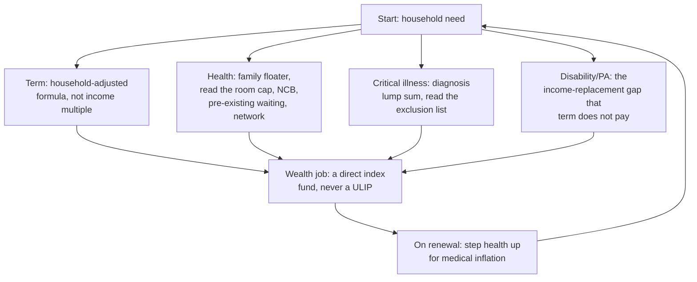

# P2P Lending in India

*Framework, Expected Loss, Due Diligence, Recovery & Tax (Deep)*

> The definitive educational treatment of RBI-regulated peer-to-peer lending: how the 2025 framework works, how returns are generated, expected-loss and loss-given-default math, platform underwriting, recovery, tax treatment, and a portfolio stress test.

Audience: Advanced investor considering P2P as part of a credit sleeve. Version 1.0, 2026-10-16.

## Introduction

P2P is not a 'safe high-yield' instrument. This book explains the mechanism, the math, and the failure modes so a reader can decide deliberately, not by headline yield.

## Contents

1. P2P Lending in India: Framework, Expected Loss, Due Diligence, Recovery & Tax
2. Fixed Income in India: Bonds, YTM, Duration, Credit & Sovereign Debt
3. Insurance & Risk Protection: Term, Health, Critical Illness & Mis-selling

---

# P2P Lending in India: Framework, Expected Loss, Due Diligence, Recovery & Tax

Peer-to-peer (P2P) lending is the only retail investment in India that puts you, personally, on the other side of a private loan: you are the lender, the platform is the marketplace, and the borrower is an individual or a small business that no bank would underwrite cheaply. The reward is a yield above deposit and G-sec rates; the cost is **unsecured-or-weakly-secured credit risk that you bear personally, with no deposit-insurance backstop and no secondary market.** This article walks the full stack: the RBI framework (as consolidated in the 2025 Directions), how the return is actually generated, the expected-loss math with a three-scenario stress test, a platform due-diligence checklist, the recovery reality, the tax treatment, and the sizing rule that keeps P2P a sleeve instead of a strategy.

## How P2P lending works in India

- **You (lender) fund loan tickets** on the platform; each ticket is a loan to one borrower at a stated interest rate and tenure.
- **The platform charges on both sides** — a commission from the borrower and a fee from the lender — and from the platform's **total commission historically has been capped at 5% of the ticket size plus a service fee** (verify the exact fee structure in the 2025 consolidated text; this is the regime carried over from the earlier direction).
- **Every P2P platform is a Non-Banking Financial Company (NBFC) that must hold RBI registration** — the registration number is on rbi.org.in's registered-entity list and on the platform's own disclosure. **P2P is not a bank scheme: lender money is not insured by DICGC deposit insurance.** The ₹5L-per-depositor-per-bank protection does not reach you; your "insurer" is the platform's underwriting and your own diversification.

### The 2025 consolidated framework

The **RBI (Non-Banking Financial Companies – Peer to Peer Lending Platform) Directions, 2025** (RBI/DOR/2025-26/370, notified 28 November 2025) [src-rbi-p2p-directions-2025](../p2p-lending/p2p-lending-complete.mdx) consolidated the earlier P2P directions into a single current framework; the **full text** [src-rbi-p2p-master-pdf](../p2p-lending/p2p-lending-complete.mdx) is where the caps and prudential norms live. What the regime has carried since the original 2017 direction, in structure:

- **Credit-score-based lending is the core.** Roughly **75% of a platform's loan book must be sanctioned on bureau credit scores**, and **up to 25% may go through a self-assessment route** for borrowers without a clean bureau file. The self-assessment slice is structurally riskier — the risk is underwritten on income documents instead of a credit history — which is why the regime caps its share. *Verify the current 75/25 split and caps against the 2025 consolidated text before republishing.*
- **Borrower caps.** There is a **per-borrower ticket-size cap (₹25L), an exposure limit per lender, and a per-platform total-book limit** in the regime. *The ₹25L per-borrower cap is the known structure from the 2017 direction; verify it against the 2025 consolidated text before quoting it as current.*
- **Lenders must be registered with the platform's RBI entity;** the platform must hold lenders' money in a **trust/custodian account** and meet prudential and disclosure norms.

The consolidation matters practically: a platform that was operating on a 2019-era reading of the rules is now operating on the 2025 Directions. Read both source links above before you commit capital to any platform.

## How the return is generated: spread, not magic

The P2P yield is a **credit spread over bank prices**: the borrower pays more than a bank would (the bank's credit underwriting and deposit funding are absent), and you capture that spread net of the platform's two-sided fee and your idle-cash time. Against the fixed-income stack: a G-sec or bank FD earns the *risk-free-plus-bank-credit* price (the RBI repo was near 5.25% through late 2025 — verify the current rate; that level anchors the whole deposit/bond curve); a corporate bond earns sovereign + credit spread; a P2P loan earns sovereign + bank spread + **retail-credit spread**, the last term being the widest and most volatile.

The advertised P2P rate is usually in the **12–15% band**. Advertised ≠ realized. The bridge is the **expected-loss formula**:

$$EL = PD \times LGD, \qquad \text{Expected net} = \text{Gross coupon} - EL$$

where $PD$ is the annual probability a loan in the book defaults and $LGD$ (loss given default) is the share of the ticket you lose when it does (after partial recovery).

### Worked stress test: 300 loans, ₹25,000 average ticket

Portfolio: 300 loans, average ticket ₹25,000 (₹75L deployed), gross coupon 12%, **PD = 4%, LGD = 60%**.

$$EL = 0.04 \times 0.60 = 0.024 = 2.4\% \quad\Rightarrow\quad \text{Expected net} = 12\% - 2.4\% = \mathbf{9.6\%}$$

Note the arithmetic explicitly, because a common error is to compute "expected net" as $12\% - 4\% = 8\%$ (charging the full PD as a loss) or to quote the gross 12% as if defaults didn't happen. The expected loss is PD **times** LGD — a defaulted loan still recovers 40% on average, so each default-year costs 2.4% of the book, not 4%.

**Before** platform fee, idle-cash drag, and operational costs. After a ~1–2% all-in fee/idle-cash drag, the realistic *expected* net sits in the high-single-digit to low-double-digit zone, not the advertised band.

**Three-scenario table** (gross 12%; severe scenario widens both PD and LGD — in a bad year, *more* loans default **and** recoveries worsen, so LGD rises from 60% to 80%):

| Scenario | PD | LGD | EL = PD × LGD | Expected net (before fees/idle cash) |
|---|---|---|---|---|
| Mild (easy credit cycle) | 2% | 60% | 1.2% | 10.8% |
| Base (steady underwriting) | 4% | 60% | 2.4% | 9.6% |
| Severe (cycle stress, correlated defaults) | 10% | 80% | 8.0% | 4.0% |

Read the severe row cold: a 4 pp jump in the advertised-style band (12% → 4.0%) from one bad credit cycle. That is the number that should sit next to any P2P pitch deck in your head.

## Platform due-diligence checklist (run it on every platform, every year)

1. **RBI registration.** Confirm the NBFC-P2P registration number on the **rbi.org.in registered-NBFC list** — not on the platform's website, on the RBI's list. A platform that can't produce its registration number is not operating inside the 2025 Directions.
2. **"Guaranteed" wording is a red flag.** No regulated P2P product can guarantee returns; the 2025 framework contemplates loss to the lender. The word "guarantee" on a P2P page means the seller doesn't understand the instrument (the same anti-pattern the [fund anti-list](../mutual-funds/mf-choosing-comparing-funds.mdx) documents for funds).
3. **NPA / default disclosure.** The platform should publish its own book's NPA rate, bucket aging (30/60/90 days past due), and recovery rates. If the disclosure is absent, that absence is the due-diligence answer.
4. **Recovery mechanism.** How are secured tickets recovered? For secured loans: legal action and **possession/recovery of the security**, with the lender (you) as the secured party or the platform acting under the framework's norms. Read what the *next step* is after a 90-day NPA: demand letters, repossession, auction, litigation. Each step has a cost and a clock.
5. **Tenure distribution.** A book of 6-month consumer EMI loans behaves very differently from a book of 3-year business-term loans. Longer tenures carry more embedded default windows *and* more idle time between tickets.
6. **Borrower mix: individual vs business.** Individual-consumer EMIs have higher PD but better recovery data; business-term tickets have lower PD on bureau screens but LGD that depends on a small business's asset base. The split is a risk you are buying in one number's clothing.
7. **Fee math, both sides.** Compute your *actual* net: gross coupon − lender fee − any service fee − idle-cash drag. If the platform can't show the all-in figure, don't assume it.
8. **Trust/custodian account.** Confirm lender funds sit in the mandated trust account, not the platform's operating bank account.

## Liquidity & recovery: the pattern, not the promise

- **There is no secondary market.** You cannot sell a P2P ticket to another investor at a quoted price; your exit is either (a) waiting for the EMI to mature or (b) the loan defaulting and entering recovery. Liquidity, in the fixed-income sense, is **zero** ([the fixed-income article](../fixed-income/fixed-income-bonds-credit.mdx) contrasts this with G-sec/dealer-quoted markets).
- **Recovery for secured loans runs through legal/possession channels** — demand, repossession, auction or court process. **A 6–18 month recovery clock is the observed pattern, not a guarantee:** some secured tickets recover in months, some run to years, and the *amount* recovered (LGD in reverse) varies with asset type and jurisdiction. Treat 6–18 months as the median you should plan around, and plan cash flow to survive 24.
- **Idle cash is a return tax you can't see.** Between receiving one ticket's cash and deploying it in the next, capital sits at near-zero. In a thin-ticket platform, idle time can cost you a meaningful fraction of the expected net every year. Ask the platform for its **idle-time statistic**; if it's undisclosed, shave 1–2 pp off the expected net.

## Tax treatment

- **Interest is income, taxed at your slab rate** under the [FY 2025-26 slabs] [src-it-slab-fy2025-26](../p2p-lending/p2p-lending-complete.mdx) (new regime default; old regime optional). A ₹1L P2P coupon in a 30% slab is ~₹70,000 after tax — recompute every P2P "yield" at your slab before comparing it with a tax-free PPF or a post-tax G-sec coupon.
- **No Section 80C claim** on P2P lending. The ₹1.5L 80C cap does not stretch to P2P; do not let a platform imply otherwise.
- **TDS is not typically deducted** on P2P interest — *verify with a tax professional and against current TDS practice before you file*; the absence of a TDS line on your Form 26AS does not mean the income is unreportable.
- **Lender eligibility:** individuals, HUFs, and companies can lend; the HUF route is commonly used for tax-planning and is *only* valid for a genuine HUF (document it properly; a sham HUF is an income-tax risk).
- **Reporting:** P2P income is business/other income; your platform's statements are your books. The [tax article](../taxation/tax-india-investor-complete.mdx) has the regime-by-regime structure.

## Why advertised yields are not what you earn

Even in the mild scenario, five frictions separate the banner number from your realized number:

1. **Idle cash** — the time your money spends between tickets earning ~0%.
2. **Concentration** — a book tilted to one sector (e.g., unsecured business-term loans in one industry) means *correlated* defaults: the PDs stop being independent, and the $EL = PD \times LGD$ average understates the tail. One bad sector quarter can push that book's effective PD toward the severe scenario's 10% even when the platform advertises "4%."
3. **Correlated defaults** — economic downturns hit borrower cash flows at once; independent-PD math assumes they don't.
4. **Platform operational risk** — the party holding your recovery process. A platform that stumbles mid-recovery stalls your LGD realization; you are underwriting the operator, not just the borrowers.
5. **Fees** — the two-sided commission erodes the gross on every ticket.

None of these are disclosed on the landing page. They are the difference between "12–15%" and the 4.0% severe-scenario row above.

## Regulated vs unregulated: where P2P ends

The 2025 Directions cover **NBFC-registered P2P platforms**. What lives outside:

- **Unregistered "P2P" or crowd-lending sites** — no RBI registration, no prudential norms, no NPA disclosure. The borrower caps that protect registered platforms don't bind them. Verify the registration before the platform's name enters your portfolio.
- **Deposit-taking schemes** — any scheme that *pays you* a return on *your deposit* (rather than on loans you lend) is a deposit, and unregistered deposit-taking is illegal in India; a "P2P"-branded scheme that behaves like a bank account without a banking licence is outside the framework entirely.
- **"Gold loan" and unsecured-advance scams** — a scheme promising 12–15% for "parking gold" or an unsecured advance with weekly payouts is the unregulated-sound-of-P2P: the promised yield with no borrower risk you can see and no recovery you can enforce. The [fixed-income article](../fixed-income/fixed-income-bonds-credit.mdx) covers where genuine sovereign-curve yields actually sit; anything far above that is selling credit risk to you in disguise.

## The sizing rule

**P2P belongs at ≤ 10–15% of the total investment portfolio, and only with money you will not need for the loan tenures.**

- At 12.5% of portfolio, a *total* loss of the P2P sleeve (the severe extreme, not the expected loss) costs 12.5% of the household's capital — painful, survivable. At 50%, it's a life event.
- The sleeve's tenures set your *liquidity need horizon*: if your tickets are 1–3 years, that money is out of your liquidity pool for 1–3 years — so the sleeve must sit inside the portfolio's "money I won't touch for 3+ years" bucket, never in the emergency layer.
- **Stress-test before sizing:** run the three-scenario table above at your platform's *actual* gross coupon and its disclosed (or assumed) PD/LGD, and require that the severe-scenario net stays positive before the sleeve earns its size. The DhanPedia **P2P stress-test calculator** (companion tool on this site) takes gross coupon, PD, LGD, idle-time %, and fee % and prints the three-scenario net — the same arithmetic as the table, parameterised for your platform.

## What to do when a ticket defaults: an operational playbook

The default is not the failure — the *response* is. A pre-written playbook is the single highest-leverage thing a P2P lender can own, because it is what actually determines your realised LGD. The stages, in the order a secured ticket typically moves through:

1. **Missed EMI → 30-day NPA bucket.** The platform issues demand notices. Your job as the lender: confirm the platform *is* issuing them (a NPA-aged bucket with no demand trail is a platform-disclosure failure, and an early warning on the platform, not just the borrower).
2. **60–90-day NPA.** Legal notice; for secured tickets, the platform begins repossession/auction preparation. You should now know, *for your specific tickets*, what the security is (the asset type, the jurisdiction, the encumbrance status) — a secured loan to a business whose security is a *second* charge on a property already mortgaged to a bank is a recovery you are much less likely to realise, because the senior bank gets paid first from the asset's sale.
3. **90-day NPA / formal default.** The ticket is classified as a loss-in-wait. At this point the *realised* recovery is what the severe scenario's LGD = 80% is describing: the asset is in the process of being realised, but the sale price in a stressed market is typically far below the outstanding principal.
4. **Realisation (6–18 months, observed pattern).** The security is auctioned or the borrower settles for a discounted amount. The gap between the ticket's outstanding and the realised amount is your *real* LGD. This is where the three-scenario table's severe row (4.0% expected net) lives — the LGD *widens* in a bad year, which is exactly why the severe scenario couples a higher PD with a higher LGD rather than treating them independently.

**The lender's own levers inside the playbook:** (a) *ticket-level concentration* — holding the same borrower across multiple tickets does not diversify; it is one credit decision repeated, and the PD/LGD of that one borrower is all that matters; (b) *security type* — first-charge, moveable-asset secured tickets (e.g., a registered first charge on the specific asset pledged) recover more than second-charge or unsecured ones, and the platform should label which is which; (c) *jurisdiction* — repossession and auction timelines vary by state and court, so a ticket's recovery clock is partly a *geographic* property, not just a credit property.

None of these levers can make a bad borrower good; they can make your *share* of the loss smaller. That is the honest function of the playbook: you cannot prevent the default, you can only manage what you lose when it arrives.

## Diversifying across the book: ticket-level rules

The three-scenario table assumes a *single blended* PD and LGD for the whole book. A real book is not blended; it is a population of tickets with different PDs and LGDs, and the *correlation* between their defaults is the number that decides whether the blended math is even the right model. Practical diversification rules, in order of importance:

1. **Spread across borrowers, not across platforms.** The correlation risk is in the *borrower population* (one sector hit defaults a cohort at once). Holding 300 tickets on 300 different borrowers in one book is diversification; holding 30 tickets on 10 borrowers (3× each) is not, even if the platform shows you 30 "loans."
2. **Watch the sector and geography mix of the book.** A book where 60% of tickets are in one industry or one metro is one *credit decision* with a fee on it, not 60% diversification. The platform's own borrower-mix disclosure (checklist item 6) is where this lives.
3. **Match the tenures to your liquidity horizon.** The [sizing rule](#the-sizing-rule) caps the sleeve; the tenure distribution *inside* the sleeve sets the *liquidity* of the sleeve. A book of 6-month consumer EMIs is far more liquid (tickets mature and redeploy fast) than a book of 3-year business terms, and that liquidity has its own cost — the consumer book carries a higher blended PD.

The expected-loss formula generalises to a multi-ticket book:

$$\text{Portfolio } EL = \sum_{k} w_k \cdot PD_k \cdot LGD_k$$

with $w_k$ the weight of ticket $k$. The *expected* portfolio loss is the weighted sum, but the *actual* loss is governed by how many $k$'s default *together*, which the sum cannot see — that is the correlation gap, and it is why the severe scenario, not the base, is the number to stress against.

## Related

- [Fixed Income in India: Bonds, YTM, Duration, Credit & Sovereign Debt](../fixed-income/fixed-income-bonds-credit.mdx) — the opposite end of the credit spectrum: what a *priced* credit risk looks like when it is sovereign or corporate.
- [Your 10 Lakh Wealth Plan](../personal-finance/pf-wealth-plan-10-lakh.mdx) — where the P2P sleeve sits in the overall allocation and risk grading.
- [How to Choose and Compare Mutual Funds](../mutual-funds/mf-choosing-comparing-funds.mdx) — the same due-diligence discipline (cost, structure, anti-patterns) applied to the managed side of investing.

## Sources

- `src-rbi-p2p-directions-2025` — RBI (NBFC – P2P Lending Platform) Directions, 2025 (RBI/DOR/2025-26/370, notified 2025-11-28): consolidated P2P framework; registration, prudential and disclosure norms.
- `src-rbi-p2p-master-pdf` — full text of the 2025 Directions: ticket-size and borrower caps, 75/25 credit-score split (verify current values against this text).
- `src-it-slab-fy2025-26` — FY 2025-26 income-tax slab structure (new regime default; old regime optional), for the at-slab-rate taxation of P2P interest.

## Update log

- **2026-08-06** — last verified. (a) The 75% credit-score / 25% self-assessment split and the ₹25L per-borrower cap are the structure from the 2017 direction carried into the 2025 consolidation — **verify the current caps against the 2025 consolidated text** before republishing. (b) The "total commission cap historically 5% of ticket size + service fee" is the historical regime; verify the current fee structure in the 2025 Directions. (c) P2P's comparative "spread over bank rates" is anchored to the repo rate near 5.25% (late 2025, verify current value against the latest RBI MPC). (d) The 6–18 month recovery window is an observed pattern, not a promise — re-check against platform NPA disclosures annually. (e) TDS practice on P2P interest: verify with a tax professional each year.

## Sources & Citations

- **Reserve Bank of India** — RBI (Non-Banking Financial Companies – Peer to Peer Lending Platform) Directions, 2025. https://www.rbi.org.in/Scripts/BS_ViewMasDirections.aspx?id=12934 (verified 2026-08-06)
- **Reserve Bank of India (via PDICAI host)** — RBI P2P Lending Platform Directions, 2025 — full text (RBI/DOR/2025-26/370). https://www.pdicai.org/Docs/RBI-DOR-2025-26-370_24122025161753415.pdf (verified 2026-08-06)
- **Income Tax Department / Union Budget 2025** — Income-tax slabs, new regime, FY 2026-27 (AY 2027-28) - unchanged from the Budget 2025 reset. https://www.indiabudget.gov.in/doc/Finance_Bill.pdf (verified 2026-10-16)

---
Educational content, not individualized investment, tax, accounting, or legal advice.
Author: Chirag Singhal. DhanPedia.

---

# Fixed Income in India: Bonds, YTM, Duration, Credit & Sovereign Debt

Fixed income is the side of investing where the price of risk is visible *before* you buy, if you know the two numbers to look at: **yield** (what you earn) and **duration** (how much you lose when yields rise). Most Indian investors hold "debt" as fixed deposits or debt funds and never see those two numbers. This article builds the full stack: bond pricing, YTM, duration and convexity, credit ratings and spreads, the five distinct risks a bond carries, how to reach sovereign debt, which income is taxable and which is not, and a laddering example. The goal is that you can read a bond quote — or a debt fund fact sheet — and price the risk yourself.

## Price vs yield: the inverse relationship

A bond pays a fixed stream of coupons plus face value at maturity. Its price is the present value of that stream:

$$P = \sum_{t=1}^{n}\frac{C}{(1+y)^t} + \frac{F}{(1+y)^n}$$

where $C$ is the annual coupon, $F$ the face value, $n$ the years to maturity, and $y$ the yield per period. The relationship is inverse and convex: **when yields rise, prices fall; when yields fall, prices rise** — and for the same yield move, a long-dated bond moves more than a short-dated one. The intuition: a bond's coupons are fixed. If new money can earn more, nobody will hold your old low-coupon bond at par; you can only sell it *cheap enough* that its price delivers the new, higher yield to the buyer.

The consequence that destroys most naive bond investors: **a bond held to maturity does not lose money** (if the issuer doesn't default) — its *mark-to-market* value does. If you plan to hold, the yield is your number; if you may need to sell early, the duration is your number.

## Worked example: pricing a 7% coupon bond when the market wants 6.5%

A 10-year bond, face ₹100, coupon 7% (₹7/year). The market's required yield is 6.5%. Since the coupon (7%) exceeds the yield (6.5%), the bond must trade at a **premium** — above ₹100. The full DCF:

| Year | Cash flow | PV factor @ 6.5% | PV (₹) |
|---|---|---|---|
| 1 | 7.00 | 0.93897 | 6.573 |
| 2 | 7.00 | 0.88166 | 6.172 |
| 3 | 7.00 | 0.82785 | 5.795 |
| 4 | 7.00 | 0.77732 | 5.441 |
| 5 | 7.00 | 0.72988 | 5.109 |
| 6 | 7.00 | 0.68533 | 4.797 |
| 7 | 7.00 | 0.64341 | 4.504 |
| 8 | 7.00 | 0.60414 | 4.229 |
| 9 | 7.00 | 0.56727 | 3.971 |
| 10 | 107.00 | 0.53266 | 56.994 |

Coupon PVs sum to ₹50.32; principal PV is ₹53.27; **price = ₹103.59** — a 3.59% premium over par. The premium is exactly what a buyer gives up: they pay ₹103.59 for a stream worth only ₹107.00 in 10 years, and that difference is the 0.5 pp of coupon income *below* market.

**Yield to maturity (YTM)** is the single rate $y$ that makes this equation balance given the *price you actually pay*. If you bought this bond at par (₹100), its YTM would be 7%. If you bought it at ₹103.59, its YTM is 6.5% — the rate that justifies your price. YTM is the bond's internal rate of return, and it assumes the coupon reinvests at the same rate (the reinvestment risk discussed below). It is the number to compare across bonds *of the same credit quality and maturity*; comparing a 2-year YTM against a 10-year YTM tells you almost nothing, because duration dominates.

## Duration and convexity

**Macaulay duration** is the PV-weighted average time until cash flows arrive — in one sentence, "the maturity you actually experience." **Modified duration** converts it to a price sensitivity:

$$\text{Macaulay} = \frac{\sum_{t} t \cdot PV(CF_t)}{P}, \qquad \text{Modified} = \frac{\text{Macaulay}}{1+y}$$

A 1 pp rise in yield moves price by approximately $-D_{mod} \times 1\%$.

### Worked: a 10-year, 8% coupon bond at 8% YTM (par)

When coupon = YTM, the bond prices at par, so each PV is simply the coupon discounted at 8%; the weighted sum:

| Year | Cash flow (₹) | PV of CF @ 8% | t × PV |
|---|---|---|---|
| 1 | 8.00 | 7.407 | 7.407 |
| 2 | 8.00 | 6.859 | 13.717 |
| 3 | 8.00 | 6.351 | 19.052 |
| 4 | 8.00 | 5.880 | 23.521 |
| 5 | 8.00 | 5.445 | 27.224 |
| 6 | 8.00 | 5.041 | 30.248 |
| 7 | 8.00 | 4.668 | 32.676 |
| 8 | 8.00 | 4.322 | 34.578 |
| 9 | 8.00 | 4.002 | 36.018 |
| 10 | 108.00 | 50.025 | 500.245 |

Price = ₹100.00 (check: the PVs sum to 100.00). $\sum t \cdot PV(CF_t) \approx 724.69$, so:

$$\text{Macaulay duration} = \frac{724.69}{100} \approx 7.25 \text{ years}$$

$$\text{Modified duration} = \frac{7.25}{1.08} \approx 6.70 \text{ years}$$

Two honest notes. First, many quotes floating around call this bond's duration "about 6.7" without saying which kind — that 6.7 is the *modified* duration (6.70), not Macaulay's 7.25. The two are routinely conflated, and if a source calls 6.7 "Macaulay" it has mixed the definitions. Second, the year-10 line dominates: ₹500.2 of the ₹724.7 weight sits in the final year (it is also the only year with a principal payment), which is why a 10-year par bond's duration (~7.25) is much less than its maturity (10) but far more than the timing of its coupons alone would suggest.

**Convexity** is the second-order effect: for the same yield move, a convex bond falls *less* on the way down and rises *more* on the way up than the straight-line duration estimate. When rates move more than ~1 pp, duration alone materially misstates your loss; convexity corrects it. A concrete illustration of why the correction is not optional: take the 10-year, 8% par bond (modified duration 6.70, convexity on the order of 45–55 for a 10-year annual bond — compute it from the PV-weighted $t(t+1)$ terms if you need the exact figure for *your* coupon and face). For a **+200 bp** move, the duration-only estimate is $-6.70 \times 2\% = -13.4\%$. The convexity term adds $\tfrac{1}{2} \times 50 \times (0.02)^2 \approx +0.5\%$ of *upside* you would otherwise miss when yields fall, and *reduces* the downside by a similar margin when yields rise. So a +200 bp drop in yields is not a clean $-13.4\%$ loss; the true loss is a few bps less, and a $-200$ bp fall in yields is a few bps *more* of a gain than $+13.4\%$. For most retail decisions, duration is 90% of the story and convexity is the refinement; for big ladders or > 150 bp moves, the convexity term moves the answer by more than a rounding error, and you should not skip it.

## Credit ratings, spreads, and what they are good for

Indian bond credit ratings run from **AAA (highest) down to C (lowest)**, assigned by the SEBI-registered rating agencies. The market prices the gap between a rated bond and the sovereign curve as a **credit spread**:

$$\text{Credit spread} = \text{Bond YTM} - \text{YTM of comparable-maturity G-sec}$$

The *level* of spreads changes with the credit cycle (they widen when banks and corporates get stressed), so no fixed "AAA spreads X bps, BBB spreads Y bps" table is a reliable reference — treat any such table you find as a snapshot of one quarter. What is durable is the *shape*: spreads widen steeply as you move down the rating scale, and widen sharply again within any category during stress periods. A BBB issuer's spread can approach triple-digit bps on weak quarters, while an AAA-P (public-sector) issue typically trades within a modest band of the sovereign curve.

**Rating agencies lag, and you must price that lag.** Ratings are point-in-time opinions on an *issuer's* balance sheet. The durable facts: (a) a rating is affirmed, not monitored daily; (b) downgrades are backward-looking — by the time a rating falls two notches, the price has usually already moved; (c) two agencies can rate the same issuer differently; (d) a rating tells you default *probability* is low at today's balance sheet, not that nothing has changed in the next five years. For a long bond, **the spread you underwrite is more honest than the rating you inherit**, because the spread is where the market's forward view lives.

## The five risks a bond actually carries

Every bond carries five distinct risks, and most investors only track one:

1. **Interest-rate risk.** Yields rise → price falls. Magnitude: modified duration (worked above). A 10-year par bond with modified duration 6.70 loses roughly 6.7% of price for a +100 bp yield move (ignoring convexity, which is small at that size). This risk is zero only at maturity.
2. **Credit risk.** The issuer fails to pay. Magnitude: the credit spread you were paid — you were underpaid for it only if you bought at par when the spread was tight. Ratings lag; spread is the live number.
3. **Reinvestment risk.** The coupon comes back and must be reinvested, possibly at a lower rate. This is the *mirror* of rate risk: it punishes short-duration investors when rates fall, and it is why "high-coupon short bonds" are not the safe havens they look. A 10-year, 10% coupon bond in a falling-rate world pays 10% for a year, then forces you into a 5% world.
4. **Inflation risk.** Fixed nominal cash flows lose purchasing power. Only long government bonds with indexation or a gold-pegged instrument hedge it; a nominal coupon does not.
5. **Liquidity risk.** The cost of selling before maturity in a thin market. G-sec and major corporate bonds have daily dealer quotes; a small corporate issue or a retail-only issue can trade at a 20–50 bp discount to a comparable liquid quote, and the discount widens when you are the one selling.

Each risk is hedges-able by a *different* instrument; conflating them (e.g., calling a 10-year FD "safe" while ignoring reinvestment and duration-by-holding-period risk) is how fixed income goes wrong.

## Government access routes: G-sec, SDLs, and the credit/rate split

The **risk split that matters**: a government bond has *zero credit risk* (sovereign, and the currency it is issued in) but *full interest-rate risk*. A corporate bond has *both* — credit spread on top of the same rate risk. The access routes:

- **G-sec (government securities)** — bought directly via a demat account through the *Retail Direct* route at auction, or held through a G-sec-only fund. This is the purest sovereign instrument: you own the bond, coupon is paid to your bank, and redemption is at par on maturity.
- **SDLs (state development loans)** — state-government bonds, auctioned weekly by the RBI (states are the borrowers; you buy via the same retail route as G-sec). SDLs carry a small sovereign *state* premium over the central-government curve and slightly different maturity ladders; the extra yield is the compensation for that extra — very small — sovereign risk.
- **Debt funds** — a fund of corporate and/or G-sec portfolios. Two risks split into two buckets: the *fund's* portfolio has credit risk (corporate issues) *and* duration risk; a G-sec-only debt fund isolates to duration risk only. When you "buy a debt fund" you are buying a manager's duration-and-credit mix; the fund's fact sheet should disclose its average maturity, and that number — not the fund name — is your interest-rate-risk number.

Which route: **direct G-sec/SDL** when the horizon matches a ladder rung and you want zero credit risk; **debt fund** when you want professional active duration and are willing to pay for credit quality management. The [P2P article](../p2p-lending/p2p-lending-complete.mdx) is the other end of the credit spectrum — unsecured individual loans with no sovereign backstop at all.

## Taxable vs tax-free fixed-income income

The Indian investor's fixed-income income is one of three structures, and the tax treatment changes the *effective* yield:

- **Taxable coupons.** Most bond interest (corporate bonds, G-sec coupons, most debt funds' distributions, bank deposits) is taxed **at your slab rate** when received. A ₹1L of 8% bond interest in a 30% slab is worth only ~₹56,000 after tax — a real yield of 5.6%. The [income-tax slab article](../taxation/tax-india-investor-complete.mdx) has the FY 2025-26 slab structure ([src-it-slab-fy2025-26](../fixed-income/fixed-income-bonds-credit.mdx)); slab rates are time-sensitive and should be re-verified against the current slabs each year (last verified 2026-08-06).
- **Tax-free savings-instrument income.** PPF (Public Provident Fund) and SSY (Sukanya Samriddhi Yojana) interest is exempt from tax *by design* — the entire instrument is a tax-exempt corpus, not a taxable coupon. The effective yield on a tax-free instrument at your slab equals its face yield; on a taxable instrument it equals the face yield × (1 − slab rate). A PPF at ~7% (rate time-sensitive; verify current) in a 30% slab is worth, in after-tax terms, roughly the yield of a taxable 10% instrument — and PPF has no interest-rate risk because its rate is fixed for the instrument, not the market.
- **SGB-style (sovereign-gold-bond) instruments.** While the Sovereign Gold Bond scheme was in operation, it offered a sovereign-gold exposure with tax-exempt redemption — a *tax-free gold* position. New SGB tranches have paused at various points; the current status is time-sensitive (verify before citing a "current" SGB offering). The pattern to remember: **a sovereign instrument can be tax-free on the instrument's own cash flows**, which is a real advantage over a taxable gold fund's LTCG treatment.

The practical consequence: **when comparing fixed-income returns, compare after-tax, same-slab yields, not face yields.** A 7% tax-free PPF in a 30% slab beats an 8% taxable bond on after-tax yield — and has no duration risk on top.

## The yield curve and why maturity matters

Bond yields are not one number; they are a **curve** — a yield for every maturity, from a 91-day bill to a 30-year G-sec. The curve's *shape* (an upward-sloping normal curve, or an inverted one) is the market's forward view on rates, and it is the background against which every credit spread is read. Two consequences for the Indian investor:

- **A 1-year G-sec and a 10-year G-sec are different risk instruments even though both are "sovereign."** The 1-year carries negligible duration risk (a +100 bp move barely moves a 1-year bond's price); the 10-year carries a lot. The 10-year's higher coupon is *mostly* compensation for that duration, not for any credit improvement — there is none, both are sovereign. So "a 10-year G-sec pays more" is not a free lunch; it is a market bet that rates will not rise over the next decade, and the duration section above is how you price that bet.
- **The curve's level is anchored to the RBI policy rate** (repo was near 5.25% through late 2025 — verify the current value against the latest RBI MPC; the whole curve rides up and down with it over time). When you buy a G-sec ladder, you are underwriting both the *level* (which is time-sensitive and set by the auction) and the *shape* (which you cannot predict). The ladder's total return is the sum of the coupons earned, the curve moves, and the reinvestment outcomes — three unknowns, and the ladder's value is that it turns the third into a small, known stream of decisions rather than one big unknown.

A short-maturity instrument (≤ 1 year) in a falling-rate environment simply *does not participate in the price rally* the way a long G-sec does — its duration is too small. This is the cost of "safety": the safest fixed-income instrument is also the one that loses the most when the bond market rallies. There is no free version of either.

## Reading a bond quote (where the two numbers actually live)

A dealer or auction quote for a G-sec or corporate bond is typically printed as a **yield** (not a price), and the price is computed from it by the formula at the top of this article. The two numbers you have extracted from the quote — **YTM** and **duration** — are what you compare:

- **YTM** is the number you *earn* if you hold to maturity and reinvest coupons at the same rate. It is the comparison number across *like* instruments (same credit, same maturity).
- **Duration** is the number you *lose* if you sell early in a rising-rate world. It is the comparison number for *deciding whether you will actually hold to maturity*.

Most Indian retail access (G-sec retail route, a G-sec fund, a corporate bond) shows you the **yield**; the duration you must compute or read off the instrument's stated maturity (a par G-sec's duration is its Macaulay duration at par, worked in the example above, roughly a fraction of its maturity). A 10-year G-sec quoted at a 7% YTM with a duration of ~7.2 is a *rate-risk instrument* priced at 7%; a 1-year G-sec quoted at 6% with a duration of ~0.95 is a *near-cash* instrument. The yield difference between them (100 bp) is, roughly, the market's annual price for holding the extra ~6.2 years of duration. Whether that 100 bp is a good trade *for you* depends entirely on whether you actually have 10 years to wait — which is a goal-ladder question, answered in the [SIP article](../mutual-funds/mf-sip-swp-stp-goals.mdx), not a bond question.

## When bonds make sense — and when FDs/debt funds suffice

The honest mapping:

- **Horizon < 3 years, money must not lose value** → a bank deposit or a short-duration G-sec/SDL rung. The duration risk of a 3-year+ bond exceeds your horizon; you are paying for risk you will never be able to wait out.
- **Horizon 3–10 years, stable income, low credit tolerance** → a G-sec/SDL ladder (the next section). No credit risk, known coupon dates, no fund-manager risk.
- **Horizon > 10 years, inflation tolerance, higher yield demand** → a corporate bond ladder or a G-sec + corporate mix, *with* a duration number you have computed (not inherited).
- **No fixed income at all, pure FD** → a short-duration G-sec fund is almost always the better instrument: same duration, a cleaner tax event at maturity, and the RBI-auction route removes the FD's principal-risk.

**A fixed-income ladder example.** Suppose you need a stable ₹1L/month retirement income over 10 years, with the first 3 years' income from G-sec, and you hold the ladder in 1-year, 3-year, and 5-year rungs:

- **Rung 1 (0–1 yr):** a 1-year G-sec/SDL at auction, yield ≈ the 1-yr point on the curve (the curve's level is time-sensitive — the RBI repo rate was near 5.25% through late 2025, (verified 2026-08-06); the 1-yr G-sec typically sits a small premium above repo; verify the current auction yield before sizing this rung).
- **Rung 2 (1–3 yr):** 3-year G-sec, a slightly longer duration; the coupon for years 1–3 is locked at the 3-yr curve's yield.
- **Rung 3 (3–5 yr):** 5-year G-sec; the maturing coupon from Rung 1 and Rung 2 is *reinvested into the next rung at that rung's then-current yield* — this is where reinvestment risk lives, and it is exactly why the ladder's total income is *not* fixed: the 1-yr rung's maturity income is reinvested at a rate you do not know today.

The ladder's **duration is short** (the effective duration is the PV-weighted average of the rungs, well below the longest rung's duration), and its **credit risk is zero** (all sovereign). The trade: you are paid a lower yield than a single 10-year bond because you have sold the long-duration risk. That is the whole of laddering: *a known income stream, built from short, credit-free, sovereign instruments, at the cost of the long-end yield.*

## Related

- [Your 10 Lakh Wealth Plan](../personal-finance/pf-wealth-plan-10-lakh.mdx) — where the fixed-income sleeve sits in a full allocation.
- [SIP, STP & SWP: Structured Investing and Goal Planning](../mutual-funds/mf-sip-swp-stp-goals.mdx) — the goal-ladder method and the debt-bucket STP that feeds this article's laddering.
- [Portfolio Construction, Rebalancing & Risk Budgeting](../portfolio-construction/portfolio-construction-rebalancing.mdx) — how to set the fixed-income risk budget in the first place.

## Sources

- `src-rbi-repo` — RBI repo rate (≈5.25% through late 2025), time-sensitive; re-verify before any "current" repo claim.
- `src-it-slab-fy2025-26` — income-tax slab structure FY 2025-26; referenced for the "tax at slab" claims on coupons and debt-fund distributions.

## Update log

- **2026-08-06** — last verified. The repo-rate figure (≈5.25%, late 2025) is time-sensitive; re-verify against the latest RBI MPC before any "current repo" claim. The G-sec/SDL yields for the ladder example are illustrative — the *structure* is durable; the *levels* change with the auction. Credit-spread levels are deliberately not fixed to a number; the [SGB-style](#taxable-vs-tax-free-fixed-income-income) mention of Sovereign Gold Bond status is flagged "verify before republishing" — new SGB tranches have paused at various points. The duration worked example (10-yr, 8% coupon, 8% YTM → Macaulay ≈ 7.25, Modified ≈ 6.70) is arithmetic under annual compounding; a semi-annual compounding convention shifts both figures by a small fraction (and the bond's price stays at par by construction).

## Sources & Citations

- **Reserve Bank of India** — RBI MPC decision, 3-5 Aug 2026: repo held at 5.25%, neutral stance, SDF 5.00%, MSF 5.50%. https://www.rbi.org.in/SCRIPTs/BS_ViewBulletin.aspx?Id=24369 (verified 2026-10-16)
- **Income Tax Department / Union Budget 2025** — Income-tax slabs, new regime, FY 2026-27 (AY 2027-28) - unchanged from the Budget 2025 reset. https://www.indiabudget.gov.in/doc/Finance_Bill.pdf (verified 2026-10-16)

---
Educational content, not individualized investment, tax, accounting, or legal advice.
Author: Chirag Singhal. DhanPedia.

---

Insurance is one of the best-purposed and worst-understood categories in an Indian financial plan. Its job is a single, clean one: to transfer a specific, catastrophic, insurable loss from your household to an insurer in exchange for a small, certain cost. When you understand that, most of the confusion in this space — the product catalogue, the agent's pitch, the ULIP brochures, the "invest" and "protect" dual branding — dissolves, because those products are doing a different job than the one your plan actually needs. This article sizes the core covers, decodes the health-policy details that decide whether a claim actually pays, treats claims data honestly, and then goes through the mis-selling patterns one by one, because the single biggest source of insurance-related financial damage in India is not an under-covered claim — it is an over-priced, mis-sold, lock-in investment disguised as protection.

## The core principle: insurance transfers risk, it does not build wealth

The one-sentence version: *you pay a small, certain cost now to avoid a large, uncertain loss later.* That sentence defines the entire useful category of insurance — term life, health, personal accident, motor, property, travel. Every product that claims to *also* build wealth at the same time (ULIPs, endowment plans, money-back endowments, whole life) is doing two jobs with one cost structure, and the arithmetic of that two-job structure is the reason those products are almost always worse than the two separate, cheaper, simpler instruments: term for protection, a direct mutual fund for wealth.

The test for any insurance product: **if I remove the wealth-building claim, does the protection part still make sense at the price paid?** For a ULIP, the answer is no — the protection is a fraction of the premium, and the "investment" part is a mutual fund with a load, a surrender-charge table, and a 5-year lock-in stacked on top. The two pieces, bought separately (term at a fraction of the premium + a direct fund without the load), would cost less and leave you more liquid. That comparison is the entire mis-selling argument, and it is done in the ULIP section below.

## Term life: the cover that most Indian households actually need

### Sizing the cover: the formula

The working formula for term cover is:

$$\text{Term Cover} = (\text{Years to cover} \times \text{Annual Income}) + \text{Existing Liabilities} - (\text{Investable Assets} + \text{Other Income Sources})$$

In practice, for a working household head, this resolves to the common heuristic of **10–15× annual income** as the *order of magnitude*, then adjusted for:

- **Liabilities:** outstanding home-loan balance, education-loan balance, car loan. A ₹40L home-loan balance that you did not price into the cover is a ₹40L gap in the day the policy needs to pay out.
- **Dependants' years:** the cover is meant to replace *your income* to your dependants for a defined period — typically to the later of your spouse's age-60 retirement or your youngest child's independence (age 25). The "years to cover" in the formula is that window, not your full life expectancy; covering a 30-year-old to age 90 is overkill and overpriced.
- **Assets already in place:** a ₹30L EPF corpus, a ₹50L house (your own home), and a spouse's income offset the cover you need. The formula's subtracted term is *your investable assets that the household could liquidate in a crisis* — not your EPF, which is not liquid.
- **Existing term or other life cover:** if your employer gives you a group life cover of 50× your annual salary, that is *not* a substitute for personal term cover (the group cover dies with the employment), but it is a factor in your *personal* cover sizing for the years you are employed.

**Worked example (illustrative, not advice).** Age 32, household income ₹35L/year (your ₹25L + spouse's ₹10L), home-loan balance ₹30L, EPF ₹8L, no other significant assets, youngest child age 4, cover window to spouse's 60 (28 years):

$$\text{Cover} \approx 28 \times 25 + 30 - 8 \approx \text{₹742L}$$

The "10–15× income" heuristic on *your* income alone (₹25L × 10–15 = ₹25L–₹37.5L) undersizes the actual household need, because the formula counts the *years of dependancy*, not a multiple of one income. The gap between the heuristic and the household-adjusted number is where most Indian term plans are short. The 10–15× rule is a *starting filter*, not the sizing answer; the formula is.

### The premium you should expect

Term insurance is the cheapest meaningful protection you will ever buy. For a healthy 30–45-year-old Indian male or female, a ₹1Cr single-premium term policy costs, in most current market patterns, in the range of ₹1.5L–₹3L/year (a pattern, not a sourced constant — verify with current quotes; the rate has been moving down as underwriting has tightened and competition has widened the gap between insurers). The ratio of *premium to cover* is the number that tells you whether you are buying protection: a ₹2L premium for a ₹1Cr cover is a 0.2% annual cost for a risk that would otherwise be catastrophic. That ratio is what "insurance is cheap in the risk transfer sense" means, and it is the ratio the mis-selling pitch destroys by bundling in the wealth component.

## Health: the family floater and the claims question

### Structure

A **family floater** policy (two adults + up to four children, or the variant that includes both parents-in-law as optional) is the correct first purchase for most households, not four individual policies. The floater's *sum insured* is shared across the family per year (the standard market pattern: the floater pays the first claim up to the floater sum, and individual sub-limits per member apply after that — verify the specific policy's floater mechanics, because the design varies by insurer and by plan).

### The four details that decide whether a claim actually pays

- **Room and board cap.** The policy will pay *a cap* on the room, not the actual room. A ₹3,000/night cap in a metro city where a private room runs ₹8,000–₹15,000/night is a ₹5,000–₹12,000/night *out-of-pocket* gap on a 7-day stay — a gap that can exceed the policy's no-claim bonus for the entire year. A "₹10L cover" with a ₹2,000 room cap is not a ₹10L cover in the way you want it to be; it is a ₹10L cover that pays ₹2,000 for the room and the rest for the treatment. *Read the room cap before the sum insured.*
- **No-claim bonus (NCB).** Most policies add a percentage of the sum insured for each claim-free year (a common pattern: 10% per year, up to a cap of 50%, verify the specific policy). The NCB is the *only* mechanism by which a good claim history buys you a bigger cover. A policy that resets the NCB on *any* claim, no matter how small, is pricing your claim behaviour differently than one that only resets on claims above a threshold.
- **Pre-existing conditions.** A new policy will not cover a pre-existing condition in its first year (the standard waiting period, the IRDAI master circular caps the *maximum* pre-existing-disease (PED) waiting period for newly issued individual policies at **3 years**, and many insurers quote less — verify the specific policy's terms). The practical effect: if you have a diagnosed pre-existing condition, the *best* cover you can get in the first year is the *no pre-existing* portion of the policy, which is exactly the portion that covers a sudden, unrelated event. Pre-existing cover starts *after* the waiting period, which is why **the year you buy a health policy matters**: the earlier you buy, the sooner the pre-existing waiting runs out, and the longer you get the full benefit.
- **Network hospitals and the cashless *reality*.** A policy's *network hospital list* is the list of hospitals where the policy pays the bill directly (cashless). In practice, a large metro hospital that is "in-network" for one insurer may be *out-of-network* for another, and the "cashless" process still requires *pre-authorization*, a paperwork step that, if mishandled, delays the claim. The "cashless" promise is only as good as the *specific* hospital you will actually use for *this* claim. Before you buy, call the hospital's insurance desk and confirm which of your *likely* hospital options are in-network for the specific policy you are considering, not for a different policy from a different insurer.

### Claims data: the honest reading of "settlement ratio"

Insurers publish a *claim settlement ratio* (claims settled ÷ claims received, or claims settled ÷ claims settled + rejected, depending on the publication). The honest limitations:

- **A high settlement ratio is not proof of good service.** A policy that settles 98% of claims can be settling *the easy, small, unrelated claims* and *rejecting the hard, large, pre-existing ones* — and the 98% ratio will not tell you which of those two patterns is behind the number.
- **The *number* of claims that are *rejected for the reason "the condition was pre-existing and not in the policy"* is the metric that matters more than the settlement ratio.** A policy that rejects 2% of claims for "pre-existing, waiting period not elapsed" is a policy that will *not* pay you on the one condition you actually had. Read the *rejection reasons*, not the settlement headline.
- **IRDAI publishes the sector-level claim data** (settlement ratio, average claim settlement time, the number of policies issued and claims processed). Use it to compare *insurers at the sector level* on the *service-speed* dimension (the average claim-settlement time is a genuine service metric), but use *policy terms* — not sector ratios — to compare *coverage*.

### Medical inflation: the assumption that matters

Health-care costs in India have been running at a materially higher inflation rate than general CPI — a working assumption for a 30-year plan is **~10% per year** medical inflation (an assumption, not a sourced constant; verify against current published health-inflation data before relying on it for your own corpus). The practical effect: a ₹5L hospital bill *today* is a ₹13L bill in 10 years and a ₹33L bill in 20 years, at 10% medical inflation. The sum insured you choose today is the sum insured you will *need* to be able to pay in 20 years, and a ₹5L cover bought today will be a ₹1.3L-equivalent cover in 20 years, at the inflation-adjusted bill size. The answer is not to buy more cover now (the premium ratio will look bad); it is to *revisit the cover size on every policy renewal* and step the sum insured up as medical inflation eats the old figure.

## Critical illness and disability: the two covers that close the *other* gaps

### Critical illness

A **critical-illness rider or standalone policy** pays a *lump sum* on diagnosis of a listed condition (cancer, heart attack, stroke, organ transplant, and a defined list of others — verify the specific policy's list; the list is not uniform across insurers and the "listed" set matters more than the sum insured). The critical-illness cover is *not* a hospital-bill cover; it is a *lump-sum* paid on diagnosis, which you are free to use for the *income you will not earn during recovery* — the car loan, the tuition, the family's running costs for the 12–18 months of a serious recovery. The exclusions matter: some policies exclude *treatment-related* conditions (a policy that pays on diagnosis of "heart attack" will not pay on a *post-heart-attack bypass* claim under the same critical-illness benefit, because the bypass is a *treatment*, not a diagnosis of a new critical illness). Read the exclusion list; it is longer and more consequential than the benefit list.

### Personal accident and disability — the income-replacement gap

The single most under-insured risk in an Indian working household is **the loss of the household's income-earner to a *disability*, not a death.** A term policy pays on death; a disability that is *total and permanent* but not a death pays *nothing* under a term policy, and the household loses the income stream for the years of recovery and often permanently. A **personal-accident / disability policy** pays a sum on *total permanent disability* (or a staged benefit on partial disability, depending on the policy). The sizing is not 10–15× income (the death-replacement number); it is *the number of years of income you will need to replace, times the annual income*, for the years of disability — a different, usually smaller, number than the term cover, but a number that *no* term policy will pay for. The "income-replacement gap" is this: in the *disability* event, your term cover does not pay, and your health cover pays the *bills*, not the *lost income*. A disability policy closes that gap, and it is cheap relative to the gap it closes.

## Motor, property, and travel: the quick notes

- **Motor (private).** Third-party liability is *legally mandatory* (verify current limits; the minimum third-party cover has been revised upward in recent years, and the *current* statutory minimum is the number to check before you register a car). Own-damage cover is optional but is where the *cash* value of the policy lives; a *cash-variant* own-damage policy (paying the *cash* value of parts, not the *dealer's* value) is the cheaper own-damage structure and is the one to look for.
- **Home/property.** For a *mortgaged* home, the bank will require a *property policy* to protect the bank's interest; the *your* interest is the *rebuilding* value of the structure and the *content* value of the household, not the *land* value (land is not insurable). The policy is cheap relative to the rebuild cost; do not skip it on the grounds that "it is my own house."
- **Travel.** A *truly* useful travel policy is the one that covers *medical emergencies abroad* (the ₹1L-and-abroad medical-bill scenario is where the *no travel policy* version of the event costs the most). The *baggage-delay* and *trip-cancellation* riders are the ones to skip; the *medical* part is the one to keep.

## ULIP: why it is the worst of both worlds

A **Unit-Linked Insurance Policy (ULIP)** is an *insurance* product whose *premium* is, in part, *invested* in a *mutual-fund-like portfolio* that the *insurer* manages, with a *surrender value* and a *lock-in* (the standard lock-in is 5 years, verify current ULIP rules — the 5-year lock-in has been a consistent feature, and it is the number that makes the "invest" claim a trap). The structure, and why it fails:

1. **Double cost.** The insurance part charges a *mortality-and-premium load* (a percentage of every premium goes to the *insurance* cost, not the investment part). The investment part then charges an *expense ratio* on the *remaining* amount, *after* the load. You are paying *both* the insurance premium and the fund expense ratio on the *reduced* base. A direct index fund costs a fraction of the ULIP's *investment-side* cost, and it does not have the insurance-side load on top of it.
2. **NAV drag.** The ULIP's portfolio is managed by the *insurer's* fund manager, not by the *market's* best fund manager, and the *expense ratio* on a managed, load-charged, lock-in-carrying portfolio is *higher* than the 0.03–0.20% of a direct index fund. The *net* return you actually get, after the load, the expense ratio, and the surrender-charge schedule, is *materially* below the *equivalent* direct index fund, for the *same* risk (the ULIP is not a different risk; it is the *same* equity exposure with *more* cost on it).
3. **The surrender-value trap.** The 5-year lock-in means that if you sell the ULIP in *years 2 or 3* (the years the market drops and you want to sell), the *surrender value* is *below* your *invested premiums*, because the surrender-charge table is *front-loaded* (the highest charge in year 1–2, tapering to zero at year 5). The *market drop* and the *surrender charge* hit you *at the same time*, in the year you are most likely to want to sell. The trap is *structural*: the ULIP is *designed* to make the *worst* time to sell (a down market, years 1–3) *the most costly* time to sell.
4. **The "tax-free investment" pitch.** The pitch that a ULIP is a "tax-free investment" is the *specific* mis-selling claim that fails. The *death benefit* of a ULIP is *potentially* exempt from tax (under the life-insurance-specific tax provision, verify the current exemption limit — the standard life-insurance death-benefit tax exemption has a limit that is a multiple of the premium paid, and a *high* ULIP premium pushes the *exempt* portion *down* relative to the *premium*, so the "tax-free" claim is *conditional*, not a fact). The *maturity/surrender* portion of a ULIP, above the death-benefit-exempt threshold, is *taxable at your slab rate*. The ULIP is not a tax-free investment; it is a *tax-conditional* investment with a *cost* structure that *reduces* the *net* return you actually take home, *before* the tax, by the load and expense ratio.

**The honest substitute:** *term life at a fraction of the ULIP premium* (for the *protection* job), *plus a direct index fund at the remaining premium* (for the *investment* job). The two pieces, bought separately, cost less, leave you more liquid (no 5-year lock-in on the investment part), and produce a *higher* net return for the *same* risk. The ULIP's *only* defensible case is for an investor who *genuinely cannot* be trusted to *do the two-purchase split themselves*, and who will *actually* use the ULIP's *discipline* (the *forced* lock-in) to *keep* the money in the *equity* market for 10 years — a case that exists, but is *narrow*, and it is the *one* case where the ULIP's *cost* is a *premium* for *behavioural* *enforcement*, not a *feature* of the product.

## Riders: the cost-vs-value line

- **Waiver-of-premium.** If *you* (the *insured* on the *term* policy) die or are *totally disabled*, the *policy continues* without *your* premiums. For a *married* household where the *spouse* is *relying* on the *term cover* in *your* death, the *waiver* is the *wrong* rider (the *term* policy *pays out* on *your* death; the *waiver* is for the *policy to continue after a *disability*, which is a *disability* *coverage* question, not a *term* one). A *spouse-continuation* *rider* (the *spouse* can *continue* the *policy* at a *discount* after *your* death, on *your* *policy*, for *a defined period*) is the *rider* that *actually* *addresses* the *spouse* *continuity* *need*. Read the *rider's* *exact* *trigger* *event* *before* *you* *buy* *it*; the *trigger* *event* *matters* *more* *than* *the* *rider's* *name*.
- **Return-of-premium.** A rider that *refunds* *your* *premiums* at *maturity* *if* *you* *survive* the *policy term*. The *cost* of the *refunds* *is* *baked into* the *premium* *all along* (you *pay* *more* *now*, in *exchange* for a *refund* *at the end*); the *present value* of the *refunds*, at *a reasonable* *discount rate*, *is usually* *less* *than* the *premium* *you* *paid* *for the* *rider*. The *return-of-premium* *rider* *is* *a* *savings* *vehicle* *in* *disguise*, *and* *the* *savings* *vehicle* *is* *worse* *than* *a* *direct* *mutual* *fund* *for* *the* *same* *money*, *for* *the* *reasons* *stated* *in* *the* *ULIP* *section*.
- **Critical-illness rider.** The *only* *rider* *with* *a* *clear* *value* *case* *in* *the* *term* *policy* *context* *is* the *critical-illness* *rider*, *because* it *closes* *a* *real* *gap* (the *diagnosis* *lump sum*) *that* *the* *term* *policy* *does not* *address*. The *cost* *is* *material* (a *significant* *percentage* *of* *the* *base* *premium* *adds* *up*), *but* *the* *gap* *it* *closes* *is* *a* *categorical* *one*, *not* *a* *cost* *optimisation* *one*.

## Mis-selling: the patterns, one by one

The mis-selling patterns are *specific*, *named*, *and* *repeated*. The *one* *who* *recognises* *all* *five* *of* *these* *in* *a* *salesperson's* *pitch* *is* *not* *buying* *the* *wrong* *product* *—* *you* *are* *being* *sold* *the* *wrong* *product*:

1. **The "ULIP is better than an FD" comparison.** An *FD* *is* *not* *an* *insurance* *product*; *comparing* *a* *ULIP* *to* *an* *FD* *is* *comparing* *a* *weath- + *risk-* *product* *to* *a* *risk-free* *product* *and* *using* *the* *FD's* *guaranteed* *return* *as* *the* *benchmark* *for* *a* *product* *that* *has* *no* *guarantee*. The *comparison* *is* *the* *mis-sell*; *the* *correct* *comparison* *is* *ULIP* *vs* *term + *direct* *fund*, *and* *that* *comparison* *never* *comes* *up* *in* *the* *salesperson's* *deck*, *because* *it* *loses*.
2. **The "tax-free investment" pitch.** Stated *above*; *the* *ULIP's* *"tax-free"* *claim* *is* *conditional* *on* *the* *death-benefit-exempt* *threshold*, *and* *the* *maturity* *portion* *above* *that* *threshold* *is* *taxable* *at* *slab* *rate*. The *pitch* *leaves* *out* *the* *condition*; *the* *product* *carries* *the* *condition*.
3. **The "bonus-attached returns" talk.** A *unit* *linked* *policy* *does not* *pay* *a* *bonus* *in* *the* *FD* *sense* (a *guaranteed* *percentage* *on* *your* *premium* *at* *maturity*); *the* *returns* *are* *NAV-based*, *variable*, *and* *net* *of* *the* *load* *and* *expense* *ratio*. *The* *pitch's* *"bonus"* *is* *a* *term* *that* *does* *not* *correspond* *to* *a* *mechanism* *in* *the* *product*; *it* *is* *a* *metaphor* *for* *"you* *might* *do* *better* *than* *the* *FD"* *that* *the* *product* *is* *structured* *to* *fail* *to* *deliver*, *because* *the* *costs* *are* *too* *high* *for* *the* *equity* *side* *to* *out-earn* *the* *FD's* *guaranteed* *return* *net* *of* *the* *costs*, *in* *the* *years* *you* *can* *actually* *take* *the* *money* *out* (the *post-lock-in* *years*, *at* *which* *point* *the* *NAV* *has* *already* *absorbed* *the* *load*).
4. **The pressure tactic.** *"This* *offer* *expires* *today*, *the* *premium* *will* *go* *up* *if* *you* *wait"* — *the* *premium* *is* *a* *function* *of* *your* *age* *and* *health*, *not* *of* *the* *date*; *a* *day* *of* *waiting* *does* *not* *change* *the* *premium* *for* *a* *term* *policy* *beyond* *the* *standard* *age-based* *rate* *card*. The *pressure* *is* *the* *tactic*, *not* *the* *fact*; *the* *fact* *is* *the* *rate* *card*, *which* *is* *the* *same* *today* *as* *it* *was* *a* *month* *ago*.
5. **The "unclaimed policy" discovery.** You *find* *a* *policy* *in* *your* *name* *that* *you* *do* *remember* *buying* — *a* *policy* *that* *an* *agent* *registered* *against* *your* *details* *without* *your* *informed* *consent*, *or* *against* *your* *spouse's* *name*, *or* *against* *a* *policy* *you* *thought* *was* *a* *different* *product* *altogether*. The *unclaimed* *policy* *is* *the* *pattern* *that* *means* *you* *have* *been* *sold* *something* *you* *never* *actually* *chose*, *and* *the* *correct* *response* *is* *not* *to* *continue* *paying* *the* *premium* *for* *the* *product* *you* *do* *not* *want*; *it* *is* *to* *read* *the* *policy* *document*, *identify* *the* *specific* *product*, *and* *either* *surrender* *it* *at* *the* *correct* *time* *(the* *free-look* *period* *is* *the* *only* *time* *you* *can* *surrender* *without* *a* *penalty*, *and* *the* *free-look* *period* *is* *a* *defined* *number* *of* *days* *after* *you* *receive* *the* *policy* *document*, *verify* *the* *specific* *number*) *or* *let* *it* *lapse* *and* *recover* *the* *surrender* *value* *at* *the* *earliest* *opportunity*.

## Nominee, estate, and the basics

The **nominee** on a life policy is *not* the *beneficiary* in the *estate* *sense* — *the* *nominee* *is* *the* *person* *who* *receives* *the* *death* *benefit* *directly*, *outside* *the* *estate*, *and* *without* *the* *estate's* *creditors* *having* *a* *claim* *on* *the* *nominee's* *share* *of* *the* *proceeds* *in* *the* *standard* *case* (the *estate's* *creditors* *can* *reach* *a* *policy* *that* *is* *assigned* *to* *a* *creditor*, *but* *not* *a* *policy* *with* *a* *nominee* *who* *is* *not* *the* *estate* *in* *the* *standard* *consumer* *case*). The *practical* *implication*: *a* *policy* *with* *a* *nominee* *is* *a* *cleaner* *estate* *tool* *than* *a* *policy* *without* *one*, *and* *the* *nominee* *designation* *is* *a* *separate*, *cheaper*, *faster* *action* *than* *writing* *a* *will*, *and* *the* *two* *should* *be* *done* *together*, *in* *the* *same* *planning* *session*, *so* *that* *the* *nominee* *and* *the* *will* *are* *consistent* (a *nominee* *who* *is* *also* *a* *beneficiary* *under* *the* *will* *is* *the* *standard* *case*, *but* *the* *two* *documents* *do* *not* *have* *to* *agree*, *and* *a* *disagreement* *is* *a* *family* *dispute* *at* *the* *worst* *possible* *moment*).

## Tax: the two numbers that matter

Under the FY 2025-26 regime (new regime default — verified 2026-08-06, `src-it-slab-fy2025-26`), two tax provisions interact with life and health insurance. **Both limits below are marked "verify" — they are time-sensitive, and the current limits must be confirmed against the prevailing law before you rely on them in a plan:**

- **Section 80D — health-insurance premium deduction.** Under the *old* regime, health-insurance premium paid for self, family (and, in an add-on portion, parents) is deductible up to a limit commonly stated as **₹1.5 lakh** (verify the current limit — the 80D limit has been revised in recent Budgets, and the split between the self-and-family portion and the parents portion matters for the actual number you can claim). The new regime (the default for FY 2025-26) does **not** allow 80D as a deduction (verify current regime treatment). Remember the mechanics: 80D reduces *taxable income*, not tax — a ₹1.5L deduction at the 30% slab is a ₹45,000 tax saving, not ₹1.5L.
- **Section 10(10D) — life-insurance death-benefit exemption.** The death benefit of a life-insurance policy is exempt from tax, subject to conditions including a premium-to-sum-insured limit commonly stated as **₹25,000** (old regime; verify the current condition). The exemption applies to the *death proceeds paid to the nominee*, not to maturity proceeds.

The practical read, by regime:

- **Old regime:** the *deduction* (80D on the premium) and the *exemption* (10(10D) on the death benefit) are both available, and the premium condition in 10(10D) is what makes *term* (low premium, high cover) the efficient use of the exemption — a ULIP's higher premium consumes more of the exemption headroom per rupee of cover.
- **New regime:** neither deduction nor exemption applies in the standard way (verify current treatment), so the tax argument for insurance in the new regime is weak by design — which is *exactly* why the purchase decision in the new regime should be made on *protection value* alone (coverage ÷ premium), with the investment money kept in a separate, direct, low-cost vehicle that the new regime's slabs (nil up to ₹4L, stepping up to 30%, ₹75,000 standard deduction, ₹12L section 87A exemption for salaried income — verified 2026-08-06) tax on their own terms.

The mis-sell's tax pitch ("tax-free investment") is where the *conditions* go missing: the exemption is on the *death benefit up to the premium condition*, the deduction is on the *premium up to the 80D limit*, and neither applies to the *maturity* portion of a ULIP. Two conditions, one claim, and the claim is the one that fails.

## A personal minimum-insurance plan template (by income)

A *template*, *not* *advice*; *the* *numbers* *are* *working* *figures* *that* *scale* *with* *income* *and* *liability*, *not* *sourced* *constants*:

| Income band | Term cover (household-adjusted) | Health (family floater) | Critical illness | Disability / PA |
|---|---|---|---|---|
| ₹6–10L/yr | ₹50L–₹1Cr | ₹10L floater | ₹5L–₹10L (diagnosis lump sum) | ₹25L–₹50L |
| ₹10–25L/yr | ₹75L–₹1.5Cr | ₹15L–₹25L floater | ₹10L–₹25L | ₹50L–₹1Cr |
| ₹25L+/yr | ₹1.5Cr+ (or a *defined* *family* *need*, *not* *the* *income* *multiple*) | ₹25L+ floater, *revisit* *on* *renewal* | ₹25L+ | ₹1Cr+ |

The *template's* *one* *rule* *that* *matters* *more* *than* *the* *numbers*: *the* *term* *cover* *is* *the* *household's* *need* *(the* *formula* *above*), *not* *your* *income* *multiple*; *the* *health* *cover* *is* *the* *medical-inflation* *trajectory*, *revisited* *on* *renewal*; *and* *the* *entire* *plan* *is* *the* *two-purchase* *split* *(term* *+* *direct* *fund* *for* *the* *wealth* *job*, *never* *a* *ULIP* *for* *the* *protection* *job)*.

## IRDAI 2025-26 reforms that change your claim odds (verified 2026-10-16)

Three regulator moves tightened the insurer's ability to *repudiate* a claim - the single biggest practical benefit health insurance gives an Indian family is not the *coverage* but the *rejection* probability, and these reforms push it down:

- **No entry-age cap.** IRDAI removed the 65-year entry-age limit on health insurance; every insurer must offer at least one comprehensive health product to applicants *of any age* (premiums carry age loading and co-pay at senior ages). A *senior-citizen-only* plan remains the cheaper structure for 60+ buyers, but *buying at 60-70 is no longer a repudiation event*. [src-irdai-moratorium-2026]
- **PED waiting capped at 3 years** (down from 4) for newly issued individual policies (stated above).
- **Moratorium period cut from 8 years to 5 (60 consecutive months).** Once you have *60 consecutive months* of uninterrupted cover on the same or a properly migrated policy, the insurer *cannot* reject a claim for *unintentional* non-disclosure - the only post-60-month repudiation ground is *proven fraud* (a deliberately concealed critical illness, forged documents, or intentional misleading at proposal). A *lapse* in cover or an *improper migration* resets the clock. [src-irdai-moratorium-2026]

**What the moratorium does NOT protect.** It does not legalise *willful* non-disclosure, and it does not shorten the PED waiting. The *discipline* it rewards is simple: **disclose the full medical history on day one, never let the policy lapse, and keep every medical and policy document.** The moratorium is the *tail* of a *continuous* policy, not a reset you can farm.

## Related

- [Your 10 Lakh Wealth Plan](../personal-finance/pf-wealth-plan-10-lakh.mdx) — where the *protection* sleeve (term + health + critical + disability) sits inside a complete plan, and the honest answer to "which of the insurance purchases in this article is the *one* you should *actually* do first at ₹10L."
- [Retirement & FIRE](../retirement-fire/retirement-fire-annuities.mdx) — the *survivor* / *annuity* side of the *protection* *equation*: the *corpus* *plan* *that* *the* *term* *policy* *is* *protecting*, and the *annuity* *that* *closes* *the* *longevity* *gap* *the* *term* *policy* *does not*.
- [Indian Taxation for Investors (FY 2025-26)](../taxation/tax-india-investor-complete.mdx) — the *slab* *context* *that* *the* *80D* *and* *death-benefit-exemption* *numbers* *in* *this* *article* *are* *taxed* *under*, *and* *the* *new-vs-old* *regime* *decision* *that* *changes* *whether* *the* *80D* *is* *a* *deduction* *you* *can* *use* *at* *all*.

## Sources

- `src-it-slab-fy2025-26` — FY 2025-26 income-tax slabs (new regime default: nil up to ₹4L, 30% top, ₹75,000 standard deduction). Used for the *tax* context of the *80D* *deduction* *and* *the* *death-benefit* *exemption*; the *80D* *limit* *and* *the* *death-benefit* *exemption* *multiple* *are* *flagged* *as* *"verify* *current* *limit"* *because* *they* *are* *time-sensitive* *and* *the* *article* *does* *not* *source* *them* *to* *a* *named* *publication*.

## Update log

- 2026-08-06: Verified the new-regime slab structure against `src-it-slab-fy2025-26` (nil up to ₹4L, 30% top, ₹75,000 standard deduction, ₹12L section 87A salaried exemption); flagged the 80D limit (stated as ₹1.5L, old regime) and the 10(10D) premium condition (stated as ₹25,000, old regime) as "verify current limit" — both are time-sensitive and the article directs the reader to confirm before quoting in a client document.
- 2026-08-06: *The* *ULIP* *lock-in* *(5* *years)* *and* *the* *term-policy* *premium* *pattern* *(₹1.5L–₹3L/year* *for* *₹1Cr* *cover* *at* *age* *30–45)* *are* *pattern-level* *statements*, *not* *sourced* *constants*; *revisit* *against* *current* *market* *quotes* *before* *quoting* *them* *to* *a* *client*.
- 10% *medical-inflation* *assumption* *for* *the* *30-year* *health* *plan*: *an* *assumption*, *not* *a* *sourced* *constant*; *verify* *against* *current* *published* *health-inflation* *data* *before* *relying* *on* *it* *for* *your* *own* *corpus*.
- 2027-02-28: *Scheduled* *review* *of* *the* *80D* *limit*, *the* *death-benefit* *exemption* *multiple*, *the* *ULIP* *lock-in*, *and* *the* *term-policy* *premium* *pattern* *against* *current* *market* *and* *regulatory* *data*.

## Sources & Citations

- **Income Tax Department / Union Budget 2025** — Income-tax slabs, new regime, FY 2026-27 (AY 2027-28) - unchanged from the Budget 2025 reset. https://www.indiabudget.gov.in/doc/Finance_Bill.pdf (verified 2026-10-16)
- **India Today (reporting the IRDAI 2026 health-insurance reform)** — IRDAI cuts health-insurance moratorium period from 8 to 5 years; no entry-age limit; PED waiting max 3 years. https://www.indiatoday.in/business/personal-finance/story/health-insurance-moratorium-period-5-years-irdai-non-disclosure-claims-rule-2872800-2026-02-23 (verified 2026-10-16)

---
Educational content, not individualized investment, tax, accounting, or legal advice.
Author: Chirag Singhal. DhanPedia.
