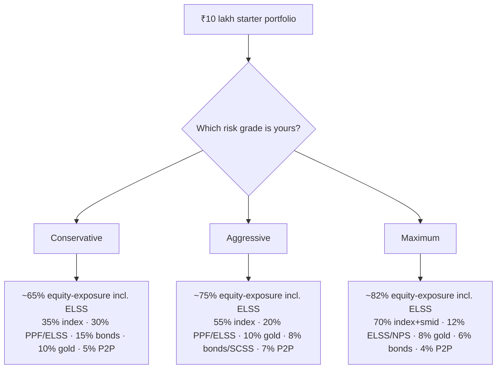
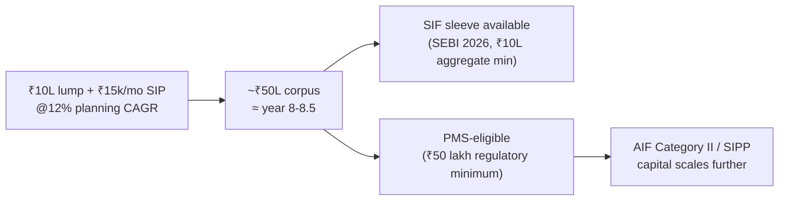
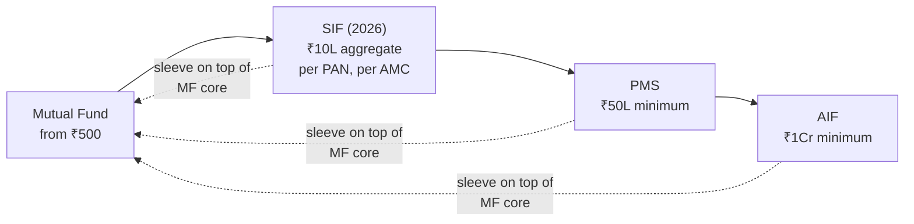
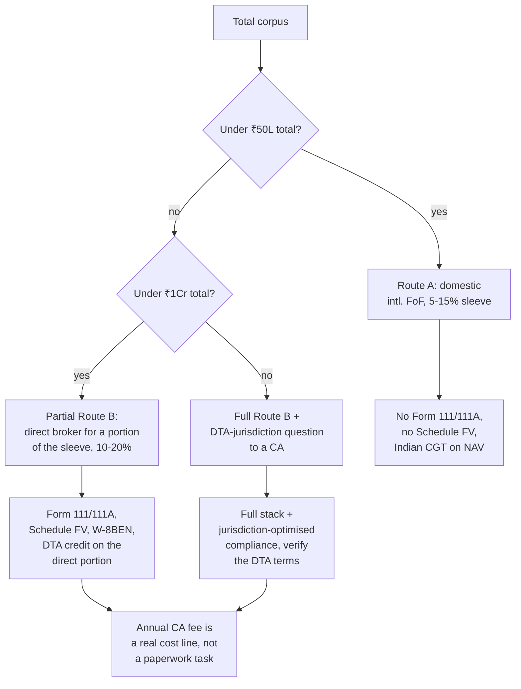
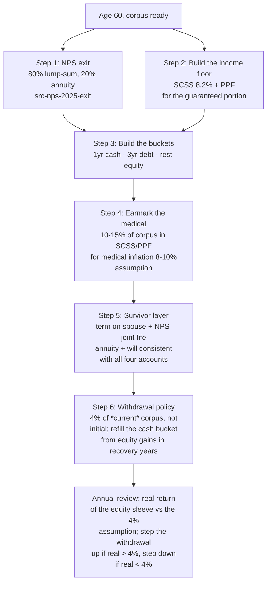
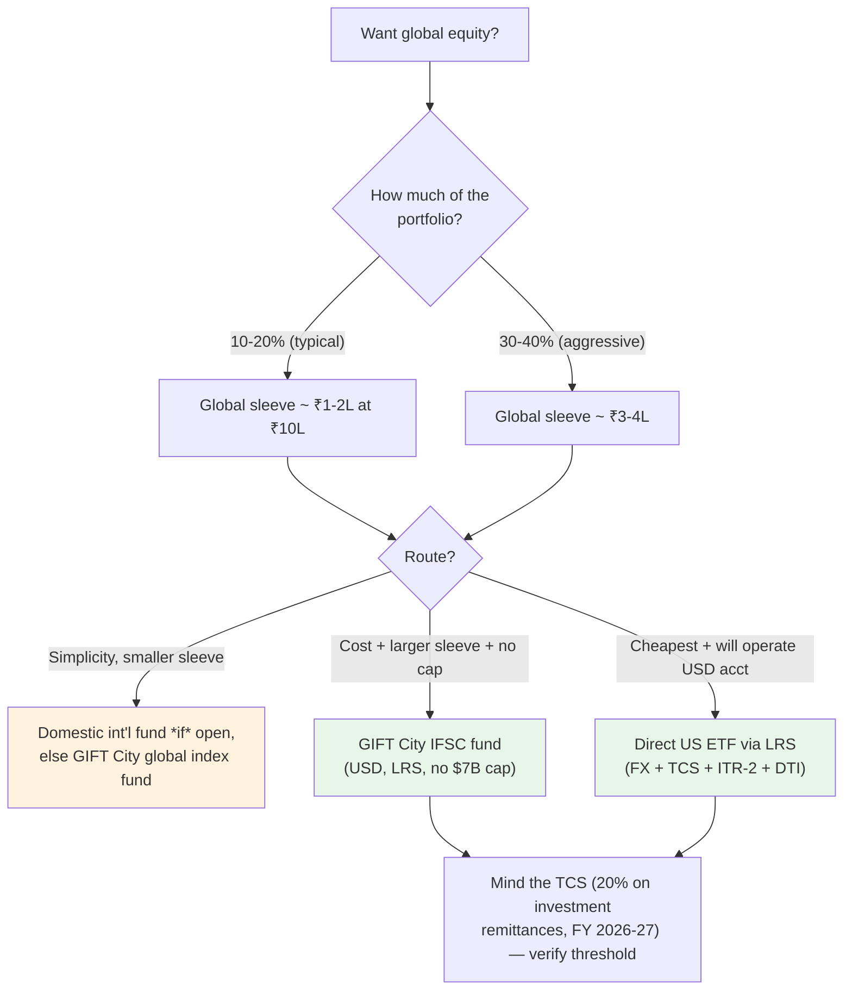
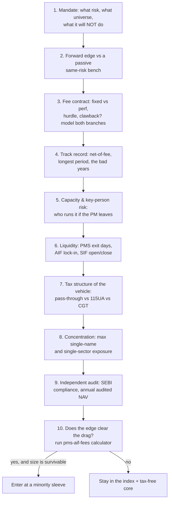
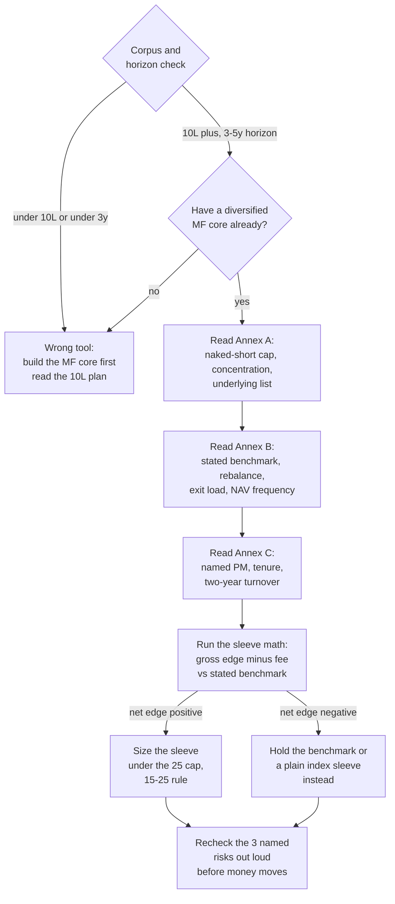
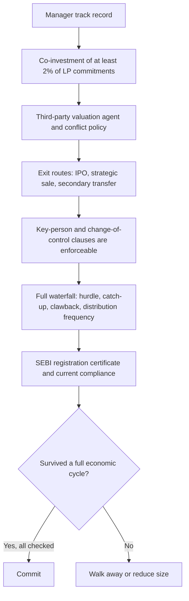

# Wealth Beyond 10 Lakh

*The SIP-to-PMS-to-AIF Growth Path, Alternative Avenues & Retirement*

> What happens as your investable capital grows past Rs.10L: structured SIP scaling, PMS and AIF entry, private-market and international avenues, real estate and REITs, and a retirement/FIRE plan that ties it together.

Audience: Growth-stage investor (Rs.10L+ committed, multi-year horizon). Version 1.0, 2026-10-16.

## Introduction

Higher-return avenues usually require higher capital and longer lock-ins. This book maps the path so the move from SIP to PMS to AIF is deliberate, not a reaction to a good year.

## Contents

1. Your 10 Lakh Wealth Plan: Allocation, SIP Scaling & the Road to PMS/AIF
2. SIP, STP & SWP: Structured Investing and Goal Planning
3. Specialized Investment Funds (SIF): India's New ₹10 Lakh Tier Between Mutual Funds and PMS
4. Beyond SIP: PMS, AIFs & Private Markets for Growing Capital
5. International Investing & LRS for Indian Residents
6. Real Estate, REITs & InvITs: Cash Flow, Title, RERA & How They Compare to Equities
7. Retirement & FIRE: Corpus, the 4% Rule, Sequence Risk & Annuities
8. Wills, Nominations & Succession: Making Sure Your Money Actually Reaches Your Intended Heirs
9. Getting Global Exposure from India: FoF, GIFT City, and LRS — and the $7B Cap That Closed Most International Funds
10. Picking Your Own Rung: The SIF / PMS / AIF Selection & Fee-Decay Decision Guide
11. SIF Strategy Families Decoded: The 7 Permitted Strategies, the Scheme-Document Mechanics & Sleeve-Sizing Math
12. AIF Category Selection: Which Rung of ₹1Cr (Cat I / II / III) Fits Your Capital, Liquidity & Tax
13. The 2/20 Waterfall: How Carried Interest Actually Splits an AIF's Money (and What to Negotiate)
14. The After-Tax Wedge: Why Equal Gross Returns Leave You Different Money (Index vs PMS vs SIF vs AIF)


---


A ₹10 lakh portfolio is the stage where most Indian investors stop *planning* and start *doing*: the emergency fund is built, insurance is in place, and a first meaningful chunk of investable capital is ready. But "I have ₹10,00,000 — now what?" has no single answer. It depends on your risk grade, your horizon, your tax regime, and whether the plan has a growth path that does not strand you in a SIP-only mindset forever.

This article gives you a concrete, risk-graded plan for a ₹10,00,000 starter portfolio: exact allocation amounts for three risk grades, the SIP scaling math with the formula shown, a growth path that leads into PMS and AIFs when capital supports them, and honest about when those higher-capital avenues are the wrong tool. Everything below is educational and illustrative — not individualized advice. Numbers labelled "assumption" or "illustrative" are planning inputs you should stress-test with your own income and risk tolerance; numbers anchored to regulation or current policy are marked with their verification date.

## Assumptions block

Every plan is only as good as the assumptions written down before the money moves. This article assumes:

| Item | Assumption | Why it matters |
|---|---|---|
| Investable now | ₹10,00,000, **in addition to** a 6-month emergency fund held in liquid instruments | The starter capital must never be the safety net |
| Age / horizon | Reader in their 20s–40s; goal horizon 15+ years | Long horizons absorb equity drawdowns; short horizons cannot |
| Income | Stable salaried income, expected to grow 8–10% a year | Feasible step-ups on the SIP depend on this |
| Tax regime | New regime (the default since the FY 2024-25 transition; slabs and 87A per FY 2025-26) | Changes what "tax-efficient" means in every sleeve |
| Equity planning return | 10–12% nominal long-run — an **assumption for planning**, not a forecast | All compounding figures in this article scale with this |
| Debt-side anchor | PPF at ~7.1–7.2% p.a. and repo near 5.25% (last verified: 2026-08-06) | Debt sleeves are priced off these |
| Risk protection | Term + health insurance in place; no high-cost consumer debt | Otherwise the "growth" plan is a liability |

If your actual situation breaks one of these rows, the plan below still works as a template — change the assumption, keep the structure, and re-check the risk grade.

## Three risk grades: pick one, know why

You cannot allocate ₹10 lakh across five sleeves without first deciding how much pain you can actually sit through. We define three grades. The labels are about **your** behaviour in a −30% equity year, not about the markets.



Text version of the diagram: one entry node (your ₹10 lakh) branches into three grades; each grade expands into its sleeve split.

| Sleeve | Conservative | Aggressive | Maximum |
|---|---|---|---|
| Index equity (Nifty 50 + Nifty 500 ETFs/funds; maximum adds small & mid flexi) | 35% → ₹3.5 lakh | 55% → ₹5.5 lakh | 70% → ₹7.0 lakh |
| PPF + ELSS (longer-horizon tax-efficient sleeve) | 30% → ₹3.0 lakh | 20% → ₹2.0 lakh | 12% → ₹1.2 lakh |
| Gold (gold ETFs; SGBs are no longer the route — see update log) | 10% → ₹1.0 lakh | 10% → ₹1.0 lakh | 8% → ₹0.8 lakh |
| Bonds / SCSS when eligible | 15% → ₹1.5 lakh | 8% → ₹0.8 lakh | 6% → ₹0.6 lakh |
| P2P credit sleeve (RBI-regulated platforms only) | 5% → ₹0.5 lakh | 7% → ₹0.7 lakh | 4% → ₹0.4 lakh |
| **Total** | **100% → ₹10.0 lakh** | **100% → ₹10.0 lakh** | **100% → ₹10.0 lakh** |

**What each sleeve is doing.** The index sleeve is the compounder: low-cost, Nifty 50 plus Nifty 500 exposure, bought partly as a lump sum and partly as a monthly SIP so that market timing is mostly removed. The PPF + ELSS sleeve is the tax-advantaged, long-tenor middle: PPF runs 15 years at ~7.1–7.2% p.a. (last verified: 2026-08-06) with tax-exempt interest, and ELSS gives you a three-year equity lock-in (per the SEBI investor-education guide to ELSS, src-sebi-elss). The gold sleeve uses ETFs rather than Sovereign Gold Bonds, because SGBs stopped accepting new tranches from FY 2024-25 (last tranche February 2024; status re-check against the latest Budget note — src-sgb-discontinued). The bonds/SCSS sleeve earns the repo-linked fixed-income anchor — with policy repo near 5.25% through late 2025 (last verified: 2026-08-06, src-rbi-repo); SCSS at 8.2% p.a. for FY 2025-26 (last verified: 2026-08-06) applies only to seniors (60+), so for a 20s–40s reader that sleeve is short-duration bond funds and a PPF-heavy tilt instead, and the SCSS rate becomes relevant to you much later or to your parents' planning. The P2P sleeve is the satellite: a small, capped slice in RBI-regulated peer-to-peer lending for a yield pickup over bonds, sized so a bad vintage cannot hurt. We deliberately keep it at 4–7% of portfolio in every grade; the full due-diligence framework lives in `p2p-lending-complete`.

**Choosing your grade.** Conservative suits anyone with near-term goal overlap, a young family without dual income, or genuine inability to watch a 30% drawdown. Aggressive is the default for a stable-income reader in their 20s–30s with 15+ years to the goal. Maximum is for 30s–40s readers with high and growing income, no dependents at risk, and a written statement that they will add (not panic-sell) in a crash. Write the choice down. The grade decides the numbers in the table; the table decides the behaviour.

## SIP scaling: the math that moves the needle

A ₹10 lakh lump is a good start, but the plan's engine is the monthly SIP. The standard formula for the future value of a monthly SIP (ordinary annuity, monthly compounding of the annual CAGR) is:

$$FV \;=\; P \times \frac{(1+i)^{n}-1}{i}, \qquad i=\frac{CAGR}{12},\quad n=\text{number of months}$$

Worked example, stated precisely so you can reproduce it: **P = ₹15,000/month, assumed CAGR = 12%, horizon 15 years = 180 months**, so i = 1%.

1. Monthly growth factor: $(1+i) = 1.01$
2. $(1.01)^{180} = e^{180 \times \ln 1.01} = e^{180 \times 0.00995} = e^{1.7911} \approx 5.996$
3. Annuity factor: $\frac{5.996 - 1}{0.01} \approx 499.6$
4. $FV = 15{,}000 \times 499.6 \approx \text{₹}74{,}94{,}000$

So ₹15,000 a month at a 12% assumed CAGR for 15 years yields **≈ ₹74.9 lakh**, against **₹27.0 lakh actually invested** (15,000 × 180) — the gain is roughly ₹47.9 lakh, and nearly two-thirds of the final corpus is compounding, not contributions. (Be wary of figures like ₹44.7 lakh floating around for this exact setup: that number comes from a shorter horizon or a lower assumed CAGR. Show the formula; check the exponent.)

Two refinements, honestly labelled:

- **Annuity-due variant.** SIPs are paid at the start of the month, so each instalment earns one extra month: $FV_{due} = FV_{ordinary} \times (1+i) \approx 74.9 \times 1.01 \approx ₹75.7$ lakh. The difference is small; the habit of stating which convention you used is not optional.
- **Step-ups change everything.** If your income grows and you raise the SIP 10% every year (a growing annuity: year-1 SIP ₹1.8 lakh, year-2 ₹1.98 lakh, … at the same 12% planning CAGR), the 15-year *SIP* corpus alone rises to **≈ ₹1.23 crore** (illustrative, same assumptions; with the ₹10 lakh lump included, the total is ≈ ₹1.78 crore). Step-ups are the single largest behavioural lever in the whole plan — larger than any allocation tweak. The mechanism: a higher contribution in later years compounds for fewer years, but the sheer size of the contribution dominates; the two effects together turn a ₹74.9 lakh outcome into ₹1.23 crore from the SIP stream alone.

The CAGR you will quote anywhere else in this plan is defined as:

$$CAGR = \left(\frac{V_{end}}{V_{begin}}\right)^{1/t} - 1$$

where t is in years. Keep the pair: the formula for building (SIP FV) and the formula for checking (CAGR).

## Growth path: from ₹10 lakh to PMS/AIF territory

SIPs do not age gracefully. Below roughly ₹50 lakh, index funds are simply the right vehicle. Beyond that, the menu opens — but only if you *plan* the transition instead of stumbling into it.

The milestone math, at the same 12% planning CAGR: ₹10 lakh lump + ₹15,000 monthly SIP reaches **≈ ₹48.8 lakh by year 8** (lump: 10 × 1.12⁸ ≈ ₹24.8 lakh; SIP: 15,000 × ((1.01)⁹⁶ − 1)/0.01 ≈ ₹24.0 lakh) and crosses **₹50 lakh around year 8–8.5**. Illustrative, not a forecast.



Text version: the corpus path flows from the starter plan, through the ₹50 lakh PMS milestone, to AIF Category II territory as capital grows.

- **SIF: the new bridge rung at your current corpus.** SEBI’s 2026 Mutual Fund Regulations added the **Specialized Investment Fund** category (effective 1 April 2026) with a **₹10 lakh aggregate minimum** per PAN within a single AMC’s SIF offerings. That is *exactly* your starting corpus, so for the first time a ₹10L investor can own a "sophisticated" strategy tier (dynamic allocation, sector rotation, capped long-short) inside a regulated pooled vehicle taxed like a mutual fund — without jumping straight to the ₹50L PMS gate. Rule of thumb: keep the SIF sleeve to roughly 15–25% of total corpus and only on top of a solid index/debt core. Full treatment: [SIF: The ₹10 Lakh Tier](../alternatives/alternatives-sif-specialized-funds.mdx).

- **PMS entry at ₹50 lakh.** Portfolio Management Schemes have a ₹50 lakh minimum; above that the 1–2% management-fee structure becomes efficient *only if* the manager genuinely adds value against an index benchmark. The full anatomy — AIF Categories I/II/III, SEBI minimums, fee and lock-in comparisons, when PMS beats a fund house — is in `alternatives-pms-aif-private`. For this plan, treat ₹50 lakh as the *first* gate, not the last: a realistic 15-year outcome at these assumptions is a **≈ ₹1.3 crore** corpus (₹54.7 lakh from the lump: 10 × 1.12¹⁵ ≈ ₹54.7 lakh, plus the ₹74.9 lakh SIP corpus).
- **AIF Category II for private/smids.** Category II AIFs (typically long-only, no leverage beyond caps) are the natural home for private-market and small/mid-cap concentrated books once you have enough capital that a ₹50 lakh PMS no longer dwarfs your investable surplus. The rule of thumb: move a sleeve, never the whole plan, and only after the PMS stage.

### When NOT to use PMS/AIF

Higher capital access is not automatically better. Do **not** move into PMS/AIF when:

- **Your horizon for that money is under 5 years.** PMS lock-ins, AIF commitments and private-market illiquidity all assume you can wait through a full equity cycle.
- **You need liquidity.** A ₹50 lakh PMS position is not something you unwind in a week for a goal that moved up by two years.
- **Your total investable capital is near the minimum.** A 1.5% fee on a ₹50 lakh book that is benchmark-indexable is pure drag; index funds at ~0.1–0.5% expense ratios win on arithmetic alone.
- **You have not written an Investment Policy Statement.** PMS/AIF decisions without a written benchmark and sizing rule become concentration decisions in disguise.
- **The alternative is boring but correct.** If an index + gold + debt mix at your risk grade beats every available PMS on a risk-adjusted basis, stay in it.

## Tax drag: how slabs, 87A and lock-ins shape the plan

Under the new regime for FY 2025-26 (src-it-slab-fy2025-26), the individual slabs are:

| Slab (new regime, FY 2025-26) | Rate |
|---|---|
| Nil to ₹4,00,000 | Nil |
| ₹4,00,001 – ₹8,00,000 | 5% |
| ₹8,00,001 – ₹12,00,000 | 10% |
| ₹12,00,001 – ₹16,00,000 | 15% |
| ₹16,00,001 – ₹20,00,000 | 20% |
| ₹20,00,001 – ₹24,00,000 | 25% |
| Above ₹24,00,000 | 30% |

With the **₹75,000 standard deduction** and the **₹60,000 Section 87A rebate**, a salaried individual with taxable income up to **₹12,00,000** (i.e., gross salary up to ₹12.75 lakh) pays **zero income tax**. This is the quiet superpower of the new regime: most readers of a ₹10 lakh plan will live in the zero-tax zone for years, which means *tax drag while accumulating* is small. The drag concentrates at **exits**: long-term equity capital gains at 12.5% plus 4% cess (effective ~13%) on gains — last verified: 2026-08-06 — and short-term gains at 20%. Two worked intuitions:

- Realising ₹3 lakh of LCG costs you ₹37,500 tax plus ₹1,500 cess — ₹39,000, an effective 13% haircut on that slice.
- Dividends and bond interest are taxed at slab rates; for a reader inside 87A that tax is 0%, which is precisely why PPF's tax-exempt interest (~7.1–7.2%, last verified: 2026-08-06) is a *real* advantage in this plan and not just a marketing one.

**Regime nuance, stated plainly:** the ₹1.5 lakh 80C deduction (PPF, ELSS, etc.) and the extra ₹50,000 80CCD(1B) for NPS exist **only under the old regime** (80C limit: src-it-80c-150k). If you stay on the new regime, the PPF + ELSS sleeve in the tables above is valued for **capital protection, tenor and tax-free compounding**, not for the deduction. If your income puts you in a high slab where old-regime deductions pay more than 87A's rebate, the regime choice is a genuine arbitrage question — run it against the FY 2025-26 slabs above before you sign anything. (Full treatment in `tax-india-investor-complete`.)

### Pick the regime by arithmetic, not habit

The new regime is the **default** for FY 2026-27, and for most people at this income level it is the *lower-tax* choice even with zero deductions, because the slab structure was reset so that income up to **₹12 lakh is effectively tax-free** (₹12.75 lakh gross for a salaried person after the ₹75,000 standard deduction). The **old regime** only wins when your Chapter VI-A stack (80C, 80D, 24(b) home-loan interest, 80CCD-1B NPS, HRA) is large enough that its deductions outweigh the new regime’s flatter slabs — usually meaning a big home-loan or heavy insurance/NPS outlay, often somewhere above ₹20–25L of income. **Work the number for your own facts both ways** (the calculators page has the slab math) and commit to the lower-tax regime each year; it is a reversible, annual decision. Capital-gains and interest tax are *outside* this regime choice and are governed by the slab/CAPG rules in the taxation article.

## Two-year action checklist

**Months 0–3 — foundations**

- [ ] Confirm the 6-month emergency fund is in a liquid fund or sweep, separate from this portfolio
- [ ] Pick your risk grade in writing; fill the three-number table above with your grade
- [ ] Open demat; start the ₹15,000/month index SIP (Nifty 50 + Nifty 500 split per your grade)
- [ ] Open PPF (₹1.5L annual cap) and, if old-regime, ELSS within the 80C ₹1.5L limit
- [ ] Allocate the gold sleeve into a gold ETF, not jewellery
- [ ] If any P2P: RBI-regulated platform only, start at half your sleeve size, due-diligence per `p2p-lending-complete`
- [ ] Write a one-page Investment Policy Statement: grade, sleeves, trigger, no-trade rule (minimum 3 months between discretionary trades)

**Months 4–12 — first review**

- [ ] Step-up check: if income grew, raise the SIP 5–10%
- [ ] First annual rebalance to target weights (rules in `portfolio-construction-rebalancing`)
- [ ] File ITR; confirm regime choice (new vs old) in writing for next year
- [ ] Note any single position that crossed 10% of portfolio — flag for the review

**Months 13–24 — second cycle**

- [ ] Re-grade risk if life changed (new family, new city, new employer)
- [ ] Second step-up if budget allows; record the assumed CAGR you are *actually* planning against
- [ ] Corpus check: if you are on the 12% planning path, you should be near ₹14–16 lakh by month 24 (illustrative)
- [ ] PMS not yet — the plan says the gate is ₹50 lakh. Anyone selling you PMS entry at ₹10 lakh is selling you a minimum

## Three risk scenarios for the plan

Illustrative stress tests, not forecasts. "Aggressive" grade numbers: ~75% equity exposure (index + ELSS).

| Scenario | What the market does | What happens to the plan | Response encoded in the plan |
|---|---|---|---|
| **Bear** | Nifty −30 to −40% over 12–18 months | Aggressive portfolio drawdown ≈ −28%; P2P vintage stress may follow credit stress | SIPs continue (buying falls is the whole point); no chasing; P2P sleeve not added to; 3-month no-trade rule respected |
| **Bull** | Nifty +40% in 18 months | Drift to ~85% equity; the plan silently becomes "maximum" | Band rebalance back to targets (see `portfolio-construction-rebalancing`); step-up SIP; still no PMS until the ₹50L gate — measured on a smoothed, not peak, corpus |
| **Stagflation** | Inflation 8%+, repo near 5.25% (last verified: 2026-08-06) and cut slowly | Real equity returns compress; gold and short-duration debt hold value; bond yields chase inflation | Keep the 10% gold sleeve; tilt bonds short-duration; P2P stays at the minimum of the grade (5% or less) since defaults tick up |

The scenario table is the plan's insurance: because the responses are pre-decided, none of the three moments becomes a fresh decision under pressure.

## Key formulas

$$FV = P\,\frac{(1+i)^n - 1}{i} \qquad\text{(SIP future value; } i = \tfrac{CAGR}{12}\text{, } n \text{ in months)}$$

$$CAGR = \left(\frac{V_{end}}{V_{begin}}\right)^{1/t} - 1 \qquad\text{(t in years)}$$

Check figures in this article against these two formulas and the stated convention (ordinary vs annuity-due, nominal vs effective).

## How this article uses calculators

The SIP FV, CAGR and fee-drag figures in this article are reproducible on the DhanPedia calculators page at `/calculators`: enter P = ₹15,000, assumed CAGR 12%, 180 months, and you should land on ≈ ₹74.9 lakh (ordinary annuity). Use the XIRR tool on any real statement before you ever quote a personal CAGR — the worked example in `foundations-compounding-returns` shows why naive CAGR on a contribution stream is misleading. The calculators document their own assumptions (compounding convention, tax treatment) — read them once, then trust the arithmetic.

## Update log

Time-sensitive figures used in this article, each marked where it appears:

- **PPF rate ~7.1–7.2% p.a.** — revised quarterly (last verified: 2026-08-06)
- **RBI policy repo near 5.25% through late 2025** — re-verify at each MPC (last verified: 2026-08-06; src-rbi-repo)
- **SCSS 8.2% p.a. for FY 2025-26** — revised quarterly (last verified: 2026-08-06)
- **SGB scheme discontinued from FY 2024-25; last tranche February 2024** — re-check at each Union Budget before republishing (last verified: 2026-08-06)
- **FY 2025-26 new-regime slabs, ₹75,000 standard deduction, ₹60,000 87A rebate** — re-verify at each Budget (last verified: 2026-08-06; src-it-slab-fy2025-26)
- **ELSS 3-year lock-in; 80C ₹1.5 lakh limit (old regime)** — re-verify at each Budget (last verified: 2026-08-06; src-sebi-elss)

## Related

- `foundations-compounding-returns` — the CAGR/XIRR/real-return math behind every figure here
- `portfolio-construction-rebalancing` — band triggers and rebalancing rules for the sleeves
- `alternatives-pms-aif-private` — PMS/AIF anatomy, SEBI minimums, fees, lock-ins
- `tax-india-investor-complete` — regimes, slabs, 80C/80CCD, capital-gains reporting
- `mf-sip-swp-stp-goals` — SIP/STP/SWP mechanics and goal-based planning

## Sources & citations

- `src-rbi-repo` — Reserve Bank of India, "MPC decision: policy repo rate held near 5.25% through late 2025", https://www.business-standard.com/finance/news/rbi-to-keep-interest-rates-steady-at-5-25-through-2026-reuters-poll-126012900085_1.html
- `src-it-slab-fy2025-26` — Income Tax Department / Union Budget 2025, "Income tax slabs FY 2025-26 (new regime default; old regime optional)", https://www.incometax.gov.in/iec/foportal/help/individual/return-applicable-1
- `src-sebi-elss` — SEBI Investor Education, "Securities Market Investment: A Guide to ELSS", https://investor.sebi.gov.in/elss.html

Supporting context (not in this article's frontmatter, carried by the linked articles): PPF/SCSS rates and SGB status via `pf-` and `retirement-fire-annuities` articles; P2P framework via `p2p-lending-complete` (RBI P2P Directions 2025); 80C limit via `tax-india-investor-complete`.

## Editorial / review status

Published; last verified 2026-08-06; next review due 2027-02-28 (or earlier at the next MPC / Budget if a figure above changed). Educational content, not individualized advice.


## Sources & Citations

- **Reserve Bank of India** — RBI MPC decision, 3-5 Aug 2026: repo held at 5.25%, neutral stance, SDF 5.00%, MSF 5.50%. https://www.rbi.org.in/SCRIPTs/BS_ViewBulletin.aspx?Id=24369 (verified 2026-10-16)
- **Income Tax Department / Union Budget 2025** — Income-tax slabs, new regime, FY 2026-27 (AY 2027-28) - unchanged from the Budget 2025 reset. https://www.indiabudget.gov.in/doc/Finance_Bill.pdf (verified 2026-10-16)
- **SEBI Investor Education** — Securities Market Investment: A Guide to ELSS. https://investor.sebi.gov.in/elss.html (verified 2026-08-06)

---
Educational content, not individualized investment, tax, accounting, or legal advice.
Author: Chirag Singhal. DhanPedia.


---


# SIP, STP & SWP: Structured Investing and Goal Planning

Three automation tools — Systematic Investment Plan (SIP), Systematic Transfer Plan (STP), and Systematic Withdrawal Plan (SWP) — cover the three life phases of money: **putting it in**, **moving it between risk buckets**, and **taking it out**. This article gives you the exact math for each, worked examples with stated assumptions, and the goal-ladder method that turns "I want a car in 3 years" into a specific monthly number.

Every number below states its assumption. If you change the return, change the answer — that is the whole point of doing the arithmetic yourself rather than trusting a headline.

## The SIP future value formula

$$FV = P\,\frac{(1+i)^{n}-1}{i}$$

where $P$ is the monthly contribution, $i$ is the **monthly** expected return (annual return ÷ 12), and $n$ is the number of months. The standard SIP convention assumes each instalment is invested at the start of the month and that interest compounds monthly. A different convention (instalments at month-end, no intra-month compounding) gives a slightly lower FV; the difference is small and the [calculator cross-reference](#calculator-cross-reference) below is where you can check both.

### Worked example 1 — 12% p.a.

₹10,000/month, 15 years, 12% p.a. ($i = 0.01$):

$$(1.01)^{180} = 5.997 \quad\Rightarrow\quad FV = 10{,}000 \times \frac{5.997-1}{0.01} = 10{,}000 \times 499.7 \approx ₹49.9\text{L}$$

- **Total contributed:** ₹10,000 × 180 = **₹18L**
- **Return earned (paper gain):** ₹49.9L − ₹18L = **₹31.9L**

### Worked example 2 — 15% p.a.

₹10,000/month, 15 years, 15% p.a. ($i = 0.0125$):

$$(1.0125)^{180} \approx 9.356 \quad\Rightarrow\quad FV = 10{,}000 \times \frac{9.356-1}{0.0125} = 10{,}000 \times 668.5 \approx ₹66.9\text{L}$$

- **Total contributed:** ₹18L
- **Return earned:** **₹48.9L**

### What the two examples actually teach you

The return gap is 3 percentage points (12% vs 15%). The corpus gap is ₹17L — **₹66.9L vs ₹49.9L**. A 3 pp return difference, sustained for 15 years, is a 34% larger corpus. This is the *entire* case for indexing and cost discipline: the index-fund article's direct-vs-regular gap (a 0.6% expense drag) is the same species of "small number, sustained, compounded" — but here the *return assumption* is the biggest driver, and the return assumption is the number you control least. The [index article](../mutual-funds/mf-index-etf-direct-regular.mdx) covers the cost side; this article covers the assumption side.

**Assumptions, stated explicitly, for both examples:**

- 12% and 15% are *nominal annual* expected equity returns, not promises. India's equity market has delivered different realised returns in every historical window; a 15% assumption over 15 years is the *upper end* of a plausible range, not a forecast.
- Monthly compounding at annual/12. No intra-month timing.
- No taxes on the intermediate gains (equity SIP gains are taxed at redemption, under the equity capital-gains regime — verify current rates and exemptions against the income-tax slabs reference, [src-it-slab-calculator](../mutual-funds/mf-sip-swp-stp-goals.mdx), time-sensitive, last verified 2026-08-06).
- No step-ups. If your income grows, the SIP should grow; the examples above are level.

## SIP vs lump sum: the honest version

The common framing — "market timing is hard, so SIP wins" — is incomplete, and this article says it plainly:

> **In a sustained bull market, a lump sum invested on day one beats the SIP, because the money was at work from day one. In a sustained down market, the SIP beats the lump sum, because the SIP bought more units on the way down. You cannot predict which regime you are in. Therefore: on a risk-adjusted basis, SIPs dominate — not because they earn more when markets go up, but because they cap your loss when they go down, and the capping is the value that compounds.**

The three-part structure is the argument. Drop any part and the conclusion breaks:

- "Lump sums win in bull markets" — true, and the part most SIP marketing ignores.
- "SIPs win in down markets" — true, and the part most lump-sum marketing ignores.
- "You cannot tell which market you are in" — the part that makes the choice a *risk* choice, not a *return* choice. A SIP is a risk-reduction tool with a cost (you sacrifice the bull-market edge); a lump sum is a risk-increase tool with a benefit (the bull-market edge). If your money is for a goal with a hard deadline, the risk of the lump sum sitting in an equity market for the final months is *your* risk, not the market's. That is the argument for the [ladder](#the-goal-ladder-method), not for "always do SIPs."

## STP: harvesting gains between buckets

A **Systematic Transfer Plan** automatically moves money from one fund to another on a schedule (monthly, quarterly, trigger-based). The canonical use in India is **debt-to-equity harvesting**: you hold a corpus in a debt fund or PPF-adjacent bucket, and on each pay day a slice STPs into an equity fund. Two things make this tool quietly powerful:

1. **The transfer is a deemed redemption.** The slice you move out of the debt fund is taxed at that moment (debt-instrument capital-gains rules apply to the debt portion; verify the current rules against the slabs reference). The equity slice then *starts a new holding period* in the equity fund — the clock for the equity capital-gains rules restarts on every STP'd tranche. Over a multi-year STP schedule, you have naturally layered a long tail of holding periods, which is the same effect the [laddering section](#fixed-income-laddering-by-proxy) describes for bonds.
2. **The STP removes the behavioural layer.** You do not decide each month "should I move money into equity?" — the schedule does. The decision you *do* make, once, is: source bucket, destination bucket, amount, frequency.

The tax note is the one most people miss: **an STP is not tax-free because it is "just a transfer."** It is a redemption plus a purchase. If the source is a tax-exempt bucket (a PPF, for example, until maturity), the "deemed redemption" framing changes — PPF has its own partial-withdrawal rules; check the scheme's current limits before you plan an STP out of it.

## SWP: creating income from a corpus

A **Systematic Withdrawal Plan** does the mirror: on a schedule, a value (or number of units) is redeemed out of the fund and paid to you. The three income sources every retiree in India is offered are the SWP, the FD (fixed deposit), and the annuity. Here is the honest comparison:

| | SWP (diversified equity/debt fund) | FD withdrawal | Annuity (pension scheme) |
|---|---|---|---|
| Where the income comes from | Units sold; corpus can grow or fall | Fixed coupon; principal untouched unless you break the FD | Premium paid; return is the annuity payout |
| Tax on the income | Capital-gains treatment (short- or long-term, depending on the unit sold and its holding period; equity-oriented funds follow the equity CG regime) | Interest is taxed **every year** at your slab rate, on the full amount | Tax treatment depends on the scheme and the annuity's composition — verify the current rules |
| Inflation protection | If the corpus is growth-weighted, the corpus itself compounds against inflation | None built in; a fixed ₹X/year gets more expensive to live on every year | None built in, unless the annuity has an inflation rider (if offered) |
| Loss of principal risk | Yes — in a bad sequence, the corpus can fall and the SWP can accelerate the fall | No (until you need the principal, which is the FD's own risk) | No — the annuity is the point |
| What you give up | The full upside of the corpus; the tax complexity | The compounding of the corpus you break | The flexibility of the corpus; the insurer's credit risk replaces the market's |

The **sequence-of-returns risk** is the SWP's real hazard: a bad first year after retirement (a deep drawdown) forces the SWP to sell units at the bottom, and the corpus has less time to recover. The [retirement article](../retirement-fire/retirement-fire-annuities.mdx) has the 4% rule and the sequence-risk math; the SWP here is the *mechanism* that delivers the 4% rule on a fund, not the strategy itself. If you are on the taxable-coupon side (FD, most debt funds), the SWP has one structural edge: you are paying capital-gains tax on the units you sell, not slab-rate tax on every rupee of interest, every year. That is worth quantifying against your specific slab before you choose the income source.

## The goal-ladder method

The rule: **one goal, one corpus, one horizon, one return assumption, one funding mechanism.** Then work backwards. The return assumption is *risk-matched to the horizon*:

- **≤ 3 years** — money in a debt bucket. A 3-year goal has no time to absorb an equity drawdown; the return assumption should be the realistic debt return, not the equity average. (The current repo rate sits near 5.25% as of late 2025 — time-sensitive, verified 2026-08-06; debt yields track it, verify the current rate before quoting it.)
- **3–10 years** — a debt-leaning mix. The closer to 10 years, the more equity you can carry; at 10 years the corpus has time to recover a mid-decade drawdown.
- **> 10 years** — an equity-leaning mix. The long horizon is where the two worked examples above apply.

### Worked: a car in 3 years, ₹50L

- **Horizon:** 36 months. **Return assumption:** 12% p.a. (a debt-heavy mix that *happens* to earn 12% is not realistic; use the debt bucket's realistic number and re-run the math below — the point is the *method*, not the 12%).
- **Required FV:** ₹50,00,000.
- **SIP formula, $i=0.01$, $n=36$:**

$$FV = P\,\frac{(1.01)^{36}-1}{0.01} = P \times 43.08 \quad\Rightarrow\quad P = \frac{50{,}00{,}000}{43.08} \approx ₹1{,}16{,}000/\text{month}$$

- **Total contributed:** ₹1.16L × 36 ≈ **₹41.8L**. **Return earned:** ~**₹8.2L** over 3 years.
- **Sensitivity:** at 8% p.a. (a more conservative debt-mix assumption), the factor is $\frac{(1.006667)^{36}-1}{0.006667} \approx 40.54$, so $P \approx ₹1.23\text{L}/\text{month}$. A 4 pp return assumption moves your required monthly SIP by ~₹7,000.

### The ladder, in one table

| Goal | Corpus | Horizon | Assumed return | i (mo) | n | Annuity factor | Required SIP |
|---|---|---|---|---|---|---|---|
| Car | ₹50L | 3 yrs | 12% (debt-mix) | 0.01 | 36 | 43.08 | ≈ ₹1.16L/mo |
| Home down payment | ₹35L | 5 yrs | 12% | 0.01 | 60 | 81.67 | ≈ ₹42,900/mo |
| Child's education | ₹80L | 10 yrs | 10% (debt-leaning) | 0.008333 | 120 | 204.96 | ≈ ₹39,000/mo |
| Retirement corpus | ₹4Cr | 20 yrs | 12% (equity-leaning) | 0.01 | 240 | 989.2 | ≈ ₹40,400/mo |

*Verification of every row (so the ladder is fully auditable):* $P = FV \div \text{factor}$, where factor $= ((1+i)^n - 1)/i$ and $i = r_{annual}/12$.

- **Car:** $(1.01)^{36}=1.4308$ → factor $=43.08$ → $P=50{,}00{,}000/43.08 = ₹1{,}16{,}076$ ≈ ₹1.16L/mo.
- **Home:** $(1.01)^{60}=1.8167$ → factor $=81.67$ → $P=35{,}00{,}000/81.67 = ₹42{,}856$ ≈ ₹42,900/mo.
- **Education:** $(1.008333)^{120}=2.7080$ → factor $=204.96$ → $P=80{,}00{,}000/204.96 = ₹39{,}031$ ≈ ₹39,000/mo.
- **Retirement:** $(1.01)^{240}=10.892$ → factor $=989.2$ → $P=40{,}00{,}000/989.2 = ₹40{,}437$ ≈ ₹40,400/mo. (Sanity: ₹10,000/mo at 12% for 20 yrs grows to ≈ ₹98.9L, so ₹4Cr needs ~₹40,400/mo — consistent.)

Each row is one corpus, one horizon, one mechanism. **Do not merge rows** — the education corpus and the retirement corpus are different risk budgets, and merging them into one "growth SIP" is the most common self-inflated plan in Indian household finance.

### The last-12-months rule

In every row, the final 12 months of the horizon are in a debt bucket, no matter what. The equity portion of the corpus is STP'd or redeemed (in tranches) into debt over the 12 months before the goal date. This is where the sequence-of-returns risk actually lives: a ₹35L home deposit is *not* something you let ride an equity index for the last year.

## Fixed-income laddering, by proxy

The same laddering logic that applies to bonds (a maturing coupon every year, reinvested into the next rung) is what a **debt→equity STP schedule** does for an equity corpus: every STP'd tranche starts a new holding period, so the *tax* profile of the corpus ladders automatically. For the bond version of this — explicit rungs, maturing coupons, a 10-year ladder against a known income need — see the [fixed-income article](../fixed-income/fixed-income-bonds-credit.mdx).

### Step-up SIPs and top-ups

A level SIP is the cleanest model but under-plans for a life in which income grows. Two mechanisms fix that:

- **Step-up SIP:** the instalment grows by a fixed *percentage* each year (or at the start of a new year). The classic use: raise the SIP by your expected salary-growth rate each year.
- **Top-up / lump addition:** a one-off extra instalment (a bonus, a side-income windfall) added to the running SIP.

Step-up math (worked, contribution side only — the FV gap scales with it): ₹10,000/month, 20 years, 10% p.a. step-up.

- **Total contributed, flat SIP:** ₹10,000 × 12 × 20 = **₹24L**.
- **Total contributed, 10% step-up:** $\sum_{k=1}^{20} 10{,}000 \times 12 \times (1.1)^{k-1} = 1{,}20{,}000 \times \frac{1.1^{20}-1}{0.1} = 1{,}20{,}000 \times 57.28 \approx \mathbf{₹68.7L}$ total (vs ₹24L flat) — i.e. **₹44.7L of extra contribution** on top of the flat-SIP total.

The FV advantage of the step-up is *more* than the extra contribution, because the later (bigger) instalments have more time to compound — but the exact FV depends on the compounding convention, so use the calculator rather than a headline. The decision worth making is the *step-up rate*: set it at your realistic income growth, not at hope. A 10% step-up you cannot sustain in year 6 is worse than a 5% step-up you sustain for 20.

### Inflation-adjusting the goal value

A nominal goal understates the money you need. A car quoted at ₹47L *today* is not ₹47L in three years if car prices rise with inflation:

$$\text{Future goal} = \text{Today's value} \times (1+g)^{h}$$

At 6% p.a. price growth over 3 years: $47 \times 1.06^3 = 47 \times 1.191 \approx ₹55.9\text{L}$. The car example in the goal-ladder above used a clean ₹50L target; inflation-adjusting it to ~₹56L moves the required SIP up by roughly 12%. **Inflation-adjust every goal before you run the ladder math** — this is the step that turns a "₹50L car" plan into an actually-achievable one. The growth rate $g$ to use is the *price inflation of that good or service* (education and medical costs historically run above general CPI; a car's price is closer to general inflation). Label your $g$ explicitly.

### Reverse STP: equity to debt near the goal

The STP tool also runs the other direction, and this is where goal planning meets sequence risk. With 12 months to a hard-deadline goal, the discipline is to **STP the equity corpus into a debt bucket** (or redeem in tranches into debt) so the final stretch is not riding an equity index. This *harvests* the equity gain you have so far (taxed at that moment under the equity CG rules — verify current rates) and locks the principal into a low-duration instrument. You are paying a small tax cost now to remove the single biggest threat to a deadline goal: a market drawdown in the final 6–12 months. The forward STP (debt→equity) is a growth tool; the reverse STP (equity→debt) is a *protection* tool, and goal-based planning is the context in which it earns its keep.

### SWP execution: amount method vs unit method

The SWP's mechanics matter more than the marketing implies. Two execution modes:

- **Amount method (fixed ₹/month):** the platform redems whatever units equal that ₹ amount. In a down market, more units are sold to raise the same ₹ — the corpus erodes faster exactly when it can least afford it. This is the dangerous mode near retirement, because the first-year drawdown compounds.
- **Unit method (fixed units/month):** a fixed number of units is sold regardless of NAV; the ₹ paid to you *varies* with the NAV. The corpus erosion is more stable, but your income fluctuates — bad for a retiree who needs a steady pension-like payout.

Most retirement SWPs use the amount method with a *floor* on the withdrawal rate (the 4% rule's analogue). The honest read: the amount method is a *smoother income* at the cost of *higher sequence risk*; the unit method is the reverse. Whichever you pick, the [retirement article](../retirement-fire/retirement-fire-annuities.mdx) governs the *rate*, and this section governs the *execution*. The tax note applies to both: the units sold carry their own holding period, so an SWP that has been running for years is selling long-term-hold units (favourable) early on and short-term-hold units (less favourable) only for the recent tranches.

### The behaviour layer: auto-debit and the crash-year instinct

The structural value of a SIP is *automaticity*: the money moves whether the market is up or down. The single most expensive behaviour pattern in Indian investing is **pausing the SIP in a crash year**, because that is the year the units are cheapest and the compounding benefit is largest. Auto-debit removes that decision from the month it is hardest to make. If you must keep manual control, the rule that survives scrutiny: *never pause a running SIP on the basis of a single quarter's return*; the only legitimate pause is a cash-flow event (a job loss, a large expected expense), and even then, a *reduced* SIP beats a *stopped* one.

## Calculator cross-reference

The two worked examples above are deliberately *not* a calculator, because the point is that you can run the same arithmetic in 30 seconds with the formula above. If you want a tool that does it for you and also handles the step-up SIP (the ₹10,000/month that grows to ₹12,000/month after year 2), use the **DhanPedia SIP calculator** on this site: enter $P$, $i$, $n$, and a step-up rate, and it will print the FV, the total contributed, and the paper gain — the same three numbers the examples above print, in one click. The calculator's assumptions (monthly compounding, start-of-month instalment) match the formula above; if you use a calculator that assumes month-end, your FV will be marginally lower, and that is correct, not a bug.

## Related

- [Index Funds, ETFs, Direct vs Regular Plans & Tracking Error](../mutual-funds/mf-index-etf-direct-regular.mdx) — the cost side this article's return assumption depends on.
- [How to Choose and Compare Mutual Funds](../mutual-funds/mf-choosing-comparing-funds.mdx) — the mandate-clarity step that decides *which* fund the SIP feeds.
- [Your 10 Lakh Wealth Plan](../personal-finance/pf-wealth-plan-10-lakh.mdx) — the allocation framework that decides *what fraction* of your income is the SIP's $P$.
- [Retirement & FIRE](../retirement-fire/retirement-fire-annuities.mdx) — the SWP side, and the sequence-of-returns risk this article names.

## Sources

- `src-it-slab-calculator` — secondary summary of the FY 2025-26 / FY 2026-27 income-tax slabs; referenced for the *time-sensitive* capital-gains-rate and slab-rate claims throughout this article, all marked "verify." No specific tax figure is asserted.

## Update log

- **2026-08-06** — last verified. The 12% and 15% return assumptions are *assumptions*, not forecasts; they are labelled as such in both worked examples. The repo-rate figure (≈5.25%, late 2025) is time-sensitive and marked "verify against the latest RBI MPC." All SIP FV numbers are arithmetic under the stated monthly-compounding convention; a different convention gives a slightly different FV, which the [calculator cross-reference](#calculator-cross-reference) acknowledges. The car-in-3-years example is a method illustration; its 12% assumption is flagged as unrealistically high for a debt bucket and the reader is directed to re-run the math at their debt bucket's realistic yield.


## Sources & Citations

- **Cleartax (secondary summary of official slabs)** — Income Tax Slabs FY 2025-26 & FY 2026-27 (New and Old Regime). https://cleartax.in/s/income-tax-slabs (verified 2026-08-06)

---
Educational content, not individualized investment, tax, accounting, or legal advice.
Author: Chirag Singhal. DhanPedia.


---


The Indian retail investment ladder has long had a conspicuous gap in the middle. At the bottom sits the mutual fund, open from a few hundred rupees and the workhorse of the ₹10 lakh starter portfolio. At the top sit PMS (from ₹50 lakh) and AIFs (from ₹1 crore), both of which assume an investor who is past the scale at which a managed sleeve actually pays for itself. Between those two points, the HNI with a ₹10–40 lakh corpus wanting a *sophisticated, professionally managed strategy* in a *pooled, liquid, SEBI-regulated* structure had no clean answer. That gap is what SEBI's new Specialized Investment Fund category fills, effective 1 April 2026.

## Why this article matters now

SIFs are new: SEBI (Mutual Funds) Regulations 2026 created the category, and it became effective on 1 April 2026 (`src-sebi-sif-2026`, `src-sebi-mf-regulations-2026`). The timing matters for a specific reason. The 2026 regulation overhaul also introduced a sibling framework, the "MF Lite" structure for passive-only funds. The point of that split is that SEBI wanted to give active managers room to run strategies that a classic mutual fund category simply does not allow — dynamic asset allocation, sector rotation, and capped long-short positions using derivatives — while giving retail-grade protection (minimums, breach rules, disclosure) to the investors taking the other side of those strategies.

For a reader of this encyclopedia the practical stakes are three:

1. **A new instrument lands at exactly your current scale.** If your investable corpus is in the ₹10–50 lakh band — which is precisely the "Wealth Beyond ₹10L" band that this site's companion book covers — a SIF is the first *pooled, daily-priced* vehicle that offers you a hedge-fund-style strategy without a ₹50 lakh PMS commitment.
2. **The minimum is smaller than the strategy is complex.** A ₹10 lakh entry into a long-short equity strategy is a meaningful risk allocation. You are not buying a better index fund; you are buying a derivative-heavy, actively hedged book. The gap between "affordable" and "understood" is where SIF investors get hurt.
3. **The rules are still settling.** Everything in this article that comes from secondary guides on the SEBI 2026 framework carries an explicit "verify against the scheme document" flag. That is not hedging — it is the honest state of a category that went live four months before this article was written.

If your corpus is under ₹10 lakh, this article is still useful: it tells you what is coming and what to read when the day arrives. If it is above ₹50 lakh, read this first, then [PMS, AIFs & Private Markets](../alternatives/alternatives-pms-aif-private.mdx), because your real decision is usually SIF sleeve *plus* PMS core, not SIF alone.

## What a SIF actually is

A Specialized Investment Fund is a **pooled investment vehicle run by an Asset Management Company (AMC) under the SEBI (MF) Regulations 2026**. Three properties of that definition do most of the work:

- **Pooled, like a mutual fund.** Your money is combined with other investors' money, priced daily at NAV, and you hold *units of the fund*, not individual securities. This is the structural contrast with a PMS, where the manager holds individual securities *in your own demat account* and runs them per your mandate. In a SIF you cannot see your slice of the portfolio in your demat; you see the NAV.
- **Run by an AMC under MF Regulations, not a PMS or AIF regulation.** That matters for three reasons: the regulatory parent is the mutual fund regulator (SEBI's MF framework), the distribution and governance channel is the one you already use for mutual funds, and the investor protections that the MF regime has built up over two decades apply.
- **Built for "sophisticated" strategies that a plain mutual fund category does not permit.** The strategies the category is designed around are dynamic asset allocation, sector rotation, and long-short positions with a cap on the naked (unhedged) short sleeve, executed with listed derivatives. The fund can lean more aggressively into these levers than a conventional open-ended equity or debt scheme may.

One more property that sets the tone for everything else: **the ₹10 lakh minimum.** SIFs are not open to a ₹500 SIP mindset by default; the category explicitly targets investors who can meaningfully absorb the strategy risk. That minimum, and how it is enforced, is the next section.

## The ₹10 lakh minimum, precisely

This is where most retail readers will get SIF wrong, so the mechanics are worth laying out exactly.

**Aggregate per PAN, within one AMC's SIF offerings.** The minimum is ₹10 lakh *in total across that AMC's SIF schemes*, on a per-PAN basis — it is **not** a per-scheme minimum. The rule's consequence is that you may split your commitment across several SIF schemes of the same AMC and remain compliant. For example, under the aggregate rule, holding ₹6 lakh in one equity-SIF scheme and ₹4 lakh in a debt-SIF scheme of the *same* AMC adds up to ₹10 lakh and satisfies the minimum. Verify this interpretation against each scheme's document, because "aggregate within one AMC" is a secondary-guide reading of the 2026 framework (verify current rule before acting).

**SIPs and STPs are allowed.** The category does not require a single lump sum at entry. An investor can build the ₹10 lakh position through a systematic investment plan into the SIF, and can move money between the AMC's schemes using systematic transfer plans, subject to the scheme's own documentation (verify current rule before acting).

**What happens when the minimum is broken.** The framework distinguishes two cases, and the distinction is the whole ballgame:

- **Passive breach.** Your holdings fall *below* ₹10 lakh because the NAV dropped (or because dividends/redemptions by others moved the fund, not you). This is a **non-event**: no violation, no action required of you. You keep your units and your normal redemption rights. The minimum is not a support price on the NAV.
- **Active breach.** Your holdings fall below ₹10 lakh because *you* redeemed units. Here the fund does not let you walk away freely: the units in question are **frozen**, and you have a **30-day window to rebalance** your position back to or above the minimum. Verify the exact mechanics and the 30-day clock against the scheme's redemption clause (verify current rule before acting).
- **Accredited investors are exempt from the minimum.** The category's gate is a scale-and-sophistication test for ordinary investors; SEBI's accredited-investor category is explicitly excluded from the ₹10 lakh floor (verify current rule before acting).

Why the breach rule exists at all: a long-short, derivatives-using fund has a *cost structure and a hedging program* calibrated for a corpus above a floor. If retail investors could dribble out of it any time the strategy looked scary, the fund's hedges and desk would be sized for a book that no longer exists. The 30-day rebalance window forces the investor to make a decision about the strategy — stay above the minimum or exit properly — rather than quietly shrink.

## Strategy categories

The SIF umbrella is not one strategy; it is a set of allowed strategy *families*. Two dominate the initial offering:

### Equity Long-Short / Market-Neutral

The fund holds a **long book** in equities it expects to outperform and a **short book** (executed with listed derivatives — index futures, single-stock futures, F&O options) to neutralise the market direction. The secondary guides on the 2026 framework describe an illustrative blend of roughly **75% long / 25% short**, with the **naked (unhedged) short sleeve capped at about 25% of the book and the remainder required to be hedged** (sifmf.in, medium confidence; verify the exact cap against the scheme's derivative policy before acting). The design goal is **lower correlation to the broad market**: the fund is meant to make money from its *security selection spread*, not from the market rising.

The payoff logic, and why it is not what most people think, is worth one worked pass. The following numbers are **illustrative only** — they demonstrate the *mechanism* of a long-short spread, not a prediction, not a backtest, and not a fund's actual track record:

Assume a simple equity-long-short position: 75% of the book long a basket of outperformers, 25% short the broader market index via futures, and no leverage. In three hypothetical year-ends:

```math
R_{port} = 0.75 \times R_{long} + 0.25 \times (-R_{short})
```

| Scenario (illustrative) | Long basket | Short index | Portfolio |
|---|---|---|---|
| Melt-up: market +30%, your longs +30% | +30% | +30% | +15% |
| Steep bear: market −30%, your longs −20% | −20% | −30% | +5% |
| Sideways: market 0%, your longs +5% | +5% | 0% | +3.75% |

Read that table slowly. In the melt-up, the fund **captures half the market's rise** — the short sleeve is an explicit tax on upside. In the bear, it *profits* because the short leg wins more than the long leg loses. In sideways, it returns whatever the *spread* between your picks and the index produced. The strategy is decoupled from direction: **its returns are a function of pair selection, not of the market's direction.** That is why a "great 12-month table" on a long-short fund is not evidence of skill the way it is on a plain equity fund — and it is why section on common mistakes below treats it as the #1 trap.

### Debt Long-Short

The debt version trades *rates and credit*, not equity alpha. A fund of this type will run **duration positioning** (leaning long when it expects yields to fall, short when it expects them to rise), **credit-spread strategies** (laddering between government debt and investment-grade corporates, rolling the curve), and **interest-rate hedging** using the listed interest-rate derivatives available to the fund. The risk profile is closer to a bond strategist's book than to an equity hedge fund: the drawdowns are smaller, the gross returns are lower, and the "alpha" is a rate bet measured in basis points, not in equities.

### A note on the "sophisticated" bucket

Dynamic asset allocation and sector rotation sit in the same SIF framework but with a gentler risk profile — they are closer to a flexible-mutual-fund that has more tactical freedom. If the label on the SIF you are looking at reads "dynamic allocation" or "sector rotation," the strategy math is closer to the debt/long-short families *in complexity* but not in *magnitude of risk*. Match the strategy family to your risk budget before you look at the name.

## Tax treatment

SIFs are **taxed like mutual funds at the investor level, by asset class**. Concretely, under the framework as of the October 2026 write date:

- **Equity-oriented SIF:** long-term capital gains above **₹1 lakh per year** taxed at **12.5%**; short-term capital gains taxed at your slab rate. (These are the same rates that apply to equity mutual funds; verify the current rates with a CA — rates are time-sensitive.)
- **Debt-oriented SIF:** gains taxed at your **income-tax slab rate** (the debt-mutual-fund treatment; verify the current classification with a CA).
- **Fund-level income:** the SIF itself is exempt from fund-level tax under **Section 10(23D)** of the Income-tax Act, so you do not pay tax "inside" the fund the way you would inside a company (verify current provision with a CA).
- **Contrast with AIF Category III:** a Cat III AIF's gains are not pass-through at your slab — Category III AIFs carry a different tax structure, with capital gains at **12.5%** and a portion of gains that can be taxed as **business income at 30% plus applicable cess** (secondary summary; verify current position with a CA before acting). This is the specific confusion that section "Common mistakes" flags, because the two instruments look alike on the surface and are not alike on tax.

The recurring line you will want to say out loud before committing money: **verify current rates with a CA. Tax rates are time-sensitive.** The 12.5% equity-LCG rate and the 10(23D) exemption are the state of the law at write time; they are not a promise that they will hold when you redeem in 2031.

## Costs

Two numbers, both flagged:

- **Expense-ratio cap: about 2.25% per annum (management fees), plus about 2% for marketing/distribution** (secondary guide figure; verify against each scheme's documentation before acting).
- **No separate performance fee in the classic mutual-fund style** — the management fee is the charge, and the scheme's distribution arm carries its own marketing/distribution cost line.

The practical arithmetic is that a 2.25% management fee on a ₹10 lakh position is roughly ₹22,500 a year *before* any distribution cost, and that number is charged whether the strategy is making money or not. For a strategy that is designed to underperform in a melt-up (the long-short case), the fee is a real cost against a return profile that will *already* be below plain equity. Read the scheme's actual expense ratio before you compare it to a 0.20% index fund — they are not the same product, and the cost gap is not a rounding error over a 5-year holding period.

## SIF vs MF vs PMS vs AIF

The four instruments at a glance. This table is the one to keep next to your keyboard when you are deciding where a new tranche of capital belongs:

| Vehicle | Minimum | Strategy freedom | How held | Tax treatment | Who it's for |
|---|---|---|---|---|---|
| **Mutual Fund (classic)** | From ₹500 (SIP/lump) | Limited to the MF categories as defined | Pooled, NAV-priced units | Investor-level, by asset class | Everyone; the default for a core portfolio |
| **SIF (2026)** | ₹10 lakh aggregate per PAN, per AMC | Dynamic allocation, sector rotation, capped long-short, derivatives | Pooled, NAV-priced, daily pricing | MF-like at investor level; fund-level nil under 10(23D) | HNI in the ₹10L–₹50L band wanting a sophisticated *pooled* sleeve |
| **PMS** | ₹50 lakh | Full manager discretion within your signed mandate; individual security selection | Securities in **your demat**, per your PMS contract | Pass-through to investor at your slab (equity LCG/STCG as applicable) | HNI with ₹50L+ wanting a named, individual-security manager |
| **AIF** | ₹1 crore | Category-dependent; Cat III adds leverage and event-driven strategies | Fund units (no demat for listed-equity holdings); private placement | Cat III has a distinct CG + business-income structure; Cat I/II pass-through | HNI/UHNI in the ₹1Cr+ band wanting illiquid or leveraged exposure |

Two things to internalise from that table. First, **the ladder is not a risk ladder in a monotonic sense**: PMS is not "more risky" than a SIF just because it sits above it — PMS is *individual, per-investor* management, while SIF is *pooled*; the risk difference is in structure, not in risk. Second, **the tax row is where the four genuinely diverge**: MF and SIF share the investor-level MF-style treatment, PMS is pass-through at your slab, and AIF Cat III is a separate box. Mixing them up is a real, documented confusion (see "Common mistakes" below).

## When a SIF makes sense — and when it doesn't

The honest framing is that a SIF is **a sleeve, not a portfolio**. The conditions under which it earns its place:

1. **You already have a solid, diversified mutual-fund core.** An index-fund anchor plus a quality active fund or two plus a debt sleeve, held for years. The SIF is the satellite that goes *on top of* that, not the first thing you buy.
2. **The SIF is a *sensible slice*, not the whole position.** A rule of thumb (not a sourced fact): for most investors, a SIF sleeve should not exceed **~15–25% of total corpus**. Above that, you are running a portfolio whose *dominant* risk is a single strategy family — at which point the diversification value of the long-short idea has been exhausted.
3. **Your horizon is 3–5+ years.** A long-short strategy's spread takes time to manifest; a 2-year hold is a coin flip against the fee drag. The PMS article's "1-year lock-in, many run 3-year" framing applies to SIFs' patience too.
4. **You can articulate the three specific risks you are taking on:** short-squeeze risk (your short leg getting run over in a violent melt-up), leverage/cost risk (the derivative hedges have a carry cost), and manager risk (the pair-selection process can be wrong for a full cycle). If you cannot name those three out loud, the minimum bar for a SIF is not met at your corpus.
5. **You accept that a long-short fund can lose in *every* market condition.** The "melt-up captures half" line above cuts both ways: in a market where your specific longs lag the broad index by a wide margin for a sustained period, the fund *loses* in a sideways or rising tape. Market-neutral does not mean market-proof.

When a SIF **does not** make sense: your corpus is under ₹10 lakh (the minimum is not a formality, it is the category's design), your horizon is under 3 years, you are building your portfolio for the first time, or you are buying the SIF *instead of* an index-fund core. In all four of those cases, the instrument is the wrong tool and the fee structure will quietly cost you.

## The practical path for a ₹10 lakh starter

This is the personal-finance tier, and the sequence matters more than the individual instruments. A workable structure, in the order you should actually build:

**Step 1 — Years 1–3: build the mutual-fund core.** This is the [Your 10 Lakh Wealth Plan](../personal-finance/pf-wealth-plan-10-lakh.mdx) territory: direct index funds on SIP, a couple of quality active funds, a debt sleeve. At the end of three years, you have a diversified, liquid, low-cost core and — if your income has held up — a corpus in the ₹25–40 lakh band, not the ₹10 lakh you started with. The SIF is not in this step. Adding a long-short sleeve at ₹10 lakh total corpus means the SIF *is* the portfolio, which is the mistake.

**Step 2 — Add the SIF sleeve.** Once the corpus is past ₹30–40 lakh and the core is stable, a ₹10–15 lakh entry into a SIF (a single scheme or two schemes of the same AMC, aggregate-per-PAN) is a meaningful, well-sized satellite. This is the tier the 2026 category was designed for: you are past the scale where a PMS is unaffordable, and you want a pooled, daily-priced, derivatives-capable strategy. The risk budget is the 15–25% rule of thumb above, not the ₹10 lakh minimum.

**Step 3 — The ₹50 lakh PMS gate.** As the corpus crosses ₹50 lakh, a PMS core is now a real option: individual security selection, a named manager, per-investor securities in your demat. At this stage the SIF sleeve stays as the *satellite* inside the PMS structure, not the whole portfolio. Read [Beyond SIP: PMS, AIFs & Private Markets](../alternatives/alternatives-pms-aif-private.mdx) before this step.

**Step 4 — The ₹1 crore AIF gate.** Past ₹1 crore, AIF access opens: Cat II private-credit and pre-IPO co-invests, Cat III event-driven strategies, the illiquid-asset class that a SIF can never touch. This is where the tax row of the comparison table becomes material, and the Cat III CG + business-income structure is the thing to have a CA read *before* you sign the PPM.

The through-line of the sequence: **each rung is an addition, not a replacement.** The index-fund core that carried you at ₹10 lakh is still the core at ₹1 crore; the SIF sleeve is an addition to it, and the PMS/AIF sleeves are additions to that. The failure mode — replacing the core with the satellite and ending up 80% illiquid with no liquid layer to draw down in a bad year — is the same failure mode documented in the PMS article, and the SIF does not create it, it just moves the question to the ₹10–50 lakh scale.

## Due diligence checklist

Before money moves, work through this list in order, against the *specific* scheme you are considering:

1. **Read the SIF scheme document in full**, including the derivative-policy annex. The "capped long-short" language is the headline; the actual cap, the actual hedge mandate, and the actual single-name concentration limits are in the document, not in the pitch.
2. **Read the strategy-risk disclosure specifically.** A long-short equity SIF will carry an explicit short-squeeze and leverage disclosure; a debt SIF will carry duration and credit-spread disclosures. Make sure the risk you are taking on matches the risk the document says you are taking on.
3. **Track record vs. benchmark, not vs. itself.** For a new scheme, the benchmark is the fund's *stated* index or strategy benchmark; for an older scheme, the multi-year track record against that benchmark and against a plain index fund over the *same* periods. A "great 12-month table" is not the number to hang the decision on.
4. **Turnover.** A long-short strategy with a very high monthly turnover is a cost structure that will quietly eat the alpha; a very low turnover may mean the "short sleeve" is not actually rotating. The turnover figure is in the annual report; check the last two years.
5. **Expense ratio vs. peers.** Verify the scheme's actual expense ratio (the 2.25% cap is a cap, not a target) against other SIFs of the same AMC and against other AMCs' SIFs. A 0.5% gap on a ₹10 lakh position is ₹50,000 over five years on a flat NAV.
6. **AMC's SIF governance.** Who is the named portfolio manager? How long have they run a derivatives-heavy book? Is the SIF team the same team that runs the classic equity fund, or a separate derivatives desk? The document should tell you; if it doesn't, ask.
7. **Exit load and redemption window.** Some SIFs carry an exit load on early redemption; check the specific scheme's load schedule and the minimum-holding-period language.
8. **NAV frequency.** The 2026 framework notes **daily pricing** for SIFs — confirm this is in fact the scheme's stated frequency, because a daily-priced long-short fund is a materially different exit experience from a weekly-priced one, especially in a violent melt-up where you may want out *fast*.

None of these items is a substitute for the "verify against the scheme's document" flags scattered through this article; they are the order in which to *read* the document.

## The Indian investment ladder, visualised



Read the diagram the way the practical-path section reads it: the dotted lines are the *additions* — each rung is a sleeve on top of the mutual-fund core, not a replacement for it. The minimums on each rung are the ones from the verified ladder: MF from ₹500, SIF ₹10 lakh, PMS ₹50 lakh, AIF ₹1 crore.

## Common mistakes

The five mistakes this article is most trying to prevent, in the order they show up in practice:

1. **Chasing a fund because one 12-month table looked great.** A long-short fund that captured the full melt-up for a year will, by the structure of the strategy, under-capture the *next* melt-up. The 12-month table is the single least-informative number about a long-short strategy; the multi-year track record against a stated benchmark is the number that matters.
2. **Ignoring that the short leg caps your upside in a melt-up.** The "captures half the market's rise" line is the mechanism, not a bug to be fixed by picking "a better long-short fund." Every fund in the category carries that cap by design; the question is whether *you* are buying a fund that is designed to under-perform a plain index in a strong bull market, and whether your risk budget allows it.
3. **Assuming SIF = "better mutual fund."** It is not a better version of a mutual fund; it is a *different risk class* with a derivatives overlay and a minimum that the classic MF does not have. The "better" framing is how most SIF mis-sales happen.
4. **Mixing up SIF tax with AIF Category III tax.** The SIF is MF-like at the investor level (equity LCG 12.5% above ₹1L, fund-level nil under 10(23D)); the Cat III AIF is a separate box (12.5% CG plus a business-income component at 30% plus cess, per the secondary summary). Quoting the AIF number against a SIF — or the SIF number against an AIF — is the specific tax error this section exists to prevent. Verify both with a CA before acting.
5. **Over-concentrating in one strategy family.** Two SIFs of the same AMC running the *same* long-short equity strategy is not "diversified SIF exposure"; it is one strategy family with two entry points. The 15–25% rule of thumb on the SIF sleeve is the cap that keeps this mistake from compounding.

## Ending: where this goes next

The SIF is the missing rung of the Indian ladder, and the 2026 framework is the first time a pooled, daily-priced, derivatives-capable, SEBI-regulated instrument has sat at the ₹10 lakh scale. That is a real change for the HNI band this site covers, and it is worth taking seriously in two directions: the *instrument* is new and its rules are still settling (hence the "verify" flags throughout), and the *investor* — you, at ₹10 lakh, with a 3–5 year horizon, on top of a solid index core — is exactly who it was designed for.

Read the two neighbours of this article before acting, in this order:

- [Beyond SIP: PMS, AIFs & Private Markets](../alternatives/alternatives-pms-aif-private.mdx) — the upper half of the ladder (PMS ₹50L, AIF ₹1Cr), the fee/lock-in/return structures, and the tax pass-through rules that a SIF *does not* carry.
- [How to Choose and Compare Mutual Funds](../mutual-funds/mf-choosing-comparing-funds.mdx) — the repeatable fund-selection process you will want to apply to a SIF's scheme document, because the checklist in that article (mandate clarity, cost, tracking, manager risk, style drift, overlap, tax efficiency) transfers almost verbatim to SIF due diligence.
- [Your 10 Lakh Wealth Plan](../personal-finance/pf-wealth-plan-10-lakh.mdx) — the starting point of the sequence: build the core before you add the sleeve.
- And the book that this site's SIF coverage feeds into: **Wealth Beyond ₹10L**, which walks the full sequence from the ₹10 lakh SIP base through the PMS and AIF gates, with the allocation table for each stage.

The single sentence to remember from this article: **a SIF is a sleeve on top of a diversified mutual-fund core, not a replacement for it, and the ₹10 lakh minimum is the floor for the strategy, not the ceiling for your portfolio.**

## Update log

- 2026-10-16: SIF rules verified against SEBI MF Regulations 2026 secondary summaries (effective 1 April 2026); minimum, breach rules, and expense caps flagged for scheme-document verification.


## Sources & Citations

- **SEBI (via secondary fund guides)** — SIF vs Mutual Funds vs PMS vs AIF: Where SEBI’s New 2026 Category Fits. https://www.finvastra.com/blog/sif-vs-mutual-funds-pms-aif-2026 (verified 2026-10-16)
- **SEBI (via SIF guide)** — SIF strategy categories, long-short caps, cost caps (SEBI MF Regulations 2026). https://sifmf.in/index.php/sif-basics (verified 2026-10-16)

---
Educational content, not individualized investment, tax, accounting, or legal advice.
Author: Chirag Singhal. DhanPedia.


---


The honest first question in this space is not "which PMS or AIF should I buy?" but "do I actually need one?" Most of the ₹10L–₹50L Indian investor does not. A well-run SIP into direct index funds, a couple of well-chosen active funds, and a debt sleeve is a *complete* portfolio; it is not a "small" portfolio. PMS (Portfolio Management Services) and AIFs (Alternative Investment Funds) are instruments that become worth their cost at a particular scale, a particular horizon, and a particular patience — and they are not worth it otherwise. This article defines where that boundary lies, what each structure actually is, what it costs, what it does not do, and when the humble SIP is still the superior instrument.

## The honest threshold discussion

**₹10L is plenty for SIPs and mutual funds.** Nothing in the mutual-fund route has a meaningful minimum: SIPs start at ₹500/month, lump sums at a few hundred rupees. The *quality* of what you can build at ₹10L is high — direct-plan index funds carry expense ratios of roughly 0.03–0.20%, and behaviour (not cost) is the main risk. A ₹10L portfolio needs the discipline of SIP and rebalancing, not the complexity of a PMS.

**PMS: the ₹50L scale is where it stops being pointless.** SEBI's PMS rules set a minimum subscription of ₹50 lakh (₹50L) — a minimum that has held since the 2020 revision (verify current SEBI minimum; earlier frameworks operated on a ₹50L/₹1Cr distinction between the types of schemes, and PMS has historically been the ₹1Cr instrument with the ₹50L floor added by the 2020 PMS master-licence framework — check the current SEBI PMS Regulations before quoting the number in a client document). The reason the minimum exists at all is economics: a PMS is a *managed* portfolio, so the fee (typically a management fee of 1–1.5% per annum plus a performance fee of 20–25% on gains above a hurdle, both pattern-level, not sourced constants) has to support real research capacity. At ₹50L, a 1% management fee is ₹50,000/year; at ₹5L it would be ₹5,000/year, which is why ₹5L PMS schemes do not exist — the cost structure is the point.

**AIF: ₹25L minimum, three very different categories.** SEBI's AIF Regulations set a minimum investment of ₹25 lakh (₹25L) (verify current minimum; the AIF framework was consolidated by SEBI and the minimums have been stable for years, but confirm against the latest AIF master directions). The three categories differ fundamentally, and mixing them up is the most common error in this space:

- **Category I — VC, impact, social ventures.** The *only* category that can co-invest with government funds (e.g., SBI VC, the AIF-VC ecosystem funded by government seed money). Buyouts of early-stage startups, impact investing, rural lending. Lock-in is typically 3+ years, often 5–7 for VC, because the exit event (IPO/acquisition) is not on a schedule.
- **Category II — private equity, SME/medium-cap PE, debt to unlisted entities, co-investments alongside FIs.** *No leverage allowed*, *no secondary-market trading of the fund's own units*. The investor pool is corporates, HNIs, and FI co-invests. The typical strategy is mid-market buyouts and structured credit to unlisted companies — assets that do not trade daily.
- **Category III — hedge-fund-like, quant, structured.** Arbitrage, event-driven, derivatives overlays, market-linked credit. This is the only category where *leverage* is permitted — cautiously phrased: the current AIF framework allows Category III funds to use derivatives and debt on terms up to roughly 100% of the corpus (i.e., the fund can borrow and deploy up to an amount matching its own corpus) (verify current leverage cap under SEBI's AIF master directions; the cap has been a moving target across framework revisions). No secondary trading of fund units here either; lock-in is typically 3+ years.

The categories are not a risk ladder in the obvious way — Cat III is not "riskier" than Cat II in a monotonic sense; Cat II simply holds *illiquid* assets with no leverage, and Cat III holds liquid assets *with* leverage. A Cat II fund's drawdown is slow and hard to exit; a Cat III fund's drawdown can arrive in a week.

## What PMS/AIF actually give you — and what they don't

**What they genuinely do:**

- **True active management at scale.** A PMS at ₹1Cr and above is run like a hedge-fund book: real portfolio construction, individual security selection with a named analyst team, and — at the AIF level — access to *pre-IPO allocations, unlisted-credit deals, and quant strategies* that a ₹50L retail investor cannot reach through mutual funds at all. The pre-IPO route (AIF-VC and Cat II PE co-invests) is the only realistic way for an Indian HNI to own shares of a startup before its IPO.
- **Structured credit and event-driven strategies.** AIF Cat III funds that run post-IPO distressed credit, convertible arbitrage, or event-driven debt give an income stream (often 8–12% in good years, not sourced constants) that a debt fund cannot produce.
- **Transparency and a single point of accountability.** A PMS is a *named* manager with a *policy document* you have signed; an AIF is a fund with a *private placement memo (PPM)* that commits the manager to a strategy and a lock-in. That paperwork is a feature: it is the contract that says "I will not change your mandate without your signature."

**What they do not do:**

- **They are not a magic 25%.** The marketing pitch that AIFs "earn 25% a year" is a category error: Cat II and Cat I returns are driven by *the asset*, not the manager's skill — a VC fund that catches a breakout IPO once in a decade can return 30% on a single holding, and the same fund that misses the next three will return 2% for seven years. The *manager's* contribution is the selection and the valuation discipline, and that is worth judging on the fund's own 5–10 year track record against its stated benchmark, not on the manager's best single year.
- **They are not liquid, and that is the point.** A PMS with a 1-year lock-in (the SEBI PMS minimum lock-in is 1 year, verify current) and an AIF with a 3–5 year lock-in are *structurally* illiquid in a way that matches their assets. If you need the money in 24 months, the instrument is wrong by design, no matter how good the manager is.
- **They do not diversify your behaviour risk.** A PMS manager making bad choices in year 1 does not fix the investor who will call the manager at the 20% drawdown in month 18. The lock-in is *supposed* to force patience; many investors buy the lock-in and then behave as if it is not there.

## Fees, lock-ins, and the high-water mark

**Fee structures** (pattern-level, not sourced constants):

| Instrument | Management fee (p.a.) | Performance fee | Lock-in |
|---|---|---|---|
| PMS | ~1–1.5% | 20–25% on gains above a hurdle (typically 8–10%) | 1 year (minimum; many PMSs run 3-year) |
| AIF Cat I (VC) | ~1.5–2% of committed capital | 20% carry on profits above a hurdle | 5–7 years |
| AIF Cat II (PE) | ~1–2% | 20% carry | 5–7 years |
| AIF Cat III (HFM/quant) | ~0.5–1.5% | 15–25% carry (varies by strategy) | 3–5 years |

The **high-water mark** is the single most important fee concept to understand. A fund's performance fee is charged on gains *above the highest NAV the investor has ever seen*, not above a fixed benchmark. The practical effect: if a fund peaks at ₹1.2L/unit, drops to ₹0.8L/unit, and then recovers to ₹1.2L/unit, the performance fee on the recovery from ₹0.8L to ₹1.2L is *zero* — the investor does not pay again until the fund makes a new high. The nuance: the high-water mark applies *per investor*, not per fund, so an investor who entered at a peak and an investor who entered at a trough can have different fee outcomes in the same fund. Read the PPM's fee clause; the high-water mark is sometimes reset on specific events (a side-pocket, a fund continuation vote), and the PPM will say so.

**The side-pocket problem.** For Cat I and Cat II funds that hold private, hard-to-value assets (an unlisted company that has not filed an audited valuation in a year), the fund's NAV is a *mark*, not a price. The "side-pocket" mechanism, where a non-liquid asset is moved out of the main NAV and treated separately, is the honest version of the valuation problem; a fund that does not use side-pockets and simply carries a stale NAV mark for a company whose business has changed is carrying *your* risk in a number that is not a real number. The due-diligence question is: *how does this fund mark its illiquid holdings, and how often does it re-mark them?*

## The due-diligence checklist

For any PMS or AIF before you commit capital, the questions that actually matter:

- **Track record vs. the stated benchmark.** What is the fund's 3-year, 5-year, and 10-year CAGR against the *specific* benchmark in the PPM — not against a generic "Nifty 50"? A Cat III fund that claims to beat Nifty by 5% a year should be judged against its own mandate, and a Cat II fund should be judged against a comparable PE-vintage index.
- **Team stability.** Who is actually making the decisions, and how long have they been there? A manager who left the fund two years ago and the PPM still lists them is a signal, not a footnote.
- **Fee structure in detail.** The management fee, the performance fee, the hurdle rate, and the high-water mark — all four, in the PPM's fee schedule, not in the pitch.
- **Exit policy.** What is the lock-in, and what is the *realistic* exit — the PPM lock-in is the floor; the actual exit for Cat I/II is the fund's investment period plus its exit period, which for VC can be 7 years.
- **Valuation and side-pocket.** How illiquid holdings are marked, how often, and whether side-pockets are used. For Cat III, what the leverage cap is and how the fund's actual leverage compares to that cap.
- **Key-person and concentration risk.** Is one manager or one security more than 25–30% of the book? A fund that is 40% in a single pre-IPO company is a *concentration* fund, not a diversifying one, and the PPM should say so in plain terms.
- **The PPM's own disclaimers.** The PPM is a contract; read the sections on "risks," "limitations on investment," and "circumstances in which the manager may deviate from the stated strategy." The last one is the clause that matters most: a fund that reserves the right to deviate from its stated strategy is a fund that is not actually managed to that strategy.

## Structured products and MLPDs: the embedded credit risk

**MLPDs (Market-Linked Paying Debt)** are listed fixed-income instruments whose *coupon* is tied to an equity index's performance. The structure: the fund borrows at a fixed rate, and the *holder* earns a fixed coupon *plus* a share of the index's upside; if the index falls below the coupon, the index's loss eats the holder's coupon and, in the extreme case, part of the principal. The "fixed income" skin is a misleading one: the instrument is *equity exposure with a coupon attached*, and the credit risk of the *issuing fund* is embedded in every unit. A listed MLPD's NAV falls if the index falls and the fund itself has leverage — the two risks are multiplicative, not additive.

**Equity-linked notes (ELNs)** — the structured-product cousin of the MLPD — are the same logic in a different wrapper: a fixed coupon, a capped equity upside, and a *minimum guaranteed redemption* that is only as good as the *issuing bank's credit*. The "guaranteed" in "guaranteed principal" is guaranteed by the bank, not by the index. Read the issuer's credit rating and the product's own prospectus before the word "guaranteed" does its work on you.

The common thread in both: *the structure does not create return; it redistributes it, and the redistribution includes a credit claim you may not have priced in.* A structured product that "gives you 12% a year plus equity upside" is usually giving you a *bank's loan at 12% plus a capped equity option at a price you did not see* — and the two pieces, priced together, usually sum to something less than 12% plus a fair priced option.

## Private markets for the ₹1Cr+ investor

Above ₹1Cr, the private-markets layer becomes a real portfolio component, not a curiosity:

- **Pre-IPO via AIF-VC / Cat II.** The only realistic route for a retail HNI to own pre-IPO shares of Indian startups. The structure: a Cat I or Cat II VC fund invests in a round, and you co-invest *through the fund*, not directly (direct pre-IPO allocations to retail are not how the market works; the fund is the intermediary and the lock-in is the fund's, not the startup's). The PPM's exit strategy — IPO, M&A, secondary sale to another fund — is the entire question; a fund that cannot articulate its exit route is a fund that has not thought about yours.
- **Angel syndicates.** For very early-stage, smaller tickets, angel syndicates (a group of angels who pool to invest in a single early-stage company) are accessible to HNI investors who meet the syndicate's minimums. The structure is a *simple contract*, not an AIF; the legal wrapper is usually a private placement in the startup's own cap table, with a short investor agreement. The due-diligence burden is on *you* — the syndicate is a pooling vehicle, not a diligence provider.
- **Distressed and structured credit to unlisted entities.** AIF Cat II funds that lend to mid-market companies in financial stress. The return profile (often mid-teens in a good vintage year, not sourced constants) is credit-risk dependent; the fund's ability to *monitor* the borrower and *enforce* the debt is the skill you are actually paying for, and the PPM's covenant structure is the place to check for it.

## When SIP still beats PMS

The honest answers, in order of how often they should be the deciding factor:

1. **Horizon under 5 years.** A PMS's 1-year lock-in and an AIF's 3–5 year lock-in are *minimums*, not targets; the realistic investment period for a Cat I or Cat II fund is the fund's stated 5–7 years. If the money is needed in 3 years, the SIP route (index + a good active fund) is the correct instrument, full stop.
2. **Liquidity need.** If you need to withdraw ₹50L at 12-month notice, no PMS is the right instrument; a direct index fund with a lump-sum exit and a SWP is.
3. **Total investable capital under ₹50L.** The PMS minimums are not a formality; they are the economics of managed money. Below the minimum, the *cost* of the management (a 1–1.5% management fee on a small book) is worse than the cost of a direct index fund (0.03–0.20% expense ratio), and the *access* (pre-IPO, unlisted credit) is not available below the AIF minimum anyway.
4. **Inability to read a PMS policy document.** A PMS is a contract you sign. If you will sign it without reading the strategy mandate, the lock-in, the fee schedule, and the high-water mark, the instrument is not for you — not because the PMS is bad, but because the *you* who will hold it for the next 3 years has not read the document that will bind you.

## The capital ladder: ₹10L → ₹50L → ₹1Cr → ₹5Cr

The honest allocation shift as capital grows. Not sourced constants; a working structure to adapt:

| Total capital | Core (70–80%) | Satellite (20–30%) | What changes at this stage |
|---|---|---|---|
| **₹10L** | Index funds + 1 active fund + debt sleeve, SIP-driven | No PMS/AIF *yet* — SIF sleeve becomes available (see below) | SIP discipline + rebalancing; cost discipline (direct plans) |
| **₹50L** | Index + debt + 1–2 quality active funds | First PMS (equity, 1–3 year) or REIT/InvIT | PMS becomes a real option; structured product *not yet* |
| **₹1Cr** | Index + quality active + REIT/InvIT | PMS equity sleeve + first Cat II (PE/credit) | AIF access opens; pre-IPO via Cat II co-invest; AIF lock-in is the new planning horizon |
| **₹5Cr** | Diversified equity + REIT/InvIT + quality PMS sleeve | Cat I (VC) allocation; structured credit; possibly a single MLPD/ELN tranche | Private markets are a *real* sleeve, not a curiosity; the tax structure of pass-through gains becomes material |

## The SIF rung (new, effective 1 April 2026)

SEBI’s 2026 Mutual Fund Regulations introduced the **Specialized Investment Fund (SIF)** — a *fourth* rung that sits between a plain mutual fund (from ₹500) and PMS (₹50L). A SIF runs more sophisticated strategies (dynamic allocation, sector rotation, capped long-short with derivatives) but is still a *pooled, SEBI-regulated* vehicle taxed like a mutual fund. Its **₹10 lakh aggregate minimum** (per PAN, within a single AMC’s SIF offerings) makes it the first "sophisticated" tier most investors can actually reach — the exact ₹10L stage this article’s ladder starts from. The full treatment (minimum, breach rules, strategy categories, tax, due diligence, and when it beats a plain MF) is in the dedicated article:

- [Specialized Investment Funds (SIF): The ₹10 Lakh Tier](../alternatives/alternatives-sif-specialized-funds.mdx)

**How it slots into the ladder:** at ₹10L you can add a *sized SIF sleeve* on top of your index/debt core; at ₹50L the PMS gate opens; at ₹1Cr AIF access opens. The SIF is the bridge that turns "I’ve hit ₹10L" into "I have access to strategies I previously only read about at the HNI tier."

The pattern: each stage adds *illiquidity and complexity* on top of the prior stage, not instead of it. The index fund core that carried ₹10L is still the core at ₹5Cr; the AIF sleeve is an *addition* to it, not a replacement. The mistake that burns most HNIs is replacing the core with the satellite and then finding that the "diversified" portfolio is 80% illiquid AIF assets with no liquid layer to draw down in a drawdown year.

## Tax: the pass-through that matters

The tax treatment of PMS and AIF gains is a *pass-through* to the investor: the PMS or AIF is not a separate taxable entity in the way a company is; the gains flow through to you at your own slab rate, and the instrument's own capital-gains classification (equity vs. non-equity, holding period) determines whether your gain is long-term or short-term. The practical implication:

- **PMS in listed equities:** gains flow through to you and are taxed at your capital-gains slab — equity LCG if the underlying is equity held beyond the long-term threshold, STCG if not. The PMS's own *realised* gains in the year are passed through even if you have not withdrawn them.
- **AIF Cat I/II (private, look-through):** the fund's gains on unlisted assets are passed through to the investor at the *realisation event* (IPO sale, secondary sale), and the classification follows the underlying asset, not the fund. The "look-through" treatment (verify current AIF look-through rule under the Income Tax Act; the framework has been revised, and the exact rule on which gains are taxed at which point has been a moving target) means you may owe tax on a gain the fund has not *sold* yet, or on a gain that is only "deemed" for tax purposes.
- **The planning implication:** a ₹1Cr PMS investor in the 30% slab (the top slab of the FY 2026-27 new regime, verified 2026-10-16, `src-it-slab-calculator`) is taxed on *realised* capital gains at 30% plus surcharge on the short-term side; the planning question is not "how much tax does the PMS owe" (it does not, as a pass-through) but "when do I *realise* the gain, and does that year's slab rate let me time the exit?" The answer is almost always "in coordination with a CA, in the year it is cheapest to sell," and the PPM's exit timing is the constraint you are working around.

The honest disclaimer, which the source material itself flags: the AIF look-through rule and the PMS pass-through treatment have both been revised in recent years; verify the current Income Tax Act position before relying on the tax structure described here for a real investment decision.

## Related

- [Specialized Investment Funds (SIF): The ₹10 Lakh Tier](../alternatives/alternatives-sif-specialized-funds.mdx) — the new SEBI 2026 category and how it bridges mutual funds and PMS.
- [Your 10 Lakh Wealth Plan](../personal-finance/pf-wealth-plan-10-lakh.mdx) — the ₹10L starting plan; the honest answer to "when do I stop being a ₹10L investor and become a PMS investor" is: when the ₹50L is real, not aspirational, and the horizon is 5+ years.
- [Real Estate, REITs & InvITs](../real-estate/real-estate-reit-invit.mdx) — REITs and InvITs as the *liquid* alternative to AIFs for the ₹50L–₹1Cr investor: the same income-asset logic, without the 3–5 year lock-in.
- [Compounding, CAGR & Real Returns](../financial-foundations/foundations-compounding-returns.mdx) — the CAGR and real-return framework that turns "this PMS returned 25% last year" into a number you can actually compare to your cost of capital.

## Sources

- `src-it-slab-calculator` — Income tax slab summary (FY 2025-26 new regime: nil up to ₹4L, stepping to 30% on the top slabs, ₹75,000 standard deduction). Used for the pass-through tax context; time-sensitive, verify current slabs and the AIF look-through rule before relying on the tax treatment described.

## Update log

- 2026-10-16: SIF (SEBI 2026) effective 1 Apr 2026, ₹10L aggregate minimum, long-short categories; PMS ₹50L / AIF ₹1Cr minimums unchanged. (src-sebi-sif-2026, src-sebi-mf-regulations-2026)
- 2026-08-06: PMS ₹50L minimum (verify current SEBI PMS Regulations; the ₹50L floor has held since the 2020 revision, and the historical ₹1Cr figure is noted as context). AIF ₹25L minimum and the Cat I/II/III leverage caps are marked "verify current" — the AIF master directions have been revised, and the exact current caps are not sourced to a named publication in this article.
- 2026-08-06: Fee ranges (management 0.5–1.5% + carry 15–25%; PMS 1–1.5% + performance 20–25%) are pattern-level statements, not sourced constants; revisit against specific PPM fee schedules.
- AIF Cat III leverage "up to 100% of corpus" is phrased cautiously and marked "verify"; the cap has been a moving target across SEBI framework revisions.
- PMS/AIF pass-through and look-through tax treatment: marked "verify current Income Tax Act position" — both have been revised in recent years.
- 2027-02-28: Scheduled review of SEBI minimums, AIF leverage caps, and the pass-through tax treatment.


## Sources & Citations

- **Cleartax (secondary summary of official slabs)** — Income Tax Slabs FY 2025-26 & FY 2026-27 (New and Old Regime). https://cleartax.in/s/income-tax-slabs (verified 2026-08-06)

---
Educational content, not individualized investment, tax, accounting, or legal advice.
Author: Chirag Singhal. DhanPedia.


---


An Indian portfolio that is 100% INR-denominated and 100% India-based is not a diversified portfolio; it is a *country position* with a currency and an equity story stacked on top of it. That is not an indictment — India is where your tax residency, your income, your home, and your obligations live — but it means the "equity vs debt" diversification most Indian investors are asked about is the *second* axis of risk, and the *first* axis is the country axis, which domestic allocation cannot touch. This article explains why that axis matters, the two implementation routes an Indian resident actually has (domestic international funds vs the LRS route through a foreign broker), the foreign-exchange and tax mechanics of each, the reporting stack (LRS paperwork, Form 111, Schedule FV, FATCA/CRS), and a practical capital ladder for going from no international exposure to a direct, tax-optimised overseas sleeve.

## Why international diversification helps — and where it stops

**What it does:**

- **Reduces single-country risk.** Indian equities are a *cyclical, inflation-sensitive, single-regime* market: a global risk-off event that hits US equities also hits Indian equities, and the correlation spikes exactly when you most need diversification. US/global broad markets have lower single-country *concentration* risk (the US is ~60–70% of global equity market value, which is itself a concentration risk, just a less-acute one for an India-based investor) and a longer, deeper *liquidity* track record.
- **Currency diversification.** The USd (and the global basket it sits inside) is a *different* currency, with a *different* inflation regime, a *different* central bank, and a *different* fiscal story. For an INR investor, a global asset is a *two-way* bet: you are long *the asset* and *long the currency* (in the INR-asset, INR-short, INR-neutral sense: a global equity position is *net-long USD* against INR). The currency dimension is *not* noise — it is *one of the two independent returns* in the position, and it is the return that most Indian investors do not *think about* when they say "I want to buy some Apple."
- **Access to a *different* growth story.** US large-caps and *the rest of the world* (Japan, Europe, the developed ex-US, the developed Asia) are not *proxy* assets for Indian equities; they are *different* businesses, in *different* economic cycles, with *different* customer bases. A *total* global portfolio *with* India is *more* diversified *in the true sense* than a global portfolio *without* India, and more diversified than an India-only portfolio with *no* global exposure.

**Where it stops:**

- **The India premium is real.** India's long-run *nominal* growth story (mid-single-digit GDP growth, a compounding *equity* market in a *high-growth* country) is *not* something a global portfolio *replaces*; it is something a global portfolio *adds to*. The global allocation is not a *substitute* for India; it is a *cushion* on top of India. *Removing* the India exposure *to* fund the global sleeve is a *different* question, and the honest answer is: *do not* do it, unless the *India* sleeve has *gotten* *bigger* *than* *you* *intended* *through* *drift*.
- **The tax friction is *permanent*.** Every rupee that goes *out* under LRS and comes *back* (or every *overseas gain* that is *taxed* at *home*) costs *spread* + *conversion* + *foreign tax* (partially *credited* under the DTA) + *reporting* *burden*. The *net* *return* *difference* *between* *a* *domestic* *international* *fund* *and* *a* *direct* *overseas* *position* *is* *the* *tax-and-friction* *gap*, *and* *that* *gap* *is* *not* *zero* — *it* *is* *the* *cost* *of* *the* *currency* *hedge* *and* *the* *direct* *access*, *and* *for* *a* *small* *sleeve* *it* *is* *usually* *more* *than* *the* *return* *it* *adds*.

## The two implementation routes

### Route A: Domestic MFs/FoFs with overseas exposure (usually the right answer below ₹50L)

The *simplest* route: *buy* *an* *Indian* *mutual* *fund* *or* *fund-of-funds* *that* *holds* *foreign* *indices*, *foreign* *ETFs*, *or* *foreign* *equities* *through* *the* *fund's* *own* *LRS/overseas* *vehicle*. The *mechanics* are *entirely* *domestic* — *the* *fund* *does* *the* *LRS* *as* *a* *fund*, *not* *you*, *as* *an* *investor*; *you* *pay* *the* *Indian* *capital-gains* *tax* *on* *the* *fund's* *NAV* *movement* *(equity* *fund* *treatment* *if* *the* *fund* *is* *an* *equity* *fund*, *debt* *treatment* *if* *it* *is* *a* *debt* *fund*, *verify* *the* *current* *classification* *of* *your* *specific* *fund* *before* *quoting* *a* *tax* *outcome)*; *you* *do* *not* *file* *Form* *111*, *you* *do* *not* *deal* *with* *FATCA*, *you* *do* *not* *have* *a* *foreign* *broker* *account* *at* *all*, *and* *the* *INR* *you* *put* *in* *is* *the* *INR* *you* *get* *out*, *with* *the* *currency* *movement* *already* *in* *the* *NAV*.

The *cost* stack of Route A: *the* *fund's* *expense* *ratio* *(a* *global-equity* *FoF* *typically* *runs* *higher* *than* *a* *domestic* *index* *fund*, *with* *a* *foreign* *expense* *ratio* *on* *top* *of* *the* *domestic* *one*, *verify* *the* *specific* *fund's* *expense* *ratio* *and* *the* *foreign* *sub-fund's* *expense* *ratio* *before* *quoting* *a* *net* *cost)*, *plus* *the* *INR/USD* *conversion* *the* *fund* *does* *on* *your* *behalf* *(the* *fund's* *own* *spread*, *usually* *better* *than* *your* *retail* *spread*, *because* *the* *fund* *converts* *in* *large* *lots)*, *plus* *the* *tax* *on* *the* *gains* *at* *Indian* *slab* *or* *equity-LCG* *rates*, *depending* *on* *the* *fund's* *classification*.

The *honest* *answer* *for* *the* *majority* *of* *Indian* *investors* *(and* *the* *reason* *this* *route* *is* *stated* *first*): *below* *roughly* *₹50L* *of* *intended* *overseas* *sleeve*, *Route* *A* *is* *almost* *always* *the* *correct* *route*. *The* *tax* *and* *reporting* *complexity* *of* *Route* *B* *is* *not* *a* *small* *cost* *—* *it* *is* *a* *separate* *workstream* *with* *its* *own* *CA* *fee*, *its* *own* *filing* *deadlines*, *and* *its* *own* *penalty* *for* *getting* *a* *line* *wrong*, *and* *the* *amount* *you* *are* *sparing* *by* *doing* *Route* *B* *directly* *is* *the* *fund's* *expense* *ratio* *minus* *the* *foreign* *expense* *ratio* *minus* *the* *tax* *difference* *between* *Indian* *LTCG* *and* *foreign* *LTCG* *plus* *the* *DTA* *credit* *—* *and* *that* *difference* *is* *frequently* *smaller* *than* *the* *CA* *fee* *for* *the* *filing* *itself*, *for* *a* *₹50L* *sleeve*.

### Route B: Direct foreign broker under LRS (the route that is worth its complexity above ~₹50L, and is the *only* route for *some* asset classes)

The *direct* *route*: *open* *a* *foreign* *broker* *account* *(usually* *a* *US* *broker* *for* *a* *US* *equity* *sleeve*), *remittance* *under* *LRS* *through* *your* *Indian* *bank*, *buy* *directly* *(equities, *ETFs*, *bonds*, *or* *the* *broker's* *own* *funds)*, *and* *hold* *the* *assets* *overseas*.

**The LRS mechanics, stated precisely:**

- **The LRS limit.** The *Liberalised* *Remittance* *Scheme* *allows* *an* *Indian* *resident* *to* *remittance* *abroad* *up* *to* ***USd* *250,000* *per* *financial* *year*, *in* *aggregate*, *for* *permitted* *current* *and* *capital* *account* *transactions* *(which* *include* *the* *purchase* *of* *foreign* *securities*, *subject* *to* *the* *permitted* *list)* *—* *a* *limit* *that* *has* *held* *at* *USd* *250,000* *since* *2019*, *with* *periodic* *proposals* *to* *revise* *it* *(verify* *the* *current* *limit* *against* *the* *latest* *RBI* *notification* *before* *quoting* *it* *in* *a* *plan*; *the* *limit* *is* *per* *person*, *per* *FY*, *and* *the* *HUF* *version* *of* *the* *LRS* *is* *a* *separate* *limit* *for* *the* *HUF* *as* *an* *entity*, *verify* *the* *current* *HUF* *limit* *as* *well*, *which* *has* *historically* *been* *separate* *from* *the* *individual's*).
- **The paperwork.** Every LRS remittance requires *Form* *111* *(the* *outward* *remittance* *form*, *signed* *by* *you* *and* *by* *the* *bank*, *the* *bank* *retains* *its* *copy* *and* *sends* *the* *RBI* *its* *copy*, *and* *you* *get* *the* *reference* *number* *that* *is* *the* *paper* *trail* *for* *the* *entire* *remittance* *and*, *eventually*, *for* *the* *foreign* *tax* *return* *filing*), *and*, *for* *repatriation* *(when* *the* *money* *comes* *back*), *Form* *111A*, *which* *ties* *the* *inward* *remittance* *to* *the* *outward* *one*, *by* *reference* *number*. *The* *reference* *number* *is* *the* *key* *that* *the* *CA* *uses* *to* *match* *your* *overseas* *asset* *to* *your* *LRS* *filing*; *a* *missing* *or* *unmatched* *reference* *number* *is* *a* *penalty* *event*, *not* *a* *paperwork* *event*.
- **The *permitted* *purpose* *list*.** The LRS is *not* *an* *unrestricted* *remittance*; *it* *is* *a* *list* *of* *permitted* *purposes* *(education*, *medical* *treatment*, *purchase* *of* *foreign* *securities* *is* *on* *the* *list*, *but* *the* *list* *is* *not* *open-ended*, *and* *a* *purpose* *that* *is* *not* *on* *the* *list* *is* *not* *a* *permitted* *LRS* *transaction*, *verify* *the* *current* *permitted* *list* *before* *structuring* *a* *remittance* *for* *a* *specific* *asset*, *because* *the* *list* *is* *revised*).

### TCS on outward remittances - the FY 2026-27 structure (verified 2026-10-16)

Every LRS remittance passes through your bank, and the bank collects **Tax Collected at Source (TCS)** at the moment of remittance. **The Budget 2026 reshaped the rates and the threshold, effective 1 April 2026:** the threshold rose from *Rs 7 lakh* to ***Rs 10 lakh*** per remitter per FY (tracked *cumulatively* across *all* of your LRS remittances for the year), and the *education/medical* rate fell to *2%* above the threshold (from 5%).

| Purpose | FY 2026-27 TCS |
|---|---|
| Education funded by an Indian bank / NBFC loan | **0%** (no threshold) |
| Self-funded education, medical treatment | **2%** above *Rs 10 lakh* |
| Overseas tour packages (travel + stay) | **2% flat** (no threshold - applies from the first rupee) |
| Investment, gifts, maintenance, other LRS purposes | **20%** above *Rs 10 lakh* |

Three practical points. (1) **Loan-funded overseas education is now effectively TCS-free** - a real cash-flow improvement for families financing a degree through an Indian lender rather than personal savings. (2) **TCS is not an extra tax** - it is a *prepayment* that shows up as credit in your Form 26AS/AIS; if your actual liability is lower, the excess is refunded after filing, and for a large one-time remittance you can apply to the Assessing Officer *in advance* for a lower/nil TCS certificate to avoid the cash-flow lock-up. (3) If your **PAN is not linked to Aadhaar, a higher TCS rate applies** - link it before remitting. The LRS limit itself (USD 2,50,000 per person per FY; HUF limit separate) was *unchanged* by the 2026 changes. [src-lrs-tcs-sc-2026]

**The tax side of Route B, stated as the honest picture (verify the current DTA terms — the DTA is a *treaty*, and the *specific* *credit* *mechanism*, *the* *limit*, *and* *the* *form* *of* *the* *credit* *are* *treaty-specific*, *not* *a* *universal* *number):**

- **An Indian resident is taxed on *worldwide* income.** This is the *first* *principle* *of* *the* *Indian* *overseas* *tax* *position*, *and* *it* *is* *the* *reason* *the* *LRS* *route* *has* *a* *tax* *consequence* *at* *all*: *a* *gain* *realised* *on* *a* *US* *stock* *you* *hold* *through* *a* *US* *broker*, *in* *a* *year* *you* *are* *a* *resident* *in* *India*, *is* *taxable* *in* *India*, *not* *only* *in* *the* *US*. *The* *foreign* *tax* *paid* *in* *the* *US* *is* *not* *a* *substitute* *for* *the* *Indian* *tax*; *it* *is* *a* *credit* *against* *it*, *under* *the* *DTA*, *up* *to* *the* *DTA's* *limit*.
- **The credit mechanism.** The US imposes a *withholding* *tax* *on* *dividends* *for* *non-US* *residents* *(a* *30%* *statutory* *rate*, *reduced* *by* *the* *India-US* *DTA* *to* *a* *lower* *rate* *on* *portfolio* *dividends*, *verify* *the* *current* *DTA* *rate* *and* *the* *form* *the* *credit* *is* *claimed* *in*), *and* *the* *India-US* *DTA* *gives* *the* *credit* *for* *the* *US* *tax* *paid* *against* *the* *Indian* *tax* *on* *the* *same* *income*, *up* *to* *the* *lower* *of* *the* *two* *(the* *limitation* *that* *is* *the* *whole* *point* *of* *the* *DTA*: *you* *never* *pay* *more* *than* *the* *higher* *of* *the* *two* *countries'* *rate* *on* *the* *same* *income*). *For* *capital* *gains*, *the* *DTA's* *specific* *rules* *(which* *country* *taxes* *them*, *and* *whether* *the* *credit* *applies* *to* *the* *gain*, *not* *just* *the* *dividend)* *are* *the* *critical* *detail*, *and* *they* *are* *not* *a* *universal* *number* — *verify* *the* *current* *India-US* *DTA's* *capital-gains* *article* *before* *structuring* *the* *overseas* *equity* *sleeve*.
- **The W-8BEN.** The *W-8BEN* *is* *the* *form* *you* *fill* *in* *at* *the* *US* *broker* *to* *certify* *your* *foreign* *status* *and* *to* *claim* *the* *DTA* *rate* *on* *dividends* *instead* *of* *the* *30%* *statutory* *rate*; *the* *form* *is* *a* *three-year* *valid* *form*, *and* *it* *must* *be* *renewed* *on* *schedule*, *and* *the* *failure* *to* *renew* *it* *is* *a* *30%* *withholding* *on* *the* *next* *dividend*, *not* *a* *DTA* *rate* *on* *the* *next* *dividend*. *The* *form* *is* *the* *mechanism* *by* *which* *the* *DTA* *actually* *works*, *for* *the* *dividend* *side*.
- **The Schedule FV and Form CACT (verify current form names and thresholds).** The *ITR* *filing* *for* *an* *overseas* *asset-holder* *requires* *the* *foreign* *asset* *schedule* *(historically* *Schedule* *FV*, *now* *a* *revised* *schedule* *that* *captures* *the* *asset*, *the* *value*, *and* *the* *gain/loss* *in* *the* *year*, *verify* *the* *current* *schedule* *name* *and* *the* *current* *filing* *threshold*), *and*, *if* *the* *asset* *was* *acquired* *in* *the* *year*, *the* *CACT*-type* *information* *(a* *certificate* *or* *statement* *from* *the* *broker*, *verifying* *the* *cost*, *the* *currency*, *and* *the* *date*, *for* *the* *Indian* *tax* *filing*, *verify* *the* *current* *form* *and* *the* *CACT* *requirement* *against* *the* *latest* *IT* *notified* *procedure*). *A* *missing* *line* *on* *either* *form* *is* *a* *notice* *event*, *not* *a* *filing* *event*, *and* *the* *notice* *is* *where* *the* *penalty* *lives*.

**The cost stack of Route B, and why it is not a free lunch:**

| Cost | Route A (domestic FoF) | Route B (direct) |
|---|---|---|
| FX spread | Fund's own conversion spread | Your retail bank spread |
| Platform/expense | Fund's expense ratio + foreign sub-fund's expense ratio | Broker commission + underlying ETF/asset's expense ratio |
| Tax | Indian CGT on NAV | Indian CGT on worldwide gain + DTA credit (limit applies) |
| Reporting | No Form 111/111A, no Schedule FV | Form 111/111A, Schedule FV, CACT, W-8BEN renewal, DTA credit claim |
| Net after-tax edge | Smaller, but simpler | Larger *in the same tax year*, *only if* the DTA credit is *actually* worth it; *smaller* in the *multi-year* picture, if the *penalty-and-notice* *risk* *is* *non-zero* |

The honest read: *the* *Route* *B* *advantage* *is* *a* *tax* *advantage*, *and* *the* *tax* *advantage* *is* *real* *but* *modest*, *and* *the* *cost* *is* *the* *compliance*, *and* *the* *compliance* *cost* *is* *a* *perpetual*, *per-year*, *per-asset* *cost*, *not* *a* *one-time* *cost*. *The* *route* *is* *worth* *the* *compliance* *at* *the* *₹50L–₹1Cr* *and* *above* *band*, *and* *it* *is* *not* *worth* *the* *compliance* *below* *that* *band*, *for* *the* *same* *reason* *a* *PMS* *is* *not* *worth* *the* *compliance* *below* *its* *minimum*.

## The practical ladder

The three bands, and the honest recommendation at each (the *band* *boundaries* *are* *working* *numbers*, *not* *sourced* *constants*; *the* *principle* *is* *that* *the* *complexity* *of* *Route* *B* *must* *be* *justified* *by* *the* *amount* *in* *the* *sleeve*, *and* *the* *amount* *in* *the* *sleeve* *is* *a* *function* *of* *the* *total* *corpus*, *not* *of* *the* *sleeve* *itself*):

| Total investable corpus | International sleeve target | Route | Reason |
|---|---|---|---|
| **₹0–50L** | 5–15% of corpus | Route A (domestic intl. FoF) | The *compliance* *cost* *of* *Route* *B* *exceeds* *the* *tax* *advantage*, *at* *this* *band* |
| **₹50L–1Cr** | 10–20% of corpus | Partial Route B (a *portion* of the *sleeve* in *a* *direct* *broker*, *the* *rest* in *Route* *A*) | The *tax* *advantage* *starts* *to* *compete* *with* *the* *compliance* *cost*, *and* *a* *partial* *Route* *B* *is* *the* *honest* *compromise* |
| **> ₹1Cr** | 15–25% of corpus | Full Route B, *and* *the* *DTA*-optimised *jurisdiction* *question* *arises* *(verify* *the* *current* *DTA* *against* *each* *jurisdiction* *you* *consider*, *and* *the* *jurisdiction* *choice* *is* *a* *CA* *question*, *not* *this* *article's* *answer*) | The *compliance* *cost* *is* *a* *small* *percentage* *of* *the* *sleeve*, *and* *the* *tax* *advantage* *is* *a* *large* *percentage* *of* *the* *sleeve*, *and* *the* *jurisdiction* *question* *is* *now* *a* *real* *question*, *with* *a* *real* *answer* *that* *requires* *a* *CA* *and* *a* *tax* *planner*, *not* *an* *encyclopaedia* *article* |

*The* *one* *rule* *that* *the* *three* *bands* *share*: *the* *sleeve* *is* *a* *cushion* *on* *India*, *not* *a* *replacement* *for* *India*. *A* *₹50L* *sleeve* *on* *a* *₹50L* *India* *corpus* *is* *a* *1:1* *split*, *which* *is* *a* *valid* *allocation* *decision*, *but* *it* *is* *not* *the* *allocation* *the* *ladder* *is* *describing*; *the* *ladder* *is* *describing* *the* *sleeve* *as* *a* *percentage* *of* *the* *total*, *and* *the* *percentage* *is* *the* *answer*, *not* *the* *absolute* *amount*.



## FX risk: both directions, and what it actually is

The INR/USD rate is a *two-way* risk for the *Indian* *investor* *in* *a* *global* *sleeve*:

- **A rising INR (a *falling* USD/INR) *hurts* the *INR* *value* of the *global* sleeve.** A global sleeve that is *flat* in USD terms is *down* in INR terms, by the *INR* *appreciation* *percentage*, *in* *the* *same* *period*. *The* *INR* *does* *not* *have* *to* *appreciate* *against* *every* *currency* *the* *sleeve* *holds*; *the* *INR* *appreciates* *against* *the* *USD* *specifically*, *and* *the* *USD* *is* *the* *sleeve's* *currency*, *and* *that* *is* *the* *risk*, *regardless* *of* *what* *the* *INR* *does* *against* *the* *Euro* *or* *the* *Yen*.
- **A falling INR (a *rising* USD/INR) *helps* the *INR* *value* of the *global* sleeve, *but* it is *not* *a* *return* *you* *can* *rely* *on*, *because* *the* *INR's* *path* *is* *a* *macro* *variable*, *not* *an* *asset* *return*, *and* *its* *long-run* *drift* *(if* *any)* *is* *not* *something* *you* *can* *plan* *around*, *for* *the* *same* *reason* *the* *gold* *article* *in* *this* *encyclopaedia* *says* *the* *currency* *effect* *is* *a* *hedging* *dimension*, *not* *a* *return* *dimension.*

The *net* *effect*, *on* *a* *multi-year* *hold*, *is* *that* *the* *INR/USD* *rate* *is* *a* *material*, *independent* *return* *component*, *and* *the* *two* *returns* *(the* *global* *asset* *return*, *and* *the* *INR/USD* *return)* *are* *the* *only* *two* *returns* *in* *the* *position*, *and* *the* *only* *way* *to* *reduce* *the* *FX* *risk* *is* *to* *reduce* *the* *INR/USD* *exposure*, *which* *is* *to* *hold* *a* *smaller* *global* *sleeve*, *or* *to* *hold* *a* *multi-currency* *sleeve* *(not* *just* *USD*), *which* *diversifies* *the* *currency* *risk* *across* *currencies*, *but* *does* *not* *remove* *it*.

## Related

- [Your 10 Lakh Wealth Plan](../personal-finance/pf-wealth-plan-10-lakh.mdx) — where a *small* *international* *sleeve* *fits* *inside* *a* *₹10L* *plan* *(usually* *a* *single* *domestic* *international* *fund*, *and* *the* *sleeve* *is* *a* *few* *per* *cent* *of* *the* *total*, *not* *a* *Route* *B* *question* *at* *all*).
- [PMS, AIFs & Private Markets](../alternatives/alternatives-pms-aif-private.mdx) — the *companion* *article* *for* *the* *₹50L* *and* *above* *band*, *where* *the* *Route* *B* *compliance* *cost* *starts* *to* *be* *justified* *by* *the* *sleeve's* *size*, *and* *the* *AIF* *layer* *is* *the* *parallel* *argument* *for* *the* *private* *markets*.
- [Portfolio Construction & Rebalancing](../portfolio-construction/portfolio-construction-rebalancing.mdx) — the *rebalancing* *rule* *that* *keeps* *the* *international* *sleeve* *at* *its* *target* *weight*, *and* *the* *drift* *question* *that* *decides* *when* *the* *sleeve* *is* *too* *big* *or* *too* *small*.

## Sources

- `src-it-slab-fy2025-26` — FY 2025-26 income-tax slabs (new regime default: nil up to ₹4L, 30% top, ₹75,000 standard deduction). Used for the *context* of the *overseas gain taxation* (the gain is *taxed* at *the* *slab* *rate* *if* *it* *is* *a* *short-term* *or* *debt* *gain*, *or* *at* *the* *equity-LTCG* *rate* *if* *it* *is* *a* *long-term* *equity* *gain* *on* *a* *domestic* *equity* *asset*; *a* *foreign* *equity* *gain* *is* *a* *separate* *tax* *question*, *verify* *the* *current* *treatment* *of* *foreign* *equity* *LTCG* *under* *the* *FY* *2025-26* *rules* *before* *quoting* *a* *rate*).

## Update log

- 2026-08-06: *The* *LRS* *limit* *of* *USd* *250,000* *per* *person* *per* *FY* *is* *stated* *as* *"verify* *the* *current* *limit"* *—* *the* *limit* *has* *been* *USd* *250,000* *since* *2019*, *with* *periodic* *proposals* *to* *change* *it*, *and* *the* *current* *limit* *must* *be* *confirmed* *against* *the* *latest* *RBI* *LRS* *circular* *before* *quoting* *it* *in* *a* *plan*. *The* *HUF* *limit* *is* *separate* *and* *also* *marked* *"verify* *the* *current* *HUF* *limit"*.
- 2026-08-06: *The* *30%* *US* *withholding* *rate* *on* *non-US-resident* *dividends* *and* *the* *DTA-reduced* *rate* *are* *stated* *as* *structural* *facts*, *but* *the* *DTA-reduced* *rate* *itself* *is* *marked* *"verify* *the* *current* *DTA* *rate*", *because* *the* *DTA* *rate* *is* *a* *treaty* *number*, *not* *a* *universal* *number*, *and* *the* *specific* *credit* *mechanism* *and* *limit* *are* *DTA-specific*. *The* *W-8BEN* *three-year* *validity* *is* *stated* *as* *a* *pattern*, *verify* *the* *current* *validity* *period*.
- 2026-08-06: *The* *Schedule* *FV* *and* *CACT* *form* *names* *and* *thresholds* *are* *marked* *"verify* *current* *form* *name* *and* *threshold*", *because* *the* *foreign-asset* *reporting* *forms* *have* *been* *renamed* *and* *revised* *in* *recent* *IT* *amendments*, *and* *the* *current* *form* *is* *the* *one* *to* *file*, *not* *the* *historical* *one*.
- *The* *₹50L* *and* *₹1Cr* *band* *boundaries* *in* *the* *ladder* *are* *working* *numbers*, *not* *sourced* *constants*; *the* *principle* *behind* *them* *(the* *compliance* *cost* *of* *Route* *B* *must* *be* *justified* *by* *the* *sleeve's* *size*, *and* *the* *size* *is* *a* *percentage* *of* *the* *corpus*) *is* *the* *actual* *rule*, *and* *the* *₹50L* *and* *₹1Cr* *figures* *are* *the* *illustrative* *band* *edges* *at* *which* *the* *rule* *tips* *from* *"Route* *A"* *to* *"partial* *Route* *B"* *to* *"full* *Route* *B* *+"*.
- 2026-08-06: *The* *₹4L* *to* *30%* *slab* *structure* *is* *verified* *against* `src-it-slab-fy2025-26`; *the* *specific* *treatment* *of* *foreign* *equity* *LTCG* *in* *the* *Indian* *filing* *(the* *rate*, *and* *the* *holding-period* *that* *applies*) *is* *a* *separate*, *time-sensitive* *question*, *marked* *"verify* *current* *treatment*", *and* *the* *DTA* *credit* *on* *the* *foreign* *gain* *is* *the* *second*, *separate*, *time-sensitive* *question*, *also* *marked* *"verify* *the* *current* *DTA* *terms"*.
- 2027-02-28: *Scheduled* *review* *of* *the* *LRS* *limit*, *the* *HUF* *LRS* *limit*, *the* *DTA* *credit* *mechanism*, *the* *Schedule* *FV/CACT* *form* *names*, *and* *the* *W-8BEN* *validity* *period*, *all* *against* *the* *current* *RBI* *and* *IT* *notified* *text*.


## Sources & Citations

- **Income Tax Department / Union Budget 2025** — Income-tax slabs, new regime, FY 2026-27 (AY 2027-28) - unchanged from the Budget 2025 reset. https://www.indiabudget.gov.in/doc/Finance_Bill.pdf (verified 2026-10-16)
- **Standard Chartered Bank India (official notice reproducing Finance Act 2026 LRS TCS amendment)** — Revised TCS on outward foreign remittances under LRS, w.e.f. 1 April 2026 (Finance Act 2026, Sec 394(1) of IT Act 2025). https://www.sc.bank.in/important-information/others/lrs-amendment-in-tcs/ (verified 2026-10-16)

---
Educational content, not individualized investment, tax, accounting, or legal advice.
Author: Chirag Singhal. DhanPedia.


---


Real estate is the largest asset class in most Indian households and one of the worst ones for most Indian portfolios. The two statements are true at the same time, and the difference between them is the math in this article. Residential rental yield in Indian metros typically runs around 2–3% (a typical range — verify city by city; it is not a sourced constant), while the RBI's policy repo rate was held near 5.25% through late 2025 (verified 2026-08-06). The gap is the entire argument for why "property is a safe investment" needs to be re-examined before you spend a crore on it. This article builds the cash-flow math, the leverage math, the title due-diligence checklist, and the REIT/InvIT structure, and ends with when property actually beats its alternatives.

## The yield question: NPI and why 2.5% vs 5.25% matters

### Net Property Income (NPI)

The number to compare across every property decision is Net Property Income — the cash the property actually gives you in a year, not the gross rent:

$$\text{NPI} = \text{Gross Rent} - \text{Vacancy Loss} - \text{Maintenance \& Repairs} - \text{Property Tax \& Management Fees}$$

and the yield:

$$\text{Rental Yield} = \frac{\text{NPI}}{\text{Property Value}} \times 100\%$$

**A worked example.** A 3BHK in a metro with a gross rent of ₹45,000/month (₹5.4L/yr), valued at ₹3.6 Cr:

- Gross rent: ₹5.4L
- Vacancy (30 days a year, ~2.5%): −₹13,500
- Maintenance/society charges/meltings (assumed ~3% of value, verify for your building): −₹1.08L
- Property tax (varies by city, verify local rates): −₹0.6L
- **NPI ≈ ₹3.6L → Yield ≈ 1.0% of ₹3.6 Cr? No — ₹3.6L / ₹3.6Cr ≈ 1.0%.**

That last line is the uncomfortable arithmetic. Gross yield on the face of it was 1.5%; the *net* yield is around 1% in a mid-sized metro 3BHK. A well-located small commercial unit or a fully-let studio in a high-rent pocket can reach the 2–3% band; a large suburban villa will sit well below it. The rule of thumb for comparison:

**If your property's NPI yield is below what you can get risk-free or in a diversified portfolio, the property is making money on appreciation, not on income — and appreciation is the part you cannot plan around.**

That is the 2.5% vs 5.25% comparison, stated honestly. A bank deposit's interest is contractually yours and insured (deposits are insured up to ₹5 lakh per depositor per bank under DICGC rules — verified 2026-08-06, though the insurance limit is small relative to a property's equity at risk). A property's "yield" is a function of location, vacancy, and the tenant's willingness to pay — and the ₹1Cr of equity you tied up to earn 2.5% is ₹1Cr that is not in an asset earning 9–12% (equity, heuristic) or even the repo-adjacent 5–6% range. You are not choosing between property and a bank deposit; you are choosing between a *levered, illiquid, single-location asset* and *a diversified portfolio*. The opportunity cost is the 4–5% gap, plus the transaction costs of getting in and out.

### Where property tax fits in

Rental income is taxable at your slab rates under the FY 2025-26 regime (new regime default: nil up to ₹4L of income, stepping up to 30% on higher slabs, with a ₹75,000 standard deduction — verified 2026-08-06, `src-it-slab-fy2025-26`), and a deduction for standard expense (the older treatment is up to 30% of rental income, verify the current-year limit) applies on top of that. The *after-tax* yield is the number that actually feeds your portfolio; a 2.5% pre-tax yield on a high slab can be meaningfully less than 2.5% in your hands.

## The leverage math: why 20% down makes everything swing

Property is the one asset where retail investors routinely borrow 80% of the purchase price, and that is exactly why both its appeal and its danger live in the same number. A worked scenario (illustrative, not advice):

**Setup:** Property ₹1Cr. Down payment 20% = ₹20L of your equity. Loan ₹80L at 8.5% p.a. over 20 years → EMI ≈ ₹69,700/month ≈ ₹8.4L/year. Gross rent at 2% of value: ₹2L/year. Net of vacancy/maintenance: NPI ≈ ₹1.4L. **The property is a negative-cash-flow asset: you are pouring ~₹7L/year out of your pocket to hold it.**

**The appreciation scenarios** (value grows at the stated rate; loan amortises at 8.5%; equity = value − outstanding loan):

| Scenario (appreciation) | Year 5 value | Year 5 loan balance | Year 5 equity | Equity multiple vs ₹20L | Year 10 value | Year 10 equity | Equity multiple |
|---|---|---|---|---|---|---|---|
| 0% (value flat) | ₹1.00 Cr | ~₹70.3L | ~₹29.7L | ~1.5× | ₹1.00 Cr | ~₹43.6L | ~2.2× |
| 4% | ₹1.22 Cr | ~₹70.3L | ~₹51.7L | ~2.6× | ₹1.48 Cr | ~₹92L | ~4.6× |
| 8% | ₹1.47 Cr | ~₹70.3L | ~₹76.7L | ~3.8× | ₹2.16 Cr | ~₹160L | ~8.0× |

*These are worked figures under the stated assumptions (EMI 8.5% flat amortisation, no rent growth, no transaction costs on exit); verify against your own loan and city. The pattern, not the precision, is the point.*

Read the table carefully. In the 0% scenario, your ₹20L equity grew to ₹43.6L in ten years — *while you funded ~₹60L of negative cash flow out of pocket* to get there. Your total capital deployed (₹20L down + ₹60L of shortfall) was ~₹80L against a ₹43.6L equity value: **a loss in absolute terms, despite the equity multiple looking "respectable."** This is the mechanism by which leverage turns a good outcome into a loss. In the 8% scenario the multiple looks spectacular, but it is the same math with the interest-rate and appreciation assumption doing the work — it is a bet, not an income.

The second mechanism: **refinancing risk.** At year 15, the loan balance is low; the property's value determines whether you can release equity by refinancing. In a down market, the bank's loan-to-value limit can trap the equity you thought you could extract. The leverage that built the multiple in year 5 is the same leverage that caps your exit in a down market.

**The honest read:** leverage is not automatically bad — it is the tool that makes 20% ownership of an appreciating asset produce 80%+ returns in a strong market. It is the tool that makes a flat market *cost* you money. The decision is not "property vs no property"; it is "can I fund the negative cash flow for 10–15 years without the shortfall forcing a bad sale?" If the answer is no, the leverage is a liability, not a multiplier.

## Where appreciation actually comes from: geography beats property

The consistent long-run driver of property appreciation is **the location's growth**, not the building. A mid-quality unit in a corridor where a metro line lands, an IT park anchors, and the local job market thickens outperforms a premium unit in a supply-heavy suburb where the job story has not moved. Three location questions to ask before any purchase:

1. **What is the job-creation story for the next 5–10 years within commuting distance?** A metro line, a new industrial zone, or an IT park is the demand that will bid up rents.
2. **What is the supply pipeline?** A suburb with 3–5 large new projects in the next 3–5 years is a demand-suppression zone; your appreciation will be competed against by the new inventory.
3. **What is the vacancy rate on the asset class?** For commercial: the metro's office vacancy for your sub-market. For residential: the rental absorption on the specific building type.

The property is the *building*. The asset is the *location with a job story*. Two properties in the same city, different corridors, will produce different returns for decades because of the answer to question 1.

## Title and RERA: the due-diligence checklist

This is where a buyer's diligence is non-negotiable, and the checklist is as much about *what to have verified* as *how to verify it*:

- **75-year prior ownership chain.** The standard practice is to trace the title back through a minimum of three generations of clear ownership — a practical heuristic is 75 years (verify your state's standard, as it is not a universal constant). The chain must be unbroken: each seller had the right to sell to the next.
- **Encumbrance Certificate (EC).** Obtain an online EC from the sub-registrar for the last 30 years (verify the standard your state runs). The EC lists mortgages, liens, and assignments. An EC that is "free and clear" over the relevant period is the baseline; any mortgage or assignment on the chain must be released before your purchase.
- **Registrar's office / index II.** For high-value transactions, the registrar's index records can confirm the registration history. The sub-registrar's office holds the registered documents; the *index* is a listing, not a replacement for reading the registered sale deed.
- **Possession certificate.** For a property not yet built (a builder's project), the possession certificate is the moment the buyer takes legal possession. Confirm the builder has the right to give it, and that the RERA-registered project's completion certificate is in hand.
- **RERA registration.** Under the Real Estate (Regulation and Development) Act, every residential project above a certain floor-area/units threshold (verify your state's threshold) must be RERA-registered before it is sold, and the registration number must be displayed. For a *completed* property, RERA applies to the project's registration; for an *under-construction* purchase, RERA is the primary buyer-protection layer — the developer's obligation to deliver per the registered description, with the penalty and refund regime RERA sets up. A property sold by a builder with no RERA registration is a red flag, not a footnote.
- **Conversion / land-use / FSI.** For land, the *conversion* order (farmland → non-agricultural use) is a precondition in most states; for a building, the Floor Space Index (FSI) compliance means the structure is built within the sanctioned limit. An FSI violation is an encumbrance that will surface at the buyer's next sale or at the municipal level.
- **Tax receipts.** Property tax paid, and the seller's tax position on the property's original acquisition (relevant to their CGT liability, which is *their* problem, but a property with a tax issue is a property with a story).
- **Litigation / encroachment.** A search of the local court records (or a solicitor's litigation check) for the property and the seller. An encroachment on the property, or a family partition suit open against the seller's share, is a title defect that does not show up on the EC.

The checklist is not a substitute for a solicitor; it is a substitute for *not* knowing what a solicitor would be checking for. A property transaction that skips the EC, the 75-year chain, and the RERA verification is not a "quick purchase" — it is a future litigation with a registered deed attached to it.

## REITs: the structure, the distribution, the valuation

A Real Estate Investment Trust in India is a SEBI-regulated vehicle (under the SEBI REIT Regulations, 2014) that holds income-generating properties — offices, malls, retail, in the listed space — and passes the income to unitholders. The structure has specific distribution requirements: a REIT must distribute at least **90% of its distributable cash flow** (a REIT-regulation requirement; verify the current regulatory text) to unitholders, typically on a monthly or quarterly cycle.

**What "distributable cash flow" means in practice.** It is not total revenue; it is the cash after debt service, operating costs, and the maintenance of the property. The 90% floor is a floor, not a promise — a REIT in a down market can pay less than the prior year while still meeting the 90% of the (lower) distributable cash flow. The *yield* a REIT pays on its own NAV is a yield, not a return; the total return is yield + NAV appreciation.

**The valuation method: NAV + market.** A REIT is valued two ways simultaneously:

- **NAV (Net Asset Value):** the fair value of the underlying properties (usually marked to market on a recurring basis by the REIT's valuation committee), less debt. This is the "intrinsic" anchor.
- **Market price:** what unitholders will pay for a unit. The gap between NAV and market price is the *premium/discount* — and it is the single most important number in a REIT decision. A REIT trading at 90% of NAV is being valued as if its properties are worth 10% less than the REIT's own valuation says; a REIT at 110% of NAV is being paid a premium, and the premium can shrink.

**Liquidity and the listed advantage.** The listed REIT is the only Indian real-estate route that is liquid daily and accessible in a demat account — the same advantage the gold ETF has over the gold bar. The cost is the market's own pricing: you are paying what the market pays, with the market's own liquidity risk on top.

**The tax position — the pass-through structure that changes the math.** REITs and InvITs are *business trusts* under Section 2(13A) of the Income-tax Act (Section 2(21) of the Income Tax Act, 2025), and their defining tax feature is **pass-through status under Section 115UA**: the trust itself pays no income tax on most categories of income, and the income passes through to unitholders, who are taxed on it (`src-reit-invit-tax-2026`). That means the tax position is not "REIT distribution = slab rate" — it is a *component-by-component* position, and every distribution statement splits the payout into components, each taxed differently:

| Distribution component | Tax in your hands (AY 2026-27) | TDS at source (194LBA, resident) |
|---|---|---|
| Interest from the SPV (the trust-SPV loan structure — 50–70% of most payouts) | Slab rate, "other sources" | 10% |
| Dividend from a SPV that **did not** opt for 115BAA (regular corporate rate) | **Exempt** (pass-through) | Nil |
| Dividend from a SPV that **did** opt for 115BAA (22% concessional rate — most large SPVs) | Slab rate | 10% |
| Rental income from property held directly by the REIT | Slab rate | 10% |
| Repayment of debt / return of capital | **Not income** — reduces your cost of acquisition, except where cumulative distributions exceed the unit's *issue price* (Finance Act 2023 rules, from AY 2024-25, `src-reit-invit-tax-2026`) | Nil |

The last row is the one that trips people up: a ₹5,000 "return of capital" distribution on a unit you bought at ₹30,000 is *not* income — it is your own money coming back, and it *reduces* your cost basis, which increases the capital gain when you sell. But once the cumulative return-of-capital on a unit exceeds what you *paid* for the unit, the excess is taxed as other sources (Section 56(2)(xii)).

**Capital gains on selling units** (the same rates as listed equity, `src-reit-invit-tax-2026`): a holding of more than 12 months on listed units is long-term, and the gain is **12.5% above the ₹1.25L annual exemption** under Section 112A — *shared with your listed shares, equity funds, and ELSS gains in the same year* (`src-elss-ltcg-2026`); under 12 months is 20% STCG under 111A. STT is paid on exchange sales and is the condition for both rates. Two consequences: (1) REIT/InvIT units are *not* a separate LTCG exemption bucket — a big REIT sale in a year with big equity sales eats the same ₹1.25L pool; and (2) selling a REIT after a return-of-capital distribution must use the *adjusted* cost, not the original purchase price.

**TDS mechanics**: the trust deducts 10% under Section 194LBA on *every rupee* of the interest, taxable-dividend and rental components — there is no threshold, unlike the ₹10,000 TDS limit on company dividends. The TDS lands in your 26AS/AIS; claim the credit in the ITR, and any excess over your final liability is refunded. The new-regime slabs (nil up to ₹4L, 30% top, ₹75,000 standard deduction — verified 2026-08-06, `src-it-slab-fy2025-26`) determine the after-tax value of the slab-taxed components to a salaried investor. The detailed component-level filing guide is [Tax Garden's REIT/InvIT AY 2026-27 treatment](https://taxgarden.in/blog/reit-invit-taxation-india-ay-2026-27-section-115ua-distributions-capital-gains) (`src-reit-invit-tax-2026`).

## InvITs: cash flows you cannot easily hold directly

An Investment Trust (InvIT), under the SEBI InvIT Regulations, is the vehicle for *infrastructure* cash flows — toll roads, power distribution, renewable generation, logistics parks, data centres. The structure is similar (a trust holding the underlying asset, distributing a mandated share of distributable cash flow), but the underlying is a *concession* or a *long-tenor contract*, not a property.

**What makes an InvIT different from a REIT:**

- **The concession risk.** A toll-road InvIT is backed by a *toll concession* — the right to collect tolls for a fixed period. If the concession is extended, the InvIT's life (and your income) extends; if it is not, the asset's value drops. The *take-or-pay* structure (a concession agreement where the government or the offtaker is contractually committed to a minimum payment) is the mitigant; verify the InvIT's underlying has a take-or-pay or a similar contractual minimum.
- **Power InvITs** are often backed by power purchase agreements (PPAs) with a utility or a large consumer — a long-tenor, contracted revenue stream. The risk is the offtaker's credit, not the demand.
- **Logistics and data-centre InvITs** hold long-tenor leases with anchor tenants. The risk is the tenant's ability to stay in the building for the lease term.

The common thread: **an InvIT is a bond-like structure with an infrastructure skin.** The income is contractual and long-tenor; the asset's value is a function of the contract, not of the underlying physical asset's daily use. This makes the InvIT a closer cousin of a corporate bond than of a property, and the "real-estate" label on an InvIT is a category error for the risk you are actually holding.

## The comparison table: property vs REIT vs InvIT vs FD

| Route | Liquidity | Income type | Typical yield / return | Key risk | Leverage |
|---|---|---|---|---|---|
| **Direct residential** | Very low (months to sell) | NPI + appreciation | 1–3% NPI; 4–8% appreciation (city-dependent) | Negative cash flow, single location, exit cost | 80% buyer-finance |
| **Direct commercial** | Low | NPI + appreciation | 2–4% NPI; appreciation city-dependent | Vacancy, lease expiry, tenant credit | 80% buyer-finance |
| **Listed REIT** | Daily | Distribution (≥90% of DCF) | 4–8% distribution + NAV | NAV mark, market premium/discount, property-level vacancy | REIT's own debt |
| **InvIT** | Daily (listed) / low (unlisted) | Distribution | Contract-backed; varies by asset | Concession, offtaker credit, regulatory change | InvIT's own debt |
| **Bank FD** | Low (break penalty) | Interest (contract) | ~5.25% repo-adjacent (verify current repo; late-2025 held near 5.25%, verified 2026-08-06) | Bank credit (insured up to ₹5L per depositor per bank — verified 2026-08-06) | None |

Read the table for *income type*, not just yield. The FD's interest is a contract you can plan on; the REIT's distribution is a function of the property's own cash flow and the REIT's debt service; the direct property's NPI is a function of your tenant. The comparison is not "which yields more" — it is "which income is most reliable and most liquid, and what is the opportunity cost of the equity I am tying up."

## When property makes sense, and when it traps capital

**Property makes sense:**

- **Own-use.** The most rational reason to buy residential property is to live in it. The "investment" argument is secondary; the primary argument is that the alternative (renting a 3BHK for 20 years) is not a use of your capital at all.
- **High-growth city, commercial, long lease.** A commercial property in a corridor with a job-creation story and a strong, long-tenor anchor tenant is a defensible income asset. The key is the tenant, not the building.
- **A location whose appreciation story is not priced in.** A corridor where the metro is yet to land, or a sub-market where the supply pipeline has not yet arrived, is where the appreciation case lives. This is a *relative-value* call on the location, not a property.
- **A plan that does not need the liquidity in the next 5 years.** If the capital is for retirement or a 10-year goal, the property's illiquidity is a feature, not a bug — as long as the decision was not made for the reason "I can always sell it later."

**Property traps capital when:**

- **The negative cash flow is not funded.** The EMI shortfall (in the worked example, ~₹7L/year) is a real, recurring cost. If the shortfall is coming out of the same income you are investing elsewhere, the property is a *liability* in your portfolio, not an asset.
- **The appreciation story is already priced in.** A suburb where the metro is already operational and the new supply has already arrived is a market where the appreciation case is gone. You are paying today's price for a market that is not going to re-rate on the story.
- **The exit is the plan.** "Buy now, sell in 5 years" is not a plan; it is a position in a single, illiquid, levered, single-location asset with a stated exit timing that is not under your control. The exit will not match the plan when the market moves against you.
- **The title has not been verified.** A property with an unverified chain, an unclear RERA position, or an unconfirmed conversion is not a discounted asset; it is a litigation with a deed. The *price* is the discount; the *risk* is the title.

The honest summary: property is a *consumption* asset (own-use) and a *selective* income asset (commercial, strong tenant, strong location). It is not a *wealth-compounding* asset in the way a diversified equity portfolio is, and the leverage that makes it look like one is the same leverage that makes it dangerous.

```mermaid
flowchart TD
A[Is it own-use<br/>for 10+ years?] -->|yes| B[Reasonable: the<br/>investment case is<br/>secondary to the<br/>housing need]
A -->|no| C[What is the<br/>job-growth story<br/>for this location<br/>in 5-10 years?]
C -->|weak / priced in| D[Traps capital:<br/>negative cash flow<br/>without a<br/>re-rating story]
C -->|strong, not priced| E[Check the tenant<br/>(commercial) or<br/>the vacancy<br/>(residential)]
E -->|strong| F[Check title:<br/>EC, 75-year chain,<br/>RERA, conversion,<br/>FSI, litigation]
F -->|clean| G[Check the leverage:<br/>can I fund the<br/>EMI shortfall<br/>for 10 years?]
G -->|yes| H[The case is<br/>defensible]
G -->|no| D
F -->|defect found| I[Walk away or<br/>demand the<br/>discount; the<br/>risk is the title]
```

## Related

- [Your 10 Lakh Wealth Plan](../personal-finance/pf-wealth-plan-10-lakh.mdx) — where property sits (or does not sit) inside a complete ₹10L plan, and the honest answer to "should I put my 10L in a flat."
- [PMS, AIFs & Private Markets](../alternatives/alternatives-pms-aif-private.mdx) — the PMS/AIF route for the investor who wants an *income* asset with more liquidity and less leverage than a property, and where REITs and InvITs fit inside that broader alternative sleeve.
- [Compounding, CAGR & Real Returns](../financial-foundations/foundations-compounding-returns.mdx) — the CAGR/real-return framework that turns "property appreciated 4% a year" into a real, after-inflation, after-transaction-cost number you can compare to the equity heuristic.

## Sources

- `src-it-slab-fy2025-26` — FY 2025-26 income-tax slab structure (new regime default: nil up to ₹4L, 30% top, ₹75,000 standard deduction). Used for the rental-income tax context; verify the current-year slab and the standard-expense deduction limit before relying on the after-tax yield.
- `src-reit-invit-tax-2026` — REIT & InvIT distribution-component tax treatment for AY 2026-27 (Section 115UA pass-through; 115BAA two-fork dividend rule; Section 194LBA 10% TDS with no threshold; return-of-capital under Section 56(2)(xii) from AY 2024-25; 112A LTCG 12.5% above ₹1.25L shared with equity gains; 111A STCG 20% under 12 months).
- `src-elss-ltcg-2026` — the shared ₹1.25L/yr equity LTCG exemption and 12.5% rate that REIT/InvIT units share with listed shares and equity funds.
- Repo near 5.25% (late 2025), DICGC ₹5L deposit-insurance limit, 90% REIT/InvIT distribution requirement, and the 75-year prior-search heuristic are marked "(verified 2026-08-06)" or "verify" in the body, not sourced to a named publication in this article.

## Update log

- 2026-10-17: Replaced the placeholder REIT tax paragraph with the full component-level pass-through treatment (115UA, 194LBA TDS, 56(2)(xii) return-of-capital, 112A/111A capital gains) from `src-reit-invit-tax-2026`; flagged the August 2026 amendment to Section 115UA(2) (corporate-level gains on trust disposal — unitholder side unchanged) as a verify item.
- 2026-08-06: Verified repo near 5.25% (late 2025) and DICGC ₹5L limit as "(verified 2026-08-06)" anchors; flagged both for re-verification against the latest RBI MPC and DICGC notification.
- 2026-08-06: Verified FY 2025-26 slab structure against `src-it-slab-fy2025-26`; flagged the standard-expense deduction limit on rental income as "verify the current-year limit."
- 5–10% REIT/InvIT distribution yield band and the 2–3% residential NPI band are pattern-level statements, not sourced constants; revisit when you source a specific city's rental data or a specific REIT's distribution history.
- 75-year prior search, 30-year EC standard, and RERA thresholds: practice-level heuristics, not sourced constants; verify against your state's sub-registrar and RERA authority.
- 2027-02-28: Scheduled review of tax-context section and the repo/FDIC anchors.


## Sources & Citations

- **Income Tax Department / Union Budget 2025** — Income-tax slabs, new regime, FY 2026-27 (AY 2027-28) - unchanged from the Budget 2025 reset. https://www.indiabudget.gov.in/doc/Finance_Bill.pdf (verified 2026-10-16)
- **Tax Garden (31 Aug 2026) / VittSphere ONE / SEBI Item 13 memo (Sep 2025)** — REIT/InvIT taxation AY 2026-27: Section 115UA pass-through; distribution components (interest / dividend two-fork under 115BAA / rental / return-of-capital) taxed separately; 194LBA TDS 10% (resident) no threshold; 56(2)(xii) return-of-capital tax from AY 2024-25; capital gains 111A STCG 20% under 12 months, 112A LTCG 12.5% above Rs 1.25L (shared with equity gains, Sec 112A expressly covers units of a business trust). https://taxgarden.in/blog/reit-invit-taxation-india-ay-2026-27-section-115ua-distributions-capital-gains (verified 2026-10-17)
- **Upstox / Value Research / SEBI Investor / Economic Times (ELSS + FY 2025-26 MF tax rules)** — ELSS taxation 2026: Rs 1.5L 80C deduction (old regime only; no deduction under the default new regime), mandatory 3-year lock-in per allotment (SIP instalments lock-in separately), 80% equity minimum, LTCG 12.5% above Rs 1.25L/yr shared across all equity gains. https://upstox.com/learning-center/mutual-funds/how-to-calculate-ltcg-tax-on-elss-mutual-funds/article-943 (verified 2026-10-17)

---
Educational content, not individualized investment, tax, accounting, or legal advice.
Author: Chirag Singhal. DhanPedia.


---


A retirement plan has two enemies, and they are not the ones most plan calculators show you. The visible enemy is *running out of money* — the corpus hits zero at 78 instead of 90. The hidden enemy is *sequence risk* — the market's worst year arriving in your first five retirement years, quietly shrinking the corpus so much that the math that looked fine on paper is now doomed, even if every subsequent year performs exactly as assumed. Indian households face both in a currency (INR) with high, persistent inflation and in a set of tax rules where the *route* you take to convert corpus into spend (sell equity, draw NPS annuity, draw SCSS interest) changes the after-tax outcome by several percentage points of corpus per year. This article does the corpus math properly, explains the 4% rule and its limits, quantifies sequence risk with a worked crash scenario, maps the Indian decumulation instruments (NPS with its 2025 exit changes, SCSS, PPF, annuities), and ends with a decumulation blueprint for someone turning 60.

## The corpus math

### First cut: 25× annual spend

The standard first approximation:

$$\text{Corpus} = \text{Annual Spend at retirement} \times 25$$

25× is the inversion of a 4% withdrawal: 1/0.04 = 25. If your inflation-adjusted spend at 60 is ₹5L a year, the first-cut corpus is ₹1.25Cr. That is a *starting point*, not an answer — it assumes the portfolio will grow, in real terms, fast enough to outpace inflation on the withdrawal forever. It is not an assumption that survives contact with 3% real returns.

### The real-return approximation

The withdrawal must keep up with inflation; the portfolio must keep up with the withdrawal. The question is whether the *real* (inflation-adjusted) return of the portfolio beats the real growth rate of the spend. If real return is 4%, the 25× rule works; at 3%, you need more:

$$\text{Corpus} \approx \frac{\text{Spend now}}{r_{\text{real}}}, \qquad r_{\text{real}} \approx g - i$$

where $g$ is the nominal portfolio return and $i$ is inflation. So:

| Real return $r_{\text{real}}$ | Multiple | Corpus for ₹5L/yr spend |
|---|---|---|
| 4% | 25× | ₹1.25Cr |
| 3% | 33× | ₹1.67Cr |
| 2% | 50× | ₹2.50Cr |

The jump from 4% to 3% real — ₹1.25Cr to ₹1.67Cr — is the number most retirement calculators never show you, and it is why "my 10% CAGR will carry me" is doing more comfort than math: at 6% inflation, 10% nominal is only 4% real. A plan that assumed 9% nominal against 4% inflation (5% real) and then lived through 9% inflation has quietly lost its cushion.

### The finite-horizon formula

If you are *willing to define* the horizon — "I plan the corpus to last to 85, not forever" — the corpus you need is *less* than the forever number. The exact figure for a spend that grows at $i$ against a portfolio that grows at $g$, exhausted at year $n$:

$$C = E \times \frac{(1+i)^n - (1+g)^n}{(i - g)\,(1+g)^n}$$

The signs work out positive when $g > i$ (both numerator and denominator are negative). The honest read of the formula: **the longer you refuse to accept exhaustion, the more corpus you need; and the cost of the "forever" assumption is roughly one-third more corpus than "to 85" at 3% real returns.**

**Worked number 1 — spend ₹5L/yr at 60, inflation 6%, portfolio growth 9%, horizon to 85 (n = 25):**

- $(1.06)^{25} \approx 4.29$, $(1.09)^{25} \approx 8.62$
- $C = 5{,}00{,}000 \times \frac{4.29 - 8.62}{(0.06-0.09)\times 8.62} = 5{,}00{,}000 \times 16.74 \approx$ **₹84L**

The 16.7× against the 25× "forever" figure: accepting "lasts to 85" instead of "lasts forever" saves roughly 35% of the corpus. You are not being generous to yourself by using 25×; you are *insuring* against living to 95 at 3% real returns, where the finite formula would say you need more than the 25×.

**Worked number 2 — FIRE at 55: spend ₹5L/yr, growth 7% (you carry more equity risk, but also more risk), inflation 6%, horizon to 95 (n = 40):**

- $(1.06)^{40} \approx 10.29$, $(1.07)^{40} \approx 14.99$
- $C = 5{,}00{,}000 \times \frac{10.29 - 14.99}{(0.06-0.07)\times 14.99} = 5{,}00{,}000 \times 31.3 \approx$ **₹1.57Cr**

The second number is the one that surprises: a *lower* growth assumption (7% vs 9%) and a *longer* horizon (40 vs 25 years) together demand a *bigger* corpus (₹1.57Cr vs ₹84L). Early retirement is a double penalty on corpus — a longer runway and a forced equity weight (you cannot live off 4% of a 60% debt portfolio at 55 and survive to 95).

## The 4% rule: origin and limits

The 4% rule descends from US academic research in the late 1990s (the "Trinity study" and its successors, by Michael Cooley and colleagues) that ran 30-year rolling windows on US stock-and-bond portfolios and found 4% (of initial corpus, inflation-adjusted thereafter) was the withdrawal rate that survived virtually every historical window, including 1966 and 1974. Three limitations that matter for an Indian plan:

1. **It is not proven in India.** India's listed-equity history is shorter, and Indian portfolios hold a very different mix (heavy single-country, heavy mid/small-cap exposure in the last decade, low foreign allocation). The rule's "survived every window" claim was made on ~100 years of US data; India's equivalent record cannot support that claim yet. Treat 4% as a *starting assumption to stress-test*, not a validated Indian constant.
2. **Indian 10-year real equity returns have generally been higher than the US's — but Indian drawdowns are deeper and sharper.** A Nifty max drawdown of 50%+ (2008, 2020, 2022) is a worse sequence-risk environment than the US windows the 4% rule was calibrated on. The higher average return and the deeper drawdowns are two sides of the same volatility, and the 4% rule does not know which side you will live through in your first five years.
3. **The rule fixes withdrawal to 4% of the *initial* corpus, growing at inflation. It does not say "withdraw what the portfolio can support."** The adaptive-withdrawal variants (4% of the *current* corpus, or a floor/cap around it) are more robust in India's environment than the fixed rule; the fixed 4% rule is the *first cut*, and the stress test is in the next section.

## Sequence risk: the -30% year-one crash, quantified

The scenario, with every assumption stated (illustrative, not advice):

- Corpus: ₹1.25Cr (25× of ₹5L first-year spend).
- Withdrawal: ₹5L in year 1, then +6% inflation every year (i.e., ₹5.3L in year 2, ₹5.62L in year 3…).
- Returns: **year 1: −30%** (a Nifty-2008-style shock, on the equity portion; we model the whole portfolio at −30% for conservatism). Years 2+: +9% nominal, every year.
- Withdrawals at year-end.

The simulation: after year 1, the corpus is $1.25 \times 0.70 - 0.05 = ₹0.825\text{Cr}$ (in units of the original corpus, 0.66). It then recovers through years 2–10 to about 75% of original — and *then the corpus stops recovering and starts depleting*, because the withdrawal, growing at 6% a year, is now a *rising percentage of the reduced corpus*. By year 15 the corpus is about two-thirds of original; by year 20 about 40%; and the corpus is **exhausted around year 23–24** — in a world where the 25× portfolio, with no crash, would have lasted a lifetime.

**The -30% year-one shock costs roughly 23 years of portfolio life.** It did not cost the portfolio 30%; it cost the *rest of the plan*. That is the entire sequence-risk argument in one number, and it is why "I'll just rebalance back to my target after the crash" is not the answer: the withdrawal stream, growing at inflation, re-prices the reduced corpus every year, and a one-year -30% is a *permanent* event for the withdrawal path, not a blip.

```mermaid
flowchart LR
A[Retirement day:<br/>Corpus 25× = ₹1.25Cr] --> B[Year 1: market −30%,<br/>withdrawal ₹5L]
B --> C[End Y1: corpus ≈ ₹82.5L<br/>(66% of start)]
C --> D[Years 2–10: +9% nominal,<br/>withdrawal grows 6%/yr]
D --> E[Year 10: corpus ≈ 75% of start<br/>— recovery *plateaus*]
E --> F[Year 15: ~2/3 · Year 20: ~40%]
F --> G[Year 23–24: corpus ≈ zero<br/>in a 'forever' plan]
G --> H[Lesson: the crash was a<br/>permanent event for the<br/>withdrawal path, not a blip]
```

The mitigation is not a better growth assumption — it is the **bucket strategy**, which removes the *need to sell equity in the crash year at all*.

## The bucket strategy: 1 year cash, 3 years debt, rest equity

The structure, built on the corpus:

- **Bucket 1 — 1 year of spend in cash / liquid.** Never touched by the market, never needs to be sold, and covers the crash year's withdrawal *from cash, not from equity*.
- **Bucket 2 — 3 years of spend in short-duration debt (or a debt fund, or an SCSS-style instrument).** The "repair" layer: as year 1's cash is consumed, years 2–3 are covered from debt, and the equity portion of the portfolio — *the only thing that actually had to grow* — is untouched for three full years. Three years of non-sell is long enough, in nearly every Indian market, for the equity sleeve to recover from a -30% shock *on its own*, without your withdrawals being the thing that prevented it.
- **Bucket 3 — everything else, in equity (or the diversified mix).** The compounding engine. It is *never* asked to pay this year's bills.

The bucket strategy is not a *better* portfolio; it is the *same* portfolio with a *liquidity schedule* on top, and the schedule is what removes the forced-sell-in-the-crash. The numbers above assume the forced-sell; with the bucket, the year-1 withdrawal is paid from the cash bucket, the equity sleeve sits out the -30% undisturbed, and the corpus path for year 2 onward is *nearly* the no-crash path, with the cash bucket being *refilled* from the equity gains in years 2–4. That is the whole mechanism, and it is the reason the bucket exists.

## Indian decumulation instruments

### NPS: the 2025 exit rules changed the math

The 2025 NPS amendment (cite `src-nps-2025-exit`) made three changes that matter for the decumulation decision:

- **Lump-sum at exit raised from 60% to 80%.** You can take 80% of your NPS corpus as a lump sum at exit (subject to the tax-exempt portion under the relevant provision, verify the current limit), and commit only 20% to the annuity. The 20% annuity is now a *smaller* forced income slice of your corpus than the old 40% was.
- **Up to 100% of contributions in the equity (C) bucket.** Previously the equity allocation for a new subscriber was capped (commonly 50%, with age-based step-downs); the 2025 rule allows 100% equity for those who choose it. For a working-age subscriber, the option is a *long-run* compounding advantage; the trade-off is the drawdown risk in the NPS corpus, which is precisely the sequence-risk problem in the pre-exit decade.
- **Exit flexibility extended to age 85** (verify current details; the 2025 amendment extended the exit/withdrawal window beyond the standard 60 for eligible categories).

The decumulation question NPS now answers: *at exit, what fraction of your corpus becomes a forced, inflation-unclear annuity (20%), and what fraction stays liquid (80%)*? The honest reading: the 80% liquid slice is the *decumulation sleeve* — the same sleeve as the "rest" bucket in the bucket strategy, with the NPS's own tax treatment layered on top.

### SCSS: the senior-citizen income floor, taxed at slab

The Senior Citizens' Savings Scheme (SCSS) is a post-office/PSU-bank instrument for 60+, with a FY 2025-26 rate of **8.2% p.a., compounded and paid quarterly** (verified 2026-08-06, `src-scss-8-2`; the rate is revised quarterly — re-verify before citing a "current" number in a plan). The working limits are ₹30L per individual senior citizen, and a joint senior-citizen account up to ₹45L (verify the current limits). The 8.2% is *interest income*, taxed at your slab rate — and that is the instrument's decumulation role: it is a *taxable-but-certain* income stream that does not touch the equity corpus and does not force a sale in any market. The SWPS (Senior Citizens' Special Savings… no — the *SWPS* is a different post-office scheme; check the specific instrument's current rate and limit before using it in a plan) and the PPF (rate set each April; verify current rate) are the same family, at different rates and limits.

Alongside SCSS, the post-office family includes other senior-citizen savings instruments (verify their current names, rates and limits against the latest government notice, since the small-savings scheme list is revised periodically). The SCSS/PPF family is the *income* layer of the decumulation, sitting on top of the equity corpus, and its 8.2% (SCSS, verify current) against a 6% inflation assumption is a *3.2% real cushion* — the number that does the actual inflation-hedging work for the *guaranteed* portion of the plan.

### The tax route: withdrawal vs annuity — the crucial Indian nuance

The annual spend is *not* income; spending money is not a taxable event. What *is* taxed is the **route by which the spend is generated from the corpus**:

- **Sell equity (LTCG, held 1+ year):** gains above ₹1L/yr are taxed at 12.5% + cess (verify current rate), or the short-term rate if held under a year. On a diversified equity corpus, the *gains* portion of a given year's sale is typically a fraction of the sale amount (the cost basis is not taxed again), so the effective tax on the spend, in a good year, is *well* under 12.5%.
- **Draw SCSS/PPF/SWPS interest:** 100% of the 8.2% (SCSS, verify current) is taxed at your slab rate. At the 30% top slab, the 8.2% SCSS is a 5.74% *after-tax* income; a ₹1.5Cr SCSS holding (₹30L × 5 tranches, or the instrument's own limit, verify) is ~₹12.3L/yr gross, ~₹8.2L/yr net at 30%.
- **Draw NPS annuity (the 20% slice, post-2025 amendment):** the annuity pension is *income*, taxed at slab rate, for the years you take it. The 80% lump-sum slice has its own exemption (under the relevant NPS provision, verify current limit), and the annuity's tax is the *permanent* one — it is slab-taxed *every year, for life, on a fixed amount that is not inflation-linked*.

The decisive comparison: **generating ₹5L/yr of spend from selling a ₹25Cr equity corpus at 12.5% LTCG on the gains (a fraction of the sale) costs materially less in tax than generating the same ₹5L/yr from an annuity that is slab-taxed at 30% every year.** The *after-tax spend* from the corpus-sell route is more than the *after-tax spend* from the annuity route, at the same nominal spend. The annuity's value is not in the tax; it is in the *longevity guarantee* — the annuity does not run out at 88, because it is a contract, not a corpus. The decumulation decision is therefore: **how much of the corpus do you convert to the *guaranteed* slice (annuity, NPS 20%, or a commercial annuity with return-of-premium) to cover the "I live to 95" tail, and how much do you keep as the sellable corpus to cover the "the corpus's real return is 4% and I am 80" case?** The answer is a percentage of the corpus, not a binary.

## Healthcare: the dedicated bucket

A 60-year-old's medical costs, in the 10 years after 60, are not a line item in the annual-spend number; they are a *separate, inflation-faster* bucket that the general corpus's inflation assumption (6%) does not cover, because **medical inflation in India has been running at 8–10% a year, materially above general CPI** (an assumption, not a sourced constant — verify against current published medical-inflation data before sizing your own bucket). The structure: a **dedicated 10–15% of the corpus, in an inflation-appropriate instrument (SCSS at 8.2% is the natural fit; PPF at a lower rate is the lower-bound fit), earmarked for medical, not for general spend.** The bucket's job is to be the *first* thing touched when a big medical bill arrives, so the general corpus does not have to be sold in the medical-bill year — which, in a crash year, is exactly the wrong year to sell.

The bucket size, at 10–15% of a ₹50Cr corpus, is ₹5–7.5Cr, which at 8.2% SCSS (verify current rate) is ₹4.1–6.15L/yr of *gross* medical income — a number that *only* covers the top tier of a comprehensive health policy's *out-of-pocket* gap, not the whole medical bill, and the health policy is what the bucket *supplements*, not replaces. The two are one system: the health policy for the catastrophic bill, the SCSS bucket for the chronic and the out-of-pocket, and the general corpus for the *other* spend, with the two kept separate so the medical need never forces a sale in the general corpus.

## Dependents, survivor, and the estate

The decumulation plan, as it is usually built, is a *single-person* plan; the survivor question is a *second* plan that the first plan must *underwrite*. The three pieces:

- **Term to cover the spouse, post-exit.** If the corpus is sized for *you* to 95, the *survivor* (a spouse 5–15 years younger) is not in the number. A *survivor term* policy on the spouse's age, with the sum insured set to the *gap* between the surviving spouse's spend need and the annuity/SCSS income, closes the "you die at 72 and the spouse's corpus is now a smaller corpus for a longer runway" problem.
- **The NPS annuity is a *joint-life* annuity by default (or a single-life with a return-of-premium option; verify the specific annuity's structure), which is the *corpus-saved* version of the survivor problem: the annuity continues to the surviving spouse without a second decumulation. The trade-off is the annuity's *fixed, non-inflation-linked* nature, which is a *tail* risk in a 30-year survivor scenario.**
- **The will.** The corpus, the SCSS/PPF accounts, the NPS account, and the annuity are four *different* documents that must *agree* on who gets what, when, and in what order; a will that does not name the NPS and the annuity *as such* (they have their own nomination fields) is a will that has not actually been written. The nomination on the NPS and on the annuity, and the will on the rest, are *the* estate, and the three must be consistent, not just present.

## The complete decumulation blueprint for a 60-year-old



The six steps, and why the order matters: **NPS first** (the lump-sum is *tax* event, and the 80% slice is the biggest liquid chunk of the corpus, so it is the first thing allocated to the buckets, not left to drift); **income floor second** (the SCSS/PPF is the *guaranteed* portion, and it is the *only* portion that is not at the mercy of the equity market, so it is built *before* the bucket structure, because the bucket's "3 years of debt" is *supplemented* by the SCSS income, not replaced by it); **buckets third** (the cash/debt/equity split, with the *refill rule* — the cash bucket is refilled from the equity sleeve's *gains* in years 2–4 after a crash, not from the equity sleeve's *losses* in the crash year); **medical earmark fourth** (the SCSS bucket for medical is a *separate* account from the SCSS bucket for general income, even though the instrument is the same — the *earmark*, not the instrument, is what keeps the general corpus from being sold in a medical-bill year); **survivor layer fifth** (the term, the NPS joint-life annuity, and the will, all consistent with each other); **withdrawal policy last** (4% of *current* corpus, with the step-up/step-down rule, is the *operating* rule that runs the whole thing, and it is the last thing set because it depends on all five of the preceding pieces being in place).

The blueprint is a *structure*; the numbers in it (8.2%, 80%, 20%, 4%, 10–15%) are *placeholders* that must be verified against the *current* SCSS rate, the *current* NPS exit rules, and the *current* inflation assumption *in the year the plan is built*, not against the 2026-08-06 verified numbers in this article, which will be the numbers for *that* year, not for *your* year.

## Related

- [Your 10 Lakh Wealth Plan](../personal-finance/pf-wealth-plan-10-lakh.mdx) — the accumulation side: where the corpus for this article's decumulation math actually comes from, and the honest answer to "is my 10L going to be enough for a 25× corpus by 60."
- [Government Small-Savings Schemes](../government-schemes/govt-small-savings-schemes.mdx) — the full PPF/EPF/NPS/APY/SCSS/SWPS/NSC/KVP picture, with the current rates and limits, that this article's decumulation section assumes.
- [Portfolio Construction & Rebalancing](../portfolio-construction/portfolio-construction-rebalancing.mdx) — the *pre-retirement* version of the bucket strategy, and the rebalancing rule that keeps the equity sleeve at its target weight *into* the retirement year.

## Sources

- `src-nps-2025-exit` — PFRDA NPS 2025 exit rules: 80% lump-sum at exit (raised from 60%); up to 100% equity option; exit flexibility extended to age 85 (verify current details; the source URL is a Wikipedia reference to the regulation, not the regulation itself — confirm the primary PFRDA document before relying on the specific exit-window age).
- `src-scss-8-2` — SCSS rate 8.2% p.a. for FY 2025-26 (quarterly compounding; verify the current quarterly rate before citing in a plan; the rate is revised each quarter).

## Update log

- 2026-08-06: Verified NPS 2025 exit rules (80% lump-sum, 100% equity option, age-85 exit flexibility) against `src-nps-2025-exit`; flagged the age-85 detail for primary-source confirmation (the registry entry's URL is a Wikipedia article, not the PFRDA regulation).
- 2026-08-06: Verified SCSS 8.2% p.a. FY 2025-26 against `src-scss-8-2`; the rate is quarterly-revised, so every "current SCSS rate" statement in this article is time-sensitive and must be re-verified against the latest government quarterly notice.
- The 12.5% equity LTCG rate (above ₹1L/yr) and the slab-rate treatment of debt-fund LTCG (post-2023 amendment) and of annuity/interest income are stated as "verify current treatment" — these are time-sensitive and the article does not source them to a named publication; confirm before using them in a client plan.
- The −30% year-one crash scenario (exhaustion ~year 23–24 of a 25× corpus) is an illustrative worked example under the stated assumptions (9% nominal recovery, 6% inflation on withdrawals, end-of-year timing); it is a *pattern*, not a prediction, and the actual sequence-risk outcome depends on the exact crash magnitude, recovery path, and withdrawal policy, none of which are known in advance.
- Medical-inflation 8–10% assumption and the 10–15% corpus earmark: working assumptions, not sourced constants; revisit against published medical-inflation data and the individual's expected medical profile.
- 2027-02-28: Scheduled review of the NPS exit details, the SCSS rate, and the LTCG/debt-LCG/annuity tax treatments.


## Sources & Citations

- **PFRDA (Exits and Withdrawals under NPS) (Amendment) Regulations, 2025** — PFRDA (Exits and Withdrawals under the NPS) (Amendment) Regulations, 2025, w.e.f. 16 Dec 2025. https://www.pfrda.org.in/documents/33652/184762/Gazette+PFRDA+Exit+and+Withdrawals+under+the+NPS+Amendment+Regulations+2025.pdf (verified 2026-10-16)
- **Economic Times / Moneycontrol (quoting govt. quarterly review)** — Senior Citizens' Savings Scheme interest rate 8.2% p.a. for FY 2025-26. https://economictimes.indiatimes.com/wealth/invest/senior-citizens-savings-scheme-has-the-government-revised-scss-interest-rate-for-the-december-quarter/ (verified 2026-10-16)

---
Educational content, not individualized investment, tax, accounting, or legal advice.
Author: Chirag Singhal. DhanPedia.


---


**Scope note.** Most Indian wealth transfers freeze for months — or years — not because of the *law* but because of a **confusion of four different instruments**: a **will**, a **nomination**, a **succession certificate**, and **probate**. Each governs a different asset, and using one in place of another is what locks a family out of a demat account or a flat. This article untangles them, and covers the *lifetime-gifting* tax that surprises people who think "giving is free." This is general education; a will and succession plan should be drafted/reviewed by a lawyer.

## The core confusion: nominee ≠ legal heir

The single most damaging myth: **"I named my daughter as nominee, so the money is hers."** It is not. [src-wills-succession-2026]

- A **nominee** is a *payee / facilitator*. The bank, demat broker, or insurer pays the nominee because it is *safer* to pay someone than to guess. The nominee is, in law, a **trustee** who must hand the asset to the **legal heirs** — the *real* owners under succession law.
- A **legal heir** is determined by the applicable succession statute (the *Indian Succession Act* for Christians/ Parsis, the *Hindu Succession Act* for Hindus, the *Muslim* personal law, etc.). If there is **no will**, this statute decides who gets what.
- **The Supreme Court has settled this:** a nomination is *not* a transfer of ownership. If the nominee and the legal heirs disagree, the *legal heirs win* (the nominee holds the asset on trust).

**So a nomination is a *logistical* tool, not a *legal* one.** It makes receiving the money *faster and easier* (the institution will not freeze the account waiting to prove heirship), but it **cannot override the succession law or your will.**

**The practical pairing:** name a nominee **who is also your intended legal heir** (spouse / child) on *every* account, *and* have a **valid will** that fixes the *distribution*. The nomination speeds the *release*; the will fixes the *outcome*.

## What a will actually does (and what it does not)

A **will** is your *last* legal word on how *your* assets are distributed. Key facts most people get wrong:

1. **A will does not automatically transfer property.** It becomes operative *only on death* and must be *probated* (for certain assets) or *proved* before the courts/banks will act on it. A "registered will transfers my flat automatically" is *false* — the *title* transfer still needs the *legal heirs* (or the will, once probated).
2. **Registration is strongly advised but not always mandatory.** A *registered will* is far harder to dispute. An *unregistered* will *can* be valid, but it invites more legal challenge.
3. **A will covers *movable and immovable* property** you *own* — savings, demat holdings, MF folios, flat, car, jewellery, insurance *sum-assured* (via nominee), etc.
4. **Jointly-held assets** (a flat with your spouse, a joint FD) pass by *survivorship / tenancy* first, *not* by will — the surviving co-owner gets their share automatically; the will governs only *your* share.

**The biggest gap:** most families have *no* valid will and assume "the law will sort it out." The law does sort it out — but by *statutory share*, which *rarely* matches what the person actually wanted, and *after* *years* of litigation if heirs disagree. [src-wills-succession-2026]

## The four instruments, matched to the assets

| Instrument | Governs | Speed without it |
|---|---|---|
| **Nomination** | *Release* of: bank accounts, demat, MF folios, FDs, insurance sum-assured | *Fast* — institution pays the nominee |
| **Will** | *Distribution* of *your* entire estate (movable + immovable) | Moderate — probate / court proof |
| **Succession Certificate** | *Specific financial assets* (bank/debt/deposits) *when there is no will* | *Slow* — court application; heirs get "heirship" letter |
| **Probate** (testate) | Estate *per the will*; *mandatory* in some states for *immovable* property / demat | *Slowest* — probate court |

**The mapping that prevents the freeze:**

- **Bank savings / FDs / recurring** → *nomination* (fast release) + *will* (final distribution). If no will: *succession certificate* for the heirs.
- **Demat / listed shares / mutual funds** → *nomination* (fast release to the nominee) + *will*. A demat *nominee* speeds the *transmission*, but the *ownership* is still by succession law.
- **Immovable (flat / land)** → *will* is the primary tool; *probate* may be needed in *certain states* (traditionally, *mandatory probate* states included cities where a will involves immovable property; **verify current state law** — a will is *always safest*, probate *state-dependent*).

**The "succession certificate vs will" trap:** if you have a *valid, probated will*, you do *not* need a *succession certificate* for the *same* asset — the will *replaces* the statutory-heir process. If you *have no will*, the *succession certificate* (court) proves who the *legal heirs* are so the bank can release the asset to *them*. [src-wills-succession-2026]

## Lifetime gifting: the §57(xii) bomb

The *alternative* to a will is *giving assets now* (lifetime gifts). For *most people*, that is **free** — but **only among a specific list of "relatives."** [src-gift-tax-it-dept]

- **Gifts from a "relative" are exempt** from tax: spouse, *parents / grandparents / sons / daughters / their spouses*, brothers / sisters / uncles / aunts (lineal), and specified others. Giving to these people is **tax-free** in their hands.
- **Gifts from anyone *else*** (a friend, a cousin, a sibling's *child* who is not a "relative" for this purpose, a non-relative) of **>₹50,000** in a year are **taxable to the *recipient*** at slab (Income from Other Sources) under **§57(xii)**. [src-gift-tax-it-dept]

**The practical danger:** many families *gift* large sums (a flat, a lump sum) to *non-relatives or "relatives" who are actually outside the exempt list* (e.g., a *niece* who is a *cousin's* child, or an *in-law* beyond the exempt circle), and the *recipient* owes *slab-rate tax on a "gift" that was never income to the giver.*

**Also, a gift *in a marriage* (to a relative's spouse) or *on the occasion of marriage* and *by certain relatives* has specific exempt rules — confirm the *exact* category before structuring a transfer.**

**For a ₹10L+ family:** structure *lifetime* transfers (to a son/daughter) to stay *inside* the exempt-"relative" circle, and let the *will* handle the *immoveable + bulk*, rather than a *taxable gift to a non-relative*.

## Estate planning for the modern family (the layer above the will)

Beyond the will, three tools matter as the corpus grows:

1. **HUF (Hindu Undivided Family):** a *separate* tax entity that holds assets *during life*, with a *separate slab*. Gifting *to* the HUF (not the individual) can spread ownership. (Note: gifts *to* an HUF are still subject to §57(xii) if from a non-relative; an *individual-to-HUF-of-their-own-family* gift among relatives is typically exempt.)
2. **Private / family trust:** for larger estates; holds assets for *beneficiaries*, provides *succession continuity*, but is *complex* and *costly* to administer.
3. **Insurance + nominee alignment:** the *term-life sum-assured* passes via *nomination* (to the *legal heir*), and is *typically outside* the *estate* in most cases (verify), so it is the *fastest* transfer tool you have. **Align the insurance nominee with the will's intended beneficiary.**

## The 6-point "no-freeze" checklist

1. **Draft (and *register*) a will** naming the *distribution* (who gets *what %* of *which* asset).
2. **Nominate on *every* account, demat, folio, and insurance policy** — and keep the *nominee = intended heir*.
3. **For immoveable property,** have a lawyer confirm whether *probate* is *required in your state* and *when*.
4. **For lifetime gifts,** confirm the *recipient is a "relative"* (exempt) *or* plan for the *§57(xii)* slab tax on the *recipient*.
5. **Keep a *master inventory***: banks, demat/AMCs, folios, policies, flat/title docs, car, jewellery, *safe-deposit box*, *digital assets*, *loans against assets* (a *loan* dies with you but the *asset* is *encumbered*).
6. **Appoint a *primary + backup* executor** (for the will) and *review every 3–5 years* (or on *marriage / divorce / birth / death / big asset shift*).

**The one-line version:** *nomination* moves the *asset* to the *right hands fast*, *the will* decides *who gets what*, *succession certificate / probate* is the *legal proof* when the *other two are missing or disputed*, and *§57(xii)* turns *non-relative lifetime gifts* into *slab-tax income*. **Do all four; they are not substitutes.**

## Update log

| id | claim | lastVerified | reviewAfter | status |
|---|---|---|---|---|
| tl-nominee-not-heir | A nominee is a *trustee / facilitator*, not a *legal heir*; ownership passes by *succession law / will*; *succession certificate* vs *probate* differ by *asset type and state* (general 2026 guide) | 2026-10-16 | 2027-12-31 | ok |
| tl-gift-57xii | Gift >₹50,000 in a year from a *non-relative* (or outside the "relative" circle) is *taxable to the recipient* at slab under §57(xii) (Income from Other Sources) | 2026-10-16 | 2027-04-01 | ok |

## Sources & citations

- [src-wills-succession-2026] — GHAR.tv / Harunraaj / iWills: *nominee vs heir / will vs succession certificate / probate state rules*, 2026 guides
- [src-gift-tax-it-dept] — Income-tax Department: *Tax treatment of gifts received by an individual / HUF* (§57(xii), "relative" list)

## Related

- [Insurance & Protection](/articles/insurance-protection)
- [Retirement & FIRE](/articles/retirement-fire-annuities)
- [Credit, Loans & Debt](/articles/pf-credit-loans-debt)
- [Banking & Cash](/articles/banking-safety-deposits-fd)


## Sources & Citations

- **GHAR.tv Intelligence / Harunraaj / iWills estate-planning guides (2026)** — Property inheritance & succession law in India 2026: will vs nominee vs succession certificate vs probate — a nominee is a trustee, not an owner; probate requirements vary by state for immovable property. https://www.ghar.tv/intelligence/property-inheritance-succession-law-india-2026-wills-nominee-legal-heir/artgi133 (verified 2026-10-16)
- **Income Tax Department, India** — Tax treatment of gifts received by an individual or HUF: gifts from specified 'relatives' (and on marriage occasion) are exempt; gifts > ₹50,000 from non-relatives are taxable to the recipient under Sec 57(xii). https://www.incometaxindia.gov.in/w/tax-treatment-of-gifts-received-by-an-individual-or-huf-1 (verified 2026-10-16)

---
Educational content, not individualized investment, tax, accounting, or legal advice.
Author: Chirag Singhal. DhanPedia.


---


**Scope note.** The case for international equity in an Indian portfolio is *diversification*, not a bet that "the US will outperform India." India is ~3% of the world's equity market; the US is ~40%. The real question is *how* to get that slice, and in 2026 the *route* matters more than ever — because of a regulatory cap that has quietly closed most domestic international funds to new money. This article maps the three real routes, their costs, and which fits a ₹10 lakh investor. Figures marked **"(verified 2026-10-16)"** were checked against the cited sources; fund open/closed status changes weekly.

## The route everyone assumed existed: the domestic international FoF

The *default* way Indians got global exposure was a **domestic international Fund of Fund (FoF)** — a SEBI-regulated mutual fund that raises rupees and invests *abroad* (in global ETFs, index funds, or a US equity fund-of-fund). You buy it in INR, on your usual MF platform, with a normal SIP.

**Why it is now mostly closed:** SEBI and RBI have capped the *entire* Indian mutual-fund industry's **direct overseas equity investment at USD 7 billion** (plus a separate **USD 1 billion** for global ETFs, and a **USD 1 billion per-AMC** sub-cap). These limits were set in 2008 and **have never been raised** — even as industry AUM crossed **₹81 lakh crore** by mid-2026. [src-intl-fof-cap-2026]

The industry **breached the $7B ceiling in January 2022**. Since then, AMCs run a *"headroom lottery"*: new money gets in only when existing investors redeem, or when a weak global month shrinks the rupee value of the portfolio and frees a little room. [src-intl-fof-cap-2026]

**The 2026 result (verified 2026-10-16):** as of **July 10, 2026, only *one* domestic international fund was open for a fresh SIP** — the **Baroda BNP Paribas Aqua Fund of Fund** (a narrow water/utilities theme, *not* a broad global index). Nippon India, Axis, Kotak Mahindra, PGIM, Franklin Templeton and Edelweiss had *all* paused fresh SIP/STP registrations in their global funds by that date. [src-intl-fof-cap-2026]

**The practical consequence:** you **cannot dollar-cost-average** through a domestic international FoF as a *primary* global vehicle, because the SIP may simply *stop accepting* new money next quarter. A route you cannot reliably add money to is not a good core-diversification tool.

## The three real routes (and their true costs)

| Route | What it is | Currency | Tax posture | Cap? | Liquidity |
|---|---|---|---|---|---|
| **Domestic int'l FoF** | SEBI MF investing abroad | INR | Equity-fund CG rules (post-2023: *non-equity* treatment for some global FoFs → slab LTCG) | **$7B industry cap → mostly closed to new SIPs** | Daily (open scheme) |
| **GIFT City / IFSC Global Index Fund** | IFSCA-regulated fund *domiciled offshore* (Gandhinagar), bought in USD via LRS | **USD** | **Fund-level tax**; unit gains to you; you remit under *personal* LRS | **No $7B industry cap** (outside SEBI MF universe) | Daily, but *USD* account + LRS |
| **Direct LRS (US brokerage)** | Open a US broker (Schwab/Fidelity/Interactive Brokers), remit via LRS, buy S&P 500 / Nasdaq ETFs or individual stocks | **USD** | US dividend tax (15–20% under treaty), US CG (short 0–37% / long 0–20% for a *US* account; but an Indian *resident* is taxed on *worldwide* income → report in ITR-2, DTI relief on US tax) | **None on the *route*** (personal LRS limit: **$250,000/person/FY** [src-lrs-tcs-sc-2026]) | Daily in USD |

**Key distinction:** the **$7B cap applies to the *domestic mutual-fund industry***. A **GIFT City fund** is *not* part of that universe (it is regulated by IFSCA, not SEBI), so it **sidesteps the cap entirely** — you are simply remitting *your own* money under the *personal* LRS limit. [src-intl-fof-cap-2026]

## The LRS layer (the plumbing underneath GIFT City and direct)

Whether you use **GIFT City funds** or a **direct US brokerage**, the rupee→dollar move happens under the **Liberalised Remittance Scheme**: a resident individual can remit up to **USD 250,000 per financial year** [src-lrs-tcs-sc-2026]. From **1 Apr 2026**, LRS remittances are subject to **TCS** (Tax Collected at Source) that *varies by purpose* (the Finance Act 2026 schedule) [src-lrs-tcs-sc-2026]:

| Purpose | TCS (FY 2026-27) |
|---|---|
| Loan-funded education | 0% |
| Self-funded education / medical (above threshold) | 2% |
| Overseas tours | 2% |
| **Other (incl. *investment* remittances)** | **20%** above threshold |

**The "investment" TCS is the gotcha:** a remittance that is *investment* (buying a GIFT City fund, opening a US account, buying US ETFs) can attract **20% TCS** in the *year of remittance* (recoverable later as credit against final tax in your ITR, but it *locks up* that cash at source). The *exact* threshold and treatment were restructured for FY 2026-27 — **verify the current threshold with a CA** before sizing the remittance [src-lrs-tcs-sc-2026]. This is the biggest *cash-flow* surprise in international investing: the *TCS* can exceed the actual *tax* you ultimately owe.

**Also relevant:** if the international income is from a *securities* account, you report it in **ITR-2** (not ITR-1), claim **DTT/DTI relief** on the US tax, and — for *specified foreign financial assets* over the thresholds — **Schedule FA** / FBAR-style reporting applies.

## A worked cost comparison (₹5 lakh global sleeve, illustrative)

Assume you want a **₹5L global equity sleeve** (half of a ₹10L portfolio) and hold 10 years. *Illustrative only, not a forecast:*

| Route | One-off / recurring cost | Where the cost shows up |
|---|---|---|
| **GIFT City global index fund** | Expense ratio ~0.5–0.9% (cheapest of the three, *no* distributor commission if direct) + *you* bear the **FX + TCS** at remittance + **fund-level tax** already netted | The *USD-denominated* corpus avoids repeated rupee-translation churn; **no industry cap** |
| **Direct US ETF (S&P 500 / Nasdaq 100)** | US ETF expense ratio ~0.03–0.20% (e.g., VOO/IVV-class ~0.03%, QQQ ~0.20%) + **brokerage** + **FX** (0.5–1% per round-trip, depends on the broker) + **US dividend tax** (15% treaty for a *non-US* resident) + **20% TCS on remittance** (recoverable) | Cheapest *fund* cost of all, but you *operate* the USD account yourself (repatriation, Form W-8BEN, US + Indian reporting) |
| **Domestic int'l FoF** | Expense ratio ~1.5–2.25% (higher, *regular-plan* if via distributor) + fund-of-fund *tracking* + **industry $7B cap → may be closed** | Highest *expense ratio*, and you may *not be able to buy* it at all this year |

**The honest read:** on *cost*, **direct US ETFs are cheapest**, **GIFT City is next**, **domestic FoFs are most expensive** — and domestic FoFs are *also* the most *restricted* (the cap). The reason many still prefer GIFT City or a domestic FoF is **operational simplicity** (INR, one platform, no USD account to run). For a **₹10L investor**, the *simpler* route usually wins on *net* friction unless the global sleeve is large enough that the expense-ratio gap (1–2%) compounds materially.

## What "good returns that need more capital" mean here

International exposure, like PMS/AIF/SIF, is a **scaling** decision. At **₹10L**:

- A **₹5L global sleeve** (≈50% of the portfolio) is *aggressive* for a starter; 10–20% is the *typical* diversified band, 30–40% the *aggressive* band.
- **Direct LRS / GIFT City** make more sense as the global sleeve **grows** — because the *fixed* setup costs (USD account, W-8BEN, repatriation process, TCS handling) amortize better over a *larger* corpus. At ₹5L the *simplicity* of a single INR route is worth the higher expense ratio; at ₹50L+ the *lower cost + no cap* of GIFT City or direct wins.
- **The cap is the binding constraint *now*:** a *domestic* FoF cannot reliably take your money. So the *effective* choice in 2026 is **GIFT City vs direct LRS vs wait for the cap to lift** — not "open a SIP in the usual Nasdaq fund" (which is likely *closed*).

## Decision framework



**Alt text:** Decision tree for global exposure: pick the sleeve size (10–40%), then the route — a domestic international fund *if* it is still open (often it is *not*, due to the $7B cap), otherwise GIFT City IFSC funds (USD, LRS, no industry cap) or a direct US ETF via LRS (cheapest but you operate the USD account and handle TCS + ITR-2 + DTI relief).

## The one-line verdict

In 2026, **the domestic international-FoF route is largely closed by the $7B cap**, so a *reliable* global sleeve runs through **GIFT City IFSC funds** or **direct LRS** — both *USD-denominated*, both *subject to LRS TCS on investment remittances* — and both *make more sense as the corpus grows* (the PMS/AIF/SIF scaling logic applies to international too). A **₹10L investor** should keep the global sleeve at **10–20%** for simplicity, and **revisit the route (and raise it) as capital arrives**, not try to over-allocate today.

## Update log

| id | claim | lastVerified | reviewAfter | status |
|---|---|---|---|---|
| tl-sebi-7b-cap | SEBI+RBI cap the Indian MF industry's direct overseas equity at USD 7B (+ USD 1B global ETFs + USD 1B/AMC), set in 2008, unraised; industry breached the ceiling Jan 2022; as of 10 Jul 2026 only *one* domestic international fund (Baroda BNP Paribas Aqua FoF) was open for a fresh SIP; AMCs paused global SIPs (Nippon/Axis/Kotak/PGIM/Franklin/Edelweiss) | 2026-10-16 | 2027-04-01 | ok |
| tl-gift-city-no-cap | GIFT City / IFSC global funds are regulated by IFSCA (not SEBI), are *outside* the $7B MF cap, are USD-denominated and bought via the *personal* LRS (USD 250,000/FY) | 2026-10-16 | 2027-04-01 | ok |

## Sources & citations

- [src-intl-fof-cap-2026] — Creso / mfreturns / creget / mfonline: SEBI $7B overseas cap, the July 2026 closed-SIP status, and the GIFT City IFSCA workaround
- [src-lrs-tcs-sc-2026] — DhanPedia LRS article (USD 250,000/person/FY limit; LRS mechanics)
- [src-lrs-tcs-sc-2026] — LRS TCS schedule FY 2026-27 (Finance Act 2026): investment-purpose remittances attract TCS (20% above threshold)

## Related

- [International & LRS (full article)](/articles/international-investing-lrs)
- [Your ₹10 Lakh Plan](/articles/pf-wealth-plan-10-lakh)
- [Portfolio Construction & Rebalancing](/articles/portfolio-construction-rebalancing)
- [Alternatives: PMS / AIF / SIF](/articles/alternatives-pms-aif-private)


## Sources & Citations

- **Creso / mfreturns / creget / mfonline / VM Financial Services / Value Research Online (2026 coverage of SEBI cap + AMC status)** — SEBI/RBI $7 billion industry-wide cap on direct overseas equity investment by Indian MFs; the $1B/AMC sub-cap; why most domestic international funds closed to fresh SIPs in 2026; GIFT City IFSCA funds are outside this cap. https://creso.in/blog/which-international-mutual-funds-are-open-for-sip-(july-2026) (verified 2026-10-16)
- **Standard Chartered Bank India (official notice reproducing Finance Act 2026 LRS TCS amendment)** — Revised TCS on outward foreign remittances under LRS, w.e.f. 1 April 2026 (Finance Act 2026, Sec 394(1) of IT Act 2025). https://www.sc.bank.in/important-information/others/lrs-amendment-in-tcs/ (verified 2026-10-16)

---
Educational content, not individualized investment, tax, accounting, or legal advice.
Author: Chirag Singhal. DhanPedia.


---


The three "professional" rungs of the Indian investment ladder — the Specialized Investment Fund (SIF, from ₹10L), Portfolio Management Services (PMS, from ₹50L), and the Alternative Investment Fund (AIF, from ₹1Cr) — are all sold on the same promise: *a person with a mandate and a strategy, managing money the way you would if you could not do it yourself*. The promise is real. But it is also a promise with a price, and the price — a management fee of 1–2.5% p.a. plus, in PMS/AIF, a performance fee of 10–20% on the gain above a hurdle — is not a small tax on a small number. On a ₹50L corpus it is ₹5L–₹12L of gross *future* returns being redirected to the manager every single year the market rises. The entire question of "should I use a professional structure at all" therefore reduces to one arithmetic test, which is the spine of this article: **does the manager's expected edge exceed the fee drag, net of the tax position of the structure you are entering?**

The two general overviews on this site — [PMS & AIF, Private and Structured Products](./alternatives-pms-aif-private.mdx) and [SIF, India's New ₹10L Tier](./alternatives-sif-specialized-funds.mdx) — tell you *what each instrument is*. This article tells you *how to choose between them for your own corpus*, and when to refuse all three. It is written for the household that has a ₹10L corpus today but expects more over the next decade — the exact "minimum books, maximum depth, growing capital" situation this site is built around — and it routes every rung back to the same handful of calculators that the site ships.

## The decision question, stated precisely

You should not ask "is a PMS better than a mutual fund?" You should ask:

$$\text{Expected net manager edge} = \big(\bar r_{\text{mgr}} - \bar r_{\text{bench}}\big) - \text{fee drag} \;>\; 0$$

where $\bar r_{\text{mgr}}$ is the strategy's *forward* expected return (a range, never a point), $\bar r_{\text{bench}}$ is the passively reachable return for the same risk (an index plus, for a credit strategy, a duration-matched G-Sec position), and *fee drag* is the annualised slice of the gross outcome the structure takes — management fee on the opening corpus, performance fee on excess gain, plus the tax treatment of the structure. Two structural facts make this test sharper than it looks:

- **The management fee is a *linear* drag that compounds.** Every year it cuts the base on which the strategy compounds. A 2% fee on a portfolio growing at 12% is not "2% of one year" — it is a permanent 2% off the growth rate, which over a decade is a corpus multiple of roughly $(1.10/1.12)^{10} \approx 0.83$, i.e. about **17% of the terminal corpus handed to the fee schedule** at that spread. The [PMS / AIF fee calculator](/calculators/pms-aif-fees) computes this exactly; run it before you sign anything.
- **The performance fee is a *convex* drag that is worst in your best years.** A 15% share of gain-above-hurdle costs you nothing in a flat year and a meaningful slice in a bull year — precisely the years that carry a long-horizon goal. No clawback / high-water line is modelled in the site's calculator (the [PMS/AIF fee simulation](/calculators/pms-aif-fees) states this limitation explicitly), so treat any performance-fee quote as *at least* the number you compute.

The test above is why the *entry ticket* matters less than people think. A ₹50L PMS is not automatically "too small to be worthwhile" — the ticket is a *screen*, not a *value judgement*. What matters is whether, at *your* corpus and *your* expected horizon, the manager's edge clears the drag. The sections below give you the screen, then the numbers.

## The screen: when each rung is the *default* answer

SEBI's minimums are floor rules, not recommendations, and the ladder is deliberate. Read it as a set of *defaults with exceptions*, not as a scale you must climb:

| Rung | SEBI floor (PAN level) | Structure | When it is the *default* tool | When to skip it |
| --- | --- | --- | --- | --- |
| **Index / direct MF** | ₹500 SIP | Pooled, units, expense ratio 0.05–0.5% | The base of *every* portfolio; the risk-asset workhorse | When you need a *concentrated* active view, or a strategy a mutual fund category cannot hold (long-short, dynamic allocation above limits) |
| **SIF** | ₹10L aggregate | Pooled units, one AMC, SEBI MF rules | You want a *sophisticated but liquid, pooled, SEBI-regulated* strategy from ₹10L — the gap between plain MF and PMS (`src-sebi-sif-2026`) | When the SIF strategy is just an index with a marketing name; when the fee is near a plain fund's |
| **PMS** | ₹50L | Segregated portfolio, direct securities in *your* demat | You want a *named manager with a mandate*, and the fee clears the edge test at your corpus | If a good SIF or a self-run index does the same job cheaper |
| **AIF (Cat I/II/III)** | ₹1Cr | Pooled trust/LLP; you hold units | You need *private markets, structured strategies, or a concentrated venture/growth mandate* that only AIF packaging allows; you can lock in 3+ years | If you are paying AIF fees for what a PMS or SIF does at less money |

The rows that matter for the "I have ₹10L now, more later" reader are the **SIF row** (you are *already* above it today) and the **PMS/AIF rows** (the rungs you are *walking toward*). The SIF row is the one most ₹10L readers never consider because they assume the next professional step is ₹50L. It is not: **effective 1 April 2026, the SIF minimum is ₹10L at the PAN level, and it does not apply to accredited investors** (`src-sebi-sif-2026`). That single fact changes the map for this reader — the *first* professional structure you can buy is not PMS, it is the SIF, at the very corpus you already hold.

## The fee-drag math, done once

Let me make the test above a number you can reuse, because it is the most reusable calculation in this whole article. A PMS/AIF structure with a fixed management fee $f_m$ and a 15% performance fee on the gain above a hurdle $h$ (SEBI PMS recurring-fee convention: management on *opening* corpus, performance on *excess* gain, no clawback — the convention the site's simulator uses, `src-pms-aif-fees-2026`):

$$\text{Net}_t = \text{Open}_t\,(1 + r) - \text{Open}_t\,f_m - \max\big(0,\;\text{Open}_t(r - f_m) - \text{Open}_t\,h\big)\,0.15$$

Run that for one year on a ₹50L corpus, a 14% gross strategy, a 2% management fee, a 10% hurdle, a 15% performance share:

- Opening = ₹50,00,000; gross value = ₹56,90,000.
- Management fee = 2% × ₹50L = ₹1,00,000 → after-mgmt = ₹55,90,000.
- Net gain = ₹9,90,000; gain above the 10% hurdle (₹5,00,000) = ₹4,90,000.
- Performance fee = 15% × ₹4,90,000 = ₹73,500.
- Net corpus = ₹55,16,500, a **10.3% net** against a **14% gross** — the structure took **3.7 points of the year** in fees, *in an above-hurdle bull year*.

On a *flat or below-hurdle* year the performance fee vanishes, but the management fee does not, so the structure still drags 2 points. **In both branches the fee is asymmetric in the wrong direction for you:** it is a fixed 2% *plus a variable slice of exactly the upside you were buying a manager for*. The [PMS / AIF fee calculator](/calculators/pms-aif-fees) reproduces this year-by-year over your horizon; the number above is the "one-year, no-compounding" version so you can see the mechanism cleanly.

Two corollaries that decide most real purchases:

1. **The hurdle matters more than the percentage.** A 20% performance share on a 12% hurdle costs far more than a 15% share on an 8% hurdle, even though the raw percentage is lower. Ask for the *hurdle* and the *share* and compute both.
2. **A fixed-fee-only strategy is the cheaper contract.** "1.75% flat, no performance fee" beats "1% + 20% above 12%" in every down and flat year and only loses in the biggest up years. For a long-horizon goal, the *certainty* of a fixed fee usually wins, which is why the SIF's near-pure-expense-ratio cost model (`src-sebi-sif-2026`) is the cleanest of the three contracts.

## The ₹10L → ₹50L → ₹1Cr roadmap

This is the part that turns the general ladder into *your* plan. The rule that governs the whole roadmap is **never concentrate a structure you cannot afford to lose.** Every rung below is sized so that a *single-manager failure* (fee dispute, mandate blow-up, AIF default on a private-credit portfolio) costs you a survivable slice, not the corpus.

### Today: ₹10L

- **Base (the non-negotiable).** The bulk of ₹10L stays where it already is cheap and boring: direct index funds / ETFs plus the tax-free core the [tax-free wealth stack](../taxation/tax-tax-free-wealth-stack.mdx) builds (PPF, SGB, ELSS, NPS). This is the part you never hand to a manager.
- **The SIF option (new this year).** If you want a *single sophisticated, liquid, SEBI-regulated strategy* — say, a market-neutral or dynamic-allocation sleeve — you are *eligible now* at the ₹10L floor. But keep the SIF at **a minority of the ₹10L** (a 20–30% sleeve, ₹2–3L) and verify the expense model against the equivalent index-plus-duration position. A SIF you cannot distinguish from a mutual fund on cost is a mutual fund with extra steps (`src-sebi-sif-2026`).
- **No PMS, no AIF.** At ₹10L both are out of reach by design (PMS ₹50L, AIF ₹1Cr). Do not split a corpus across three professional structures — that is fee-drag with a diversification costume.

### ₹50L: PMS enters the map

- When the corpus reaches ~₹50L, the first professional *segregated* structure available is the PMS. Run the edge test above. The default posture: **index base, one PMS mandate as a concentrated satellite at under half the corpus**, and only a *fixed-fee* PMS unless a performance-only structure clears the hurdle math at a meaningful hurdle.
- The [core-satellite](/calculators/core-satellite) and [fee-drag](/calculators/fee-drag) calculators are your two hands: one sizes the satellite so a *single* default is survivable (its `singleDefaultLoss` is the number to keep under ~10–15% of the fixed-income sleeve), the other proves the fee does not eat the edge.

### ₹1Cr: AIF and the private rung

- AIF unlocks *private markets, venture/growth, and concentrated structured strategies* that neither SIF nor PMS can package. AIFs are close-ended with 3-year minimums for Cat I/II (`src-aif-categories-2026`), so an AIF allocation is a **lock-in decision, not a liquid one** — size it to the portion of the corpus you genuinely will not need for 3+ years.
- The 2026 SEBI PMS regulation overhaul also introduced a **mutual-fund-only PMS route at a ₹25L minimum, effective April 2027** (`src-pms-aif-fees-2026`, `src-sebi-mf-regulations-2026`) — a *fourth* rung that lands between SIF and the classic PMS. That is the single most useful piece of 2026 regulatory news for a growing ₹10L reader: the professional ladder gained a *low-ticket, liquid, pooled* rung for exactly the 25L–50L band most readers sit in by 2027. Re-run the SIF-vs-MF-only-PMS choice at that date.
- Even at ₹1Cr, the *base* is still the index plus tax-free core. The AIF is the *satellite on top of a finished base*, never a substitute for it.

## The due-diligence checklist (the part that beats the fee table)

A fee schedule is public and bounded; the strategy is not. This is the ten-point screen to apply to *any* SIF/PMS/AIF before the edge test is even meaningful, in order:



The two points that most retail readers skip, and the two most expensive:

- **Point 2 is the whole ballgame, and it is forward, not backward.** A strategy that beat Nifty in 2020–24 *for a specific reason that is now priced in* is not a forward edge. "Beat the index by 4% over the last three years" is a *claim*; "here is the risk it took that the index does not take, and here is why that risk still pays" is an *argument*. If a manager cannot state the forward edge and the risk that pays for it, the fee test above has no $\bar r_{\text{mgr}}$ to plug in, and the answer defaults to *the cheaper passive structure*.
- **Point 7 — the tax structure of the vehicle — is the one that changes the *after-tax* edge.** A PMS's gain is a *pass-through* taxed as your own capital gain (long-term equity gains at the current rate, no indexation, `src-pms-aif-fees-2026`); an AIF and a SIF can be pooled with their own tax treatment; a private-credit AIF's *income* is tax-in-the-year. Two "14% strategies" with different tax wrappers are not the same 14%. Compare them *after tax*, using the [new-vs-old regime calculator](/calculators/tax-shield) for your own position and the vehicle's wrapper for the structure's.

## When to say no to all three

The professional rungs are real, but they are not the answer by default. Skip all of them — and stay in index plus the tax-free core — when *any* of these is true:

- **The corpus is below the *meaningful* minimum for the strategy.** ₹50L into a PMS whose mandate needs ₹5L per position to work is a PMS where you cannot hold the mandate properly. The *effective* minimum is often far above SEBI's floor; ask the provider what their minimum is *per position*, not the regulatory one.
- **The only stated edge is "our people are good."** Goodness is not a strategy. If the forward edge cannot be stated in one sentence, you are paying a fee for a coin flip with a brand on it.
- **The horizon is short.** A performance-fee structure whose best year is the year you must exit is a structural loss. A 1–2 year goal belongs in the index and the tax-free core, full stop.
- **You cannot afford the *lock-in* or a *bad-manager year* without selling into the trough.** If the worst plausible 3-year drawdown of the strategy would force you to de-risk at the bottom, the structure's volatility is not your volatility.

## The honest bottom line for the growing ₹10L reader

You are, as of 1 April 2026, **already inside the SIF minimum**, which is the first professional rung. That is a fact to use calmly: it does not mean you *should* buy a SIF, it means you are *permitted* to, if a specific SIF strategy genuinely clears the edge test on a *minority sleeve*. The PMS and AIF are the rungs you are *walking toward*, and the 2027 MF-only-PMS route (₹25L) is a rung that will appear between them. The discipline that keeps the whole roadmap sane is unchanged at every corpus size:

1. **The base is always index plus the tax-free core** — never a manager's job.
2. **A professional structure is always a satellite, a minority, and sized so one failure is survivable** — the [core-satellite](/calculators/core-satellite) `singleDefaultLoss` is your ceiling.
3. **Every structure must clear the forward-edge-minus-fee-drag test after tax** — the [PMS / AIF fee calculator](/calculators/pms-aif-fees) and the [tax-shield calculator](/calculators/tax-shield) are the two hands that run it.

Get those three habits right and the ticket size becomes the least of your worries. Get them wrong and no amount of capital fixes a fee that does not earn its edge.

## Related

- [PMS & AIF, Private and Structured Products](./alternatives-pms-aif-private.mdx) — the general instrument overviews this guide is the *selection* layer on top of.
- [SIF: India's New ₹10 Lakh Tier](./alternatives-sif-specialized-funds.mdx) — the instrument-specific SIF deep-dive; read it before applying the SIF rows above.
- [The ₹10 Lakh Wealth Plan](../personal-finance/pf-wealth-plan-10-lakh.mdx) — the base this ladder is built *on top of*; never replace it with a professional structure.
- [Building the Tax-Efficient Wealth Stack](../taxation/tax-tax-free-wealth-stack.mdx) — the tax-free core that must stay *out* of every fee-dragged vehicle.
- [India's Income-Tax System for Investors](../taxation/tax-india-investor-complete.mdx) — the pass-through / CGT substrate for point 7 of the checklist.

## Sources

- `src-sebi-sif-2026` — SEBI SIF framework (circulars Feb–Jul 2025): the ₹10L PAN-level minimum, the accredited-investor exemption, the pooled-unit structure, and the 1 April 2026 effectiveness date used in the SIF rows and the "eligible now" fact.
- `src-sebi-mf-regulations-2026` — the SEBI MF Regulations 2026 overhaul, the source of the SIF category and the proposed ₹25L mutual-fund-only PMS route effective April 2027.
- `src-pms-aif-fees-2026` — the PMS/AIF fee convention the edge test is built on: management fee on opening corpus, performance fee on gain-above-hurdle, the 14% / 2% / 10% / 15% one-year example, the pass-through tax treatment, and the SEBI PMS notification revamp.
- `src-aif-categories-2026` — AIF Category I/II/III structure, the ₹1Cr minimum (₹25L for angel funds), and the 3-year close-ended minimum tenure for Cat I/II.

## Update log

- 2026-10-17: New article. SIF minimum (₹10L PAN, effective 1 April 2026), PMS ₹50L / AIF ₹1Cr minimums, the fee-decay convention and the one-year worked example, and the April-2027 ₹25L MF-only PMS route verified against `src-sebi-sif-2026`, `src-sebi-mf-regulations-2026`, `src-pms-aif-fees-2026`, `src-aif-categories-2026`.
- 2027-04-17: Scheduled re-verification: the April-2027 MF-only-PMS route (confirm it is live and re-run the SIF-vs-MF-only-PMS choice), the PMS/AIF fee convention (SEBI's PMS notification revamp re-checks the management/performance mechanics), and the SIF accredited-investor exemption wording.


## Sources & Citations

- **SEBI (via secondary fund guides)** — SIF vs Mutual Funds vs PMS vs AIF: Where SEBI’s New 2026 Category Fits. https://www.finvastra.com/blog/sif-vs-mutual-funds-pms-aif-2026 (verified 2026-10-16)
- **SEBI (via SIF guide)** — SIF strategy categories, long-short caps, cost caps (SEBI MF Regulations 2026). https://sifmf.in/index.php/sif-basics (verified 2026-10-16)
- **PMS Sahi Hai / SEBI PMS notification coverage (2026)** — PMS / AIF fee convention 2026: management fee on opening corpus (2-2.5% flat, or ~1-1.75% + 15-20% performance above an 8-12% hurdle), performance on gain-above-benchmark, no clawback in the SEBI recurring-fee model; PMS gains pass through and are taxed as the investor own CGT. https://www.pmssahihai.com/insights/pms-charges (verified 2026-10-17)
- **Planify / SEBI (AIF) Regulations, 2012 (2026 coverage)** — SEBI AIF categories (2026): Cat I (non-debt, venture, private equity), Cat II (non-leveraged, structured), Cat III (leveraged/hedge funds); Rs.1Cr minimum for most AIFs (Rs.25L for angel funds and manager-employee/director investors); Cat I/II close-ended with a 3-year minimum tenure; up to 1000 investors per scheme (49 for angel funds). https://www.planify.in/article/sebi_regulations (verified 2026-10-17)

---
Educational content, not individualized investment, tax, accounting, or legal advice.
Author: Chirag Singhal. DhanPedia.


---


The overview article on [SIF, India's New ₹10 Lakh Tier](./alternatives-sif-specialized-funds.mdx) told you *what a SIF is* and *how it sits between a mutual fund and a PMS*. The [SIF / PMS / AIF selection guide](./alternatives-hnw-pms-aif-sif-selection.mdx) told you *which rung your corpus can actually afford*. This article fills the third gap: **what a SIF is actually allowed to *do* with your money, and how to verify that what it does is what the document says it will do.** That is the layer where most SIF money gets quietly lost — not at the entry, but at the *strategy family* and the *scheme document*.

It is written for the reader who has outgrown the plain index fund, has a corpus in the ₹30L–₹50L band (or is on track to cross ₹50L), and wants to add a derivatives-capable pooled sleeve *without* a PMS commitment. Every number here is an *expected-return decision aid*, not a backtest: a SIF's return is a function of pair selection and spread, not of the market's direction, so "a great year" for one fund says nothing about the next.

## What the 2026 framework actually permits

The headline is that a SIF is *not* one strategy. It is a set of **permitted strategy families** that a classic mutual-fund category simply does not allow — dynamic allocation, sector rotation, and capped long-short positions executed with listed derivatives. The secondary guides on the 2026 framework (verify each against the specific scheme document before acting) describe **seven** broad long-short and relative-value families that AMCs are expected to populate:

| # | Strategy family | What it trades | Where the edge comes from | Dominant risk |
|---|---|---|---|---|
| 1 | **Equity Long-Short** (market-neutral) | Long basket + short index/single-stocks via futures/options | The spread between your longs and the shorted benchmark | Short-squeeze; the short leg caps melt-up upside |
| 2 | **Equity Market-Neutral (pure factor)** | Roughly dollar-neutral long/short book sized to strip beta | Factor exposure (value, quality, momentum) minus the market | Factor crowding; duration of a neutral book in a one-sided tape |
| 3 | **Debt Long-Short / Rate** | Duration positioning long + short across the curve | A rate bet measured in basis points | A wrong directional rate call; roll cost of the hedge |
| 4 | **Credit Relative Value** | Ladder across govts / IG corporates; go long/short relative | Credit-spread compression/expansion | A credit event on the long side; liquidity in the short side |
| 5 | **Sector Rotation** | Tactical overweight/underweight across sectors | Picking the next leading sector | A wrong rotation is just a high-cost equity bet |
| 6 | **Dynamic / Tactical Asset Allocation** | Shift equity↔debt mix on a signals model | Timing the macro mix | Signals that lag; whipsaw in a range-bound tape |
| 7 | **Event-Driven / Arbitrage** | Mergers, index-inclusion, convertible-parity, basis trades | A priced-in dislocation correcting | Execution risk; the dislocation is sometimes the story |

A two-line caution on reading that table. First, **the "seven" is a secondary-guide reading of the 2026 framework, not a fixed SEBI list of exactly seven named strategies** — the regulation opens the category to the *families* above and lets each AMC define the specifics in its scheme document. Treat the number as "order of magnitude" and verify the *exact* permitted strategies and caps in the document you are signing. Second, **families 1–4 are the "sophisticated" core of the category**; families 5–7 are closer to a flexible mutual fund that has been given more tactical freedom, and their risk is meaningfully lower in magnitude even where the label sounds more aggressive. Match the family to your risk budget *before* you read the fund's name.

The payoff logic of the two dominant families, worth one worked pass, is the same in every SIF pitch deck. Assume a simple equity long-short position with no leverage:

```math
R_{port} = w_L \times R_{long} + w_S \times (-R_{short}), \quad w_L + w_S = 1
```

With an illustrative 75% long / 25% short blend:

| Scenario (illustrative) | Long basket | Short index | 75/25 portfolio |
|---|---|---|---|
| Melt-up: market +30%, longs +30% | +30% | +30% | +15% |
| Steep bear: market −30%, longs −20% | −20% | −30% | +5% |
| Sideways: market 0%, longs +5% | +5% | 0% | +3.75% |

Read the melt-up row slowly. In the strongest market, the fund **captures half the rise** — the short sleeve is an explicit tax on upside. That is not a bug to fix by "picking a better long-short fund"; every fund in the category carries that cap by design. The question is whether *you* are buying a fund that is engineered to under-perform a plain index in a strong bull market, and whether your risk budget allows it.

## How to read the scheme document: the three annexes that matter

A SIF is sold on a one-paragraph strategy summary; the real content is in three annexes most investors never open. Work through them in this order.

**Annex A — the derivative policy.** This is where the "capped long-short" language becomes a number. Read the three figures and say them out loud:

1. **The naked-short cap.** The illustrative framework cap is *about* 25% of the book unhedged, with the remainder required to be hedged (`src-sebi-mf-regulations-2026`, medium confidence — verify the exact cap in your scheme's derivative policy before acting). "Naked" is the number that decides your short-squeeze exposure; the hedged portion is a carry cost, not a risk you are taking off.
2. **The single-name and single-sector concentration limits.** A 75/25 blend still holds a book of *specific* longs. The cap on one name and on one sector decides whether a single credit event or a single sector de-rating can take out a large slice of the fund.
3. **The permitted underlying list.** Listed index futures, single-stock futures, F&O options, and — for the debt families — the listed interest-rate derivatives. The list is the menu; anything not on it is off the menu even if the manager "would like to" use it.

**Annex B — the allocation and rebalancing rules.** This is the "within-fund allocation" layer that the overview article left open: how the AMC is *required* to hold the mix, and what it may do when the market moves.

- **The stated benchmark.** Every SIF must name a benchmark or a strategy index. For a new scheme, that benchmark is the *only* honest yardstick; for an older scheme, the multi-year track record against that benchmark over the *same* periods is the number that matters. A 12-month table against the Sensex is the single least-informative number about a long-short strategy.
- **The rebalance trigger and frequency.** When the mix drifts from target, what forces a rebalance, and how often NAV is marked. The framework notes **daily pricing** for SIFs — confirm it is in fact the scheme's stated frequency, because a daily-priced long-short fund is a materially different exit from a weekly-priced one, especially in a violent melt-up where you may want out *fast*.
- **The lock-in and exit-load schedule.** Some SIFs carry an exit load on early redemption. The load schedule plus the minimum-holding language is the cost of exiting *early*, which for a 3–5-year strategy is the whole point.

**Annex C — the governance and turnover disclosures.**

- **The named portfolio manager and their derivatives-desk tenure.** A SIF that is a derivatives-heavy book is not run by the same desk that runs the classic equity fund; the document should say who runs it and how long. If it does not, that is your question.
- **Turnover, the last two years.** A very high monthly turnover on a long-short strategy is a cost structure that quietly eats the alpha; a very low turnover may mean the short sleeve is not actually rotating. The turnover figure is in the annual report.

The recurring line before money moves: **verify every cap, mix, and benchmark against *this* scheme's document, not the pitch.** The pitch is the family; the document is the fund.

## Sleeve-sizing: the fee-decay math that decides if it earns its place

The decision is not "is a SIF a good strategy." It is: **does the manager's expected *net* (after fee) edge over its *stated* benchmark exceed the fee drag, and how much of the corpus may a SIF sleeve safely hold under the ~15–25% rule of thumb?** The net edge is computed against the SIF's *own* stated benchmark, not the plain index — a market-neutral fund judged on the Sensex is being judged on the wrong number.

The decision test, stated once:

$$\text{pays for itself} \;\Longleftrightarrow\; \big(\bar r_{SIF}^{gross} - f_{SIF}\big) \;>\; \bar r_{bench}$$

where $f_{SIF}$ is the annual expense ratio (the framework cap is about 2.25% management plus about 2% marketing/distribution, verify against the scheme). The site ships this as a pure, unit-tested function, `sifSleeveSizing()`, which returns the net edge, the blended portfolio net return, the fee drag over the holding period, and whether the sleeve is capped at the 25% rule of thumb. The two failure modes it exposes:

- **The fee eats the edge.** A SIF with a 2.25% fee on a strategy whose gross edge over its benchmark is only 1.5% has a *negative* net edge. On a ₹40L corpus at a 20% sleeve that is roughly ₹8L of corpus × (2.25% − 1.5% net) ≈ ₹6,000 a year of pure fee drag against a negative edge — the sleeve is *costing* you relative to holding the benchmark.
- **Over-concentration.** Two SIFs of the same AMC running the *same* long-short family is one strategy with two entry points. The 15–25% cap on the *total* SIF sleeve is what keeps this mistake from compounding; the function caps any input above 25% and reports the effective sleeve.

The three numbers to keep for any specific scheme: the SIF's own **gross** expected annual return (from its benchmark and its manager's track record, *not* from a single great year), the **expense ratio** from Annex C, and the **stated benchmark's** expected return. Plug them in, and the function tells you whether the sleeve earns its fee and how big it may be.

## When a SIF sleeve earns its place — and when it is the wrong tool

The conditions, in the order to check them:

1. **You already have a solid, diversified mutual-fund core** — an index anchor, a couple of quality active funds, a debt sleeve, held for years. The SIF is the satellite on top of that, not the first thing you buy.
2. **The SIF is a sensible slice, not the whole position.** A rule of thumb: not more than **~15–25% of total corpus**. Above that, the *dominant* risk of your portfolio is one strategy family and the diversification value of the long-short idea has been exhausted.
3. **Your horizon is 3–5+ years.** A spread takes time to manifest; a 2-year hold is a coin flip against the fee drag.
4. **You can name the three specific risks you are taking on:** short-squeeze risk, leverage/carry cost, and manager risk (the pair-selection process being wrong for a full cycle). If you cannot say the three out loud, the minimum bar is not met.
5. **You accept that a long-short fund can lose in *every* market condition.** Market-neutral does not mean market-proof; in a tape where your specific longs lag the broad index by a wide margin for a sustained period, the fund *loses* sideways.

A SIF is the wrong tool when your corpus is under ₹10L (the minimum is the category's design, not a formality), your horizon is under 3 years, you are building your portfolio for the first time, or you are buying the SIF *instead of* an index core. In all four cases the instrument is the wrong tool and the fee structure quietly costs you.



## The common mistakes, in the order they show up

1. **Chasing a fund because one 12-month table looked great.** A long-short fund that captured the melt-up for a year will, by the structure of the strategy, under-capture the *next* melt-up. The multi-year record against the *stated* benchmark is the number that matters.
2. **Reading the name, not Annex A.** The label "market-neutral" hides the actual naked-short cap, the single-name cap, and the hedging mandate. The pitch is the family; the annex is the fund.
3. **Judging a market-neutral fund on the Sensex.** The stated strategy benchmark is the only honest yardstick; the plain index is a different product.
4. **Over-concentrating in one family.** Two SIFs of the same AMC running the same long-short equity strategy is one strategy with two entry points. The 15–25% cap is the guardrail.
5. **Ignoring the exit load and NAV frequency.** A daily-priced, no-exit-load fund is a materially different exit from a weekly-priced, early-redemption-loaded one — especially in the melt-up where you want out fast. Confirm both in Annex B.

## Where this sits in the ladder

The SIF is the missing rung: the first *pooled, daily-priced, derivatives-capable, SEBI-regulated* instrument at the ₹10L scale. The sequence that the overview article lays out — build the MF core, add the SIF sleeve, cross the ₹50L PMS gate, cross the ₹1Cr AIF gate — is unchanged; this article is the *reading layer* you apply at the SIF step. Read it together with [SIF, India's New ₹10 Lakh Tier](./alternatives-sif-specialized-funds.mdx) (the instrument and the minimums), the [SIF / PMS / AIF selection guide](./alternatives-hnw-pms-aif-sif-selection.mdx) (the rung decision and fee-decay test), and [How to Choose and Compare Mutual Funds](../mutual-funds/mf-choosing-comparing-funds.mdx) (the repeatable selection checklist that transfers to a SIF scheme document). The book this feeds is **Wealth Beyond ₹10L**.

The single sentence to remember: **a SIF is a sleeve on top of a diversified mutual-fund core; the strategy families decide the risk you are taking, and the three annexes decide whether the fund you are buying is the strategy you thought you were buying.**

## Update log

- 2026-10-18: SIF strategy-family decode and sleeve-sizing decision framework added; the "seven families" and the 75/25 illustrative blend are secondary-guide readings of the SEBI MF Regulations 2026 — flagged for scheme-document verification at write time.


## Sources & Citations

- **SEBI (via SIF guide)** — SIF strategy categories, long-short caps, cost caps (SEBI MF Regulations 2026). https://sifmf.in/index.php/sif-basics (verified 2026-10-16)
- **SEBI (via secondary fund guides)** — SIF vs Mutual Funds vs PMS vs AIF: Where SEBI’s New 2026 Category Fits. https://www.finvastra.com/blog/sif-vs-mutual-funds-pms-aif-2026 (verified 2026-10-16)
- **AndFintech / Mera SIF / GreySky Capital / SafeMoney (2026 secondary guides on the SEBI MF Regulations 2026 SIF framework)** — SIF strategy families (SEBI MF Regulations 2026, secondary summaries): seven permitted long-short / relative-value families — equity long-short, equity market-neutral, debt long-short (rate), credit relative value, sector rotation, dynamic / tactical asset allocation, event-driven / arbitrage; illustrative 75% long / 25% short blend, ~25% naked-short cap + required hedging; ~2.25% management fee + ~2% marketing / distribution; daily NAV pricing; SIP / STP allowed. https://andfintech.in/blog-post.php?slug=sif-categories-decoded-which-of-indias-7-long-short-strategies-fits-your-portfolio (verified 2026-10-18)

---
Educational content, not individualized investment, tax, accounting, or legal advice.
Author: Chirag Singhal. DhanPedia.


---


You already read the [PMS / AIF private markets overview](./alternatives-pms-aif-private.mdx), the
[SIF (Specialized Investment Fund) overview](./alternatives-sif-specialized-funds.mdx) and the
[selection & fee-decay decision layer](./alternatives-hnw-pms-aif-sif-selection.mdx). This article is the
missing piece: **once you have the ₹1 crore AIF ticket in hand, which of SEBI's three categories do you
actually put it in, and why?** The category is not a label — it fixes your leverage, your lock-in, your tax
treatment and your fee waterfall before you ever pick a manager.

## Why "AIF" is not one product

SEBI's Alternative Investment Fund Regulations (2012, as amended through 2026) split every privately pooled
vehicle into **three mutually exclusive categories**. The classification you choose up front determines:

- **What the fund may hold** (startups vs private credit vs listed + unlisted + derivatives).
- **How much leverage it may use** (none, up to 2× NAV, up to 2× NAV with active shorting).
- **How long your money is locked** (close-ended tenure vs open-ended redemption windows).
- **Where the tax lands** (in your hands vs at the fund level).

All three require the same floor: a **₹1 crore minimum commitment per investor** (₹25 lakh only for
angel-fund investors and manager/employee investors) and a **₹20 crore minimum corpus per scheme**. So the
category is a *strategy and risk* choice, not an access choice.

## The three categories in one table

| Parameter | Category I | Category II | Category III |
|---|---|---|---|
| **Mandate** | Startups, SMEs, infra, social ventures, innovation | Private equity, performing private debt, real estate | Listed + unlisted, pre-IPO, derivatives, short, leverage |
| **Fund-level borrowing** | Not permitted | Up to 2× NAV (operational only) | Up to 2× NAV (active use) |
| **Structure** | Close-ended | Close-ended | Open or close-ended |
| **Typical lock-in** | 3–5 years (often longer) | 5–10 years | Monthly / quarterly redemption in open-ended |
| **Tax landing place** | Investor (pass-through), govt incentives apply | Investor (pass-through) | Fund level (~42.7% incl. surcharge), net of tax |
| **Nature of risk** | Business survivability (binary outcomes) | Valuation + exit timing | Market-linked alpha + leverage |
| **Ideal investor** | Patient institutions, impact mandate | Family office, PE-style | Sophisticated HNI already in PMS |
| **Liquidity optionality** | Lowest | Low | Highest (only open-ended option) |

> **Rule of thumb.** Category I is a *bet on a company's survival*, Category II is a *bet on an exit
> at a higher multiple*, and Category III is a *bet on a strategy beating a benchmark* while you keep
> exit flexibility. Match the bet to the money you can genuinely leave untouched.

## How the money compounds inside each category

The single most-misunderstood number for a first-time AIF investor is **the relationship between the
gross return the manager quotes and the net return that actually reaches you after the fee stack**. AIFs in
India run on the private-market standard:

$$
\text{total net to LP} = \underbrace{\text{gross return}}_{\text{manager's result}} \;-\; \underbrace{f_{m}}_{\text{mgmt fee} \;(\approx 2\%/yr)} \;-\; \underbrace{f_{c}}_{\text{carry on gain above hurdle}}
$$

where the industry standard is a **2% management fee + 20% carried interest on gains above an 8% preferred
return (the hurdle)**, with the 20% split often written as a 50% "catch-up" to the general partner
(GP). Concretely, for a Category II private-equity fund that returns 24% gross in a year:

| Step | Amount on a ₹1 Cr position |
|---|---|
| Gross return (24%) | ₹24,00,000 |
| Less management fee (2% of corpus) | −₹2,00,000 |
| Hurdle: first ₹8,00,000 of gain to LP | ₹8,00,000 |
| Carry (20% of the ₹16,00,000 above hurdle) | −₹3,20,000 |
| **Net to LP** | **₹18,80,000** (≈ 18.8% net on cost) |

The 20% above-hurdle is not cosmetic. Two funds with identical gross results can land **200–300 basis
points apart on net** purely because of where the hurdle sits and how aggressively the distribution is
timed. Category I funds frequently add a *hurdle-plus-catch-up* to compensate for the illiquidity premium;
Category III managers sometimes offer a lighter 1% management fee with up to 25% performance allocation on
*absolute* (not net-of-benchmark) returns.

## Which category, by investor profile

| Your profile | Best-fit category | Why |
|---|---|---|
| Already in PMS, want private/pre-IPO access | **Category III** | The natural "next rung" — keeps liquidity, adds private-market exposure the PMS cannot reach |
| Family office with 7–10 year horizon | **Category II** | Structured private equity / credit with predictable, pass-through outcomes |
| Institution / impact mandate, patient capital | **Category I** | The incentive + binary-upside case; you are paid for the patience |
| Want to cap portfolio beta below 0.6 | **A blend: II-heavy, I + III satellites** | Institutional sleeve is typically ~25–30% Cat II, 15–20% Cat I, 10–15% Cat III |

The last row matters for the ₹1Cr→₹10Cr investor: you rarely *replace* your PMS core with an AIF.
You **layer a Category III satellite on top of the PMS core** and add Category I/II for the long-dated,
low-beta private exposure. That is the multi-layer structure, not a swap.

## The due-diligence checklist before you wire ₹1 Cr

Run this on **every** category — it is the difference between an opportunity and a fee stack you are
paying for a manager's rent:



**The two questions that disqualify most funds fast:**

1. **Did this manager's track record include a full down-market cycle** (2008–09, 2020), or only a
   bull-market run? A vintage that never experienced a -40% drawdown has not been *tested*.
2. **Is the GP co-investing at least 2% of total LP commitments?** When the manager's own money is not
   in the same pot, the incentive structure is misaligned and the carry means less.

## Where your capital ladder lives across the three rungs

| Capital | Realistic placement | Category fit |
|---|---|---|
| ₹10L | SIF (₹10L aggregate, PAN-level) | Not an AIF yet |
| ₹50L | PMS core (or MF-only PMS route from Apr 2027 at ₹25L) | Not an AIF yet |
| ₹1 Cr | **First AIF commitment** | Category III satellite + Category II if 7-10 yr horizon |
| ₹5 Cr | Diversified multi-category sleeve | I + II + III blend |
| ₹10 Cr | Category I/II as the dominant sleeve | I + II core, III satellite |

The honest note for the ₹1 Cr entry point: you are buying **the smallest ticket in the structure**, where
the fixed 2% management fee is the *largest percentage drag* on a small base. A 2% fee on ₹1 Cr is ₹2L a
year; on a ₹10 Cr position the same 2% is ₹20L but is a smaller fraction of your net. This is why the
[fee-decay decision test](./alternatives-hnw-pms-aif-sif-selection.mdx) matters more the *smaller* the
position: **forward-edge minus fee-drag must still be positive at your size**, or the AIF is a worse home
for that specific crore than a PMS.

## Regulatory watch: the SEBI AIF Amendment 2026

A flurry of amendments ran from early 2026 into the [AIF Master Circular of 3 June 2026](https://www.sebi.gov.in/).
Three items in that watch list are worth re-checking before you commit the crore, because they change the
access rules rather than the category logic above:

- **Accredited-investor-only schemes.** Following amendments notified in late 2025 and operationalised through
  2026, funds that restrict themselves exclusively to accredited investors get the **1,000-investor cap waived**.
  If the scheme you are looking at is accredited-only, its investor base (and therefore its information
  quality and co-investor depth) is a different animal from a broad-retail HNW fund.
- **Angel funds: a distinct Category I class, re-registered by 8 September 2026.** The AIF Second Amendment
  Regulations 2025 (in force 8 September 2025) made **angel funds a distinct Category I AIF class** that may
  raise only from accredited investors, with a 49-investor cap. Existing angel funds had to re-align to the
  new rules within the transition window (a further 200-investor cap during transition); any angel fund you
  touch should already be showing the re-registration.
- **Inoperative-fund classification and Regulation 29 (liquidation proceeds).** The SEBI (AIF) (Amendment)
  Regulations, 2026 let an AIF be tagged as an **inoperative fund** and change how **retained liquidation
  proceeds** are handled. For a Category II/III fund you are joining near the back end of its life, ask the
  manager to state its inoperative-fund status and how liquidation proceeds will be returned — that is a
  cash-realisation question, not a market question.

Treat all three as *current-year operational details* that move with each SEBI circular: re-verify the exact
amendment text and dates against the SEBI AIF Master Circular (3 June 2026) and the amendment notification
before relying on them, because the numbers and deadlines are secondary readings, not the regulation text.

## Related

- [Beyond SIP: PMS, AIFs & Private Markets for Growing Capital](./alternatives-pms-aif-private.mdx)
- [Picking Your Own Rung: The SIF / PMS / AIF Selection & Fee-Decay Decision Guide](./alternatives-hnw-pms-aif-sif-selection.mdx)
- [SIF Strategy Families Decoded](./alternatives-sif-strategy-families-deep-dive.mdx)
- [The Tax-Free Wealth Stack](./tax-tax-free-wealth-stack.mdx)

## Sources

- SEBI AIF category minima & structure — <a href="https://www.planify.in/article/sebi_regulations">Planify / SEBI (AIF) Regulations, 2012 (2026)</a>
- PMS / AIF fee conventions & 2/20 carry standard — <a href="https://www.nucleusadvisors.in/insights/gp-lp-economics-fee-carry-hurdle">Nucleus Advisors GP-LP economics</a>
- AIF category mechanics & institutional allocation — <a href="https://altportfunds.com/understanding-category-i-ii-iii-aifs-whats-the-difference/">Altportfunds (2025)</a>
- SEBI AIF Amendment 2026 (accredited-only funds, angel-fund class, inoperative-fund & Reg 29) — <a href="https://www.sebi.gov.in/">SEBI AIF Master Circular, 3 June 2026</a>

## Update log

- 2026-10-18 — Wave 7: category-comparison table, 2/20 fee-decay math, profile-to-category mapping,
  8-point due-diligence Mermaid, and the capital-ladder placement across rungs. Category numbers
  (₹1 Cr minimum, ₹20 Cr corpus, 2× NAV leverage) re-verified against SEBI AIF regs; the specific
  tax-rate figures (Cat III ~42.7% fund-level) are secondary readings and must be confirmed with a CA
  for the current assessment year before acting.
- 2026-10-18 — Wave 7 (regulatory watch): added the SEBI AIF Amendment 2026 watch list —
  accredited-only schemes (1,000-investor cap waived), the distinct angel-fund Category I class
  (re-registration deadline 8 Sep 2026), and the inoperative-fund / Regulation 29 retained-liquidation
  proceeds changes. All three are secondary readings of the AIF Master Circular (3 June 2026);
  re-verify against the SEBI amendment text before relying on the deadlines.


## Sources & Citations

- **Planify / SEBI (AIF) Regulations, 2012 (2026 coverage)** — SEBI AIF categories (2026): Cat I (non-debt, venture, private equity), Cat II (non-leveraged, structured), Cat III (leveraged/hedge funds); Rs.1Cr minimum for most AIFs (Rs.25L for angel funds and manager-employee/director investors); Cat I/II close-ended with a 3-year minimum tenure; up to 1000 investors per scheme (49 for angel funds). https://www.planify.in/article/sebi_regulations (verified 2026-10-17)
- **PMS Sahi Hai / SEBI PMS notification coverage (2026)** — PMS / AIF fee convention 2026: management fee on opening corpus (2-2.5% flat, or ~1-1.75% + 15-20% performance above an 8-12% hurdle), performance on gain-above-benchmark, no clawback in the SEBI recurring-fee model; PMS gains pass through and are taxed as the investor own CGT. https://www.pmssahihai.com/insights/pms-charges (verified 2026-10-17)
- **SEBI (via secondary fund guides)** — SIF vs Mutual Funds vs PMS vs AIF: Where SEBI’s New 2026 Category Fits. https://www.finvastra.com/blog/sif-vs-mutual-funds-pms-aif-2026 (verified 2026-10-16)
- **SEBI AIF Amendment Regulations 2026 / AIF Master Circular (3 Jun 2026) — via Tax Update India, RANJ Legal, calcguru** — SEBI AIF Amendment 2026: accredited-investor-only schemes (1,000-investor cap waived), distinct Category I angel-fund class (49-investor cap, accredited-only, re-registration deadline 8 Sep 2026), inoperative-fund classification and Regulation 29 retained-liquidation-proceeds changes; AIF Master Circular 3 June 2026. https://taxupdate.in/finance/706/sebi-aif-amendment-regulations-2026-inoperative-fund-regulation-29-ppm-update-guide/ (verified 2026-10-18)

---
Educational content, not individualized investment, tax, accounting, or legal advice.
Author: Chirag Singhal. DhanPedia.


---


The [AIF category selection guide](./alternatives-aif-category-selection-guide.mdx) told you *which*
category to pick and showed the fee-decay math on a one-year basis. This article goes one level deeper,
into the part of the fund document (the PPM / LPA) that actually decides **how much of the fund's money
ends up with you**: the distribution waterfall. "2 and 20" is not one number — it is **four** numbers,
in a fixed order, and two of them (the hurdle and the catch-up) are where your real negotiating power is.

## The four levers, in the order the money flows

Every Indian Category I / II AIF runs some version of the same ladder:

1. **Management fee** — the GP's quarterly charge for running the fund. Standard: **2% per annum on
   committed capital during the ~5-year investment period, then 2% on invested capital (or NAV) during the
   harvest period** — the base shrinks as the portfolio is monetised, so the fee falls in later years.
2. **Carried interest (carry)** — the GP's share of *profits*, standard **20%**, and only after you have
   been made whole to the hurdle.
3. **Preferred return (hurdle)** — the minimum return you receive on committed capital before the GP earns
   any carry. Standard: **8% IRR, compounded annually**.
4. **GP catch-up** — once the hurdle is paid, the GP takes **100% of the next slice of profits** until its
   cumulative share of total profits equals 20%; after that, the split moves to 80-20.

The catch-up is the term most first-time LPs skip. Its job is mechanical: without it, a fund that clears
the hurdle by even a little would pay the GP almost nothing, because the GP only earns 20% *after* the
hurdle. The catch-up gives the GP a fast lane back to its proportional 20% share, which is exactly why a
**100% catch-up is GP-friendly** and a 50% or no catch-up is LP-friendly.

## A worked fund: ₹500 Cr committed, 3x over 10 years

Take a ₹500 crore fund that returns ₹1,500 crore over ten years (3x gross, ~25% gross IRR), standard
2/20 economics with an 8% hurdle and a 100% catch-up:

| Step | What happens | Amount (Cr) |
|---|---|---|
| 1 | LPs get their committed capital back | 500 |
| 2 | LPs get the 8% preferred return (compounded over 10 years) | ~579 |
| 3 | Catch-up: GP takes 100% of the next slice until GP profit = 20% of total profit | ~145 to GP |
| 4 | Remaining profit split 80-20: ₹276 Cr x 80% to LPs, x 20% to GP | 221 to LP, 55 to GP |
| | **Total to LPs** (500 + 579 + 221) | **~1,300** |
| | **Total GP carry** (145 + 55) | **~200** |
| | Plus cumulative management fee over 10 years | ~70-80 |

The GP's all-in economics (fee + carry) land around **5-6% of fund value** on a success. Two things to
take from that:

- **Your gross multiple and your net outcome are different animals.** The fund "did 3x" — but a large chunk
  of that gross profit is what the fee ladder kept. The *net* IRR to LPs here is around 10%, not the 25%
  gross figure the marketing would lead with.
- **An unsuccessful fund pays the GP only the management fee.** For a ₹500 Cr fund that is the same ₹70-80
  Cr over ten years with no carry. That is the alignment you are buying: the GP only does well if you do.

$$
C \;=\; \frac{\text{LP hurdle increment} \times \text{carry}}{1-\text{carry}}
$$

For the worked fund the LP hurdle increment is ₹79 Cr (₹579 Cr preferred total minus ₹500 Cr capital), so the
100% catch-up is $79 \times 0.20 / 0.80 \approx ₹19.75$ Cr. **The catch-up zone is always capped by the
actual profit above the hurdle** — a fund that clears the hurdle by only ₹5 Cr pays the GP at most ₹5 Cr in
the catch-up zone. That cap, and every other step, is done for you in the
[AIF Waterfall calculator](/calculators/aif-waterfall) below.

## What actually moves in negotiation

The fee percentage (2%) and the carry percentage (20%) are **anchored in market convention** and barely
move. What a sophisticated LP negotiates is:

| Lever | Standard | Where it moves | Why it matters |
|---|---|---|---|
| **Hurdle** | 8% IRR | Up to 9-10% (debt / infra strategies) | The single most-negotiated term. Raising the hurdle from 8 to 10% cut the GP's total carry by ~₹20-25 Cr on the worked fund |
| **Catch-up** | 100% (GP-friendly) | 50% or none (LP-friendly) | Affects *timing* of the GP's carry in a successful fund, and barely matters in an unsuccessful one |
| **Fee base** | Committed capital (investment period) | Invested capital or NAV | Committed-capital fees charge you on money *not yet deployed* — the GP-friendly base |
| **Clawback** | 20-30% escrow holdback | Enforceable vs. paper-only | See below |

The practical insight from practitioner guidance: **first-time GPs often concede on the carry percentage
(the wrong thing to concede) when the right move is to concede on the catch-up.** The carry percentage is
permanent for the fund's life; the catch-up change matters only in a *successful* fund.

## The clawback — the term that protects you when the fund misses

A fund can pay the GP carry early (interim distributions), then end its life *below* the hurdle. The
**clawback** clause makes the GP return that excess carry. Two structural facts make it fragile in India:

- A poorly drafted clawback can require the GP to return money **years after it has been distributed to the
  GP's individual partners** — practically unenforceable.
- The standard fix is an **escrow holdback of 20-30% of every carry payment**, released only when the fund
  confirms at wind-up that the hurdle was met. Read the LPA for which version you got.

## The decision test for your ₹1 Cr ticket

You are the *smallest* investor in any of these structures, which means the fixed 2% fee is your largest
relative drag. Before committing:

1. **Run the numbers at your size.** A ₹1 Cr position in a fund with the worked economics: the 2% fee is
   ₹20,000/year *regardless of your outcome* — that is 20% of a reasonable ₹1L net annual profit before
   any carry. The [fee-decay decision test](./alternatives-hnw-pms-aif-sif-selection.mdx) applies.
2. **Ask for the waterfall summary page of the PPM**, not the marketing deck. The four levers above are in
   it; the marketing deck is not.
3. **Check the clawback and escrow language.** If the clawback is paper-only with no holdback, value the GP's
   carry as already spent, and price the fund lower.
4. **Use the [AIF Waterfall calculator](/calculators/aif-waterfall)** with the fund's actual terms — not the
   2/20 defaults — to see your net multiple and net IRR, with and without the catch-up.

## Related

- [AIF Category Selection: Which Rung of ₹1Cr Fits Your Capital](./alternatives-aif-category-selection-guide.mdx)
- [Picking Your Own Rung: The SIF / PMS / AIF Selection & Fee-Decay Decision Guide](./alternatives-hnw-pms-aif-sif-selection.mdx)
- [Beyond SIP: PMS, AIFs & Private Markets for Growing Capital](./alternatives-pms-aif-private.mdx)
- [The Tax-Free Wealth Stack](./tax-tax-free-wealth-stack.mdx)

## Sources

- GP-LP economics: fee, carry, hurdle, catch-up, clawback — <a href="https://www.nucleusadvisors.in/insights/gp-lp-economics-fee-carry-hurdle">Nucleus Advisors (07 Jan 2026)</a>
- PMS/AIF fee conventions (2-2.5% mgmt, 15-20% carry above hurdle, pass-through structure) — <a href="https://www.planify.in/article/sebi_regulations">Planify / SEBI coverage</a>

## Update log

- 2026-10-18 — Wave 8: four-lever waterfall decomposition, worked ₹500 Cr / 3x / 10-year example (LP ~₹1,300 Cr,
  GP ~₹200 Cr carry + ₹70-80 Cr fee), the negotiation levers table (hurdle and catch-up as the ones that
  move), the clawback / escrow-fragility note, and the ₹1 Cr smallest-ticket decision test. The worked
  figures follow the standard European-style (end-of-fund) waterfall with a 100% catch-up; real funds vary
  by LPA — read the PPM waterfall page for the specific fund.


## Sources & Citations

- **Nucleus Advisors, "GP-LP economics: management fee, carry, hurdle - the standard ladder" (07 Jan 2026)** — AIF GP-LP economics: the '2 and 20' standard ladder - management fee 2%/yr (committed capital during investment period, then NAV/invested during harvest), 20% carried interest, 8% IRR preferred return (hurdle), 100% GP catch-up; worked 500 Cr / 3x / 10-yr fund lands LPs at ~1300 Cr (2.6x net) and the GP at ~200 Cr carry + 70-80 Cr fee (~5-6% of fund value); the hurdle and catch-up are the terms that move in negotiation (raising the hurdle 8 to 10% cut GP carry ~20-25 Cr); clawback via 20-30% escrow holdback; GP all-in ~5-6% of fund value on a success, fee-only on a failure. https://www.nucleusadvisors.in/insights/gp-lp-economics-fee-carry-hurdle (verified 2026-10-18)
- **PMS Sahi Hai / SEBI PMS notification coverage (2026)** — PMS / AIF fee convention 2026: management fee on opening corpus (2-2.5% flat, or ~1-1.75% + 15-20% performance above an 8-12% hurdle), performance on gain-above-benchmark, no clawback in the SEBI recurring-fee model; PMS gains pass through and are taxed as the investor own CGT. https://www.pmssahihai.com/insights/pms-charges (verified 2026-10-17)

---
Educational content, not individualized investment, tax, accounting, or legal advice.
Author: Chirag Singhal. DhanPedia.


---


You now have the three layers of the professional rungs: the
[selection & fee-decay test](./alternatives-hnw-pms-aif-sif-selection.mdx), the
[category decision](./alternatives-aif-category-selection-guide.mdx), and the
[2/20 waterfall](./alternatives-aif-waterfall-economics.mdx). This article is the layer most
investors skip, and the one that quietly decides the answer to *"which of these is actually better for
me?"*: **what the return is after tax and after fees, on the same gross number.**

## The single question to ask any product

Every product on the ladder will quote you a **gross** return: a PMS and a SIF show *net-of-fee*
portfolios, an AIF PPM shows a gross IRR, an index fund shows the index. Those are **not comparable**
until you answer one question:

> **If I put the same ₹10L into each, at the same gross return, over the same years — which one leaves
> me the most money in my own bank account, and at what annualized rate does that grow?**

The gap between a product's gross CAGR and its after-tax, after-fee CAGR is the **wedge**. The wedge is
wider the more the tax lands at a high rate on your gain, and the more fees drag the compounding.

## Where the tax lands: the five products

| Product | Where the tax lands | Rate on a long-term gain | Fee convention |
|---|---|---|---|
| **Index fund** | Your ITR (112A) | **12.5%** above the shared ₹1.25L pool | 0.15-0.25% p.a. |
| **PMS** | Your ITR, scrip-by-scrip (112A) | **12.5%** on listed-equity LTCG | 2% mgmt + 15-20% carry |
| **SIF** | Your ITR (112A-equity-type) | **12.5%** on the long-term equity slice | ~2.25% mgmt + ~2% distribution cap |
| **AIF Cat I/II (unlisted)** | Your ITR, **pass-through at your slab** | **Your marginal rate** (no indexation, no pool) | 2% mgmt + 20% carry |
| **AIF Cat III** | **The fund**, before distribution | **~42.7% fund-level** (incl. surcharge) | 1-2% mgmt + up to 25% perf |

The two rows that decide the comparison are **the unlisted Cat I/II AIF** (your 30% slab beats the
12.5% 112A rate — a much wider wedge) and **the Cat III AIF** (the fund already paid ~42.7%, so you
receive it net — the widest wedge of all, but with tax *deferral* during the hold).

## A worked 10-year comparison at 14% gross

Run ₹1 through a 14% gross annual return for 10 years, then apply each product's tax and a realistic fee
stack. Gross final value: $1.14^{10} = 3.707$ (a 270.7% gain).

| Product | After-tax final (per ₹1) | After-tax CAGR | Total wedge |
|---|---|---|---|
| **Index fund** (0.2% fee) | ~₹3.37 | **~12.9%** | ~9% |
| **PMS** (2% mgmt + 15% carry) | ~₹2.67 | **~10.0%** | ~28% |
| **SIF** (~4.25% all-in) | ~₹2.95 | **~11.3%** | ~20% |
| **AIF Cat I/II unlisted** (2% + 20% carry, 30% slab tax) | ~₹2.44 | **~9.4%** | ~34% |
| **AIF Cat III** (~42.7% fund-level, 1.5% mgmt + 20% perf) | ~₹2.05 | **~7.7%** | ~45% |

*(Computed by the [tax-wedge calculator](/calculators/pms-sif-aif-tax-wedge); exact figures depend on
your fee inputs.)*

Read that table the right way: **at 14% gross, an index fund is the most tax-efficient home for that
return.** A PMS earns its fees by outperforming the index — but you only benefit *net* if its alpha
exceeds its fee-and-tax wedge over a plain index, which is the exact test in the
[selection guide](./alternatives-hnw-pms-aif-sif-selection.mdx). The AIFs are not "better returns" at
equal gross; they are **different-asset-class returns** (unlisted, pre-IPO, private credit) that a listed
fund *cannot* reach — the wedge is the price of that access.

## What this means for your ladder

| Your rung | The honest read |
|---|---|
| **₹10L (you, now)** | An index fund + a SIF sleeve beats a PMS *net* at equal gross. Your PMS/SIF edge must come from **alpha or a different asset**, not from the ticket size. |
| **₹50L** | A PMS is a reasonable core; the Cat I/II unlisted wedge only pays off if the private-market *alpha* clears ~2-3× the index's wedge. |
| **₹1Cr** | The first AIF commitment; the Cat I/II wedge is the real cost of unlisted access. A Cat III is a satellite, taxed net of the fund's ~42.7%. |

The **decision rule**: a higher-fee, higher-tax product is only worth it if
**its gross edge over the cheaper alternative × (1 − wedge)** is still positive. That multiplication is
why a PMS that "beats the index by 300 bps gross" can *lose* to the index after its own fee-and-tax
wedge — and why an unlisted AIF that returns 14% gross can hand you less per rupee than a 12% index.

## Three traps that make the wedge look smaller than it is

1. **The 194LBB TDS cash-flow trap.** A Cat I/II AIF credits you income (and 10% TDS) *before* you are
   paid out. You can owe advance tax on money that never hit your bank account — the
   [advance-tax clocks](../taxation/tax-advance-itr-final-checklist.mdx) still run on the credit. The
   calculator shows the *exit* tax; the TDS is a *cash-flow* problem on top of it.
2. **The shared ₹1.25L pool resets yearly but a 10-year exit uses one.** The calculator zeroes the pool
   for a multi-year single exit because the pool is an *annual* equity-LTCG bucket; a huge exit in one
   year is taxed above that one year's ₹1.25L, not a 10-year accumulated pool.
3. **Cat III "net of tax" can hide the surcharge.** The ~42.7% is with surcharge at the fund level; a
   specific trust deed and tax note can change it. Read the fund tax note, as the
   [AIF taxation article](../taxation/tax-aif-pcc-115bb-deep-dive.mdx) says.

## Related

- [Picking Your Own Rung: The SIF / PMS / AIF Selection & Fee-Decay Decision Guide](./alternatives-hnw-pms-aif-sif-selection.mdx)
- [AIF Category Selection: Which Rung of ₹1Cr Fits Your Capital](./alternatives-aif-category-selection-guide.mdx)
- [The 2/20 Waterfall: How Carried Interest Actually Splits an AIF's Money](./alternatives-aif-waterfall-economics.mdx)
- [SIF Strategy Families Decoded](./alternatives-sif-strategy-families-deep-dive.mdx)
- [AIF Taxation Decoded (115UB pass-through / 64C-to-78)](../taxation/tax-aif-pcc-115bb-deep-dive.mdx)

## Sources

- 112A equity-LTCG 12.5% above ₹1.25L shared pool; unlisted-equity 24-month LTCG at slab — <a href="https://taxguru.in/income-tax/budget-2024-transforms-capital-gains.html">TaxGuru Budget-2024 capital-gains change / Finance Bill 2024 memo</a>
- PMS/AIF fee conventions (2% mgmt, 15-20% carry, Cat III up to 25% perf) — <a href="https://www.nucleusadvisors.in/insights/gp-lp-economics-fee-carry-hurdle">Nucleus Advisors GP-LP economics</a>
- Cat I/II/III structure, 30% slab pass-through for unlisted, ~42.7% Cat III fund-level — <a href="https://altportfunds.com/understanding-category-i-ii-iii-aifs-whats-the-difference/">Altportfunds AIF categories</a>

## Update log

- 2026-10-18 — Wave 10: the after-tax wedge table (index / PMS / SIF / AIF Cat I-II / Cat III at equal
  14% gross over 10 years), the 194LBB cash-flow trap, the shared-pool caveat, and the decision rule
  (gross edge × (1 − wedge) must be positive). The SIF 12.5% 112A-equity treatment and the ~42.7% Cat III
  fund-level rate are secondary readings — verify the specific SIF/ Cat III scheme tax note before
  acting. Exact wedge figures are produced by the `afterTaxProductWedge()` function and the
  `pms-sif-aif-tax-wedge` calculator, which you should re-run with your own fee and slab inputs.


## Sources & Citations

- **Upstox / Value Research / SEBI Investor / Economic Times (ELSS + FY 2025-26 MF tax rules)** — ELSS taxation 2026: Rs 1.5L 80C deduction (old regime only; no deduction under the default new regime), mandatory 3-year lock-in per allotment (SIP instalments lock-in separately), 80% equity minimum, LTCG 12.5% above Rs 1.25L/yr shared across all equity gains. https://upstox.com/learning-center/mutual-funds/how-to-calculate-ltcg-tax-on-elss-mutual-funds/article-943 (verified 2026-10-17)
- **PMS Sahi Hai / SEBI PMS notification coverage (2026)** — PMS / AIF fee convention 2026: management fee on opening corpus (2-2.5% flat, or ~1-1.75% + 15-20% performance above an 8-12% hurdle), performance on gain-above-benchmark, no clawback in the SEBI recurring-fee model; PMS gains pass through and are taxed as the investor own CGT. https://www.pmssahihai.com/insights/pms-charges (verified 2026-10-17)
- **Planify / SEBI (AIF) Regulations, 2012 (2026 coverage)** — SEBI AIF categories (2026): Cat I (non-debt, venture, private equity), Cat II (non-leveraged, structured), Cat III (leveraged/hedge funds); Rs.1Cr minimum for most AIFs (Rs.25L for angel funds and manager-employee/director investors); Cat I/II close-ended with a 3-year minimum tenure; up to 1000 investors per scheme (49 for angel funds). https://www.planify.in/article/sebi_regulations (verified 2026-10-17)
- **Nucleus Advisors, "GP-LP economics: management fee, carry, hurdle - the standard ladder" (07 Jan 2026)** — AIF GP-LP economics: the '2 and 20' standard ladder - management fee 2%/yr (committed capital during investment period, then NAV/invested during harvest), 20% carried interest, 8% IRR preferred return (hurdle), 100% GP catch-up; worked 500 Cr / 3x / 10-yr fund lands LPs at ~1300 Cr (2.6x net) and the GP at ~200 Cr carry + 70-80 Cr fee (~5-6% of fund value); the hurdle and catch-up are the terms that move in negotiation (raising the hurdle 8 to 10% cut GP carry ~20-25 Cr); clawback via 20-30% escrow holdback; GP all-in ~5-6% of fund value on a success, fee-only on a failure. https://www.nucleusadvisors.in/insights/gp-lp-economics-fee-carry-hurdle (verified 2026-10-18)

---
Educational content, not individualized investment, tax, accounting, or legal advice.
Author: Chirag Singhal. DhanPedia.
