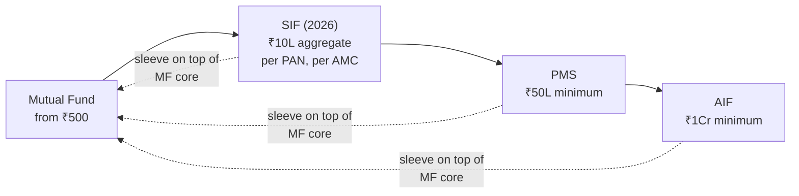

The Indian retail investment ladder has long had a conspicuous gap in the middle. At the bottom sits the mutual fund, open from a few hundred rupees and the workhorse of the ₹10 lakh starter portfolio. At the top sit PMS (from ₹50 lakh) and AIFs (from ₹1 crore), both of which assume an investor who is past the scale at which a managed sleeve actually pays for itself. Between those two points, the HNI with a ₹10–40 lakh corpus wanting a *sophisticated, professionally managed strategy* in a *pooled, liquid, SEBI-regulated* structure had no clean answer. That gap is what SEBI's new Specialized Investment Fund category fills, effective 1 April 2026.

## Why this article matters now

SIFs are new: SEBI (Mutual Funds) Regulations 2026 created the category, and it became effective on 1 April 2026 (`src-sebi-sif-2026`, `src-sebi-mf-regulations-2026`). The timing matters for a specific reason. The 2026 regulation overhaul also introduced a sibling framework, the "MF Lite" structure for passive-only funds. The point of that split is that SEBI wanted to give active managers room to run strategies that a classic mutual fund category simply does not allow — dynamic asset allocation, sector rotation, and capped long-short positions using derivatives — while giving retail-grade protection (minimums, breach rules, disclosure) to the investors taking the other side of those strategies.

For a reader of this encyclopedia the practical stakes are three:

1. **A new instrument lands at exactly your current scale.** If your investable corpus is in the ₹10–50 lakh band — which is precisely the "Wealth Beyond ₹10L" band that this site's companion book covers — a SIF is the first *pooled, daily-priced* vehicle that offers you a hedge-fund-style strategy without a ₹50 lakh PMS commitment.
2. **The minimum is smaller than the strategy is complex.** A ₹10 lakh entry into a long-short equity strategy is a meaningful risk allocation. You are not buying a better index fund; you are buying a derivative-heavy, actively hedged book. The gap between "affordable" and "understood" is where SIF investors get hurt.
3. **The rules are still settling.** Everything in this article that comes from secondary guides on the SEBI 2026 framework carries an explicit "verify against the scheme document" flag. That is not hedging — it is the honest state of a category that went live four months before this article was written.

If your corpus is under ₹10 lakh, this article is still useful: it tells you what is coming and what to read when the day arrives. If it is above ₹50 lakh, read this first, then [PMS, AIFs & Private Markets](../alternatives/alternatives-pms-aif-private.mdx), because your real decision is usually SIF sleeve *plus* PMS core, not SIF alone.

## What a SIF actually is

A Specialized Investment Fund is a **pooled investment vehicle run by an Asset Management Company (AMC) under the SEBI (MF) Regulations 2026**. Three properties of that definition do most of the work:

- **Pooled, like a mutual fund.** Your money is combined with other investors' money, priced daily at NAV, and you hold *units of the fund*, not individual securities. This is the structural contrast with a PMS, where the manager holds individual securities *in your own demat account* and runs them per your mandate. In a SIF you cannot see your slice of the portfolio in your demat; you see the NAV.
- **Run by an AMC under MF Regulations, not a PMS or AIF regulation.** That matters for three reasons: the regulatory parent is the mutual fund regulator (SEBI's MF framework), the distribution and governance channel is the one you already use for mutual funds, and the investor protections that the MF regime has built up over two decades apply.
- **Built for "sophisticated" strategies that a plain mutual fund category does not permit.** The strategies the category is designed around are dynamic asset allocation, sector rotation, and long-short positions with a cap on the naked (unhedged) short sleeve, executed with listed derivatives. The fund can lean more aggressively into these levers than a conventional open-ended equity or debt scheme may.

One more property that sets the tone for everything else: **the ₹10 lakh minimum.** SIFs are not open to a ₹500 SIP mindset by default; the category explicitly targets investors who can meaningfully absorb the strategy risk. That minimum, and how it is enforced, is the next section.

## The ₹10 lakh minimum, precisely

This is where most retail readers will get SIF wrong, so the mechanics are worth laying out exactly.

**Aggregate per PAN, within one AMC's SIF offerings.** The minimum is ₹10 lakh *in total across that AMC's SIF schemes*, on a per-PAN basis — it is **not** a per-scheme minimum. The rule's consequence is that you may split your commitment across several SIF schemes of the same AMC and remain compliant. For example, under the aggregate rule, holding ₹6 lakh in one equity-SIF scheme and ₹4 lakh in a debt-SIF scheme of the *same* AMC adds up to ₹10 lakh and satisfies the minimum. Verify this interpretation against each scheme's document, because "aggregate within one AMC" is a secondary-guide reading of the 2026 framework (verify current rule before acting).

**SIPs and STPs are allowed.** The category does not require a single lump sum at entry. An investor can build the ₹10 lakh position through a systematic investment plan into the SIF, and can move money between the AMC's schemes using systematic transfer plans, subject to the scheme's own documentation (verify current rule before acting).

**What happens when the minimum is broken.** The framework distinguishes two cases, and the distinction is the whole ballgame:

- **Passive breach.** Your holdings fall *below* ₹10 lakh because the NAV dropped (or because dividends/redemptions by others moved the fund, not you). This is a **non-event**: no violation, no action required of you. You keep your units and your normal redemption rights. The minimum is not a support price on the NAV.
- **Active breach.** Your holdings fall below ₹10 lakh because *you* redeemed units. Here the fund does not let you walk away freely: the units in question are **frozen**, and you have a **30-day window to rebalance** your position back to or above the minimum. Verify the exact mechanics and the 30-day clock against the scheme's redemption clause (verify current rule before acting).
- **Accredited investors are exempt from the minimum.** The category's gate is a scale-and-sophistication test for ordinary investors; SEBI's accredited-investor category is explicitly excluded from the ₹10 lakh floor (verify current rule before acting).

Why the breach rule exists at all: a long-short, derivatives-using fund has a *cost structure and a hedging program* calibrated for a corpus above a floor. If retail investors could dribble out of it any time the strategy looked scary, the fund's hedges and desk would be sized for a book that no longer exists. The 30-day rebalance window forces the investor to make a decision about the strategy — stay above the minimum or exit properly — rather than quietly shrink.

## Strategy categories

The SIF umbrella is not one strategy; it is a set of allowed strategy *families*. Two dominate the initial offering:

### Equity Long-Short / Market-Neutral

The fund holds a **long book** in equities it expects to outperform and a **short book** (executed with listed derivatives — index futures, single-stock futures, F&O options) to neutralise the market direction. The secondary guides on the 2026 framework describe an illustrative blend of roughly **75% long / 25% short**, with the **naked (unhedged) short sleeve capped at about 25% of the book and the remainder required to be hedged** (sifmf.in, medium confidence; verify the exact cap against the scheme's derivative policy before acting). The design goal is **lower correlation to the broad market**: the fund is meant to make money from its *security selection spread*, not from the market rising.

The payoff logic, and why it is not what most people think, is worth one worked pass. The following numbers are **illustrative only** — they demonstrate the *mechanism* of a long-short spread, not a prediction, not a backtest, and not a fund's actual track record:

Assume a simple equity-long-short position: 75% of the book long a basket of outperformers, 25% short the broader market index via futures, and no leverage. In three hypothetical year-ends:

```math
R_{port} = 0.75 \times R_{long} + 0.25 \times (-R_{short})
```

| Scenario (illustrative) | Long basket | Short index | Portfolio |
|---|---|---|---|
| Melt-up: market +30%, your longs +30% | +30% | +30% | +15% |
| Steep bear: market −30%, your longs −20% | −20% | −30% | +5% |
| Sideways: market 0%, your longs +5% | +5% | 0% | +3.75% |

Read that table slowly. In the melt-up, the fund **captures half the market's rise** — the short sleeve is an explicit tax on upside. In the bear, it *profits* because the short leg wins more than the long leg loses. In sideways, it returns whatever the *spread* between your picks and the index produced. The strategy is decoupled from direction: **its returns are a function of pair selection, not of the market's direction.** That is why a "great 12-month table" on a long-short fund is not evidence of skill the way it is on a plain equity fund — and it is why section on common mistakes below treats it as the #1 trap.

### Debt Long-Short

The debt version trades *rates and credit*, not equity alpha. A fund of this type will run **duration positioning** (leaning long when it expects yields to fall, short when it expects them to rise), **credit-spread strategies** (laddering between government debt and investment-grade corporates, rolling the curve), and **interest-rate hedging** using the listed interest-rate derivatives available to the fund. The risk profile is closer to a bond strategist's book than to an equity hedge fund: the drawdowns are smaller, the gross returns are lower, and the "alpha" is a rate bet measured in basis points, not in equities.

### A note on the "sophisticated" bucket

Dynamic asset allocation and sector rotation sit in the same SIF framework but with a gentler risk profile — they are closer to a flexible-mutual-fund that has more tactical freedom. If the label on the SIF you are looking at reads "dynamic allocation" or "sector rotation," the strategy math is closer to the debt/long-short families *in complexity* but not in *magnitude of risk*. Match the strategy family to your risk budget before you look at the name.

## Tax treatment

SIFs are **taxed like mutual funds at the investor level, by asset class**. Concretely, under the framework as of the October 2026 write date:

- **Equity-oriented SIF:** long-term capital gains above **₹1 lakh per year** taxed at **12.5%**; short-term capital gains taxed at your slab rate. (These are the same rates that apply to equity mutual funds; verify the current rates with a CA — rates are time-sensitive.)
- **Debt-oriented SIF:** gains taxed at your **income-tax slab rate** (the debt-mutual-fund treatment; verify the current classification with a CA).
- **Fund-level income:** the SIF itself is exempt from fund-level tax under **Section 10(23D)** of the Income-tax Act, so you do not pay tax "inside" the fund the way you would inside a company (verify current provision with a CA).
- **Contrast with AIF Category III:** a Cat III AIF's gains are not pass-through at your slab — Category III AIFs carry a different tax structure, with capital gains at **12.5%** and a portion of gains that can be taxed as **business income at 30% plus applicable cess** (secondary summary; verify current position with a CA before acting). This is the specific confusion that section "Common mistakes" flags, because the two instruments look alike on the surface and are not alike on tax.

The recurring line you will want to say out loud before committing money: **verify current rates with a CA. Tax rates are time-sensitive.** The 12.5% equity-LCG rate and the 10(23D) exemption are the state of the law at write time; they are not a promise that they will hold when you redeem in 2031.

## Costs

Two numbers, both flagged:

- **Expense-ratio cap: about 2.25% per annum (management fees), plus about 2% for marketing/distribution** (secondary guide figure; verify against each scheme's documentation before acting).
- **No separate performance fee in the classic mutual-fund style** — the management fee is the charge, and the scheme's distribution arm carries its own marketing/distribution cost line.

The practical arithmetic is that a 2.25% management fee on a ₹10 lakh position is roughly ₹22,500 a year *before* any distribution cost, and that number is charged whether the strategy is making money or not. For a strategy that is designed to underperform in a melt-up (the long-short case), the fee is a real cost against a return profile that will *already* be below plain equity. Read the scheme's actual expense ratio before you compare it to a 0.20% index fund — they are not the same product, and the cost gap is not a rounding error over a 5-year holding period.

## SIF vs MF vs PMS vs AIF

The four instruments at a glance. This table is the one to keep next to your keyboard when you are deciding where a new tranche of capital belongs:

| Vehicle | Minimum | Strategy freedom | How held | Tax treatment | Who it's for |
|---|---|---|---|---|---|
| **Mutual Fund (classic)** | From ₹500 (SIP/lump) | Limited to the MF categories as defined | Pooled, NAV-priced units | Investor-level, by asset class | Everyone; the default for a core portfolio |
| **SIF (2026)** | ₹10 lakh aggregate per PAN, per AMC | Dynamic allocation, sector rotation, capped long-short, derivatives | Pooled, NAV-priced, daily pricing | MF-like at investor level; fund-level nil under 10(23D) | HNI in the ₹10L–₹50L band wanting a sophisticated *pooled* sleeve |
| **PMS** | ₹50 lakh | Full manager discretion within your signed mandate; individual security selection | Securities in **your demat**, per your PMS contract | Pass-through to investor at your slab (equity LCG/STCG as applicable) | HNI with ₹50L+ wanting a named, individual-security manager |
| **AIF** | ₹1 crore | Category-dependent; Cat III adds leverage and event-driven strategies | Fund units (no demat for listed-equity holdings); private placement | Cat III has a distinct CG + business-income structure; Cat I/II pass-through | HNI/UHNI in the ₹1Cr+ band wanting illiquid or leveraged exposure |

Two things to internalise from that table. First, **the ladder is not a risk ladder in a monotonic sense**: PMS is not "more risky" than a SIF just because it sits above it — PMS is *individual, per-investor* management, while SIF is *pooled*; the risk difference is in structure, not in risk. Second, **the tax row is where the four genuinely diverge**: MF and SIF share the investor-level MF-style treatment, PMS is pass-through at your slab, and AIF Cat III is a separate box. Mixing them up is a real, documented confusion (see "Common mistakes" below).

## When a SIF makes sense — and when it doesn't

The honest framing is that a SIF is **a sleeve, not a portfolio**. The conditions under which it earns its place:

1. **You already have a solid, diversified mutual-fund core.** An index-fund anchor plus a quality active fund or two plus a debt sleeve, held for years. The SIF is the satellite that goes *on top of* that, not the first thing you buy.
2. **The SIF is a *sensible slice*, not the whole position.** A rule of thumb (not a sourced fact): for most investors, a SIF sleeve should not exceed **~15–25% of total corpus**. Above that, you are running a portfolio whose *dominant* risk is a single strategy family — at which point the diversification value of the long-short idea has been exhausted.
3. **Your horizon is 3–5+ years.** A long-short strategy's spread takes time to manifest; a 2-year hold is a coin flip against the fee drag. The PMS article's "1-year lock-in, many run 3-year" framing applies to SIFs' patience too.
4. **You can articulate the three specific risks you are taking on:** short-squeeze risk (your short leg getting run over in a violent melt-up), leverage/cost risk (the derivative hedges have a carry cost), and manager risk (the pair-selection process can be wrong for a full cycle). If you cannot name those three out loud, the minimum bar for a SIF is not met at your corpus.
5. **You accept that a long-short fund can lose in *every* market condition.** The "melt-up captures half" line above cuts both ways: in a market where your specific longs lag the broad index by a wide margin for a sustained period, the fund *loses* in a sideways or rising tape. Market-neutral does not mean market-proof.

When a SIF **does not** make sense: your corpus is under ₹10 lakh (the minimum is not a formality, it is the category's design), your horizon is under 3 years, you are building your portfolio for the first time, or you are buying the SIF *instead of* an index-fund core. In all four of those cases, the instrument is the wrong tool and the fee structure will quietly cost you.

## The practical path for a ₹10 lakh starter

This is the personal-finance tier, and the sequence matters more than the individual instruments. A workable structure, in the order you should actually build:

**Step 1 — Years 1–3: build the mutual-fund core.** This is the [Your 10 Lakh Wealth Plan](../personal-finance/pf-wealth-plan-10-lakh.mdx) territory: direct index funds on SIP, a couple of quality active funds, a debt sleeve. At the end of three years, you have a diversified, liquid, low-cost core and — if your income has held up — a corpus in the ₹25–40 lakh band, not the ₹10 lakh you started with. The SIF is not in this step. Adding a long-short sleeve at ₹10 lakh total corpus means the SIF *is* the portfolio, which is the mistake.

**Step 2 — Add the SIF sleeve.** Once the corpus is past ₹30–40 lakh and the core is stable, a ₹10–15 lakh entry into a SIF (a single scheme or two schemes of the same AMC, aggregate-per-PAN) is a meaningful, well-sized satellite. This is the tier the 2026 category was designed for: you are past the scale where a PMS is unaffordable, and you want a pooled, daily-priced, derivatives-capable strategy. The risk budget is the 15–25% rule of thumb above, not the ₹10 lakh minimum.

**Step 3 — The ₹50 lakh PMS gate.** As the corpus crosses ₹50 lakh, a PMS core is now a real option: individual security selection, a named manager, per-investor securities in your demat. At this stage the SIF sleeve stays as the *satellite* inside the PMS structure, not the whole portfolio. Read [Beyond SIP: PMS, AIFs & Private Markets](../alternatives/alternatives-pms-aif-private.mdx) before this step.

**Step 4 — The ₹1 crore AIF gate.** Past ₹1 crore, AIF access opens: Cat II private-credit and pre-IPO co-invests, Cat III event-driven strategies, the illiquid-asset class that a SIF can never touch. This is where the tax row of the comparison table becomes material, and the Cat III CG + business-income structure is the thing to have a CA read *before* you sign the PPM.

The through-line of the sequence: **each rung is an addition, not a replacement.** The index-fund core that carried you at ₹10 lakh is still the core at ₹1 crore; the SIF sleeve is an addition to it, and the PMS/AIF sleeves are additions to that. The failure mode — replacing the core with the satellite and ending up 80% illiquid with no liquid layer to draw down in a bad year — is the same failure mode documented in the PMS article, and the SIF does not create it, it just moves the question to the ₹10–50 lakh scale.

## Due diligence checklist

Before money moves, work through this list in order, against the *specific* scheme you are considering:

1. **Read the SIF scheme document in full**, including the derivative-policy annex. The "capped long-short" language is the headline; the actual cap, the actual hedge mandate, and the actual single-name concentration limits are in the document, not in the pitch.
2. **Read the strategy-risk disclosure specifically.** A long-short equity SIF will carry an explicit short-squeeze and leverage disclosure; a debt SIF will carry duration and credit-spread disclosures. Make sure the risk you are taking on matches the risk the document says you are taking on.
3. **Track record vs. benchmark, not vs. itself.** For a new scheme, the benchmark is the fund's *stated* index or strategy benchmark; for an older scheme, the multi-year track record against that benchmark and against a plain index fund over the *same* periods. A "great 12-month table" is not the number to hang the decision on.
4. **Turnover.** A long-short strategy with a very high monthly turnover is a cost structure that will quietly eat the alpha; a very low turnover may mean the "short sleeve" is not actually rotating. The turnover figure is in the annual report; check the last two years.
5. **Expense ratio vs. peers.** Verify the scheme's actual expense ratio (the 2.25% cap is a cap, not a target) against other SIFs of the same AMC and against other AMCs' SIFs. A 0.5% gap on a ₹10 lakh position is ₹50,000 over five years on a flat NAV.
6. **AMC's SIF governance.** Who is the named portfolio manager? How long have they run a derivatives-heavy book? Is the SIF team the same team that runs the classic equity fund, or a separate derivatives desk? The document should tell you; if it doesn't, ask.
7. **Exit load and redemption window.** Some SIFs carry an exit load on early redemption; check the specific scheme's load schedule and the minimum-holding-period language.
8. **NAV frequency.** The 2026 framework notes **daily pricing** for SIFs — confirm this is in fact the scheme's stated frequency, because a daily-priced long-short fund is a materially different exit experience from a weekly-priced one, especially in a violent melt-up where you may want out *fast*.

None of these items is a substitute for the "verify against the scheme's document" flags scattered through this article; they are the order in which to *read* the document.

## The Indian investment ladder, visualised



Read the diagram the way the practical-path section reads it: the dotted lines are the *additions* — each rung is a sleeve on top of the mutual-fund core, not a replacement for it. The minimums on each rung are the ones from the verified ladder: MF from ₹500, SIF ₹10 lakh, PMS ₹50 lakh, AIF ₹1 crore.

## Common mistakes

The five mistakes this article is most trying to prevent, in the order they show up in practice:

1. **Chasing a fund because one 12-month table looked great.** A long-short fund that captured the full melt-up for a year will, by the structure of the strategy, under-capture the *next* melt-up. The 12-month table is the single least-informative number about a long-short strategy; the multi-year track record against a stated benchmark is the number that matters.
2. **Ignoring that the short leg caps your upside in a melt-up.** The "captures half the market's rise" line is the mechanism, not a bug to be fixed by picking "a better long-short fund." Every fund in the category carries that cap by design; the question is whether *you* are buying a fund that is designed to under-perform a plain index in a strong bull market, and whether your risk budget allows it.
3. **Assuming SIF = "better mutual fund."** It is not a better version of a mutual fund; it is a *different risk class* with a derivatives overlay and a minimum that the classic MF does not have. The "better" framing is how most SIF mis-sales happen.
4. **Mixing up SIF tax with AIF Category III tax.** The SIF is MF-like at the investor level (equity LCG 12.5% above ₹1L, fund-level nil under 10(23D)); the Cat III AIF is a separate box (12.5% CG plus a business-income component at 30% plus cess, per the secondary summary). Quoting the AIF number against a SIF — or the SIF number against an AIF — is the specific tax error this section exists to prevent. Verify both with a CA before acting.
5. **Over-concentrating in one strategy family.** Two SIFs of the same AMC running the *same* long-short equity strategy is not "diversified SIF exposure"; it is one strategy family with two entry points. The 15–25% rule of thumb on the SIF sleeve is the cap that keeps this mistake from compounding.

## Ending: where this goes next

The SIF is the missing rung of the Indian ladder, and the 2026 framework is the first time a pooled, daily-priced, derivatives-capable, SEBI-regulated instrument has sat at the ₹10 lakh scale. That is a real change for the HNI band this site covers, and it is worth taking seriously in two directions: the *instrument* is new and its rules are still settling (hence the "verify" flags throughout), and the *investor* — you, at ₹10 lakh, with a 3–5 year horizon, on top of a solid index core — is exactly who it was designed for.

Read the two neighbours of this article before acting, in this order:

- [Beyond SIP: PMS, AIFs & Private Markets](../alternatives/alternatives-pms-aif-private.mdx) — the upper half of the ladder (PMS ₹50L, AIF ₹1Cr), the fee/lock-in/return structures, and the tax pass-through rules that a SIF *does not* carry.
- [How to Choose and Compare Mutual Funds](../mutual-funds/mf-choosing-comparing-funds.mdx) — the repeatable fund-selection process you will want to apply to a SIF's scheme document, because the checklist in that article (mandate clarity, cost, tracking, manager risk, style drift, overlap, tax efficiency) transfers almost verbatim to SIF due diligence.
- [Your 10 Lakh Wealth Plan](../personal-finance/pf-wealth-plan-10-lakh.mdx) — the starting point of the sequence: build the core before you add the sleeve.
- And the book that this site's SIF coverage feeds into: **Wealth Beyond ₹10L**, which walks the full sequence from the ₹10 lakh SIP base through the PMS and AIF gates, with the allocation table for each stage.

The single sentence to remember from this article: **a SIF is a sleeve on top of a diversified mutual-fund core, not a replacement for it, and the ₹10 lakh minimum is the floor for the strategy, not the ceiling for your portfolio.**

## Update log

- 2026-10-16: SIF rules verified against SEBI MF Regulations 2026 secondary summaries (effective 1 April 2026); minimum, breach rules, and expense caps flagged for scheme-document verification.
