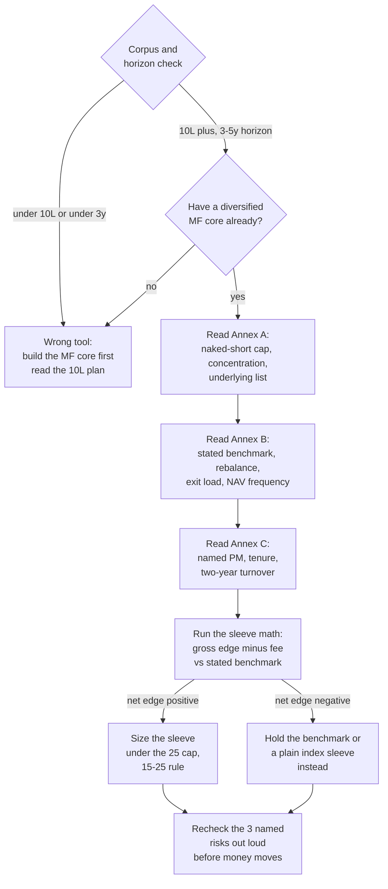

The overview article on [SIF, India's New ₹10 Lakh Tier](./alternatives-sif-specialized-funds.mdx) told you *what a SIF is* and *how it sits between a mutual fund and a PMS*. The [SIF / PMS / AIF selection guide](./alternatives-hnw-pms-aif-sif-selection.mdx) told you *which rung your corpus can actually afford*. This article fills the third gap: **what a SIF is actually allowed to *do* with your money, and how to verify that what it does is what the document says it will do.** That is the layer where most SIF money gets quietly lost — not at the entry, but at the *strategy family* and the *scheme document*.

It is written for the reader who has outgrown the plain index fund, has a corpus in the ₹30L–₹50L band (or is on track to cross ₹50L), and wants to add a derivatives-capable pooled sleeve *without* a PMS commitment. Every number here is an *expected-return decision aid*, not a backtest: a SIF's return is a function of pair selection and spread, not of the market's direction, so "a great year" for one fund says nothing about the next.

## What the 2026 framework actually permits

The headline is that a SIF is *not* one strategy. It is a set of **permitted strategy families** that a classic mutual-fund category simply does not allow — dynamic allocation, sector rotation, and capped long-short positions executed with listed derivatives. The secondary guides on the 2026 framework (verify each against the specific scheme document before acting) describe **seven** broad long-short and relative-value families that AMCs are expected to populate:

| # | Strategy family | What it trades | Where the edge comes from | Dominant risk |
|---|---|---|---|---|
| 1 | **Equity Long-Short** (market-neutral) | Long basket + short index/single-stocks via futures/options | The spread between your longs and the shorted benchmark | Short-squeeze; the short leg caps melt-up upside |
| 2 | **Equity Market-Neutral (pure factor)** | Roughly dollar-neutral long/short book sized to strip beta | Factor exposure (value, quality, momentum) minus the market | Factor crowding; duration of a neutral book in a one-sided tape |
| 3 | **Debt Long-Short / Rate** | Duration positioning long + short across the curve | A rate bet measured in basis points | A wrong directional rate call; roll cost of the hedge |
| 4 | **Credit Relative Value** | Ladder across govts / IG corporates; go long/short relative | Credit-spread compression/expansion | A credit event on the long side; liquidity in the short side |
| 5 | **Sector Rotation** | Tactical overweight/underweight across sectors | Picking the next leading sector | A wrong rotation is just a high-cost equity bet |
| 6 | **Dynamic / Tactical Asset Allocation** | Shift equity↔debt mix on a signals model | Timing the macro mix | Signals that lag; whipsaw in a range-bound tape |
| 7 | **Event-Driven / Arbitrage** | Mergers, index-inclusion, convertible-parity, basis trades | A priced-in dislocation correcting | Execution risk; the dislocation is sometimes the story |

A two-line caution on reading that table. First, **the "seven" is a secondary-guide reading of the 2026 framework, not a fixed SEBI list of exactly seven named strategies** — the regulation opens the category to the *families* above and lets each AMC define the specifics in its scheme document. Treat the number as "order of magnitude" and verify the *exact* permitted strategies and caps in the document you are signing. Second, **families 1–4 are the "sophisticated" core of the category**; families 5–7 are closer to a flexible mutual fund that has been given more tactical freedom, and their risk is meaningfully lower in magnitude even where the label sounds more aggressive. Match the family to your risk budget *before* you read the fund's name.

The payoff logic of the two dominant families, worth one worked pass, is the same in every SIF pitch deck. Assume a simple equity long-short position with no leverage:

```math
R_{port} = w_L \times R_{long} + w_S \times (-R_{short}), \quad w_L + w_S = 1
```

With an illustrative 75% long / 25% short blend:

| Scenario (illustrative) | Long basket | Short index | 75/25 portfolio |
|---|---|---|---|
| Melt-up: market +30%, longs +30% | +30% | +30% | +15% |
| Steep bear: market −30%, longs −20% | −20% | −30% | +5% |
| Sideways: market 0%, longs +5% | +5% | 0% | +3.75% |

Read the melt-up row slowly. In the strongest market, the fund **captures half the rise** — the short sleeve is an explicit tax on upside. That is not a bug to fix by "picking a better long-short fund"; every fund in the category carries that cap by design. The question is whether *you* are buying a fund that is engineered to under-perform a plain index in a strong bull market, and whether your risk budget allows it.

## How to read the scheme document: the three annexes that matter

A SIF is sold on a one-paragraph strategy summary; the real content is in three annexes most investors never open. Work through them in this order.

**Annex A — the derivative policy.** This is where the "capped long-short" language becomes a number. Read the three figures and say them out loud:

1. **The naked-short cap.** The illustrative framework cap is *about* 25% of the book unhedged, with the remainder required to be hedged (`src-sebi-mf-regulations-2026`, medium confidence — verify the exact cap in your scheme's derivative policy before acting). "Naked" is the number that decides your short-squeeze exposure; the hedged portion is a carry cost, not a risk you are taking off.
2. **The single-name and single-sector concentration limits.** A 75/25 blend still holds a book of *specific* longs. The cap on one name and on one sector decides whether a single credit event or a single sector de-rating can take out a large slice of the fund.
3. **The permitted underlying list.** Listed index futures, single-stock futures, F&O options, and — for the debt families — the listed interest-rate derivatives. The list is the menu; anything not on it is off the menu even if the manager "would like to" use it.

**Annex B — the allocation and rebalancing rules.** This is the "within-fund allocation" layer that the overview article left open: how the AMC is *required* to hold the mix, and what it may do when the market moves.

- **The stated benchmark.** Every SIF must name a benchmark or a strategy index. For a new scheme, that benchmark is the *only* honest yardstick; for an older scheme, the multi-year track record against that benchmark over the *same* periods is the number that matters. A 12-month table against the Sensex is the single least-informative number about a long-short strategy.
- **The rebalance trigger and frequency.** When the mix drifts from target, what forces a rebalance, and how often NAV is marked. The framework notes **daily pricing** for SIFs — confirm it is in fact the scheme's stated frequency, because a daily-priced long-short fund is a materially different exit from a weekly-priced one, especially in a violent melt-up where you may want out *fast*.
- **The lock-in and exit-load schedule.** Some SIFs carry an exit load on early redemption. The load schedule plus the minimum-holding language is the cost of exiting *early*, which for a 3–5-year strategy is the whole point.

**Annex C — the governance and turnover disclosures.**

- **The named portfolio manager and their derivatives-desk tenure.** A SIF that is a derivatives-heavy book is not run by the same desk that runs the classic equity fund; the document should say who runs it and how long. If it does not, that is your question.
- **Turnover, the last two years.** A very high monthly turnover on a long-short strategy is a cost structure that quietly eats the alpha; a very low turnover may mean the short sleeve is not actually rotating. The turnover figure is in the annual report.

The recurring line before money moves: **verify every cap, mix, and benchmark against *this* scheme's document, not the pitch.** The pitch is the family; the document is the fund.

## Sleeve-sizing: the fee-decay math that decides if it earns its place

The decision is not "is a SIF a good strategy." It is: **does the manager's expected *net* (after fee) edge over its *stated* benchmark exceed the fee drag, and how much of the corpus may a SIF sleeve safely hold under the ~15–25% rule of thumb?** The net edge is computed against the SIF's *own* stated benchmark, not the plain index — a market-neutral fund judged on the Sensex is being judged on the wrong number.

The decision test, stated once:

$$\text{pays for itself} \;\Longleftrightarrow\; \big(\bar r_{SIF}^{gross} - f_{SIF}\big) \;>\; \bar r_{bench}$$

where $f_{SIF}$ is the annual expense ratio (the framework cap is about 2.25% management plus about 2% marketing/distribution, verify against the scheme). The site ships this as a pure, unit-tested function, `sifSleeveSizing()`, which returns the net edge, the blended portfolio net return, the fee drag over the holding period, and whether the sleeve is capped at the 25% rule of thumb. The two failure modes it exposes:

- **The fee eats the edge.** A SIF with a 2.25% fee on a strategy whose gross edge over its benchmark is only 1.5% has a *negative* net edge. On a ₹40L corpus at a 20% sleeve that is roughly ₹8L of corpus × (2.25% − 1.5% net) ≈ ₹6,000 a year of pure fee drag against a negative edge — the sleeve is *costing* you relative to holding the benchmark.
- **Over-concentration.** Two SIFs of the same AMC running the *same* long-short family is one strategy with two entry points. The 15–25% cap on the *total* SIF sleeve is what keeps this mistake from compounding; the function caps any input above 25% and reports the effective sleeve.

The three numbers to keep for any specific scheme: the SIF's own **gross** expected annual return (from its benchmark and its manager's track record, *not* from a single great year), the **expense ratio** from Annex C, and the **stated benchmark's** expected return. Plug them in, and the function tells you whether the sleeve earns its fee and how big it may be.

## When a SIF sleeve earns its place — and when it is the wrong tool

The conditions, in the order to check them:

1. **You already have a solid, diversified mutual-fund core** — an index anchor, a couple of quality active funds, a debt sleeve, held for years. The SIF is the satellite on top of that, not the first thing you buy.
2. **The SIF is a sensible slice, not the whole position.** A rule of thumb: not more than **~15–25% of total corpus**. Above that, the *dominant* risk of your portfolio is one strategy family and the diversification value of the long-short idea has been exhausted.
3. **Your horizon is 3–5+ years.** A spread takes time to manifest; a 2-year hold is a coin flip against the fee drag.
4. **You can name the three specific risks you are taking on:** short-squeeze risk, leverage/carry cost, and manager risk (the pair-selection process being wrong for a full cycle). If you cannot say the three out loud, the minimum bar is not met.
5. **You accept that a long-short fund can lose in *every* market condition.** Market-neutral does not mean market-proof; in a tape where your specific longs lag the broad index by a wide margin for a sustained period, the fund *loses* sideways.

A SIF is the wrong tool when your corpus is under ₹10L (the minimum is the category's design, not a formality), your horizon is under 3 years, you are building your portfolio for the first time, or you are buying the SIF *instead of* an index core. In all four cases the instrument is the wrong tool and the fee structure quietly costs you.



## The common mistakes, in the order they show up

1. **Chasing a fund because one 12-month table looked great.** A long-short fund that captured the melt-up for a year will, by the structure of the strategy, under-capture the *next* melt-up. The multi-year record against the *stated* benchmark is the number that matters.
2. **Reading the name, not Annex A.** The label "market-neutral" hides the actual naked-short cap, the single-name cap, and the hedging mandate. The pitch is the family; the annex is the fund.
3. **Judging a market-neutral fund on the Sensex.** The stated strategy benchmark is the only honest yardstick; the plain index is a different product.
4. **Over-concentrating in one family.** Two SIFs of the same AMC running the same long-short equity strategy is one strategy with two entry points. The 15–25% cap is the guardrail.
5. **Ignoring the exit load and NAV frequency.** A daily-priced, no-exit-load fund is a materially different exit from a weekly-priced, early-redemption-loaded one — especially in the melt-up where you want out fast. Confirm both in Annex B.

## Where this sits in the ladder

The SIF is the missing rung: the first *pooled, daily-priced, derivatives-capable, SEBI-regulated* instrument at the ₹10L scale. The sequence that the overview article lays out — build the MF core, add the SIF sleeve, cross the ₹50L PMS gate, cross the ₹1Cr AIF gate — is unchanged; this article is the *reading layer* you apply at the SIF step. Read it together with [SIF, India's New ₹10 Lakh Tier](./alternatives-sif-specialized-funds.mdx) (the instrument and the minimums), the [SIF / PMS / AIF selection guide](./alternatives-hnw-pms-aif-sif-selection.mdx) (the rung decision and fee-decay test), and [How to Choose and Compare Mutual Funds](../mutual-funds/mf-choosing-comparing-funds.mdx) (the repeatable selection checklist that transfers to a SIF scheme document). The book this feeds is **Wealth Beyond ₹10L**.

The single sentence to remember: **a SIF is a sleeve on top of a diversified mutual-fund core; the strategy families decide the risk you are taking, and the three annexes decide whether the fund you are buying is the strategy you thought you were buying.**

## Update log

- 2026-10-18: SIF strategy-family decode and sleeve-sizing decision framework added; the "seven families" and the 75/25 illustrative blend are secondary-guide readings of the SEBI MF Regulations 2026 — flagged for scheme-document verification at write time.
