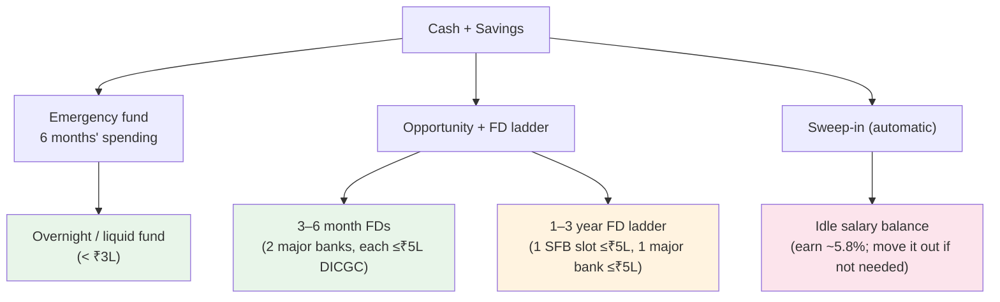

**Scope note.** This article covers the *safety mechanics* of Indian bank deposits (what is insured, what is not, what bank categories mean), *FD economics* at current rates, and *where cash should live* for a ₹10 lakh investor. It is not a bank-recommendation article. Figures marked **"(verified 2026-10-16)"** were checked against the cited sources; interest rates move quarterly.

## Why "bank is safe" is only half the truth

India has a **deposit-insurance floor**, not a guarantee. The **DICGC** — a wholly-owned subsidiary of the RBI — insures deposits up to **₹5 lakh per depositor, per bank, per "same right and same capacity."** [src-dicgc-deposit-insurance]

That means:

- Your ₹50 lakh in SBI + ₹50 lakh in HDFC + ₹50 lakh in ICICI is insured in **full** if each is in a separate bank and all in your individual (non-JOINT, non-HUF) name.
- ₹50 lakh split across **five SBI accounts in your name** (current + savings + FD1 + FD2 + salary) is insured **only up to ₹5 lakh total** — DICGC aggregates *same depositor, same bank, same capacity.*
- **Joint accounts are capped at ₹5 lakh per joint holder**, not per account. A 2-person joint FD of ₹100 lakh at one bank is insured only ₹10 lakh in total.
- **SGBs, PPF, KVP, SCSS, NPS, bank NPS, and government-guaranteed retirement assets are NOT DICGC-covered** — they are protected by the government or by scheme law, but they do not add to your ₹5L DICGC headroom.
- **Sweep-ins and overnight funds** (which park excess balance in overnight/liquid mutual funds or call accounts) **lose DICGC cover** the moment the funds flow out of the bank's own balance sheet. A sweep account is effectively an MF exposure; the insurance does not follow.

### DICGC is the floor, not the ceiling

The ₹5L limit has not changed in decades. It is a *last-resort safety net* — in practice, when a bank goes under, the government (via RBI) has historically stepped in to protect depositors *beyond* DICGC (e.g., Yes Bank 2020: RBI extended its safety net to **all depositors, not just up to ₹5L**). But DICGC is the **legal minimum**, and yes-bank/IDBI-style bailouts are discretionary.

**Rule of thumb:** if you hold more than ₹5L at a single bank in your individual name in insured deposits, the excess is *technically* uninsured.

## Bank categories, and why the category matters more than the brand

| Category | Examples | RBI supervision | DICGC insured? | FD 1-year rate range (verified 2026-10-16) |
|---|---|---|---|---|
| **Major scheduled commercial banks (public + private)** | SBI, PNB, BOB, HDFC, ICICI, Axis, Kotak | Full RBI supervision | Yes, up to ₹5L | 6.25%–7.10% |
| **Small Finance Banks (SFBs)** | Ujjivan, Jan SFB, AU SFB, Fincap | Yes, but RBI-imposed lending-deposit cap: SFBs cannot concentrate ≥25% of deposits from one depositor (each depositor's FDs capped at ₹25L for SFBs) | Yes, up to ₹5L | 7.00%–8.50% (senior) / up to 9% advertised |
| **Payment Banks** | Airtel Pay, Paytm (payment), NPS India Pay | Yes — but payment banks **cannot lend** (except against deposits, with caps) | Yes, up to ₹5L | Savings rate only (no FD) |
| **Cooperative banks (state/district)** | District Central Cooperatives, State Co-op | RBI (district/states) | Yes, up to ₹5L | Varies; typically 6–8% |

**Key takeaway:** you can safely chase **small-finance-bank FDs** at 7–8.5% **as long as your deposit at any one SFB stays under ₹5L** (DICGC) *and* under the SFB's own **₹25L per-depositor cap** (which is a *regulatory* cap on total liability to any one depositor — beyond ₹25L the SFB may not accept further deposits from you).

For a ₹10L investor: spread your cash and FDs across 2–3 banks with **≤₹5L each** in insured deposits.

## FD mechanics — what a "1-year FD at 6.75%" actually means

A Fixed Deposit is a **deposit account** with a fixed interest rate and a fixed maturity. Interest can be paid:
- **Credited at maturity (CUM)** — the classic option; you get principal + total interest lump-sum at maturity.
- **Periodic payouts (monthly/quarterly/semi-annual)** — interest is taxed each year at your slab; the FD principal is not compounded.

**Taxation of FD interest:** taxed at **your slab rate** under "Income from Other Sources." TDS at 10% applies on interest >₹40,000 per year for individuals (₹50,000 for senior citizens). No deduction on interest *earned*; no 80C benefit on the principal.

**Premature withdrawal:** most banks charge a **penalty of 0.50–1.00 percentage point** on the rate; you may be locked for the penalty period. If you break a 3-year FD after 2 years, you lose the interest spread plus the penalty.

### FD vs. other cash options at current rates (verified 2026-10-16)

| Instrument | 1-year return (typical) | Tax treatment | DICGC insured? |
|---|---|---|---|
| Major-bank FD (SBI/HDFC/ICICI) | 6.25%–7.10% | Slab; TDS >₹40k | Yes, up to ₹5L |
| SFB FD (Ujjivan/Jan SFB) | 7.00%–8.50% | Slab; TDS >₹40k | Yes, up to ₹5L |
| Overnight/liquid mutual funds | ~5.8–6.2% (yield) | STCG at slab if under 3 months; LCG 0% after 91 days | **No** |
| PPF (8.2% p.a., verified [src-rbi-repo] repo 5.25% context) | 8.15% | EEE | N/A (govt scheme) |
| Senior Citizen Savings Scheme (8.2%) | 8.2% | Slab; no TDS until >₹1L/yr | N/A |
| Bank NPS | 8.5% (assumed return; PFRDA) | EET + 80CCD(1B) extra ₹50k | N/A |

**Rule of thumb:** if you need the cash **inside 1 year**, an overnight/liquid fund is fine (0% LCG after 91 days) and more liquid than an FD. If you **don't need it for 1–3 years**, an FD at 7–8% (spread across banks for DICGC) typically beats overnight funds on after-tax yield.

## Where should ₹10 lakh emergency + cash reserve actually live?

This is not an investment question — it is a *liquidity and safety* question. A typical ₹10L individual investor (no home loan) might structure:

| Bucket | Amount | Where it lives | Rationale |
|---|---|---|---|
| **Emergency fund (6 months' spending)** | ₹2–3L | Overnight/liquid MF (Gilt/overnight, under ₹5L per fund) | Instant T+1/T+2 access; no TDS; LCG zero after 91 days |
| **Opportunity/sinkhole reserve** | ₹2–3L | 3–6 month FDs across 2 major banks (each ≤₹5L DICGC) | Locked-in spread over money-market; DICGC-protected |
| **Sweep / idle-cash auto-parking** | ₹1–2L | Bank sweep-in auto (overnight) or liquid fund | Captures idle salary-account balances; *loses* DICGC cover once in the sweep MF — accept this; the amount is small |
| **FD ladder** | ₹3–4L | 1/2/3-year FDs across SBI + 1 SFB + 1 PVT bank (each ≤₹5L DICGC) | 7–8% effective if staggered |

**Do NOT keep ₹10L in a single bank's savings account.** The savings-account interest (~2–3%) is negligible; the FD rates (6–8.5%) are the real yield, and the DICGC limit applies to *total per-bank per-depositor per-capacity* deposits (including savings + FDs combined).

## The 7-day credit-bureau reporting change (2026)

RBI's 2025–26 **Credit Information Reporting** framework (amended July 2026) moved credit-bureau reporting from **monthly → fortnightly → weekly** in phases. [src-rbi-credit-reporting-2026]

**What changed for you:**
- Lenders must now upload EMI/overdue data to CIBIL/Experian/Equifax/CRIF on **4 fixed dates every month** (9th, 16th, 23rd, last day) from **July 2026** (framework start April 1, 2026; full weekly reporting from July 1, 2026).
- A single missed EMI now hits your credit score **within days, not 30–60 days.**
- A paid-off loan or a cleared default now *recovers* your score faster too.

**Practical implication:** if you take a personal loan, credit-card EMI, or home loan, the credit-bureau "window" for repairing damage after a default is now measured in **weeks, not months.** This makes consistent, on-time EMIs *more* valuable than it was in 2024. See the [Credit & Loans article](/articles/pf-credit-loans-debt) for the full prepay-vs-invest framework.

## Sweep-ins: the quiet yield-loss

Most salary accounts have a **sweep-in facility**: when your balance exceeds ₹1L–₹5L, the excess is *automatically moved* into an overnight mutual fund or call-money account (typically 5.5–6.0% effective). This is **not a bank FD** and **not DICGC-insured.**

**The yield trap:** if you hold ₹3L permanently swept, you are earning ~5.8% in a liquid fund rather than ~7.1% in a bank FD or ~8.15% in PPF. The sweep is a *convenience default*, not a choice. If you know you will not need that ₹3L for 3 months+, move it to a proper FD ladder or PPF contribution.

## Payment Banks: what you can and can't do

Payment banks (Airtel Pay, Paytm Payments Bank, NPS India Pay) are **deposit-taking but non-lending** — they cannot give out loans (except tiny, cap-managed credit against deposits). They are **DICGC-insured up to ₹5L.**

**Limits:**
- Maximum deposit per customer: ₹2 lakh (total across all payment-bank accounts).
- No FDs; savings interest only (~3–4%).
- Good for UPI/mobile wallets; **do not store emergency funds here** — the ₹2L cap alone makes it unsuitable.

## Small-Finance Bank FDs: the high-yield corner

SFBs (Ujjivan, Jan SFB, AU SFB, Fincap, ESAF, etc.) have been advertising **senior-citizen FDs up to 8.5%** (verified 2026-10-16). [src-fd-rates-aug2026]

**The trade-off:**
- **Return:** ~1.5–2.0 percentage points above major private banks.
- **Risk:** the bank's capital base is smaller; RBI imposes a **₹25L per-depositor cap** on SFB deposits (total across all products). Your DICGC insurance still stops at ₹5L.
- **Liquidity:** SFBs have far fewer branches; most digital onboarding works, but physical paperwork at maturity can be slower.

**For a ₹10L investor:** use **1 SFB FD slot** of ≤₹5L (to stay in DICGC) at 8.0–8.5%, combined with major-bank FDs for the rest. Do not concentrate more than one SFB slot.

## Where DICGC does NOT apply

These common "safe-sounding" instruments are **not DICGC-insured:**

| Instrument | Why it's not DICGC |
|---|---|
| **SGB (existing, traded on NSE/BSE)** | A bond, not a bank deposit |
| **PPF** | Govt scheme — sovereign-guaranteed, but not bank-deposit insurance |
| **KVP / NSC / SCSS** | Govt schemes; not bank deposits |
| **Bank NPS (PFRDA corpus)** | Regulated by PFRDA, not RBI/DICGC |
| **Corporate FDs / NBFC debentures** | The "NBFC" — non-banking financial company — is **not a bank** and is **not DICGC-insured**. A corporate or NBFC FD is a *debt instrument* with default risk. |
| **Overnight / liquid mutual funds** | SEBI-regulated MFs; not bank deposits |

**Critical distinction:** an **NBFC FD** (e.g., a 9.5% "corporate FD" from a Finance company) is *not* a bank FD. It is a *debenture* with the NBFC's credit risk. If the NBFC defaults, you are an unsecured creditor — not a DICGC-protected depositor. See the [Fixed Income & Credit article](/articles/fixed-income-bonds-credit) for how to underwrite an NBFC debenture.

## The "safety-first" cash framework

For a ₹10 lakh investor with no home loan and no other liabilities:

**Alt text:** A flow diagram showing where each rupee of "cash" should live: emergency fund goes to overnight funds, opportunity/short-term goes to major-bank FDs (DICGC-protected), longer-term goes to an FD ladder (including one SFB slot for 8%+), and idle salary-balance sweep-in is a temporary convenience trap.

## The "what if the bank fails" checklist

If you have more than ₹5L total at one bank in your individual name:

1. **Total up:** savings + current + all FDs + recurring deposits + loan account balances (loans offset *against* your DICGC headroom) + any joint accounts where you are a co-holder.
2. **Compare to ₹5L:** if you exceed it, move the excess to a second bank or to a PPF/government scheme (not another bank at the same).
3. **Check "same capacity":** a ₹3L HUF FD and a ₹3L individual FD at the *same* bank count as **separate DICGC heads** (HUF vs. individual = different "capacity").
4. **Joint accounts:** each joint holder gets up to ₹5L separately. A 2-person joint FD of ₹10L at one bank is insured **₹5L per person = ₹10L total** — you are safe.
5. **Sweep-in:** if you have a large sweep-in balance, know that the swept portion has *left* the bank's balance sheet and is *not* DICGC-insured. It is in an MF.

**Bottom line:** the DICGC limit is ₹5L per person per bank per capacity. Build your bank portfolio (and your FD portfolio) *around* that line, not in hope that a bailout will cover the excess.

## Update log

| id | claim | lastVerified | reviewAfter | status |
|---|---|---|---|---|
| tl-dicgc-5l | DICGC deposit insurance limit is ₹5 lakh per depositor, per bank, per same right and capacity (no change since 2015); joint accounts: ₹5L per joint holder | 2026-10-16 | 2027-06-30 | ok |
| tl-sfb-fd-rates-2026 | Small-finance-bank FD rates: up to 8.5% (senior) / ~8.25% (general) as of Oct 2026; major private-bank 1-year FDs: 6.25–7.10% (verified 2026-10-16); SFB per-depositor cap: ₹25L | 2026-10-16 | 2027-01-31 | ok |
| tl-rbi-weekly-credit-reporting | RBI phased in weekly credit-reporting (9th/16th/23rd/last of month) from July 1, 2026 (framework from April 1, 2026); replaces the old monthly/fortnightly cycle | 2026-10-16 | 2027-04-01 | ok |

## Sources & citations

- [src-dicgc-deposit-insurance] — DICGC / RBI: deposit insurance ₹5L limit
- [src-rbi-repo] — RBI MPC (3–5 Aug 2026): repo 5.25%, neutral stance
- [src-fd-rates-aug2026] — SBI/HDFC/ICICI/Axis/PNB/SFB FD rates as of Oct 2026 (multiple bank rate sheets + Zee Business + HindustanBusinessLine, Aug 2026)
- [src-rbi-credit-reporting-2026] — RBI (Credit Information Reporting) Directions, 2025 (amended July 2026); weekly reporting framework

## Related

- [Credit & Loans: EMI, Prepayment, and Credit Score in 2026](/articles/pf-credit-loans-debt)
- [Fixed Income & Credit](/articles/fixed-income-bonds-credit)
- [Your ₹10 Lakh Plan](/articles/pf-wealth-plan-10-lakh)
- [Government Savings Schemes](/articles/govt-small-savings-schemes)
