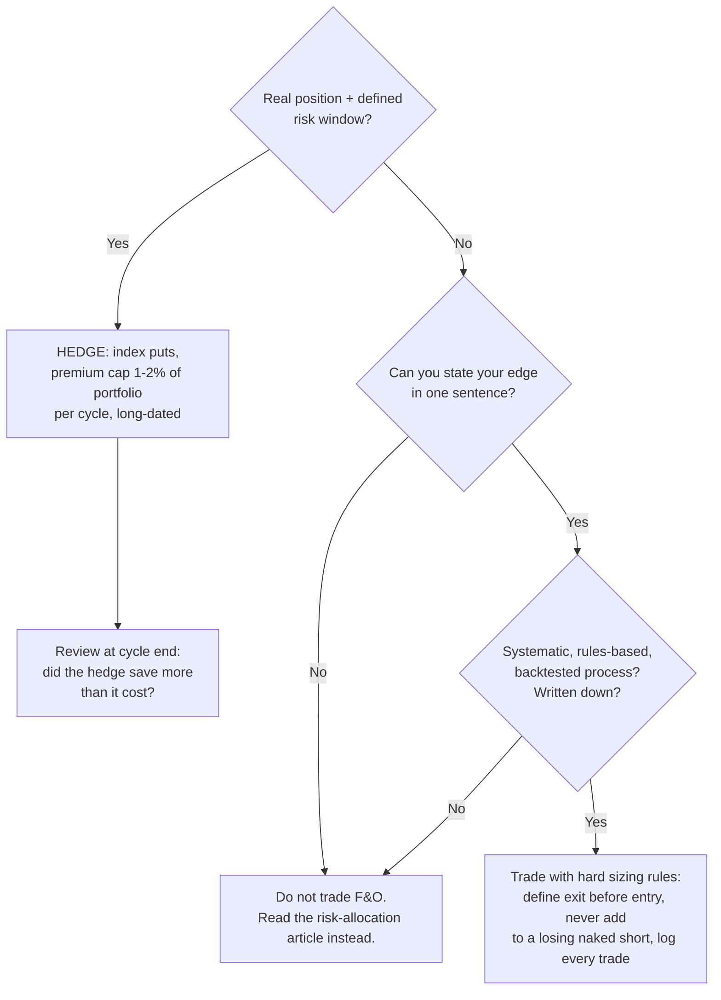

Every F&O trading account in India now opens with a disclosure that would be unthinkable a decade ago: **“9 out of 10 Individual traders made losses in F&O in FY22”** [src-sebi-fo-fy26]. Brokers must show it at login. The message is not folklore; it is the official output of a SEBI study of individual equity-derivatives traders, reported through a Ministry of Finance written reply in the Rajya Sabha on 11 August 2026 [src-sebi-fo-fy26].

This article is the arithmetic behind that disclosure. It is for the Indian reader who already knows the basics, holds roughly a ₹10 lakh corpus, and has been tempted by options trading, F&O tips, or “guru” content — and wants to know, with numbers, whether derivatives can ever be a rational tool at that scale. The honest answer, developed below: **speculation is almost always the wrong instrument at ₹10 lakh; hedging a real equity position is the one defensible use, and it has strict sizing rules.** This is education, not advice; verify tax and current-rate claims with a chartered accountant before acting.

## The verified loss data: SEBI's five-year table

The study tracks individual (retail) equity-derivatives traders across a top-15-broker sample that represents about 90% of all individual F&O investors. The data below is the headline evidence for this article [src-sebi-fo-fy26]:

| Fiscal year | Individual F&O traders | Notional + premium turnover | Net losses | Avg. loss per losing trader |
|---|---|---|---|---|
| FY22 | 42.74 lakh | ₹115 lakh crore | ₹40,824 cr | ₹95,517 |
| FY23 | 58.35 lakh | ₹149 lakh crore | ₹65,747 cr | ₹1,12,677 |
| FY24 | 86.26 lakh | ₹172 lakh crore | ₹74,812 cr | ₹86,728 |
| FY25 | 98.1 lakh | ₹213 lakh crore | ₹1,11,788 cr | ₹1,13,913 |
| FY26 | 78.6 lakh | ₹202 lakh crore | ₹91,685 cr | ₹1,16,654 |

Three things in that table deserve attention:

1. **Participation exploded, then contracted.** The base of individual traders grew more than 2.3× from FY22 to FY25 (42.74 lakh → 98.1 lakh), then fell about 20% year-on-year in FY26 to 78.6 lakh — the first decline in a decade [src-et-fo-retail-exodus]. The contraction follows years of reported retail losses; the capital is leaving.
2. **The losses did not contract with the base.** FY26 net losses of ₹91,685 crore remained in the ₹80,000–1,10,000 crore band even with ~20 lakh fewer traders. Average loss per losing trader actually rose to ₹1,16,654, the highest in the series [src-sebi-fo-fy26].
3. **The segment is still massive.** F&O STT collections across NSE and BSE ran ₹6,634 crore in FY22, ₹9,053 crore in FY23, ₹14,359 crore in FY24, ₹22,225 crore in FY25, and ₹27,695 crore in FY26 [src-sebi-fo-fy26]. Even as retail participation fell, the venue stayed enormous in notional terms — because the institutional side of the book kept trading.

The loss rate is the stat most readers will not internalise: **87.7% of individual F&O traders lost money in FY26**, per press reporting of the SEBI data [src-et-fo-retail-exodus]. Demographics sharpen the picture: traders **under 30 were 43% of all individual traders in FY26, up from 31% in FY22, and roughly 89% of them lost** [src-et-fo-retail-exodus]. This is the generation with the smallest corpus, the shortest track record, and the highest loss rate.

## What F&O actually is — in plain mechanics

Two products, two payoffs.

**Futures are linear and leveraged.** A Nifty futures contract obliges you to buy (or sell) the index basket at a fixed price on expiry. Your profit or loss is a straight line in the index's move, multiplied by the contract size. Leverage comes from the margin: you post perhaps 10–12% of notional (exchange-plus-broker margin; the exact percentage varies by volatility and is not asserted here) and control 100% of the notional. A 10% adverse index move on a fully leveraged futures position is roughly a 100% loss of the margin. The line goes through zero — there is no capped downside on a naked short.

**Options are non-linear.** An option is a right, not an obligation. If you *buy* a put, your maximum loss is the premium you paid; your payoff has a floor and an open ceiling. That capped-loss shape is exactly why options look “safe” to beginners — which is the marketing error: a capped *maximum* loss does not mean a *likely* loss of only that amount. Most option purchases do not reach their maximum loss; they simply decay, slowly and repeatedly, to near zero.

**Who is on the other side of your trade?** This is the structural point most retail readers skip. Your counterparty network is dominated by **proprietary desks (propos), institutional market-makers, and FIIs** — parties with lower cost of capital, faster systems, hedging infrastructure, and often the other side of a flow business. Press reporting of the SEBI data for FY26 puts it bluntly: while retail traders lost about ₹72,000 crore, **propos made about ₹44,000 crore** on the same book [src-toi-big-boys] (press reporting of SEBI data; treat the exact split as approximate).

## The arithmetic of why retail loses

Strip away the psychology and a retail option-buyer faces four structural drags, each small, none of them small *together*:

- **Time decay (theta).** Option value bleeds as expiry approaches, even if the underlying is flat. This is the seller's structural income and the buyer's structural cost.
- **Bid-ask spread and slippage.** Every entry and exit consumes part of the premium; retail crosses the spread in both directions.
- **Premium is sunk on the buy side.** Buying options means paying a premium for a right that, statistically, usually expires worth less than you paid. Long-term, buying options at the market's fair value is a **negative-sum game for the buyer side**: the premium you pay is roughly what the seller keeps, net of the seller's own costs. The seller side — which is where the prop desks and institutions concentrate — wins that structure by default.
- **Leverage magnifies the drags.** The same costs, applied to a notional 5–10× your margin, turn a 5% annual drag into a position that must win often just to break even.

Why the “9 in 10” figure then persists even among experienced retail? Because the house edge above is not a rounding error; it is the *business model* of the counterparty. When SEBI's data shows ₹91,685 crore in net retail losses in FY26 against ₹44,000 crore of prop gains [src-toi-big-boys], the money is not vanishing — it is transferring across the book from the slower, higher-cost, less-informed side.

**The two distinct uses of derivatives** are where honesty matters. The *speculation* use — buying weeklies for direction, trading tips, chasing volatility — is the game in which 87.7% of participants lose [src-et-fo-retail-exodus]. The *hedging* use — an investor who genuinely holds a portfolio reducing its risk in a defined window — is a different activity with different economics: you are *paying* for insurance, and you can size the premium. Conflating them is how a hedge becomes a gambling table.

## The cost of doing business: a round-trip arithmetic

Because we are not asserting exact statutory STT or charge rates here (rates change; see the update-log re-check rows), the useful question is *order of magnitude*, with assumptions stated.

> **Assumptions block (used in all worked examples below).** These are illustrative assumptions, not quoted market data: (1) total transaction costs on an F&O round trip — STT, exchange fees, brokerage, GST — cost on the order of **0.1–0.2% of notional** for a moderately high-activity trader; (2) a weekly index option's fair premium is around **5% of the index level**; (3) an annual index put that insures against a moderate drawdown costs on the order of **0.5–1.5% of the index** as a fraction of the index level, depending on volatility; (4) the reader's corpus is ₹10 lakh, fully invested in a diversified equity sleeve. Verify the exact STT and charge schedule for your broker and product before acting.

| Scenario | Notional | Illustrative round-trip cost (assumed) | Cost as % of the *capital* supporting the position |
|---|---|---|---|
| 1× weekly index option buy + sell | ₹5,00,000 | ~₹7,500–15,000 | ~1.5–3% of a ₹5L premium outlay, every cycle |
| Futures, 2× leverage on ₹5L margin | ₹10,00,000 | ~₹20,000–40,000 | ~40–80% of the ₹5L margin, *per round trip* |

Read the second row slowly: at 2× leverage, a single round trip of transaction costs consumes 40–80% of the margin you posted. To break even on a weekly cycle you must beat both the cost *and* the decay. That is the entire case against weekly speculative churn, and it does not depend on any particular broker's fee card.

## Worked example 1: what theta does to a weekly option

Assume (as in the block above) Nifty is at 25,000 and you buy a weekly, near-the-money index put for **5% of the index ≈ ₹1,250 premium**, paying about ₹1,250 per index point of contract, so a position on one standard contract of ~₹15–20 lakh notional costs you on the order of ₹1.5–2.5 lakh in premium [assumption 2].

Now suppose the index is flat for the week. A near-the-money weekly option with one week of life typically loses the bulk of its time value; a representative (illustrative) decay path for such a contract, with volatility unchanged, is:

| Day | Illustrative premium |
|---|---|
| Purchase (T+0) | ₹1,250 |
| T+1 day | ~₹980 |
| T+3 days | ~₹700 |
| Expiry, index flat | ~₹0 |

The option fell ~72% in three days and to zero at expiry **while the market did nothing**. To merely recover the premium, the index had to move *against your put* in the direction you wanted, enough, fast enough, and before the spread and decay ate the move — and that on a book where you already paid 0.1–0.2% of notional to enter. This is not a claim about any specific option; it is the shape of the payoff that makes buying short-dated options a losing game in aggregate, and it is why the 87.7% FY26 loss rate [src-et-fo-retail-exodus] is *consistent* with the math rather than an anomaly.

## Worked example 2: sizing a real hedge on a ₹10 lakh portfolio

This is the defensible use. You hold ₹10 lakh in diversified equities; you have a defined risk window (a goal date, a large cash need, or a genuinely feared downturn). You buy index puts as a floor.

With assumption (3), an annual-dated, moderately out-of-the-money index put costs on the order of **0.5–1.5% of the index** as a fraction of index level. As a *percentage of your ₹10L corpus*, that hedge costs:

- **0.5% → ₹50,000** in premium for the cycle
- **1% → ₹1,00,000** in premium for the cycle

The sizing rule that keeps this a hedge and not a bet: **cap premium outlay at 1–2% of the portfolio per hedge cycle** (₹1,00,000–₹2,00,000 on a ₹10L corpus). Above that, the hedge costs more than the risk you are transferring and you have, in effect, decided the crash is coming with money. Companion rules: use **index options, not single-stock options** at your scale (cheaper, more liquid, no idiosyncratic gap); prefer **long-dated over short weekly** contracts (less decay per day of protection); and **never add to a losing short** — if you sell premium, a defined stop-loss rule written *before* entry is the only sane protection.

## Worked example 3: what a gap does to a naked short

You sell a weekly call for ₹5,000 per point; the stock gaps up 15% overnight on news. Your call, worth ₹5,000, is now worth ₹25,000+. You wanted a defined loss equal to the premium; because you are *naked* (no offsetting position), your actual loss is the premium **plus** the option's new intrinsic value, and your loss is no longer capped at the premium you collected — it is capped only by how high the underlying can go. Worse, in a limit-up/limit-down market the option may trade with a wide or nonexistent book, and “exiting” at your stop may be impossible: the stop triggers, there is no counterparty, and you carry the position into the next day's open. This is the gap/cornering mechanic that distinguishes a *premium harvest* (a defined, sized risk) from a *naked short* (an undefined tail). Rules: define your exit before entry; never add to a losing naked short; treat a limit-down/limit-up freeze as “you cannot exit,” not as a reason to average down.

## A decision framework (and when derivatives make no sense at all)

The flow below is the entire article in one diagram. Its text alternative: **if you cannot state your edge, do not trade; if you have no rules-based backtested process, do not trade; if you have a real position to hedge, size the hedge at 1–2% of the portfolio per cycle and use index options.**

If you reach the “do not trade” node, that is not a failure — it is the 9-in-10 base rate [src-et-fo-retail-exodus] doing its job *before* you spent money on it.

### Red flags: the tips-and-“guru” channel

- **Tips, “calls,” and copy-trading rooms.** A signal you did not generate is a position you cannot defend, and the seller of signals makes money on *volume of followers*, not on your P&L. The structure is a subscription business, not an investing business.
- **Promises of “100× in a month.”** At the cost structure above, a position that must return 100%+ per month is, arithmetically, a total-loss candidate; nobody who knows the math sells it.
- **Unlimited liability on the seller side.** If the guru is naked-short, their loss is unbounded; your loss is bounded only by the same gap mechanics in worked example 3.
- **No written exit, no position cap, no maximum-loss-per-trade.** “When it looks right” is not a rule; it is how you lose the hedge and keep “hanging on.”

### Regulatory context: the curbs since November 2024

SEBI's post-2024 tightening is relevant because it changed the structure of the market, not just its volume. Since November 2024, the measures include: rationalisation of weekly index derivative products; increased tail-risk coverage on options expiry days; increased contract size for index derivatives; rationalisation of monthly index products; **upfront collection of option premiums from buyers**; removal of calendar-spread treatment on expiry days; and intraday monitoring of position limits [src-sebi-fo-fy26]. In May 2025 this was extended by streamlining of expiry days across exchanges and risk-based metrics for position limits [src-sebi-fo-fy26]. The direction of travel is legible: the regulator has spent the period making F&O *harder to churn* — fewer expiries to trade, bigger contracts (less relative leverage per rupee of capital), and premiums collected upfront so a buyer cannot enter a premium position without the full cash. State each change qualitatively as above; the exact contract sizes and margin parameters changed over this period and should be verified against the current SEBI circulars before you quote them.

## Tax treatment of F&O in India (verify with a CA)

F&O is not “investing” for tax purposes; it is *trading*, and the classification splits:

- **Intraday equity trades** are **speculative business** income, taxed at your slab rates; speculative and non-speculative turnovers are not netted against each other.
- **F&O positions (futures and options, held beyond intraday)** are **non-speculative business** income when you trade as a business, taxable at slab rates.
- **Presumptive taxation option:** a trader carrying on a non-speculative F&O business may declare income under **Section 44AB** at the presumptive rates — **8% of profits/turnover or 4% of capital gains, whichever is more** — subject to conditions (including, for F&O, the requirement that turnover be below the specified threshold and that the trade is conducted in a recognised derivative exchange). Note the interplay with **Section 44AA** (books of account) and **44ADA** (presumptive rates for professionals — *not* the F&O provision; 44AB is the one that applies to F&O traders), and re-verify the current 8%/4% rates and 44AA/44ADA structure with a CA — these provisions and their rates are time-sensitive [verify with a CA].
- **Option sellers and option buyers are not taxed identically** in every circumstance; the characterisation (business income vs. capital gains where the option is incidental to an investment position) depends on facts. This article marks the slab rates as **verified as of 2026-10-16 only**; the F&O presumptive provisions are flagged for re-check, not asserted as current.

## Where F&O fits — and does not fit — in a ₹10 lakh portfolio

For a ₹10 lakh corpus, F&O *speculation* is, in the overwhelming case, the wrong instrument. The two rational roles are:

1. **Hedging an existing equity sleeve in a defined risk window** — the worked example 2 case: cap premium at 1–2% of the portfolio per cycle, use index options, long-dated, rules written before entry.
2. **Harvesting option premium only as an advanced strategy** — with strict risk rules (no naked shorts without a defined offset, hard position caps, written exit). This is a strategy desk's job, not a starter's.

Note what derivatives do **not** do: they do not raise the rung of the Indian investment ladder. The ladder is [mutual funds → SIFs → PMS → AIFs](../personal-finance/pf-wealth-plan-10-lakh.mdx), which is exactly the sequence walked in [Specialized Investment Funds (SIF): India's New ₹10 Lakh Tier Between Mutual Funds and PMS](../alternatives/alternatives-sif-specialized-funds.mdx). Derivatives are a *tool inside the equity sleeve* — a hedge, a short-dated expression of a view, a premium harvest — not a rung you climb. A ₹10L corpus that is *mostly* F&O positions is not a more sophisticated portfolio; it is a 4× leveraged, negative-sum, 87.7%-losing game with a fee schedule.

For the reader at this scale the honest ordering is: build the diversified core (index funds, debt, per [Your 10 Lakh Wealth Plan](../personal-finance/pf-wealth-plan-10-lakh.mdx)), understand risk allocation and your own behavioral traps (per [Risk, Asset Allocation, Diversification & Behavioral Traps](../financial-foundations/foundations-risk-allocation-behavior.mdx)), learn to read the fundamentals you are actually buying (per [Equity Investing: Financial Statements, Valuation & Governance Red Flags](../equities/equity-fundamental-valuation.mdx)), and *then* — only then — use index options as a *cheap hedge* on that core during a defined window. That sequence is the difference between derivatives as a tool and derivatives as a trap.

## Ending: the one number to remember

87.7% of individual F&O traders lost money in FY26 [src-et-fo-retail-exodus]; their average loss among losers was ₹1,16,654 [src-sebi-fo-fy26]; the prop desks on the other side of the book made about ₹44,000 crore in the same year [src-toi-big-boys]. The structure is not a rumor and it is not a bug — it is the operating model. The question is never “can I beat the props?”; it is “do I have a *real position to hedge*, and if not, am I here for the insurance or for the casino?” The data says most of us at ₹10 lakh are here for the casino, and the house knows it. The framework above is how to be on the insurance side of the line — or, if you are not, how to stay out of the game entirely.

## Update log

| Date | Change / re-verification |
|---|---|
| 2026-10-16 | Verified SEBI FY26 retail F&O loss table (FY22–FY26), 87.7% loss rate, under-30 share, broker login disclosure wording, STT series (₹6,634 cr FY22 → ₹27,695 cr FY26), and Nov 2024 / May 2025 SEBI curbs, all from the Ministry of Finance written reply (11 Aug 2026) and press reporting [src-sebi-fo-fy26, src-et-fo-retail-exodus]. |
| 2026-10-16 | Re-check pending: exact STT rates and broker charge schedule (asserted here as an order-of-magnitude assumption only, not a statutory figure); 44AB presumptive rates (8%/4%) and 44AA/44ADA interplay for F&O traders; current SEBI contract-size and margin parameters post-Nov 2024 curbs. Verify all three against the current SEBI circulars and a CA before acting. |

## Sources & citations

- **`[src-sebi-fo-fy26]`** — Ministry of Finance, *Rajya Sabha Unstarred Question 2633, written reply, 11 August 2026* (retail investor protection in F&O trading), based on the SEBI study of individual equity-derivatives traders. Primary verified source for the FY22–FY26 loss table, STT series, and the regulatory curbs. [https://sansad.in/getFile/annex/271/AU2633_w2b25X.pdf](https://sansad.in/getFile/annex/271/AU2633_w2b25X.pdf)
- **`[src-et-fo-retail-exodus]`** — Economic Times, *Retail F&O boom hits reverse gear as active trader base falls 18% in FY26* (reporting of SEBI data: 87.7% loss rate in FY26; under-30 share 43% up from 31% in FY22, ~89% of under-30s lost; first participation decline in a decade). [https://economictimes.indiatimes.com/markets/stocks/news/retail-fo-boom-hits-reverse-gear-as-active-trader-base-falls-18-in-fy26-sebi/printarticle/133382023.cms](https://economictimes.indiatimes.com/markets/stocks/news/retail-fo-boom-hits-reverse-gear-as-active-trader-base-falls-18-in-fy26-sebi/printarticle/133382023.cms)
- **`[src-toi-big-boys]`** — The Times of India, *In F&O space, big boys profit at retail's expense: SEBI study* (press reporting of SEBI data: propos ≈ +₹44,000 cr vs retail ≈ −₹72,000 cr net in FY26; the exact split is approximate as reported). [https://timesofindia.indiatimes.com/business/india-business/in-fo-space-big-boys-profit-at-retails-expense-sebi-study/articleshow/133390369.cms](https://timesofindia.indiatimes.com/business/india-business/in-fo-space-big-boys-profit-at-retails-expense-sebi-study/articleshow/133390369.cms)

*Related: [Portfolio Construction, Rebalancing & Risk Budgeting](../portfolio-construction/portfolio-construction-rebalancing.mdx) · [Risk, Asset Allocation, Diversification & Behavioral Traps](../financial-foundations/foundations-risk-allocation-behavior.mdx) · [Equity Investing: Financial Statements, Valuation & Governance Red Flags](../equities/equity-fundamental-valuation.mdx) · [Your 10 Lakh Wealth Plan](../personal-finance/pf-wealth-plan-10-lakh.mdx)*

**Last verified:** 2026-10-16 (SEBI FY26 data, loss statistics, STT series, regulatory curbs — all primary). F&O presumptive-tax provisions and exact STT/charge rates: flagged for re-check, not asserted current.
