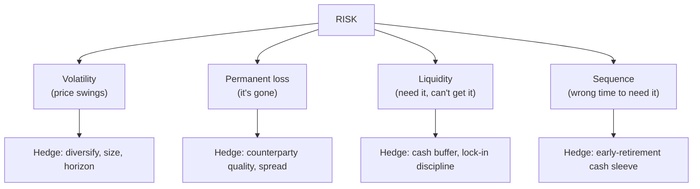
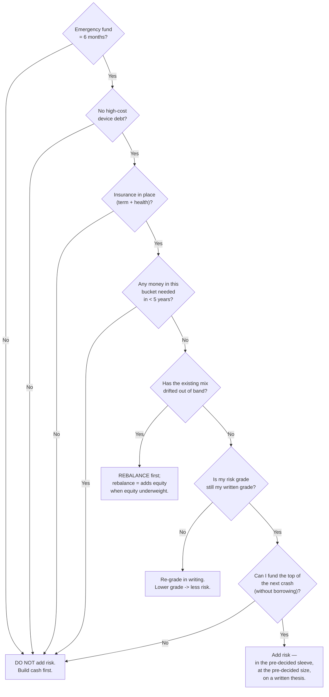

Most investing losses are not market losses. The market is a neutral referee; the score is set long before the first trade, by how much risk you took on, in which mix, and — least understood — by the repeated small decisions of an investor watching his own money. This article separates the two engines that actually drive long-run outcomes: **asset allocation** (the decisions you make once, deliberately) and **behaviour** (the decisions you make constantly, automatically). It defines risk the way a practitioner does, walks through the traps that are specific to India, and closes with a decision tree you can put on the wall.

Read this after `foundations-compounding-returns`, because everything here is about *protecting* the compounding that article measures.

## What "risk" means (and the four things you must keep separate)

"Risk" is the last of the financial terms people use most loosely and least usefully. Split it into four, because each has different drivers and different hedges:

| Risk type | What it is | How you measure it | How you hedge it |
|---|---|---|---|
| **Volatility** | Price swings around the mean — the standard deviation of returns | Stdev of returns, max drawdown | Diversification; position sizing; horizon |
| **Permanent loss** | Money that never comes back: fraud, default, a company's terminal decline | Default rates, balance-sheet strength, concentration | Counterparty quality, credit analysis, diversification across issuers |
| **Liquidity risk** | You need the money and the market is closed, thin, or you are in a lock-in | Bid-ask, lot sizes, lock-in terms, platform caps | Cash/ladder buffer; avoid over-concentration in illiquid sleeves |
| **Sequence risk** | A bad market *at exactly* the time you need to withdraw, early in retirement | Time-to-retirement, withdrawal order | Long early-retirement buffer; keep the drawdown sleeve funded in cash |

The reason the split matters is that **the same label hides opposite problems.** A liquid equity index can be highly *volatile* yet have near-zero *permanent-loss* risk over a long horizon. A P2P loan can be *low-volatility* (steady interest) yet carry high *permanent-loss* risk (a bad vintage defaulting) and *liquidity* risk (you cannot sell a loan to a stranger). Call each thing by its own name and the hedging decisions stop colliding.

Text version of the diagram: "Risk" fans into four sub-types, each with its own distinct hedge; volatility hedging is not permanent-loss hedging.

## Allocation: the decision that sets most of the outcome

The single most-cited result in investment literature is unglamorous: **what you earn over a horizon is determined far more by your asset-mix choices than by your security or timing choices.** Studies consistently show that the split between broad asset classes (equity, bonds, gold, cash) explains the large majority of the *difference* between one investor's long-run outcome and another's, while stock-picking, market-timing and manager-selection explain a much smaller share. The honest framing: this is a broad, well-supported empirical regularity across countries and decades, not a single headline study you can quote to the decimal.

The mechanism is simple. Different asset classes move differently in different economic weather — equities in growth, bonds in rate cuts, gold in fear and currency, cash in nothing. A *mix* is therefore less volatile and less likely to be badly positioned than a *concentration*, and that lower risk lets you hold longer, which is the entire value of compounding. The trap is that the mix only works while you keep it: left alone, a 60/40 silently becomes 70/30 after a strong equity year, and the "decision you made once" quietly un-does itself. That is the whole subject of `portfolio-construction-rebalancing`.

For India specifically, allocation has two added levers the Western averages don't capture: (1) **domestic equity is a high-growth, high-volatility asset** — long-run, but with drawdowns deep enough to scare off retail; and (2) **the debt side is anchored by RBI policy**, with the repo rate near 5.25% through late 2025 (last verified: 2026-08-06, src-rbi-repo). So an Indian "balanced" mix is not the 60/40 the US textbook implies; it is a deliberate choice of *how much Indian equity you can stomach* plus a short-duration debt sleeve that earns the policy rate.

## The India-specific traps

These are the mistakes that cost Indian investors more than anything in the factor model. Each one is documented qualitatively; where we attribute it to a regulator, we name the source without inventing a figure.

- **Nifty all-in after a fat year.** The most expensive reflex in the Indian market. A great Nifty year makes the "equity sleeve" look like a cash cow, and the investor who was 60% equity in a good year is 80% by the next, at the exact top. The mitigation is mechanical: rebalance on bands, not on mood (see `portfolio-construction-rebalancing`). The behavioural version of this is *hindsight bias* — the good year feels like it was "earned," so you lean in.
- **Single-stock PMS and "concentrated" private sleeves.** PMS at a ₹50 lakh minimum tempts the investor to go heavy in a couple of names through a manager, mistaking a *management* fee for *alpha*. A genuine PMS is a diversified book; a single-stock PMS is a concentrated bet wearing a fee. Rule: a PMS position should never be larger than your tolerance for that manager being *wrong* for two years in a row. Full PMS/AIF anatomy is in `alternatives-pms-aif-private`.
- **Home-city real estate as a "diversification".** Owning a flat in the city you live in and counting it as part of your portfolio is the classic Indian over-concentration: one asset, one geography, one economy, illiquid, and already paid for with your best years of cash flow. True diversification across asset classes *and* geography is what the word means; a home is a consumption item, not a diversifier. If you must hold property, REITs and InvITs are the *investable*, liquid form — see `real-estate-reit-invit`.
- **F&O retail losses.** Per SEBI annual reports, the overwhelming majority of retail F&O traders lose money net of charges, year on year, and the loss is heavily concentrated among small, high-churn accounts. This is a *qualitative* statement we do not quantify here: we will not fabricate a percentage or a count. The point for a long-horizon investor is structural — F&O is a zero-sum, fee-negative game where your counterparty is a funded, faster participant, so it belongs in the portfolio, if at all, as a tiny, pre-sized optionality sleeve, never as the strategy. Treat any P&L you have in F&O as the cost of tuition, and budget the next one.

The common thread: **each trap is a place where a *decision* has become a *habit*.** Allocation is a decision; all four of these are habits wearing the costume of an allocation.

## Eight behavioural biases, one line each to kill them

The bias is named; the mitigation is the *pre-commitment* that defeats it before the market does.

1. **Anchoring** — you hold a loss because "I bought it at ₹420." *Mitigation:* decide every holding on "what would I buy today at this price," never on cost.
2. **Loss aversion** — a loss hurts ~2× a gain, so you sell the winner and keep the loser. *Mitigation:* rebalance mechanically; selling the big winner *is* the trade, every time.
3. **Hindsight bias** — the fat year looks like skill; the crash looks like bad luck. *Mitigation:* write your thesis *before* buying; grade yourself against the written thesis, not the outcome.
4. **Overconfidence** — one good year convinces you that you can beat the market. *Mitigation:* require a *repeatable*, process-based edge before adding a concentrated position; default is index.
5. **Herding / FOMO** — the crowd rushes the IPO, the hot theme, the "next big thing." *Mitigation:* a written 24-hour no-trade rule on any non-plan asset.
6. **Mental accounting** — you segregate money by source ("bonus money" vs "salary money") and treat them differently. *Mitigation:* one portfolio, one risk grade; the rupee from the bonus and the rupee from the salary are the same rupee.
7. **Recency bias** — the last five years' average gets mistaken for the next five years'. *Mitigation:* plan against a 10–15 year range, not the trailing one; the "rule of 72" in `foundations-compounding-returns` keeps you honest.
8. **Time inconsistency** — the plan you approve in calm markets is not the one you execute in crashes. *Mitigation:* a standing instruction (a "no-trade window" of 3 months between discretionary moves) so the calm-you can pre-commit the crash-you.

The last one is the meta-bias: it is why every other bias *survives*. You are not one investor; you are a calm one and a panicked one, and the plan is a treaty between them.

## Should I add risk? — the decision tree

This is the wall chart. It is not a "should I buy X" chart; it is a "have I earned the right to take on more risk right now" chart, in the order you must actually answer.

Text version: a gate sequence. Six preconditions must all be *yes* before "add risk" is even a question; the two "no" exits are a pre-rebalance and a re-grade, and the final "GO" is only reached on a written thesis, a pre-sized sleeve, and a written ability to fund the next crash without borrowing.

Note how the tree makes *adding* risk the hard path and *not* adding it the default. That is deliberate: the asymmetry of the decision (adding is easier to regret than it is to reverse) means the burden of proof should sit with the person adding, not removing, risk.

## A short due-diligence checklist

Before you move a rupee, run this against *your* situation, not a template:

- [ ] Emergency fund and insurance confirmed *outside* the growth portfolio?
- [ ] Every asset I hold, named by its *risk type* (volatility / permanent-loss / liquidity / sequence)?
- [ ] Allocation is a written number, and there is a written *trigger* to act on it?
- [ ] No single asset or issuer above 10–15% of the portfolio without a thesis?
- [ ] No F&O or concentrated PMS sized above what I can absorb losing *half* of?
- [ ] The calm-me / panic-me treaty (no-trade window) is actually written down?

## How this article uses calculators

The risk figures here are qualitative by design; the *quantitative* follow-through lives on the DhanPedia calculators page at `/calculators`. Once you have a mix from this article's decision tree, use the calculators' portfolio-drawdown and CAGR tools to (a) see how a given equity weight behaves in a −30% scenario and (b) confirm the real (inflation-adjusted) return you are actually planning for, using the exact real-return formula in `foundations-compounding-returns`. The calculators are the bridge from "I will hold through a crash" to "a crash costs me X and recovers in Y years."

## Update log

- **RBI policy repo near 5.25% through late 2025** — re-verify at each MPC; drives the debt-sleeve anchor (last verified: 2026-08-06; src-rbi-repo)
- **SEBI retail F&O loss context** — qualitative only, per SEBI annual reports; no figure quoted here, so no verification date is attached to a number. Re-check the *trend* when the next SEBI annual report publishes.
- **No other time-sensitive rates are claimed in this article.**

## Related

- `foundations-compounding-returns` — the return maths this article protects
- `portfolio-construction-rebalancing` — the band triggers and rebalancing rules that make "allocation holds" true
- `alternatives-pms-aif-private` — PMS/AIF concentration traps in detail
- `real-estate-reit-invit` — the investable, liquid form of property exposure

## Sources & citations

- `src-rbi-repo` — Reserve Bank of India, "MPC decision: policy repo rate held near 5.25% through late 2025", https://www.business-standard.com/finance/news/rbi-to-keep-interest-rates-steady-at-5-25-through-2026-reuters-poll-126012900085_1.html

The "studies consistently show" allocation-dominance framing is a broad empirical regularity cited qualitatively (general investment literature), not a single quantified study. The SEBI F&O point is attributed qualitatively to SEBI annual reports, not to a fabricated figure.

## Editorial / review status

Published; last verified 2026-08-06; next review due 2027-02-28. Educational content, not individualized advice.
