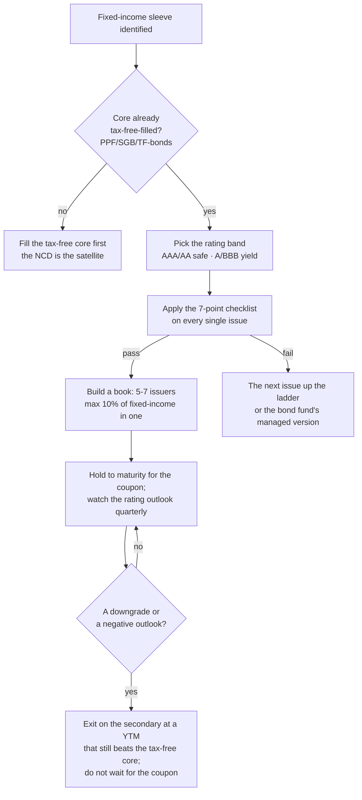

Between the bank FD (sovereign-backed, DICGC-insured up to ₹5L per depositor per bank, `src-dicgc-deposit-insurance`) and P2P lending (a direct credit book, 11–14% gross with 4–6% expected loss, [P2P Lending Complete](../p2p-lending/p2p-lending-complete.mdx)) sits the instrument this article is about: the **Non-Convertible Debenture (NCD)** of the Indian NBFC — a listed, exchange-traded, SEBI-regulated corporate bond, accessible from ₹10,000 (`src-ncd-rates-2026`). It is the first *professional* fixed-income tool a ₹10L-to-₹50L household can hold: a credit position underwritten by four rating agencies, with a trustee standing behind the bondholders, and a secondary market with T+1 settlement. The cost of that structure is the work: the return on a NCD is *your read of the issuer's credit*, and the entire yield ladder exists because each rung below AAA is a compensation for a specific, knowable risk. This article is that compensation, unpacked.

## How an NCD's coupon is actually set

Four factors set the coupon at issuance (`src-ncd-rates-2026`), and the ordering matters because it tells you what to read in a bond's pricing:

1. **The repo floor.** The RBI repo rate (5.25%, the cumulative cut of 2026 — `src-rbi-repo`) is the floor below which no credible issuer borrows from the market.
2. **The G-Sec benchmark.** The 10-year Government Security yield (roughly 6.5–6.8% through mid-2026, `src-ncd-rates-2026`) is the risk-free reference every corporate paper is priced against.
3. **The credit spread.** Above the benchmark, the issuer pays a *specific-default-risk* premium set by its rating: AAA adds roughly 50–100 basis points; BBB adds 400–600. This is the number that separates "same yield, different risk" from "different yield, same instrument."
4. **Tenor and demand.** Longer coupons for the same issuer (a 60-month beats a 24-month), tighter pricing when an issue is heavily subscribed.

**The 2026 yield ladder by rating** (indicative, Q2 2026, `src-ncd-rates-2026` — verify each issue's live coupon in the offer document):

| Rating band | Indicative coupon | Typical issuers | SEBI "investment grade"? |
|---|---|---|---|
| AAA | 7.0–8.0% | Bajaj Finance, Tata Capital, top HFCs; PSU paper (PFC/REC/IRFC) at 7.0–7.5% | Yes |
| AA+ / AA | 8.0–9.5% | Mid-tier NBFCs, housing-finance companies (IIFL Finance's Feb 2026 public issue was AA– up to 9.0% secured, `src-ncd-rates-2026`) | Yes |
| A+ / A | 9.5–11.5% | Smaller NBFCs, gold-loan companies (Muthoot, Manappuram type), MFIs | Yes |
| BBB+ / BBB | 11.5–13%+ | Smaller lending NBFCs, specialty finance — the *lowest* investment-grade rung | Yes (barely) |
| Below BBB | 13%+ | Distressed / speculative grade | No — SEBI's retail public-issue rules sit at BBB and above |

Read the ladder the way a credit analyst does: a 12% NCD and a 7.5% NCD are *not* the same instrument with different prices — they are two risk profiles, each compensating its holder for a different probability of default. The 200–400bp "high-yield premium" of the A/BBB rung over AAA is the market's own pricing of that gap (`src-hyb-bonds-2026`).

## The coupon-vs-YTM trap (why the headline number lies)

The coupon is *fixed at issuance on face value*. In the primary market, bought at face, coupon = YTM. In the secondary market they diverge, and **YTM is the number that matters** (`src-ncd-rates-2026`): a 9% NCD with ₹1,000 face, bought at ₹950 with three years to run, has a YTM near 10.8% — not 9%. The error is to compare a secondary-market buy on its coupon against a primary issue's coupon; the correct comparison is YTM to YTM, and "hold to maturity" to "hold to maturity."

For a buy-and-hold investor the practical rule: primary issues (via the broker's NCD window or an OBPP — Online Bond Platform Provider, a SEBI-registered execution-only channel) are the cleanest entry, at face, where YTM is the coupon. The secondary is where you can pick up *downward-price* yield, and where the price drop usually has a *reason* (a downgrade, a spread widening) that the coupon alone does not show you.

## The underwriting checklist: 7 points that separate a NCD from a P2P ticket

This is the section that makes the NCD a *credit decision* rather than a *rate decision* (`src-hyb-bonds-2026`, `src-ncd-rates-2026`):

| # | Check | What you are looking for | Red flag |
|---|---|---|---|
| 1 | **Rating outlook** | "Stable" or "Positive" from CRISIL/ICRA/CARE/India Ratings; a *two-agency* rating on a large public issue | "Negative" outlook, a single-agency rating, or a downgrade in the last 12 months |
| 2 | **Promoter background** | A long operating history, a public company with audited financials, a clean SEBI/RBI compliance record (for an NBFC) | Frequent management churn, an unlisted promoter holding, a first-time public debt issue |
| 3 | **Interest coverage** | Comfortably above 2x — the issuer's operating profit covers its interest bill twice over | Running near or below 1x, or a "coverage" that only exists because the last issue's interest was refinanced by the new issue |
| 4 | **Secured vs unsecured** | Secured, with *specific* asset cover stated in the offer document and a **debenture trustee** named (a SEBI mandate on every public NCD issue) | Unsecured paper from a lower-rated issuer, or a trustee named without a published track record of enforcing on default |
| 5 | **Objects of the issue** | A stated use — capex, a specific loan book, or refinancing of *specific* maturing debt | A large share to "general corporate purposes" (the issuer's own words for "we will decide after you subscribe") |
| 6 | **Capital adequacy (NBFC)** | CAR comfortably above the 15% regulatory minimum, with the quarterly figure trending up or flat | A CAR sliding toward the minimum while the AUM grows — the "grow the book faster than the capital" signature that preceded most of the 2018–19 NBFC stress |
| 7 | **Collateral class (for secured issues)** | Liquid, mark-to-market collateral — gold (the gold-loan NBFC's signature), a diversified property portfolio | Concentrated illiquid collateral: a single-asset-class book (real-estate developers' unsold inventory is the classic one — `src-hyb-bonds-2026` calls it out explicitly), or collateral that *is* the company's own receivables |

Points 3, 6 and 7 are where a "good NBFC" and a "good-sounding NBFC" diverge: interest coverage tells you the *current* interest bill is covered, CAR tells you the *losses* are absorbable, and the collateral class tells you what you *recover* when neither of those holds. The default data behind that sequence (CRISIL's annual default studies, cited in `src-hyb-bonds-2026`): the 3-year cumulative default rate for A-rated corporates is around **1.5–3%**, for BBB around **3–5%**. Those are *cohort* numbers, not any one bond's probability — but they are the number that justifies the yield ladder, and the number that says a 5-issuer, A-rated book has historically lost roughly a quarter to a third of its cohort's tickets over three years.

## Diversification and the core-satellite frame

The same source's worked illustration (`src-hyb-bonds-2026`): ₹10L into *one* A-rated HFC at 11% → one default costs the full ₹10L. ₹10L across *five* A-rated issuers at 11% blended → one default costs ₹2L, and the remaining ₹8L's coupon (₹88,000/yr at 11%) is a partial offset against that loss in the income stream. The structural rule that follows: **no more than 10% of a total fixed-income portfolio in a single high-yield issuer**, and the core-satellite split (70% AAA/AA at ~8.2% / 30% A/BBB at ~11%) lands the blended pre-tax yield around **9%** — the arithmetic of "a portfolio that looks like 8% on the safe rung and earns 9%."

For the ₹10L household, the *practical* version: the safe core (PPF + SGBs + tax-free bonds, [the tax-free pool](./tax-tax-free-wealth-stack.mdx)) is not the NCD's job — it is the *other* sleeve. An NCD book is the *yield satellite* that tops up a 7% tax-free core toward a 9–10% total fixed-income return, with the diversification rules above applied to the satellite's own composition.

## The tax position (FY 2026-27, post-July-2024 Finance Act rules, `src-ncd-rates-2026`)

| Event | Treatment |
|---|---|
| **Coupon income** | "Income from other sources" at your slab; **no TDS on interest from *listed* NCDs held in demat by a resident** — you self-report in the ITR (a non-resident holder has TDS at the applicable rate) |
| **Sale, holding under 12 months** | STCG at slab (the 12-month line is the debt convention, not equity's 12-month — it is the *debt* holding-period rule) |
| **Sale, holding 12 months or more** | LTCG at 12.5%, *without indexation* (the Finance Act 2024 change that removed debt indexation) |
| **Held to maturity** | No capital-gains event on a standard coupon NCD — the coupons only, year by year |
| **Zero-coupon / deep-discount NCDs** | A different computation at maturity; take a CA's position before buying one |

Two consequences of that table: (1) the NCD's coupons are *taxed in the year received*, so a falling-rate world that locks in a 9% coupon is also a world where that 9% is taxed at whatever your slab is in *that* year — a 30% slab makes the 9% NCD a 6.3% instrument, which re-anchors the comparison to the PPF (7.1% *in hand*); (2) the coupon-vs-YTM distinction above is also a *tax* distinction: the secondary-market price gain is capital, the coupon is income, and they are computed separately.

## What an NCD is not

- **Not a bank deposit.** No DICGC layer; the insurer's ₹5L cap protects *deposits*, and a NCD is a *loan to the company*, which is the company's own credit (`src-dicgc-deposit-insurance`). A ₹10L NCD book is ₹10L of un-insured credit exposure; that is the number to hold in the *diversification* rules above, not to comfort yourself with "it's a bank-adjacent product."
- **Not a mutual fund, and not a P2P loan.** A bond fund gives you a *pooled, actively managed* credit book with an expense ratio of 0.5–1.5% p.a. off the top and no issuer control (`src-hyb-bonds-2026`); P2P is a *direct* expected-loss book with 4–6% historical loss and no secondary market; the NCD is a *named, rated, exchange-traded* position with a trustee. Each has its own failure mode: the fund's is the manager's; P2P's is the book's; the NCD's is *your* read of the issuer — which is why the checklist above is the instrument's whole value.
- **Not a "fixed" income stream in a rate cycle.** The coupon is fixed; *the G-Sec benchmark moves with the repo* (the 5.25% floor of 2026 is itself the product of a 50bp cumulative cut, `src-rbi-repo`). In a falling-rate world, the *new* issues are priced lower — the 9% NCD you hold becomes a 10.8%-YTM secondary-market opportunity for the next buyer, and the price you can exit at is a function of that spread. Locking a coupon in a falling-rate world is the *advantage*; the same position in a rising-rate world is the *loss* — the asymmetry is the interest-rate risk that a NCD's return table never shows you, because a held-to-maturity coupon schedule shows no price.

## The decision sequence, in order

The last step is the one the "hold to maturity" habit gets wrong: a downgrade is not a "wait it out" event, it is a *price* event — the secondary price of a downgraded paper falls with the new spread, and the YTM at the new price is the number that tells you whether "holding" is still better than the next rung up the ladder. A held-to-maturity coupon is only the safe plan while the rating is what you priced it for.

## Related

- [Bonds & Credit: The Fixed-Income Foundation](./fixed-income-bonds-credit.mdx) — the duration/YTM substrate this article assumes; read it first if the 7-point checklist's "interest coverage" line is new to you.
- [P2P Lending, Complete](../p2p-lending/p2p-lending-complete.mdx) — the other "expected loss" instrument in the 11–14% band; the NCD's diversification rules are the mirror image of P2P's book rules.
- [Banking, Safety, Deposits & FDs](../banking-cash/banking-safety-deposits-fd.mdx) — the DICGC layer this article's "not a deposit" section is defined against.
- [Building the Tax-Efficient Wealth Stack](./taxation/tax-tax-free-wealth-stack.mdx) — where the NCD's satellite position sits inside the tax-free core.

## Sources

- `src-ncd-rates-2026` — BondScanner (SEBI-registered OBPP), NCD interest-rates guide, May 2026: the repo-floor→G-Sec→spread coupon-setting sequence, the Q2 2026 rating-band yield table, the coupon-vs-YTM example (9% coupon at ₹950 ≈ 10.8% YTM), the FY 2026-27 coupon/CGT/TDS treatment, and the minimum ₹10,000 investment.
- `src-hyb-bonds-2026` — GoldenPi (OBPP), high-yield-bond guide, 2026: the A/BBB yield band (10–12%+), the CRISIL 3-year cohort default data (A 1.5–3%, BBB 3–5%), the 7-point underwriting checklist, the 5-issuer diversification math, and the 70/30 core-satellite blend.
- `src-rbi-repo` — the 5.25% repo-rate floor and the 2026 cumulative 50bp cut, the coupon-setting baseline.
- `src-dicgc-deposit-insurance` — the ₹5L per-depositor-per-bank DICGC limit, the "NCD is not a deposit" boundary.

## Update log

- 2026-10-17: Verified the Q2 2026 rating-band yield ladder, the CRISIL cohort default ranges, the 7-point checklist, and the FY 2026-27 coupon/CGT/TDS treatment from `src-ncd-rates-2026` and `src-hyb-bonds-2026`; the IIFL Finance Feb-2026 public issue (AA–, up to 9.0% secured) is cited as a same-year worked example, not a recommendation.
- 2026-10-17: Confirmed the repo-rate floor at 5.25% (`src-rbi-repo`) and the 2026 50bp cumulative cut as the coupon-setting baseline.
- 2027-01-17: Scheduled re-verification: the rating-band yield table (drifts with the G-Sec benchmark, re-price each quarter), the cohort default data (the CRISIL annual default study is the primary source; re-pull at each annual release), and the FY 2027-28 TDS/coupon treatment (the July-2024 Finance Act rules are the current reference; check for amendment at the next Finance Act).
