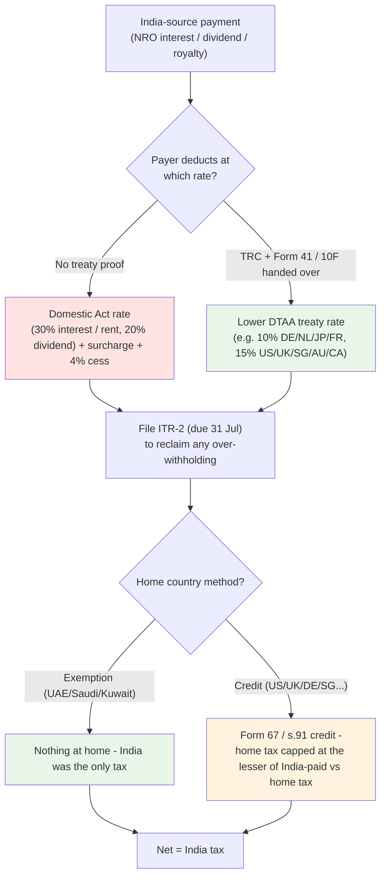

The [NRI tax article](./international-nri-tax-residency-tds-dtaa.mdx) covered *how* an NRI claims DTAA
relief — the Tax Residency Certificate, Form 41 (formerly 10F), and Form 67. But it deliberately left
out the part everyone actually looks up at the moment of a payment: **what is the treaty rate for
*my* country, on *this* type of income?** This article is that reference. It puts India's 90-plus
DTAA corridors side-by-side against the domestic Act rate, explains the two relief methods, and walks
the claim end-to-end. Figures marked **(verified 2026-10-18)** come from the cited sources; treaty
rates are the *typical corridor* rate, and the exact figure depends on the income type and any
holding condition — confirm the treaty text before you act.

## The two relief methods (and why most corridors are "credit")

A DTAA stops the *same* income being fully taxed twice. It does that in one of two ways, and the
method is decided by **which country has the *first* right to tax** the income in that treaty:

| Method | How it works | Where India is the source country | Examples |
|---|---|---|---|
| **Exemption** | Income is taxed *only* in one country; the other exempts it | Home country exempts, or India exempts | UAE, Saudi Arabia, Kuwait (no / low home-side income tax) |
| **Credit** | Income is taxed in *both*; the residence country credits the tax already paid in the source country | India withholds; home country credits it | USA, UK, Germany, Singapore, Australia, Canada |

For an NRI with India-source income, the practical effect is the same: **you want India to charge the
*treaty* (lower) rate, not the domestic Act rate**, and your home country to either exempt or credit
what India took. The *domestic* fallback is what you pay if you never claim the treaty — that is the
number this article's corridor table compares against. [src-dtaa-country-rates-2026]

## How the lower rate wins (Sec 90 / 90A / 159(4))

- **Section 90** (DTAA countries) and **Section 90A** (exemption-method countries) let the NRI be taxed
  at the *treaty* rate when the treaty is more beneficial than the Act.
- **Section 159(4)** is the switch: the tax is computed under the Act, *but* where the treaty
  provides a lower rate, the treaty rate applies — provided the non-resident supplies the proof.
- The proof is the **Tax Residency Certificate (TRC)** from your home country plus **Form 41** (the
  NRI self-declaration that replaces the older **Form 10F**). Hand both to the *payer* before it
  deducts; the payer then withholds at the lower treaty rate.
- If the treaty *also* credits the home country, you file **Form 67** with your Indian ITR to claim
  the **foreign tax credit** (now **Section 91** under the Income-tax Act 2025) for tax paid abroad.
  The credit is capped at the *lesser* of the India-side tax paid and the home-country tax on the
  same income — you cannot come out ahead of the higher of the two. [src-nri-tax-tds-dtaa-2026]

## Corridor reference (typical treaty rates, FY 2026-27)

The table below shows the **domestic Act rate** (no treaty claim) against the **typical treaty rate**
for the major NRI corridors. Rates are *before* surcharge and the 4% Health & Education cess, and are
the *headline* corridor rate — the exact figure for your income may differ by holding condition.
[src-dtaa-country-rates-2026]

| Corridor (country of residence) | Domestic Act rate | Typical DTAA rate | Income type the rate refers to | Relief method (home country) |
|---|---|---|---|---|
| **United States** | 30% (interest / rent) ; 20% (dividends) | **15%** (interest; dividends if 10%+ holding) | Interest / dividends / royalties | Credit |
| **United Kingdom** | 30% ; 20% | **15%** (dividends; 10% if 10%+ capital) ; **15%** interest | Dividends / interest / royalties | Credit |
| **Singapore** | 30% ; 20% | **15%** (interest) ; **10–15%** (dividends, 10% at 25%+ stake) | Interest / dividends / royalties | Credit |
| **Australia** | 30% ; 20% | **15%** (dividends; interest) | Dividends / interest | Credit |
| **Canada** | 30% ; 20% | **15%** (dividends 10%+ control; interest) ; **25%** dividends otherwise | Dividends / interest | Credit |
| **Germany** | 30% ; 20% | **10%** (dividends; interest; royalties) | Dividends / interest / royalties | Credit |
| **Netherlands** | 30% ; 20% | **10%** (dividends; interest; royalties) | Dividends / interest / royalties | Credit |
| **Japan** | 30% ; 20% | **10%** (dividends; interest; royalties) | Dividends / interest / royalties | Credit |
| **France** | 30% ; 20% | **10%** (dividends; interest; royalties) | Dividends / interest / royalties | Credit |
| **UAE** | 30% ; 20% | **12.5%** (interest; 5% on bank loans) ; **10%** (dividends) | Interest / dividends | Exemption (no home income tax) |
| **Domestic (no DTAA claim)** | **30%** (interest / rent) ; **20%** (dividends) ; **20%** (royalty / FTS) | — | Fallback if you never claim | — |

**Read it in one line:** Germany / Netherlands / Japan / France are the *cheapest* corridors (a flat
**10%** across dividends, interest and royalties); the Anglo-Saxon corridors (US / UK / AU / SG /
Canada) sit at **15%**; the **UAE** is special because it is an *exemption-method* country — you pay
India's **10–12.5%** and *nothing* at home, so India is your only tax. [src-dtaa-country-rates-2026]

**The capital-gains caveat that ruins the easy assumption:** *most* DTAAs do **not** let you reduce
the tax on the **sale of shares or property** below India's rate. India keeps its taxing right on
gains from Indian shares (111A / 112A) and immovable property (12.5% no-indexation). The treaty
relief that matters to an individual NRI is on **dividends, interest, royalties and fees** — not on
realising your gains. (A few older treaties had special share-gain protections for pre-2017
holdings; treat gains as *India-taxed* unless the treaty text says otherwise.) [src-nri-tax-tds-dtaa-2026]

**Alt text:** Flow for India-source income of an NRI: the payer withholds at the domestic Act rate
unless you hand over the TRC + Form 41/10F (then the lower treaty rate); you then file ITR-2 to
reclaim over-withholding; the home country either exempts (exemption-method, e.g. UAE) or credits
the India tax (Form 67 / section 91), so the net is at most the higher of the two countries' taxes.

## Surcharge and cess still ride on top

The treaty rate *caps the base withholding*; it does **not** delete surcharge or the 4% Health &
Education cess, both of which stack onto the (treaty) tax before it is remitted. That is why the
**all-in** effective rate is higher than the headline treaty rate: the [surcharge / cess article](../taxation/tax-surcharge-cess-high-income.mdx)
carries the FY 2026-27 surcharge schedule, and the [calculator](/calculators/dtaa-rate-reference)
shows both the pre-cess saving and the all-in figure for your corridor. [src-it-slab-fy2026-27]

## How to claim (the exact sequence, in order)

1. **Get the Tax Residency Certificate (TRC)** from your home country's tax authority. It is valid
   for the financial year it is issued for — renew it yearly.
2. **File Form 41** (the NRI declaration; the renamed **Form 10F**) on the Indian e-filing portal,
   and keep the acknowledgement. This is what tells the payer you are a non-resident entitled to
   the treaty.
3. **Hand PAN + TRC + Form 41 acknowledgement to the payer / bank *before* the payment date.** The
   payer withholds at the *lower treaty* rate only when this is in place; missing the payment date
   means it withholds at the domestic rate and you chase the refund.
4. **File your Indian ITR (ITR-2, due 31 Jul)** to **reclaim any over-withheld TDS** — the ITR is
   the *only* route to the refund; TDS already deducted does not disappear by itself.
5. **Claim the foreign tax credit** — **Form 67**, credit under **Section 91** (exemption-method
   corridors have nothing to credit; credit-method countries cap the credit at the lesser of the
   India-side tax and the home-side tax on the same income).

Two NRI-only traps, repeated here from the [NRI article](./international-nri-tax-residency-tds-dtaa.mdx):
**NRIs cannot use Form 15G / 15H** (the nil-TDS declarations are resident-only), and the **87A
rebate does not apply to an NRI** — an NRI is taxed on the *whole* India-source income with no
₹12L tax-free threshold.

## A worked example (₹10L NRO interest, three corridors)

Assume **₹10,00,000** of NRO interest in FY 2026-27, withheld at **30% domestic** (no surcharge in
this band) plus the **4% cess**, and no home-country tax (exemption corridor). The [calculator](/calculators/dtaa-rate-reference)
computes these; the point is the *spread*:

| Corridor | Base rate | All-in (with 4% cess) | You actually pay |
|---|---|---|---|
| Domestic (no claim) | 30% | 31.2% | Rs 3,12,000 |
| 15% corridor (US / UK / AU / SG / CA) | 15% | 15.6% | Rs 1,56,000 |
| 10% corridor (DE / NL / JP / FR) | 10% | 10.4% | Rs 1,04,000 |
| UAE (exemption, 12.5% interest) | 12.5% | 13% | Rs 1,30,000 |

Claiming the **10% corridor** route instead of doing nothing saves **₹2,08,000** on this single
₹10L — before you even add the home-country credit. That is the entire value of the TRC + Form 41
exercise, and it is why the *sequence in "How to claim"* above is the difference between a refund
and a leak.

## When the treaty does NOT help (the honest limits)

- **Capital gains on Indian shares / property** — most treaties leave India's rate intact.
- **A payer who withholds before you send the TRC + Form 41** — you pay the domestic rate and must
  reclaim via the ITR; the money is *locked* meanwhile.
- **A home country whose credit is *lower* than India's tax** — the net is still bounded by the
  *higher* country; you cannot use the treaty to manufacture a below-both-countries result.
- **GAAR / beneficial-ownership tests** — if the structure is seen as the *principal purpose* of
  avoiding tax, the treaty benefit can be denied (Principal Purpose Test on newer MLI treaties).

## Update log

| id | claim | lastVerified | reviewAfter | status |
|---|---|---|---|---|
| tl-dtaa-corridor-rates | Typical DTAA corridor rates for the major NRI corridors (US/UK/SG/AU/CA 15%; DE/NL/JP/FR 10%; UAE 12.5% interest / 10% dividends; exemption-method), domestic fallback 30% interest / 20% dividends | 2026-10-18 | 2027-04-17 | ok |
| tl-dtaa-no-cg-relief | Most DTAAs do NOT reduce the tax on sale of Indian shares / property (India keeps its taxing right; 111A/112A + 12.5% property); relief is on dividends / interest / royalties / FTS | 2026-10-18 | 2027-04-17 | ok |
| tl-form41-renamed | Form 10F (NRI declaration) is the renamed Form 41 under the Income-tax Act 2025; TRC + Form 41 + Form 67 (s.91 credit) is the FY 2026-27 claim sequence | 2026-10-18 | 2027-04-17 | ok |

## Sources

- [src-dtaa-country-rates-2026] — India DTAA corridor rates (dividends / interest / royalties / FTS)
  for the major corridors, with the domestic Act fallback and the exemption vs credit method split —
  <a href="https://crosscheckai.in/dtaa/rates">DTAA rates chart (97 treaties, per-article)</a> and
  <a href="https://incometaxindia.gov.in/Charts%20%20Tables/Withholding%20tax%20rates.htm">Income-tax Department country-wise withholding chart</a> (SBI DTAA annexure corroborates).
- [src-nri-tax-tds-dtaa-2026] — NRI TRC + Form 41 (10F) + Form 67 claim sequence, the 195 TDS
  baseline, and the capital-gains caveat — <a href="https://www.taxclue.in/blog/dtaa-double-taxation-avoidance-agreements-under-ita-2025-benefits-claim-process-and-key-treaties">TaxClue DTAA under ITA 2025</a>.
- [src-it-slab-fy2026-27] — surcharge + 4% cess stacking on the treaty (base) rate, FY 2026-27.

## Related

- [NRI Tax in India: Residency, 195 TDS & DTAA Relief](./international-nri-tax-residency-tds-dtaa.mdx)
- [International Investing & LRS: The Outbound Route](./international-investing-lrs.mdx)
- [GIFT City FoF & the Real Routes Abroad](./international-fof-gift-city-lrs.mdx)
- [Surcharge, Cess & the High-Income Regime](../taxation/tax-surcharge-cess-high-income.mdx)
- [DTAA Rate Reference Calculator](/calculators/dtaa-rate-reference)
