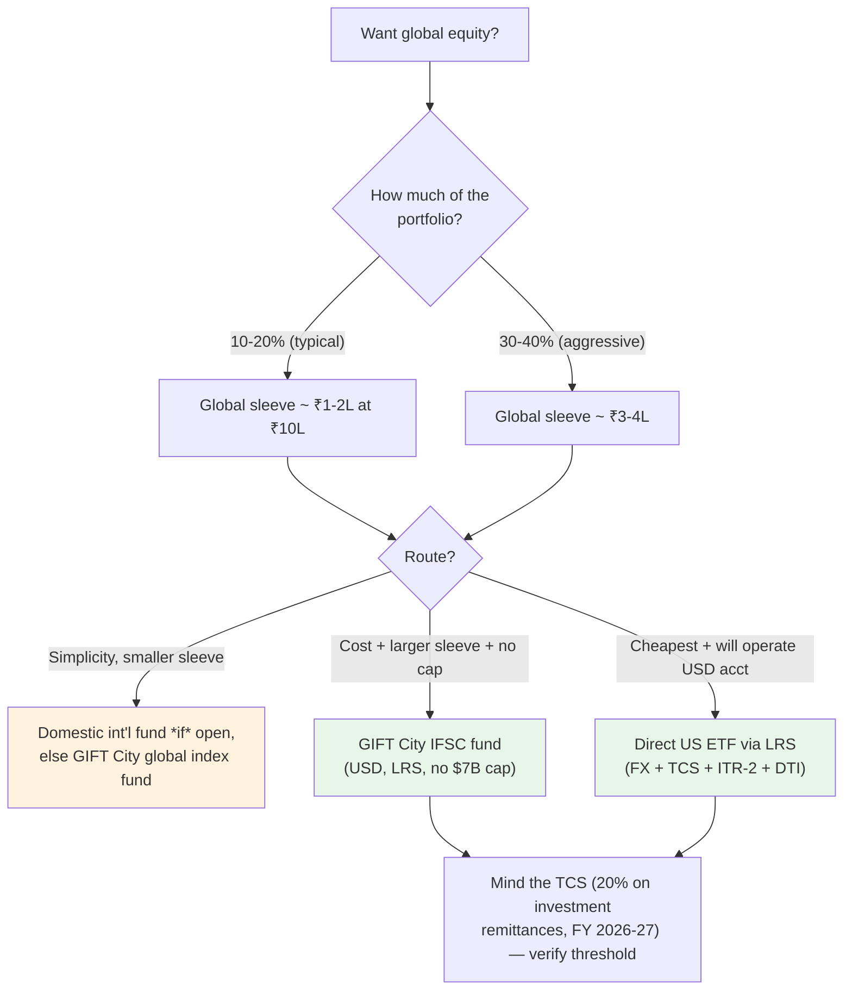

**Scope note.** The case for international equity in an Indian portfolio is *diversification*, not a bet that "the US will outperform India." India is ~3% of the world's equity market; the US is ~40%. The real question is *how* to get that slice, and in 2026 the *route* matters more than ever — because of a regulatory cap that has quietly closed most domestic international funds to new money. This article maps the three real routes, their costs, and which fits a ₹10 lakh investor. Figures marked **"(verified 2026-10-16)"** were checked against the cited sources; fund open/closed status changes weekly.

## The route everyone assumed existed: the domestic international FoF

The *default* way Indians got global exposure was a **domestic international Fund of Fund (FoF)** — a SEBI-regulated mutual fund that raises rupees and invests *abroad* (in global ETFs, index funds, or a US equity fund-of-fund). You buy it in INR, on your usual MF platform, with a normal SIP.

**Why it is now mostly closed:** SEBI and RBI have capped the *entire* Indian mutual-fund industry's **direct overseas equity investment at USD 7 billion** (plus a separate **USD 1 billion** for global ETFs, and a **USD 1 billion per-AMC** sub-cap). These limits were set in 2008 and **have never been raised** — even as industry AUM crossed **₹81 lakh crore** by mid-2026. [src-intl-fof-cap-2026]

The industry **breached the $7B ceiling in January 2022**. Since then, AMCs run a *"headroom lottery"*: new money gets in only when existing investors redeem, or when a weak global month shrinks the rupee value of the portfolio and frees a little room. [src-intl-fof-cap-2026]

**The 2026 result (verified 2026-10-16):** as of **July 10, 2026, only *one* domestic international fund was open for a fresh SIP** — the **Baroda BNP Paribas Aqua Fund of Fund** (a narrow water/utilities theme, *not* a broad global index). Nippon India, Axis, Kotak Mahindra, PGIM, Franklin Templeton and Edelweiss had *all* paused fresh SIP/STP registrations in their global funds by that date. [src-intl-fof-cap-2026]

**The practical consequence:** you **cannot dollar-cost-average** through a domestic international FoF as a *primary* global vehicle, because the SIP may simply *stop accepting* new money next quarter. A route you cannot reliably add money to is not a good core-diversification tool.

## The three real routes (and their true costs)

| Route | What it is | Currency | Tax posture | Cap? | Liquidity |
|---|---|---|---|---|---|
| **Domestic int'l FoF** | SEBI MF investing abroad | INR | Equity-fund CG rules (post-2023: *non-equity* treatment for some global FoFs → slab LTCG) | **$7B industry cap → mostly closed to new SIPs** | Daily (open scheme) |
| **GIFT City / IFSC Global Index Fund** | IFSCA-regulated fund *domiciled offshore* (Gandhinagar), bought in USD via LRS | **USD** | **Fund-level tax**; unit gains to you; you remit under *personal* LRS | **No $7B industry cap** (outside SEBI MF universe) | Daily, but *USD* account + LRS |
| **Direct LRS (US brokerage)** | Open a US broker (Schwab/Fidelity/Interactive Brokers), remit via LRS, buy S&P 500 / Nasdaq ETFs or individual stocks | **USD** | US dividend tax (15–20% under treaty), US CG (short 0–37% / long 0–20% for a *US* account; but an Indian *resident* is taxed on *worldwide* income → report in ITR-2, DTI relief on US tax) | **None on the *route*** (personal LRS limit: **$250,000/person/FY** [src-lrs-tcs-sc-2026]) | Daily in USD |

**Key distinction:** the **$7B cap applies to the *domestic mutual-fund industry***. A **GIFT City fund** is *not* part of that universe (it is regulated by IFSCA, not SEBI), so it **sidesteps the cap entirely** — you are simply remitting *your own* money under the *personal* LRS limit. [src-intl-fof-cap-2026]

## The LRS layer (the plumbing underneath GIFT City and direct)

Whether you use **GIFT City funds** or a **direct US brokerage**, the rupee→dollar move happens under the **Liberalised Remittance Scheme**: a resident individual can remit up to **USD 250,000 per financial year** [src-lrs-tcs-sc-2026]. From **1 Apr 2026**, LRS remittances are subject to **TCS** (Tax Collected at Source) that *varies by purpose* (the Finance Act 2026 schedule) [src-lrs-tcs-sc-2026]:

| Purpose | TCS (FY 2026-27) |
|---|---|
| Loan-funded education | 0% |
| Self-funded education / medical (above threshold) | 2% |
| Overseas tours | 2% |
| **Other (incl. *investment* remittances)** | **20%** above threshold |

**The "investment" TCS is the gotcha:** a remittance that is *investment* (buying a GIFT City fund, opening a US account, buying US ETFs) can attract **20% TCS** in the *year of remittance* (recoverable later as credit against final tax in your ITR, but it *locks up* that cash at source). The *exact* threshold and treatment were restructured for FY 2026-27 — **verify the current threshold with a CA** before sizing the remittance [src-lrs-tcs-sc-2026]. This is the biggest *cash-flow* surprise in international investing: the *TCS* can exceed the actual *tax* you ultimately owe.

**Also relevant:** if the international income is from a *securities* account, you report it in **ITR-2** (not ITR-1), claim **DTT/DTI relief** on the US tax, and — for *specified foreign financial assets* over the thresholds — **Schedule FA** / FBAR-style reporting applies.

## A worked cost comparison (₹5 lakh global sleeve, illustrative)

Assume you want a **₹5L global equity sleeve** (half of a ₹10L portfolio) and hold 10 years. *Illustrative only, not a forecast:*

| Route | One-off / recurring cost | Where the cost shows up |
|---|---|---|
| **GIFT City global index fund** | Expense ratio ~0.5–0.9% (cheapest of the three, *no* distributor commission if direct) + *you* bear the **FX + TCS** at remittance + **fund-level tax** already netted | The *USD-denominated* corpus avoids repeated rupee-translation churn; **no industry cap** |
| **Direct US ETF (S&P 500 / Nasdaq 100)** | US ETF expense ratio ~0.03–0.20% (e.g., VOO/IVV-class ~0.03%, QQQ ~0.20%) + **brokerage** + **FX** (0.5–1% per round-trip, depends on the broker) + **US dividend tax** (15% treaty for a *non-US* resident) + **20% TCS on remittance** (recoverable) | Cheapest *fund* cost of all, but you *operate* the USD account yourself (repatriation, Form W-8BEN, US + Indian reporting) |
| **Domestic int'l FoF** | Expense ratio ~1.5–2.25% (higher, *regular-plan* if via distributor) + fund-of-fund *tracking* + **industry $7B cap → may be closed** | Highest *expense ratio*, and you may *not be able to buy* it at all this year |

**The honest read:** on *cost*, **direct US ETFs are cheapest**, **GIFT City is next**, **domestic FoFs are most expensive** — and domestic FoFs are *also* the most *restricted* (the cap). The reason many still prefer GIFT City or a domestic FoF is **operational simplicity** (INR, one platform, no USD account to run). For a **₹10L investor**, the *simpler* route usually wins on *net* friction unless the global sleeve is large enough that the expense-ratio gap (1–2%) compounds materially.

## What "good returns that need more capital" mean here

International exposure, like PMS/AIF/SIF, is a **scaling** decision. At **₹10L**:

- A **₹5L global sleeve** (≈50% of the portfolio) is *aggressive* for a starter; 10–20% is the *typical* diversified band, 30–40% the *aggressive* band.
- **Direct LRS / GIFT City** make more sense as the global sleeve **grows** — because the *fixed* setup costs (USD account, W-8BEN, repatriation process, TCS handling) amortize better over a *larger* corpus. At ₹5L the *simplicity* of a single INR route is worth the higher expense ratio; at ₹50L+ the *lower cost + no cap* of GIFT City or direct wins.
- **The cap is the binding constraint *now*:** a *domestic* FoF cannot reliably take your money. So the *effective* choice in 2026 is **GIFT City vs direct LRS vs wait for the cap to lift** — not "open a SIP in the usual Nasdaq fund" (which is likely *closed*).

## Decision framework

**Alt text:** Decision tree for global exposure: pick the sleeve size (10–40%), then the route — a domestic international fund *if* it is still open (often it is *not*, due to the $7B cap), otherwise GIFT City IFSC funds (USD, LRS, no industry cap) or a direct US ETF via LRS (cheapest but you operate the USD account and handle TCS + ITR-2 + DTI relief).

## The one-line verdict

In 2026, **the domestic international-FoF route is largely closed by the $7B cap**, so a *reliable* global sleeve runs through **GIFT City IFSC funds** or **direct LRS** — both *USD-denominated*, both *subject to LRS TCS on investment remittances* — and both *make more sense as the corpus grows* (the PMS/AIF/SIF scaling logic applies to international too). A **₹10L investor** should keep the global sleeve at **10–20%** for simplicity, and **revisit the route (and raise it) as capital arrives**, not try to over-allocate today.

## Update log

| id | claim | lastVerified | reviewAfter | status |
|---|---|---|---|---|
| tl-sebi-7b-cap | SEBI+RBI cap the Indian MF industry's direct overseas equity at USD 7B (+ USD 1B global ETFs + USD 1B/AMC), set in 2008, unraised; industry breached the ceiling Jan 2022; as of 10 Jul 2026 only *one* domestic international fund (Baroda BNP Paribas Aqua FoF) was open for a fresh SIP; AMCs paused global SIPs (Nippon/Axis/Kotak/PGIM/Franklin/Edelweiss) | 2026-10-16 | 2027-04-01 | ok |
| tl-gift-city-no-cap | GIFT City / IFSC global funds are regulated by IFSCA (not SEBI), are *outside* the $7B MF cap, are USD-denominated and bought via the *personal* LRS (USD 250,000/FY) | 2026-10-16 | 2027-04-01 | ok |

## Sources & citations

- [src-intl-fof-cap-2026] — Creso / mfreturns / creget / mfonline: SEBI $7B overseas cap, the July 2026 closed-SIP status, and the GIFT City IFSCA workaround
- [src-lrs-tcs-sc-2026] — DhanPedia LRS article (USD 250,000/person/FY limit; LRS mechanics)
- [src-lrs-tcs-sc-2026] — LRS TCS schedule FY 2026-27 (Finance Act 2026): investment-purpose remittances attract TCS (20% above threshold)

## Related

- [International & LRS (full article)](/articles/international-investing-lrs)
- [Your ₹10 Lakh Plan](/articles/pf-wealth-plan-10-lakh)
- [Portfolio Construction & Rebalancing](/articles/portfolio-construction-rebalancing)
- [Alternatives: PMS / AIF / SIF](/articles/alternatives-pms-aif-private)
