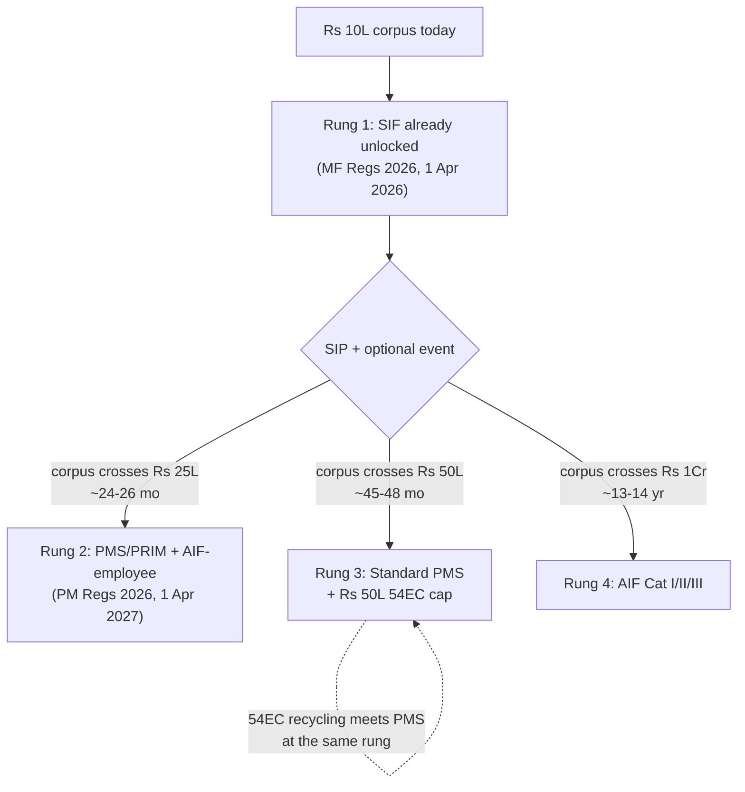

The question this page is built to answer is not "which funds?" — it is the one a ₹10L investor actually asks at 2 a.m.: *I can deploy ₹10L today, and I expect more capital later (a promotion, a bonus, an ESOP, a sale). So which doors open as I climb, and when?* Most of the Indian "professional" investment world — the Specialized Investment Fund, Portfolio Management Services, and Alternative Investment Funds — is gated behind **regulatory minimum-ticket sizes**, not behind your knowledge. Get the corpus below the threshold and the instrument does not exist for you; get it above it and a whole new set of avenues unlocks. This article lays that ladder out rung by rung, times each unlock to your real corpus trajectory, and shows the tax (surcharge) cost of the income growth that usually accompanies the climb.

Everything here is regulatory and arithmetic, not a fund recommendation. The rung thresholds are SEBI minimums; the timing math is a planning model you should stress-test with your own income and risk tolerance. The companion **capital-ladder calculator** turns this into an interactive "when do I qualify?" tool.

## The four rungs, in order

The professional-grade Indian investment ladder has four doors, each at a different corpus threshold. Verified against SEBI's FY 2026-27 regime (the SEBI (Mutual Funds) Regulations 2026 for SIF, and the SEBI (Portfolio Managers) Regulations 2026 for PMS/PRIM):

| Rung | Threshold | What unlocks | Regulatory anchor |
|---|---|---|---|
| **0 — retail base** | ₹1L+ | Index/ETF, direct mutual funds, REIT/InvIT, P2P, digital gold, NPS, sovereign debt | Open to everyone; the ₹10L plan already lives here |
| **1 — SIF** | **₹10L** (PAN-level) | SEBI Specialized Investment Fund: long-short, multi-asset, and credit strategies run by an AMC | SEBI (MF) Regs 2026, effective 1 Apr 2026 |
| **2 — PMS/PRIM + AIF-employee** | **₹25L** | The mutual-fund-only PMS "PRIM" route; the AIF minimum for eligible employees/directors of a portfolio company | SEBI (Portfolio Managers) Regs 2026, effective 1 Apr 2027 |
| **3 — Standard PMS** | **₹50L** | A dedicated portfolio run by a SEBI-registered manager (all strategies; 1–2.5% mgmt + 10–20% performance fees) | PMS per-client minimum (unchanged into 2026-27) |
| **4 — AIF** | **₹1Cr** | Category I (VC/PE), II (fixed-return debt), III (open-end long-short/leveraged) | AIF HNI minimum (unchanged into 2026-27) |

Two things the table makes clear that most advice misses:

- **The ₹25L rung is a real, currently-existing door, not just "PMS from 50L".** The SEBI (Portfolio Managers) Regulations 2026 introduced the **PRIM (Portfolio Investment in Mutual Funds)** route — a mutual-fund-only PMS at a **₹25L** minimum, effective **1 April 2027**. The same ₹25L number is the AIF minimum *if you are an eligible employee or director of a portfolio company*. So between 25L and 50L you are not stuck at "nothing new" — you have two genuinely different doors.
- **The 54EC infrastructure-bond cap is set at ₹50L**, the same number as the standard-PMS door. That is a quiet coincidence that matters: the moment your corpus reaches ₹50L, you can both (a) recycle a house-property gain into 54EC notified bonds up to ₹50L and (b) open the standard PMS route. The ladder and the tax-rollover math meet at the same rung.

## When a rung unlocks: the corpus math

A rung "unlocks" the month your **deployable corpus crosses its threshold**. Your corpus is not static — it is your current lump sum, plus a monthly SIP, plus any future lump-sum event (promotion, ESOP, a sale), all compounding. The timing to each door is a straightforward trajectory question:

- **Starting at ₹10L**, the SIF door is *already open today*. You qualify the moment you have ₹10L, and you do.
- **The 25L door** takes time. At a conservative 9% nominal annual return with a ₹50,000 monthly SIP, ₹10L reaches ₹25L in roughly **24–26 months**. Bump the event — say a ₹5L promotion bonus at month 12 — and it comes a few months sooner.
- **The 50L door** is the long climb. From the same start, ₹50L arrives around **45–48 months**; that is when standard PMS (and the ₹50L 54EC cap) open.
- **The ₹1Cr AIF door** is the multi-year one. From ₹10L at 9%, ₹1Cr is roughly **13–14 years** of disciplined compounding *without* a large event, or dramatically sooner if a genuine windfall (an ESOP exit, a business sale) lands.

The **capital-ladder calculator** does this exactly for your numbers: it compiles your trajectory month-by-month and reports, for each of the four rungs, the month it opens (or "beyond 30 years" if it does not). It also models the **optional future lump-sum event** — the "I'll get more capital later" assumption made concrete as a ₹ amount at a given month — and shows how much earlier each door opens with it.

## The surcharge-tier shift (the tax cost of the climb)

The ladder is not only about which instruments open — it is about the **income growth** that usually funds the climb. That income growth is exactly what pushes you up the **surcharge tiers**, and the surcharge is levied on the base income tax, not on the corpus. Under the FY 2026-27 new regime the tiers are:

| Total income | Surcharge | Note |
|---|---|---|
| up to ₹50L | 0% | no surcharge |
| above ₹50L to ₹1Cr | 10% | first new tier you hit as income climbs |
| above ₹1Cr to ₹2Cr | 15% | the HNI band |
| above ₹2Cr | 25% | new-regime cap (the old regime still had a 37% tier above ₹5Cr) |

Two consequences the ladder makes explicit:

1. **The "when do I unlock PMS" moment and the "when do I start owing 10% surcharge" moment are not the same event, but they are correlated.** A PMS/AIF-grade income (typically ₹50L+ taxable income) is exactly where the 10% surcharge band starts. So the moment your professional instruments become available is also the moment your *effective* tax wedge on that income rises — the ladder and the surcharge both reward planning the deployment and the income together, not separately.
2. **The new regime caps the surcharge at 25%.** That cap is meaningful at the ₹1Cr+ AIF rung: your marginal cost of a rupee of *salary* income above ₹2Cr is 30% slab + 25% surcharge + 4% cess, which is why high earners at that rung lean on the instruments in the *corpus* (post-tax, taxed on capital gains, not salary) rather than on pushing more *income*.

The calculator models this with a **current-vs-future income** pair: it computes the new-regime base tax at each income level, applies the correct band surcharge, and reports the tier label plus the surcharge amount now vs later, and the increase. Feed in your income today and your income a few years out and you see the exact surcharge jump.

## Worked example: ₹10L, ₹50,000 SIP, a ₹5L bonus at month 12

Assume: corpus ₹10L today, ₹50,000/month SIP, 9% nominal annual return, and a ₹5,00,000 promotion bonus landing at month 12. Income today ₹20L/yr, projected ₹40L/yr a few years out.

| Rung | Threshold | Months to unlock | Reading |
|---|---|---|---|
| SIF | ₹10L | **0 (today)** | Open now — the 10L corpus already qualifies |
| PMS/PRIM + AIF-employee | ₹25L | ~**22–24** | The bonus accelerates it past the pure-SIP ~25 months |
| Standard PMS + 54EC | ₹50L | ~**40–44** | ~3.5 years of compounding; 54EC recycling becomes available at this same rung |
| AIF | ₹1Cr | **beyond the 30-yr window without a windfall** | Realistic only with a genuine event (ESOP exit / sale) |

The surcharge read: at ₹20L income there is **no surcharge**; at the projected ₹40L, still below the ₹50L band, **still no surcharge**. But the projection that *funds* the PMS rung (income crossing ₹50L) is the exact income at which the **10% surcharge** turns on. That is the single most useful thing this page tells you: **the PMS door and the surcharge door open at different corpus/income levels, and conflating them is how investors both over-estimate their qualification and under-estimate their tax wedge.**

## When a higher rung is the wrong tool (the honest layer)

The ladder says *when you can*, not *whether you should*. Three honest limits:

- **Fees are the price of the rung.** SIF/PMS/AIF carry a management fee of 1–2.5% a year plus, in PMS/AIF, a 10–20% performance fee on the gain above a hurdle. At ₹50L that is ₹5L–₹12L of *future* gross returns redirected to the manager every rising year. The **after-tax-wedge calculator** tells you at what corpus a professional mandate actually beats a low-cost index + direct-sleeve build-up — that crossover is the *real* "should I move up" line, and it is usually *above* the regulatory minimum.
- **AIF minimums have exceptions, and the exceptions are the trap.** The ₹25L AIF figure applies to eligible employees/directors of a portfolio company; the general HNI route is ₹1Cr. An "AIF for 25L" pitch to a non-employee is not the regulated route and should make you stop and ask why.
- **The 25L PRIM route is dated.** It opens **1 April 2027**. Before then, the only sub-₹50L professional door is the SIF at ₹10L. Plan the timeline accordingly; a manager quoting you a "25L PMS" today is quoting you next year's product.

## What to do with the ₹10L you have today (while you climb)

While the corpus compounds toward the next door, the retail base (rung 0) is fully available and is where a ₹10L plan should actually sit:

- **Core:** a low-cost index/ETF sleeve plus 1–2 high-conviction direct funds (see *mf-index-etf-direct-regular* and *mf-choosing-comparing-funds*).
- **Satellite:** a REIT/InvIT slice for yield-with-liquidity, a P2P tranche for the carry, digital gold for the inflation hedge (see *real-estate-reit-invit*, *p2p-lending-complete*, *gold-silver-commodities*).
- **Tax-shield layer:** ELSS and NPS to the extent your regime still values them (see *tax-80c-baskets-regime-decision*, *retirement-nps-exit-annuity-tax-deep-dive*).
- **The first rung (SIF):** only *after* the core is built and you understand the long-short/credit risk you are buying. A SIF is the first instrument where you are delegating the *strategy*, not just the assets — that is a different risk than a fund.

The discipline that makes the ladder work is to **let the corpus, not the label, drive the moves**: deploy the SIF when ₹10L is there, open the PMS when ₹50L is there (and only past the fee-crossover line), and reach for the AIF when ₹1Cr is there. The calculator turns that into a date, not a guess.

## Update log

- **2026-10-18 (Wave 20):** created. Verified the four rung thresholds and the surcharge tiers against the SEBI (Mutual Funds) Regulations 2026 (SIF ₹10L, 1 Apr 2026), the SEBI (Portfolio Managers) Regulations 2026 (PRIM ₹25L MF-only + IPO/unlisted-debt/overseas broadening, 1 Apr 2027), the AIF ₹1Cr HNI / ₹25L employee-director minimums, and the FY 2026-27 new-regime surcharge bands (10% > 50L, 15% > 1Cr, 25% > 2Cr cap).
- **Review by 2027-04-17:** re-verify the SIF, PMS/PRIM, and AIF minimums and the surcharge tiers at the FY 2027-28 Budget; confirm the 1 Apr 2027 PRIM commencement actually happened as notified.

## Sources

- `src-sebi-sif-2026` — SEBI (Mutual Funds) Regulations 2026: SIF introduction, ₹10L PAN-level minimum, effective 1 Apr 2026.
- `src-pms-aif-fees-2026` — PMS/AIF fee structure (1–2.5% management + 10–20% performance) and per-client minimums.
- `src-aif-categories-2026` — AIF Category I/II/III definitions, ₹1Cr HNI minimum and ₹25L employee/director exception.
- `src-surcharge-cess-fy2026-27` — FY 2026-27 surcharge tiers (new regime 10%/15%/25% cap) and 4% cess.

## Related

- [Your 10 Lakh Wealth Plan](/articles/pf-wealth-plan-10-lakh)
- [Picking Your Own Rung: The SIF / PMS / AIF Selection & Fee-Decay Guide](/articles/alternatives-hnw-pms-aif-sif-selection)
- [Surcharge & Cess for High Income](/articles/tax-surcharge-cess-high-income)
- [Capital-Gains Rollover (54/54F/54EC)](/articles/tax-capital-gains-rollover-54-54f-54ec)
- The **capital-ladder** calculator — turn your real corpus, SIP, and future event into "months to each door".
