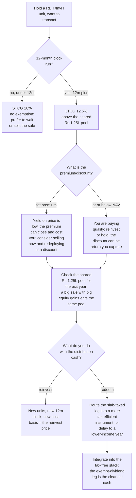

The [Real Estate, REITs & InvITs](./real-estate-reit-invit.mdx) article built the structure: the pass-through treatment under Section 115UA, the distribution-component table (interest / the 115BAA two-fork dividend / rental / return-of-capital), the 194LBA TDS mechanics, and the capital-gains rates. This article is the **timing and total-return layer** — the decision *when* and *how* to transact, which is where the yield you thought you were getting quietly diverges from what you actually get. It answers four questions the base article does not:

1. **When does a REIT/InvIT unit become long-term, and what does that rate step actually save you?**
2. **How does the NAV premium or discount change the yield you earn on your purchase price versus on NAV?**
3. **Reinvest the distribution or redeem it — and into what?**
4. **How does a REIT/InvIT distribution slot into the [tax-free wealth stack](../taxation/tax-tax-free-wealth-stack.mdx) without blowing the shared ₹1.25L equity-LTCG pool or pushing you into a higher slab?**

The through-line: a business trust's total return is **distribution + NAV appreciation**, and its capital gain is **12.5% long-term (above the shared ₹1.25L annual equity pool, Section 112A)** only once the **12-month clock** has run; before that the gain is **20% short-term** (Section 111A). Most distributions are **slab-taxed component-by-component**, so the *after-tax income* is the number that feeds your stack — not the headline yield.

## The 12-month clock, and the rate step it buys

The clock is the single most mechanical decision in REIT/InvIT timing. For *listed* units:

- **Holding of more than 12 months → long-term.** The gain is **12.5% above the ₹1.25L annual exemption** under Section 112A — *the same exemption shared with your listed shares, equity funds, and ELSS gains in the same year* (`src-elss-ltcg-2026`, `src-reit-invit-tax-2026`). No indexation.
- **Holding of 12 months or less → short-term.** The gain is **20% under Section 111A**, no exemption.
- **STT paid on the exchange sale is the condition** for both rates. A sale without the STT condition does not get the 112A/111A rates; verify the exchange-settlement mechanics before acting.

Two consequences that trip people up:

- **The pool is shared, not separate.** A big REIT sale in a year with big equity sales eats the *same* ₹1.25L. A ₹8L long-term REIT gain plus a ₹8L equity gain in one year puts the combined ₹16L over the pool — **only ₹14.75L is taxed, and the REIT sale did not get a clean 12.5% on the full gain** because it crossed the shared exemption. Time or split the sale, or use [loss harvesting](../taxation/tax-loss-harvesting.mdx) to absorb part of it.
- **The clock runs on your *entry*, and a return-of-capital distribution *adjusts the cost*.** A ₹5,000 return-of-capital on a unit you bought at ₹400 is *not* income — it *reduces* your cost basis, which *increases* the capital gain when you sell. Selling must use the *adjusted* cost, not the original purchase price. Track the running adjusted cost of every unit; it is the number that decides your 112A gain.

The site ships this as a pure, unit-tested function, `businessTrustTiming()`, which computes the 12-month qualification, the headline-yield-versus-price-yield gap, the after-tax distribution income at your marginal slab, and the after-tax proceeds of selling *now* versus *holding forward* at a stated NAV growth rate.

## The NAV premium/discount: the yield you get is not the yield on NAV

A listed REIT is priced two ways at once — the **NAV** (the mark-to-market value of the properties, less debt) and the **market price**. The gap is the premium or discount, and it is the number most REIT buyers never compute:

$$\text{premium/discount} = \frac{\text{price} - \text{NAV}}{\text{NAV}}$$

It moves your effective yield in two directions, both in your favour or both against you:

- **The headline yield is on *NAV* (or on your cost basis); the yield you actually earn is on your *purchase price*.** If a REIT pays ₹30/unit and you bought at ₹400, the cost-basis yield is 7.5% — but if you pay a premium and buy at ₹480, your *actual* yield is 6.25%. The premium *taxes* your upside and *shrinks* your effective distribution yield. The function computes both and the drag between them.
- **The premium can *shrink* and become a loss you did not plan for.** A REIT at 110% of NAV is being valued as if the properties are worth more than the REIT's own mark says. When the premium normalises back to ~100%, you lose the 10% *on top of* the distribution — total return is yield + NAV growth + **change in the premium/discount**, and that last term is the one most investors omit. Buying at a fat premium is buying a future discount that eats your returns.

The symmetric case: a REIT at a *discount* to NAV (say 90% of NAV) is being valued as if its properties are worth 10% less than its own mark. If you believe the mark, the discount is a *return* you capture as it closes — the same mechanics, opposite direction. The honest read: **a persistent deep discount usually signals a real problem** (property-level vacancy, a weak anchor tenant, a tightening concession for an InvIT), not a free lunch. Verify *why* the discount is there before you "buy the dip."

## Reinvest the distribution, or redeem it — and into what

Every distribution statement splits the payout into components, and the choice is *what you do with the cash*, which has a tax consequence of its own:

- **Reinvest (the default on a demat mandate).** The units you buy are *new* entries — each gets its *own* 12-month clock and its *own* cost basis (the reinvest price). Reinvesting at a discount to NAV is the same move as buying at a discount; reinvesting at a premium buys a future discount. There is no tax on the reinvestment itself, but the new units' cost basis is the reinvest price, not the original NAV.
- **Redeem / take the cash.** You take the after-tax distribution into your hand. This is the move that matters for the [tax-free wealth stack](../taxation/tax-tax-free-wealth-stack.mdx): you can *route* the cash into an instrument that is *more* tax-efficient than the REIT, or *delay* the redeployment to a lower-income year if the distribution would push you into a higher slab.
- **The slab-taxed component is the one to route.** The interest and 115BAA-dividend and rental components are taxed at *your* slab (`src-reit-invit-tax-2026`). The **exempt** component (a dividend from an SPV that did *not* opt for 115BAA) is the cleanest cash to pocket. Check the *breakup* of each payout before you calculate the post-tax return — a REIT that pays a high share of slab-taxed interest is not a "tax-free distribution," and the Finance Bill 2026 proposal to make the dividend component uniformly exempt *does not* make the interest and other components exempt (`src-reit-invit-premium-discount-2026`).

The timing question inside the reinvest decision: **reinvest when the unit is at (or near) a discount to NAV, and delay or redirect when it is at a fat premium.** You are doing the same premium/closing game as a buy, but on the cash leg. The function's `afterTaxDistIncome` is the *income* you capture either way; the premium/discount decides the *purchase-quality* of the reinvested units.

## The exit math: now or forward, worked

The decision "sell this REIT position now or hold for the forward year" is a three-term comparison the function computes: (a) the premium/discount, (b) the after-tax distribution income, and (c) the 112A/111A gain *now* versus *forward*. A worked pass (illustrative, not a backtest — the NAV growth and distribution figures are assumptions to replace with the fund's own):

**Setup:** 1,000 units, bought at ₹400 each (cost ₹4.0L), now priced at ₹480, NAV ₹420. Annual distribution ₹30/unit. Marginal slab 30%. No shared-LTCG pool assumed available in the exit year.

- **Premium:** (480 − 420) / 420 = **+14.3%**. You paid a fat premium; it can close to zero and cost you that 14.3% on the price.
- **Headline yield (on cost):** 30 / 400 = **7.5%**. **Yield on your price:** 30 / 480 = **6.25%**. The premium is eating 1.25 points of your effective yield.
- **After-tax distribution income:** ₹30,000 × (1 − 0.30) = **₹21,000** a year (assuming the slab-taxed component dominates; an exempt-dividend-heavy payout would be higher).
- **Holding: 18 months → long-term now.** The ₹80,000 gain (4.8L − 4.0L) is 12.5% long-term = **₹10,000 tax**. After-tax proceeds now: ₹4.7L.
- **Holding forward 3 years at 5% NAV growth:** ₹4.8L × 1.05³ ≈ ₹5.56L. The forward long-term gain ₹1.56L × 12.5% ≈ **₹19,458 tax**. After-tax proceeds forward: ≈ **₹5.36L**.

Read the two outcomes together. The *forward* after-tax proceeds (₹5.36L) exceed the *now* proceeds (₹4.7L), so the function flags **hold forward** — but the decision is *not* "NAV will grow 5%." It is: *the premium you paid is still open (a future closing is a future cost), the 12-month clock has already run (you are in the better 12.5% bucket now), and the forward projection compounds the NAV growth against the shared-LTCG pool you will face.* The honest answer the math forces: **if you are in the 12.5% long-term bucket already, selling now and redeploying the proceeds into a cheaper entry (a unit at a discount, or a higher-yield REIT) is often *better* than riding a single REIT's premium to close — because you capture the distribution reinvestment quality *and* avoid paying a fat premium into the NAV mark.** The function returns the two after-tax figures and the `betterChoice`; the strategy layer is whether *redeploying* beats *holding*, and that is a portfolio decision, not a single-REIT one.

## How it slots into the tax-free stack

A REIT/InvIT is **not** a tax-free instrument — its dominant components are slab-taxed. But it *feeds* the stack in two specific, useful ways:

- **The exempt-dividend leg.** Where a payout's dividend component is from an SPV that did *not* opt for 115BAA, it is **exempt in your hands** (`src-reit-invit-tax-2026`). That is the cleanest cash a REIT can hand you; the 2026 Finance Bill proposal to make the dividend uniformly exempt (with a 25% SPV-level surcharge trade-off) would widen that leg — verify the current-year wording before relying on it (`src-reit-invit-premium-discount-2026`).
- **The 112A pool management.** A REIT sale is *the same* 12.5% / ₹1.25L pool as your equity. The [tax-free wealth stack](../taxation/tax-tax-free-wealth-stack.mdx) is built around *which* gains you let be long-term-equity (12.5% above the pool) versus which you shelter in instruments that are not equity-LTCG at all. A REIT position gives you a *second* dial on that pool: a big REIT gain in a year is a *cost* to the pool you were going to use for a deferred equity sale. Time the REIT sale into a year when the pool is otherwise idle, or harvest a loss against it.

The honest summary: a REIT/InvIT is a **bond-like, listed, daily-liquid income asset with a real-estate or infrastructure skin** — closer to a corporate bond than to a property, and closer to an equity *for the gains* (112A/111A) than to a bond *for the income* (slab-taxed components). The timing layer is the premium/discount on the price leg and the 12-month clock on the gain leg; the tax layer is the component breakup on the distribution leg. Three legs, three different decision rules — and the function that ships the gain-and-yield math is `businessTrustTiming()`.

## The mistakes, in the order they show up

1. **Buying a REIT at a fat premium and ignoring that the premium can close and cost you.** The 14.3% premium in the worked example is not a number you keep; it is a number you *risk giving back*.
2. **Assuming a "REIT dividend" is tax-free.** Most of it is slab-taxed component-by-component; only the exempt-dividend leg is clean. Read the *breakup* of the payout.
3. **Forgetting the shared ₹1.25L pool.** A big REIT long-term gain and a big equity gain in the same year eat the *same* exemption; time or split the sale.
4. **Selling without tracking the return-of-capital cost adjustment.** The adjusted cost, not the purchase price, is the 112A base; a return-of-capital distribution raises the gain.
5. **Ignoring the STT condition.** A sale that did not satisfy the STT requirement on the exchange does not get the 112A/111A rates. Verify the settlement mechanics.

## Where this sits

Read it with [Real Estate, REITs & InvITs](./real-estate-reit-invit.mdx) (the structure, the component table, the 194LBA TDS), the [tax-free wealth stack](../taxation/tax-tax-free-wealth-stack.mdx) (where the exempt-dividend leg and the 112A pool management live), and [loss harvesting](../taxation/tax-loss-harvesting.mdx) (the tool that absorbs a big REIT gain). The base article's tax-component table is the *what*; this article is the *when* and the *how-much*.

The single sentence to remember: **a REIT/InvIT has three legs — a price leg governed by the NAV premium/discount, a gain leg governed by the 12-month clock and the shared ₹1.25L pool, and an income leg governed by the distribution component breakup — and the total return you actually get is the sum of all three, not the headline yield.**

## Update log

- 2026-10-18: Timing and total-return layer added over the base REIT/InvIT article; 12.5% long-term rate, the shared ₹1.25L pool, the 12-month clock, the premium/discount yield-drag, and the component-breakup income routing are flagged for CA verification of the current-year wording (including the 2026 Finance Bill dividend-uniformity proposal and its 25% SPV-surcharge trade-off).
