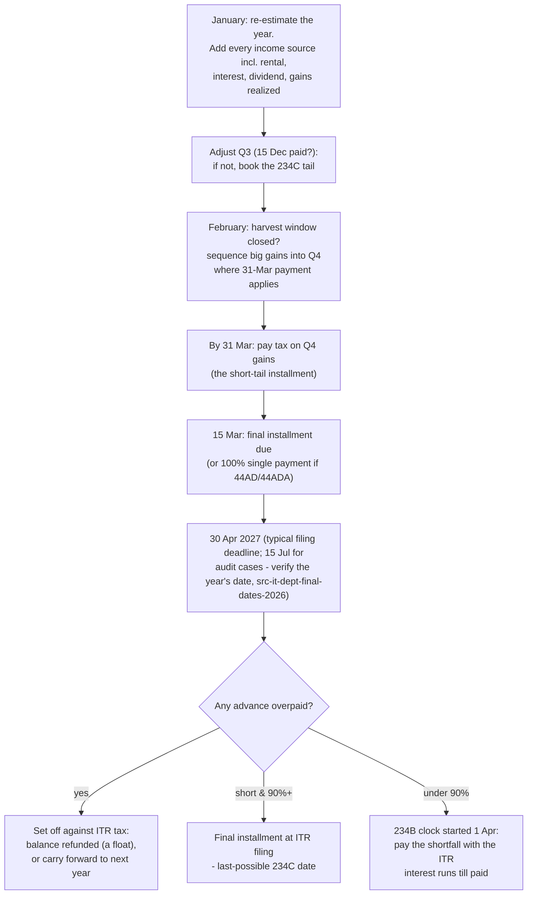

Most of the site's tax articles tell you *what you owe*. This one tells you *when it becomes expensive to be late*, and the small machine of end-of-year steps that separates a clean filing from a 234B interest bill. Advance tax is where the investor's two biggest non-salary incomes — rental income and realized gains — meet the tax authority *during the year*, not in July. The numbers below are for FY 2026-27 (the first year of the Income-tax Act, 2025; nothing in Budget 2026 moved the personal slab rates, `src-it-slab-fy2026-27`).

## Who owes advance tax at all

The duty is simple: if your **total tax liability for the year, after all TDS/TCS credited, exceeds ₹10,000**, you owe advance tax (`src-advance-tax-fy2026-27`). That single sentence has four consequences most salaried readers never feel, because their TDS already covers them, and every investor with a side income or realized gains *does* feel:

- **Rental income has no TDS.** You receive it in full; the advance duty is *yours* to discharge. The 234C clock starts ticking from 15 June even on income you have not yet received.
- **Capital gains are timing problems.** A large long-term gain realized in February is taxed *in the quarter it arises* — the installment *ahead* of it cannot cover it, but the final 15 March installment can. The Act gives you a specific relief here (below).
- **Interest income from NCDs, deposits, and P2P platforms is partial-TDS territory.** The TDS on those (where any is deducted) is credited; the residue beyond the ₹10,000 threshold is advance tax.
- **Freelancers and professionals** get 44AD/44ADA presumptive income, which means they may pay 100% of the advance tax in *a single 15 March installment* instead of the four-part schedule (`src-advance-tax-fy2026-27`).

## The four dates, and why they are cumulative

The schedule for FY 2026-27 (unchanged for years; dates only, `src-advance-tax-fy2026-27`):

| Installment | Due | Cumulative share | What you actually pay on that date |
| --- | --- | --- | --- |
| 1st | **15 Jun 2026** | 15% of the year's estimated tax | 15% |
| 2nd | **15 Sep 2026** | 45% | a further 30% |
| 3rd | **15 Dec 2026** | 75% | a further 30% |
| 4th | **15 Mar 2027** | 100% | the final 25% |

The word *cumulative* is the whole game. The 15 June payment is not "15% of what you know by June"; it is 15% of your *estimate for the whole year* made at the time. An underestimate at 15 June is a 234C interest cost on the shortfall, and it is not fixed by paying more in September — the *first* quarter's shortfall still carries interest. This is the most common advance-tax error: treating the schedule as four independent payments instead of a cumulative ramp.

$$\text{Advance tax} = \max\big(0,\;\text{estimated total tax} - \text{TDS/TCS}\big) \;\;\text{payable as cumulative } 15/45/75/100\%$$

The [advance-tax calculator](/calculators/advance-tax) on this site gives you the four numbers for any income/TDS pair under FY 2026-27 new-regime slabs (surcharge and 4% cess included when the income crosses the 50L / 1Cr / 2Cr thresholds — 10% / 15% / 25% surcharge, new-regime cap at 25% over ₹2Cr, `src-it-slab-fy2026-27`).

## The two interest clocks: 234C is your problem, 234B is the backstop

**Section 234C — the installment clock (the one you will actually hit).** 1% per month (or part thereof) on *each* installment shortfall. The statutory pattern, which is what most calculators understate:

- Short at **15 June** → 1% × 3 months of 234C interest on the shortfall (Jun, Jul, Aug).
- Short at **15 Sep** → 1% × 3 months (Sep, Oct, Nov).
- Short at **15 Dec** → 1% × 3 months (Dec, Jan, Feb).
- Short at **15 Mar** → 1% × 1 month (Mar) — the final installment has no 3-month tail.
- Paid after **15 March** but within the year → 1% × 1 month on the 100% shortfall.

Worked example, so the clock is not abstract: you estimated ₹1,50,000 of advance tax and paid *nothing* until 15 March.

$$\text{234C} = 1\%\times3\times0.15\times1.5\text{L} + 1\%\times3\times0.45\times1.5\text{L} + 1\%\times3\times0.75\times1.5\text{L} + 1\%\times1\times1.0\times1.5\text{L}$$
$$= 675 + 2025 + 3375 + 1500 = ₹7{,}575$$

That is the cost of "I'll just pay it all in March" on a modest liability: **₹7,575 of interest on ₹1.5L of tax**, a 5% effective rate on the tax itself. The [advance-tax calculator](/calculators/advance-tax) reports an *approximation* of this clock (1% × 3 months on each of the first three quarterly shortfalls — identical to the formula above when only one payment is made at the end; when several payments are made on time the approximation overstates slightly, which is why the calculator says *approx* and the ITR utility is the authority).

**Section 234B — the 90% backstop (rare but real).** If your total advance paid for the year is less than **90% of the tax finally assessed** (not the estimated figure), 234B charges 1% per month from 1 April on the shortfall, until paid. This is the catch that converts "I estimated well" into "I estimated 8% too low": estimating 85% of the final tax saves you nothing and costs you a 234B clock that runs from the start of the year. The practical rule: **estimate with a margin.** If you expect ₹1.5L, budget for a slightly higher number in Q1/Q2 — an overpayment of a few percent is refunded against the final ITR (a free, interest-bearing float), while a 90% miss is not refunded, it is *interest-billed*.

$$\text{If } \text{advance paid} < 0.9\times \text{assessed tax} \;\Rightarrow\; \text{234B: }1\%\text{/month on the shortfall from 1 Apr}$$

## The capital-gains relief that is worth knowing

The Act's standard relief, and the one that saves a specific, expensive scenario: **income that arises after an installment date — capital gains, lottery, dividend — attracts no 234C interest on that installment**, provided its tax is paid in the installments that remain, and tax on gains arising in the last quarter is payable by **31 March** of the year-end (`src-advance-tax-fy2026-27`). The consequence is a real planning lever:

- A ₹80L long-term equity gain realized on **28 February** owes *no* 234C on the missed December installment, provided the tax on it is paid by **31 March 2027** (a one-month 234C on the final installment at most).
- The same gain realized on **10 January** (third quarter) must be paid *in the 15 December installment* — one quarter early — or you carry 234C.

The planning move this enables: if you are planning to harvest a large gain [as the loss-harvesting article describes](../taxation/tax-loss-harvesting.mdx), **the month you harvest changes the quarter its tax is due**. A gain harvested before the quarter's date is a 234C item; a gain harvested in the last quarter is a 31 March item with a shorter interest tail. For a large harvest, that sequencing decision is worth more than the harvest itself in some years. (The harvest's *eligibility* and its interaction with loss carry-forward are the loss-harvesting article's subject; this one only prices the *taxing* of what you harvested.)

## The surcharge layer the ₹10L reader will meet later

FY 2026-27 surcharge is income-thresholded on *total income*, not tax: **10% above ₹50L, 15% above ₹1Cr, 25% above ₹2Cr, with marginal relief at each threshold, capped at 25% under the new regime** (the old regime's cap reaches 37%+, and super-seniors above ₹5Cr face their own bands — out of scope here, verify with a CA) (`src-it-slab-fy2026-27`). Two things the 10L→50L→1Cr roadmap reader should internalize *now*, before the corpus arrives:

1. **Surcharge bites on the *estimate*, which is why the estimate margin matters more at the threshold.** An estimate that straddles ₹50L or ₹1Cr in one quarter and lands under it in the final ITR can *create or remove* a whole surcharge band — the advance duty on the wrong side of the line is a real, non-trivial difference.
2. **Marginal relief is per-threshold, and it is generous.** Income just above a threshold pays at most (income − threshold) × the marginal rate; the cliff is a *relief*, not a trap. This is also why the new regime's 25% surcharge cap is structurally better at the 50L–1Cr band than the old regime's 37% top — a reason it surfaces in the [tax-shield calculator](/calculators/tax-shield) comparisons at the very top of the range.

## The final-year checklist: from estimate to settled

The fiscal year's last 90 days is where the advance tax plan and the ITR filing meet. Run this in order, and the "estimate" becomes "settled":

The checklist items, in the order they fail in practice:

1. **Re-estimate in January, not March.** The January re-estimate catches the rental income and Q1–Q2 realized gains you forgot, while the December installment (if unpaid) is still adjustable. By March there is only one move left.
2. **Sequence the last big gain.** As above: a Q4 harvest buys the 31 March, one-month 234C treatment; a Q1–Q3 harvest must be paid early or you carry 234C.
3. **Pick the right form.** The FY 2026-27 forms under the new Act: **ITR-1** (salary + one house property + other sources, up to the capital-gains threshold), **ITR-2** (any capital gains, HUF investment income, or a non-resident — note: a HUF files ITR-2 for investment income and ITR-3 for business income, as [the HUF structure article](../taxation/tax-huf-wealth-structure.mdx) lays out), **ITR-3** (business/profession income). An investor with a large equity gain jumps to ITR-2; a single HUF and its karta may file *two* returns this year. Filing the wrong form and catching it is a refile and a late fee; filing the right one is a form of *compliance insurance*.
4. **Set off the overpayment, and let the float work.** Advance tax that exceeds the assessed tax is not a loss: it is set off at filing, and a residue *can* be carried forward to the next year. A deliberate small overestimate in year N is thus a zero-interest loan to the government in year N — never a strategy to abuse, but never a penalty to fear.
5. **The 90% test, last.** Before you file, check: *advance paid this year* ≥ 90% of *assessed tax*? If not, the 234B clock is running from 1 April and the *only* stop is paying the shortfall with the ITR — which the final installment is, so you stop it then, and every month before then costs 1% on the shortfall.
6. **Verify the dates for the year.** The standard deadline is **31 July 2027** (15 July for audited entities; the Act keeps the July dates) — but the Income-tax Department publishes the final dates at year-end, and `src-it-dept-final-dates-2026` is the check line. Do not plan the last mile off a remembered date.

## The three advance-tax errors that cost real money

Ranked by frequency in the patterns the 234B/234C structure actually produces:

1. **"Cumulative" read as "independent."** Paying nothing until March on a ₹1.5L liability: the worked ₹7,575 234C cost above, a 5% effective rate on *the tax itself* — a rate no fixed-income instrument beats.
2. **Estimating 90%+ of the *estimate* instead of a cushion on the *year's* estimate.** A Q1 rental income that arrives at Q3, and the gain the December installment should have covered, are the two misses that turn a clean year into a 234B year. The margin rule: estimate the *whole year* in January.
3. **Filing ITR-1 with a capital gain in it.** The form will not carry it; the gain becomes *disclosed-but-not-taxed* in a form that cannot tax it, which is the specific kind of exposure that gets the ITR reassessed. ITR-2 for any equity capital gain, full stop; [the loss-harvesting article](../taxation/tax-loss-harvesting.mdx) covers the *losses* that travel with those gains.

## What this article does not model (read before you rely on it)

- **234A/234E** (the small business-interest and the TDS-shortfall interest) are out of scope — they apply to specific categories and the 234C mechanism above is the investor's one.
- **Presumptive 44AD/44ADA** is mentioned for its *single 15 March payment*; its 50%/55% income assumption and the turnover thresholds are the [loss-harvesting](./tax-loss-harvesting.mdx) article's subject, not this one's — the point here is only that it is a *single* payment, not a four-part ramp.
- **The 87A rebate does not reduce the advance duty.** The duty is on the *tax after rebate* — a ₹10L income owes *no* advance tax at all (₹0 after the 87A rebate), which is the cleanest line in the whole section: **if you fall under the ₹12L new-regime tax-free corridor, the advance tax machine does not touch you** (`src-it-slab-fy2026-27`).
- **This is the site's general-information layer; the ITR utility's own 234B/234C calculation, and your CA's filing, are the authority** on the specific numbers for *your* year. The calculator and this article are the pre-filing map; the filing is the territory.

## Related

- [India's Income-Tax System for Investors](./tax-india-investor-complete.mdx) — the slab structure this article's estimates sit on; read it if the new-regime slabs are new to you.
- [Building the Tax-Efficient Wealth Stack](./tax-tax-free-wealth-stack.mdx) — the tax-free corridor this article's "you may owe no advance tax at all" line points to.
- [Loss Harvesting and Carry-Forward](./tax-loss-harvesting.mdx) — the losses that travel with the gains this article's 31 March timing lever prices.
- [The ₹10 Lakh Wealth Plan](../personal-finance/pf-wealth-plan-10-lakh.mdx) — the corpus under which the advance tax estimate is first run, and why the estimate margin matters at 10L.

## Sources

- `src-advance-tax-fy2026-27` — Income-tax Act, 2025 (FY 2026-27), Sections 207–211 (advance duty), 234B, 234C (interest clocks), the 15/45/75/100% cumulative schedule and its 15 Jun / 15 Sep / 15 Dec / 15 Mar 2026–27 dates, the ₹10,000 threshold, the capital-gains 31 March relief, the 44AD/44ADA single-payment option, and the 90% backstop.
- `src-it-slab-fy2026-27` — the FY 2026-27 new-regime slab structure (nil to ₹4L … 30% above ₹24L; 87A rebate to ₹12L; surcharge 10/15/25% at 50L/1Cr/2Cr, new-regime cap 25%), which this article's "estimate" is computed on; confirmed unchanged by Budget 2026.
- `src-it-dept-final-dates-2026` — the Income-tax Department's FY 2026-27 filing and advance-payment final dates (the 31 July 2027 ITR deadline for non-audited, 15 July for audited), the check line for the "last mile" of the checklist.

## Update log

- 2026-10-17: New article. The FY 2026-27 advance-tax schedule (15/45/75/100% on 15 Jun / 15 Sep / 15 Dec / 15 Mar), the 234B/234C interest clocks (3-month and 1-month tails), the capital-gains 31 March relief, the surcharge thresholds (10/15/25% at 50L/1Cr/2Cr, new-regime cap 25%), and the ITR-1/2/3 selection logic verified against `src-advance-tax-fy2026-27`, `src-it-slab-fy2026-27`, `src-it-dept-final-dates-2026`.
- 2027-04-17: Scheduled re-verification: the FY 2027-28 advance schedule dates and thresholds (re-check at each Finance Act), the surcharge cap (the new-regime 25% cap is the current number; any change at the 2027 Budget), the 31 July filing deadline (published by the Income-tax Department each year), and the MF-only PMS route's April-2027 go-live (cross-checks with the HNW selection article's re-verify line).
