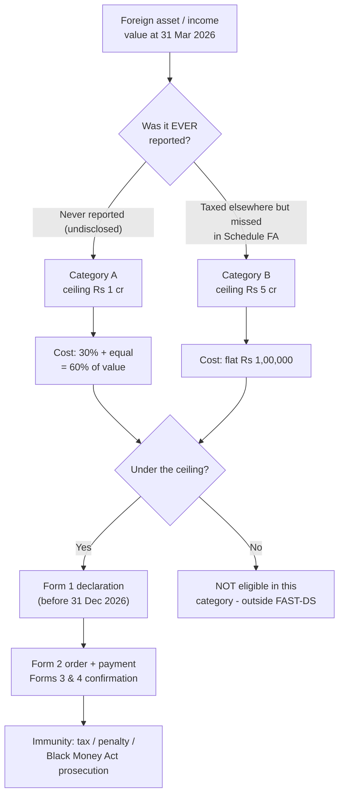

The [direct-LRS filing article](./tax-direct-lrs-us-equity-filing-walkthrough.mdx) ends on layer 5 — the **FAST-DS 2026** small-taxpayer window flagged as the *separate* amnesty layer for assets you *never* reported. This page is that layer, worked out: the two categories, the exact cost of each, the reference date, the Form 1 → 2 → 3/4 sequence, the immunity you get, and the decision of when it is (and is not) the right move. This is a **time-boxed** article — the window closes **31 December 2026** — so the numbers here are the ones to act on before that date, and the update log carries a hard `reviewAfter` of 31 Jan 2027 to re-verify whether a successor scheme is announced. Everything is a planning model; a FAST-DS declaration is a real Form 1 filing before the Principal DGIT (Systems), not a calculator output.

## What FAST-DS 2026 actually is

**FAST-DS 2026** = the **Foreign Assets of Small Taxpayers – Disclosure Scheme, 2026**, introduced through **Chapter IV (sections 130–144) of the Finance Act, 2026** and operationalised by the **FAST-DS Rules, 2026** (notified by the CBDT on **15 August 2026**). [src-us-stock-tax-india-2026] It is a **one-time, voluntary** disclosure route for a defined class of taxpayers, and it trades a *defined, calculable cost today* for *protection from open-ended Black Money Act exposure later*. The key facts, verified against the official FAQ / Rules coverage:

| Fact | Value |
|---|---|
| Scheme | Foreign Assets of **Small** Taxpayers – Disclosure Scheme, 2026 |
| Authority | Finance Act 2026, Chapter IV (§§130–144) + FAST-DS Rules, 2026 (notified 15 Aug 2026) |
| Window | **16 August 2026 → 31 December 2026** (no declaration accepted after this date) |
| Reference date | **31 March 2026** (the value of the asset/income is measured here) |
| Who | Residents, *and* certain non-residents / RNORs who meet the scheme's residential-status conditions for the relevant year |
| What can be declared | Undisclosed foreign assets / income up to ₹1 cr, **or** specified foreign assets up to ₹5 cr that were taxed elsewhere but omitted from Schedule FA |
| Cost | **Category A: 30% tax + an equal additional amount (60% of value)** · **Category B: a flat ₹1,00,000 fee** |
| What you get | Immunity from further tax, penalty and **Black Money Act** prosecution for the declared asset/income |
| Filing mode | Fully online, **Form 1 → Form 2 → payment → Forms 3 & 4**, before the **Principal DGIT (Systems)** |

The single most important framing: **FAST-DS is the *amnesty* layer, not the routine layer.** A resident who reports a US brokerage position in Schedule FA every year does *not* need FAST-DS. FAST-DS exists for the asset that *never showed up* — the forgotten overseas account, the old student account that "faded into the background," the asset acquired while non-resident that was taxed abroad but never listed in the Indian return.

## The two categories (the math that decides your cost)

The scheme splits into **two categories** with **different cost structures and different ceilings**. Getting this wrong is the most common FAST-DS mistake, because the *ceiling* — not just the rate — decides which category you are in.

| | **Category A — undisclosed** | **Category B — missed Schedule FA** |
|---|---|---|
| What it covers | Undisclosed foreign asset / income that was **never** reported | A specified foreign asset that was **already taxed elsewhere** (or acquired during non-residence) but was simply **omitted from Schedule FA** |
| Ceiling | **₹1 crore** | **₹5 crore** |
| Cost | **30% tax + an equal additional amount** | **A flat ₹1,00,000 fee** |
| Effective cost | **60% of the disclosed value** | **₹1L flat (the larger the value, the lower the % cost)** |
| Worked | ₹50L asset → 30% = ₹15L tax + ₹15L additional = **₹30L** | ₹4 cr asset → **₹1,00,000 flat** (0.25% of value) |

The "equal additional amount" in Category A is the clause that surprises people: you do **not** pay 30% — you pay **30% plus another 30%**, so the real cost is **60% of the value**. That is deliberately steep *on purpose*: it is a "pay the defined cost and get clean immunity" price, not a normal tax rate. Category B is the *cheap* route, and it is cheap specifically because the asset was *already taxed somewhere* — the ₹1L is a filing fee for the omission, not a tax on the value.

**Alt text:** FAST-DS decision: split by whether the asset was *ever reported*. Undisclosed → Category A (₹1 cr ceiling, 60% of value). Taxed-elsewhere-but-missed-Schedule-FA → Category B (₹5 cr ceiling, flat ₹1L). Both require being under the ceiling; then Form 1 → Form 2 + payment → Forms 3/4, and the declared asset gets immunity from further tax, penalty and Black Money Act prosecution.

## What you get in return (and what you do not)

A **valid declaration and payment** under FAST-DS gives **immunity from further tax, penalty and prosecution under the Black Money (Undisclosed Foreign Income and Assets) Act, 2015** — *for the specific asset or income covered by the declaration*. That is the whole point of the scheme: instead of facing open-ended Black Money Act exposure (the "up to ₹10L a year" missed-disclosure penalty plus prosecution risk), you pay a defined, calculable cost and the door on that asset closes.

The equally important *limits* — what the immunity does **not** cover:

- **It is asset-specific.** You get immunity for the asset/income you *declared*, not a blanket clean slate. Anything you did not declare stays exposed.
- **It does not replace Schedule FA.** After the one-time FAST-DS window, the **ongoing** obligation to report foreign assets in Schedule FA, every year, continues unchanged. FAST-DS regularises the *past*; Schedule FA handles the *present and future*.
- **It excludes certain assets.** Assets linked to **proceeds of crime**, and any year where a **Black Money Act assessment is already complete**, are *outside* the scheme.
- **Eligibility is residential-status-conditional.** For the non-resident / RNOR route, you qualify only if you were resident in India in the year the undisclosed income arose *or* the year the asset was acquired. A returning NRI should check the specific conditions, not assume automatic eligibility.
- **It is time-boxed.** No declaration is accepted after **31 December 2026**. After that, the only routes left are the ordinary (and harsher) Black Money Act assessment path.

## When FAST-DS is the right move (the honest layer)

**Right — file it** when:

- You have a **genuinely forgotten** overseas account (a work account from years ago, an old student stipend account, a dormant forex holding) that was *never* in any Schedule FA, *and* its 31-Mar-2026 value is **under ₹1 cr** → Category A. The 60% cost is high, but it is *defined*, and the alternative (an open-ended Black Money Act discovery through information exchange with a foreign tax authority) is worse.
- An asset was **already taxed abroad** (e.g. bought during a non-resident period, or taxed in the home country) and you just *never listed it in Schedule FA*, with a value **up to ₹5 cr** → Category B. The **flat ₹1L fee** is, in most of this range, by far the cheapest clean-regularisation available — a ₹4 cr asset costs 0.25% of its value.
- You want **certainty before 31 Dec 2026** rather than betting on the scheme being renewed.

**Wrong / do not file** when:

- The asset is a **normally-reported** position (a US brokerage you disclose in Schedule FA every year, a GIFT City fund you report) — you do **not** need FAST-DS; the *routine* layer already covers it, and filing a redundant FAST-DS declaration for a reported asset has no benefit.
- The value is **above the ceiling** for its category (over ₹1 cr undisclosed, or over ₹5 cr missed-Schedule-FA) — FAST-DS simply *cannot* be used, and you need a different (and costlier) regularisation path.
- The asset is linked to **proceeds of crime** or a year with a **completed Black Money Act assessment** — those are excluded, full stop.
- You can **genuinely** show the asset was *always* reported — then there is nothing to declare and you should not manufacture a declaration.

**The Category A vs B decision is the real cost lever.** If an asset was *taxed somewhere* (even just acquired during non-residence), the **Category B flat-fee route is dramatically cheaper** than Category A's 60%. The first question to answer, before computing any number, is: *was this asset ever taxed or reported at all?* If yes → you are almost certainly in Category B territory (within the ₹5 cr ceiling), and the cost is the flat ₹1L, not 60% of value. That single reclassification can save lakhs on a mid-size asset, and it is the decision the **fast-ds-declaration calculator** is built to surface.

## A worked example: a ₹50L forgotten overseas account

Assume a resident opened a foreign bank account a decade ago, funded it with a few salary/stipend deposits while working overseas, returned to India, and *never* reported it — the account is now dormant at a **₹50,00,000** value as of 31 March 2026.

| Step | Figure |
|---|---|
| Was it ever reported? | **No** → **Category A** (undisclosed) |
| Under the ₹1 cr ceiling? | Yes (₹50L ≤ ₹1 cr) → **eligible** |
| 30% tax | ₹50L × 30% = **₹15L** |
| Equal additional amount | ₹50L × 30% = **₹15L** |
| **Total payable** | **₹30L** (60% of value) |
| What you get | Immunity from further tax, penalty and Black Money Act prosecution *for this account* |
| Deadline | File Form 1 **before 31 December 2026** |

Now the *same* facts but with one extra fact — the account's value was **already taxed in the home country** (you paid tax on the income there) — the reclassification is to **Category B**: the asset is "taxed elsewhere but missed in Schedule FA," and if its value is within ₹5 cr the cost is the **flat ₹1,00,000** instead of ₹30L. **A 30× difference on the identical asset**, decided by a single fact (was it taxed somewhere?). That is why the "was it ever reported / taxed?" question must be answered *before* any cost computation — and why a ₹50L asset that was taxed abroad should never be filed under the 60% Category A route when the flat-fee Category B route is available.

## The Form 1 → 2 → 3/4 sequence (the actual filing)

The FAST-DS process is **fully online** and runs before the **Principal DGIT (Systems)**:

1. **Form 1 — the declaration.** Electronic, submitted **before 31 Dec 2026**. This is the *entry* to the scheme; it is not enough by itself.
2. **Form 2 — the order.** The Department determines the amount payable (the 60% / flat-fee computation) and issues the order.
3. **Payment** of the determined tax / fee.
4. **Forms 3 & 4 — confirmation.** The declaration is confirmed on payment.

The practical trap the official guidance flags: **the Form 1 deadline and the process-completion are different things.** The *downstream* steps (determination, payment, confirmation) happen *after* you file Form 1, so **leaving the declaration to the last week of December compresses the entire downstream process** — you can file Form 1 on 30 December and still be unable to complete the payment/confirmation inside the window. File **well before 31 December**, not on the last day.

## What to do now (before 31 December 2026)

1. **List every foreign account, investment or asset** you or a family member holds *or held* — active, dormant, or closed. A dormant account is *not* automatically irrelevant; its historical value can still matter.
2. **For each, answer the Category question first:** *was it ever reported or taxed?* Untaxed-and-unreported → Category A. Taxed-somewhere-but-missed-Schedule-FA → Category B (the cheap flat-fee route).
3. **Check the value as of 31 March 2026** using the FAST-DS Rules, 2026 valuation method (Rule 3), and confirm it is **within the ₹1 cr / ₹5 cr ceiling** for that category.
4. **Run the [fast-ds-declaration calculator](/calculators/fast-ds-declaration)** for the exact cost (60% of value, or the flat ₹1L).
5. **File Form 1 well before 31 December 2026** (the declaration → payment → confirmation sequence needs lead time), and keep the supporting records (bank statements, purchase documents, even partial ones).
6. **Reconcile with a CA** — eligibility depends on residential-status conditions and the valuation method; a FAST-DS declaration is a real filing, not a self-serve form.
7. **Remember Schedule FA continues** for future years — FAST-DS regularises the past; it does not retire the ongoing obligation.

## The one-line verdict

**FAST-DS 2026 is a two-category, time-boxed amnesty that closes 31 December 2026:** Category A (undisclosed foreign asset/income up to ₹1 cr) costs **60% of value** (30% tax + an equal additional amount) for Black Money Act immunity, and Category B (a taxed-elsewhere asset up to ₹5 cr that was simply missed in Schedule FA) costs a **flat ₹1,00,000** — and that single reclassification is the cost lever that can save lakhs on the identical asset. The decision is the *one question first* (was it ever reported or taxed?), the *ceiling check second*, and the *Form 1 filing with lead time before 31 December*; the **fast-ds-declaration calculator** runs the two-category math on your exact 31-March-2026 value.

## Update log

- **2026-10-18 (Wave 25):** created. Verified the FAST-DS 2026 structure against `src-us-stock-tax-india-2026` (the dedicated source: Finance Act 2026 Ch. IV §§130–144, Rules notified 15 Aug 2026, window 16 Aug – 31 Dec 2026, reference date 31 Mar 2026, the two categories (A = undisclosed ≤ ₹1 cr at 30% + equal additional = 60% of value; B = missed-Schedule-FA ≤ ₹5 cr at a flat ₹1L fee), the Form 1 → 2 → 3/4 sequence before the Principal DGIT (Systems), and the Black Money Act immunity + the exclusions (proceeds of crime, completed BMA assessments)).
- **Review by 2027-01-31 (hard):** re-verify whether the FAST-DS 2026 window actually closed on 31 Dec 2026 and whether any **successor** disclosure scheme is announced at the FY 2027-28 Budget; this is a one-time window and the article is *only* actionable while the window is open or a successor is confirmed.

## Sources

- `src-us-stock-tax-india-2026` — the FAST-DS 2026 small-taxpayer scheme terms: the Finance Act 2026 Chapter IV (§§130–144) authority, the 16 Aug – 31 Dec 2026 window, the 31 Mar 2026 reference date, the two categories and their costs (A = 30% + equal additional; B = flat ₹1L fee), the Form 1 → 2 → 3/4 filing sequence, and the Black Money Act immunity + exclusions.
- `src-it-slab-fy2026-27` — the FY 2026-27 slab context for why the 60% Category A cost and the flat-fee Category B are priced the way they are relative to a normal assessment.

## Related

- [Direct LRS US-Equity Filing Walkthrough (the layer 5 this page expands)](/articles/tax-direct-lrs-us-equity-filing-walkthrough)
- [International Investing & LRS](/articles/international-investing-lrs)
- [NRI Tax / Residency / TDS / DTAA (the residential-status eligibility conditions)](/articles/international-nri-tax-residency-tds-dtaa)
- [The Complete Indian Investor Tax Guide](/articles/tax-india-investor-complete)
- The **fast-ds-declaration** calculator — run your exact 31-March-2026 value through both categories and see the 60%-vs-₹1L cost.
