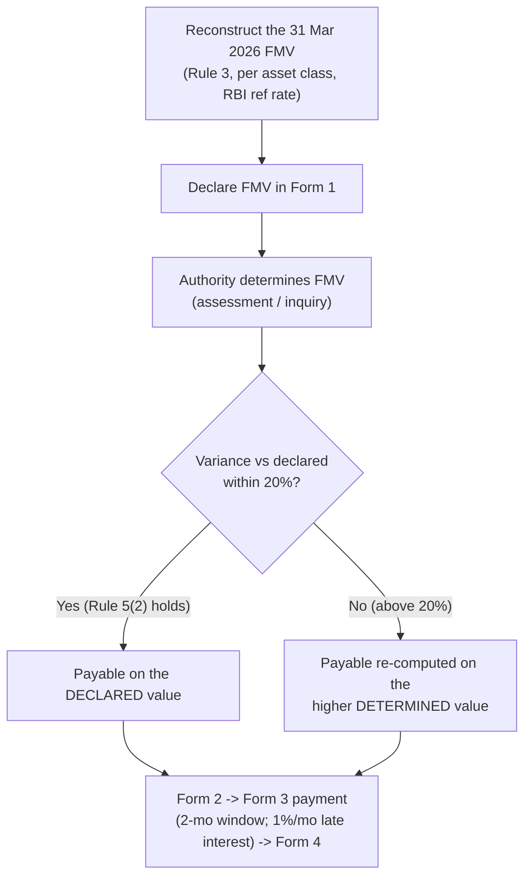

The [FAST-DS 2026 declaration article](./tax-fastds-2026-declaration.mdx) tells you *whether* to file and the *cost* (60% / flat ₹1L). The [Black Money Act exposure article](./tax-black-money-act-exposure.mdx) tells you the *counterfactual* if you do nothing. This is the operational layer both point to but do not compute: **how to actually value the asset for Form 1, and what to have in hand before you file.** A FAST-DS declaration is only as good as its valuation, and the Rules 2026 have a specific, non-obvious mechanism — the **20% valuation-variance safeguard** — that makes "value it conservatively" actively dangerous. Everything below is verified against the notified FAST-DS Rules, 2026 (G.S.R. 732(E), 14 Aug 2026) and the official FAQs; it is a due-diligence planning layer, not a Form 1 filing.

## The fixed valuation date: 31 March 2026 (and why it is not adjustable)

The first thing that surprises people: **the value you declare is *not* "the value today" and not "the value when you bought it."** The Rules fix a single valuation date for *every* asset in the scheme — **31 March 2026** (Rule 2(1)(e)). Whatever date you actually acquired, funded, or held the asset, the fair market value (FMV) you compute is the FMV **as on 31 March 2026**. This is deliberate: it pins the scheme to one cross-sectional date so the ₹1 cr / ₹5 cr ceilings have a consistent reference. The corollary is that a stale number ("I remember it being worth ₹X a few years ago") is *wrong by definition* — you must reconstruct the 31-March-2026 value, even for an account that has been dormant. [src-fastds-rules-valuation-2026]

## Rule 3: the per-asset-class FMV method (the one most people skip)

Valuation is **not** a single "look up the market rate" step. **Rule 3 prescribes a different mechanism for each asset class**, all as on 31 March 2026:

| Asset class | Rule 3 clause | The FMV method |
|---|---|---|
| Bullion, jewellery, precious stones | 3(1)(a) | The prescribed method for precious metals/stones |
| Artistic works | 3(1)(b) | The prescribed method for artworks |
| Quoted shares & securities | 3(1)(c)(i) | The quoted (market) value of the holding |
| Unquoted equity shares | 3(1)(c)(ii) | The unquoted-equity valuation method |
| Other unquoted shares/securities | 3(1)(c)(iii) | The prescribed unquoted-security method |
| Immovable property | 3(1)(d) | The prescribed property-valuation method |
| **Foreign bank accounts** | **3(1)(e)** | **The sum of deposits from the account's opening to 31 Mar 2026, with specific treatment for redeposits arising from withdrawals** |
| Partnership / AOP / LLP interests | 3(1)(f) | The prescribed interest-valuation method |
| Other assets | 3(1)(g) | The residual method |

Two subtleties that change the number:

- **For a bank account, Rule 3(1)(e) is the *accumulated-deposit* method, not the closing balance.** It looks at the *sum of deposits from opening to 31 March 2026* (with specific treatment for redeposits that arise from your own withdrawals). A dormant account that you *kept topping up* has a much larger Rule 3 value than its current balance suggests — which is exactly why the "it's just a small forgotten account" instinct under-values most bank-account cases.
- **The fallback is the indexed cost of acquisition.** Where valuation is not otherwise carried out in the specified circumstances, **the indexed cost of acquisition is *deemed* to be the FMV** (Rule 3(2)/(3), which also cover assets transferred *before* the valuation date and assets acquired from the proceeds of another asset or a bank-account withdrawal). This matters: if you genuinely cannot establish a market FMV for an unquoted holding, your declared value defaults to the *indexed* cost — which, for a long-held asset, is the conservative (often low) number, and is what the 20% safeguard below then protects.

## Currency conversion: the RBI reference rate (Rule 3(4)/(5))

A foreign asset is denominated in a foreign currency; the scheme is priced in rupees. **Rule 3(4)/(5) prescribe the conversion, and it is not the rate your broker quoted you:**

- An asset in a **permitted currency** is converted to INR using the **RBI reference rate on the valuation date** (31 March 2026).
- An asset in **any other currency** is converted by a **two-stage route through USD**: the prescribed foreign-country rate to USD, then the RBI reference rate from USD to INR.

The practical risk is the same as the "stale number" risk: using a *convenient* spot rate (say, today's) instead of the **31-March-2026 RBI reference rate** moves your declared FMV off the Rules' value, and that is precisely the variance the next section tests.

## The 20% valuation-variance safeguard (the trap)

This is the single most non-obvious mechanism in the whole scheme, and it is in **Rule 5(2)**:

> If the FMV you declared in Form 1 **differs from the FMV the authority later determines** (on assessment or inquiry), your declaration is **not treated as invalid** *provided the variance does not exceed 20% of the FMV you declared.*

Read that carefully. The safeguard protects you from a **small** valuation error — a ±20% slip keeps the declaration valid on the value you declared. But it is a **one-sided, value-upward** protection in practice: if the authority's determined FMV is *higher* than your declared one, and the gap is *more* than 20% of your declared value, **the charge is re-computed on the higher (determined) FMV, and your payable rises with it.** The asymmetry that bites:

- **Declared ₹40L, determined ₹48L** → variance = ₹8L ÷ ₹40L = **20%** (inclusive) → **the safeguard holds**; you pay on ₹40L.
- **Declared ₹40L, determined ₹50L** → variance = ₹10L ÷ ₹40L = **25%** → **the safeguard fails**; you pay 60% of **₹50L**, not ₹40L.

So "I'll just declare a bit less and the 20% covers it" is a trap: the 20% is measured against *your declared* value, which means the room to under-declare is *very* small, and **undervaluing the asset is where the risk lives.** The safe posture is to value the asset *upward* (or at the true FMV) so that any later authority determination is *at or below* your declared value — in which case the payable does not rise. The **fast-ds-valuation-guard calculator** computes the variance, whether the safeguard holds, the payable that actually applies, and the late-payment interest, for your declared vs determined values.

**Alt text:** Value the asset at the 31 March 2026 FMV (Rule 3 + RBI reference rate) and declare it in Form 1. When the authority determines the FMV, the 20% Rule-5(2) safeguard keeps the payable on the *declared* value only if the variance is within 20% of what you declared; above that, the payable re-computes on the *higher determined* value. Both paths then run through Form 2 (determination) → Form 3 (payment, 1%/month late interest) → Form 4 (certification).

## The document checklist (what Form 1 actually needs)

FAST-DS "rewards documentation, not just disclosure" — a declaration without the supporting record is the one that gets re-valued up. For a Form 1 + the annexures, have **before** you file:

- **The asset inventory** — every foreign account, holding, property, and any foreign-source income, with opening/closing dates. (The account is not "irrelevant because dormant" — the Rule 3 value is the *accumulated deposit* to 31 Mar 2026, not the current balance.)
- **Statements / records for the 31 Mar 2026 value** — bank statements through 31 March 2026 for the Rule 3(1)(e) bank-account method; the relevant market/broker value for quoted securities (3(1)(c)(i)); the prescribed valuation for property (3(1)(d)) and unquoted holdings (3(1)(c)(ii)/(iii)); acquisition records for the indexed-cost fallback.
- **The currency-conversion basis** — the RBI reference rate on 31 March 2026 (permitted currency) or the two-stage USD route (other currency), so your INR figure is defensible under Rule 3(4)/(5).
- **The source-of-funds / tax-history record** — to settle *Track A vs Track B* (the 60%-vs-₹1L decision): was this asset's value built from income *never offered to tax* (Track A), or from income *already taxed* / acquired during *non-residence* but just missed from Schedule FA (Track B)? This is the document that decides a 30× cost difference.
- **Your residential-status record** — for the years the income arose / the asset was acquired (the RNOR/returning-NRI eligibility route depends on it).
- **The Forms 1 → 2 → 3 → 4 sequence and timings** — Form 1 (declaration + the separately-captured Track A and Track B computations) → Form 2 (the determination order from the Principal / DGIT (Systems)) → **Form 3 (payment within 2 months of receipt of Form 2; 1% interest per month or part thereafter; part payments are recognised)** → Form 4 (final certification that the declaration is valid for Section 139 and confers the prescribed immunity).

## When the asset is even eligible (the pre-valuation gate)

Valuation is *after* eligibility; get the gate first or the number is irrelevant:

- **The value must be within the track ceiling** — Track A aggregate at or under ₹1 cr; Track B at or under ₹5 cr. (Above it, the scheme cannot be used for that asset.)
- **The asset must not be proceeds of crime**, and **no Black Money Act assessment may already be complete** for the relevant year — those are excluded.
- **The scheme is *taxpayer-specific*** — a company, LLP, firm or trust **cannot** use FAST-DS for an *employee's* foreign asset; the individual files it.
- **Residential-status conditions** must be met for the relevant year (the returning-NRI / RNOR route).

## What the immunity does NOT cover (the honest limit)

A valid FAST-DS declaration + payment gives **immunity from further tax, penalty and prosecution under the Black Money Act, 2015, for the specific asset/income declared.** It is *not* a universal clean slate:

- **It does NOT settle FEMA / exchange-control exposure.** Tax regularisation and exchange-control regularisation are *separate* exercises; a FAST-DS declaration regularises the *tax/BMA* side and can leave an independent FEMA question open. (This is the most quietly important limit for a cross-border position.)
- **It does NOT replace Schedule FA going forward.** FAST-DS regularises the *past*; the *ongoing* obligation to report foreign assets in Schedule FA each year continues unchanged.
- **The immunity is asset/income-specific** — only for what you actually declared.
- **The 20% safeguard is not a licence to undervalue** — above 20% the payable re-computes on the higher determined value (Section above), and the department's discretion under the "may" wording of the BMA (the ITAT Special Bench read it as *directory*) is not a planning input.

## A worked valuation example: the ₹40L bank account

Assume a foreign bank account; you declare a 31-March-2026 FMV of **₹40,00,000** (the Rule 3(1)(e) accumulated-deposit figure, converted at the 31-Mar-2026 RBI reference rate) in **Track A** (the deposits came from salary never offered to tax), and you have *no* late payment.

| Quantity | Figure | Reading |
|---|---|---|
| Declared FMV | ₹40L | your Form 1 figure |
| If determined = ₹40L (variance 0%) | safeguard **holds** | payable = 60% × ₹40L = **₹24L** |
| If determined = ₹48L (variance 20%) | safeguard **holds** (inclusive) | payable still on ₹40L = **₹24L** |
| If determined = ₹50L (variance 25%) | safeguard **fails** | payable re-computes = 60% × ₹50L = **₹30L** |
| 1 month late on a ₹24L payable | + ₹24,000 | 1% × ₹24L |

The **fast-ds-valuation-guard calculator** runs this table on your exact declared/determined pair, the track, and the late-payment months — and shows the *upward* risk (declare too low and the payable steps up at 25% variance) that the 20% safeguard does *not* remove.

## What to do now (the due-diligence order)

1. **Gate first:** is the asset within a FAST-DS ceiling, not proceeds of crime, and not already BMA-assessed? (Above — the pre-valuation gate.)
2. **Fix the source-of-funds fact:** Track A (never taxed) vs Track B (taxed-elsewhere / non-resident, missed Schedule FA) — this is the 60%-vs-₹1L lever and the document that decides it.
3. **Reconstruct the 31 March 2026 FMV** using the *correct* Rule 3 method for the asset class (the accumulated-deposit rule for bank accounts is the one most often wronged) and the RBI reference rate.
4. **Value it upward, not down:** declare at or above the true FMV so the 20% safeguard protects *downward* variance only — undervaluing is where the payable rises.
5. **Assemble the document checklist** (statements through 31 Mar 2026, conversion basis, source-of-funds record, residential-status record).
6. **Run the [fast-ds-valuation-guard calculator](/calculators/fast-ds-valuation-guard)** for the variance, the payable that applies, and the late-interest cost.
7. **File Form 1 well before 31 December 2026** and pay Form 3 within 2 months of Form 2 to avoid the 1%/month interest.
8. **Reconcile with a CA and check the FEMA question separately** — a FAST-DS declaration is not a FEMA safe harbour.

## The one-line verdict

A FAST-DS 2026 declaration lives or dies on **valuation, not disclosure**: the value is the **31 March 2026 FMV** computed by the **asset-class-specific Rule 3 method** (the accumulated-deposit rule for bank accounts is the most-misread one) converted at the **RBI reference rate**, and it is protected only by a **20% Rule-5(2) variance safeguard that is measured against *your declared* value** — so undervaluing is the active risk, because above 20% variance the payable **re-computes on the higher determined FMV** and the 1%/month late interest can stack on top. Value *upward*, gate on Track A vs Track B (the 60%-vs-₹1L lever), keep the document checklist in hand, file before 31 December, and remember the immunity regularises the *tax/BMA* side but **does not settle FEMA**. The **fast-ds-valuation-guard calculator** runs all of that on your exact numbers.

## Update log

- **2026-10-18 (Wave 27):** created. Verified against the notified FAST-DS Rules, 2026 (G.S.R. 732(E), 14 Aug 2026; in force 16 Aug; last date 31 Dec 2026) and the official FAQs: the fixed 31 Mar 2026 valuation date (Rule 2(1)(e)); the Rule 3 per-asset-class FMV methods (including the Rule 3(1)(e) bank-account accumulated-deposit method and the indexed-cost deemed-FMV fallback) + the Rule 3(4)/(5) RBI-reference-rate / two-stage-USD currency conversion; the **Rule 5(2) 20% valuation-variance safeguard** (the declaration stands on the declared value only while the variance is within 20% of it; above that the charge re-computes on the higher determined value); the four-form chain (Forms 1–2–3–4, Rules 5–8, before the Principal / DGIT (Systems)) + the **1%/month late-payment interest** (Rule 7); and the limited immunity (regularises tax / BMA exposure but does NOT settle FEMA and does not replace ongoing Schedule FA).
- **Review by 2027-01-31 (hard):** re-verify the 20% safeguard, the Rule 3 methods, and the window at the FY 2027-28 Budget / a successor notification — this layer is only actionable while the FAST-DS window (31 Dec 2026) is open or a successor is confirmed.

## Sources

- `src-fastds-rules-valuation-2026` — the FAST-DS Rules 2026 valuation + due-diligence source: the G.S.R. 732(E) 14 Aug 2026 notification, the 31 Mar 2026 valuation date, the Rule 3 per-asset-class methods + currency conversion, the Rule 5(2) 20% safeguard, the four-form chain + 1%/month late interest, and the limited (non-FEMA) immunity.
- `src-us-stock-tax-india-2026` — the FAST-DS two-category / ceiling structure (Track A ₹1 cr / Track B ₹5 cr) that the valuation layer prices, and the Schedule FA / Black Money Act context.
- `src-it-slab-fy2026-27` — the FY 2026-27 context for why the 60% / flat-₹1L defined costs and the 120% BMA counterfactual are priced the way they are.

## Related

- [FAST-DS 2026 Declaration (the defined-cost + category layer this page prices)](/articles/tax-fastds-2026-declaration)
- [Black Money Act Exposure (the counterfactual this valuation protects against)](/articles/tax-black-money-act-exposure)
- [Direct LRS US-Equity Filing Walkthrough (the routine Schedule FA layer)](/articles/tax-direct-lrs-us-equity-filing-walkthrough)
- [The Complete Indian Investor Tax Guide](/articles/tax-india-investor-complete)
- The **fast-ds-valuation-guard** calculator — run your declared vs determined FMV through the 20% safeguard, the payable, and the late-interest cost.
