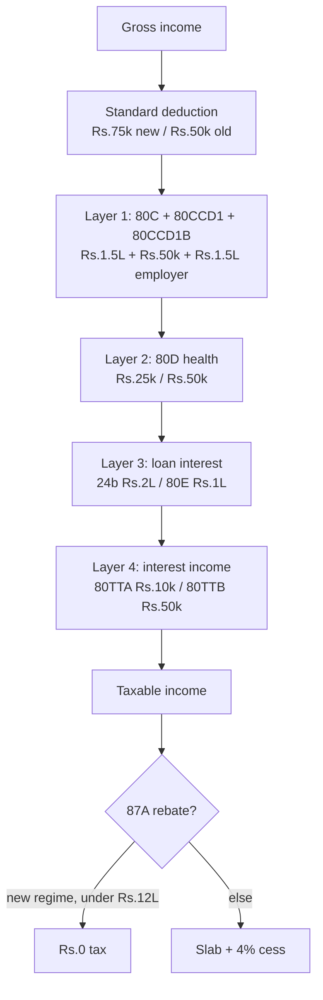

Most Indian investors pick tax-saving instruments one at a time, driven by whichever one an advisor mentioned first. The better approach is to see the whole stack at once: every layer has its own limit, its own instrument pool, and its own exit tax, and the layers stack *additively* before they hit a slippage into the wrong slab. This article lays out the complete FY 2026-27 stack — what qualifies, what the limit is, what the exit cost is — and then works one full example end-to-end, including the new-regime-vs-old-regime break-even that decides whether the stack earns its keep at all.

## The stack at a glance

Three things control everything downstream:

1. **The stack is an old-regime device.** Under the new (default) regime, Chapter VI-A deductions — 80C, 80CCD(1B), 80D, 80E, 80G, 80TTB — are *not available* (`src-it-slab-fy2026-27`, `src-eldeductions-fy2026-27`). The exceptions that do survive in the new regime are the employer NPS contribution under 80CCD(2) (up to 14% of salary), let-out property interest under 24(b), the Agniveer corpus, and gratuity/leave-encashment exemptions. So before building any stack, run the break-even test below; a ₹10L-income taxpayer usually does *not* need it.
2. **Each layer has a hard limit.** 80C caps at ₹1.5L across all instruments *combined*; 80CCD(1B) is a separate ₹50,000; 80D is ₹50,000 (₹1L for senior citizen parents); loan interest layers are ₹2L / ₹1L. Unused capacity in one layer does not flow to the next.
3. **Exit tax is the other half of the benefit.** A PPF that saves you 30% on entry returns tax-free at exit; an NPS saves you 30% on entry but forces a 40% annuity component whose pension is taxed for life; an ELSS saves 30% on entry but the gains are 12.5% above ₹1.25L at exit. The net value of every instrument is entry benefit minus exit cost.

## Layer 1 — the 80C bucket (₹1.5L, old regime only)

Everything below shares *one* ₹1.5L ceiling per individual (the family does not multiply it, except via HUF — see [HUF Wealth Structure](./tax-huf-wealth-structure.mdx)):

| Instrument | Limit within 80C | Lock-in | Exit tax on income/gains | What actually makes it worth it |
|---|---|---|---|---|
| PPF | ₹1.5L/yr | 15 yrs | **Nil** (EEE) | 7.1% p.a. FY 2025-26, sovereign-backed, fully tax-free at every stage; the best *risk-free* use of 80C for anyone under 40 |
| ELSS mutual fund | ₹1.5L/yr | 3 yrs | LTCG 12.5% above ₹1.25L (shared with all equity gains, `src-elss-ltcg-2026`) | Shortest lock-in in the bucket; the 3-year staggered lock-in per SIP instalment; highest-growth use of 80C |
| SSY | ₹1.5L/yr | to 21 from opening | **Nil** | 8.2% p.a., tax-free including maturity; only for a girl child up to age 10 — for that child it beats PPF on both rate and tax |
| NSC | ₹1.5L/yr | 5 yrs | Interest taxed at slab (except last year) | 7.7% p.a.; the annual "deemed reinvestment" lets next year's accrued interest qualify as fresh 80C — a compounding tax trick |
| Tax-saver FD (5-yr) | ₹1.5L/yr | 5 yrs | Interest at slab every year | Locks a 6–7% coupon in a falling-rate world; *no* tax-free status, so the 80C benefit is entry-only |
| EPF (own contribution above 12%) | up to ₹1.5L | until retirement | tax-free for 5+ years of service | The 12% employer portion is exempt separately; extra self-contribution beyond 12% fills 80C at ~8.25% (FY 2025-26 EPF rate, verified elsewhere on this site) |
| Life-insurance premium | ₹1.5L/yr | policy term | maturity tax-free if premium under ₹2.5L/yr and sum assured at least 10x premium | Term policies are the *efficient* form: pure protection, premium well inside 80C |
| Home-loan principal | amount paid | none (loan life) | none (principal is your asset) | The only 80C item with no instrument limit of its own; stamp duty on purchase year also counts |
| NPS Tier-I own (80CCD(1)) | ₹1.5L/yr | to 60 | partial (below) | Low-cost retirement corpus; the *distinct* 80CCD(1B) part is the point of using NPS |
| Tuition fees | up to 2 children | none | none | full-time education, India or abroad (verify current eligibility text) |

**The one-line rule:** PPF/SSY/NSC give tax-free or near-free *income*; ELSS and tax-saver FDs give tax on *gains*; life insurance and home-loan principal give *no tax at exit at all* because they aren't income-producing in the first place. If your marginal rate is 20–30% and you have a 15-year horizon, PPF and SSY are the highest net-value uses of 80C. If the horizon is under 5 years, ELSS is the only 80C instrument that unlocks.

## Layer 2 — NPS: the ₹2L route and the December 2025 exit change

NPS is the only retirement instrument with *three* separate tax levers (`src-nps-deductions-2026`):

- **80CCD(1)** — your own contribution, *inside* the ₹1.5L 80C cap (old regime).
- **80CCD(1B)** — an *additional* ₹50,000 over and above the cap, old regime only. Since FY 2025-26, the same ₹50,000 also covers contributions to a **minor child's NPS Vatsalya** account (a parent chooses: own NPS *or* the child's, not both, within the single limit).
- **80CCD(2)** — employer contribution, up to 14% of Basic+DA in the new regime (raised from 10% for private-sector employees effective FY 2025-26), available in **both** regimes, and separately capped: combined employer contribution to EPF + NPS + superannuation is exempt up to ₹7.5L a year; anything above is taxable.

The exit side changed on 16 December 2025 (`src-nps-2025-exit`, PFRDA amendment): non-government subscribers can now withdraw **80% of the corpus as lump sum** with only **20% going into the mandatory annuity** (previously 60/40), deferment is extended to age 85, and a corpus under ₹8 lakh can be taken out 100% as lump sum. **The subtlety that secondary summaries miss:** the *allowance* to withdraw 80% is a PFRDA rule; the *tax exemption* under Section 10(12A) still exempts only 60% of the corpus. If you take the extra 20% lump sum, that slice is taxable at your slab. Plan the final exit as: 60% tax-free lump sum + 20% more lump sum at slab rate + 20% annuity (pension taxed for life), and pick the annuity provider on price (Pension Fund Regulator's annuity price tables, or the insurance company route).

Partial withdrawals remain available from year 3 (up to 25% of own contribution, once, for approved purposes). And the equity allocation is no longer effectively capped: the December 2025 amendment allows up to 100% equity option for the growth allocation.

**Who is NPS *not* for?** A new-regime taxpayer who gets no employer NPS contribution: you lock money to 60 for a deduction you cannot claim. The math only works under the old regime, or when your employer is *already* contributing (then it is a free tax-free wrapper in both regimes).

## Layer 3 — loan interest (24(b), 80E, 80EEA/80EEB status)

- **24(b)** — home-loan interest: ₹2L/yr cap on *self-occupied* property (old regime only; for let-out property there is **no cap** and it works in *both* regimes). Pre-construction interest spreads over 5 equal instalments from the year construction completes.
- **80E** — education-loan interest: up to ₹1L/yr for 8 consecutive years (or until the loan is repaid), old regime. No cap means a ₹25L engineering loan at ~10% generates ₹2–2.5L of annual interest, of which ₹1L is deductible — the most underused deduction in the code for salaried families.
- **80EEA / 80EEB** — the affordable-housing and EV-loan extra ₹1.5L deductions: both windows are **closed for new loans** (80EEA sanction window ended 31 Mar 2022; 80EEB ended 31 Mar 2023). Existing eligible borrowers continue to claim; nobody new can. (`src-eldeductions-fy2026-27` lists the closed windows.)

## Layer 4 — interest income: 80TTB, 80TTA, and the tax-free interest pool

Deposit and scheme interest is the biggest *post-stack* leak for the ₹10L+ saver, because it is income at your full slab rate every year. Four tools:

1. **80TTA** — savings-account interest deduction, up to ₹10,000/yr, non-seniors only, old regime.
2. **80TTB** — interest on bank/post-office/co-op deposits (savings, FD, RD, SCSS, NSC) deductible up to **₹50,000/yr** for resident senior citizens (60+), old regime. *Note:* Budget 2026 coverage (BasuNivesh, Mar 2026) reports the 80TTB cap raised to **₹1L** for FY 2026-27 with the TDS threshold for seniors also doubled — this is a secondary-report claim; verify against the Income Tax Department's portal before filing AY 2026-27 (`src-eldeductions-fy2026-27`, flagged "verify").
3. **Tax-free interest pool** — PPF (7.1%), SSY (8.2%), Sovereign Gold Bonds (coupon tax-free, gains tax-free after 3 years, `src-sgb-discontinued` notes the *issuance* of SGBs stopped in April 2024 but outstanding bonds continue to pay tax-free), and tax-free municipal-bond interest (verify current issue list) — these need no deduction at all because the income itself is exempt.
4. **SCSS** — 8.2% for 60+, ₹30L cap (`src-scss-8-2`); interest is *taxed* but 80TTB absorbs up to ₹50,000 (₹8.2% x ₹30L = ₹2.46L interest — so 80TTB only shields the slice, and the excess is at slab).

**The sequencing rule:** before buying any taxed-interest product (FD, tax-saver FD, SCSS, NCD — see [NBFC Debenture Underwriting](../fixed-income/fixed-income-nbfc-debentures.mdx)), first fill the tax-free pool (PPF, SSY, SGBs, tax-free bonds). A ₹1L PPF at 7.1% is worth ₹7,100 *in your hand*; a ₹1L FD at 6.5% in the 30% slab is worth ₹4,550. The tax asymmetry beats the 50bp rate gap, which is why "PPF vs FD" is not a fair 7.1 vs 6.5 comparison.

## Worked example: the full stack for a ₹18L-income taxpayer (old regime)

Assumptions: 35-year-old salaried, gross ₹18L, old regime, family of two, no house yet, a 9-year-old girl child. (All figures rounded; verify your own numbers against the latest slab table.)

| Layer | Instrument | Amount | Notes |
|---|---|---|---|
| 80C pool (cap ₹1.5L) | PPF | ₹60,000 | tax-free ~7.1%, 15-yr clock starts |
| 80C pool | ELSS | ₹50,000 | 3-yr lock-in, highest-growth use |
| 80C pool | SSY | ₹30,000 | 8.2% tax-free, girl child under 10 |
| 80CCD(1B) | NPS Tier-I | ₹50,000 | *over and above* the 80C cap |
| 80D | Family health + parents | ₹30,000 | preventive check-up included |
| Total deductible | | ₹1,80,000 | the 80C items fit under the ₹1.5L cap; NPS and 80D add on top |
| Standard deduction | | ₹50,000 | old regime |

Pre-deduction income: ₹18,00,000. Post-deductions: ₹18L − ₹1.8L − ₹50k standard = ₹15,70,000. Old-regime tax on ₹15.7L (nil to ₹2.5L, 5% to ₹5L, 20% to ₹10L, 30% above) = 12,500 + 1,00,000 + 1,61,000 = ₹2,73,500; with 4% cess ≈ **₹2.84L**, versus ₹3,37,500 + cess ≈ **₹3.51L** without the stack. The stack saves about **₹72,000** — every rupee of it is worth 30 paise plus cess, because the whole deduction slice from ₹15.7L up to ₹17.5L sits in the 30% band. Note the arithmetic trap: the 80C items are capped at ₹1.5L, so "invest ₹1.6L in PPF/ELSS/SSY" does *not* buy ₹1.6L of deduction — the extra ₹10k buys nothing. And the older 5/10/15% intermediate slabs found in some pre-2013 references no longer exist; the old regime today has just four bands. At a 5% marginal slab (taxable income under ₹5L), the same stack saves under ₹12,000 and the new regime almost certainly wins.

**ELSS exit check:** the ₹40,000 ELSS bought in FY 2026-27 (at the same notional return the PPF earns for comparison, say a 12% CAGR) becomes ₹57,700+ in three years; the ~₹17,000+ gain is under the ₹1.25L annual exemption shared with all equity gains (`src-elss-ltcg-2026`) — so at this scale, ELSS exit cost is *zero*, and the entire 20% entry saving is pure gain. At ₹1.5L/yr forever, gains eventually cross ₹1.25L/yr and the 12.5% tax starts biting; that is the point to re-balance ELSS into plain index funds (which have no 80C entry benefit but the *same* exit treatment).

## The break-even: when the old regime wins

The new regime's advantage is not deductions — it is *lower slabs* (nil to ₹4L, stepping to 30% above ₹24L) plus the ₹75,000 standard deduction (`src-it-slab-fy2026-27`). The decision is mechanical:

**Run both computations** (new-regime tax on gross − 75k standard; old-regime tax on gross − 50k standard − all deductions) and pick the lower. As a rule of thumb (illustrative, not a substitute for the computation): a salaried taxpayer whose total available deductions (80C + 80CCD(1B) + 80D + loan interest) is under roughly **₹3.5–4L** usually lands in the new regime; above that, the old regime's slab depth typically wins. The *only* new-regime NPS benefit is the employer's 80CCD(2) — if your employer already contributes to NPS, ask HR to maximise that slice within the ₹7.5L combined cap; it reduces your tax under *both* regimes without any extra money from you.

The [Tax Shield calculator](/calculators/tax-shield) runs exactly this comparison on your own numbers.

## Common mistakes that destroy the stack

1. **Buying a ULIP "for the 80C benefit."** The 80C deduction on the premium is real, but the fund charges 2–5% per year in loads and fund expenses, and the 5-year lock-in plus exit charges make ULIPs structurally worse than a term plan *plus* an index SIP (worked out in [Insurance Claims, ULIPs & Mis-selling](../insurance/insurance-claims-ulip-mis-selling.mdx)). The same 80C money goes further in an ELSS.
2. **Letting 80C capacity go unused in March.** The ₹1.5L cap is *annual*, not one-time — the March 2026 ELSS/PPF purchase does not buy you a deduction for April 2026. Set the stack in by January and hold it.
3. **NSC interest booked as "investment" instead of income.** The deemed-reinvestment trick works, but the interest is still slab-rate income except the final year; model it, don't assume it is tax-free.
4. **NPS as a tax play in the new regime.** No employer contribution, new regime, NPS chosen purely for the ₹50,000: the deduction does not exist, and you just gave up 20+ years of liquidity for nothing. The only new-regime NPS value is the employer's 80CCD(2) slice.
5. **Forgetting the shared LTCG bucket.** The ₹1.25L annual exemption is *one bucket across all equity*: listed shares, equity funds, ELSS, REIT/InvIT units (`src-reit-invit-tax-2026`), and foreign equity gains all stack into it. A big equity sale in the year you also redeem ELSS can push the combined gains over the exemption.
6. **Stacking without insurance.** A ₹2L family health cover and a 20x-income term plan cost under ₹60,000/yr; without them, the 80D and term-premium lines of the stack are the only layer protecting the family, and everything above is just tax arithmetic on money that could vanish under one hospital bill.

## The stack as a habit, not a March scramble

The difference between "filed a tax-saving ITR" and "built a tax-efficient wealth stack" is that the stack has *time asymmetry*: PPF/SSY/ELSS compounding starts on the first rupee, not on the first assessment year. The minimum viable version for a ₹10L-income, 30-year-old, old-regime taxpayer is:

- **Fixed, monthly:** PPF ₹8,000/mo (₹96k/yr) + ELSS ₹4,000/mo (₹48k/yr, SIP so the 3-year lock-in staggers), term + health premiums billed monthly.
- **Fixed, yearly:** 80CCD(1B) ₹50,000 NPS (January), NSC/SSY top-ups, 80D balance before 31 March.
- **Quarterly check:** AIS (Annual Information Statement) against bank/demat statements — TDS on REIT distributions, NCD coupons, and rental income all land in the AIS, and the stack's value is destroyed by an income line nobody noticed (`src-reit-invit-tax-2026` has the component-level filing guide).
- **Annual:** re-run the regime break-even, re-price the NPS annuity at 60, and decide whether the ELSS bucket has outgrown its 80C job.

## Related

- [Indian Taxation for Investors](./tax-india-investor-complete.mdx) — the slab and capital-gains substrate this stack sits on.
- [HUF Wealth Structure](./tax-huf-wealth-structure.mdx) — the second *entity* that multiplies the stack's capacity legally.
- [Small Savings Schemes](../government-schemes/govt-small-savings-schemes.mdx) — the tax-free pool (PPF, SSY, NSC, SCSS, SGBs) in detail.
- [Your 10 Lakh Wealth Plan](../personal-finance/pf-wealth-plan-10-lakh.mdx) — where the stack's fixed lines live inside a real monthly plan.

## Sources

- `src-it-80c-150k` — Section 80C limit ₹1.5L, old regime only.
- `src-nps-2025-exit` — PFRDA (Exits and Withdrawals under NPS) (Amendment) Regulations, 16 Dec 2025: 80% lump sum / 20% annuity allowance, deferment to 85, ₹8L full-withdrawal threshold; Section 10(12A) tax exemption remains 60% (corroborated by PFRDA press release 19 Dec 2025).
- `src-nps-deductions-2026` — 80CCD(1)/(1B)/(2) structure: ₹50,000 extra under 1B (old regime, incl. Vatsalya from FY 2025-26), employer 14% both regimes, ₹7.5L combined employer cap.
- `src-elss-ltcg-2026` — ELSS 3-year lock-in, 80C ₹1.5L, LTCG 12.5% above ₹1.25L shared across equity gains; new regime: no deduction.
- `src-eldeductions-fy2026-27` — FY 2026-27 deduction list: 80TTB reported hike to ₹1L (verify against Income Tax portal), 80EEA/80EEB windows closed, Income Tax Act 2025 renumbering (80C → 123 etc.).
- `src-it-slab-fy2026-27` — FY 2026-27 new-regime slabs (nil to ₹4L … 30% above ₹24L), 87A ₹12L, ₹75k standard deduction.
- `src-sgb-discontinued` — SGB issuance stopped April 2024; outstanding bonds keep paying tax-free coupon, gains tax-free after 3 years.
- `src-scss-8-2` — SCSS 8.2%, ₹30L cap, 60+.

## Update log

- 2026-10-17: Verified 80CCD(1B) Vatsalya inclusion, NPS 14% employer both-regime rule, PFRDA 16 Dec 2025 80/20 exit amendment and its Section 10(12A) 60%-exemption gap, ELSS 12.5%-above-₹1.25L shared bucket.
- 2026-10-17: 80TTB "raised to ₹1L in Budget 2026" is a secondary-report claim (`src-eldeductions-fy2026-27`); the Income Tax Department's threshold page still shows ₹50,000 — kept as flagged pending official confirmation.
- 2027-04-01: Scheduled re-verification at next Budget: 80C cap, 80CCD(1B) limit, 87A threshold, 80TTB limit, and the regime break-even slabs.
